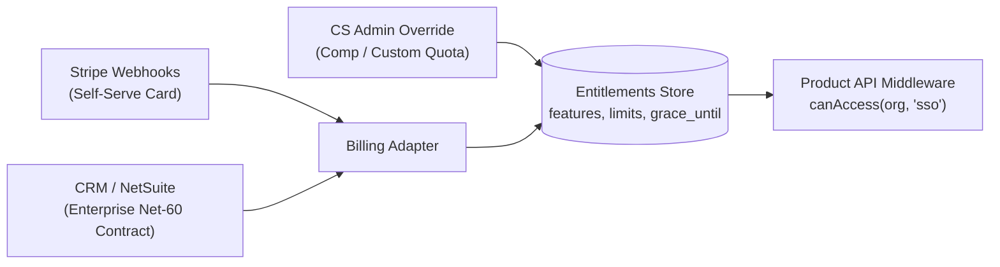
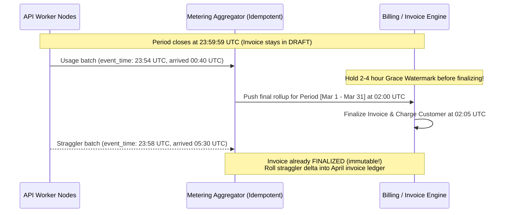

# Subscription & Billing

## What Is It?

Subscription billing is recurring revenue — customers pay on a regular schedule (monthly, yearly) for ongoing access to your product or service. Think Netflix, Spotify, SaaS tools like Slack or Notion. As a developer, you're building the plan selection, payment collection, and the logic that decides what happens when a payment fails, a customer upgrades, or a trial expires.

## Why Should You Care?

Subscriptions are the dominant business model for modern SaaS. Most of the web apps you'll build for companies will have some form of recurring billing. The business logic is deceptively complex — proration, dunning, plan changes mid-cycle, tax calculations, and free trials all have subtle edge cases that can cost real money if you get them wrong.

## How It Works (The Business Flow)

### Signing Up

1. User picks a plan (Free, Pro, Enterprise)
2. User enters payment method (credit card, usually)
3. System creates a subscription with the payment gateway (Stripe, etc.)
4. First payment is charged immediately (or after trial period)
5. User gets access to the features included in their plan

### The Billing Cycle

1. On each billing date, the gateway automatically charges the customer
2. If successful → invoice generated → receipt emailed → subscription stays active
3. If failed → retry logic kicks in (see "Dunning" below)
4. Gateway sends a webhook to your server for every event (payment succeeded, failed, etc.)

### Plan Changes (Upgrades / Downgrades)

**Upgrading mid-cycle (e.g., Basic → Pro):**

1. Customer clicks "Upgrade"
2. System calculates proration: "You've used 15 days of your Basic plan. Here's the credit. The Pro plan costs X more."
3. Customer is charged the prorated difference immediately (or on next invoice)
4. Access to Pro features is granted right away

**Downgrading:**

1. Customer clicks "Downgrade"
2. Usually takes effect at the end of the current billing period (so they keep access until they've paid for)
3. Next invoice reflects the lower plan price

### Free Trials

1. User signs up for a trial (7 days, 14 days, 30 days)
2. Some trials require a credit card upfront, some don't
3. During trial, user has full (or limited) access
4. When trial ends: if card is on file → auto-charge and start subscription. If no card → account is downgraded or locked
5. Send reminder emails before trial expires (3 days out, 1 day out)

### Cancellation

1. Customer clicks "Cancel"
2. Two options:
   - **Cancel at period end**: Keep access until the current period expires, then stop billing
   - **Cancel immediately**: Stop access and billing now, possibly with a prorated refund
3. Most SaaS companies use "cancel at period end" — it's less jarring and sometimes customers come back before the period ends

### Dunning (Failed Payment Recovery)

1. Payment fails (expired card, insufficient funds)
2. System retries automatically (typically: retry after 3 days, 5 days, 7 days)
3. Send email to customer: "Your payment failed, please update your card"
4. If all retries fail → subscription is paused or cancelled
5. Good dunning can recover 20-40% of failed payments

## Key Terms You'll Hear

| Term                    | What It Means                                                                                            |
| ----------------------- | -------------------------------------------------------------------------------------------------------- |
| **MRR**                 | Monthly Recurring Revenue — the holy metric for subscription businesses                                  |
| **ARR**                 | Annual Recurring Revenue — MRR × 12                                                                      |
| **Churn**               | Percentage of customers who cancel per period. 5% monthly churn = you lose half your customers in a year |
| **Proration**           | Adjusting charges when a customer changes plans mid-cycle                                                |
| **Dunning**             | The process of recovering failed payments through retries and emails                                     |
| **Seat-Based Pricing**  | Charging per user (e.g., $10/user/month). Common in B2B SaaS                                             |
| **Usage-Based Pricing** | Charging based on consumption (API calls, storage, compute hours)                                        |
| **Tiered Pricing**      | Different price per unit at different volume levels                                                      |
| **Flat-Rate Pricing**   | One price for everything. Simple but less flexible                                                       |
| **Freemium**            | Free tier with limited features + paid tiers with more. Not the same as a free trial                     |
| **Invoice**             | A formal billing document sent to the customer for each charge                                           |
| **Billing Period**      | The time between charges (monthly, quarterly, annually)                                                  |
| **Grace Period**        | Extra time given after a failed payment before cutting off access                                        |
| **Entitlements**        | What features/resources a plan includes (e.g., Pro plan gets 100GB storage)                              |
| **Coupon / Discount**   | A reduction applied to the subscription price (percentage or fixed amount, limited or ongoing)           |
| **Entitlements Engine** | An internal service decoupled from Stripe/PSP billing state that resolves feature flags and quotas from plans, trials, grace periods, and enterprise contract overrides |
| **Hard vs. Soft Decline** | Permanent card failures (`stolen_card`, `invalid_account` — never retry) vs. temporary failures (`insufficient_funds`, `issuer_unavailable` — eligible for smart dunning) |
| **Billing-Cycle Anchor** | The fixed reference day-of-month (e.g., the 31st) from which all future recurring billing dates are calculated |
| **Metering Watermark**  | The timestamp cut-off boundary separating usage events included in the current closing invoice from late-arriving telemetry rolled into the next period |
| **Credit Note**         | An accounting document that reduces or reverses the amount owed on an already-finalized invoice without mutating historical invoice records |

## Common Patterns

### Pattern 1: Plan-Based (Most Common)

Fixed plans with fixed prices. Free → Pro → Enterprise. Each plan has a defined set of features.

**When it's used:** Most SaaS products. Simple for customers to understand.

**Trade-off:** Hard to capture value from heavy users. Light users might feel overpaying.

### Pattern 2: Seat-Based

Charge per user. The more team members, the higher the bill.

**When it's used:** Collaboration tools (Slack, Notion, Jira).

**Trade-off:** Customers game the system (sharing accounts). You need to decide: what counts as a "seat"?

### Pattern 3: Usage-Based

Charge for what you use. Like a utility bill.

**When it's used:** Infrastructure (AWS), API services (Twilio), AI APIs (OpenAI).

**Trade-off:** Revenue is unpredictable. Customers may fear surprise bills. You need metering infrastructure.

### Pattern 4: Hybrid

Base plan + usage overage. "Pro plan includes 10,000 API calls. After that, $0.01 per call."

**When it's used:** The best-of-both-worlds approach. Increasingly popular.

**Trade-off:** Billing logic is the most complex. Clear communication is essential so customers understand what they'll pay.

## Gotchas & Edge Cases

- **Proration math is tricky**: If a customer upgrades from $10/month to $20/month on day 15 of a 30-day cycle, how much do you charge? ($5 credit + $10 charge = $5 net). Let your payment gateway handle this.
- **Timezone issues**: When does a billing cycle start? Midnight in which timezone? Be consistent.
- **Annual vs monthly switching**: Customer on annual plan wants to switch to monthly mid-year. Do you refund the remaining annual balance? What if they got a discount for annual?
- **Grandfathering**: When you raise prices, existing customers usually keep their old price. Your billing system needs to support this.
- **Multiple subscriptions**: Can a user have more than one active subscription? (e.g., a personal plan and a team plan). This adds complexity.
- **Tax on subscriptions**: Subscription tax rules differ by jurisdiction. Digital services are taxed differently than physical goods in many places.
- **Free trial abuse**: Users sign up for a trial, cancel, create a new account, repeat. You need device fingerprinting or card uniqueness checks.
- **Webhook reliability**: Your webhook handler must be idempotent. Stripe may send the same event multiple times.

## Industry War Stories & Non-Obvious Best Practices

### 1. Decoupling Billing State from an Internal Entitlements Engine

The single most expensive architectural mistake in SaaS is scattering `if (user.stripe_subscription_status === 'active' && user.stripe_plan === 'pro')` across 50 API endpoints.

Within six months of launch, business reality breaks that `if` statement:
- **Enterprise Wire Transfers (Net-60)**: Your biggest $120K/year customer doesn't use Stripe credit cards — they pay via quarterly ACH/wire after signing a DocuSign MSA.
- **Sales-Negotiated Custom Overrides**: An Enterprise customer buys the standard `Pro` plan ($99/mo for 10 seats) plus a custom addendum granting `max_api_keys = 50` and `sso_enabled = true`.
- **Payment Webhook Lags & Dunning Grace Periods**: When a renewal card charge fails on Friday night, `stripe_subscription_status` flips to `past_due`. If your app immediately locks out a 200-person company because the CFO's corporate card expired, you will lose the customer on Monday morning.
- **Goodwill / Comp Extensions**: Customer Support needs to grant 14 days of free Pro access to apologize for an outage without touching Stripe's billing ledger.

**Production Pattern**: Product code **never** queries billing tables or PSP concepts. Product code calls an internal **Entitlements Engine** (`entitlements.check(org_id, 'max_seats')`), which evaluates an effective snapshot combining:
1. Base Plan Catalog (`plan_id = 'pro'`)
2. Per-Org Overrides (`override_json = {"sso": true, "max_seats": 25}`)
3. Access Window (`active_until` or `grace_period_until > now()`, giving `past_due` accounts a 7–14 day bannered grace window before hard-locking features).

### 2. Smart Dunning: Hard vs. Soft Decline Classification & Card-Network Retry Fines

Naive dunning cron jobs retry every failed subscription invoice on a fixed schedule (Day +1, +3, +5, +7, +14). **Doing this blindly violates Visa and Mastercard network rules and gets your merchant account fined.**

Card networks classify decline codes (ISO 8583 / PSP decline codes) into two strict categories:

| Decline Category | Example Codes | Card Network Rule & Retry Strategy |
| ---------------- | ------------- | ---------------------------------- |
| **Hard Decline (Permanent)** | `stolen_card`, `lost_card`, `invalid_account_number`, `pickup_card`, `transaction_not_permitted` | **0 Retries Allowed.** Immediately halt automatic billing, mark payment method invalid, and email user to add a new card. Retrying hard declines triggers Visa/MC **"Misuse of Authorization System"** fines ($0.10–$1.00+ per retry after limit). |
| **Soft Decline (Temporary)** | `insufficient_funds`, `exceeds_withdrawal_limit`, `do_not_honor` (generic), `issuer_unavailable` | **Smart Dunning Eligible** (max **15 retries over 30 days** under Visa rules). Schedule retries aligned with payday cycles (1st and 15th of the month, or Friday mornings in the cardholder's local timezone). |

### 3. Billing-Cycle Anchor Drift & Mid-Cycle Upgrade/Downgrade Proration Exploits

Two calendar and proration bugs routinely corrupt SaaS revenue:

1. **The `Jan 31 -> Feb 28 -> Mar 28` Anchor Drift Bug**:
   - Customer subscribes to a monthly plan on **January 31**.
   - February only has 28 days, so the second invoice correctly fires on **February 28**.
   - If your scheduler calculates the next billing date as `last_billed_at + 1 month` (`Feb 28 + 1 month`), the third invoice fires on **March 28** — permanently drifting the customer's billing day from the 31st to the 28th (costing them 3 days/month and breaking contract terms).
   - **Fix**: Store an immutable `billing_cycle_anchor_day = 31` (or anchor timestamp). Always compute the $N$-th period end as $\min(\text{anchor\_day}, \text{days\_in\_month}(Y, M))$ so billing snaps back to **March 31**.
2. **The Weekend Upgrade / Downgrade Proration Exploit**:
   - A user on the $10/mo Basic plan upgrades to the $500/mo Enterprise plan on Friday at 5:00 PM, exports 100,000 leads using Enterprise bulk-export, and downgrades back to the $10/mo Basic plan on Sunday at 6:00 PM.
   - If your system applies **both** upgrades and downgrades immediately with daily proration credits, the attacker just got full Enterprise bulk-export for $\frac{2}{30} \times \$500 \approx \$33$.
   - **Fix**: Apply **Upgrades immediately** (charging the prorated positive delta upfront), but schedule **Downgrades to take effect at `current_period_end`** (no mid-cycle credit refunds), OR enforce non-prorated minimum consumption commitments on bursty features like bulk exports.

### 4. Usage-Based Metering Watermarks & Late-Arriving Telemetry After Invoice Finalization

In usage-based or hybrid SaaS (charging per API call, GB-hour, or AI token), raw telemetry volume is too high to hit your billing database synchronously. Instead, events flow through Kafka/Kinesis into an aggregation pipeline that periodically pushes usage summaries to the billing engine.

What happens when a customer's monthly billing period closes at **`2026-03-31 23:59:59 UTC`**, and how do you handle telemetry that arrives 2 hours late due to a regional worker queue backlog?

1. **Idempotent Event Ingestion (`idempotency_key` + `event_timestamp`)**: Every metered event must carry a deterministic UUID (`request_id`) and the actual `event_timestamp` when the work occurred (not when the queue processed it). Deduplicate in a sliding window store or ClickHouse/Postgres `ON CONFLICT DO NOTHING`.
2. **Invoice Finalization Grace Window (Watermark Delay)**: Never finalize and charge a usage-based invoice at `00:00:01` on the 1st of the month. Keep the closed period's invoice in **`draft`** status for a **1-to-4 hour grace watermark** so in-flight queue partitions can drain all events with `event_timestamp <= period_end`.
3. **Never Mutate Finalized Invoices**: Once an invoice transitions from `draft` to `finalized`/`paid`, it is an immutable legal tax document. Any straggler usage events arriving after the 4-hour watermark must either be written to a rollover adjustment ledger item on the **next month's invoice** or absorbed if below a de minimis threshold (or, for overcharges, corrected via a formal **Credit Note**).

## Quick Reference

| Scenario                      | Recommended Approach                                                                         |
| ----------------------------- | -------------------------------------------------------------------------------------------- |
| Starting out                  | Simple plan-based pricing (2-3 tiers)                                                        |
| B2B SaaS                      | Seat-based + plan tiers backed by a decoupled internal Entitlements Engine                   |
| API / Infrastructure          | Usage-based or hybrid with idempotent event keys + 2–4h invoice finalization watermark       |
| Free trial                    | 14 days with card required → higher conversion + card fingerprint deduplication              |
| Failed payments (Dunning)     | Classify Hard vs. Soft declines; never retry hard declines; retry soft declines ≤15x/30d     |
| Plan changes                  | Upgrades immediate with upfront proration; Downgrades scheduled at `current_period_end`      |
| Monthly billing dates         | Pin to immutable `billing_cycle_anchor_day` so Jan 31 -> Feb 28 snaps back to Mar 31         |
| Cancellation & Accounting     | Cancel at period end + use immutable Credit Notes (never edit finalized tax invoices)        |
| Revenue tracking              | Track MRR, ARR, voluntary vs. involuntary churn rate, LTV, CAC                               |

