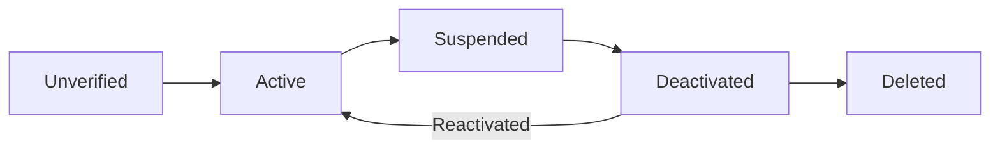
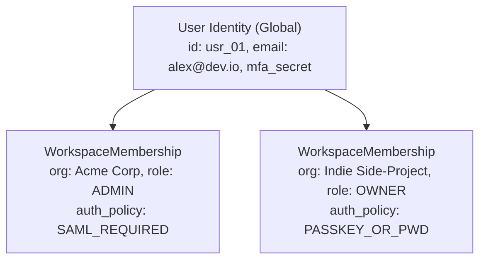

# User Management

## What Is It?

User management is everything that happens around a user account — from the moment someone signs up to the moment they delete their account (and even after that, because you might need to keep some data for legal reasons). It covers registration, profiles, roles, preferences, account states, and the entire lifecycle of a user's relationship with your product.

## Why Should You Care?

Every web app has users. Whether you're building a social network, a SaaS tool, or an internal dashboard, user management is foundational. And it's more than just a `users` table with an email and password. There are business rules around verification, account states, roles, data retention, and account deletion that directly affect user trust and legal compliance. Miss something here and you'll be patching it in production under pressure.

## How It Works (The Business Flow)

### Registration

1. User fills out signup form (email + password, or social login)
2. System validates: Is the email already taken? Does the password meet requirements?
3. System creates user record with status = `unverified`
4. Verification email sent with a one-time link (expires in 24 hours)
5. User clicks link → status changes to `active`
6. If link expires, user can request a new one

### Profile Management

1. User edits their profile: name, avatar, bio, preferences
2. Some fields may require re-verification (changing email requires confirming the new one)
3. Sensitive changes (email, password) often require entering the current password first
4. Profile updates are saved and immediately reflected

### Account States

A user account is a state machine:



- **Unverified**: Signed up but hasn't confirmed email
- **Active**: Normal, fully functional account
- **Suspended**: Temporarily disabled by an admin (policy violation, suspicious activity)
- **Deactivated**: User chose to disable their account. Data preserved, can be reactivated
- **Deleted**: Permanent removal. May have a grace period before data is purged

### Password Management

1. **Password reset**: User clicks "Forgot Password" → system sends reset link → user sets new password → all existing sessions are invalidated
2. **Password change**: Logged-in user changes password (requires current password)
3. **Password requirements**: Minimum length, complexity rules. Don't over-restrict (no max length, allow special characters, allow paste)
4. **Breach detection**: Some systems check passwords against known breach databases (HaveIBeenPwned API)

### Roles & Permissions

1. Users are assigned one or more roles (e.g., Owner, Admin, Member, Viewer)
2. Each role has a set of permissions (can_create, can_edit, can_delete, can_invite)
3. Roles are usually scoped to an organization or workspace (a user can be Admin in one org and Viewer in another)
4. Permission checks happen at the API level, not just the UI

### Account Deletion

This is surprisingly complex thanks to privacy laws:

1. User requests account deletion
2. System shows what will be deleted and what must be retained
3. Grace period (often 30 days) — account is deactivated, not deleted
4. After grace period, personal data is purged
5. Some data must be kept (financial records, legal holds) — but anonymized
6. The user's content may need special handling (do their posts disappear? get attributed to "Deleted User"?)

## Key Terms You'll Hear

| Term                           | What It Means                                                                                    |
| ------------------------------ | ------------------------------------------------------------------------------------------------ |
| **User Lifecycle**             | The full journey from registration to deletion                                                   |
| **Onboarding**                 | The initial experience after signup — welcome emails, setup wizard, guided tour                  |
| **KYC**                        | Know Your Customer — identity verification required in finance/regulated industries              |
| **SSO Provisioning**           | Automatically creating user accounts when employees are added in the company's identity provider |
| **SCIM**                       | System for Cross-domain Identity Management — a protocol for syncing user data between systems   |
| **Org / Workspace / Team**     | A grouping of users. One user can belong to multiple orgs                                        |
| **Invite Flow**                | Existing user invites someone → system sends invite email → invitee signs up or joins            |
| **Impersonation**              | Admin logs in "as" a user to debug their issues. Requires audit logging                          |
| **Soft Delete**                | Marking a record as deleted without removing it from the database                                |
| **Hard Delete**                | Actually removing data from the database (and backups, eventually)                               |
| **PII**                        | Personally Identifiable Information — name, email, phone, address. Must be handled carefully     |
| **Data Subject Request (DSR)** | A user's formal request under GDPR/CCPA to access or delete their data                           |
| **JIT (Just-In-Time) Provisioning** | Creating a user's workspace account on the fly the first time they log in via SAML/OIDC SSO |
| **SCIM Circuit Breaker**       | A safety threshold that pauses automated directory sync when an IdP suddenly attempts to provision or deprovision a massive percentage of an org's users |
| **Service Account / Bot Principal** | A non-human identity owned by an organization (rather than an employee) used to bind production API keys, webhooks, and scheduled jobs |
| **ReBAC (Relationship-Based Access Control)** | Google Zanzibar-style authorization model (`subject, relation, object` tuples) designed for nested folders, documents, and inherited sharing |

## Common Patterns

### Pattern 1: Simple User Model

One user = one account. No teams, no orgs. Each user has a role (user, admin).

**When it's used:** Consumer apps, simple SaaS, personal tools.

**Trade-off:** Breaks down when you need multi-user collaboration.

### Pattern 2: User + Organization

Users belong to organizations. Roles are scoped per organization.

```
User ← belongs to → Organization (with role)
```

**When it's used:** B2B SaaS (Slack, Notion, GitHub).

**Trade-off:** More complex queries. Need to handle: user has no org, user has multiple orgs, org has no users.

### Pattern 3: User + Organization + Team

Organizations have teams. Permissions can be at org level or team level.

**When it's used:** Large enterprise SaaS (Jira, Azure DevOps).

**Trade-off:** Permission model gets complicated. Keep it as simple as possible.

## Gotchas & Edge Cases

- **Email uniqueness**: What if someone signs up with `john@gmail.com` via email and later tries "Sign in with Google" using the same email? You need an account linking strategy.
- **Username changes**: If usernames appear in URLs (`/users/john`), changing usernames breaks links. Either disallow changes or maintain redirects.
- **Timezone handling**: Store dates in UTC, display in user's timezone. Let users set their timezone in preferences.
- **Avatar storage**: Don't store base64 images in your database. Upload to object storage (S3) and store the URL.
- **Deleted user's content**: In a forum, if a user deletes their account, do their posts disappear? Usually not — you attribute them to "Deleted User" or "[removed]".
- **Admin account lockout**: If the only admin deletes their account or gets suspended, who manages the org? Prevent the last admin from leaving.
- **Merge accounts**: "I accidentally created two accounts" is a common support request. Account merging is hard — you need to reconcile all related data (orders, posts, settings).
- **Re-registration with deleted email**: Can someone sign up again with the same email after deleting their account? During the grace period? After?
- **Session invalidation**: When a user changes their password or an admin suspends an account, all active sessions must be invalidated immediately.

## Industry War Stories & Non-Obvious Best Practices

### 1. SCIM 2.0 Directory Sync Circuit Breakers (The "Accidental 5,000-Seat Okta Sync")

Enterprise customers love **SCIM 2.0** (System for Cross-domain Identity Management) because assigning an employee to an Okta or Azure AD group automatically provisions their seat in your app, and removing them in Okta immediately revokes their session and deprovisions their seat.

In production, an IT administrator at a Fortune 500 customer will inevitably make two catastrophic mistakes inside Okta:
1. **The Accidental "Everyone" Group Assignment**: The admin means to assign `Engineering-Frontend (40 users)` to your app, but accidentally selects `All-Employees (8,500 users)`. If your SCIM endpoint auto-provisions and triggers an instant Stripe seat-expansion charge for 8,460 extra seats ($250,000+), your customer's CFO will escalate within an hour.
2. **The Broken LDAP Filter Mass-Wipe**: The admin edits an Active Directory rule, and Okta suddenly fires `PATCH /scim/v2/Users/{id} { "active": false }` for **100% of the organization's 1,200 users** in 90 seconds — locking the entire company out of production during business hours.

**Production Defenses:**
- **Deprovisioning Blast-Radius Circuit Breaker**: Track a rolling 10-minute counter per organization. If SCIM attempts to deactivate $> 10\%$ of active seats (or $> 25$ users) within 10 minutes, **trip the SCIM circuit breaker**: halt further deactivations, hold the remaining jobs in a `pending_admin_confirmation` queue, and page the Org Owner via email/Slack.
- **Seat Expansion Soft-Cap & True-Up Grace Window**: Enforce a configurable `max_auto_provision_seats` cap (e.g., contracted seats + 15% buffer). Never auto-charge credit cards synchronously inside a SCIM `POST /Users` handler.
- **SCIM Deactivation = Soft-Suspend, Never Hard-Delete**: When SCIM sends `DELETE /scim/v2/Users/{id}` or `active: false`, immediately revoke active sessions/tokens and free the billable seat, but **keep the membership record and resources in a `scim_suspended` state**. When the IT admin realizes their mistake 15 minutes later and re-assigns the group in Okta, re-activating the user restores all their project memberships, permissions, and history intact.

### 2. Orphaned Assets, Webhooks & API Keys When an Admin Leaves

In early-stage SaaS schemas, developers routinely write foreign keys like `api_keys.created_by_user_id`, `webhooks.owner_user_id`, or `dashboards.user_id`.

Two years later, the lead DevOps engineer (`bob@acme.com`) who set up the integration leaves Acme Corp. IT deprovisions Bob via SCIM. Suddenly:
- Acme's production CI/CD pipeline breaks at 2:00 AM because the API key belonged to `bob@acme.com` and was deactivated with his user account.
- Critical billing alerts stop firing, and 45 shared dashboards vanish or become uneditable ("Orphaned Assets").

**Production Architecture:**
1. **Never Bind Infrastructure Credentials to Human Users**: Production API keys, OAuth apps, webhooks, and scheduled jobs must belong to a first-class **Service Account** (or directly to the `Organization` / `Workspace` resource), with human users only recorded in `created_by_actor_id` for audit logging.
2. **Guided Offboarding & Asset Transfer Tombstone**: When deprovisioning a human user, run an atomic offboarding pipeline:
   - Revoke personal sessions, refresh tokens, and personal access tokens (PATs).
   - Leave Organization Service Accounts and shared webhooks running untouched.
   - Reassign ownership of private drafts, folders, or scheduled reports to a designated **Fallback Admin** (or the manager specified in the SCIM payload's `urn:ietf:params:scim:schemas:extension:enterprise:2.0:User.manager` attribute).

### 3. Multi-Tenant Workspace Membership vs. Personal Identity (`Users` vs. `Memberships`)

Never put `organization_id` or `role` directly on the `users` table. A consultant, investor, or developer switching companies will need access to multiple organizations with the same email, or will want to keep their personal workspace when leaving an employer.



- **Global `User` vs. Scoped `WorkspaceMembership`**: The `User` record holds global identity (`id`, verified `email` addresses, `password_hash`, WebAuthn credentials). The `WorkspaceMembership` join table holds `user_id`, `org_id`, `role`, `scim_external_id`, `status`, and per-org billing seat status.
- **Per-Workspace Session Enforcement**: A user logged into their personal workspace via password cannot automatically access `Acme Corp` if Acme enforces `SAML_REQUIRED` or `MFA_REQUIRED`. The authorization middleware inspects the active `WorkspaceMembership`'s security policy and triggers an IdP redirect or Step-Up MFA challenge when switching workspaces.

### 4. Evolving from RBAC to Zanzibar-Style ReBAC for Hierarchical Resources

Flat RBAC (`Owner`, `Admin`, `Editor`, `Viewer` at the organization level) works great until your product introduces **Teams, Projects, Nested Folders, and Document-Level Sharing** (like Notion, Google Drive, Figma, or Linear).

With flat RBAC, answering *"Can Alice edit Document D?"* requires checking:
- Is Alice an Org Admin?
- Or is Alice a member of Team T, which has `editor` access to Project P, which contains Folder F1, which contains Subfolder F2, which contains Document D?
- Or was Alice granted a direct guest `editor` link to Folder F1?

Modeling this with ad-hoc SQL `JOIN`s across 6 tables becomes slow and bug-ridden. Modern SaaS systems adopt **Relationship-Based Access Control (ReBAC)** inspired by **Google Zanzibar** (implemented via SpiceDB, OpenFGA, Ory Keto, or a unified relation-tuple table):

| Subject (Who) | Relation | Object (What) | Meaning |
| ------------- | -------- | ------------- | ------- |
| `user:alice` | `member` | `team:eng` | Alice belongs to Engineering team |
| `team:eng#member` | `editor` | `folder:roadmap` | All Engineering members are editors of the Roadmap folder |
| `folder:roadmap` | `parent` | `doc:q3_spec` | `q3_spec` inherits permissions from its parent folder `roadmap` |
| `user:bob` | `viewer` | `doc:q3_spec` | Bob has direct single-document viewer access |

Every permission check reduces to a fast graph reachability query: **`check(user:alice, can_edit, doc:q3_spec)`**, cleanly unifying Org roles, Team groups, folder inheritance, and single-item guest sharing under one consistent model.

## Quick Reference

| Scenario                       | Recommended Approach                                                                    |
| ------------------------------ | --------------------------------------------------------------------------------------- |
| Simple consumer app            | User + role (user/admin)                                                                |
| B2B SaaS                       | Global `User` identity decoupled from per-org `WorkspaceMembership`                     |
| Nested folders / doc sharing   | Zanzibar-style ReBAC (`subject, relation, object` tuples via OpenFGA / SpiceDB)         |
| Enterprise SCIM 2.0 sync       | Soft-suspend on deprovision + blast-radius circuit breaker (>10% org wipe pauses sync)  |
| API keys, webhooks & cron jobs | Bind to Organization `ServiceAccount` principals, never to human employee user IDs      |
| Employee offboarding           | Revoke human sessions/PATs; auto-transfer orphaned private assets to manager/Org Owner  |
| Account deletion (GDPR/DSR)    | 30-day grace period → soft delete → hard delete PII & anonymize audit/financial logs    |
| User impersonation             | Audit-logged, step-up MFA required, read-only by default, persistent banner in UI       |

