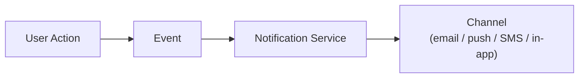
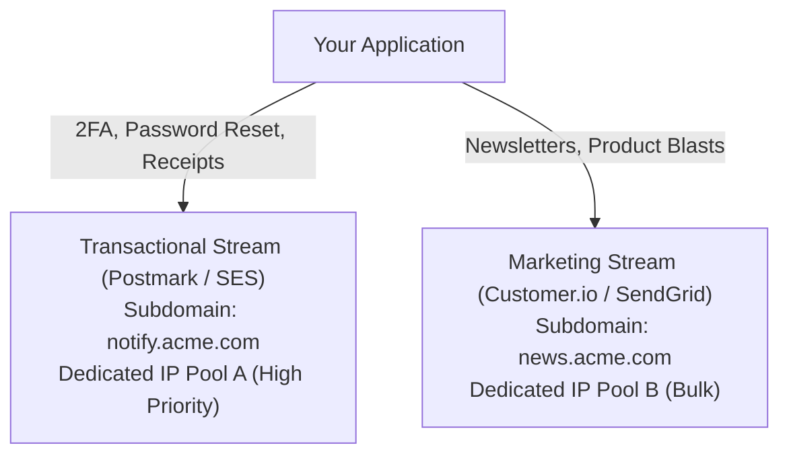

# Email & Notifications

## What Is It?

Email and notifications are how your app communicates with users when they're not actively looking at your screen. Order confirmations, password resets, payment failures, new message alerts — these are all notifications. They span multiple channels: email, push notifications, SMS, and in-app messages. Getting this right is critical because it's often the only touchpoint between your app and your users.

## Why Should You Care?

A great product with terrible notifications is a product people forget about. Conversely, a product that sends too many notifications gets uninstalled. As a developer, you'll build notification systems for almost every app. You need to understand the business rules: when to send, which channel to use, how to respect user preferences, and what happens when delivery fails. Mess up transactional emails and customers never get their receipts. Mess up marketing emails and you get marked as spam.

## How It Works (The Business Flow)

### Transactional Emails

These are triggered by user actions and are expected:

1. User does something (signs up, places an order, resets password)
2. Your backend creates a notification event
3. Notification service picks up the event and selects the right template
4. Template is rendered with dynamic data (user name, order details)
5. Email is sent via a delivery provider (SendGrid, Postmark, SES)
6. Delivery provider reports back: delivered, bounced, or complained

**Examples:** Welcome email, order confirmation, password reset, payment receipt, shipping update.

### Marketing Emails

These are initiated by the business, not by user actions:

1. Marketing team creates a campaign (newsletter, promo, feature announcement)
2. Audience is selected (all users, segment, cohort)
3. Email is designed and tested (A/B subject lines, preview text)
4. Campaign is scheduled or sent
5. System tracks opens, clicks, unsubscribes

**Key difference:** Marketing emails MUST include an unsubscribe link (CAN-SPAM law). Transactional emails don't need one (but they shouldn't contain marketing content).

### Push Notifications

1. User grants notification permission in their browser or mobile app
2. A device token is generated and stored on your server
3. When an event occurs, your server sends a push via APNs (Apple) or FCM (Firebase/Google)
4. Notification appears on the user's device even if the app is closed
5. User taps the notification → app opens to the relevant screen

### SMS Notifications

1. User provides phone number and opts in
2. System sends SMS via a provider (Twilio, Vonage)
3. Used sparingly for high-priority messages: 2FA codes, fraud alerts, delivery notifications
4. SMS is expensive ($0.01-0.05 per message) and has strict consent requirements

### In-App Notifications

1. While the user is in your app, a notification badge or dropdown shows new items
2. Usually backed by a notifications table in your database
3. Can be real-time (WebSocket) or polled periodically
4. User can mark as read, dismiss, or click to navigate

## Key Terms You'll Hear

| Term                         | What It Means                                                                                                         |
| ---------------------------- | --------------------------------------------------------------------------------------------------------------------- |
| **Transactional Email**      | Triggered by user action, expected and necessary (receipts, password resets)                                          |
| **Marketing Email**          | Sent to promote something. Requires opt-in and unsubscribe                                                            |
| **Bounce**                   | Email failed to deliver. Soft bounce = temporary (mailbox full). Hard bounce = permanent (address doesn't exist)      |
| **Complaint / Spam Report**  | Recipient marked your email as spam. Very bad for your sender reputation                                              |
| **Sender Reputation**        | A score that email providers assign to your sending domain. Low reputation = emails go to spam                        |
| **SPF / DKIM / DMARC**       | Email authentication protocols that prove your emails are legitimately from your domain. Essential for deliverability |
| **Open Rate**                | Percentage of recipients who opened the email. Increasingly unreliable (Apple Mail Privacy Protection)                |
| **Click-Through Rate (CTR)** | Percentage who clicked a link in the email                                                                            |
| **Unsubscribe Rate**         | Percentage who opt out after receiving an email. High rate = you're sending too much or irrelevant content            |
| **CAN-SPAM**                 | US law requiring unsubscribe links in commercial emails. Violations = $50K+ fines                                     |
| **GDPR Consent**             | In the EU, you need explicit opt-in before sending marketing emails                                                   |
| **Notification Preferences** | User settings for what they want to receive and on which channels                                                     |
| **Quiet Hours**              | Time window when notifications are suppressed (e.g., no push notifications between 10pm-8am)                          |
| **IP Pool / Subdomain Isolation** | Separating transactional emails (`auth.acme.com`) from marketing blasts (`promo.acme.com`) on distinct subdomains and dedicated IP pools |
| **SafeLinks / Link Scanner** | Enterprise email security bots (Microsoft Defender SafeLinks, Mimecast, Proofpoint) that headless-fetch URLs inside incoming emails before delivering to the inbox |
| **RFC 8058 One-Click Unsubscribe** | Standard (`List-Unsubscribe-Post` HTTP header) mandated by Gmail and Yahoo allowing inbox providers to unsubscribe a user via a background `POST` request |
| **Apple MPP (Mail Privacy Protection)** | Apple Mail feature that pre-fetches all email tracking pixels through Cloudflare/Apple relay proxies as soon as an email arrives, inflating open rates to ~100% |
| **Suppression List**         | An internal blocklist of addresses that have hard-bounced or reported spam, preventing your app from ever attempting delivery to them again |

## Common Patterns

### Pattern 1: Event-Driven Notifications

Application events are published to a queue. A notification service consumes events and decides what to send, to whom, and on which channel.



**When it's used:** Most production applications. Decouples notification logic from business logic.

**Trade-off:** Requires a message queue or event bus. More infrastructure.

### Pattern 2: Template-Based Emails

Email content is defined as templates (HTML with variables). At send time, variables are filled in from the event data.

**When it's used:** Every email system. Templates live in the email provider (SendGrid templates) or your codebase.

**Trade-off:** HTML email rendering is a nightmare (Outlook uses Word's rendering engine). Use a framework like MJML or React Email.

### Pattern 3: Multi-Channel with Preferences

Each notification type can be sent on multiple channels. Users choose which channels they want for each type.

```
Order shipped → User prefers: email ✓, push ✓, SMS ✗ → send email + push
```

**When it's used:** Mature products with diverse notification types.

**Trade-off:** Complex preference management. Need a good UI for users to control their notifications.

## Gotchas & Edge Cases

- **Email deliverability is a whole discipline**: Set up SPF, DKIM, and DMARC. Warm up new sending domains. Monitor bounce rates. A single spam complaint spike can tank your deliverability for weeks.
- **Don't send from noreply@**: Users reply to transactional emails. Route them somewhere or at least use a monitored address.
- **Notification fatigue**: If every feature triggers a notification, users will turn off all notifications. Be selective about what's worth interrupting someone.
- **Deduplication**: If an event fires twice (queue retry), don't send two emails. Use idempotency keys.
- **Timing**: Don't send a "You left items in your cart" email 5 minutes after someone walks away. Wait 1-24 hours. Don't send it at 3am in their timezone.
- **Unsubscribe must work instantly**: If someone unsubscribes and gets another email the next day (because of a queue delay), they'll report you as spam.
- **Push notification tokens expire**: Device tokens can change. Handle token refresh and clean up invalid tokens.
- **Regulatory differences**: CAN-SPAM (US) requires unsubscribe. GDPR (EU) requires opt-in. CASL (Canada) is somewhere in between. Know which laws apply to your users.

## Industry War Stories & Non-Obvious Best Practices

### 1. Dedicated IP Pool & Subdomain Isolation (Protecting 2FA From Marketing Blasts)

A classic startup outage happens the day the marketing team sends a Black Friday promo email to 250,000 cold leads from `hello@acme.com`. Thousands of recipients click "Report Spam" or hard-bounce. Within 20 minutes, Gmail and Outlook throttle your root domain `acme.com` and shared sending IP — and suddenly **existing paying customers cannot log in because their 2FA codes and password reset emails are going straight to Spam or bouncing**.

Never mix transactional and marketing traffic on the same sending domain or IP pool:



| Stream Type | Sending Subdomain (`Return-Path` & DKIM) | IP Pool | Failover / SLA Priority |
| ----------- | ---------------------------------------- | ------- | ----------------------- |
| **Critical Auth & Security** | `auth.acme.com` | Dedicated Transactional IP Pool 1 | P0 (< 3 sec delivery); never queued behind bulk jobs |
| **Transactional / Receipts** | `notify.acme.com` | Dedicated Transactional IP Pool 1 or 2 | P1 (< 15 sec delivery); strict suppression list sync |
| **Marketing & Newsletters** | `news.acme.com` or `mail.acme.com` | Separate Bulk Marketing IP Pool | P3 (Rate-limited warmup); isolated reputation |

Because mailbox providers track **DKIM/SPF domain reputation at the subdomain level** alongside IP reputation, isolating `auth.acme.com` on its own IP pool guarantees that even if a marketing campaign tanks `news.acme.com`, password resets and 2FA codes still hit the primary inbox in under 2 seconds.

### 2. Corporate Security Scanners (Microsoft SafeLinks / Mimecast) Pre-Fetching `GET` Magic Links

You build a passwordless "Magic Link" login or a one-time email verification link:
`https://app.acme.com/auth/verify?token=one_time_xyz`

Works flawlessly on `@gmail.com` in staging. Then you launch to your first enterprise customer using **Microsoft 365 (Defender SafeLinks)**, **Mimecast**, or **Proofpoint** — and **every single enterprise employee reports that clicking their magic link says "Link Expired or Already Used."**

**What Happened:**
Before delivering an email to an employee's inbox, corporate email security gateways run an automated headless browser/scanner that **follows every `GET` link inside the email body** (and sometimes honors `302` redirects) to inspect the destination page for phishing. When your `GET /auth/verify?token=one_time_xyz` handler immediately consumes the one-time token on `GET`, **the security bot consumes the token 500ms before the human even sees the email!**

**Three Production Defenses:**
1. **Never Mutate State or Consume One-Time Tokens on `GET` (`GET -> POST` Two-Step)**:
   - `GET /auth/verify?token=xyz` renders a lightweight static HTML confirmation page containing a `<form method="POST" action="/auth/verify">` and a "Click to Sign In" button (do **not** auto-submit via JavaScript `window.onload`, because headless security sandboxes execute `onload` JS!).
   - Only the `POST` handler (triggered by an explicit human click or form submission) marks the token as consumed and issues the session cookie.
2. **Respond to `HEAD` Requests Purely**: Scanners often probe with `HEAD` first. Ensure your framework doesn't run `GET` controller side-effects during `HEAD` requests.
3. **Include a Plain-Text OTP Code Beside the Link**: Always include a 6-digit code in the same email ("Click the button, or enter code `482-910` in your browser tab") so users whose corporate firewall blocks external links entirely can still complete authentication.

### 3. RFC 8058 One-Click `List-Unsubscribe` & Gmail/Yahoo's 0.3% Spam Complaint Cliff

Since 2024, Google (Gmail) and Yahoo enforce strict bulk-sender requirements (> 5,000 emails/day). If your **user-reported spam complaint rate reaches 0.3%** (just **3 spam reports per 1,000 emails!** — measured in Google Postmaster Tools), Gmail begins rejecting or routing your domain's emails straight to spam.

To keep complaint rates below 0.1%, you must make unsubscribing easier than hitting "Report Spam" by implementing **RFC 8058 One-Click Unsubscribe** headers on every marketing/promotional email:

```http
List-Unsubscribe: <https://api.acme.com/v1/unsubscribe?token=opaque_signed_jwt>, <mailto:unsub@news.acme.com?subject=unsub_123>
List-Unsubscribe-Post: List-Unsubscribe=One-Click
```

- **How It Works**: When both headers are present (and covered by your **DKIM signature**), Gmail, Apple Mail, and Yahoo render a prominent native **"Unsubscribe"** button right next to your sender name at the top of the inbox UI.
- **Must Accept Unauthenticated `POST`**: When the user clicks that native UI button, Gmail's server sends a background `POST` request with body `List-Unsubscribe=One-Click` to your URL. That endpoint **cannot** require session cookies or a login redirect — it must validate the cryptographically signed `token` in the URL and immediately suppress the recipient.

### 4. Apple Mail Privacy Protection (MPP) & Why "Open Rate" Triggers Are Broken

Traditional email tracking works by embedding a $1\times1$ transparent tracking pixel (``). When the user opens the email, their client fetches the image, logging an "Open" event, IP address, and timestamp.

With **Apple Mail Privacy Protection (MPP)** (enabled by default for $>90\%$ of iOS/macOS Mail users, alongside similar Gmail image caching proxies):
1. The moment an email arrives at Apple's servers — **while the user's iPhone is locked in their pocket at 3:00 AM** — Apple's relay proxy automatically downloads every image in the email (including your $1\times1$ tracking pixel) via randomized Cloudflare/Apple IP addresses and caches it.
2. **The Consequences**:
   - Your analytics report a fake **95–100% Open Rate** across all Apple Mail users within minutes of sending.
   - **IP Geo-Location & Send-Time Optimization Break**: The pixel fetch IP belongs to an Apple relay node, not the user, and the timestamp reflects delivery time, not human reading time.
   - **Automated Drip Workflows Misfire**: Any marketing automation rule like *"Wait 48 hours -> If user has NOT opened Email #1, send follow-up reminder"* or *"Purge inactive subscribers who haven't opened an email in 90 days"* is completely broken.
3. **Production Fix**: Filter out known proxy user-agents/ASNs (`Mozilla/5.0` Apple pre-fetch signatures) into a separate `proxy_prefetched` metric, and base lifecycle automation, sunset policies, and A/B test winners strictly on **human Click-Through Rate (CTR)** or authenticated in-app conversion events.

## Quick Reference

| Channel / Mechanism            | Best For                                                     | Cost               | Key Production Rule                                                   |
| ------------------------------ | ------------------------------------------------------------ | ------------------ | --------------------------------------------------------------------- |
| Email (Auth / Transactional)   | 2FA, password resets, receipts, critical security alerts     | Low ($0.001/email) | Isolate on dedicated subdomain (`auth.`) + dedicated IP pool          |
| Email (Marketing / Bulk)       | Newsletters, promos, lifecycle campaigns                     | Low                | Include RFC 8058 One-Click `List-Unsubscribe-Post`; keep spam < 0.1%  |
| One-Time Magic / Verify Links  | Passwordless login, email verification                       | Low                | Never consume token on `GET` (defend against SafeLinks/Mimecast bots) |
| Email Analytics & Drip Triggers| Measuring campaign engagement & list hygiene                 | Free               | Ignore Apple MPP inflated open rates; trigger flows on human clicks   |
| Push notification              | Time-sensitive updates, new messages                         | Free               | Respect user timezone quiet hours; prune expired APNs/FCM tokens      |
| SMS                            | 2FA, fraud alerts, delivery updates                          | High ($0.01-0.05)  | Strict opt-in required; rate-limit per phone/ASN to prevent SMS pumping|
| In-app                         | Non-urgent updates, activity feed                            | Free               | Back with DB table + WebSocket/SSE; sync read state across devices    |

