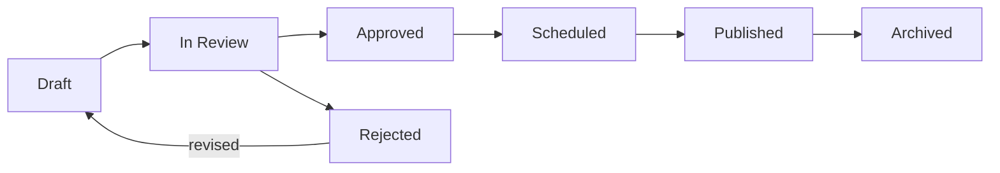
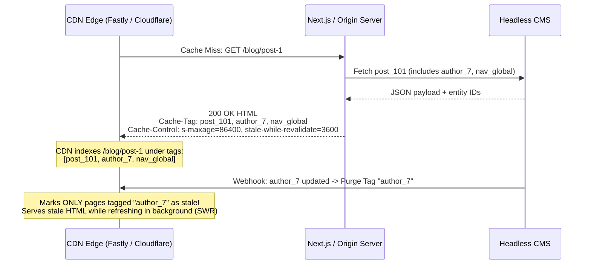

# Content Management

## What Is It?

Content management is how non-technical people create, edit, organize, and publish content on a website or app. Blog posts, product descriptions, marketing pages, help articles, news updates — all managed through a CMS (Content Management System). As a developer, you're either building a CMS, integrating one, or building features on top of one. Understanding the business workflows (drafts, approvals, publishing schedules) is as important as the technical implementation.

## Why Should You Care?

Almost every website beyond a personal project needs content management. Marketing teams want to update landing pages without filing a Jira ticket. Support teams want to publish help articles. Product teams want to manage feature announcements. If you build a system where every content change requires a developer, you've created a bottleneck. Understanding CMS business flows helps you build (or choose) the right system that empowers content teams while maintaining quality control.

## How It Works (The Business Flow)

### Content Lifecycle

Every piece of content follows a lifecycle:

1. **Draft**: Author writes content. Saves as they go. Not visible to the public
2. **In Review**: Author submits for review. Editor gets notified
3. **Approved / Rejected**: Editor approves (moves toward publishing) or sends back with feedback
4. **Scheduled**: Set to publish at a future date/time (e.g., product launch at 9am Tuesday)
5. **Published**: Live on the site. Visible to everyone
6. **Archived**: Removed from the site but preserved in the system. Can be restored

### Content Modeling

Content is structured into types with defined fields:

- **Blog Post**: title, author, body, featured image, category, tags, publish date
- **Product**: name, description, price, images, specs, category
- **FAQ**: question, answer, category
- **Landing Page**: headline, hero image, sections (flexible layout)

The content model defines what editors can enter. It enforces consistency and makes content queryable.

### Media Management

1. Editors upload images, videos, documents
2. Media library stores and organizes assets with metadata (alt text, dimensions, tags)
3. Images are automatically resized into multiple versions (thumbnail, medium, large)
4. CDN serves the media for fast global delivery
5. Old unused media can be flagged for cleanup

### Versioning & Revision History

1. Every save creates a new version
2. Editors can view the full history of changes
3. Any previous version can be restored with one click
4. Useful for: "Who changed this? When? Why?" and rollback after mistakes

### Multi-Language Content

1. Each piece of content has a "default" language version
2. Translations are linked to the original (not separate copies)
3. When the original is updated, translations are flagged as "needs update"
4. Translation workflow: original → translate → review → publish

## Key Terms You'll Hear

| Term                           | What It Means                                                                                  |
| ------------------------------ | ---------------------------------------------------------------------------------------------- |
| **CMS**                        | Content Management System — software for managing digital content                              |
| **Headless CMS**               | CMS that provides content via API. No built-in frontend. You build the presentation layer      |
| **Traditional CMS**            | CMS with a built-in frontend (WordPress, Drupal). Content and display are coupled              |
| **WYSIWYG**                    | "What You See Is What You Get" — a rich text editor that shows formatted content as you type   |
| **Markdown**                   | A lightweight text format that many technical CMS systems use instead of WYSIWYG               |
| **Content Type / Model**       | The schema for a kind of content (e.g., a Blog Post has title, body, author)                   |
| **Slug**                       | URL-friendly version of a title. "My First Post" → `my-first-post`                             |
| **Taxonomy**                   | Classification system — categories, tags, hierarchies for organizing content                   |
| **Widget / Block / Component** | Reusable content chunks that editors can assemble into pages                                   |
| **Content Preview**            | Seeing how content will look on the live site before publishing                                |
| **Workflow**                   | The approval process content goes through before publishing                                    |
| **Webhook**                    | CMS sends a notification to your app when content changes (useful for rebuilding static sites) |
| **CDN**                        | Content Delivery Network — distributes content globally for fast loading                       |
| **Content Release (Bundle)**   | A grouped set of interdependent entries (pages, navbars, banners) validated and published atomically in a single transaction |
| **Surrogate-Key / Cache-Tag**  | HTTP response header (`Surrogate-Key: entry_42 author_7`) enabling fine-grained CDN cache eviction of only the pages that rendered a modified CMS entry |
| **Stale-While-Revalidate (SWR)** | Cache directive instructing the CDN to serve slightly stale cached HTML immediately while asynchronously regenerating the fresh page in the background |
| **Field-Level Fallback Chain** | Resolving missing localized fields along a deterministic locale chain (`fr-CA -> fr -> en-US`) without duplicating unchanged non-translatable fields |
| **Source-Hash Drift Detection**| Storing the SHA-256 hash of the source-locale field on each translation record to detect when an English edit makes existing translations outdated |

## Common Patterns

### Pattern 1: Traditional CMS (WordPress, Drupal)

Content is managed and rendered by the same system. Editors use a built-in admin panel. The CMS generates HTML pages.

**When it's used:** Blogs, corporate websites, media sites with high content volume.

**Trade-off:** Quick to set up but frontend customization is limited. PHP ecosystem. Performance can be an issue at scale.

### Pattern 2: Headless CMS (Contentful, Strapi, Sanity)

CMS provides content via REST or GraphQL API. Frontend is a separate app (React, Next.js, etc.) that fetches content from the API.

**When it's used:** Modern websites, multi-platform content delivery (web + mobile + smart displays).

**Trade-off:** More development effort. But total frontend freedom and better performance with SSG/ISR.

### Pattern 3: Git-Based CMS (Netlify CMS, Tina)

Content is stored as files (Markdown, JSON) in a Git repository. Editors use a web interface that commits changes to Git.

**When it's used:** Developer blogs, documentation sites, JAMstack projects.

**Trade-off:** Great version control. But not suitable for non-technical content teams or high-frequency publishing.

### Pattern 4: Page Builder (Notion-like)

Editors build pages from blocks — text, image, video, columns, buttons. Very flexible. Content structure is defined by the editor, not by developers.

**When it's used:** Landing pages, marketing sites where layout needs to change frequently.

**Trade-off:** Harder to enforce consistency. Editors can create messy layouts. Complex to render.

## Gotchas & Edge Cases

- **Rich text is messy**: WYSIWYG editors produce inconsistent HTML. Sanitize and normalize on save, not just on display.
- **Slug conflicts**: Two posts titled "Introduction" both generate the slug `introduction`. Append numbers or dates to avoid conflicts.
- **Scheduled publishing timezone**: "Publish at 9am" — which timezone? The editor's? The server's? The reader's? Make it explicit.
- **Broken references**: Content A embeds Content B. If B is deleted, A has a broken reference. Check for references before allowing deletion.
- **SEO impact of content changes**: Changing a URL (slug) without a redirect breaks Google rankings. Always create 301 redirects.
- **Large media uploads**: Don't upload through your API server. Use direct-to-S3 uploads with presigned URLs.
- **Content preview in headless CMS**: Since the CMS doesn't render pages, preview requires a special endpoint in your frontend that fetches draft content.
- **Cache invalidation on publish**: When content is published, CDN caches need to be purged. Use webhooks to trigger rebuilds or cache invalidation.

## Industry War Stories & Non-Obvious Best Practices

### 1. Atomic "Content Releases" (Publishing 20 Interdependent Pages Simultaneously)

Imagine Apple or Stripe launching a major product at 9:00 AM Tuesday. The launch requires simultaneously updating:
- The global Navigation Bar (adding a link to `/products/vision`)
- The Homepage Hero Banner
- The Pricing Matrix table
- 12 localized Landing Pages and 5 Documentation articles

If editors publish these 20 entries one by one (or if a cron job loops through them over 45 seconds), visitors browsing the site at `09:00:12` click the new Navbar link before the `/products/vision` landing page is published and hit a **404 Not Found**, or see the new Homepage banner alongside the old Pricing table. Worse, if entry #14 fails schema validation halfway through the loop, the live website is left in a torn, half-launched state.

**The Production Architecture — Atomic Content Releases & Immutable Snapshot Pointers:**
1. **Release Bundle Entity (`content_releases`)**: Editors group all 20 draft revisions into a named release (`rel_spring_launch_2026`).
2. **Pre-Flight Dependency & Reference Graph Validation**: Before the release can be scheduled or triggered, a dry-run validator walks the reference graph of all 20 target revisions:
   - Are there any links pointing to `draft` entries that are *neither* already published *nor* included inside `rel_spring_launch_2026`?
   - Do all required localized fields and media assets pass schema validation?
3. **Atomic Pointer Flip**: Instead of updating 20 rows one by one with separate HTTP calls, the CMS stores immutable `entry_versions` rows and flips the live pointer in a single serializable database transaction (or advances an immutable dataset snapshot ID), then emits a single batch `release.published` event containing all 20 modified entry IDs.

### 2. Fine-Grained `Surrogate-Key` / `Cache-Tag` CDN Invalidation (Avoiding the Global Purge Stampede)

When an editor fixes a typo in **Author Bio #7** (`author_7`), how do you know which URLs on your website need their CDN cache cleared?
- `author_7` appears on `/about-us`, `/blog/post-1`, `/blog/post-84`, and `/category/engineering`.
- **The Naive Mistake (`Purge Everything`)**: Developers don't know which pages rendered `author_7`, so they call `cdn.purgeAll()` on every CMS webhook. On a high-traffic site with 50,000 pages, purging the entire CDN cache every time an editor saves a typo causes a **Cache Stampede (Thundering Herd)** that DDoSes your origin server and database.

**The Production Standard — Dependency-Tracked `Cache-Tag` / `Surrogate-Key` Headers:**

1. **Collect Render Dependencies**: While rendering `/blog/post-1`, your frontend framework (or GraphQL client) collects the ID of every CMS entry touched during the render (`post_101`, `author_7`, `nav_global`).
2. **Emit `Surrogate-Key` / `Cache-Tag` Response Headers**: Return `Cache-Tag: post_101,author_7,nav_global` (Cloudflare / Vercel) or `Surrogate-Key: post_101 author_7 nav_global` (Fastly) to the CDN. The CDN strips this header before sending the HTML to the browser, and indexes the cached URL under those tags.
3. **Soft Purge + `stale-while-revalidate` (SWR)**: When `author_7` changes, the CMS webhook triggers a **Tag Soft-Purge** (`purgeByTag('author_7')`). Instead of deleting the cached HTML and blocking the next visitor for 800ms, the CDN marks matching pages as *stale*, serves the existing cached HTML in 10ms to the visitor, and asynchronously re-fetches the updated page from your origin in the background.

### 3. Field-Level Localization Fallbacks & Stale Translation Drift Detection

In global B2B and e-commerce sites supporting 15+ locales (`en-US`, `en-GB`, `fr-FR`, `fr-CA`, `de-DE`, `ja-JP`), cloning an entire document row for every language creates a maintenance nightmare:

1. **Field-Level vs. Document-Level Localization**:
   - A Product or Landing Page has **locale-invariant fields** (`price_usd`, `sku`, `hero_video_id`, `layout_columns`) and **locale-specific fields** (`title`, `body_markdown`, `seo_description`, `compliance_disclaimer`).
   - Store locale-invariant fields once on the parent entry, and store localized fields in a map keyed by locale (`title: { "en-US": "...", "fr-FR": "..." }`).
2. **Deterministic Fallback Chains (With Legal Overrides)**:
   - Configure explicit locale inheritance trees: `fr-CA` (French Canadian) $\rightarrow$ `fr-FR` (French) $\rightarrow$ `en-US` (Default). If a regional marketer only overrides the pricing headline for `fr-CA`, the API automatically falls back to `fr-FR` for the body copy.
   - **Critical Exception**: Never silently fall back to `en-US` for **region-locked legal/regulatory fields** (e.g., EU GDPR privacy disclaimers, regional medical claims, or country-specific availability). Mark those schema fields with `allow_fallback: false` so missing regional compliance text blocks publication or hides the section rather than rendering illegal US terms in Germany.
3. **Stale Translation Drift Detection (`source_version_hash`)**:
   - Suppose `en-US` says *"Refunds are valid within **30 days**"* and `de-DE` translates it to *"Rückerstattungen innerhalb von **30 Tagen**"*.
   - Six months later, the US product manager changes the `en-US` field to *"Refunds are valid within **14 days**"* and publishes.
   - Because the `de-DE` string is non-empty, a naive CMS thinks the German translation is "100% Complete" — leaving a legally binding 30-day promise live on your German site!
   - **Production Fix**: Whenever a translation is saved for field $F$ in locale $L$, record `translated_from_source_hash = sha256(F["en-US"])`. Whenever the `en-US` source text changes, its SHA-256 hash changes, automatically flipping all dependent locales (`de-DE`, `fr-FR`, `ja-JP`) where `translated_from_source_hash != current_source_hash` to **`status = stale_needs_review`** and alerting the localization queue.

## Quick Reference

| Need                           | Recommended Approach                                                                    |
| ------------------------------ | --------------------------------------------------------------------------------------- |
| Simple blog                    | WordPress or headless CMS + static site generator                                       |
| Corporate website              | Headless CMS + Next.js with on-demand ISR / `Cache-Tag` invalidation                    |
| Coordinated multi-page launch  | Atomic **Content Releases** with pre-flight reference graph validation                  |
| High-traffic CDN caching       | Emit entity IDs in `Surrogate-Key` / `Cache-Tag` + Soft Purge with `stale-while-revalidate` |
| E-commerce content             | Headless CMS integrated with commerce platform                                          |
| Documentation                  | Git-based CMS with Markdown                                                             |
| Marketing landing pages        | Page builder / structured block-based CMS with strict component schemas                 |
| Multi-language (10+ locales)   | Field-level localization + fallback chains (`fr-CA -> fr -> en`) + `source_hash` drift detection |
| Editorial workflow             | CMS with built-in approval flows, RBAC roles, and scheduled UTC release bundles         |
| Real-time collaboration        | Notion-like or Google Docs-style with CRDTs / operational transforms                    |

