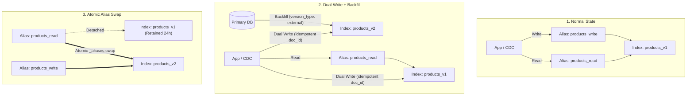
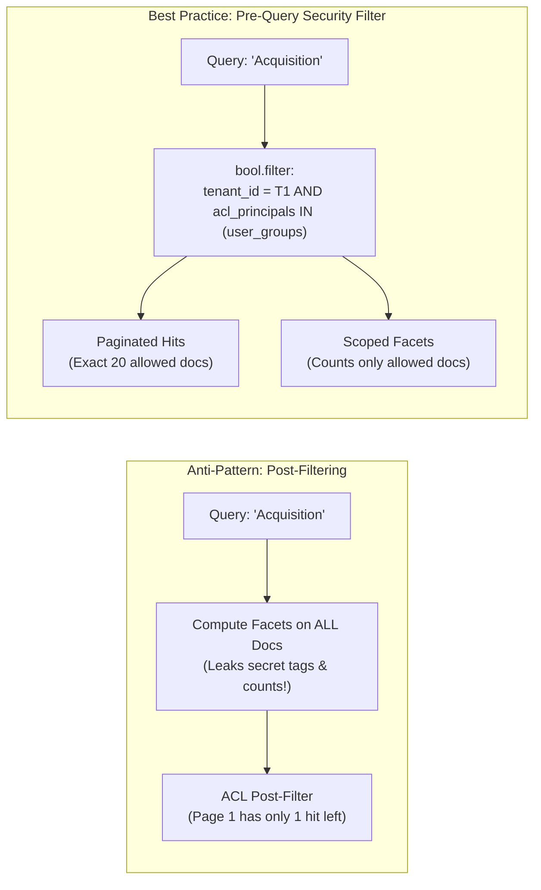
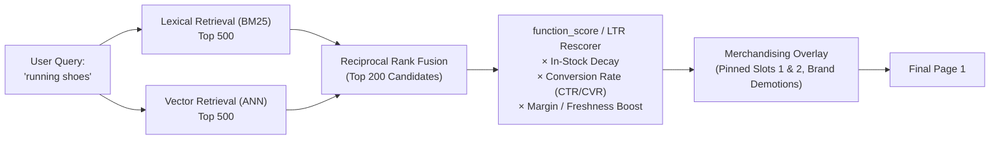

# Search & Filtering

## What Is It?

Search and filtering is how users find what they're looking for in your app. It's the search bar, the filter sidebar, the sort dropdown, the autocomplete suggestions. Whether it's an e-commerce site with 10,000 products, a job board with listings, or an internal dashboard with thousands of records — search is how people navigate your content. It seems simple from the outside, but the business logic behind relevance, ranking, and faceted filtering is surprisingly deep.

## Why Should You Care?

Bad search drives users away. If someone searches for "blue running shoes" and gets winter boots, they leave. Studies show that site search users convert at 2-3x the rate of non-searchers — they know what they want and they're ready to act. As a developer, you'll build search features in almost every data-heavy app. Understanding the business side (what "relevance" means, how facets work, why autocomplete matters) helps you build search that actually helps people.

## How It Works (The Business Flow)

### Basic Search Flow

1. User types a query into a search bar
2. Client sends the query to the server (with any active filters)
3. Server searches the index/database for matching results
4. Results are ranked by relevance
5. Results page shows items with highlighting, pagination, and filter options
6. User refines with filters or tries a new query

### Full-Text Search

Unlike database `LIKE` queries, full-text search understands language:

1. **Indexing**: Content is processed at write time — tokenized (split into words), stemmed (running → run), and stored in an inverted index
2. **Querying**: User's search query goes through the same processing
3. **Matching**: The engine finds documents that contain the processed query terms
4. **Scoring**: Results are ranked by relevance (how many terms matched, where they appear, how rare the terms are)

### Faceted Filtering

Facets are the filter sidebar you see on e-commerce sites:

```
Category:     [Electronics] [Clothing] [Books]
Price Range:  [$0-25] [$25-50] [$50-100] [$100+]
Brand:        [Nike (42)] [Adidas (38)] [Puma (15)]
Color:        [Red (12)] [Blue (28)] [Black (55)]
Rating:       [4+ stars (120)]
```

Each facet shows available values AND the count of matching items. Selecting a facet narrows results and updates other facet counts in real-time.

**How it works:**

1. User applies a filter (e.g., Brand = Nike)
2. Query re-executes with the filter applied
3. Results narrow to Nike products only
4. Other facets update their counts (Color might now show Red (3), Blue (8))
5. The selected facet stays highlighted so users know what's active

### Autocomplete & Suggestions

1. User starts typing in the search bar
2. After 2-3 characters, the system returns suggestions
3. Suggestions come from: popular searches, product names, category names, recent user searches
4. User can click a suggestion or keep typing
5. "Did you mean...?" handles typos (fuzzy matching)

### Sorting

Results can be sorted by different criteria. The default is usually "relevance" (best match first), but users can switch to:

- **Price: Low to High / High to Low**
- **Newest First** (most recently added)
- **Most Popular** (best sellers, most views)
- **Rating** (highest rated)
- **Distance** (nearest, for location-based search)

## Key Terms You'll Hear

| Term                 | What It Means                                                                                              |
| -------------------- | ---------------------------------------------------------------------------------------------------------- |
| **Full-Text Search** | Searching content by words/phrases with language awareness (stemming, synonyms)                            |
| **Inverted Index**   | A data structure that maps words to documents. The secret sauce behind fast search                         |
| **Relevance**        | How well a result matches the user's intent. The hardest part of search                                    |
| **Facet**            | A filterable dimension of the data (category, price range, brand) with counts                              |
| **Tokenization**     | Breaking text into individual words or terms for indexing                                                  |
| **Stemming**         | Reducing words to their root form (running, runs, ran → run)                                               |
| **Synonyms**         | Treating different words as equivalent (couch = sofa, laptop = notebook)                                   |
| **Fuzzy Matching**   | Finding results even when the query has typos (iphne → iPhone)                                             |
| **Boosting**         | Giving extra weight to certain fields or documents in ranking (title matches count more than body matches) |
| **Zero Results**                | When a search returns nothing. A major UX failure — always offer alternatives                                              |
| **Search Analytics**            | Tracking what people search for, what they click, and where they give up                                                   |
| **Elasticsearch**               | The most popular open-source search engine. Built on Apache Lucene                                                         |
| **Index Alias**                 | A virtual pointer (e.g., `products_read`) to a physical index (`products_v2`), enabling zero-downtime blue/green swaps     |
| **BM25 (Best Matching 25)**     | The standard lexical ranking algorithm in Lucene based on term frequency saturation and document length normalization      |
| **Reciprocal Rank Fusion (RRF)**| Algorithm that merges ranked lists from lexical (BM25) and vector (ANN) retrieval without brittle score calibration         |
| **Post-Filter**                 | Filtering search hits *after* aggregations are calculated — useful for UI facet preservation, fatal if abused for ACLs     |
| **Query Relaxation**            | Automatically dropping or softening query constraints (`AND` → `OR`) when strict matching yields zero results              |
| **Merchandising / Pinning**     | Business-rule overrides that force specific items to fixed positions or boost high-margin/in-stock inventory               |

## Common Patterns

### Pattern 1: Database Search (SQL LIKE / ILIKE)

Use the database's built-in search capabilities. PostgreSQL has solid full-text search with `tsvector` and `tsquery`.

**When it's used:** Small datasets (<100K records), simple search needs, don't want extra infrastructure.

**Trade-off:** Limited relevance ranking, no faceting, slower on large datasets.

### Pattern 2: Dedicated Search Engine (Elasticsearch / OpenSearch)

Data is indexed in a separate search engine. Your app queries the search engine for searches and the primary database for other operations.

**When it's used:** Any app with serious search needs — e-commerce, content platforms, SaaS with lots of data.

**Trade-off:** Additional infrastructure. Data must be synced between your database and the search index.

### Pattern 3: Search-as-a-Service (Algolia, Typesense, Meilisearch)

Managed search service. You push data to their API, they handle indexing, ranking, and serving.

**When it's used:** Teams that want great search without managing infrastructure.

**Trade-off:** Cost scales with usage. Less control over ranking algorithms. Vendor lock-in.

### Pattern 4: AI/Vector Search

Semantic search using embeddings. Instead of matching keywords, it understands meaning ("comfortable shoes" finds "ergonomic sneakers").

**When it's used:** Product discovery, knowledge bases, chat-with-your-docs features.

**Trade-off:** Requires embedding generation, vector database (Pinecone, pgvector). Can feel "too smart" — sometimes users want exact keyword match.

## Gotchas & Edge Cases

- **Zero results page**: Never show a blank page. Offer: spelling suggestions, popular items, relaxed filters. "No results for 'bleu shoes'. Did you mean 'blue shoes'?"
- **Search index lag**: When you add a product, it might not appear in search for a few seconds/minutes until the index updates. Users get confused when they can see a product page but can't find it via search.
- **Facet count accuracy**: Counts must be accurate or users lose trust. If "Nike (42)" is shown but filtering returns 38 items, something is wrong.
- **Performance with many facets**: Each facet requires aggregation. Too many facets = slow queries. Limit to the most useful 5-8 facets.
- **Empty filters**: Don't show filter values that would return zero results. If no products are red, don't show "Red (0)."
- **URL-driven search**: Encode search state in the URL (`?q=shoes&brand=nike&sort=price_asc`). This makes search results shareable and bookmarkable.
- **Search abuse**: People will search for SQL injection, XSS payloads, and garbage. Sanitize queries and set length limits.
- **Language-specific search**: English stemming doesn't work for Chinese or Japanese. Different languages need different analyzers.

## Industry War Stories & Non-Obvious Best Practices

### 1. Zero-Downtime Index Aliasing (Blue/Green Reindexing with Dual-Write Backfill)

In relational databases, you can often add an index concurrently. In Lucene-based search engines (Elasticsearch, OpenSearch), **changing an existing field's mapping or analyzer is impossible in-place** because the inverted index tokens are already baked on disk. If you realize your `product_sku` field was indexed with a standard analyzer (splitting `AX-900-B` into `ax`, `900`, `b`) instead of a `keyword` analyzer, you cannot run `ALTER TABLE` — you must rebuild the entire index.

**The Naive Failure Mode:** Dropping `products` and re-indexing 20 million rows from PostgreSQL takes 45 minutes. During that window, site search either returns `404 IndexNotFoundException` or serves partially populated results. Worse, if you backfill into a new index without dual-writing live updates, any price or inventory changes made during the 45-minute backfill are silently lost when you switch traffic.

**Production Best Practice:** Never point application code at a physical index name. Always read and write through **Index Aliases** (`products_read` and `products_write`), and execute a four-phase dual-write migration:



1. **Create `products_v2`** with the new analyzer/mapping settings and temporarily set `refresh_interval: -1` and `number_of_replicas: 0` during bulk ingestion to maximize write throughput.
2. **Enable Dual-Writing**: Configure your CDC consumer or application indexer to write all new mutations to both `products_v1` and `products_v2` using deterministic document IDs (`doc_id = product.id`) and an `updated_at` epoch version (`version_type: external`) so an older backfill record can never overwrite a newer live mutation.
3. **Backfill & Catch Up**: Stream all records from the primary database into `products_v2`. Once complete, restore `number_of_replicas: 2` and `refresh_interval: 1s`, then wait for shard replication to turn green.
4. **Atomic Alias Swap**: Execute a single atomic `_aliases` action that removes `products_read` from `products_v1` and adds it to `products_v2` in the same cluster state transaction. Keep `products_v1` warm for 24 hours for instant rollback before deleting it.

### 2. ACL Security Filtering & Facet Count Leakage

In B2B SaaS, healthcare, or enterprise knowledge bases (like Notion, Slack, or Jira), search results must respect fine-grained Access Control Lists (ACLs) — User A can only see documents shared with their team or role.

**Two Classic Anti-Patterns:**

1. **Application-Layer Post-Filtering (Broken Pagination)**: The developer queries Elasticsearch for the top `size: 20` documents matching `"Q4 Layoffs"`, then filters those 20 hits in Node.js/Go against the permission service. If the user only has permission to view 2 of those 20 documents, **Page 1 renders only 2 results** (or even 0 results) despite 500 accessible documents sitting on Page 2+.
2. **Engine `post_filter` or Unscoped Aggregations (Confidential Count Leakage)**: In Elasticsearch, a top-level `post_filter` filters the search hits *after* facet aggregations have already been computed across the entire unfiltered query. Even if unauthorized documents are hidden from the hit list, the sidebar facets still return `Department: [M&A Target: Project Titan (14)]` or `Tag: [SEC-Investigation (8)]`. Attackers can binary-search confidential figures (e.g., filtering by `salary_band` and reading the facet count) without ever viewing a document.



**Production Best Practice:**
- **Push ACL Tokens into the `bool.filter` Clause**: Index each document with an `acl_principals` array (e.g., `["user:42", "group:eng", "role:admin"]`). At query time, resolve the user's groups and inject a mandatory `terms` filter inside `bool.filter` (which executes *before* scoring and *before* aggregations, and is cached in the Lucene filter bitset cache).
- **Document-Level Security (DLS) in the Query Wrapper**: Never allow frontend clients to pass raw Elasticsearch DSL. Construct the `bool.filter` security envelope in a mandatory backend middleware so every hit list, `total` count, suggestion, and facet aggregation is strictly bounded to authorized documents.

### 3. Business Merchandising Rules vs. Pure Relevance (BM25 / Vector Similarity)

Pure information retrieval algorithms (BM25 for keyword frequency or Cosine/Dot-Product similarity for vector embeddings) optimize solely for *textual similarity* — they have zero awareness of unit economics, inventory depth, or business reality.

**What Goes Wrong with Pure IR:**
- A user searches `"iPhone case"`. Pure BM25 ranks a clearance iPhone 6 case #1 because the title repeats `"iPhone case"` three times, while the newly launched flagship case with 80% gross margin sits on Page 3.
- An item with `stock_count = 0` or only `size = XXS` remaining ranks at the top of the page, destroying conversion rate because every click leads to a dead end.
- Pure vector search matches `"cheap waterproof jacket"` to a $1,200 luxury Gore-Tex parka because they sit near each other in embedding space.

**Production Best Practice: Multi-Stage Hybrid Retrieval + Business Rescoring**



1. **Hard Eligibility Filters**: Exclude completely unavailable items (`is_active = true`) and heavily demote low-availability items (e.g., fewer than 2 core sizes in stock) before ranking.
2. **Multiplicative `function_score` Decay**: Combine textual relevance with business signals using damped mathematical curves (`log1p` for sales velocity, Gaussian decay for freshness) rather than additive boosts (which allow a popular item like `"gift card"` to hijack unrelated queries):
   $$\text{FinalScore} = \text{TextScore} \times (1 + w_1 \log(1 + \text{Sales}_{30d})) \times (1 + w_2 \cdot \text{CVR}_{\text{smoothed}}) \times \text{StockMultiplier}$$
3. **Rule-Based Merchandising Overlay (Pinning & Burying)**: Give non-technical merchandisers a rules engine to pin sponsored or campaign SKUs to exact slots (e.g., Slot 1 and 2 for query `"winter sale"`) and bury low-margin clearance items without deploying code.

### 4. Zero-Result Recovery Cascade (Synonym Rings, Prefix Fallback & Query Relaxation)

A search returning `0 results` is one of the highest-exit events in e-commerce and SaaS. Typically 5–12% of user queries fail on strict matching due to vocabulary mismatch (`"trousers"` vs `"pants"`, `"2fa"` vs `"multi-factor authentication"`), over-constrained multi-word queries (`"mens waterproof wide fit trail running shoe black"`), or typos.

**Production Best Practice: Single-Round-Trip Fallback Cascade**

Do not make the user manually delete words. Design your search orchestrator to run a deterministic relaxation cascade when the primary query returns zero (or fewer than `K=3`) results:

1. **Stage 1 — Strict Precision (`minimum_should_match: 100%` + Phrase Boost)**: Require all non-stopword tokens to match, with bidirectional **Synonym Rings** (`sneakers <=> trainers <=> running shoes`) and one-way hypernym expansion (`airpods => wireless earbuds`, so searching `"airpods"` shows earbuds, but searching `"earbuds"` doesn't only show Apple).
2. **Stage 2 — Partial Query Relaxation (`minimum_should_match: "75%"` or `"2<-1 4<-2"`)**: If Stage 1 returns 0 hits, automatically relax the boolean operator so that a 5-word query only requires 3 or 4 words to match, transparently banners `"Showing results matching most of your terms"`, and strikes through the dropped token (e.g., ~~`waterproof`~~).
3. **Stage 3 — Fuzzy + N-Gram Prefix Fallback**: Enable Levenshtein edit distance (`fuzziness: AUTO`, allowing 1 edit for 3–5 char words, 2 edits for 6+ chars) combined with edge n-gram prefix matching.
4. **Stage 4 — Semantic Vector Fallback**: If lexical relaxation still fails (e.g., user searched `"something to keep my coffee warm at my desk"`), fall back to dense vector similarity search + top category bestsellers so the page is never a dead end.

## Quick Reference

| Dataset Size         | Recommended Approach                       |
| -------------------- | ------------------------------------------ |
| <10K records         | Database LIKE/full-text search             |
| 10K-1M records       | PostgreSQL full-text search or Meilisearch |
| 1M+ records          | Elasticsearch / OpenSearch                 |
| Need managed service | Algolia or Typesense                       |
| Semantic / AI search | Vector search (pgvector, Pinecone)         |
| Autocomplete only    | Prefix-based index or trie structure       |

| Production Failure Scenario              | Root Cause                                               | Architectural Fix                                                       |
| ---------------------------------------- | -------------------------------------------------------- | ----------------------------------------------------------------------- |
| Downtime during mapping/analyzer change  | Direct reads/writes to physical index name               | Read/write aliases + dual-write + `version_type: external` backfill     |
| Page 1 shows 2 items instead of 20       | Post-filtering search hits in application code for ACLs  | Inject `acl_principals` into `bool.filter` before pagination and facets |
| Secret project names visible in sidebar  | Using `post_filter` while aggregations remain unscoped   | Scope all queries and aggregations inside mandatory `bool.filter`       |
| Out-of-stock or low-margin items rank #1 | Pure BM25/vector scoring ignores unit economics          | Multiplicative `function_score` with stock, CVR, and margin signals     |
| High bounce rate on 4+ word queries      | Strict `AND` matching fails when one adjective is absent | Automated query relaxation (`minimum_should_match: "75%"`) + vector net |

