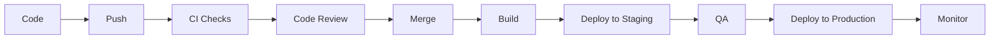
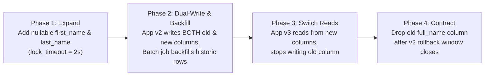
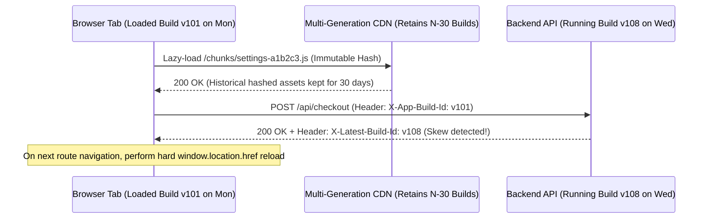
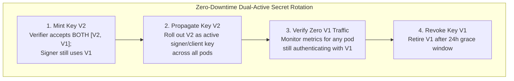

# DevOps Pipeline

## What Is It?

A DevOps pipeline is the automated path your code takes from a developer's machine to production. It covers everything after you type `git push`: code review, automated tests, building, security scanning, staging deployment, production deployment, and monitoring. The goal is to ship code quickly and safely — catching bugs before they reach users, and making deployments boring instead of terrifying.

## Why Should You Care?

Every professional development team uses some form of CI/CD pipeline. Whether you're at a startup or a large enterprise, you'll interact with the pipeline daily. Understanding the business flow — why certain checks exist, what happens during a deployment, how to roll back safely — saves you from being the person who breaks production on a Friday afternoon and doesn't know how to undo it.

## How It Works (The Business Flow)

### The Full Pipeline

### 1. Code & Commit

1. Developer writes code on a feature branch
2. Runs local checks (linting, tests, type checking)
3. Commits with a meaningful message (see [conventional commits](https://www.conventionalcommits.org/))
4. Pushes to remote repository (GitHub, GitLab, Bitbucket)

### 2. Continuous Integration (CI)

Triggered automatically on push or pull request:

1. **Linting**: Code style and formatting checks (ESLint, Prettier)
2. **Type Checking**: TypeScript compilation, type safety verification
3. **Unit Tests**: Fast tests that verify individual functions and components
4. **Integration Tests**: Tests that verify components working together
5. **Build**: Compile the application to verify it builds successfully
6. **Security Scan**: Check dependencies for known vulnerabilities (Snyk, Dependabot)
7. **Code Coverage**: Measure what percentage of code is covered by tests

All checks must pass before the PR can be merged. This is enforced by branch protection rules.

### 3. Code Review

1. Developer opens a Pull Request (PR) with a description of changes
2. Reviewers are assigned (automatically or manually)
3. Reviewers check for: correctness, readability, performance, security, test coverage
4. Comments are left, discussions happen
5. Developer addresses feedback and pushes updates
6. When approved (usually 1-2 approvals required), PR is ready to merge

### 4. Merge & Build

1. PR is merged into the main branch (via merge commit, squash, or rebase)
2. CI runs again on the merged code
3. Build artifacts are created (Docker images, compiled assets, bundles)
4. Artifacts are tagged with a version (git SHA, semantic version, build number)
5. Artifacts are pushed to a registry (Docker Hub, ECR, Artifactory)

### 5. Deployment

**Staging (Pre-Production):**

1. Artifacts are deployed to a staging environment that mirrors production
2. QA team (or automated E2E tests) verifies everything works
3. Performance testing may happen here
4. If issues are found, the pipeline stops — fix and retry

**Production:**

1. After staging approval, artifacts are deployed to production
2. Deployment strategy is executed (see Common Patterns below)
3. Health checks verify the new version is serving traffic correctly
4. Monitoring dashboards are watched for anomalies

### 6. Post-Deployment

1. **Monitoring**: Watch error rates, latency, and key metrics
2. **Alerting**: If something goes wrong, the team is notified (PagerDuty, Slack)
3. **Rollback**: If the deployment causes issues, revert to the previous version
4. **Release notes**: Communicate what changed to stakeholders

## Key Terms You'll Hear

| Term                             | What It Means                                                                                       |
| -------------------------------- | --------------------------------------------------------------------------------------------------- |
| **CI**                           | Continuous Integration — automatically testing code on every push                                   |
| **CD**                           | Continuous Deployment/Delivery — automatically deploying code after CI passes                       |
| **Pipeline**                     | The sequence of automated steps from code to production                                             |
| **Artifact**                     | The built output (Docker image, compiled binary, bundled JS)                                        |
| **Branch Protection**            | Rules that prevent merging unless checks pass and reviews are approved                              |
| **Feature Branch**               | A branch created for a specific feature or fix, merged back when done                               |
| **Trunk-Based Development**      | Everyone commits to main/trunk with short-lived branches. Favors small, frequent merges             |
| **GitFlow**                      | A branching strategy with develop, feature, release, and hotfix branches. More complex              |
| **Blue-Green Deployment**        | Two identical environments. Deploy to the idle one, then switch traffic                             |
| **Canary Deployment**            | Deploy to a small percentage of users first. If metrics are good, roll out to everyone              |
| **Rolling Deployment**           | Gradually replace old instances with new ones, one at a time                                        |
| **Rollback**                     | Reverting to a previous version when something goes wrong                                           |
| **Environment**                  | A separate instance of your app (development, staging, production)                                  |
| **Infrastructure as Code (IaC)** | Defining infrastructure (servers, databases, networks) in code (Terraform, CloudFormation)          |
| **SLA**                          | Service Level Agreement — the promised uptime (e.g., 99.9% = max 8.7 hours downtime/year)           |
| **MTTR**                                    | Mean Time To Recovery — how quickly you recover from incidents                                                              |
| **Hotfix**                                  | An urgent fix deployed outside the normal release cycle                                                                     |
| **Feature Flag**                            | A toggle that enables/disables features without deploying. See [Feature Flags](19-FEATURE-FLAGS.md)                         |
| **Expand-and-Contract (Parallel Change)**   | Multi-phase schema migration pattern (Add → Dual-Write + Backfill → Switch Reads → Drop) for zero-downtime rolling deploys  |
| **Version Skew**                            | When an older client bundle (e.g., an open SPA browser tab from yesterday) communicates with a newly deployed backend/CDN    |
| **Configuration Drift**                     | When live infrastructure diverges from the Terraform/Git state due to manual console edits ("ClickOps")                     |
| **Dual-Active Secret Rotation**             | Rotating API keys or DB credentials by having two valid keys active simultaneously during a grace window before revocation  |

## Common Patterns

### Pattern 1: Blue-Green Deployment

Two identical production environments (Blue and Green). Only one serves traffic at a time.

1. Blue is live, serving all traffic
2. Deploy new version to Green
3. Test Green thoroughly
4. Switch the load balancer to point to Green
5. Green is now live. Blue is idle (fallback)
6. If something goes wrong, switch back to Blue instantly

**Trade-off:** Requires double the infrastructure. Instant rollback is the payoff.

### Pattern 2: Canary Deployment

Deploy the new version to a small subset of users. Monitor. If all good, expand.

1. Deploy new version to 5% of servers/users
2. Monitor error rates, latency, business metrics
3. If metrics are healthy after 15-30 minutes, expand to 25%, then 50%, then 100%
4. If metrics degrade, roll back the canary immediately

**Trade-off:** More complex routing logic. But reduces blast radius — a bad deploy only affects 5% of users initially.

### Pattern 3: Rolling Deployment

Replace instances one at a time. At any point, some instances run the old version and some run the new.

1. Take one instance out of the load balancer
2. Deploy new version to that instance
3. Add it back to the load balancer
4. Repeat for each instance

**Trade-off:** No extra infrastructure needed. But rollback is slower (you have to roll forward or reverse the process).

### Pattern 4: Serverless / JAMstack

No servers to manage. Build static assets, deploy to a CDN.

1. Push to main → CI builds the site → deploys static files to CDN (Vercel, Netlify, Cloudflare Pages)
2. Dynamic functionality via serverless functions (API routes, edge functions)
3. Rollback = redeploy the previous build

**Trade-off:** Simplest deployment model. But limited for complex server-side logic.

## Gotchas & Edge Cases

- **Database migrations**: Code deploys are instant. Database changes are not. Always make migrations backward-compatible. Deploy migration first, then deploy code.
- **Never deploy on Fridays**: A joke that's also good advice. If something breaks, you want to fix it during work hours, not over the weekend.
- **Flaky tests**: Tests that sometimes pass and sometimes fail erode trust in the pipeline. People start ignoring failures. Fix flaky tests immediately.
- **Secret management**: Never put secrets in code, environment files committed to git, or CI logs. Use a secrets manager (Vault, AWS Secrets Manager, GitHub Secrets).
- **Long-running deployments**: If your deployment takes 30+ minutes, developers stack up changes waiting to deploy. Optimize build times.
- **Deployment permissions**: Not everyone should be able to deploy to production. Use role-based access in your CI/CD tool.
- **Observability gap**: You deployed successfully but have no way to know if the new version is actually working. Always pair deployments with monitoring.
- **Rollback data**: You can roll back code, but you can't easily roll back data. If the new code wrote data in a new format, rolling back the code doesn't undo the data changes.

## Industry War Stories & Non-Obvious Best Practices

### 1. Expand-and-Contract (Parallel Change) Database Migrations Under Rolling Deploys

During a Kubernetes or ECS rolling deployment, **Release `v1` pods and Release `v2` pods run simultaneously against the same production database** for 3–15 minutes (or hours during a canary rollout).

**The Destructive Migration Trap:**
Suppose you want to rename `users.full_name` to `users.first_name` and `users.last_name`, or run `ALTER TABLE orders ADD COLUMN tenant_id UUID NOT NULL`.
1. If you run the migration *before* `v2` pods roll out, `v1` pods immediately crash with `column "full_name" does not exist` or `null value in column "tenant_id" violates not-null constraint` on every `INSERT`.
2. Worse, in PostgreSQL, adding a column with a volatile validation or taking an `ACCESS EXCLUSIVE` lock on a 50M-row table without `lock_timeout` queues behind a long-running analytics query and blocks **all** reads and writes on that table, causing a total site outage in seconds.

**Production Best Practice: Four-Deploy Expand-and-Contract Pattern**

Never couple a destructive DDL change and the code that depends on it in a single release. Break every incompatible schema change into four backward-compatible phases:

1. **Phase 1 — Expand (Additive Only)**: Add the new columns as `NULL`-able (`first_name TEXT NULL, last_name TEXT NULL`). Always set `SET lock_timeout = '2s';` in migration scripts so that if a table lock cannot be acquired within 2 seconds, the migration aborts safely instead of piling up connection pools. Create indexes with `CREATE INDEX CONCURRENTLY`.
2. **Phase 2 — Dual-Write + Idempotent Backfill**: Deploy application `v2` which still reads from `full_name`, but writes to **both** `full_name` and `first_name`/`last_name` on every mutation. Run a throttled batch job (`LIMIT 5000` per batch with 50ms sleep to avoid replication lag) to backfill existing rows. If `v2` needs to be rolled back to `v1`, `full_name` is 100% up to date!
3. **Phase 3 — Cut Over Reads & Enforce Constraints**: Once 100% of rows are populated, add a `CHECK (... IS NOT NULL) NOT VALID` constraint, validate it via `VALIDATE CONSTRAINT` (which only takes a `SHARE UPDATE EXCLUSIVE` lock and does not block reads/writes), and deploy `v3` which reads from the new columns and stops writing to `full_name`.
4. **Phase 4 — Contract**: After the rollback window for `v2` has passed, drop the legacy `full_name` column.

### 2. Frontend-Backend Version Skew Protection (`ChunkLoadError` & API Drift)

In a Single-Page Application (React, Next.js, Vue), a user frequently opens your web app on Monday morning and keeps that browser tab open until Thursday. Meanwhile, your CI/CD pipeline deploys 15 times.

**Two Production Failure Modes:**
1. **Lazy-Loaded JS Chunk 404 (`ChunkLoadError`)**: On Monday, the user's browser loaded `index.html` referencing route manifest `v101`. On Wednesday, after deploy `v108` purges old build artifacts from the CDN/server, the user clicks the "Settings" tab. React Router attempts to lazy-load `/_next/static/chunks/settings-a1b2c3.js` from build `v101` — which no longer exists (`404 Not Found`), crashing the page with an unhandled `ChunkLoadError`.
2. **Client-Server Contract Skew**: The Monday tab sends a payload built for Monday's API schema to Thursday's newly deployed backend, or receives a response shape that Monday's JavaScript bundle cannot parse.

**Production Best Practice:**
1. **Multi-Generation Asset Retention on CDN/S3**: Never delete previous hashed static bundles (`/static/chunks/*-[hash].js`) on deploy. Upload new hashed assets alongside existing ones and retain the last 30 days of immutable hashed chunks in S3/CDN (`Cache-Control: public, max-age=31536000, immutable`), while serving `index.html` with `Cache-Control: no-cache, no-store, must-revalidate`.
2. **Build-ID Version Handshake & Hard-Navigation Fallback**: Embed `BUILD_ID` (the git SHA) in the client bundle and send it on API requests (`X-Client-Version: 8f3a9c`). Have the backend return `X-Latest-Version` (or poll `/version.json` every 10 minutes). When the client detects version skew, set an internal `needsHardReload = true` flag so the *next* time the user clicks an `<Link>` route transition, the router intercepts it and performs a clean `window.location.href = targetUrl` full-page navigation instead of a soft SPA transition.
3. **Graceful `ChunkLoadError` Boundary**: Wrap lazy imports in an error boundary that catches `ChunkLoadError`, stores a one-time session flag (`sessionStorage.setItem('chunk_reload', '1')` to prevent infinite reload loops), and automatically reloads the page to fetch the latest `index.html`.

### 3. Configuration Drift & Zero-Downtime Secret Rotation (Dual-Active Grace Windows)

**"It worked yesterday and nobody deployed code today — why is production down?"**
In mature organizations, over 40% of outages are triggered not by code deployments, but by **configuration changes** (feature flag toggles, Terraform manual hotfixes, or expired/rotated credentials).

**Two Classic Operational Traps:**
- **ClickOps Configuration Drift**: During a 2 AM incident, an on-call engineer manually increases an RDS parameter or edits an AWS Security Group / Kubernetes ConfigMap in the web console. Two weeks later, an unrelated CI/CD pipeline runs `terraform apply`, silently reverting the manual hotfix and immediately re-triggering the outage.
- **Single-Slot Secret Rotation Outage**: Security policy mandates rotating the database password or Stripe/internal HMAC signing key every 90 days. An engineer generates a new key, revokes the old key, updates AWS Secrets Manager, and triggers a rolling restart of 50 pods. For the 4 minutes it takes the rolling restart to finish, pods still holding the old key in memory fail every request with `401 Unauthorized`.

**Production Best Practice:**

1. **Dual-Active (Two-Slot) Secret Rotation**: Every credential verifier (JWT verifier, webhook HMAC validator, internal API auth, or database user via dual-user alternation `app_user_blue` / `app_user_green`) must accept an **array of active keys `[current_key, previous_key]`**. Rotation follows four safe steps:
   - **Step 1**: Add `Key_V2` to the verifier's allowed list (`[Key_V2, Key_V1]`) while callers still use `Key_V1`.
   - **Step 2**: Roll out `Key_V2` to all callers/signers. Both keys are valid during the rollout window.
   - **Step 3**: Assert via telemetry that zero requests have authenticated using `Key_V1` for 24 hours.
   - **Step 4**: Remove and revoke `Key_V1`.
2. **Scheduled Drift Detection**: Run `terraform plan -detailed-exitcode` in a read-only CI cron job every hour against production. If exit code `2` (diff detected) is returned outside an active deployment, alert the platform channel immediately before drift accumulates into a landmine.

## Quick Reference

| Scenario                 | Recommended Strategy                                    |
| ------------------------ | ------------------------------------------------------- |
| Small team, simple app   | Push to main → auto-deploy to production                |
| Growing team             | Feature branches + PR reviews + staging environment     |
| Large team, critical app | Canary deployment + feature flags + automated rollback  |
| Static site / JAMstack   | Push to main → build → deploy to CDN                    |
| Mobile app               | CI/CD + TestFlight/Play Console + phased rollout        |
| Breaking change          | Feature flag to decouple deploy from release            |
| Database change          | Run migration separately, ensure backward compatibility |

| Production Failure Scenario                   | Root Cause                                                | Architectural Fix                                                            |
| --------------------------------------------- | --------------------------------------------------------- | ---------------------------------------------------------------------------- |
| Old pods crash during DB column rename/delete | Destructive DDL executed while `v1` pods are still live   | 4-phase Expand-and-Contract (Add nullable → Dual-write → Cutover → Drop)     |
| `ALTER TABLE` freezes all DB queries          | Waiting for `ACCESS EXCLUSIVE` lock queues all traffic    | Set `lock_timeout = '2s'`, use `CREATE INDEX CONCURRENTLY` & `NOT VALID`     |
| Users with open tabs hit `ChunkLoadError`     | Deploy deletes previous build's lazy-loaded JS chunks     | Retain 30 days of immutable hashed chunks in CDN + hard-reload on skew       |
| Rotating API/DB secret causes 5-min outage    | Revoking old key while rolling restart is still in flight | Dual-active key array `[Key_V2, Key_V1]` + dual DB users (`blue` / `green`)  |

