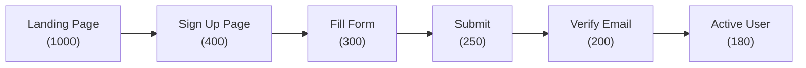
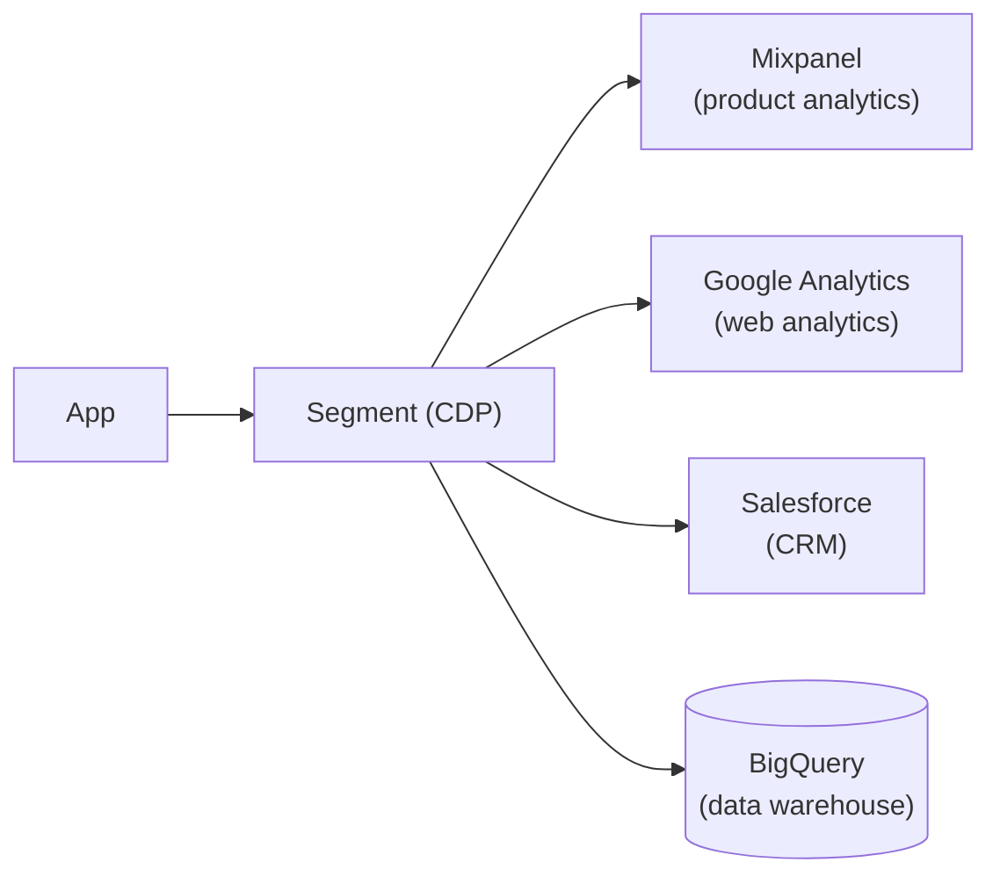
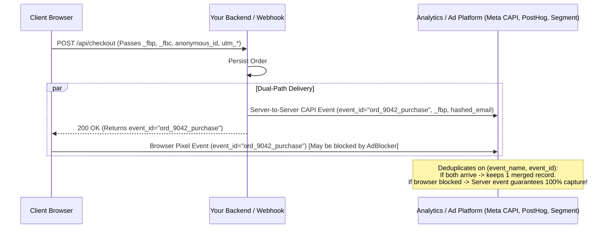
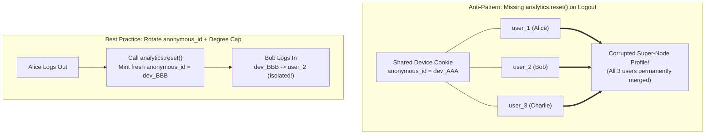

# Analytics & Tracking

## What Is It?

Analytics is measuring what users do in your app so you can make better decisions. Tracking is the mechanism — recording events like page views, button clicks, sign-ups, and purchases. Together they answer questions like: Where do users drop off? Which feature gets used most? Is the new landing page converting better? As a developer, you're instrumenting the code to collect this data and piping it to tools where product managers and marketers can analyze it.

## Why Should You Care?

Product decisions should be data-driven, not gut-driven. The PM asks "How many users complete onboarding?" and if nobody tracked that event, there's no answer. As a developer, you'll be asked to add tracking to almost everything you build. You need to understand: what events to track, how to structure event data, where to send it, and how to do it without killing performance or violating privacy laws.

## How It Works (The Business Flow)

### Event Tracking

Everything is an event. An event has a name and properties:

```
Event: "Button Clicked"
Properties:
  button_name: "Sign Up"
  page: "/pricing"
  user_id: "abc123"
  timestamp: "2026-03-01T10:30:00Z"
```

Events are sent from the client (browser/mobile) or server to an analytics platform (Mixpanel, Amplitude, Google Analytics, PostHog).

### The Tracking Plan

Before writing any tracking code, define a tracking plan — a spreadsheet or document listing:

| Event Name         | When It Fires              | Properties                     | Tracked By |
| ------------------ | -------------------------- | ------------------------------ | ---------- |
| Page Viewed        | Every page load            | page_url, referrer             | Client     |
| Sign Up Started    | User opens signup form     | source (organic, ad, referral) | Client     |
| Sign Up Completed  | User finishes registration | method (email, google, github) | Server     |
| Purchase Completed | Payment succeeds           | amount, currency, plan_name    | Server     |

A tracking plan prevents chaos. Without it, you'll end up with duplicate events, inconsistent naming, and missing data.

### Funnels

A funnel tracks users through a multi-step process:



Each step has a conversion rate. The biggest drops show where to focus improvement efforts.

### Cohort Analysis

Group users by when they signed up (or any shared characteristic) and compare their behavior:

- "Users who signed up in January" vs "Users who signed up in February"
- Track retention: what percentage are still active after 7 days, 30 days, 90 days?

### A/B Testing

1. Split users into two groups randomly
2. Group A sees the current version (control)
3. Group B sees the new version (variant)
4. Track the metric you care about (conversion rate, click-through, revenue)
5. After enough data, determine which version wins with statistical significance
6. Roll out the winner to everyone

## Key Terms You'll Hear

| Term                         | What It Means                                                                                                  |
| ---------------------------- | -------------------------------------------------------------------------------------------------------------- |
| **Event**                    | A tracked user action (page view, click, purchase)                                                             |
| **Property**                 | Metadata attached to an event (page URL, button name, amount)                                                  |
| **Funnel**                   | A sequence of steps users go through, with drop-off rates at each step                                         |
| **Conversion Rate**          | Percentage of users who complete a desired action                                                              |
| **Cohort**                   | A group of users who share a characteristic (signup date, source)                                              |
| **Retention**                | What percentage of users come back after a given time period                                                   |
| **DAU/MAU**                  | Daily/Monthly Active Users — the most basic engagement metrics                                                 |
| **Session**                  | A period of user activity. Typically ends after 30 minutes of inactivity                                       |
| **Attribution**              | Determining which marketing channel (ad, email, organic) led to a conversion                                   |
| **UTM Parameters**           | URL parameters (`utm_source`, `utm_medium`, `utm_campaign`) that track where traffic comes from                |
| **CTR**                      | Click-Through Rate — clicks divided by impressions                                                             |
| **LTV / CLV**                       | Lifetime Value / Customer Lifetime Value — total revenue a customer generates over their relationship with you      |
| **CAC**                             | Customer Acquisition Cost — how much you spend to acquire one customer                                              |
| **Statistical Significance**        | Confidence that A/B test results are real, not random chance. Usually p < 0.05                                      |
| **Conversion API (CAPI)**           | Server-to-server event delivery paired with browser tracking and shared `event_id` deduplication                    |
| **Identity Resolution (Alias)**     | Merging pre-login `anonymous_id` events with post-login `user_id` profiles into a single unified user graph         |
| **Sample Ratio Mismatch (SRM)**     | A Chi-Square test failure where observed A/B traffic split (e.g., 50.8% / 49.2%) diverges from the configured 50/50 |
| **Exposure Logging**                | Recording an A/B experiment assignment *only* when the user actually encounters the variant UI, preventing dilution |

## Common Patterns

### Pattern 1: Client-Side Tracking

JavaScript SDK in the browser captures events and sends them to the analytics platform.

**When it's used:** Page views, clicks, form interactions, UI engagement.

**Trade-off:** Can be blocked by ad blockers (30-40% of users). Subject to client-side bugs and race conditions.

### Pattern 2: Server-Side Tracking

Your server sends events to the analytics platform. Triggered by API calls, database changes, or business logic.

**When it's used:** Revenue events, sign-ups, critical business metrics that must be accurate.

**Trade-off:** Can't be ad-blocked. More reliable. But can't track UI interactions (what users hover over, scroll depth).

### Pattern 3: Event Streaming (Data Pipeline)

Events are sent to a central data pipeline (Segment, Rudderstack) that fans out to multiple destinations (analytics, CRM, data warehouse, marketing tools).



**When it's used:** Companies that use multiple analytics tools and want a single source of truth.

**Trade-off:** Extra infrastructure cost. But changing analytics tools becomes trivial (just add/remove a destination).

## Gotchas & Edge Cases

- **Naming conventions**: `signUp`, `sign_up`, `Sign Up`, `user_signed_up` — pick ONE convention and enforce it. Inconsistent naming makes data analysis a nightmare.
- **Don't track everything**: It's tempting to track every click. But too much data is as useless as too little. Focus on events that answer specific business questions.
- **PII in events**: Never put emails, names, or other personally identifiable information in event properties unless your analytics platform is set up for it. Some tools send data to third parties.
- **Ad blockers**: 30-40% of users block analytics scripts. For critical metrics, use server-side tracking.
- **Consent management**: GDPR requires consent before tracking. Implement a cookie banner and only fire analytics after the user opts in.
- **Clock skew**: Client timestamps can be wrong (user's device clock is off). Use server timestamps for anything time-sensitive.
- **Sampling**: At high volume, some analytics tools sample data (analyze a subset, not all events). Know when your data is sampled and what that means for accuracy.
- **Attribution is hard**: User sees an ad on Monday, googles you on Wednesday, clicks a friend's link on Friday, and buys on Saturday. Who gets credit? There's no perfect answer — that's why there are different attribution models (first touch, last touch, linear, etc.).

## Industry War Stories & Non-Obvious Best Practices

### 1. Hybrid Client + Server-Side Conversion API (CAPI) with Deterministic `event_id` Deduplication

If you rely solely on browser JavaScript (`analytics.track("Order Completed")`) to measure purchases and ad conversions, **your analytics will systematically undercount revenue by 25–35%**:
1. **Ad-Blockers & Brave/Safari ITP**: uBlock Origin, Brave shields, and iOS Intelligent Tracking Prevention block requests to `api.segment.io`, `connect.facebook.net`, and `google-analytics.com`, and cap client-written cookies to 7 days (or 24 hours when URLs carry tracking parameters).
2. **External Payment Redirect Tab Closes**: A user pays via Stripe Checkout, PayPal, Alipay, or 3D Secure bank redirect. Their card is charged and the payment webhook hits your server, but the user closes the mobile browser tab *before* the redirect back to `/checkout/success` finishes loading your JS bundle.

Conversely, if you only track on the server, you lose browser context (`_fbp`/`_fbc` click cookies, `user_agent`, viewport, referrer, UTM session state).

**Production Best Practice: Dual-Path Hybrid Tracking with Deterministic `event_id`**

Fire conversion events from **both** the browser pixel and your backend server (via Conversion API / Server-Side CDP), sharing a deterministic `event_id` so the downstream destination deduplicates them within a 48-hour window:



1. **First-Party Reverse Proxy + `HttpOnly` Anonymous ID**: Route client telemetry through a first-party path (`https://yourapp.com/ingest/...`) and set the `anonymous_id` cookie from your backend via `Set-Cookie` (`HttpOnly; Secure; SameSite=Lax; Domain=.yourapp.com`) so Safari ITP does not purge it after 7 days.
2. **Context Handoff at Checkout**: When the user initiates checkout, persist their client attribution context (`anonymous_id`, `utm_*`, click IDs like `gclid`/`fbclid`, client IP, and User-Agent) on the server-side `checkout_session` row.
3. **Deterministic `event_id` Generation**: Never generate a random `uuidv4()` separately on the client and server. Derive a canonical ID from the business entity (`sha256("purchase:" + order.id)`). Both the browser SDK and the Stripe webhook worker emit `Order Completed` with `event_id: "ord_9042_purchase"`, achieving 100% revenue accuracy with zero double-counting.

### 2. The Shared-Device / Kiosk "Super-Node" Identity Resolution Explosion

Analytics platforms (Segment, Amplitude, Mixpanel, RudderStack) maintain an **Identity Graph** that links a pre-login `anonymous_id` (device cookie) to a known `user_id` when `analytics.identify(user_id)` or `analytics.alias()` is called.

**The War Story:**
An enterprise hospital nurse station, university computer lab, warehouse tablet, or family iPad has 150 different staff members logging in and out on the same browser throughout the month.
- **What goes wrong**: User 1 logs in → `anonymous_id: dev_AAA` merges with `user_1`. User 1 clicks "Log Out", **but the developer forgets to call `analytics.reset()` to rotate the `anonymous_id`**.
- Fifteen minutes later, User 2 logs in on the same browser → `anonymous_id: dev_AAA` is now linked to `user_2`. Because identity merge graphs are transitive (`user_1 <-> dev_AAA <-> user_2`), the CDP merges `user_1`, `user_2`, ..., `user_150` into a single monstrous **"Super-Node" profile**!
- Suddenly, one merged identity appears to generate 80,000 events/day, corrupting cohort retention, breaking B2B account attribution, and triggering automated CRM emails addressed to the wrong person's name.



**Production Best Practice:**
1. **Always Rotate `anonymous_id` on Logout and User Switch**: Every logout handler (and any "Sign in as another user" flow) must immediately invoke `analytics.reset()` (which clears local storage and generates a fresh `anonymous_id` UUID).
2. **Never Alias on Server-Side Shared Markers**: Never pass a shared office NAT IP address, fallback empty string `""`, or literal `"null"`/`"undefined"` as an `anonymous_id` or `user_id` — a single event with `user_id: "undefined"` will bridge every unauthenticated user on your site into one profile.
3. **Enforce Identity Graph Degree Caps**: In your warehouse / CDP identity resolution SQL, cap the maximum number of `user_id`s allowed per `anonymous_id` (e.g., `MAX_USERS_PER_DEVICE = 3`). If an `anonymous_id` is seen with more than 3 distinct `user_id`s, classify it as a **Shared Kiosk Device** and exclude that `anonymous_id` edge from transitive graph stitching.

### 3. Sample Ratio Mismatch (SRM) & Pre-Exposure Assignment Dilution in A/B Tests

Even teams with sophisticated A/B testing tools frequently ship losing variants because of two subtle statistical bugs in how experiments are instrumented:

#### Bug A: Pre-Exposure Assignment Dilution
You are testing a new **Checkout Coupon Modal** on the `/checkout` page, expecting a 5% lift in purchase conversion. However, the engineer evaluates the feature flag (`getExperimentVariant("coupon_modal_exp")`) inside the global `<Navbar>` or at user login, which immediately emits an `Experiment Viewed` exposure event for **100% of site visitors** — even though 85% of visitors only browse the homepage and never reach `/checkout`.
- **The Math Disaster**: That 85% of unexposed users behave identically in Control and Treatment, injecting massive noise into the denominator. A true +5% lift on checkout users gets diluted to +0.75% across all visitors, requiring **44x more sample size** ($N \propto 1/\Delta^2$) to reach statistical significance!
- **The Fix**: Separate *bucketing* from *exposure logging*. Only fire the `$experiment_started` exposure event at the exact code branch where the user actually renders or interacts with the diverging experience.

#### Bug B: Sample Ratio Mismatch (SRM)
You configure a 50% Control / 50% Treatment split. After 100,000 users, you observe **50,820 users in Control (50.82%) and 49,180 in Treatment (49.18%)**, and Treatment shows a "+8% conversion rate win (p = 0.001)".
- **Why you must halt immediately**: A Pearson Chi-Square ($\chi^2$) goodness-of-fit test on `(50820, 49180)` vs `(50000, 50000)` yields $\chi^2 = 26.89$, $p = 2.1 \times 10^{-7}$. The probability of a fair coin flip producing that split by chance is 1 in 4.7 million!
- **What caused the SRM**: Treatment's new JS bundle has a bug that crashes on older Android browsers *before* the analytics SDK finishes loading. Those 1,640 low-end Android users dropped out of Treatment telemetry entirely. Because the surviving Treatment group is now skewed toward wealthier iOS/Desktop users, Treatment's conversion rate looks artificially 8% higher!
- **The Fix**: Automated experimentation pipelines must run a continuous **SRM Chi-Square check** on every experiment and automatically quarantine results whenever $p_{\text{SRM}} < 0.001$.

## Quick Reference

| What to Track                      | Where to Track           | Why                       |
| ---------------------------------- | ------------------------ | ------------------------- |
| Page views, clicks, scrolls        | Client-side              | UI engagement             |
| Sign-ups, purchases, subscriptions | Server-side              | Accurate business metrics |
| Feature usage                      | Both                     | Product decisions         |
| Errors and exceptions              | Both                     | Reliability monitoring    |
| Marketing attribution              | Client-side (UTM params) | ROI on marketing spend    |

| Production Analytics Pitfall              | Root Cause                                                   | Architectural Fix                                                            |
| ----------------------------------------- | ------------------------------------------------------------ | ---------------------------------------------------------------------------- |
| 30% of purchases missing in ad/BI tools   | Ad-blockers, Safari ITP, or user closing payment redirect tab| Hybrid Client + Server CAPI with shared deterministic `event_id` dedup       |
| Hundreds of users merged into one profile | Shared kiosk device without `analytics.reset()` on logout    | Rotate `anonymous_id` on logout + block `"null"` IDs + cap graph degree ≤ 3  |
| A/B test never reaches significance       | Firing exposure event at login instead of `/checkout` render | Log exposure lazily at the exact call site where variant UI diverges         |
| Variant "wins" with 50.8% / 49.2% split   | Sample Ratio Mismatch (SRM) from client crash or bot bias    | Run automated $\chi^2$ SRM check ($p < 0.001$ invalidates experiment)        |

