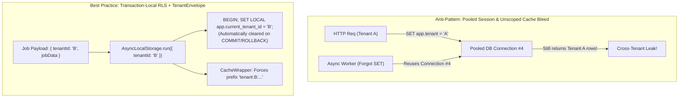
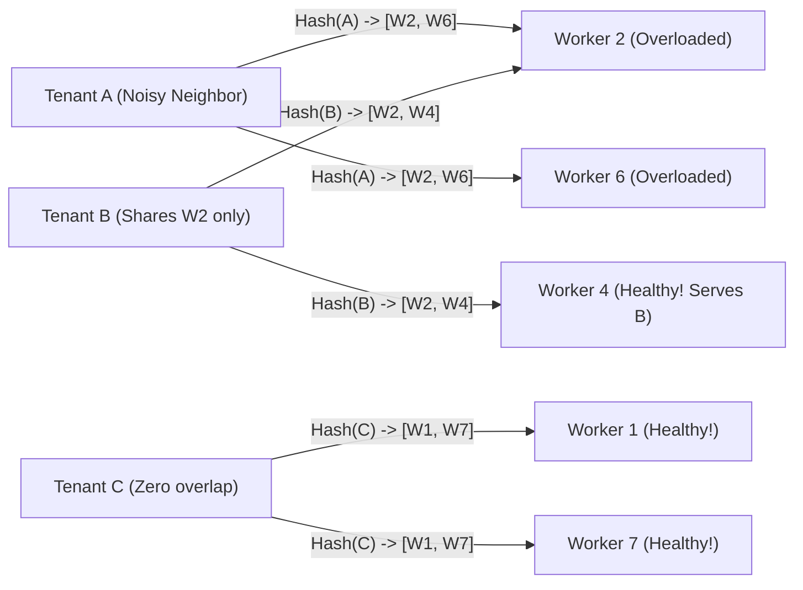
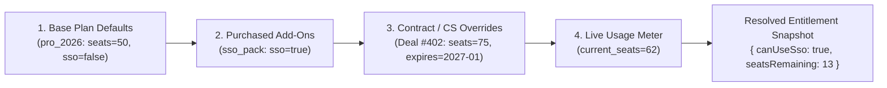

# Multi-Tenancy (SaaS)

## What Is It?

Multi-tenancy is running one application that serves multiple customers (tenants), where each tenant's data is isolated from the others. Think Slack — thousands of companies use Slack, each with their own workspace, users, channels, and messages. They all run on the same Slack infrastructure, but Company A can never see Company B's data. As a developer building SaaS, multi-tenancy is the architectural foundation of your product.

## Why Should You Care?

If you're building a B2B SaaS product, multi-tenancy is not optional — it's the core pattern. Every query, every API call, every page render must be scoped to the correct tenant. A single bug that leaks data between tenants is a catastrophic security incident. Understanding the business model (how tenants are created, billed, isolated, and managed) helps you make the right architectural decisions early.

## How It Works (The Business Flow)

### Tenant Lifecycle

1. **Signup**: A new company signs up → a tenant is created with an organization name, admin user, and billing info
2. **Onboarding**: Admin invites team members, configures settings, imports data
3. **Active Usage**: Tenant uses the product daily. Data grows. More users are added
4. **Plan Changes**: Tenant upgrades/downgrades their subscription. Feature access changes
5. **Offboarding**: Tenant cancels → data retention period → data deletion

### Tenant Identification

Every request must know which tenant it belongs to. Common approaches:

- **Subdomain**: `acme.yourapp.com` → tenant is "acme"
- **Path**: `yourapp.com/acme/dashboard` → tenant is "acme"
- **Header/Token**: API requests include a tenant ID in the header or JWT
- **Database lookup**: Authenticated user → look up their tenant from the user-tenant relationship

### Data Isolation

Every database query must be scoped to the current tenant. A user in Tenant A must never see Tenant B's data.

```sql
-- WRONG: Returns all invoices from all tenants
SELECT * FROM invoices WHERE status = 'paid';

-- RIGHT: Scoped to tenant
SELECT * FROM invoices WHERE tenant_id = 'acme' AND status = 'paid';
```

This seems simple but it's easy to miss in complex queries, background jobs, and reports.

### Feature Gating

Different tenants have different plans with different features:

```
Free Plan:    5 users, 1GB storage, basic features
Pro Plan:     50 users, 100GB storage, advanced features + API access
Enterprise:   unlimited users, unlimited storage, SSO + audit logs + custom branding
```

Your code needs to check the tenant's plan before allowing access to gated features.

## Key Terms You'll Hear

| Term                    | What It Means                                                                                     |
| ----------------------- | ------------------------------------------------------------------------------------------------- |
| **Tenant**              | A customer organization using your SaaS product                                                   |
| **Tenant Isolation**    | Ensuring one tenant cannot access another tenant's data                                           |
| **Single-Tenant**       | Each customer gets their own instance of the application (separate servers, databases)            |
| **Multi-Tenant**        | All customers share the same infrastructure with logical isolation                                |
| **Shared Database**     | All tenants' data in one database, separated by a `tenant_id` column                              |
| **Database per Tenant** | Each tenant gets their own database (stronger isolation, more operational complexity)             |
| **Schema per Tenant**   | Each tenant gets their own schema within a shared database (middle ground)                        |
| **Tenant Context**      | The current tenant, resolved from the request and available throughout the request lifecycle      |
| **Cross-Tenant**        | Anything that spans multiple tenants (reporting, admin operations). Rare and carefully controlled |
| **Noisy Neighbor**      | One tenant's heavy usage degrading performance for others                                         |
| **Custom Domain**              | Enterprise tenants want `app.acme.com` instead of `acme.yourapp.com`                                                      |
| **White-Labeling**             | Tenant's branding (logo, colors, domain) on your product, so it looks like theirs                                         |
| **Data Residency**             | Requirement to store tenant data in a specific geographic region (EU, US, etc.)                                           |
| **Row-Level Security (RLS)**   | Database-enforced policy (e.g., PostgreSQL `CREATE POLICY`) that restricts rows returned based on session `tenant_id`     |
| **Shuffle Sharding**           | Assigning each tenant a unique combinatorial subset of worker nodes so a noisy neighbor only impacts a tiny overlap       |
| **Entitlement**                | A granular capability or quota (`max_seats: 120`, `sso_enabled: true`) resolved separately from the billing plan tier     |
| **Async Context Bleed**        | Cross-tenant data leak caused by reusing mutable singleton state, unprefixed cache keys, or pooled connections in workers |

## Common Patterns

### Pattern 1: Shared Database with Tenant ID

All tenants share one database. Every table has a `tenant_id` column. Every query includes a `WHERE tenant_id = ?` filter.

**When it's used:** Most SaaS startups. Simple, cost-effective, easy to manage.

**Trade-off:** Risk of data leaks if you forget the tenant filter. Noisy neighbor problem (one tenant's heavy query slows everyone). Use Row-Level Security (PostgreSQL RLS) to enforce isolation at the database level.

### Pattern 2: Database per Tenant

Each tenant gets their own database instance. Complete data isolation at the infrastructure level.

**When it's used:** Enterprise customers with strict compliance/security requirements. Highly regulated industries (healthcare, finance).

**Trade-off:** Expensive to operate. Schema migrations must run on every database. Hard to do cross-tenant analytics.

### Pattern 3: Schema per Tenant

Shared database server, but each tenant has their own schema (PostgreSQL schemas, for example).

**When it's used:** Middle ground between shared and separate databases.

**Trade-off:** Better isolation than shared tables, less overhead than separate databases. But schema migrations still need to run per tenant.

### Pattern 4: Hybrid

Most tenants share infrastructure. Enterprise tenants get dedicated databases or even dedicated application instances.

**When it's used:** SaaS products with both self-serve (small tenants) and enterprise (large tenants) customers.

**Trade-off:** Most complex to operate but matches business reality.

## Gotchas & Edge Cases

- **Background jobs forget tenant context**: A cron job or queue worker processing data must know which tenant it's operating on. If it doesn't, it might process the wrong tenant's data or leak data across tenants.
- **Global search leaking data**: Your search index must be tenant-scoped. A shared Elasticsearch index without proper filtering is a data leak waiting to happen.
- **Admin panels need tenant switching**: Your internal admin tool needs to "impersonate" a tenant for debugging. This must be audit-logged.
- **Migrations on live data**: When you add a new column or change a schema, you're doing it for all tenants at once (shared DB) or for each tenant individually (DB per tenant). Both are painful at scale.
- **Tenant deletion**: When a tenant cancels, you need to delete all their data — users, files, database records, search index entries, cache entries, backups. This is harder than it sounds.
- **Rate limiting per tenant**: Don't let one tenant's API usage impact others. Set per-tenant rate limits.
- **Testing**: Your test suite should verify tenant isolation. Create two test tenants, create data in Tenant A, and assert Tenant B can never see it.
- **Billing per tenant**: Track usage (storage, API calls, users) per tenant for metered billing. This requires instrumentation at every usage point.

## Industry War Stories & Non-Obvious Best Practices

### 1. Async Context Bleed (Cross-Tenant Leaks Outside HTTP Request Scope)

Most teams diligently test tenant isolation in HTTP controllers (`WHERE tenant_id = req.tenantId`). Yet in production post-mortems, **the vast majority of cross-tenant data leaks occur outside the synchronous HTTP request lifecycle** — inside background job workers, Kafka consumers, cron jobs, and in-memory/Redis caches.

**Three Classic Cross-Tenant Leak Vectors:**
1. **Unprefixed Cache Keys**: A developer caches the "company settings" or "dashboard summary" under `redis.get("dashboard:summary")` or `redis.get("user:" + userId)`, forgetting that a consultant (`userId: 99`) belongs to *both* Tenant A and Tenant B, or that `"dashboard:summary"` has no tenant prefix. Tenant B opens their dashboard and sees Tenant A's revenue numbers.
2. **Connection Pool Session Variable Bleed**: When using PostgreSQL Row-Level Security (RLS) with `SET app.current_tenant_id = 'tenant_a'` on a pooled connection (PgBouncer / `pg.Pool`), if an exception occurs or a background worker runs a query without resetting the session variable, the connection returns to the pool still scoped to `'tenant_a'`.
3. **Batch Cron Jobs Mixing Tenants**: A nightly invoice generator runs `SELECT * FROM line_items WHERE billed = false`, aggregates them in memory without grouping by `tenant_id`, and emails a single combined PDF containing Tenant B's line items to Tenant A's CFO.



**Production Best Practice:**
- **Always Use `SET LOCAL` Inside a Transaction for RLS**: Never use session-level `SET app.current_tenant_id = ...` on pooled connections. Always wrap database queries in a transaction using `SET LOCAL app.current_tenant_id = 'acme'` — PostgreSQL guarantees `SET LOCAL` is automatically cleared the instant the transaction commits or rolls back.
- **Structural Tenant Cache & Queue Wrappers**: Ban raw `redis.get(key)` and raw queue publishing in lint rules. Require a `TenantScopedCache` and `TenantJobPublisher` that read `tenantId` from `AsyncLocalStorage` (Node.js) or `context.Context` (Go) and throw a hard runtime error if `tenantId` is missing, automatically rewriting every key to `t:{tenant_id}:{namespace}:{key}`.

### 2. Shuffle Sharding & Per-Tenant Fair Queuing (Defeating the Noisy Neighbor)

Suppose you have an 8-worker background queue processing webhook deliveries, PDF exports, or AI embeddings.
- **The FIFO Queue Disaster**: Tenant A (a massive enterprise) uploads a 500,000-row CSV that enqueues 500,000 jobs at 10:00 AM. At 10:01 AM, Tenant B clicks "Export 1-page Invoice PDF". In a shared FIFO queue, Tenant B's 1-second job sits behind 500,000 of Tenant A's jobs for 45 minutes.
- **Horizontal Scaling Doesn't Fix Poison-Pill Tenants**: Even if you autoscale to 80 workers, Tenant A's flood saturates all 80 workers or triggers a downstream memory leak that crashes every worker node in the cluster.

**Production Best Practice: Shuffle Sharding + Weighted Fair Queuing (DRR)**

1. **Shuffle Sharding (Combinatorial Blast-Radius Isolation)**: Instead of letting every tenant hit all $N=8$ worker nodes, assign each tenant a deterministic virtual shard of $k=2$ nodes (using two independent hash functions on `tenant_id`).
   - With $N=8$ workers and $k=2$ workers per tenant, there are $\binom{8}{2} = 28$ unique 2-node combinations.
   - If Tenant A goes rogue and saturates or crashes both of its assigned workers (say, Worker 2 and Worker 6), **96.4% of other tenants** ($\frac{27}{28}$) have at least one completely healthy worker, and **53.6% of tenants** ($\binom{6}{2}/28 = \frac{15}{28}$) share *zero* workers with Tenant A and experience zero impact!



2. **Deficit Round-Robin (DRR) Per-Tenant Fair Queuing**: Partition logical queues by `tenant_id` (or use Redis/SQS Fair Queues / Kafka partition keys with per-tenant concurrency semaphores). Workers pull 1 job from Tenant A, then 1 job from Tenant B, then 1 job from Tenant C in round-robin order, while capping any single tenant to at most `MAX_CONCURRENT_JOBS_PER_TENANT = 5`. Tenant A's 500,000-job backlog drains steadily in the background while Tenant B's 1-page PDF finishes in 200ms.

### 3. Decoupling Tenant Entitlements from Billing Plans

In early-stage SaaS, developers almost always write authorization checks like this:
```typescript
// ANTI-PATTERN: Coupling feature logic directly to billing tier names
if (tenant.plan === 'pro' || tenant.plan === 'enterprise') {
  allowSsoConfiguration();
}
```
**Why This Explodes in B2B Growth:**
1. **Sales Custom Exceptions**: An enterprise prospect says, *"We'll sign a $40k/year Pro contract today, but only if you include SAML SSO and 75 seats instead of 50."* If your codebase checks `tenant.plan === 'enterprise'`, engineers have to deploy ugly hardcoded `if (tenant.id === 'org_acme')` hacks.
2. **Grandfathered Pricing Plans**: Next year you introduce `pro_2027` where Audit Logs move to Enterprise, while existing `pro_2025` customers keep Audit Logs. Suddenly every `if` statement in your codebase turns into a 10-branch boolean nightmare.
3. **Promotional Trials & CS Overrides**: Customer Success wants to grant a struggling customer 14 days of "Advanced Analytics" or +50GB of bonus storage to prevent churn without changing their Stripe subscription tier.

**Production Best Practice: Four-Layer Entitlement Resolution Engine**

Application code must **never** check `tenant.plan`. Application code should only ever query a strongly typed **Entitlement Engine**: `entitlements.check(tenantId, "feature.saml_sso")` or `entitlements.getQuota(tenantId, "limits.max_seats")`.



The Entitlement Engine resolves a tenant's effective capabilities by merging four layers in priority order:
1. **Base Plan Catalog (`plan_entitlements`)**: Default booleans and numeric limits for `free`, `pro_2026`, `enterprise_2026`.
2. **Purchased Add-Ons (`tenant_addons`)**: Self-serve add-on packs (e.g., `+100GB Storage Pack`, `SSO Add-On`).
3. **Tenant-Specific Overrides (`tenant_entitlement_overrides`)**: Sales contract exceptions or temporary CS trials with an `expires_at` timestamp, `reason`, and `granted_by` audit trail.
4. **Real-Time Usage Ledger (`tenant_usage`)**: Compares the effective limit against current consumption and caches the resolved entitlement JSON in Redis (invalidated only on plan/override webhooks).

## Quick Reference

| Factor     | Shared DB                 | Schema per Tenant | DB per Tenant         |
| ---------- | ------------------------- | ----------------- | --------------------- |
| Cost       | Low                       | Medium            | High                  |
| Isolation  | Logical (tenant_id)       | Schema-level      | Full                  |
| Operations | Simple                    | Medium complexity | Complex               |
| Compliance | May need RLS              | Better for audits | Best for compliance   |
| Scale      | Millions of tenants       | Thousands         | Hundreds              |
| Best for   | Startups, self-serve SaaS | Mid-market SaaS   | Enterprise, regulated |

| Multi-Tenant Production Failure              | Root Cause                                                | Architectural Fix                                                            |
| -------------------------------------------- | --------------------------------------------------------- | ---------------------------------------------------------------------------- |
| Tenant B sees Tenant A's data in worker/cron | Session variable bleed on pooled DB conn or unprefixed key| Transaction-scoped `SET LOCAL` RLS + mandatory `t:{tenantId}:*` cache wrapper|
| One tenant's 500k CSV freezes queue for all  | Shared FIFO worker queue with no per-tenant concurrency   | Deficit Round-Robin (DRR) fair queuing + Shuffle Sharding ($k$ of $N$ nodes) |
| Custom enterprise deals require code deploys | Feature checks hardcoded to `tenant.plan === 'enterprise'`| Decouple `Plan` from `Entitlements` (Base Plan + Add-Ons + Expiry Overrides) |

