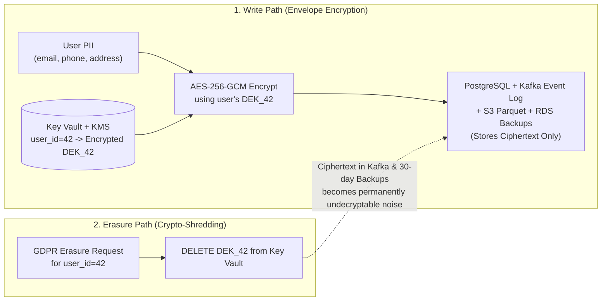
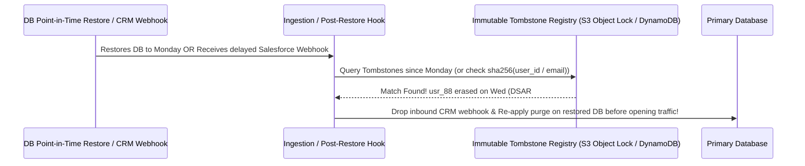
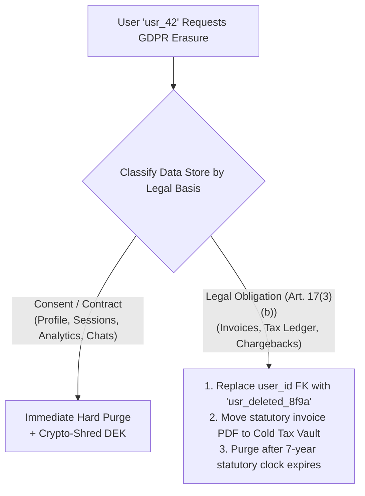

# Data Privacy & Compliance

## What Is It?

Data privacy is about protecting the personal information your app collects, stores, and processes. Compliance means following the laws that govern how you handle that data — GDPR in Europe, CCPA in California, LGPD in Brazil, PIPL in China, and many more. As a developer, you're the one actually building the systems that collect, store, and (when requested) delete personal data. If your code doesn't respect privacy rules, your company faces massive fines.

## Why Should You Care?

GDPR fines can be up to 4% of global annual revenue or 20 million euros, whichever is higher. Amazon got a 746 million euro fine. Meta got 1.2 billion euros. These aren't theoretical. Beyond fines, data breaches destroy user trust and make headlines. As a developer, privacy requirements directly affect how you design databases, APIs, analytics, and data flows. It's not a legal problem you can ignore — it shows up in your code.

## How It Works (The Business Flow)

### What Counts as Personal Data?

Anything that can identify a person, directly or indirectly:

- **Obviously personal**: Name, email, phone number, address, date of birth, photo
- **Less obvious**: IP address, device ID, cookie ID, location data, browsing history
- **Sensitive (extra protection needed)**: Race, ethnicity, health data, biometric data, sexual orientation, political opinions, criminal records

If you can link it back to a specific human, it's personal data.

### Lawful Basis for Processing

You need a legal reason to collect and use personal data. The main ones under GDPR:

1. **Consent**: User explicitly agrees (opt-in checkbox, cookie banner). Must be freely given, specific, and revocable.
2. **Contract**: You need the data to fulfill a contract (e.g., shipping address to deliver an order)
3. **Legitimate Interest**: You have a reasonable business need (e.g., fraud detection). Must be balanced against user rights
4. **Legal Obligation**: The law requires you to keep the data (e.g., financial records for tax purposes)

### User Rights (Data Subject Rights)

Users have rights over their data. Your system must support these:

| Right                                        | What It Means                                | Your System Must...                                     |
| -------------------------------------------- | -------------------------------------------- | ------------------------------------------------------- |
| **Right to Access**                          | "Show me all data you have about me"         | Export user's data in a readable format                 |
| **Right to Rectification**                   | "Fix my incorrect data"                      | Allow users to edit their personal info                 |
| **Right to Erasure** (Right to be Forgotten) | "Delete all my data"                         | Delete user's data (with exceptions for legal holds)    |
| **Right to Data Portability**                | "Give me my data so I can take it elsewhere" | Export data in a machine-readable format (JSON, CSV)    |
| **Right to Restrict Processing**             | "Stop using my data but keep it"             | Flag account to prevent processing while retaining data |
| **Right to Object**                          | "Stop using my data for marketing"           | Opt-out of specific processing activities               |

### Consent Management

1. User visits your site for the first time
2. Cookie banner appears: "We use cookies for analytics and marketing. Accept/Reject/Customize"
3. User's choice is recorded (consent record with timestamp)
4. Only approved tracking is activated
5. User can change their preferences at any time
6. You must keep a log of who consented to what and when

### Data Breach Response

If personal data is compromised:

1. Investigate the scope of the breach (what data, how many users)
2. Notify the supervisory authority within 72 hours (GDPR requirement)
3. Notify affected users if the breach is high-risk
4. Document everything — what happened, what you did about it
5. Take steps to prevent recurrence

## Key Terms You'll Hear

| Term                   | What It Means                                                                                                 |
| ---------------------- | ------------------------------------------------------------------------------------------------------------- |
| **GDPR**               | General Data Protection Regulation — EU privacy law. The most influential privacy regulation globally         |
| **CCPA / CPRA**        | California Consumer Privacy Act / California Privacy Rights Act — California's privacy law                    |
| **LGPD**               | Lei Geral de Proteção de Dados — Brazil's privacy law, modeled on GDPR                                        |
| **PIPL**               | Personal Information Protection Law — China's privacy law                                                     |
| **PII**                | Personally Identifiable Information — data that identifies a specific person                                  |
| **Data Controller**    | The entity that decides why and how data is processed (usually your company)                                  |
| **Data Processor**     | The entity that processes data on behalf of the controller (e.g., your cloud provider, analytics vendor)      |
| **DPA**                | Data Processing Agreement — a contract between controller and processor defining data handling rules          |
| **DPO**                | Data Protection Officer — a person responsible for privacy compliance within an organization                  |
| **DSAR / DSR**         | Data Subject Access Request — when a user formally exercises their privacy rights                             |
| **Data Minimization**  | Collect only the data you actually need. Don't hoard data "just in case"                                      |
| **Purpose Limitation** | Use data only for the purpose it was collected. Don't repurpose email addresses for marketing without consent |
| **Privacy by Design**       | Build privacy into your system from the start, not as an afterthought                                                     |
| **Anonymization**           | Removing all identifying information so data can never be linked back to a person. Irreversible                           |
| **Pseudonymization**        | Replacing identifiers with tokens. The data can be re-identified with the mapping key                                     |
| **Crypto-Shredding**        | Encrypting each user's PII with a unique Data Encryption Key (DEK) and destroying the key on erasure so backups go dark   |
| **Envelope Encryption**     | Encrypting user PII with a per-user DEK, which is itself encrypted by a root Key Encryption Key (KEK) in AWS KMS / Vault  |
| **Tombstone Registry**      | An immutable ledger of `sha256(user_id)` deletion timestamps used to purge "zombie PII" after DB restore or CRM sync      |
| **Statutory Retention**     | Legal mandates (e.g., 7-year tax/invoice or 5-year AML laws) that override GDPR Article 17 deletion for financial ledgers |

## Common Patterns

### Pattern 1: Privacy-First Architecture

Design your data model with privacy in mind from day one.

- Personal data is tagged and stored separately from non-personal data
- Each data field has a defined retention period
- Deletion capabilities are built into every data store
- Access to personal data is logged

**When it's used:** Greenfield projects, companies that take privacy seriously.

**Trade-off:** More upfront design work. But saves massive effort later when regulations change or a DSAR comes in.

### Pattern 2: Consent-Driven Data Collection

No data is collected without explicit consent. Different consent types enable different data processing.

```
Analytics consent    → Enable tracking
Marketing consent    → Enable email marketing, retargeting
Personalization consent → Enable recommendation engine
```

**When it's used:** Any user-facing app in jurisdictions with consent requirements.

**Trade-off:** Some users won't consent, reducing your data. But this is the law, not optional.

### Pattern 3: Data Retention Automation

Automated jobs that enforce retention policies:

1. Define retention periods per data type (transaction records: 7 years, analytics events: 2 years, session data: 90 days)
2. Scheduled job runs nightly, finds expired data, and deletes or anonymizes it
3. Deletion is logged for compliance audits

**When it's used:** Any app that stores personal data (which is basically every app).

**Trade-off:** Requires clear retention policies (business decision) and reliable automation.

## Gotchas & Edge Cases

- **Backups contain personal data**: You deleted a user's data from the live database, but it still exists in last week's backup. Have a strategy for backup data retention.
- **Third-party data sharing**: If you send user data to analytics tools, email providers, or ad networks, you need DPAs with each vendor. You're responsible for what your processors do with the data.
- **Logs contain PII**: Your application logs might contain user emails, IP addresses, request bodies with personal data. Scrub PII from logs or treat log storage as a personal data store.
- **Analytics vs privacy**: Your product team wants to track everything. Privacy law says collect the minimum. This tension is real and requires business-level decisions.
- **Cross-border data transfer**: EU user data stored on US servers is a legal issue (Schrems II ruling). Use Standard Contractual Clauses or ensure your cloud provider has EU data centers.
- **Children's data (COPPA)**: If your app might be used by children under 13 (in the US), you need parental consent and extra protections. Under 16 in the EU.
- **Right to erasure vs legal obligation**: A user wants deletion, but you're legally required to keep their tax records for 7 years. You must satisfy both — delete personal data but retain the legally required records (anonymized where possible).
- **Consent withdrawal**: If a user withdraws consent, you must stop processing AND delete data collected under that consent. This is retroactive.

## Industry War Stories & Non-Obvious Best Practices

### 1. Crypto-Shredding (Honoring Right-to-Erasure Across Immutable Kafka Logs & Backups)

When a user submits a GDPR Article 17 / CCPA Right-to-Erasure request, running `DELETE FROM users WHERE id = 'usr_42'` on your primary PostgreSQL database is the easy 5% of the problem.
**Where Deletion Actually Fails in Production:**
1. **Immutable Event Streams**: Your Kafka topics, Kinesis streams, and S3 Parquet data lakes store append-only event logs (`UserRegistered`, `AddressUpdated`) for 365 days. Rewriting petabytes of compressed Parquet files or mutating immutable Kafka segments for every single deletion request is operationally prohibitive.
2. **Encrypted Point-in-Time Backups**: Your RDS automated snapshots and WAL archives retain full database copies for 30–90 days. You cannot mount and edit a 4TB binary database snapshot every time a user deletes their account.

**Production Best Practice: Per-Subject Envelope Encryption (Crypto-Shredding)**

Instead of scrambling to find and physically overwrite every copy of a user's PII across 40 downstream systems, **encrypt the user's PII fields before they ever enter Kafka, S3, or backups using a per-user Data Encryption Key (`DEK`)**:



1. **Mint a Per-Subject `DEK` at Signup**: When `usr_42` registers, generate a unique 256-bit AES key (`DEK_42`), wrap (encrypt) it with your master KMS Key Encryption Key (`KEK`), and store `(user_id, encrypted_dek)` in a dedicated, tightly audited **Subject Key Vault** table.
2. **Publish Ciphertext to Event Streams**: Whenever an event is published to Kafka (`OrderShipped`), non-PII analytics fields (`order_total: 49.00`, `country: "DE"`, `user_id: "usr_42"`) remain cleartext for BI aggregation, while PII fields (`pii_ciphertext: AES_GCM(DEK_42, { name, email, street })`) are encrypted.
3. **Instantaneous Erasure via Key Destruction**: When `usr_42` requests deletion, delete their live row in PostgreSQL and **permanently destroy `DEK_42` in the Subject Key Vault**. Instantly, every historical copy of `usr_42`'s PII inside Kafka, S3 data lakes, and 90-day RDS snapshots is reduced to mathematically irrecoverable random noise.

### 2. Preventing "Zombie PII Resurrection" via Tombstone Registries

Consider two real-world operational disasters that have triggered regulatory investigations:
- **Scenario A (Point-in-Time Recovery after an Incident)**: User `usr_88` requests GDPR deletion on Tuesday. You delete their account on Wednesday. On Friday, a bad migration corrupts a table and the SRE team restores the database from Monday's backup snapshot. Suddenly, `usr_88` (and every user deleted between Monday and Friday) is **resurrected in production** — and worse, your marketing automation job immediately sends `usr_88` a promo email two days after you sent them a legal "Your data has been permanently erased" confirmation!
- **Scenario B (Bi-Directional CRM / Vendor Sync)**: You delete `usr_88` from your primary database, but 10 minutes later a delayed Salesforce, HubSpot, or Zendesk webhook fires `contact.updated` for `usr_88`, and your webhook handler (`UPSERT INTO users ...`) helpfully recreates the deleted user right back in your database.

**Production Best Practice: Immutable Deletion Tombstone Ledger**



1. **Out-of-Band Immutable Tombstone Store**: Whenever a DSAR erasure completes, write a minimal tombstone record into an independent, append-only store outside the primary database (e.g., a separate DynamoDB table or S3 Object Lock bucket):
   `{ subject_id_hash: hmac_sha256(secret, user_id), email_hash: hmac_sha256(secret, lower(email)), erased_at: "2026-11-04T12:00Z", dsar_ticket_id: "DSAR-9912" }`.
   *(Note: Storing a keyed HMAC-SHA256 hash proves compliance and blocks resurrection without retaining cleartext PII!)*
2. **Mandatory Post-Restore Replay Gate**: In your disaster-recovery runbook and automated restore pipeline, the database **cannot** be re-attached to production traffic until the `replay-tombstones` job scans all tombstones recorded since the backup's timestamp and re-purges those `user_id`s.
3. **Inbound Sync Guardrail**: Every third-party webhook consumer (Salesforce, HubSpot, Stripe) must check `TombstoneRegistry.isErased(email_hash)` before executing any `INSERT` or `UPSERT`, dropping late-arriving events for erased subjects.

### 3. Statutory Tax/AML Retention Overrides vs. User Erasure (Selective Anonymization)

A common interview and production trap: *"A user bought a $500 subscription yesterday, and today demands immediate GDPR Right-to-Erasure of all their records. Do you run `DELETE FROM invoices WHERE user_id = 42`?"*

**Why `DELETE CASCADE` on Financial Tables Is Illegal:**
GDPR Article 17(3)(b) explicitly states that the Right to Erasure **does not apply** to the extent processing is necessary *"for compliance with a legal obligation"*. Tax authorities (IRS in the US, HMRC in the UK, GoBD in Germany, Tax Law in China) and Anti-Money Laundering (AML) laws legally require businesses to retain immutable invoice, tax, and ledger records for **5 to 10 years**. If you `DELETE` invoice rows when a user deletes their account, your company's financial ledger no longer balances and you fail your tax audit. Conversely, if you refuse the user's deletion request entirely and keep their full profile, marketing history, and activity logs, you violate GDPR.

**Production Best Practice: De-Identified Financial Stubs + Segregated Compliance Vault**



1. **Never Use `ON DELETE CASCADE` Between `users` and `invoices` / `ledger_entries`**: Keep financial ledger tables structurally independent of mutable user profile rows.
2. **Field-Level Scrubbing on Operational Tables**: When `usr_42` requests erasure:
   - **Hard-delete** `users`, `sessions`, `oauth_tokens`, `support_tickets`, `marketing_preferences`, and uploaded files.
   - **In operational `orders` / `invoices` tables**: Keep the financial columns required for accounting (`invoice_id`, `subtotal_cents`, `vat_cents`, `currency`, `billing_country_code`, `created_at`) intact, set `user_id = NULL` (or a pseudonymized tombstone token), and scrub mutable contact fields (`customer_email = 'redacted@erased.invalid'`).
3. **Restricted Tax/AML Archive Vault**: If local tax law requires retaining the original invoice buyer name/address for tax audits, move that sealed invoice document into a **Restricted Legal Hold Vault** with zero access from product, support, or marketing services (accessible only to the `tax-auditor` IAM role with mandatory audit logging) and attach an automated TTL to purge it on `invoice_date + 7 years` (or `10 years` for German GoBD).

## Quick Reference

| Regulation | Region     | Key Requirements                                                               |
| ---------- | ---------- | ------------------------------------------------------------------------------ |
| GDPR       | EU/EEA     | Consent, data subject rights, 72h breach notification, DPAs, data minimization |
| CCPA/CPRA  | California | Right to know, right to delete, right to opt-out of data sale                  |
| LGPD       | Brazil     | Similar to GDPR, consent-based, data subject rights                            |
| PIPL       | China      | Consent, data localization, cross-border transfer restrictions                 |
| PIPEDA     | Canada     | Consent, limited collection, accuracy, accountability                          |

| Action          | Compliance Requirement                     |
| --------------- | ------------------------------------------ |
| Collecting data | Have a lawful basis + privacy notice       |
| Storing data    | Encrypt, access-control, define retention  |
| Sharing data    | DPA with processor, user consent if needed |
| Deleting data   | Honor deletion requests within 30 days     |
| Breach occurs   | Notify authority within 72 hours (GDPR)    |

| Production Privacy Dilemma                      | Root Cause                                                   | Architectural Fix                                                              |
| ----------------------------------------------- | ------------------------------------------------------------ | ------------------------------------------------------------------------------ |
| Cannot delete user PII from Kafka or DB backups | Event logs and 30-day snapshots are append-only / immutable  | Crypto-shredding: encrypt PII with per-user `DEK`, destroy `DEK` on erasure    |
| Deleted users reappear after DB backup restore  | Point-in-time recovery rolls back deletions made since backup| Out-of-band Tombstone Registry (`hmac_sha256(user_id)`) replayed post-restore  |
| CRM webhook recreates a user who just deleted   | Delayed Salesforce/HubSpot sync triggers `UPSERT`            | Check Tombstone Registry before any inbound sync `INSERT`/`UPSERT`             |
| Deleting user breaks 7-year tax audit ledger    | `ON DELETE CASCADE` wipes financial invoices                 | Purge profile & analytics; retain de-identified ledger + isolated Tax Vault    |

