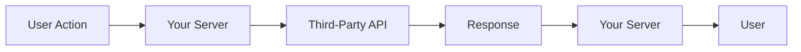
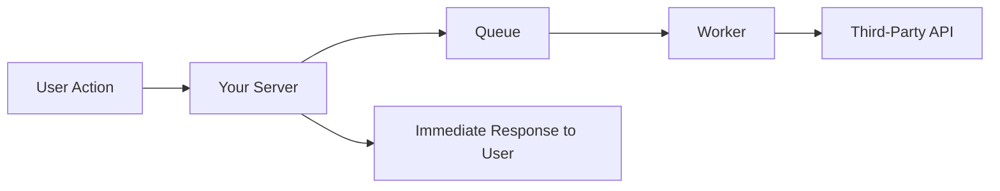
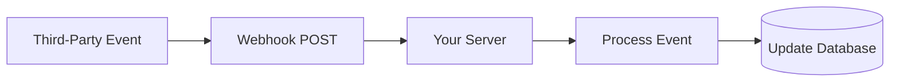
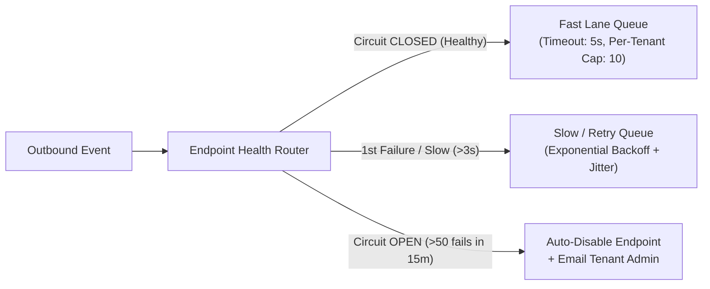
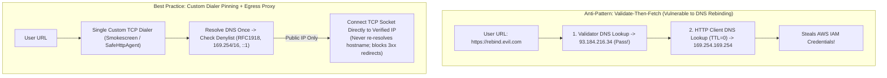

# Third-Party Integrations

## What Is It?

Third-party integration is connecting your app with external services — payment processors (Stripe), email providers (SendGrid), identity providers (Auth0), cloud storage (AWS S3), communication tools (Slack, Twilio), analytics platforms (Mixpanel), and dozens of others. Rather than building everything from scratch, you use APIs to leverage specialized services. As a developer, a huge part of your job is wiring these services together reliably.

## Why Should You Care?

Modern apps are built on integrations. A typical SaaS product might integrate with 10-20 external services. Understanding integration patterns — how to authenticate, handle failures, process webhooks, manage API changes — is a core skill. Bad integrations cause cascading failures, data inconsistencies, and security vulnerabilities. Good integrations are resilient, well-monitored, and easy to maintain.

## How It Works (The Business Flow)

### API Integration Flow

1. **Evaluate**: Research the third-party service. Check docs, pricing, reliability, rate limits
2. **Authenticate**: Get API keys or set up OAuth. Store credentials securely
3. **Integrate**: Write code to call the API. Handle responses and errors
4. **Test**: Use the service's sandbox/test environment
5. **Monitor**: Track API calls, latency, error rates in production
6. **Maintain**: Handle API version changes, deprecations, and outages

### Webhooks (Inbound)

Instead of polling an API ("Did anything change?"), the service tells you when something happens:

1. You register a webhook URL with the service (e.g., `https://yourapp.com/webhooks/stripe`)
2. When an event occurs (payment succeeded, email bounced), the service sends an HTTP POST to your URL
3. Your server receives the payload, verifies it's authentic (signature verification), and processes it
4. You respond with `200 OK` within a timeout (usually 5-30 seconds)
5. If you don't respond, the service retries (exponential backoff, usually 3-5 retries)

### OAuth Integration (Connecting User Accounts)

When your app needs to act on behalf of a user in another service:

1. User clicks "Connect Slack" in your app
2. User is redirected to Slack's authorization page
3. User approves: "Allow YourApp to post messages?"
4. Slack redirects back to your app with an authorization code
5. Your server exchanges the code for access + refresh tokens
6. You store the tokens and use them to call Slack's API on behalf of the user
7. When the access token expires, you use the refresh token to get a new one

### Data Synchronization

When your app and a third-party service need to stay in sync:

1. **One-way sync**: Your app pushes data to the service (e.g., new customers → CRM)
2. **Two-way sync**: Changes in either system are reflected in the other (complex and error-prone)
3. **Event-driven sync**: Webhooks trigger sync operations in near real-time
4. **Batch sync**: Periodic job that reconciles data between systems (hourly, daily)

## Key Terms You'll Hear

| Term                    | What It Means                                                                                     |
| ----------------------- | ------------------------------------------------------------------------------------------------- |
| **API**                 | Application Programming Interface — the contract for communicating with a service                 |
| **REST API**            | API that uses HTTP methods (GET, POST, PUT, DELETE) and URL paths to represent resources          |
| **GraphQL**             | A query language for APIs where the client specifies exactly what data it needs                   |
| **Webhook**             | An HTTP callback — the service pushes data to your server when an event occurs                    |
| **API Key**             | A credential that identifies your application. Usually a long random string                       |
| **OAuth 2.0**           | A protocol for delegated access — your app acts on behalf of a user                               |
| **Rate Limit**          | Maximum number of API calls allowed in a time window (e.g., 100 requests/minute)                  |
| **Sandbox / Test Mode** | A separate environment for development/testing that doesn't affect real data or charge real money |
| **SDK**                 | Software Development Kit — a library the service provides for easier integration                  |
| **Idempotency**         | Ensuring the same operation can be safely retried without duplicate effects                       |
| **Circuit Breaker**     | A pattern that stops calling a failing service to prevent cascading failures                      |
| **Retry with Backoff**  | Retrying failed requests with increasing delays (1s, 2s, 4s, 8s)                                  |
| **API Versioning**              | Services release new versions (`v1`, `v2`). Old versions are eventually deprecated                                          |
| **Deprecation**                 | When a service announces that an API endpoint or version will be removed                                                    |
| **Thin-Event Pull Pattern**     | Treating a webhook solely as an invalidation ping (`{ id, object_id }`) and fetching the latest canonical state via GET API |
| **Event Watermarking**          | Storing `last_event_timestamp` on a record and rejecting stale out-of-order webhook payloads with older timestamps          |
| **SSRF (Server-Side Request Forgery)** | Attack where a user registers an internal IP (`http://169.254.169.254`) as a webhook URL to trick your server into leaking cloud metadata |
| **DNS Rebinding**               | Attack where a domain resolves to a public IP during validation, then flips to `127.0.0.1` with `TTL=0` during HTTP fetch   |
| **Bulkhead Pattern**            | Isolating outbound worker pools and concurrency per tenant so one slow customer endpoint cannot starve others               |

## Common Patterns

### Pattern 1: Direct API Calls

Your server calls the third-party API directly when needed.



**When it's used:** Simple integrations, synchronous operations (verify a payment, send an email).

**Trade-off:** Your response time depends on the third party's response time. If they're slow, your user waits.

### Pattern 2: Queue-Based Integration

Decouple the API call from the user's request using a message queue.



**When it's used:** Non-urgent operations (send email, sync CRM, generate report). Anything where the user doesn't need an immediate result.

**Trade-off:** More infrastructure (queue, workers). But user requests are fast and failures can be retried.

### Pattern 3: Webhook Receiver

The third party pushes data to you instead of you pulling it.



**When it's used:** Payment events, email delivery status, subscription changes, CI/CD notifications.

**Trade-off:** You need a reliable, publicly accessible endpoint. Must verify webhook authenticity. Must handle duplicate deliveries.

### Pattern 4: Abstraction Layer

Wrap the third-party API behind your own interface so you can swap providers without changing your app.

```typescript
// Your abstraction
interface EmailProvider {
  send(to: string, subject: string, body: string): Promise<void>
}

// Implementation for SendGrid
class SendGridProvider implements EmailProvider { ... }

// Implementation for Postmark
class PostmarkProvider implements EmailProvider { ... }
```

**When it's used:** When you might switch providers, or when you use multiple providers for the same function (failover).

**Trade-off:** Extra abstraction layer. Only worth it if you realistically might switch.

## Gotchas & Edge Cases

- **Don't trust the third party to be up**: Every external service will have outages. Your app must handle unavailability gracefully — queue retries, show degraded state, fall back to cached data.
- **Webhook signature verification**: Always verify that webhooks are actually from the claimed service. Without verification, anyone can POST fake events to your webhook endpoint.
- **Webhook processing must be fast**: Respond with `200 OK` quickly, then process the event asynchronously. If you take too long, the service will time out and retry, causing duplicate processing.
- **Idempotent webhook handlers**: Webhooks can be delivered more than once. Use the event ID to deduplicate. If you've already processed event `evt_123`, skip it.
- **API key rotation**: API keys should be rotatable without downtime. Support reading from environment variables and don't hardcode them.
- **Rate limit handling**: Respect `429 Too Many Requests` responses. Read the `Retry-After` header. Implement backoff. Don't hammer a rate-limited API.
- **Sandbox vs Production keys**: Using production API keys in development means sending real emails, charging real cards, and posting to real Slack channels. Always use test/sandbox keys in development.
- **API deprecation**: Subscribe to the service's changelog/blog. When they announce a deprecation, you typically have 6-12 months to migrate. Don't ignore it.
- **Cost monitoring**: Third-party API calls cost money. A bug that sends a million emails or makes a million API calls can generate a huge bill. Set up billing alerts.

## Industry War Stories & Non-Obvious Best Practices

### 1. Out-of-Order Webhook Watermarking & The "Thin-Event Pull" Pattern

Webhook providers (Stripe, GitHub, Shopify, Adyen) explicitly state in their documentation that **they do not guarantee delivery order**.
**Two Classic Out-of-Order Disasters:**
1. **`updated` Arrives Before `created`**: When a customer checks out on Stripe, Stripe fires `customer.subscription.created` and `customer.subscription.updated` within 40 milliseconds of each other. Due to network jitter or worker scheduling, `customer.subscription.updated` hits your server 100ms *before* `customer.subscription.created`. Your `updated` handler runs `UPDATE subscriptions SET status = 'active' WHERE stripe_id = 'sub_99'` — which matches `0 rows` and silently returns `200 OK`! Or worse, it throws a `404` and waits 1 hour for Stripe's retry backoff while the customer is locked out of their paid account.
2. **Stale Retry Overwrites Newer State**: At 12:00:01, a user upgrades to `pro` (`evt_1`, delayed by a transient network blip). At 12:00:05, the user upgrades to `enterprise` (`evt_2`, processed immediately). At 12:02:00, Stripe retries `evt_1` (`pro`). If your handler blindly applies the webhook payload (`SET plan = payload.plan`), **the delayed retry downgrades the Enterprise customer back to Pro!**

**Production Best Practice: Thin-Event State Fetch + Timestamp Watermarking**

```mermaid
sequenceDiagram
    participant Stripe as Stripe / Third-Party Provider
    participant Svc as Your Webhook Worker
    participant DB as Primary DB
    Stripe->>Svc: Webhook: customer.subscription.updated (id: sub_99, created: 1731100001) [Stale Retry!]
    Note over Svc: Option A (Thin-Event Pull): Ignore payload body;<br/>Fetch canonical truth directly from Stripe API!
    Svc->>Stripe: GET /v1/subscriptions/sub_99
    Stripe-->>Svc: Returns latest state (plan: "enterprise", updated: 1731100005)
    Svc->>DB: UPSERT subscriptions ... WHERE last_synced_at <= 1731100005
```

1. **The Thin-Event Pull Pattern (Fetch Current Truth)**: Instead of trusting the snapshot embedded inside the webhook body, treat the webhook merely as a "dirty cache notification" (`sub_99` changed). In your background worker, call `stripe.subscriptions.retrieve('sub_99')` and `UPSERT` the returned canonical object. Whether `updated` arrives before `created` or 3 retries arrive out of order, `GET /v1/subscriptions/sub_99` always returns the latest authoritative state, and `UPSERT` creates the row if `created` hasn't arrived yet!
2. **Optimistic Watermarking (`WHERE provider_updated_at < $incoming_ts`)**: If an API doesn't support fast retrieval and you must consume webhook payloads directly, always use `INSERT ... ON CONFLICT (external_id) DO UPDATE` (`UPSERT` instead of separate `INSERT`/`UPDATE`) guarded by a monotonic watermark:
   ```sql
   INSERT INTO subscriptions (stripe_id, plan, status, provider_event_ts)
   VALUES ($1, $2, $3, $4)
   ON CONFLICT (stripe_id) DO UPDATE
     SET plan = EXCLUDED.plan,
         status = EXCLUDED.status,
         provider_event_ts = EXCLUDED.provider_event_ts
   WHERE subscriptions.provider_event_ts < EXCLUDED.provider_event_ts;
   ```

### 2. Building an Outbound Webhook Engine (Bulkheads & Dead-Endpoint Circuit Breakers)

As your SaaS matures, you stop just *consuming* webhooks and have to **send outbound webhooks** to your own customers' servers (`https://hooks.customer-domain.com/events`).

**What Kills Naive Outbound Webhook Senders:**
Customer A's endpoint goes down (or starts taking 29 seconds before timing out with `504 Gateway Timeout`). Meanwhile, Customer A triggers 50,000 events. Each event blocks a worker thread for 29 seconds, then schedules 5 retries. Within 3 minutes, **100% of your worker pool is tied up waiting on Customer A's dead server**, and Customer B's critical webhooks are delayed by 6 hours.

**Production Best Practice: Per-Endpoint Circuit Breakers + Tiered Retry Queues**



1. **Aggressive Timeouts & Separate Fast/Slow Lanes**: Enforce a strict `5-second` total HTTP timeout on the primary **Fast Lane Queue**. Any endpoint whose p95 latency exceeds 2 seconds or fails on first delivery is immediately demoted to an isolated **Slow / Retry Queue** with its own worker pool so healthy customers never wait behind failing endpoints.
2. **Per-Tenant Concurrency Bulkhead**: Acquire a Redis/token-bucket semaphore (`max_in_flight = 10` per webhook endpoint) before dispatching an HTTP call. If Customer A has 10 requests in flight, their 11th event stays queued in their tenant partition while workers move on to Customer B.
3. **Dead-Endpoint Circuit Breaker & Auto-Disable**: Track rolling failure counts per customer endpoint. If an endpoint fails consecutively for 72 hours (or 100 consecutive attempts after exponential backoff with full jitter: `15s → 2m → 15m → 2h → 6h`), trip the circuit breaker to `DISABLED`, stop wasting worker connections, and send an automated alert email to the tenant admin with a "Replay Missed Events" button in the dashboard.

### 3. SSRF Protection on Customer-Supplied Webhook URLs (Blocking `169.254.169.254` & DNS Rebinding)

Whenever your app lets a user type in a URL that your backend server will fetch — such as a **Webhook URL**, an **Import Image from URL** field, a **Slack-style Link Preview** scraper, or an **OIDC Discovery URL** — you have created a prime **Server-Side Request Forgery (SSRF)** attack surface.

**How Attackers Exploit Naive URL Validation:**
1. **Cloud Metadata Theft**: An attacker registers `http://169.254.169.254/latest/meta-data/iam/security-credentials/` (AWS/GCP/Alibaba Cloud instance metadata IP) or `http://localhost:6379/` as their webhook URL, clicks "Send Test Webhook", and reads the HTTP response body logged in your "Webhook Delivery Inspector" UI — instantly stealing your production AWS IAM role credentials!
2. **DNS Rebinding Bypass (`TTL = 0`)**: You add a pre-check: `dns.lookup(hostname)` → verify it's not a private IP → `fetch(url)`. The attacker sets up `hook.attacker.com` with `TTL = 0`:
   - **Lookup #1 (Your Validator)**: Resolves to `93.184.216.34` (a harmless public IP). Validation passes!
   - **Lookup #2 (5ms later inside `fetch(url)`)**: The HTTP client performs its own DNS lookup, which now resolves `hook.attacker.com` to `169.254.169.254` or `10.0.1.25` (internal admin service)!



**Production Best Practice: Three-Layer SSRF Defense**
1. **Validate Inside the Custom Socket Dialer (Resolve Once, Connect by IP)**: Never validate DNS in a separate function before calling `fetch()`. Use a hardened HTTP agent/dialer (such as Stripe's open-source `smokescreen` egress proxy or a custom `net.Socket` connect hook) that resolves the hostname **once**, checks the resolved IP against all non-routable CIDR blocks (`127.0.0.0/8`, `10.0.0.0/8`, `172.16.0.0/12`, `192.168.0.0/16`, `169.254.0.0/16`, `100.64.0.0/10`, `::1`, `fc00::/7`), and connects the TCP socket directly to that exact verified IP address.
2. **Disable HTTP Redirects (`redirect: "error"`)**: If you allow `301`/`302` redirects, an attacker can point you to `https://public-site.com/redirect` which returns `Location: http://169.254.169.254/`. Either disable redirects entirely on webhook deliveries or re-run the socket-level IP check on every hop.
3. **Dedicated Egress Proxy & IMDSv2**: Route all outbound user-triggered HTTP traffic through an isolated egress proxy sitting in a DMZ subnet with zero network routes to your VPC private subnets, and enforce **AWS IMDSv2** (which requires a session-oriented `PUT` request with an `X-aws-ec2-metadata-token-ttl-seconds` header and `IP TTL = 1`).

## Quick Reference

| Integration Type | Pattern         | Example                                                       |
| ---------------- | --------------- | ------------------------------------------------------------- |
| Payment          | Webhook + API   | Stripe: create payment intent → receive webhook on success    |
| Email            | Queue + API     | SendGrid: queue email → worker sends via API                  |
| Auth             | OAuth 2.0       | Google: redirect → authorize → exchange code → use tokens     |
| Storage          | Direct API      | S3: generate presigned URL → client uploads directly          |
| Communication    | Webhook         | Slack: receive webhook on message → process → respond         |
| Analytics        | Event streaming | Segment: send events → fan out to destinations                |
| CRM sync         | Batch + webhook | Salesforce: webhook on changes + nightly batch reconciliation |

| Integration Failure / Threat                     | Root Cause                                                   | Architectural Fix                                                             |
| ------------------------------------------------ | ------------------------------------------------------------ | ----------------------------------------------------------------------------- |
| `subscription.updated` fails or overwrites newer | Webhooks arrive out of order (`updated` before `created`)    | Thin-Event Pull (`GET` canonical state) + `UPSERT` with timestamp watermark   |
| One dead customer webhook stalls all deliveries  | Shared worker pool blocked by 30s timeouts and retries       | Fast/Slow lane queues + per-tenant concurrency cap + 72h circuit breaker      |
| Attacker steals cloud IAM keys via webhook URL   | SSRF to `169.254.169.254` or DNS rebinding (`TTL=0` flip)    | Custom socket dialer pinning verified IP + block redirects + egress DMZ proxy |

