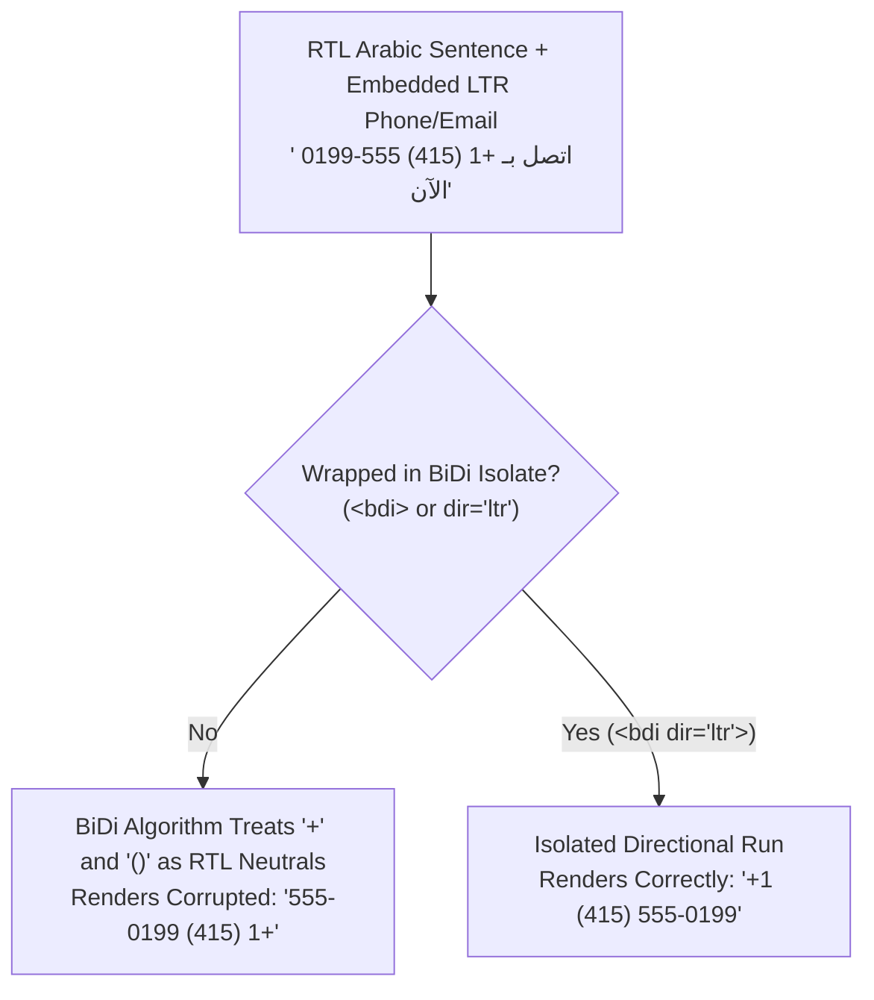

# Internationalization

## What Is It?

Internationalization (i18n) is making your app work for people around the world — different languages, currencies, date formats, number formats, text directions, and cultural conventions. Localization (l10n) is the actual work of adapting for a specific locale (translating text, formatting dates for Germany, etc.). As a developer, i18n is building the infrastructure that makes localization possible. You're creating the framework; translators fill in the content.

## Why Should You Care?

Going global is a business growth strategy, and developers make it possible or impossible. If your app hardcodes English strings, American date formats, and USD prices into the code, adding another language means rewriting huge chunks of the app. If you plan for i18n from the start, adding a new language is mostly a translation exercise. Even if your app is English-only today, building with i18n patterns saves enormous pain later.

## How It Works (The Business Flow)

### Text Translation

The core of i18n — all user-facing text comes from translation files, not hardcoded strings.

```
// WRONG: Hardcoded
<h1>Welcome back!</h1>

// RIGHT: Translation key
<h1>{t('welcome_back')}</h1>
```

Translation files:

```json
// en.json
{ "welcome_back": "Welcome back!" }

// zh.json
{ "welcome_back": "欢迎回来！" }

// de.json
{ "welcome_back": "Willkommen zurück!" }
```

### Locale Detection & Selection

How the app decides which language to show:

1. **URL-based**: `/en/about`, `/zh/about` — language in the URL path
2. **Subdomain**: `en.yourapp.com`, `zh.yourapp.com`
3. **Browser preference**: Read the `Accept-Language` header
4. **User setting**: User picks their language in profile settings
5. **Cookie/Storage**: Remember the user's last choice

Priority usually goes: User setting > URL > Cookie > Browser > Default.

### Date, Time, and Number Formatting

These vary wildly by locale:

| Format   | US (en-US) | Germany (de-DE) | China (zh-CN) | Japan (ja-JP) |
| -------- | ---------- | --------------- | ------------- | ------------- |
| Date     | 03/01/2026 | 01.03.2026      | 2026/03/01    | 2026年3月1日  |
| Number   | 1,234.56   | 1.234,56        | 1,234.56      | 1,234.56      |
| Currency | $1,234.56  | 1.234,56 €      | ¥1,234.56     | ¥1,234        |
| Time     | 3:30 PM    | 15:30           | 15:30         | 15:30         |

Use the `Intl` API (built into JavaScript) to format these correctly.

### Currency Handling

Currency is NOT just "add a dollar sign":

1. Store amounts in the smallest unit (cents) as integers — never floats
2. Store the currency code alongside the amount (USD, EUR, CNY)
3. Display using the locale's formatting rules
4. Exchange rates are external data — fetch from a service (Open Exchange Rates, fixer.io)
5. Currency conversion should happen server-side with clearly stated rates

### Pluralization

Different languages have different plural rules:

- **English**: 1 item, 2 items (2 forms)
- **Chinese**: 1 个项目 (1 form — no plural distinction)
- **Arabic**: 0 items, 1 item, 2 items, few items, many items, other items (6 forms!)

Your i18n library must handle this. ICU MessageFormat is the standard:

```
{count, plural, =0 {No items} one {1 item} other {{count} items}}
```

### Right-to-Left (RTL) Languages

Arabic, Hebrew, Farsi, and Urdu are written right-to-left. This affects:

- Text alignment flips
- Layout mirrors (sidebar on the right, back buttons on the right)
- Icons may need to flip (directional arrows)
- CSS uses `direction: rtl` and logical properties (`margin-inline-start` instead of `margin-left`)

## Key Terms You'll Hear

| Term                    | What It Means                                                                                             |
| ----------------------- | --------------------------------------------------------------------------------------------------------- |
| **i18n**                | Internationalization — building the system to support multiple locales                                    |
| **l10n**                | Localization — adapting the product for a specific locale                                                 |
| **Locale**              | A combination of language + region (en-US, zh-CN, pt-BR). Determines formatting rules                     |
| **Translation Key**     | An identifier that maps to translated text (e.g., `welcome_back`)                                         |
| **Translation File**    | A file (JSON, YAML, PO) containing all translations for a locale                                          |
| **ICU MessageFormat**   | A standard for handling complex translation patterns (plurals, gender, select)                            |
| **RTL**                 | Right-to-Left — languages like Arabic and Hebrew that read right to left                                  |
| **Locale Fallback**     | If `zh-TW` translation is missing, fall back to `zh`, then to `en`                                        |
| **String Extraction**   | Automatically finding translatable strings in code and generating translation files                       |
| **TMS**                 | Translation Management System — a platform where translators work (Crowdin, Phrase, Lokalise)             |
| **Machine Translation** | Using AI to generate initial translations (Google Translate, DeepL). Usually needs human review           |
| **Pseudo-Localization** | Replacing English text with accented characters (Ŵéĺçöḿé) to visually test i18n without real translations |
| **CLDR**                | Unicode Common Locale Data Repository — the industry-standard database of locale rules, plurals, and formats |
| **BiDi Isolation**      | Wrapping embedded LTR/RTL substrings (`<bdi>`, Unicode isolates) so bidirectional text doesn't scramble   |
| **Logical Properties**  | Direction-agnostic CSS properties (`margin-inline-start`, `padding-block-end`) that auto-flip in RTL      |
| **Unicode Normalization** | Converting visually identical character sequences (NFC vs NFD) into a canonical byte representation     |
| **Collation**           | Locale-specific rules for sorting and comparing strings (`Intl.Collator`)                                 |

## Common Patterns

### Pattern 1: JSON Translation Files

One JSON file per locale, bundled with the app. Loaded at build time or on demand.

**When it's used:** Most web apps. Frameworks like Next.js, React (react-i18next, next-intl) use this.

**Trade-off:** Simple to implement. But updating translations requires a code deployment.

### Pattern 2: Remote Translation (CMS-Driven)

Translations are stored in a CMS or TMS and fetched at runtime. Translators update text without a deploy.

**When it's used:** Large apps with frequent copy changes, marketing-heavy content.

**Trade-off:** Runtime dependency on the translation service. Need caching strategy.

### Pattern 3: Locale-Based Routing

Each locale has its own URL path. The locale is part of the route, not just a cookie.

```
/en/pricing
/zh/pricing
/de/pricing
```

**When it's used:** SEO-important sites (search engines index different language versions separately).

**Trade-off:** More routing complexity. But best for SEO and shareability.

### Pattern 4: Separate Builds per Locale

Each locale gets its own build (or bundle). Only the relevant translations are included.

**When it's used:** High-performance apps where bundle size matters.

**Trade-off:** Smaller bundles per locale but longer build times. More complex deployment.

## Gotchas & Edge Cases

- **Text expansion**: German text is ~30% longer than English. Chinese is ~30% shorter. Your UI must handle both. Buttons that say "Submit" in English might say "Formular absenden" in German. Don't set fixed widths on text elements.
- **Don't concatenate strings**: `"Hello " + name + ", you have " + count + " messages"` — this breaks in languages where word order is different. Use template variables: `"Hello {name}, you have {count} messages"`.
- **Images with text**: If your images contain text (banners, diagrams), they need separate versions per locale. Better: use CSS text overlays on images.
- **Sorting and comparison**: Alphabetical order is different in different languages. Use `Intl.Collator` for locale-aware sorting.
- **Input validation**: Email addresses can contain international characters (IDN). Names can have accents, diacritics, and characters from any script. Don't validate with ASCII-only regex.
- **Timezone is not locale**: A French speaker in New York needs French text but US Eastern time. Don't assume locale = timezone.
- **Legal content**: Privacy policies, terms of service, and cookie banners may need to be in the local language by law (GDPR requires it in the user's language).
- **Numbers in translations**: "You have 5 messages" — the number 5 should be formatted according to the locale (5 in English, ٥ in Arabic). Most i18n libraries handle this.

## Industry War Stories & Non-Obvious Best Practices

### 1. ICU MessageFormat Pluralization & Gender Select Rules

Developers coming from English or Chinese often write code like:

```javascript
// BROKEN: Assumes only singular (1) vs plural (everything else)
const label = count === 1 ? `${count} file` : `${count} files`;
```

This fails catastrophically in Slavic, Baltic, and Semitic languages defined in the Unicode CLDR:

- **Russian / Polish / Ukrainian (4 plural categories: `one`, `few`, `many`, `other`)**: In Russian, numbers ending in 1 (except 11) use `one` (`1 файл`, `21 файл`); numbers ending in 2–4 (except 12–14) use `few` (`2 файла`, `24 файла`); 0, 5–20, and numbers ending in 5–9 or 0 use `many` (`5 файлов`, `11 файлов`); fractions use `other` (`1.5 файла`).
- **Arabic (6 plural categories: `zero`, `one`, `two`, `few`, `many`, `other`)**: Has a dedicated dual form (`two`) for exactly 2 items, distinct forms for 3–10 (`few`), 11–99 (`many`), and 100+ (`other`).

Furthermore, many languages (French, Spanish, Russian, Hebrew, Arabic) inflect verbs and adjectives based on the grammatical gender of the subject, and sentences often combine **both** gender and pluralization. Splitting a sentence into fragments (`t('user_invited') + count + t('guests')`) makes it impossible for translators to conjugate the sentence properly.

**Best Practice:** Always pass full sentences to **ICU MessageFormat** so translators control all plural and gender branches inside a single translation key:

```icu
{gender, select,
  female {
    {count, plural,
      =0 {{host} не пригласила гостей.}
      one {{host} пригласила # гостя.}
      few {{host} пригласила # гостей.}
      many {{host} пригласила # гостей.}
      other {{host} пригласила # гостя.}
    }
  }
  male {
    {count, plural,
      =0 {{host} не пригласил гостей.}
      one {{host} пригласил # гостя.}
      few {{host} пригласил # гостей.}
      many {{host} пригласил # гостей.}
      other {{host} пригласил # гостя.}
    }
  }
  other {
    {count, plural,
      =0 {{host} не пригласил(а) гостей.}
      other {{host} пригласил(а) # гостей.}
    }
  }
}
```

### 2. Bidirectional (BiDi) Isolation & Logical CSS Properties

When adapting an interface for Right-to-Left (RTL) scripts like Arabic (`ar`), Hebrew (`he`), or Persian (`fa`), two subtle production bugs appear: layout hardcoding and Unicode Bidirectional Algorithm (UBA) corruption.

#### Logical CSS Properties vs. Physical Directions

If your CSS uses `margin-left: 16px`, `text-align: left`, or `right: 0`, switching `<html dir="rtl">` leaves margins and badges on the wrong side unless you maintain messy `[dir="rtl"]` overrides. Modern CSS solves this natively with **logical properties** mapped to `inline-start` (left in LTR, right in RTL) and `inline-end` (right in LTR, left in RTL):

```css
/* WRONG: Physical properties break in RTL */
.sidebar-item {
  margin-left: 12px;
  padding-right: 8px;
  border-left: 3px solid var(--accent);
  text-align: left;
}

/* RIGHT: Logical properties automatically mirror when dir="rtl" */
.sidebar-item {
  margin-inline-start: 12px;
  padding-inline-end: 8px;
  border-inline-start: 3px solid var(--accent);
  text-align: start;
}
```

#### BiDi Text Scrambling on Embedded LTR Data

Even when `<html dir="rtl">` is set, embedding Left-to-Right (LTR) strings—such as phone numbers (`+1 (415) 555-0199`), email addresses, file paths (`/var/log/nginx.log`), or English usernames with punctuation—inside an RTL sentence causes the browser's BiDi algorithm to misinterpret neutral characters (`+`, `-`, `/`, `@`, parentheses) as belonging to the surrounding RTL flow. As a result, `+1 (415) 555-0199` visually renders backward as `555-0199 (415) 1+`.



**Best Practice:**
- Wrap dynamic user-generated variables (usernames, product titles) in `<bdi>` (Bidirectional Isolate) elements so their script direction never bleeds into surrounding punctuation.
- Wrap inherently LTR technical tokens (phone numbers, URLs, code snippets, serial numbers, credit card masks) in `<span dir="ltr" class="unicode-bidi-isolate">`.
- In plain-text contexts (emails, push notifications, CSVs where HTML tags aren't available), wrap dynamic substrings with Unicode Directional Isolate characters: `U+2068` (First Strong Isolate, `⁨`) and `U+2069` (Pop Directional Isolate, `⁩`).

### 3. Locale-Aware Collation, The Turkish Dotted/Dotless-I Bug, and Unicode Normalization

Assuming string operations like `.toLowerCase()`, `.toUpperCase()`, `===`, and `.sort()` are universal is a classic cause of production outages.

#### The Turkish-I Bug (`tr-TR` and `az-AZ`)

In English, lowercase `i` maps to uppercase `I`. In Turkish and Azerbaijani, there are **two distinct letters**:
- Dotless `ı` (`U+0131`) ↔ Uppercase `I` (`U+0049`)
- Dotted `i` (`U+0069`) ↔ Uppercase `İ` (`U+0130`)

If backend or frontend code normalizes enum keys, HTTP headers, or SQL keywords using locale-sensitive casing on a machine running under the Turkish locale:

```javascript
// In Turkish locale (tr-TR):
'id'.toLocaleUpperCase('tr-TR'); // Returns "İD" (U+0130 + D), NOT "ID"!
'IMAGE'.toLocaleLowerCase('tr-TR'); // Returns "ımage" (U+0131 + mage), NOT "image"!
```

Lookup checks like `header.toUpperCase() === 'AUTHORIZATION'` or `role.toLowerCase() === 'admin'` silently return `false`, locking Turkish users out of apps.
- **Rule:** Use locale-invariant casing (`.toLowerCase()` / `.toUpperCase()` in JS, `String.toLowerCase(Locale.ROOT)` in Java, `strings.ToLower` in Go) for internal identifiers, protocol headers, and database enums; use `.toLocaleLowerCase(locale)` **only** for human-facing display text.

#### Unicode Normalization (`NFC` vs. `NFD`)

Accented characters like `é` or `ö` and Japanese kana voiced marks (`が`) can be encoded in Unicode in two byte-incompatible ways:
- **NFC (Canonical Composition)**: A single code point `é` (`U+00E9`, 1 character length). Used by Windows, Linux, Android, and web keyboards.
- **NFD (Canonical Decomposition)**: Base letter `e` (`U+0065`) followed by combining acute accent `◌́` (`U+0301`, 2 code units!). **macOS (HFS+/APFS) normalizes filenames to NFD.**

```javascript
const nfc = 'café'; // 'café' (length: 4)
const nfd = 'café'; // 'café' (length: 5)

console.log(nfc === nfd); // false! S3 keys, DB unique constraints, and search fail!
console.log(nfc.normalize('NFC') === nfd.normalize('NFC')); // true
```

If a user uploads `résumé.pdf` from a Mac, the NFD filename won't match an NFC search query or database lookup unless your API ingestion layer normalizes all incoming strings with `str.normalize('NFC')`.

#### Locale-Aware Collation

Standard `array.sort()` in JavaScript sorts by UTF-16 code units (`"Z" < "a"`, `"ä"` comes after `"z"`). Even worse, different locales sort the same letters differently:
- In **German (`de-DE`)**, `ä` sorts right next to `a`.
- In **Swedish (`sv-SE`)**, `ä` is a distinct letter at the very end of the alphabet after `z` (`x, y, z, å, ä, ö`).
- In **Chinese (`zh-CN`)**, users expect sorting by Pinyin pronunciation (`Intl.Collator('zh-CN-u-co-pinyin')`) rather than random Unicode CJK code point order.

Always reuse a pre-instantiated `Intl.Collator(locale, { sensitivity: 'base', numeric: true })` instance for sorting lists in UI tables.

## Quick Reference

| Aspect                | Implementation                                                                 |
| --------------------- | ------------------------------------------------------------------------------ |
| Text                  | Translation keys + JSON files per locale                                       |
| Dates                 | `Intl.DateTimeFormat` with locale parameter and explicit `timeZone`            |
| Numbers               | `Intl.NumberFormat` with locale parameter                                      |
| Currency              | Store in smallest integer unit (cents) + ISO 4217 code, format via `Intl`      |
| Plurals & Gender      | Full-sentence ICU MessageFormat (`plural`, `select`, `selectordinal`)          |
| RTL & BiDi            | CSS logical properties (`margin-inline-start`), `<bdi>` / `dir="ltr"` isolates |
| String Normalization  | Normalize user input and filenames with `.normalize('NFC')` at API boundary    |
| Sorting (Collation)   | `new Intl.Collator(locale, { numeric: true }).compare`                         |
| URL routing           | `/[locale]/path` pattern                                                       |
| Fallback              | Specific locale → language → default locale                                    |
