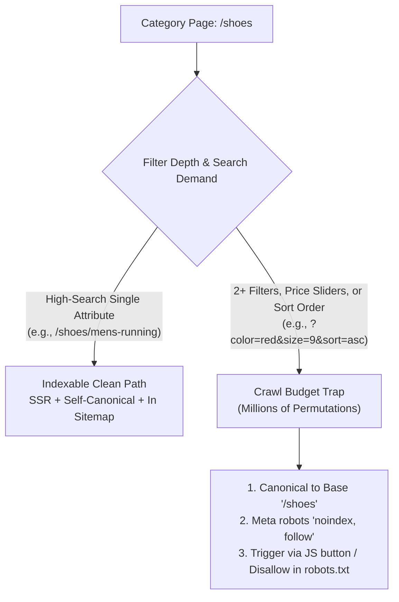

# SEO

## What Is It?

SEO (Search Engine Optimization) is making your website findable and rankable by search engines like Google. When someone searches "best project management tool," SEO determines whether your site appears on page 1 or page 50. It covers technical factors (can Google crawl your site?), content factors (does your page answer the query?), and authority factors (do other sites link to you?). As a developer, you own the technical SEO — the code-level decisions that make or break a site's search visibility.

## Why Should You Care?

Organic search traffic is free and often the largest traffic source for websites. A well-optimized site can generate millions of visits without paying for ads. But a single technical mistake — blocking Google's crawler, missing meta tags, slow page loads — can tank a site's rankings overnight. Developers make these mistakes because they don't understand SEO basics. You don't need to be an SEO expert, but you need to know enough to not accidentally break things.

## How It Works (The Business Flow)

### How Search Engines Work

1. **Crawling**: Googlebot visits your site and follows links to discover pages
2. **Indexing**: Google reads the page content and stores it in its index (a massive database)
3. **Ranking**: When a user searches, Google finds relevant pages in the index and ranks them by quality/relevance
4. **Serving**: The ranked results are shown on the search results page (SERP)

### Technical SEO (Developer's Responsibility)

**Crawlability — Can Google find your pages?**

- Your site must be accessible to search engine bots
- `robots.txt` tells crawlers which parts of your site to crawl or skip
- XML sitemap lists all pages you want indexed (submit via Google Search Console)
- Internal linking ensures all important pages are reachable from other pages
- JavaScript-rendered content must be crawlable (SSR/SSG preferred over client-side rendering)

**Indexability — Can Google understand your pages?**

- Each page needs a unique, descriptive `<title>` tag (50-60 characters)
- Each page needs a `<meta name="description">` (150-160 characters)
- Use proper heading hierarchy (`<h1>` once per page, then `<h2>`, `<h3>`)
- Canonical URLs (`<link rel="canonical">`) prevent duplicate content issues
- `noindex` meta tag tells Google not to index a page (use for admin pages, thank-you pages)

**Performance — Is your site fast?**

- **Core Web Vitals**: Google's performance metrics that affect ranking
  - **LCP** (Largest Contentful Paint): Main content loads in < 2.5s
  - **INP** (Interaction to Next Paint): Page responds to interaction in < 200ms
  - **CLS** (Cumulative Layout Shift): Layout doesn't jump around (score < 0.1)
- Fast sites rank better. Optimize images, minimize JavaScript, use CDN

**Mobile-First**

- Google indexes the mobile version of your site first
- Responsive design is a must — not a separate mobile site
- Touch targets must be large enough, text readable without zooming

### Content SEO (Usually Marketing's Responsibility, but Developers Enable It)

- Each page should target a specific search query (keyword)
- Content should be comprehensive, original, and useful
- Heading structure should be logical and include relevant terms
- Images should have descriptive `alt` text

### Structured Data (Schema Markup)

Machine-readable metadata that helps Google understand your content:

```html
<script type="application/ld+json">
  {
    "@context": "https://schema.org",
    "@type": "Product",
    "name": "Running Shoes",
    "image": "https://example.com/shoes.jpg",
    "description": "Lightweight running shoes",
    "offers": {
      "@type": "Offer",
      "price": "89.99",
      "priceCurrency": "USD"
    }
  }
</script>
```

This enables rich results in Google — star ratings, price info, FAQ dropdowns, recipe cards, etc.

## Key Terms You'll Hear

| Term                 | What It Means                                                                                     |
| -------------------- | ------------------------------------------------------------------------------------------------- |
| **SERP**             | Search Engine Results Page — what you see when you Google something                               |
| **Organic Traffic**  | Visitors who find you through search (not ads)                                                    |
| **Keyword**          | The search query you want to rank for ("project management tool")                                 |
| **Backlink**         | A link from another website to yours. More quality backlinks = higher authority                   |
| **Domain Authority** | A score estimating how likely a domain is to rank (not a Google metric, but widely used)          |
| **Crawl Budget**     | How many pages Google will crawl on your site in a given period. Matters for large sites          |
| **Index**            | Google's database of web pages. "Getting indexed" = appearing in Google's database                |
| **Canonical URL**    | The "official" version of a page when duplicate versions exist                                    |
| **301 Redirect**     | Permanent redirect from old URL to new URL. Passes SEO value                                      |
| **404 Page**         | Page not found. Too many 404s = poor user experience = ranking penalty                            |
| **Rich Results**     | Enhanced search results with extra visual info (stars, prices, images) powered by structured data |
| **Core Web Vitals**  | Google's page experience metrics (LCP, INP, CLS)                                                  |
| **Sitemap**          | An XML file listing all URLs on your site, submitted to search engines                            |
| **robots.txt**       | A file telling crawlers which URLs to crawl or skip                                               |
| **Faceted Navigation** | Multi-select category filters (color, size, price, sort) that can generate millions of URL permutations |
| **Soft 404**         | A missing or empty page that returns HTTP `200 OK` instead of `404 Not Found`, polluting search indexes |
| **hreflang**         | HTML `<link>` or HTTP header attribute telling search engines which language/region a URL targets |
| **x-default**        | Fallback `hreflang` value pointing to the language-selector or default global version of a page   |
| **noindex**          | Meta robots directive (`<meta name="robots" content="noindex">`) instructing crawlers not to index a page |

## Common Patterns

### Pattern 1: Server-Side Rendering (SSR) / Static Site Generation (SSG)

HTML is generated on the server so search engines receive complete content.

**When it's used:** Content-heavy sites, e-commerce, blogs. Next.js, Nuxt.js, Astro.

**Trade-off:** Faster for crawlers (they don't need to execute JavaScript). Slightly more complex than pure SPA.

### Pattern 2: Client-Side Rendering with Prerendering

SPA that uses a prerendering service (Prerender.io) to serve HTML snapshots to crawlers.

**When it's used:** SPAs that can't switch to SSR but need SEO.

**Trade-off:** Extra service to maintain. Content might be stale for crawlers.

### Pattern 3: Headless CMS + Static Generator

Content is managed in a CMS, pages are statically generated at build time.

**When it's used:** Blogs, documentation sites, marketing sites.

**Trade-off:** Fastest performance (static HTML on CDN). But content updates require a rebuild.

## Gotchas & Edge Cases

- **SPAs are SEO-hostile by default**: A React SPA that renders everything client-side shows an empty `<div>` to Google. Use SSR/SSG or ensure your content is server-rendered.
- **Changing URLs without redirects**: Moving `/blog/my-post` to `/articles/my-post` without a 301 redirect loses all SEO value that URL accumulated. Always redirect.
- **Blocking JavaScript in robots.txt**: If you block CSS/JS files, Google can't render your page properly and may not index it correctly.
- **Duplicate content**: Same content at multiple URLs (http vs https, www vs non-www, trailing slash vs no trailing slash) splits ranking signals. Set canonical URLs.
- **Slow page loads**: A 5-second page load isn't just bad UX — it directly hurts rankings. Optimize Core Web Vitals.
- **Missing alt text on images**: Google can't "see" images. Alt text describes images for search engines and screen readers. Always include it.
- **Pagination SEO**: For paginated content (product listings, blog archives), use proper pagination markup or load-more patterns. Don't make Google crawl infinite scroll.
- **Localized content**: For multi-language sites, use `hreflang` tags to tell Google which language version to show to which users.
- **Soft 404s**: Returning a 200 status code for a page that says "Not Found." Google gets confused. Return proper 404 status codes.

## Industry War Stories & Non-Obvious Best Practices

### 1. Faceted Navigation Crawl-Budget Traps

In e-commerce, real estate, or job board sites, **faceted navigation** (sidebar filters for color, brand, size, price range, rating, and sort order) is the #1 silent killer of organic search traffic.

Suppose a single category page (`/shoes`) has 15 filter checkboxes and 4 sort options. If every filter click generates a crawlable `<a href="/shoes?color=black&size=10&sort=price_asc">` link:
- Just 15 binary filters create $2^{15} = 32,768$ URL combinations—and if parameters can appear in arbitrary order (`?a=1&b=2` vs `?b=2&a=1`), permutations explode into the **millions** per category.
- Googlebot spends 99% of your site's **crawl budget** spidering useless empty filter combinations (`/shoes?color=purple&size=14&brand=acme`) while newly launched high-margin product pages sit undiscovered for weeks.



**Production Defense Strategy:**
1. **Promote high-intent single facets to clean paths**: Allow indexation only for curated 1-level facets with real search volume (e.g., `/shoes/running` or `/shoes/nike`).
2. **Block multi-facet and sort combinations**: Whenever 2+ filters, price ranges, or `sort=` parameters are active:
   - Point `<link rel="canonical" href="https://example.com/shoes">` back to the clean parent category.
   - Add `<meta name="robots" content="noindex, follow">` or block non-SEO query parameters (`*?sort=*`, `*?price_min=*`) in `robots.txt` so crawlers never fetch them in the first place.
   - Enforce deterministic alphabetical parameter ordering in URL builders so `?b=2&a=1` is never generated.
   - Render purely interactive filter controls (like sort dropdowns or multi-select checkboxes) as `<button>` elements updating URL state via `history.pushState` rather than `<a href>` tags that bots blindly follow.

### 2. Soft-404s in SPAs & Streaming SSR Status Codes

A **Soft 404** occurs when a URL does not exist (deleted product, expired job listing, typo URL), the page displays a human-friendly *"Sorry, product not found"* message, **but the server responds with HTTP `200 OK`**.

Why does this happen constantly in modern web stacks?
1. **Client-Side SPAs (`index.html` catch-all)**: S3/CloudFront or Nginx is configured to rewrite all unknown routes (`/* -> /index.html` with status `200`) so React Router can handle routing in the browser. When Googlebot requests `/products/deleted-item-999`, it receives `HTTP 200 OK`, executes JS, sees thin "Not Found" text, flags a Soft-404 in Google Search Console, and wastes crawl budget re-crawling dead URLs.
2. **React 18/19 Streaming SSR (`renderToPipeableStream`)**: In streaming SSR, the server flushes the HTTP response headers (`HTTP 200 OK`) and `<head>` shell **immediately** while `<Suspense>` boundaries await database queries. If a nested async server component later discovers the product doesn't exist and throws `notFound()`, **the `200 OK` HTTP status code has already been sent over the TCP socket and cannot be changed to `404`!**

**Best Practice:**
- **Await primary entity existence before streaming**: In Next.js App Router (`generateMetadata` or top of the page Server Component before `<Suspense>`), verify the primary resource exists and call `notFound()` **before** the shell flushes so the server sends a real HTTP `404 Not Found` (or `410 Gone` for permanently removed items).
- **Dynamic `<meta name="robots" content="noindex">`**: If an error occurs inside a streamed boundary after headers are sent, inject `<meta name="robots" content="noindex">` into the DOM stream so Googlebot knows not to index the broken page.
- **Zero-result search pages**: Internal search result pages with 0 matches (`/search?q=asdfghjkl`) are also treated as Soft-404s by Google—always add `noindex` when `results.length === 0`.

### 3. International `hreflang` Reciprocity & Geo-IP Redirect Mistakes

Expanding a site into multiple languages or countries (`example.com/en/`, `example.com/de/`, `example.com/fr/`) often leads to two devastating SEO mistakes that de-index international pages overnight:

#### Mistake A: Automatic Geo-IP Redirects Block Googlebot

Product managers frequently ask developers: *"If a user visits from a US IP address, automatically `302` redirect them to `/en/`."*
- **Why this destroys SEO:** Googlebot crawls the web primarily from **US IP addresses** (Mountain View / US data centers). If your middleware auto-redirects all US IPs to `/en/`, then every time Googlebot tries to crawl `/de/pricing` or `/fr/pricing`, your server forces it back to `/en/pricing`! Googlebot can never see your German, French, or Japanese pages, and de-indexes all of them.
- **Fix:** **Never force auto-redirects based on IP or `Accept-Language` on indexable public URLs.** Instead, serve the exact URL requested (`/de/pricing`), and display a non-intrusive dismissible banner (*"It looks like you're in the United States. Switch to English?"*).

#### Mistake B: Missing `hreflang` Reciprocity (Return Tags)

`hreflang` annotations tell Google which regional or language URL corresponds to the current page so US searchers see `/en-us/` (in USD) while UK searchers see `/en-gb/` (in GBP) without duplicate-content penalties. However, Google enforces a strict **bidirectional reciprocity rule**:
- If Page A (`/en/`) links to Page B (`/de/`) via `hreflang="de"`, then Page B (`/de/`) **must** link back to Page A (`/en/`) via `hreflang="en"`. If Page B omits the return link, **Google silently ignores the `hreflang` tag entirely.**
- Every page must also include a **self-referencing `hreflang`** tag and an **`x-default`** tag for unmatched locales:

```html
<!-- Inside <head> of https://example.com/de/pricing -->
<link rel="canonical" href="https://example.com/de/pricing" />
<link rel="alternate" hreflang="en" href="https://example.com/en/pricing" />
<link rel="alternate" hreflang="de" href="https://example.com/de/pricing" />
<link rel="alternate" hreflang="zh-Hans" href="https://example.com/zh/pricing" />
<link rel="alternate" hreflang="x-default" href="https://example.com/en/pricing" />
```

Notice that `canonical` on the German page points to **itself** (`/de/pricing`), **never** to `/en/pricing`—pointing `/de/pricing`'s canonical to `/en/pricing` tells Google that the German page is a duplicate that should be de-indexed!

## Quick Reference

| SEO Factor          | Developer Action                                                                 |
| ------------------- | -------------------------------------------------------------------------------- |
| Page title          | Unique `<title>` per page, 50-60 chars, includes target keyword                  |
| Meta description    | Unique `<meta description>` per page, 150-160 chars                              |
| Headings            | One `<h1>` per page, logical hierarchy                                           |
| URLs                | Clean, descriptive, lowercase (`/blog/seo-guide` not `/page?id=123`)             |
| Faceted filters     | Canonical to base category + `noindex` on 2+ filters or sort query params        |
| Images              | Compressed, lazy-loaded (except LCP hero image), with descriptive `alt` text     |
| Performance         | LCP < 2.5s, INP < 200ms, CLS < 0.1                                               |
| Mobile              | Responsive design, readable text, tappable buttons                               |
| Rendering & 404s    | SSR/SSG; verify resource existence before streaming headers to return real `404` |
| Sitemap             | Auto-generated XML sitemap (only `200 OK` canonical URLs), submitted to GSC      |
| Redirects           | 301 for permanent URL changes; never Geo-IP auto-redirect crawlers               |
| Structured data     | JSON-LD schema markup for products, articles, FAQs                               |
| Canonical & i18n    | Self-referencing `<link rel="canonical">` + reciprocal `hreflang` + `x-default`  |
