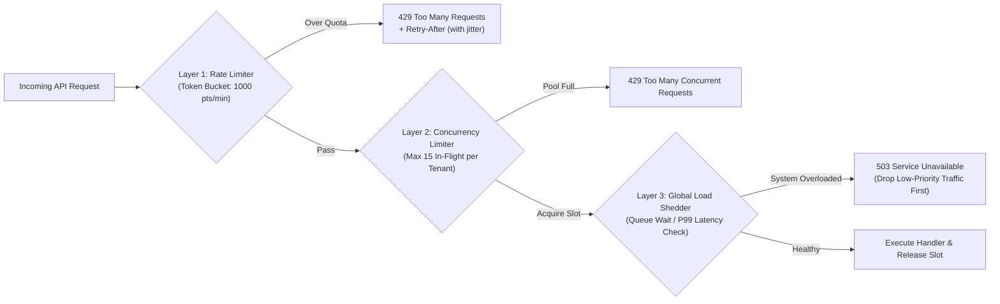

# Rate Limiting & API Management

## What Is It?

Rate limiting is controlling how many requests a client can make to your API in a given time period. API management is the broader discipline of designing, publishing, securing, and monitoring APIs — both internal APIs and APIs you expose to external developers. Together they protect your system from abuse, ensure fair usage, and turn your API into a product that others can consume reliably.

## Why Should You Care?

Without rate limiting, a single misbehaving client (or attacker) can bring down your entire service. A bot scraping your data, a bug in a client's code that fires requests in a loop, or a DDoS attack — all of these hit your API. Rate limiting is your first line of defense. Beyond protection, if your company offers an API as a product (like Stripe, Twilio, or OpenAI), you need proper API management: documentation, authentication, versioning, rate limits per plan, and usage tracking.

## How It Works (The Business Flow)

### Rate Limiting Flow

1. Client sends a request to your API
2. Rate limiter checks: how many requests has this client made in the current time window?
3. If under the limit → request is processed normally
4. If over the limit → return `429 Too Many Requests` with a `Retry-After` header
5. Client should respect the `Retry-After` header and slow down

### Rate Limit Headers

APIs typically return rate limit info in response headers:

```
X-RateLimit-Limit: 100        // Max requests per window
X-RateLimit-Remaining: 73     // Requests left in current window
X-RateLimit-Reset: 1709312400 // When the window resets (Unix timestamp)
```

This lets clients manage their request rate proactively instead of hitting the wall.

### API Key Management

1. Developer signs up for your API → gets an API key
2. API key is included with every request (header, query parameter)
3. Your server identifies the client by the key and applies the appropriate rate limit
4. Keys can be revoked, rotated, or scoped to specific endpoints
5. Usage is tracked per key for billing and monitoring

### API Versioning

APIs evolve. You need to change endpoints without breaking existing clients:

1. **URL versioning**: `/v1/users`, `/v2/users` — most common, most visible
2. **Header versioning**: `Accept: application/vnd.yourapi.v2+json` — cleaner URLs
3. **Query parameter**: `/users?version=2` — easy but less conventional

When you release `v2`:

- `v1` continues working (for a deprecation period, usually 6-12 months)
- New features only go to `v2`
- Communicate the migration timeline clearly

### Developer Portal

If your API is a product, developers need:

1. **Documentation**: Clear, up-to-date API reference with examples
2. **Authentication**: API key generation, OAuth app registration
3. **Playground**: Interactive API explorer to test endpoints
4. **SDKs**: Client libraries in popular languages (JavaScript, Python, Go)
5. **Changelog**: What changed in each version
6. **Status page**: Current API health and incident history

## Key Terms You'll Hear

| Term                      | What It Means                                                                                         |
| ------------------------- | ----------------------------------------------------------------------------------------------------- |
| **Rate Limit**            | Maximum number of requests allowed in a time window                                                   |
| **Throttling**            | Slowing down requests instead of rejecting them outright                                              |
| **429 Too Many Requests** | HTTP status code returned when rate limit is exceeded                                                 |
| **API Gateway**           | A proxy that sits in front of your API, handling auth, rate limiting, routing (Kong, AWS API Gateway) |
| **API Key**               | A unique identifier for an API consumer                                                               |
| **OAuth 2.0**             | Protocol for authorized API access on behalf of a user                                                |
| **Quota**                 | A broader usage limit (e.g., 10,000 API calls per month, 1GB storage)                                 |
| **Burst Limit**           | Short-term limit (e.g., 10 requests per second) vs sustained limit (1,000 per hour)                   |
| **Token Bucket**          | A rate limiting algorithm: tokens are added at a fixed rate, each request consumes a token            |
| **Sliding Window**        | A rate limiting approach that considers a rolling time window rather than fixed intervals             |
| **DDoS**                  | Distributed Denial of Service — flooding your API with requests to take it down                       |
| **WAF**                   | Web Application Firewall — filters malicious traffic before it reaches your API                       |
| **API Versioning**        | Maintaining multiple API versions simultaneously                                                      |
| **Deprecation**           | Announcing that an API version will be removed, giving clients time to migrate                        |
| **SLA**                   | Service Level Agreement — guaranteed uptime and performance (e.g., 99.9% uptime)                      |
| **Cost-Based Rate Limit** | Deducting points proportional to query/compute complexity (e.g., GraphQL query cost, LLM tokens)      |
| **Concurrency Limiter**   | Capping how many requests a client can have *in-flight simultaneously* rather than per minute         |
| **Load Shedding**         | Proactively dropping low-priority traffic with `503` when server CPU/latency crosses critical limits  |
| **GCRA**                  | Generic Cell Rate Algorithm — a memory-efficient leaky/token bucket calculation using a single timestamp |
| **Secret Rotation**       | Replacing an old API key with a new one using a dual-active overlap window for zero downtime          |

## Common Patterns

### Pattern 1: Fixed Window

Count requests in fixed time windows (e.g., 100 requests per minute, reset at each minute boundary).

**When it's used:** Simplest to implement. Good enough for most cases.

**Trade-off:** Burst problem — a client could make 100 requests at 11:59:59 and 100 more at 12:00:00 (200 requests in 2 seconds).

### Pattern 2: Sliding Window

Uses a rolling time window instead of fixed boundaries. Smooths out the burst problem.

**When it's used:** When you need more consistent rate enforcement.

**Trade-off:** Slightly more complex to implement. Uses more memory.

### Pattern 3: Token Bucket

Tokens are added to a bucket at a fixed rate. Each request consumes a token. If the bucket is empty, the request is rejected. Allows short bursts while enforcing average rates.

**When it's used:** Most production rate limiters. Allows bursts up to the bucket capacity.

**Trade-off:** Most flexible but more state to manage.

### Pattern 4: Tiered Rate Limits

Different rate limits for different plan tiers:

```
Free:       100 requests/hour
Pro:        1,000 requests/hour
Enterprise: 10,000 requests/hour
```

**When it's used:** API-as-a-product businesses (Stripe, OpenAI, Twilio).

**Trade-off:** Need to track usage per customer for billing. Upgrade path must be clear.

## Gotchas & Edge Cases

- **Rate limit by what?**: By API key? By IP address? By user ID? Each has different implications. IP-based limits can affect multiple users behind a NAT. Key-based limits don't catch unauthenticated abuse.
- **Don't rate limit health checks**: Monitoring systems hit your health endpoint frequently. Exempt it from rate limiting.
- **Graceful degradation**: Instead of hard-rejecting at the limit, consider degrading service quality (returning cached data, reducing response detail) before cutting off entirely.
- **Webhooks don't respect your rate limits**: If a third party sends you 10,000 webhooks in a burst, your webhook endpoint needs its own protection. Use a queue to buffer incoming webhooks.
- **Client-side retry storms**: If your API returns 429 and many clients retry simultaneously, you get a "thundering herd." Include jitter in `Retry-After` values.
- **Internal API rate limiting**: Even internal services should have rate limits. A bug in Service A shouldn't be able to overwhelm Service B.
- **Distributed rate limiting**: If your API runs on multiple servers, rate limits need to be shared (usually via Redis). Per-server limits are inaccurate.
- **Documentation is part of the product**: If developers can't understand your API from the docs, they won't use it. Invest in clear examples, error explanations, and quick-start guides.

## Industry War Stories & Non-Obvious Best Practices

### 1. Compute-Cost / Token-Budget Rate Limiting vs. Naive Request Counting (Plus Corporate NAT Traps)

Counting every HTTP request as `cost = 1` ("100 requests per minute") fails in real production APIs for two reasons:

1. **Asymmetric Request Cost**: `GET /api/v1/users/123` is a 0.5ms primary-key lookup (`cost = 1`), whereas `POST /api/v1/reports/export` scans 2 million rows (`cost = 500`), a deeply nested GraphQL query triggers 80 resolvers, and an LLM `/v1/chat/completions` call with a 100k-token prompt consumes seconds of GPU compute. Under a naive 100 req/min limit, an attacker or buggy script can send 100 heavy export requests per minute and melt your database while technically staying "under the rate limit."
2. **Corporate NAT / University / Carrier-Grade NAT (CGNAT) IP Sharing**: If you enforce strict IP-based rate limits (e.g., 60 req/min per IP) on authenticated or public routes, an entire enterprise customer headquarters (2,000 employees sharing one corporate egress IP) or a conference hotel Wi-Fi will get locked out with `429 Too Many Requests` within seconds.

**Best Practice:**
- **Cost-Based / Weighted Token Bucket**: Give each client a budget of **compute points** per window (e.g., 1,000 points/min). Assign static weights per endpoint (`GET /item` = 1 pt, `GET /search` = 10 pts, `POST /export` = 250 pts), or calculate cost dynamically (GraphQL AST complexity analysis before execution, or LLM `RPM` + `TPM`—Requests Per Minute and Tokens Per Minute). You can even refund unused estimated points after execution completes.
- **Composite Rate-Limit Keys**: Never rely solely on IP address for authenticated endpoints. Rate-limit authenticated requests by `tenant_id` or `api_key_id`. For unauthenticated endpoints (like `/login`), combine **two tiers**: a tight limit per `(ip, username)` tuple (e.g., 5 failed attempts/10 min) and a much higher ceiling per raw `ip` (e.g., 500 attempts/10 min) so one employee mistyping their password doesn't lock out their whole company office.

### 2. Concurrent In-Flight Request Limiters & Load Shedding

Time-window rate limiters (e.g., 100 req/min) **do not protect your database during a latency degradation**.

Imagine your database slows down from 10ms per query to 8,000ms per query due to a lock contention or slow disk. A client sending a steady, legal 10 requests/second (well below their 1,000 req/min limit) now accumulates **80 concurrent in-flight requests** holding open 80 database connections! Within seconds, one tenant exhausts the entire Postgres connection pool (`max_connections = 100`), causing a cascading outage for every other customer.



**Production Defense (Stripe / AWS Architecture):**
1. **Per-Tenant Concurrency Limiter**: Track currently executing (`in_flight`) requests per API key using an atomic Redis counter or lease with a short safety TTL (e.g., max 20 concurrent requests per tenant). Increment on request start, decrement in `finally`. If a tenant's queries hang, they can only tie up at most 20 worker threads/connections, isolating the blast radius ("bulkhead pattern").
2. **Priority-Aware Load Shedding**: When overall server CPU, event-loop lag, or DB connection pool utilization exceeds 85% (measured via adaptive algorithms like Little's Law / Netflix `concurrency-limits`), proactively shed lower-priority traffic (analytics pings, background syncs, free-tier batch jobs) immediately at the gateway with `503 Service Unavailable`, preserving capacity for critical paths (`POST /checkout`, `POST /payments`).

### 3. Zero-Downtime Dual-Key API Secret Rotation & Scoped Fine-Grained Tokens

How you generate, store, and rotate API keys determines whether a leaked credential causes a minor alert or a company-ending breach.

#### Never Store Plaintext API Keys in Your Database

Treat API secret keys like passwords. If an attacker dumps your `api_keys` table via SQL injection or a backup leak, plaintext keys let them impersonate every customer immediately.
- **Prefix + Hash Pattern (GitHub / Stripe / Slack style)**: Format keys with a human-readable prefix, a key ID, a random secret, and a checksum: e.g., `sk_live_7f9a2b_98xK2mP4qR7vL1nZ...`.
  - The prefix (`sk_live_`, `sk_test_`) lets GitHub Secret Scanning and pre-commit hooks detect accidentally committed keys via regex.
  - Store only `key_prefix` (`sk_live_7f9a2b`) and `SHA-256(full_key)` (or HMAC-SHA256) in your database. Show the full key to the developer **only once** upon creation.

#### Zero-Downtime Rolling Key Rotation

In production, if a customer needs to rotate a compromised or expiring API key, revoking the old key immediately breaks their running production servers before their new deployment finishes propagating.

```
Timeline of Zero-Downtime Key Rotation:
1. Key A is active.
2. Customer clicks "Roll Key" (with 24h grace period):
   - Server generates Key B (immediately active).
   - Server sets Key A `expires_at = NOW() + 24 hours` (both Key A and Key B work!).
3. Customer deploys Key B across their fleet and verifies traffic on Key A drops to 0.
4. Customer clicks "Expire Key A Now" (or 24h timer auto-revokes Key A).
```

#### Scoped Fine-Grained Tokens

Never issue a single "god-mode" API key per account. Let customers create multiple independent keys with:
- **Resource & Action Scopes**: `orders:read`, `payments:write`, `webhooks:manage` (so a key embedded in a reporting script cannot initiate refunds).
- **Environment Isolation**: Strict separation between `sk_test_...` (sandbox) and `sk_live_...` (production).
- **Optional IP Allowlisting**: Enterprise keys can restrict usage to specific CIDR blocks (`203.0.113.0/24`).

## Quick Reference

| Scenario                   | Rate Limiting & Protection Strategy                                         |
| -------------------------- | --------------------------------------------------------------------------- |
| Public / Partner API       | Weighted token bucket (compute cost) + per-tenant concurrency limit         |
| LLM / AI API               | Dual bucket: `RPM` (Requests/Min) + `TPM` (Tokens/Min) + max concurrent     |
| Login / Auth endpoint      | Two-tier: strict per `(IP, username)` + higher ceiling per IP (NAT-safe)    |
| Webhook receiver           | Fast `202 Accepted` → durable queue (SQS/Kafka) → rate-limited workers      |
| Database slowdown          | Per-tenant in-flight concurrency cap + priority-aware load shedding (`503`) |
| API key storage & rotation | Prefix (`sk_live_`) + SHA-256 hash in DB + dual-active grace window on roll |

| Algorithm / Limiter  | Best For                                                            |
| -------------------- | ------------------------------------------------------------------- |
| Fixed window         | Simple internal counters, coarse hourly/daily quotas                |
| Sliding window       | Smooth enforcement without boundary double-bursts                   |
| Token bucket / GCRA  | Bursty traffic with sustained average rate and weighted point costs |
| Concurrency limiter  | Protecting DB connection pools and worker threads from slow queries |
