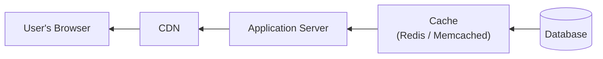
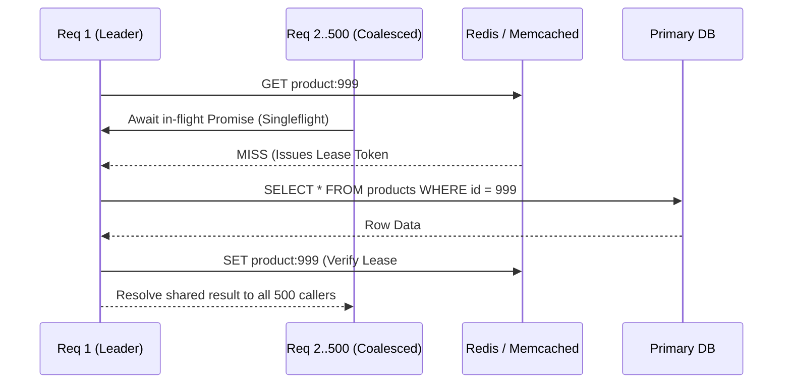

# Caching Strategies

## What Is It?

Caching is storing a copy of data in a faster location so you don't have to fetch it from the original source every time. Instead of hitting the database for every request, you keep frequently accessed data in memory. Instead of re-downloading images on every page load, the browser stores them locally. Caching exists at every layer of a web application — browser, CDN, application server, database. It's the single most effective way to make things fast.

## Why Should You Care?

Caching can turn a 500ms database query into a 1ms cache hit. It can turn an expensive API call into instant data. It can reduce your server load by 90%. But caching done wrong creates bugs that are maddening to debug — stale data, inconsistencies, cache stampedes, and the classic "Have you tried clearing your cache?" As a developer, understanding when to cache, what to cache, and how to invalidate is a fundamental skill.

## How It Works (The Business Flow)

### The Caching Layers



Each layer is faster and closer to the user. Data flows backward (from database to user), and caching happens at every step.

### Browser Cache

1. User requests a page. Server responds with the page + cache headers
2. Browser stores the response locally
3. Next time the user visits, browser checks: "Is my cached version still valid?"
4. If valid → use cached version (instant, no network request)
5. If expired → request from server again

Controlled by HTTP headers:

- `Cache-Control: max-age=3600` — Cache for 1 hour
- `Cache-Control: no-cache` — Always check with server before using cache
- `Cache-Control: no-store` — Never cache (for sensitive data)
- `ETag` — A fingerprint of the content. Server can say "it hasn't changed, use your cache"

### CDN Cache

1. CDN has servers worldwide (edge locations)
2. First request: CDN fetches from your origin server, stores a copy
3. Subsequent requests from nearby users: served from CDN edge (fast, no origin hit)
4. CDN respects your `Cache-Control` headers or has its own TTL settings
5. When content changes: you purge the CDN cache or wait for TTL to expire

### Application Cache (Redis/Memcached)

1. Application needs data (e.g., user's profile)
2. Check cache first: `cache.get("user:123")`
3. **Cache hit**: Data found in cache → return immediately
4. **Cache miss**: Not in cache → fetch from database → store in cache → return
5. Cache entries have a TTL (Time To Live) — they expire automatically

### Database Query Cache

Some databases cache query results internally. PostgreSQL caches recent query plans. MySQL has a query cache (though it's often disabled in production because invalidation is too aggressive). This is usually the database's job, not yours.

## Key Terms You'll Hear

| Term                   | What It Means                                                                                       |
| ---------------------- | --------------------------------------------------------------------------------------------------- |
| **Cache Hit**          | Requested data is found in cache. Fast                                                              |
| **Cache Miss**         | Data not in cache. Must fetch from the source. Slow                                                 |
| **Hit Rate**           | Percentage of requests served from cache. Higher = better (aim for 90%+)                            |
| **TTL (Time To Live)** | How long cached data is valid before it expires                                                     |
| **Cache Invalidation** | Removing or updating cached data when the source changes. "The hardest problem in CS"               |
| **Stale Data**         | Cached data that's no longer current. The source has changed but the cache hasn't been updated      |
| **Cache-Through**      | Application reads from cache; on miss, cache fetches from source and stores it                      |
| **Write-Through**      | Every write goes to both cache and source simultaneously                                            |
| **Write-Behind**       | Write to cache immediately, sync to source asynchronously (risky — data can be lost)                |
| **Cache Stampede**     | When a popular cache entry expires and hundreds of requests hit the database simultaneously         |
| **Cache Warming**      | Pre-loading cache with data you expect to be needed (before a traffic spike, during deployment)     |
| **Eviction Policy**    | How the cache decides what to remove when it's full (LRU, LFU, FIFO)                                |
| **LRU**                | Least Recently Used — evicts data that hasn't been accessed in the longest time. Most common policy |
| **Redis**              | An in-memory data store commonly used for application caching                                       |
| **CDN**                | Content Delivery Network — caches static and sometimes dynamic content at edge locations globally   |
| **Singleflight**       | Request coalescing — deduplicating concurrent cache misses for the same key into a single DB query  |
| **Cache Penetration**  | Queries for non-existent keys that bypass both cache and DB repeatedly (mitigated by negative caching / Bloom filters) |
| **Negative Caching**   | Caching "not found" (`null` / `404`) results with a short TTL to prevent repeated DB lookups        |
| **Lease Token**        | A monotonically increasing token issued on cache miss to prevent stale readers from overwriting newer cache entries |
| **CDC Invalidation**   | Using Change Data Capture (e.g., Debezium reading DB binlog/WAL) to reliably invalidate caches asynchronously |

## Common Patterns

### Pattern 1: Cache-Aside (Lazy Loading)

Application checks cache first. On miss, fetches from database and stores in cache.

```
Read:
1. Try cache → hit? Return.
2. Miss → query database → store in cache → return.

Write:
1. Update database → delete from cache (or update cache).
```

**When it's used:** Most common caching pattern. Works for any read-heavy workload.

**Trade-off:** First request after expiry is slow (cache miss). Risk of stale data between writes and cache invalidation.

### Pattern 2: Write-Through

Every write updates both cache and database simultaneously.

**When it's used:** When you need cache and database to be consistent at all times.

**Trade-off:** Writes are slower (two writes instead of one). But reads are always fresh.

### Pattern 3: Read-Through

Cache itself is responsible for loading data from the source on a miss. Application only talks to the cache.

**When it's used:** When you want to simplify application code. The cache acts as a data access layer.

**Trade-off:** Requires a cache that supports this pattern (or a caching library). Less control over what's cached.

### Pattern 4: Cache with Revalidation (Stale-While-Revalidate)

Serve stale data immediately, then refresh the cache in the background.

```
Cache-Control: max-age=60, stale-while-revalidate=300
```

This means: "Cache for 60 seconds. After 60 seconds, serve stale while fetching fresh in background. After 300 seconds, must revalidate before serving."

**When it's used:** Content that should be fast but eventually consistent (news feeds, dashboards, product listings).

**Trade-off:** Users might see slightly stale data. But no loading delay.

## Gotchas & Edge Cases

- **Cache invalidation is genuinely hard**: Phil Karlton famously said "There are only two hard things in Computer Science: cache invalidation and naming things." When your data changes, you must update or remove all cached copies. Miss one and you have stale data.
- **Cache stampede**: A popular cache key expires → 1,000 concurrent requests all miss → 1,000 database queries fire simultaneously → database crashes. Solution: use locking (only one request fetches from DB, others wait) or stale-while-revalidate.
- **Dogpile effect**: Similar to stampede. When cache is being rebuilt, all requests pile up waiting. Use probabilistic early expiration — randomly refresh before TTL to spread the load.
- **Cache key design**: Bad keys lead to low hit rates. Include all relevant parameters: `user:123:profile:v2` not just `user`. But don't make keys so specific that nothing ever matches.
- **Cached errors**: If a database query fails and you cache the error response, every subsequent request gets the cached error. Don't cache failures.
- **Memory limits**: Caches have finite memory. If you cache everything, the cache evicts important entries. Cache selectively — hot data, expensive queries, frequent reads.
- **Serialization overhead**: Storing complex objects in Redis requires serialization (JSON, MessagePack). Large objects might be slower to serialize/deserialize than just querying the database.
- **Multi-region caching**: If your app runs in multiple regions, each region has its own cache. A write in US-East doesn't invalidate the cache in EU-West. Cross-region cache invalidation is complex.

## Industry War Stories & Non-Obvious Best Practices

### 1. Singleflight (Request Coalescing) & Lease Tokens for Cache Stampedes

When a hot cache key (e.g., a celebrity's profile or a flash-sale product inventory) expires or is invalidated under 10,000 RPS load, all 10,000 requests simultaneously see a **Cache Miss** and fire 10,000 identical expensive SQL queries at the database—a classic **Cache Stampede (Thundering Herd)**.

Production systems solve this with two complementary mechanisms:

1. **In-Process Singleflight (Request Coalescing)**: Named after Go's `golang.org/x/sync/singleflight` (and implemented in Node.js by reusing an in-flight `Promise` map keyed by cache key). If 500 concurrent requests on the same server ask for `product:999` while a fetch is already in progress, only **1 request** actually queries Redis/Postgres; the other 499 await the exact same Promise and share the result.
2. **Distributed Leases (`gets` / Lease Tokens — Facebook Memcache Paper)**: What if a slow reader gets a cache miss at $t=1$, a writer updates the database and deletes the cache at $t=2$, and the slow reader finishes at $t=3$ and writes its stale $t=1$ value back into the cache forever?
   - When the cache returns a miss to Reader A, it grants a 10-second **Lease Token** (say, token `#42`).
   - If Writer B updates the key and invalidates the cache at $t=2$, the cache invalidates lease `#42`.
   - When Reader A tries to `cas_set(key, staleValue, lease=#42)` at $t=3$, the cache rejects the write because lease `#42` was invalidated!



Additionally, apply **TTL Jitter** (`baseTTL + random(0, 60s)`) whenever batch-loading keys so 10,000 keys warmed at deployment time don't all expire at the exact same millisecond an hour later.

### 2. Negative Caching & Bloom Filters Against Cache Penetration

A **Cache Penetration** attack (or bug) occurs when clients repeatedly request IDs that **do not exist** in the database—for example, `GET /api/products/-1` or random UUIDs generated by a scraper. Because the row doesn't exist in the database, nothing gets written to the cache under naive Cache-Aside, so 100% of these requests bypass Redis and hammer your database directly.

**Two-Layer Defense:**
1. **Negative Caching (Null Sentinel with Short TTL)**: When the database returns `null` / `0 rows`, explicitly write a sentinel value (`"__NULL__"`) into Redis with a short TTL (e.g., `30–120 seconds`). Subsequent requests for that missing ID hit Redis and immediately return `404 Not Found` in 0.5ms. Keep the TTL short so that if the record is genuinely created a minute later, the cache self-heals quickly.
2. **Bloom Filter / Cuckoo Filter at the Edge**: What if an attacker rotates through millions of *distinct* random UUIDs so every request is a new key? Negative caching won't help because each random ID is only requested once. Instead, maintain a compact **Bloom Filter** of all valid IDs in memory/Redis (10 million IDs take ~12 MB of RAM at 1% false-positive rate). Before touching Redis or the DB, check `bloom.mightContain(id)`—if `false`, reject with `404` immediately in memory.

### 3. Multi-Tier Cache Consistency (L1 + L2 + L3) & CDC Invalidation

High-scale architectures stack multiple cache tiers:
- **L1 (In-Process Memory, e.g., LRU cache inside each Node/Go/JVM pod)**: ~100ns latency, zero network serialization, absorbs ultra-hot keys that would otherwise overwhelm a single Redis shard.
- **L2 (Distributed Redis / Memcached cluster)**: ~1ms latency, shared across all pods.
- **L3 (CDN Edge Cache with `stale-while-revalidate`)**: ~10ms from user's ISP.

#### Why "Delete Cache, Then Update DB" (and Vice Versa) Still Races

In Cache-Aside, engineers often debate whether to delete the cache before or after updating the database:
- **Delete Cache → Update DB**: Fails immediately under concurrency. Thread A deletes cache; before Thread A's DB transaction commits, Thread B gets a cache miss, reads the **old** value from DB, and repopulates the cache with stale data until TTL expires.
- **Update DB → Delete Cache**: Vastly safer (standard practice), but still has a narrow race window if a slow cache miss started before the DB update and finishes `SET` after the cache delete.

**How Production Systems Guarantee Consistency:**
1. **Update DB + Change Data Capture (CDC) Invalidation**: Instead of coupling application business code with dual writes (`await db.update(); await redis.del()`), which leaves stale cache if `redis.del()` fails due to a network blip, stream the database's transaction log (**Postgres WAL / MySQL Binlog via Debezium → Kafka**) to a dedicated cache-invalidation consumer that deletes L2 Redis keys with automatic retries and broadcasts an **L1 invalidation pub/sub message** (or uses Redis 6+ Client-Side Caching invalidation messages) to clear in-process L1 memory across all app pods.
2. **Delayed Double-Delete (when CDC isn't available)**: Delete cache → Update DB → Wait ~200–500ms (async background timer) → Delete cache a second time to wipe out any dirty cache entry written by a concurrent reader during the update window.

## Quick Reference

| What to Cache                   | Where                        | TTL                               | Invalidation                                      |
| ------------------------------- | ---------------------------- | --------------------------------- | ------------------------------------------------- |
| Static assets (CSS, JS, images) | CDN + Browser                | Long (1 year, `immutable`)        | Filename content hashing (`app.8f9a2.js`)         |
| Ultra-hot config / metadata     | L1 In-Process + L2 Redis     | L1: 5–30s, L2: 10 min             | Redis Pub/Sub / Client-Side Caching invalidation  |
| API responses (read-heavy)      | L2 Redis / Memcached         | 5 min - 1 hour (+ TTL jitter)     | Update DB → Delete cache (or CDC binlog consumer) |
| Non-existent IDs (`404` / null) | L2 Redis (Negative Cache)    | Short (30s - 2 min)               | Auto-expire or delete on entity creation          |
| User sessions                   | Redis                        | Session duration                  | Delete on logout / password change                |
| HTML / Semi-static pages        | CDN Edge                     | `s-maxage=60, stale-while-revalidate=600` | Surrogate-Key / Cache-Tag purge on publish |

| Problem                                | Production Solution                                                    |
| -------------------------------------- | ---------------------------------------------------------------------- |
| Cache stampede on hot key              | Singleflight (request coalescing) + Lease tokens + TTL jitter          |
| Cache penetration (missing IDs)        | Negative caching (`"__NULL__"` sentinel with 60s TTL) + Bloom filter   |
| Stale cache on concurrent read/write   | Update DB then Delete Cache + CDC (Debezium WAL/binlog) or Lease CAS   |
| Single Redis shard CPU bottleneck      | Add bounded L1 in-process LRU cache (5–15s TTL) in front of L2 Redis   |
| Cross-region cache drift               | CDC event stream replicated across regions to purge regional Redis/CDN |
