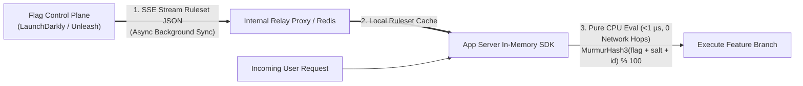

# Feature Flags & Rollouts

## What Is It?

Feature flags (also called feature toggles) are switches in your code that let you turn features on or off without deploying new code. Instead of deploying a feature to everyone at once, you deploy the code with the feature behind a flag, then gradually enable it — first for internal testers, then beta users, then 10% of all users, then everyone. It separates "deploying code" from "releasing a feature," and that separation is powerful.

## Why Should You Care?

Without feature flags, releasing a new feature means deploying code and hoping nothing breaks. If it does break, you have to roll back the entire deployment. With feature flags, you can instantly disable a broken feature without touching the deployment. You can test in production with real users, run A/B experiments, and give enterprise customers early access. It's how companies like Facebook, Netflix, and Google ship features to billions of users safely.

## How It Works (The Business Flow)

### Basic Feature Flag

```javascript
if (featureFlags.isEnabled('new-checkout-flow', user)) {
  renderNewCheckout();
} else {
  renderOldCheckout();
}
```

The flag evaluation happens at runtime. The flag's state can be changed without redeploying code.

### Flag Lifecycle

1. **Create**: Developer creates a flag for a new feature (default: OFF)
2. **Development**: Code is written behind the flag. Only developers see it (flag is ON for dev environment)
3. **Internal Testing**: Flag is enabled for internal users / QA team
4. **Beta / Early Access**: Flag is enabled for a group of beta users
5. **Gradual Rollout**: Flag is enabled for 5% → 25% → 50% → 100% of users
6. **Full Release**: Flag is ON for everyone. The feature is fully released
7. **Cleanup**: Remove the flag from code. This step is often forgotten (see Gotchas)

### Targeting Rules

Flags aren't just ON or OFF. They can target specific users or groups:

- **User ID**: Enable for user "abc123" (QA testing)
- **Email domain**: Enable for `@yourcompany.com` (internal testing)
- **Country**: Enable for users in Canada first (regional rollout)
- **Plan tier**: Enable for Enterprise customers only
- **Percentage**: Enable for 10% of all users (random, consistent per user)
- **Custom attributes**: Enable for users who signed up after January 2026

### A/B Testing with Flags

1. Create a flag with multiple variants (not just on/off)
2. Variant A: current design. Variant B: new design
3. Users are randomly assigned to a variant (and stay in that variant — "sticky bucketing")
4. Track the metric you care about (conversion rate, engagement, revenue)
5. After reaching statistical significance, pick the winner and roll it out to 100%

### Kill Switch

The most basic use of a feature flag — an emergency OFF switch for a feature that's causing problems.

1. Feature is live and working
2. Something goes wrong (performance issue, bug, third-party dependency failure)
3. On-call engineer toggles the flag OFF in the feature flag dashboard
4. Feature is instantly disabled for all users
5. No deployment needed. Incident resolved in seconds.

## Key Terms You'll Hear

| Term                        | What It Means                                                                                            |
| --------------------------- | -------------------------------------------------------------------------------------------------------- |
| **Feature Flag / Toggle**   | A conditional switch that controls feature visibility                                                    |
| **Flag Evaluation**         | The process of determining if a flag is on or off for a specific user/request                            |
| **Targeting Rule**          | Conditions that determine who sees the feature (user ID, percentage, attribute)                          |
| **Rollout**                 | Gradually increasing the percentage of users who see a feature                                           |
| **Canary Release**          | Releasing to a tiny percentage first, monitoring, then expanding                                         |
| **Kill Switch**             | Instantly disabling a feature in production without deploying                                            |
| **Variant**                 | One of multiple options in a flag (control, variant A, variant B)                                        |
| **Sticky Bucketing**        | Ensuring a user always sees the same variant once assigned                                               |
| **Flag Debt**               | Old, unused flags still in the code. Technical debt that must be cleaned up                              |
| **Trunk-Based Development** | Committing to main branch frequently, using flags to hide incomplete features                            |
| **Dark Launch**             | Deploying a feature to production but not showing it to users (backend processing happens, UI is hidden) |
| **Percentage Rollout**      | Enabling a feature for X% of users, gradually increasing                                                 |
| **Feature Gate**            | A flag that controls access to a feature (usually tied to a plan or permission)                          |
| **Local Evaluation SDK**    | Server SDK that caches the full flag ruleset in memory and evaluates flags locally in `< 1 µs`           |
| **Consistent Hashing**      | Deterministic hash (`MurmurHash3(flag_key + salt + bucketing_id) % 100`) ensuring sticky rollout buckets |
| **Bucketing Key**           | The identifier hashed for rollouts (`user_id` for B2C vs `organization_id` / `tenant_id` for B2B)        |
| **Relay Proxy**             | An internal infrastructure daemon that caches flag rulesets in Redis/memory if the external SaaS goes down |
| **Zombie Flag**             | A stale 100%-rolled-out or abandoned flag left in code, multiplying test combinations and outage risks   |

## Common Patterns

### Pattern 1: Boolean Flag (Simple On/Off)

The simplest flag. Feature is either enabled or disabled.

**When it's used:** Kill switches, feature launches, hiding incomplete features.

**Trade-off:** No nuance. Can't target specific users or run experiments.

### Pattern 2: Percentage Rollout

Enable for X% of users. Increase gradually.

```
Day 1: 5% (monitor metrics)
Day 3: 25% (still good)
Day 5: 50%
Day 7: 100% (full release)
```

**When it's used:** Any risky feature launch. Reduces blast radius of bugs.

**Trade-off:** Need consistent hashing so users don't flip between seeing and not seeing the feature.

### Pattern 3: User Segment Targeting

Enable based on user attributes (plan, country, role, signup date).

**When it's used:** Beta programs, enterprise-only features, regional launches.

**Trade-off:** More complex targeting rules. Need up-to-date user attributes available at evaluation time.

### Pattern 4: Multivariate Flag (A/B/C Testing)

Flag has multiple variants, not just on/off. Used for experiments.

**When it's used:** Testing different designs, pricing, copy, algorithms.

**Trade-off:** Requires experiment tracking infrastructure and statistical analysis.

## Gotchas & Edge Cases

- **Flag cleanup is essential**: Every flag you add is technical debt. Set a reminder to remove the flag after full rollout. Companies accumulate hundreds of dead flags that make code harder to read and maintain.
- **Testing all paths**: With 5 active flags, you have 32 possible combinations. Testing becomes exponential. Minimize active flags and test the most important combinations.
- **Server vs client evaluation**: Evaluating flags on the server is more secure (users can't see/modify flag values). Client-side evaluation is faster (no server round-trip) but exposes flag configuration.
- **Flag dependency chains**: Flag A enables a feature that depends on Flag B being ON. Document dependencies and test them.
- **Database migrations behind flags**: You can flag-gate code, but you can't easily flag-gate a database schema change. Plan database changes to be compatible with both flag states.
- **Consistent experience**: If a user sees the new checkout on Monday (flag ON for them) and the old checkout on Tuesday (flag turned OFF for maintenance), it's confusing. Changes to flag state should be deliberate.
- **Flag service outage**: What happens if your feature flag service (LaunchDarkly, Split) goes down? Your app must have sensible defaults. Most SDKs cache flag values locally.
- **Permissions vs flags**: Don't use feature flags as a permanent authorization system. Flags are temporary. Use proper RBAC for long-term access control.

## Industry War Stories & Non-Obvious Best Practices

### 1. Local Flag Evaluation SDKs (Zero-Network-Hop Architecture)

A common misconception is that calling `featureFlags.isEnabled('new-checkout', user)` makes an HTTP request to LaunchDarkly, Unleash, or your database on every API call. If a single request evaluates 15 feature flags and each took a 20ms network hop, your API latency would balloon by 300ms—and if the feature flag vendor suffered an outage, your entire application would go down.

**How Production Server SDKs Actually Work:**
1. **Streaming Ruleset Sync**: On startup, your backend server SDK downloads the **entire JSON ruleset** of all active flags (e.g., `"enable if user.plan == 'enterprise' OR murmurhash3(user.id) < 25%"`) into in-process memory, and keeps it updated in real time via a persistent **Server-Sent Events (SSE)** stream.
2. **Sub-Microsecond Local Evaluation**: When a request arrives, `isEnabled('new-checkout', userContext)` runs a pure CPU evaluation against the in-memory ruleset AST in **`< 1 microsecond`** with **zero network I/O**.
3. **Relay Proxy + Persistent Bootstrap**: For cold-starting serverless functions (AWS Lambda / Edge Workers) or air-gapped resilience, companies deploy an internal **Relay Proxy** backed by Redis. Even if LaunchDarkly's cloud is completely unreachable during a new Kubernetes pod autoscaling event, new pods bootstrap their ruleset from internal Redis and fall back to safe code-defined defaults.



*(Note: Client-side browser/mobile SDKs work differently—they send the user context to the flag server once on session start and receive only the pre-evaluated boolean results for that specific user, so secret targeting rules like unreleased customer emails aren't leaked in browser DevTools!)*

### 2. B2B Tenant-Level Consistent Bucketing (`organization_id` vs. `user_id`)

In consumer (B2C) apps, percentage rollouts hash the `user_id`:
$$\text{bucket} = \text{MurmurHash3}(\text{flag\_key} + \text{salt} + \text{user\_id}) \bmod 10000$$

If you blindly copy this pattern into a **B2B SaaS application** (like Slack, Notion, Jira, or Figma) during a 20% rollout of a new collaborative workflow or billing UI, disaster strikes:
- Inside the same customer company (`Acme Corp`), **Alice** (`bucket = 1400`, `< 20%`) gets the **New Workflow v2** and creates v2 records.
- Her teammate **Bob** sitting next to her (`bucket = 8200`, `>= 20%`) gets the **Old Workflow v1**, cannot open Alice's v2 documents, sees a completely different navigation bar on screen-share calls, and corrupts shared workspace state when saving!

**Best Practice:**
- For any feature that affects shared data models, team workflows, or company-wide UI in a multi-tenant B2B product, always set the **bucketing key (`by` attribute)** to `organization_id` / `tenant_id` / `workspace_id`—**never** `user_id`.
- Include a per-flag random `salt` in the hash input so that the "lucky 5% of tenants" who get `flag_A` are not the exact same 5% of tenants who get `flag_B` (avoiding sample bias across concurrent experiments).

### 3. Flag Technical Debt, "Zombie Flag" Outages & AST Dead-Branch Cleanup

In 2012, **Knight Capital Group** lost **$460 million in 45 minutes** (and went bankrupt) because a deployment reused an old, forgotten feature flag from 8 years earlier (`Power Peg`), inadvertently waking up dead order-routing code on one server that had never been deleted.

Leaving 100%-rolled-out or abandoned **Zombie Flags** in your codebase creates two severe risks:
1. **Combinatorial Testing Explosion**: $N$ boolean flags in a module create $2^N$ possible execution paths. Just 10 flags produce $1,024$ states. Unit and E2E tests typically only run with all flags `ON` or all flags `OFF`, leaving mixed-flag interactions completely untested until an on-call engineer flips one flag during an incident and triggers a crash.
2. **Accidental Reactivation**: If the flag control plane resets, a fallback default is stale (`default = false` for a flag that has been `true` in production for 2 years), or a config is misapplied, your app suddenly reverts to a 2-year-old code path that is incompatible with your current database schema!

**Production Hygiene Rules:**
- **Categorize Flags by Lifespan**:
  - **Release / Experiment Flags (Temporary, TTL: 14–30 days)**: Must have an assigned owner and an expiration date at creation time. Once rolled out to 100% for 7 days, CI/Slack bots automatically open a PR or alert the owner to delete the flag.
  - **Operational Circuit Breakers / Kill Switches (Permanent)**: Explicitly marked as permanent ops toggles; their fallback default in code **must** match normal healthy operation, and both `ON` and `OFF` branches must be covered by automated integration tests on every CI run.
- **Automated AST Cleanup**: Modern teams use AST refactoring tools (like `ts-morph`, Babel codemods, or Piranha by Uber) to automatically strip `if (flags.isEnabled('rolled-out-flag'))` and keep only the winning branch once a flag hits 100%.

## Quick Reference

| Use Case                      | Flag Type & Bucketing Key                  | Example                                                   |
| ----------------------------- | ------------------------------------------ | --------------------------------------------------------- |
| Hide incomplete code on trunk | Temporary Release Flag (Boolean OFF)       | `new-dashboard: false` (TTL: 30 days)                     |
| B2C gradual feature launch    | Percentage rollout (`by: user_id`)         | `new-player: 5% → 25% → 100%`                             |
| B2B SaaS workflow launch      | Percentage rollout (`by: organization_id`) | `team-approval-v2: 10% of workspaces`                     |
| Beta program                  | Segment targeting                          | `ai-copilot: org.plan == 'enterprise' OR org.beta`        |
| A/B experiment                | Multivariate (`by: user_id` + flag salt)   | `checkout-cta: [control: 50%, var-a: 25%, var-b: 25%]`    |
| Subsystem circuit breaker     | Permanent Ops Kill Switch                  | `enable-recommendations-widget: true → false` on DB spike |

| Tool                     | Type               | Notes                                                          |
| ------------------------ | ------------------ | -------------------------------------------------------------- |
| LaunchDarkly             | SaaS               | Industry standard, streaming SSE + Relay Proxy, expensive      |
| OpenFeature              | CNCF Standard SDK  | Vendor-neutral API spec so you can swap flag providers cleanly |
| Unleash / Flagsmith      | Open source / SaaS | Self-hostable, supports local evaluation in server SDKs        |
| PostHog                  | SaaS + self-hosted | Combines feature flags, session replay, and product analytics  |
| Custom (Redis + SSE)     | DIY                | Great for simple kill switches and tenant gates                |
