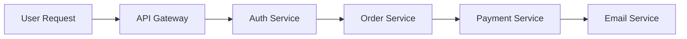
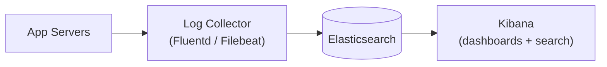
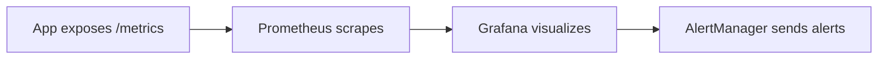
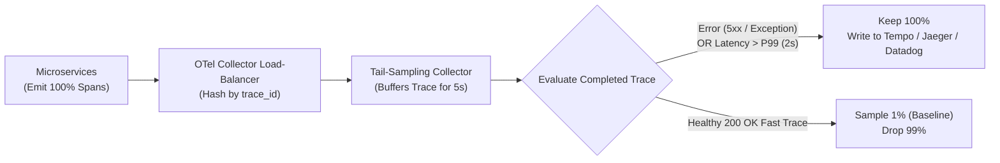

# Logging & Monitoring

## What Is It?

Logging is recording what your application does — every request handled, every error thrown, every important action taken. Monitoring is watching those logs and metrics in real-time to detect problems before users notice them. Together, they're your eyes and ears in production. When something breaks at 3am, logging tells you what happened, and monitoring is what woke you up to fix it.

## Why Should You Care?

You can't debug production by attaching a debugger. You can't ask users to reproduce the issue on their machine. All you have is logs and metrics. If your logging is bad (too little, too noisy, or unstructured), you're flying blind. If your monitoring has no alerts, you only find out about problems when users complain. As a developer, the quality of your logging directly determines how fast you can diagnose and fix production issues.

## How It Works (The Business Flow)

### Application Logging

Your application writes log entries for important events:

```
[2026-03-01T10:30:15Z] INFO  request_id=abc123 method=POST path=/api/orders status=201 duration_ms=145 user_id=user456
[2026-03-01T10:30:16Z] ERROR request_id=def789 method=POST path=/api/payments error="Card declined" user_id=user456 payment_id=pay_xyz
[2026-03-01T10:30:17Z] WARN  request_id=ghi012 message="Rate limit approaching" client_id=client_a remaining=5
```

### Log Levels

| Level     | When to Use                                   | Example                                                       |
| --------- | --------------------------------------------- | ------------------------------------------------------------- |
| **ERROR** | Something failed that shouldn't have          | Payment processing failed, database connection lost           |
| **WARN**  | Something unusual that might become a problem | Rate limit approaching, disk space running low                |
| **INFO**  | Normal operations worth recording             | User signed up, order placed, deployment completed            |
| **DEBUG** | Detailed info for troubleshooting             | SQL query executed, cache hit/miss, request/response payloads |

In production, you typically log INFO and above. DEBUG is too verbose for production but invaluable during troubleshooting.

### Structured Logging

The difference between useless and useful logs:

```
// USELESS: Unstructured
"Error processing payment for user"

// USEFUL: Structured
{
  "level": "error",
  "message": "Payment processing failed",
  "user_id": "user456",
  "payment_id": "pay_xyz",
  "amount": 4999,
  "error": "Card declined",
  "error_code": "card_declined",
  "timestamp": "2026-03-01T10:30:16Z",
  "request_id": "def789"
}
```

Structured logs (JSON) can be searched, filtered, and aggregated. Unstructured text logs can only be grep'd.

### Metrics

While logs record individual events, metrics track aggregate measurements over time:

- **Request rate**: 500 requests/second (is this normal or a traffic spike?)
- **Error rate**: 0.5% of requests return errors (is this increasing?)
- **Latency**: P50 = 100ms, P95 = 500ms, P99 = 2000ms (are things getting slower?)
- **Resource usage**: CPU at 70%, memory at 4GB, disk at 80%
- **Business metrics**: Sign-ups per hour, orders per minute, revenue per day

### Alerting

Monitoring without alerting is just looking at dashboards and hoping someone notices. Alerts trigger when metrics cross thresholds:

1. Define alert rules: "If error rate > 5% for 5 minutes, alert on-call"
2. Alert fires → notification sent (PagerDuty, Slack, email, SMS)
3. On-call engineer acknowledges the alert
4. Engineer investigates using logs, metrics, and traces
5. Issue is resolved (or escalated)
6. Post-incident review: what happened, why, how to prevent it

### Distributed Tracing

In a microservices architecture, a single user request might touch 5+ services. Tracing follows the request through every service:



Each service adds its span to the trace. You can see the complete request journey, including where time was spent and where errors occurred.

## Key Terms You'll Hear

| Term                           | What It Means                                                                                                      |
| ------------------------------ | ------------------------------------------------------------------------------------------------------------------ |
| **Log Aggregation**            | Collecting logs from all servers into one searchable system (ELK, Datadog, Splunk)                                 |
| **ELK Stack**                  | Elasticsearch + Logstash + Kibana — a popular open-source logging stack                                            |
| **APM**                        | Application Performance Monitoring — tracks request latency, errors, dependencies (Datadog, New Relic)             |
| **Trace**                      | A record of a request's journey through multiple services                                                          |
| **Span**                       | A single operation within a trace (e.g., "database query took 50ms")                                               |
| **P50 / P95 / P99**            | Percentile latencies. P99 = 99% of requests are faster than this value                                             |
| **SLA**                        | Service Level Agreement — contractual guarantee (99.9% uptime)                                                     |
| **SLO**                        | Service Level Objective — internal target (99.95% uptime, P99 latency < 500ms)                                     |
| **SLI**                        | Service Level Indicator — the actual measured metric                                                               |
| **Error Budget**               | How much downtime is "allowed" before violating the SLO. Spent error budget = freeze new features, fix reliability |
| **On-Call**                    | Engineer designated to respond to production alerts during a rotation period                                       |
| **Incident**                   | A production issue that affects users. Tracked and reviewed formally                                               |
| **Postmortem / Retrospective** | After-incident review: what happened, timeline, root cause, action items. Blameless                                |
| **MTTD**                       | Mean Time To Detect — how quickly you notice a problem                                                             |
| **MTTR**                       | Mean Time To Recover — how quickly you fix a problem                                                               |
| **Dashboard**                  | A visual display of key metrics (Grafana, Datadog dashboards)                                                      |
| **Runbook**                    | Step-by-step instructions for responding to a specific alert                                                       |
| **Cardinality**                | Number of unique time series produced by metric label combinations; unbounded labels (`user_id`) crash TSDBs       |
| **Trace Exemplar**             | A sample `trace_id` attached to a metric histogram bucket so you can jump from a latency graph to an exact trace   |
| **Head-Based Sampling**        | Deciding whether to record a trace at the very beginning of a request (e.g., random 1%)                            |
| **Tail-Based Sampling**        | Buffering spans and deciding at the *end* of a request so 100% of errors/slow traces are kept                      |
| **Burn Rate Alert**            | Alerting on how fast your SLO error budget is being consumed across short + long windows rather than static spikes |

## Common Patterns

### Pattern 1: Centralized Logging (ELK / Cloud Logging)

All services send logs to a central system where they can be searched and analyzed.



**When it's used:** Any app beyond a single server. Essential for distributed systems.

**Trade-off:** Infrastructure cost grows with log volume. Set retention policies to manage costs.

### Pattern 2: Metrics + Alerts (Prometheus/Grafana or Datadog)

Application exposes metrics. Monitoring system scrapes them. Dashboards visualize. Alerts fire on thresholds.



**When it's used:** Every production system should have this.

**Trade-off:** Requires defining what to measure and what thresholds matter. Too many alerts = alert fatigue.

### Pattern 3: Observability Stack (Logs + Metrics + Traces)

The "three pillars of observability" working together:

- **Logs**: What happened (detailed event records)
- **Metrics**: How the system is performing (aggregate numbers)
- **Traces**: How a request flowed through the system (distributed path)

**When it's used:** Microservices architectures. Complex distributed systems.

**Trade-off:** Full observability stacks are expensive. Prioritize what matters for your scale.

### Pattern 4: Error Tracking (Sentry / Bugsnag)

Dedicated service that captures application errors with full context (stack trace, user, browser, request data).

**When it's used:** Every web application should use one. Catches errors you didn't know were happening.

**Trade-off:** Can be noisy. Group similar errors and prioritize by impact.

## Gotchas & Edge Cases

- **Log too little**: "Error occurred" tells you nothing. Include context: which user, which request, what was the input, what was the expected vs actual result.
- **Log too much**: Logging every database query in production can generate terabytes and make real issues hard to find. Use appropriate log levels.
- **PII in logs**: User emails, addresses, and credit card numbers often end up in log messages accidentally. Scrub sensitive data before logging. This is also a GDPR issue.
- **Alert fatigue**: If your team gets 50 alerts a day and most are noise, they'll start ignoring alerts. Then a real incident gets missed. Tune alert thresholds aggressively. Every alert must be actionable.
- **Correlation IDs**: Without a request ID that flows through all services, you can't correlate logs from different services for the same request. Generate a request ID at the entry point and pass it through.
- **Log retention costs**: Cloud logging services charge per GB ingested and stored. A high-traffic app can generate hundreds of GB of logs per day. Set retention policies and archive old logs.
- **Sampling at scale**: At very high scale, you can't log or trace every request. Sample (trace 1% of requests) to keep costs manageable while still catching issues.
- **Dashboards nobody watches**: A dashboard is only useful if someone looks at it. Pair dashboards with alerts. The dashboard is for investigation after an alert fires, not for passive monitoring.
- **Missing the business perspective**: Technical metrics (CPU, memory, latency) matter, but business metrics matter more. Track sign-ups, purchases, and errors-per-user-action alongside system metrics.

## Industry War Stories & Non-Obvious Best Practices

### 1. High-Cardinality Metric Explosion in Prometheus & Datadog (And Why Trace Exemplars Exist)

One of the most expensive mistakes a backend engineer can make is putting an unbounded identifier (`user_id`, `order_id`, `email`, `ip_address`, or an un-normalized URL path like `/users/94812/profile`) into a **metric label/tag**:

```javascript
// CATASTROPHIC: Creates a brand-new time series in RAM for every unique user and URL!
httpRequestDuration.labels({
  method: req.method,
  path: req.originalUrl, // "/api/orders/ord_991823" -> millions of unique values!
  user_id: req.user.id,  // 2,000,000 unique users!
}).observe(duration);
```

**Why this crashes Prometheus or causes a $50,000+ surprise Datadog bill:**
- Time-Series Databases (TSDBs) like Prometheus and Datadog Custom Metrics allocate a dedicated time-series index in memory for every unique combination of labels:
  $$\text{Total Time Series} = |\text{methods}| \times |\text{status\_codes}| \times |\text{histogram\_buckets}| \times |\text{paths}| \times |\text{users}|$$
- Even 5 methods $\times$ 5 statuses $\times$ 10 histogram buckets $\times$ 100,000 users = **25,000,000 active time series**. Prometheus OOM-crashes within minutes, and SaaS observability vendors charge per unique custom time series (`$0.05/metric/month` $\times$ 10M series = `$500,000/month`).

**Best Practice:**
1. **Strict Label Bounding**: Only put low-cardinality enums in metric labels: `method` (`GET`, `POST`), `route_template` (`/api/orders/:id`—**never** the raw URL!), `status_class` (`2xx`, `4xx`, `5xx`), `region`. Keep total cardinality per metric under ~10,000 series.
2. **Use OpenTelemetry / Prometheus Trace Exemplars**: How do you find out *which* `user_id` or `request_id` caused a P99 latency spike without putting `user_id` in metric labels? Attach a **Trace Exemplar** (`trace_id="4bf92f3577b34da6"`) to the histogram observation! Exemplars store a single sample `trace_id` alongside each latency bucket at near-zero memory cost, letting you click a P99 spike in Grafana and jump directly to the exact slow trace and structured logs containing `user_id`.

### 2. Tail-Based Sampling vs. Head-Based Sampling in Distributed Tracing

At 20,000 requests/second, storing 100% of distributed traces costs more than the production servers themselves. You must sample—but *where* you make the sampling decision determines whether tracing is useful during an outage:

- **Head-Based Sampling (Decision at Request Start)**: The API Gateway rolls a die when a request arrives (`keep 1%`, `drop 99%`) and passes `sampled=0` or `sampled=1` in the `traceparent` W3C header.
  - *Fatal flaw*: At the start of a request, you have no idea whether it will succeed in 5ms or crash with a `500` after 10 seconds! If a rare payment bug affects 50 users, Head-Based Sampling at 1% drops **99% of your error traces**.
- **Tail-Based Sampling (Decision at Request End)**: All microservices emit spans to an intermediate **OpenTelemetry Collector tier** (routed by `trace_id` consistent hashing) that buffers spans in memory for a few seconds until the request completes:
  - Did any span in the trace return `HTTP 5xx`, throw an exception, or exceed `duration > 2000ms`? **Keep 100% of those traces!**
  - Was it a boring, healthy `200 OK` in `15ms`? **Keep 0.5% for baseline comparison and drop 99.5%.**



### 3. Automated PII/Secret Scrubbing Pipelines & Multi-Window Burn-Rate SLO Alerts

Two operational traps ruin engineering teams' security compliance and sleep schedules: accidental credential logging and static-threshold alert fatigue.

#### Automated PII & Secret Redaction at the Logger Boundary

Developers inevitably write `logger.error("Checkout failed", { reqBody, headers })` during debugging. Without automated redaction, plaintext passwords, `Authorization: Bearer eyJ...` JWTs, Stripe API keys, credit card PANs, and user SSNs are shipped straight into Elasticsearch/Datadog—violating GDPR, PCI-DSS, and SOC 2.
- **Defense-in-Depth Redaction**:
  1. **Serializer-Level Denylist (Zero-Overhead)**: Configure your logger (e.g., `pino({ redact: ['req.headers.authorization', 'req.headers.cookie', '*.password', '*.token', '*.cvv', '*.creditCard'] })`) so sensitive object paths are masked as `[REDACTED]` before JSON serialization even happens.
  2. **Collector-Level Regex Scrubbing (Vector / FluentBit / OTel Collector)**: Run a fast regex scrubber on the log collector agent before logs leave the VPC to catch stray patterns (`\b4[0-9]{12}(?:[0-9]{3})?\b` for Visa cards, `Bearer [A-Za-z0-9\-_]+\.[A-Za-z0-9\-_]+`, email addresses).

#### Multi-Window, Multi-Burn-Rate SLO Alerts (Google SRE Standard)

Naive alerts like *"Page on-call if 5xx error rate > 1% for 5 minutes"* fail in two ways:
1. During low-traffic 3 AM hours (10 requests/min), a single user refreshing a broken page 2 times triggers a `20% error rate` alert and wakes up an engineer for a non-incident.
2. A slow 0.2% error leak goes unnoticed for 2 weeks until it burns through your entire monthly 99.9% SLO error budget.

**The Google SRE Multi-Window Burn-Rate Formula:**
Instead of static percentages, alert on **Burn Rate** (how fast your 30-day error budget is being consumed—where `Burn Rate = 1` means you will exhaust your 30-day budget in exactly 30 days, and `Burn Rate = 14.4` means you will exhaust 2% of your monthly budget in just **1 hour**). Require **both** a long window (e.g., `1 hour`) and a short confirmation window (e.g., `5 minutes`) to be above the threshold simultaneously:
- **Page (`P1` Urgent)**: `1h burn rate > 14.4x` **AND** `5m burn rate > 14.4x` (Confirming the outage is severe *and* still actively happening right now; stops paging within 5 minutes of recovery).
- **Ticket (`P3` Next-Morning Slack/Jira)**: `6h burn rate > 6x` **AND** `30m burn rate > 6x`.

## Quick Reference

| What to Monitor              | Production Alert Strategy                                               | Why                                                           |
| ---------------------------- | ----------------------------------------------------------------------- | ------------------------------------------------------------- |
| Availability / 5xx SLO       | Multi-window burn rate (`1h > 14.4x AND 5m > 14.4x` + min request floor) | Eliminates 3 AM low-traffic false alarms & resets fast        |
| P99 Latency                  | Histogram (`route_template` label only) + **Trace Exemplars**           | Pinpoints exact slow `trace_id` without cardinality explosion |
| Distributed Traces           | **Tail-based sampling** (100% of errors/slow, 1% of healthy `200 OK`)   | Retains every failure trace while cutting storage costs ~95%  |
| Database / Connection Pool   | Pool saturation `> 85%` or wait queue growing for 3 min                 | Catches cascading DB lockups before total outage              |
| Queue / Consumer Lag         | Consumer lag time (`oldest_unprocessed_message_age > 5m`)               | Better than raw queue count (which varies with throughput)    |
| Sensitive Data in Logs       | Logger path redaction (`pino redact`) + OTel Collector regex scrubber   | Prevents JWTs, passwords, and PII from leaking into ELK       |

| Tool                             | Category               | Use Case                                                           |
| -------------------------------- | ---------------------- | ------------------------------------------------------------------ |
| OpenTelemetry (OTel)             | CNCF Standard          | Vendor-neutral SDK + Collector for traces, metrics, and logs       |
| Grafana + Prometheus + Tempo     | Open source LGTM stack | Metrics + Trace Exemplars + Tail-sampled distributed tracing       |
| Datadog                          | All-in-one SaaS        | Logs + APM + RUM + SLO burn-rate alerts (watch custom cardinality) |
| ELK / OpenSearch + Vector        | Log pipeline           | High-throughput log scrubbing, routing, and full-text search       |
| Sentry                           | Error tracking         | Frontend & backend exception grouping with source maps & breadcrumbs |
| PagerDuty / Grafana OnCall       | Incident management    | Escalation policies, deduplication, and on-call rotations          |
