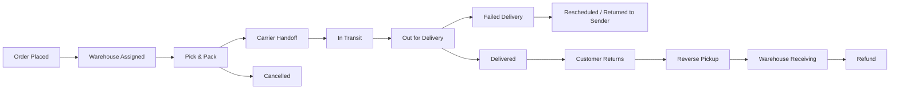

# Delivery & Supply Chain

## What Is It?

Delivery and supply chain is the entire journey that gets a product from a seller to a buyer. In tech, you're building the software that orchestrates this journey: receiving orders from an e-commerce platform, routing them to the right warehouse, coordinating picks and packs, handing parcels off to carriers, tracking them in real-time, and confirming they arrive at the customer's door. It also covers the reverse direction — returns, exchanges, and refunds flowing back upstream.

If e-commerce is about convincing someone to click "Buy Now", supply chain is about making sure that click actually results in a box on their doorstep. The systems behind this are surprisingly complex: warehouse management, transport management, carrier integrations, billing reconciliation, and last-mile delivery operations all need to work together seamlessly.

## Why Should You Care?

Logistics is where digital promises meet physical reality. A beautiful storefront means nothing if orders arrive late, damaged, or not at all. As a developer working in e-commerce or logistics tech, you'll encounter these systems constantly — whether you're integrating with a 3PL provider, building an order tracking page, calculating shipping fees at checkout, or handling the messy edge cases of failed deliveries and COD reconciliation.

Understanding supply chain concepts also makes you a better engineer in cross-functional conversations. When the operations team says "our OTD rate dropped because of a cross-docking bottleneck," you need to know what that means to build the right solution. These aren't just logistics buzzwords — they map directly to database models, state machines, and API contracts in your codebase.

## How It Works (The Business Flow)

### Order Lifecycle

This is the core state machine for a physical delivery:

1. **Order Placed**: The e-commerce system creates an order and sends it to the Order Management System (OMS)
2. **Warehouse Assignment**: OMS determines which warehouse should fulfill the order based on inventory availability, proximity to the customer, and shipping method
3. **Pick & Pack**: Warehouse staff receive a pick list, locate items on shelves, pack them into shipping boxes, and apply the shipping label
4. **Carrier Handoff**: The packed parcel is manifested (registered) with a carrier and given a tracking number (AWB). The carrier scans it at pickup
5. **In Transit**: The parcel moves through the carrier's sorting hubs. Each scan updates the tracking status
6. **Last-Mile Delivery**: A delivery driver takes the parcel from the local hub to the customer's door
7. **Proof of Delivery (POD)**: The driver captures a signature, photo, or OTP confirmation as proof that the package was delivered

### Inbound vs Outbound Logistics

**Inbound logistics** is getting products into the warehouse: supplier shipments arriving, quality inspection, put-away (storing items in designated locations). **Outbound logistics** is getting products out to customers: the pick/pack/ship flow described above.

Both directions need tracking, and both have their own set of documents (purchase orders for inbound, sales orders for outbound) and SLAs.

### Warehouse Management System (WMS)

A WMS controls everything that happens inside the warehouse:

1. **Receiving**: Inbound shipments are scanned, inspected, and recorded. The system updates inventory counts
2. **Put-Away**: Items are assigned storage locations (bin/shelf/zone). A good WMS optimizes placement — fast-moving items go near packing stations
3. **Inventory Tracking**: Real-time stock levels by SKU and location. Supports cycle counts and stock audits
4. **Pick**: When an order comes in, the WMS generates a pick list. Picking strategies include single-order pick, batch pick (multiple orders at once), and zone pick (each picker covers a zone)
5. **Pack**: Items are packed with appropriate materials, weighed, and labeled. The system validates that the right items are in the box
6. **Ship**: The WMS generates the shipping label, records the AWB, and marks the order as shipped

### Transport Management System (TMS)

A TMS handles everything between the warehouse door and the customer's door:

1. **Carrier Selection**: Choose the best carrier based on cost, speed, coverage area, and service level. Many platforms run auctions or use rate cards
2. **Route Optimization**: Plan delivery routes to minimize distance, fuel, and time — especially important for last-mile fleets
3. **Shipment Tracking**: Aggregate tracking updates from multiple carriers into a unified timeline. Normalize status codes across carriers (every carrier has different scan event names)
4. **Exception Management**: Flag shipments that are delayed, stuck, or have delivery issues. Trigger alerts or escalations
5. **Carrier Performance**: Track on-time delivery rates, damage rates, and cost per parcel by carrier to inform future selection

### Last-Mile Delivery

The last mile is the most expensive and complex part of the delivery chain — typically 40-50% of total shipping cost:

1. **Driver Assignment**: Orders are grouped by delivery zone and assigned to drivers based on capacity and route
2. **Delivery Slots**: Customers may choose a preferred time window. The system must manage slot capacity to avoid over-promising
3. **Proof of Delivery**: Captured via photo, e-signature, OTP code, or simply "left at door." This is critical for dispute resolution
4. **Failed Delivery**: Nobody home, wrong address, customer refused. The system must handle retries (usually 2-3 attempts), rescheduling, or return-to-sender
5. **COD Collection**: In COD-heavy markets, the driver collects cash. This creates an additional reconciliation flow (see billing section)

### Reverse Logistics (Returns)

Returns flow backward through the supply chain:

1. Customer initiates a return request (via app, website, or customer service)
2. System generates a return label or schedules a reverse pickup
3. The item is picked up from the customer and transported back to the warehouse
4. Warehouse receives and inspects the item — is it resalable, damaged, or defective?
5. Inventory is updated: resalable items go back to stock, damaged items are written off
6. Refund is processed to the customer

### Billing & Settlement in Supply Chain

Money flows in supply chain are often more complex than the product flows:

1. **Shipping Fee Calculation**: Determined by weight, dimensions, origin, destination, speed, and carrier rate card. Volumetric weight (length x width x height / 5000) often applies if the parcel is large but light
2. **COD Reconciliation**: When the driver collects cash, it must be reconciled: cash collected vs. order value, deposited to the company's bank account, minus the carrier's COD handling fee. This cycle often takes 3-7 days
3. **Carrier Billing**: Carriers invoice based on actual shipment weight, distance, and surcharges (fuel, remote area, weekend delivery). You need to validate carrier invoices against your own shipment records
4. **Settlement Cycles**: Payments between merchants, platforms, and logistics providers settle on fixed cycles (weekly or biweekly). Reconciliation reports match orders, deliveries, returns, and payments

## Key Terms You'll Hear

| Term                  | What It Means                                                                                                              |
| --------------------- | -------------------------------------------------------------------------------------------------------------------------- |
| **AWB**               | Air Waybill — the unique tracking number assigned to a shipment by the carrier                                             |
| **SKU**               | Stock Keeping Unit — unique identifier for each distinct product or variant                                                |
| **3PL**               | Third-Party Logistics — an external company that handles warehousing, fulfillment, and/or shipping on your behalf          |
| **WMS**               | Warehouse Management System — software that manages warehouse operations (receiving, storage, picking, packing, shipping)  |
| **TMS**               | Transport Management System — software that manages shipment planning, carrier selection, route optimization, and tracking |
| **OMS**               | Order Management System — software that manages the order lifecycle from placement to delivery                             |
| **SLA**               | Service Level Agreement — contractual delivery promises (e.g., deliver within 3 business days)                             |
| **OTD**               | On-Time Delivery — percentage of orders delivered within the promised timeframe                                            |
| **COD**               | Cash on Delivery — customer pays in cash when the parcel arrives. Common in Southeast Asia and the Middle East             |
| **POD**               | Proof of Delivery — evidence that the parcel was delivered (photo, signature, OTP)                                         |
| **Fulfillment Rate**  | Percentage of orders successfully fulfilled and shipped out of total orders received                                       |
| **Cross-Docking**     | Items arrive at a hub and are immediately sorted and loaded onto outbound trucks without being stored in the warehouse     |
| **Reverse Logistics** | The process of moving goods from the customer back to the seller or warehouse (returns, exchanges, recalls)                |
| **Hub-and-Spoke**     | A network model where parcels flow from local spokes to a central hub for sorting, then out to destination spokes          |
| **Dead Stock**        | Inventory that hasn't sold and is unlikely to sell. Costs money to store                                                   |
| **Lead Time**         | The time between placing an order with a supplier and receiving the goods                                                  |
| **Manifest**          | The official list of parcels handed to a carrier in a single batch. Used for handoff reconciliation                        |

## Common Patterns

### Pattern 1: Hub-and-Spoke Network

Parcels are collected from sellers or warehouses (spokes), consolidated at a central sorting hub, then distributed out to destination spokes for last-mile delivery.

**When it's used:** National and regional carrier networks. Nearly all major logistics companies (FedEx, JNE, J&T) use this model.

**Trade-off:** Efficient for long-distance shipping and high volume, but adds transit time. Every hub adds 0.5-1 day to the delivery timeline.

### Pattern 2: Cross-Docking

Instead of storing items in the warehouse, inbound shipments are immediately sorted and loaded onto outbound vehicles. The goods never sit on a shelf.

**When it's used:** Perishable goods, high-velocity items, or when warehouse space is limited. Grocery delivery and fast fashion companies use this heavily.

**Trade-off:** Requires precise timing and coordination. If the outbound truck isn't ready, you have a bottleneck.

### Pattern 3: Multi-Carrier Strategy

Instead of relying on a single carrier, the system selects the best carrier per shipment based on cost, coverage, speed, and performance history.

**When it's used:** Any e-commerce platform at scale. Shopee, Lazada, and Amazon all route shipments across multiple carriers.

**Trade-off:** More complex integration (each carrier has a different API), but reduces cost and risk. If one carrier goes down, others absorb the volume.

### Pattern 4: Distributed Fulfillment

Inventory is spread across multiple warehouses close to customers. Orders are routed to the nearest warehouse with stock.

**When it's used:** Companies offering same-day or next-day delivery. Amazon's fulfillment center network is the textbook example.

**Trade-off:** Higher inventory carrying costs (you need stock in multiple locations), but dramatically faster delivery and lower shipping costs.

### Pattern 5: COD with Carrier Settlement

In COD markets, the carrier collects payment from the customer and remits it to the seller, minus a handling fee, on a settlement cycle.

**When it's used:** Southeast Asia, the Middle East, India, and parts of Latin America where digital payment adoption is still growing.

**Trade-off:** Higher operational cost (cash handling, reconciliation, fraud risk from fake deliveries), but necessary to serve the market. COD orders also have higher return rates.

## Common Pitfalls

1. **Not treating order status as a state machine.** If you allow arbitrary status transitions (e.g., jumping from "Placed" to "Delivered"), you'll end up with inconsistent data and reconciliation nightmares. Define valid transitions and enforce them.

2. **Ignoring carrier API differences.** Every carrier has different status codes, webhook formats, and error handling. "Delivered" in one carrier's API might be "Completed" in another. Build a normalization layer that maps all carrier statuses to your internal status model.

3. **Underestimating failed deliveries.** In some markets, 10-20% of deliveries fail on the first attempt. Your system needs to handle retries, rescheduling, and return-to-sender flows gracefully — not just the happy path.

4. **Calculating shipping fees on the frontend only.** Shipping fee logic (weight tiers, volumetric weight, zone-based pricing, surcharges) must be validated server-side. Customers will find ways to exploit client-side calculations.

5. **Not reconciling COD collections.** If you don't match driver-collected cash against order values daily, discrepancies compound. Build automated reconciliation with exception flagging.

6. **Treating inventory as a single number.** Stock has states: available, reserved, in-transit, damaged, returned-pending-inspection. A single "quantity" field is not enough. Track inventory by state and location.

7. **Skipping idempotency on carrier API calls.** Network failures happen. If your "create shipment" call times out and you retry without idempotency, you end up with duplicate AWBs and double charges.

8. **No fallback for carrier outages.** If your only carrier's API goes down, you can't ship anything. Have a backup carrier integration and automatic failover logic.

## Industry War Stories & Non-Obvious Best Practices

### 1. Carrier DWS (Dimensioning, Weighing, Scanning) Laser Re-Rating & Automated Freight Bill Auditing

**The War Story:** A fast-growing e-commerce brand calculated checkout shipping fees and selected carriers using SKU master-catalog weights and dimensions. Three months later, finance discovered a $180,000 variance between estimated shipping costs in the TMS and the actual monthly EDI 210 / CSV invoices billed by FedEx, UPS, and J&T. Warehouse packers were putting small items into oversized boxes with heavy dunnage (air pillows), and every parcel passed through the carrier's automated sorting hub **DWS (Dimensioning, Weighing, Scanning)** laser tunnels. Whenever the laser-measured **DIM weight** ($\frac{L \times W \times H}{\text{DIM Divisor}}$, e.g., $139\text{ in}^3/\text{lb}$ or $5000\text{ cm}^3/\text{kg}$) exceeded the declared weight, the carrier silently re-rated the shipment into a higher weight tier and tacked on an "Additional Handling / Dimension Discrepancy" penalty fee.

**Non-Obvious Best Practices:**
- **Cartonization Engine at Pack Time:** Never calculate carrier labels from raw item dimensions alone. Run a 3D bin-packing (cartonization) algorithm in the WMS that recommends the smallest viable box code (`BOX-S2`), and record the **selected carton's outer dimensions** plus scale weight at the pack station before calling the carrier label API.
- **Automated Freight Bill Audit & Reconciliation Pipeline:** Ingest carrier billing files (EDI 210 or SFTP CSVs) into an automated audit table keyed by `awb_number`. Compare `manifested_weight`, `manifested_dims`, and `estimated_cost_cents` against `billed_weight`, `laser_dims`, and `billed_cost_cents`:
  - **Auto-Approve:** Variance within tolerance (e.g., $\le \$0.50$ or $\le 2\%$).
  - **Catalog Feedback Loop:** If the same single-item SKU triggers DWS re-rates across $>5$ shipments, automatically flag the SKU in the WMS for physical cubiscan re-measurement—the supplier likely changed packaging.
  - **Dispute Queue:** If a carrier bills a residential surcharge, late-delivery guaranteed service, or extreme DIM spike outside physical box bounds, auto-generate a carrier claim packet with pack-station scale logs and CCTV timestamps before the 15-day carrier dispute window closes.

### 2. Split-Shipment Margin Destruction vs. Zone-Skipping Consolidation

**The War Story:** To maximize conversion, an OMS was configured with a greedy rule: "Always route items to the warehouse that can ship fastest." When a customer ordered a $35 basket containing 3 items ($12, $13, $10) with a "Free Shipping over $30" promotion, none of the regional warehouses held all 3 SKUs. The OMS split the order into 3 separate parcels from 3 different fulfillment centers across the country. Each parcel incurred a $6.50 base carrier minimum fee ($19.50 total shipping cost), wiping out the entire gross margin and losing $9 on the order.

**Non-Obvious Best Practices:**
- **Margin-Aware Order Routing (Multi-Objective Optimization):** Never treat order routing as a pure shortest-distance problem. The OMS allocation solver must evaluate candidate fulfillment plans against a cost function:
  $$\text{Total Cost} = \sum_{\text{shipments}} \text{CarrierRate}(\text{Origin}, \text{Dest}, \text{Weight}) + \text{PickPackCost} + \text{SLA Breach Penalty}$$
  If holding the order for 12 hours to fulfill all 3 items from a single hub (or waiting for an inter-warehouse replenishment transfer) still meets the customer's promised delivery date, consolidate into 1 shipment. If splitting destroys net margin below a configurable floor (e.g., $-\$5$), prefer a single slower warehouse over 3 split shipments.
- **Zone Skipping for High-Density Lanes:** Instead of paying a national parcel carrier to haul individual boxes across 6 shipping zones from a central warehouse, aggregate all parcels destined for a distant metro region onto a single pallet/truckload (FTL/LTL) and line-haul them directly to the carrier's local destination sortation facility (Zone 2 entry). The WMS prints local-zone labels upfront, and tracking stays in a "Linehaul in Transit to Local Hub" status until the carrier's destination induction scan—cutting per-parcel freight costs by 30–45%.

### 3. Reverse Logistics Grading & Instant-Refund-on-First-Carrier-Scan Trust Scoring

**The War Story:** Waiting 7–14 days for a returned parcel to travel back, get unloaded at the return dock, and pass manual QC inspection caused massive customer support ticket volume ("Where is my refund?") and low repeat purchase rates. The team turned on "Instant Refund on Drop-Off" (issuing the refund the moment the carrier emitted the `FIRST_SCAN` webhook at the drop-off counter). Within two weeks, organized fraud rings bought $800 electronics, dropped off return boxes filled with bags of rice or rocks matched to the exact SKU weight, got instant refunds on the first carrier scan, and cashed out before the box ever reached the warehouse.

**Non-Obvious Best Practices:**
- **Risk-Gated Refund Timing Engine:** Decouple the return logistics flow from the financial refund trigger using a real-time **Return Trust Score**:
  - **Tier 1 (High Trust + Low Risk SKU):** Account age $> 180$ days, lifetime return rate $< 8\%$, item value $< \$150$, non-serialized apparel/home goods $\rightarrow$ Trigger refund immediately on carrier `IN_TRANSIT / FIRST_SCAN` webhook.
  - **Tier 2 (Medium Risk):** Hold refund until warehouse dock receiving scan (`RETURN_RECEIVED`), before detailed grading.
  - **Tier 3 (High Risk / Serialized Goods):** New account, high-value electronics, or anomaly detected $\rightarrow$ Require full **RMA Grading & Serial Verification** at the return bench before releasing funds.
- **Explicit Inventory Disposition Sub-Ledgers:** Returned items must never increment `available_to_sell` inventory upon receipt. Route them into a quarantined `returned_pending_grading` state bucket. After bench inspection, transition each unit into a discrete disposition grade:
  - **Grade A (New/Unopened):** Sanitize, repackage, move to `available_to_sell`.
  - **Grade B (Open-Box / Minor Wear):** Generate a secondary SKU suffix (e.g., `SKU-123-OPENBOX`) for outlet/refurbished channels.
  - **Grade C/D (Defective / Fraud / Brick-in-Box):** Move to `vendor_rtv` (Return to Vendor), `liquidation`, or `fraud_evidence_hold` (triggering automated payment chargeback/account ban workflows with pack-bench unbox video).

## Quick Reference

| Stage           | System            | Key Data                                          |
| --------------- | ----------------- | ------------------------------------------------- |
| Order placed    | OMS               | Order ID, items, shipping address, payment status |
| Warehouse ops   | WMS               | SKU, bin location, pick list, pack verification   |
| Carrier handoff | TMS               | AWB, manifest, carrier code, service type         |
| In transit      | TMS + Carrier API | Tracking events, hub scans, ETA                   |
| Last mile       | Driver app        | Route, delivery slot, POD capture                 |
| Delivered       | OMS + TMS         | POD, delivery timestamp, COD amount collected     |
| Returns         | Reverse logistics | Return reason, pickup, inspection result, refund  |

| Metric                      | Target  | Why It Matters                                     |
| --------------------------- | ------- | -------------------------------------------------- |
| On-Time Delivery (OTD)      | > 95%   | Customer satisfaction and SLA compliance           |
| Fulfillment Rate            | > 98%   | Measures warehouse efficiency                      |
| First-Attempt Delivery Rate | > 85%   | Failed attempts are expensive (re-delivery costs)  |
| Return Rate                 | < 5-10% | High returns indicate product or listing issues    |
| COD Reconciliation Accuracy | > 99.5% | Cash leakage erodes margins                        |
| Shipping Cost per Order     | Varies  | Track trend over time — should decrease with scale |
