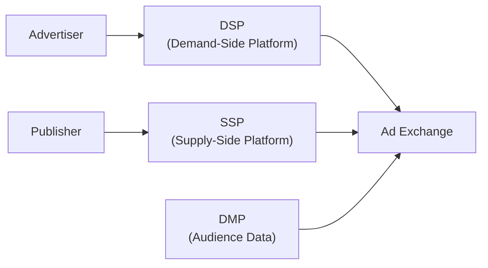
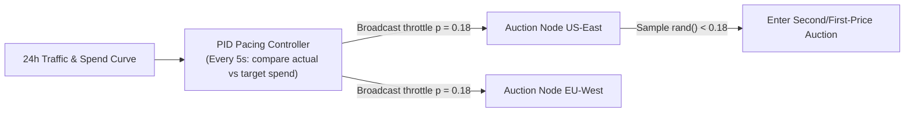

# Advertising & Ad Tech

## What Is It?

Ad tech is the infrastructure that connects businesses who want to promote something (advertisers) with websites and apps that have audiences to show those promotions to (publishers). It sounds simple, but between those two parties sits an entire ecosystem of platforms, auctions, data pipelines, and optimization algorithms. Every time a webpage loads and you see a banner ad, a real-time auction likely happened in under 100 milliseconds — dozens of advertisers bid for that exact impression, targeting you specifically based on your browsing behavior, demographics, and context. As a developer, you'll encounter ad tech when building publisher monetization, integrating ad SDKs, implementing tracking pixels, or working at any company where advertising is the business model.

## Why Should You Care?

Advertising funds the majority of the free internet. Google, Meta, Twitter, YouTube, most news sites — their revenue comes from ads. If you work at any of these companies, or build products that integrate with them, you need to understand how ads get served, bought, and measured. Even if you work at a SaaS company, you'll likely run paid campaigns and need to implement conversion tracking, attribution pixels, and landing page optimization. Understanding ad tech also means understanding where user privacy intersects with business revenue — one of the most consequential tensions in modern tech.

## How It Works (The Business Flow)

### The Ad Ecosystem

There are four main players:

- **Advertisers**: Companies paying to show ads (Nike, a local bakery, a SaaS startup). They have a budget and a goal — drive sales, generate leads, build brand awareness.
- **Publishers**: Websites and apps with ad inventory — slots where ads can appear. A news site's banner, a mobile game's interstitial, a podcast's pre-roll.
- **Ad Networks**: Middlemen that aggregate publisher inventory and sell it to advertisers. Google AdSense is the classic example.
- **Ad Exchanges**: Automated marketplaces where inventory is bought and sold in real time, like a stock exchange for ad slots.

### The Programmatic Stack

Manual ad buying (call a sales rep, negotiate a rate, send a creative) still exists, but most digital ads are now bought programmatically — through software, in real time.

- **DSP (Demand-Side Platform)**: Advertisers use DSPs to buy ad impressions across many exchanges. Examples: Google DV360, The Trade Desk. The DSP decides which impressions to bid on and how much to bid.
- **SSP (Supply-Side Platform)**: Publishers use SSPs to sell their inventory to the highest bidder. Examples: Google Ad Manager, Magnite. The SSP maximizes revenue for the publisher.
- **DMP (Data Management Platform)**: Collects and organizes audience data (demographics, interests, behavior) so DSPs can target the right users. Increasingly replaced by CDPs (Customer Data Platforms) as cookies disappear.

### Real-Time Bidding (RTB)

When a user loads a webpage with ad slots, this happens in about 100ms:

1. User's browser requests the page.
2. The page calls the publisher's ad server.
3. The ad server sends a bid request to the SSP.
4. The SSP forwards the bid request to multiple ad exchanges/DSPs.
5. Each DSP evaluates the impression (who is this user? does this match any campaign targeting?) and submits a bid.
6. The highest bid wins the auction.
7. The winning ad creative is served to the user's browser.
8. Impression, click, and conversion events are tracked.

This entire flow happens before the page finishes loading. At scale, billions of these auctions happen daily.

### Pricing Models

| Model                     | How You Pay                                | Best For                  |
| ------------------------- | ------------------------------------------ | ------------------------- |
| **CPM** (Cost Per Mille)  | Per 1,000 impressions                      | Brand awareness campaigns |
| **CPC** (Cost Per Click)  | Per click on the ad                        | Traffic and engagement    |
| **CPA** (Cost Per Action) | Per conversion (signup, purchase)          | Performance marketing     |
| **CPV** (Cost Per View)   | Per video view (usually 30s or completion) | Video campaigns           |
| **CPL** (Cost Per Lead)   | Per lead form submission                   | B2B lead generation       |

### Targeting

Targeting determines who sees the ad. The more precise the targeting, the higher the CPM (advertisers pay more for relevant audiences).

- **Demographic**: Age, gender, income, education. Based on declared or inferred data.
- **Behavioral**: Based on past browsing activity, purchase history, app usage. "Users who visited running shoe pages in the last 7 days."
- **Contextual**: Based on the content of the page where the ad appears. An ad for hiking boots on a travel blog. No user data needed — increasingly important as cookies disappear.
- **Retargeting (Remarketing)**: Showing ads to users who already visited your site or app. "You looked at this product but didn't buy it." Powered by tracking pixels and cookies.
- **Lookalike/Similar Audiences**: Find new users who resemble your existing customers based on shared characteristics.

### Attribution Models

Attribution answers: which ad or marketing touchpoint gets credit for a conversion?

- **First-Touch**: Credit goes to the first interaction. User clicked a Facebook ad initially, then later searched Google and bought. Facebook gets full credit.
- **Last-Touch**: Credit goes to the last interaction before conversion. In the same scenario, Google gets full credit.
- **Linear**: Credit is split equally across all touchpoints.
- **Time-Decay**: More credit to touchpoints closer in time to the conversion.
- **Multi-Touch (Data-Driven)**: Uses algorithms to assign credit proportionally based on the actual influence of each touchpoint. The most accurate, but requires significant data.

No model is perfect. First-touch and last-touch are simple but misleading. Multi-touch is better but harder to implement and explain.

### Campaign Management & A/B Testing

Running ads isn't set-and-forget. A campaign includes:

1. **Creative variations**: Multiple ad copies, images, and videos.
2. **Audience segments**: Different targeting groups.
3. **Budget allocation**: How much to spend per day or per segment.
4. **Bid strategy**: Manual bids vs. automated (let the platform optimize).
5. **A/B testing**: Run multiple creatives or landing pages simultaneously, measure which converts better, and shift budget to winners.

Platforms like Google Ads and Meta Ads Manager handle much of this, but understanding the mechanics matters when you're building internal tools, dashboards, or custom attribution.

## Key Terms You'll Hear

| Term                                  | What It Means                                                                                                                                        |
| ------------------------------------- | ---------------------------------------------------------------------------------------------------------------------------------------------------- |
| **Impression**                        | One instance of an ad being displayed to a user                                                                                                      |
| **Click-Through Rate (CTR)**          | Clicks divided by impressions. A 2% CTR means 2 clicks per 100 impressions                                                                           |
| **Conversion**                        | The desired action — a purchase, signup, download, or form submission                                                                                |
| **ROAS**                              | Return On Ad Spend — revenue generated divided by ad cost. ROAS of 5x means $5 revenue per $1 spent                                                  |
| **ROI**                               | Return On Investment — net profit divided by total cost, broader than ROAS                                                                           |
| **Fill Rate**                         | Percentage of ad requests that actually get filled with an ad. 80% fill rate means 20% of slots go empty                                             |
| **eCPM**                              | Effective CPM — total earnings divided by impressions times 1000. Normalizes across pricing models                                                   |
| **Ad Creative**                       | The actual ad content — image, video, text, HTML                                                                                                     |
| **Pixel**                             | A tiny piece of tracking code placed on a webpage to record conversions or build retargeting audiences                                               |
| **Frequency Cap**                     | Limit on how many times one user sees the same ad. Prevents ad fatigue                                                                               |
| **Viewability**                       | Whether an ad was actually visible on screen (not below the fold, loaded but never scrolled to)                                                      |
| **Ad Inventory**                      | The total ad slots a publisher has available to sell                                                                                                 |
| **Header Bidding**                    | A technique where publishers offer inventory to multiple exchanges simultaneously before calling their ad server, increasing competition and revenue |
| **Consent Management Platform (CMP)** | Tool that collects and manages user consent for tracking and personalized ads (required by GDPR/CCPA)                                                |

## Common Patterns

### Pattern 1: Waterfall vs. Header Bidding

**Waterfall** (legacy): The publisher's ad server calls ad networks one at a time in priority order. If the first network can't fill, try the second, then the third. Slow and leaves money on the table.

**Header Bidding** (modern): All demand sources bid simultaneously in the page header before the ad server is called. More competition, higher revenue for publishers, faster.

**When it's used:** Any publisher serious about maximizing ad revenue has moved to header bidding (Prebid.js is the most common open-source implementation).

### Pattern 2: Server-Side Ad Insertion (SSAI)

Instead of the client making ad calls, the server stitches ads directly into the content stream (especially video). The user sees a seamless stream with ads embedded.

**When it's used:** Video streaming platforms, connected TV (CTV). Harder for ad blockers to detect since the ad comes from the same domain as the content.

**Trade-off:** More infrastructure complexity. Harder to track client-side engagement events.

### Pattern 3: Conversion Tracking with Pixels

An advertiser places a tracking pixel (a 1x1 image or JavaScript snippet) on their "thank you" or confirmation page. When a user converts, the pixel fires, and the ad platform records which ad led to that conversion.

**When it's used:** Every performance marketing campaign. Facebook Pixel, Google Ads conversion tag, LinkedIn Insight Tag.

**Trade-off:** Relies on cookies and browser permissions. Increasingly unreliable as browsers block third-party cookies.

### Pattern 4: Privacy-First Advertising

With cookie deprecation (Chrome phasing out third-party cookies), IDFA changes (Apple requiring opt-in for tracking), and regulations (GDPR, CCPA), the industry is shifting:

- **Contextual targeting** over behavioral targeting.
- **First-party data** (data you collect directly from your users) becomes the most valuable asset.
- **Privacy Sandbox** (Google's initiative): Topics API, Attribution Reporting API, Protected Audiences — browser-level APIs that enable targeting without exposing individual user data.
- **Server-side tracking**: Sending conversion data from your server to ad platforms (Facebook Conversions API, Google Enhanced Conversions) to bypass client-side restrictions.

## Common Pitfalls

- **Ad fraud is massive**: Click fraud (bots clicking ads to drain budgets), impression fraud (serving ads to invisible iframes), bot traffic masquerading as real users. The industry loses tens of billions annually. Use fraud detection tools (HUMAN, DoubleVerify, IAS) and monitor for anomalies — sudden spikes in clicks with zero conversions is a red flag.
- **Misunderstanding attribution**: Last-touch attribution makes Google Search look amazing (it's often the last click) and makes top-of-funnel channels like display and social look useless. Don't kill brand awareness campaigns based on last-touch data.
- **Ignoring ad fatigue**: Showing the same ad to the same user 50 times doesn't convert — it annoys. Set frequency caps and rotate creatives regularly.
- **Not respecting consent**: Firing tracking pixels before the user consents violates GDPR and can result in massive fines. Implement a proper CMP and only load ad/tracking scripts after opt-in.
- **Vanity metrics**: High impressions and clicks mean nothing if they don't convert. Focus on CPA and ROAS, not CTR alone.
- **Cookie deprecation denial**: If your targeting or measurement strategy depends entirely on third-party cookies, it's already broken for Safari and Firefox users (roughly 30-40% of web traffic). Build with first-party data and server-side tracking now.
- **Latency from ad scripts**: Ad tags and header bidding can add 500ms+ to page load. Lazy-load ads below the fold, set auction timeouts, and monitor Core Web Vitals impact.
- **Invalid traffic (IVT)**: Not all fraud is malicious. Bots from search crawlers, internal testing, or data center traffic can inflate metrics. Filter known IVT sources from your reporting.

## Industry War Stories & Non-Obvious Best Practices

### 1. Campaign Budget Pacing: Why 1,000 Ad Servers Can Overspend a $500 Daily Budget in 8 Seconds

If an advertiser sets a `$500/day` budget on a popular campaign and 200 geographically distributed RTB auction nodes check `if (spent < $500)` against a central database or eventually consistent cache at 12:00:01 AM, all 200 nodes will simultaneously bid on millions of impressions—spending `$18,000` in 8 seconds (**Over-Delivery**), where the ad platform must legally eat the `$17,500` excess cost out of pocket.
- **How Real Ad Servers Solve Distributed Pacing**:
  1. **Probabilistic Throttling (PID Controller)**: Instead of a binary on/off budget gate, a central pacing controller computes an ideal spend curve across the 24-hour traffic forecast and broadcasts a **participation probability** $p \in [0, 1]$ (or bid-shading multiplier) every 5–10 seconds to edge auction nodes.
  2. **Pre-Allocated Micro-Quotas (Token Leasing)**: For small budgets (`<$100/day`), edge nodes must lease a `$5` budget slice from a strongly consistent shard before bidding; once exhausted, they request another lease.

### 2. Render-Beacon vs. Auction-Win Billing & the MRC Viewability Gap

Winning an auction on the backend does **not** mean the user ever saw the ad—the user might scroll past before the image loads, or a mobile app might pre-fetch 10 feed items below the fold that are never reached.
- **Unspoken Industry Rule**: Never charge the advertiser when the backend wins the auction. Charge only when the client SDK fires a **Billable Impression Beacon** (`1px` pixel or `navigator.sendBeacon`) after satisfying the **MRC Viewability Standard** ($\ge 50\%$ of ad pixels in the active viewport for $\ge 1$ continuous second for display, or $\ge 2$ seconds for video), deduplicated by a single-use cryptographic `impression_id` with a 30-minute replay window.

### 3. Post-ATT / ITP Attribution: Server-to-Server CAPI & Incrementality Holdouts

After Apple's App Tracking Transparency (ATT) removed IDFA for ~80% of iOS users and Safari ITP capped client cookies to 7 days, client-side pixel attribution routinely under-reports conversions by 30–50%, while ad networks eagerly claim credit for organic buyers via 1-day view-through windows (**View-Through Cannibalization**).
- **Production Best Practice**: Pair **Server-to-Server Conversion APIs (Meta CAPI / Google Enhanced Conversions)** using hashed first-party identifiers + click IDs (`fbclid`/`gclid`) with **Always-On Geo/Ghost-Ad Incrementality Holdouts** (withholding ads from a randomized 5% control group or serving a PSA placeholder) to measure *true incremental lift* (`iROAS`) rather than self-reported platform ROAS.

## Quick Reference

| Task                         | Tool / Approach                       | Notes                                                 |
| ---------------------------- | ------------------------------------- | ----------------------------------------------------- |
| Run paid search ads          | Google Ads, Microsoft Ads             | Intent-based — user is actively searching             |
| Run social media ads         | Meta Ads, TikTok Ads, LinkedIn Ads    | Interest/demographic-based targeting                  |
| Monetize a website with ads  | Google AdSense, Prebid.js + GAM       | Header bidding for higher revenue                     |
| Programmatic buying at scale | DSP (The Trade Desk, DV360)           | Access to multiple ad exchanges                       |
| Track conversions            | Pixels + server-side APIs             | Use both for maximum accuracy                         |
| Attribution                  | Google Analytics 4, AppsFlyer, Adjust | GA4 is free; mobile needs dedicated tools             |
| Fraud detection              | HUMAN, DoubleVerify, IAS              | Monitor click-to-conversion ratios                    |
| Consent management           | OneTrust, Cookiebot, custom CMP       | Required before loading any tracking                  |
| Measure ad viewability       | MOAT, IAS, DoubleVerify               | Industry standard: 50% of pixels visible for 1 second |
| A/B test ad creatives        | Platform-native tools or Optimizely   | Let tests run to statistical significance             |
