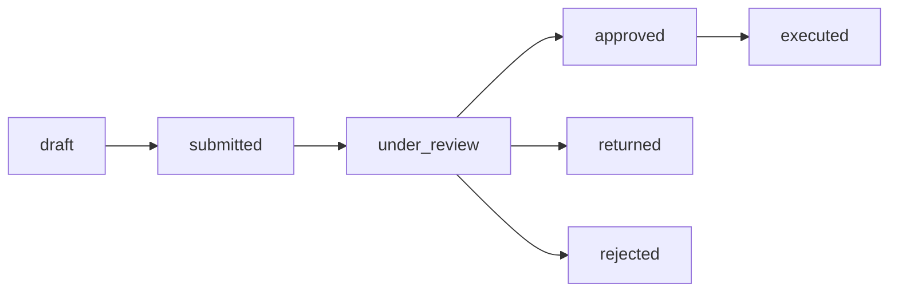

# Workflow & Approval Systems

## What Is It?

A workflow and approval system routes a piece of work through a series of steps and decision points until it reaches a final state — approved, rejected, or returned for revision. Think of an employee submitting a purchase order: it goes to their manager, then to finance, maybe to legal if the amount is large enough, and finally gets executed or denied. The system enforces who can approve what, in what order, under what conditions, and by when. At its core, you're building a state machine where transitions are guarded by business rules and human decisions.

## Why Should You Care?

Every organization beyond a handful of people needs formal approval processes — expense reports, content publishing, code deployments, vendor onboarding, leave requests, contract reviews. Without a system, approvals happen over email and Slack, things get lost, and there's no audit trail when compliance asks "who approved this $50,000 vendor contract?" As a developer, you'll encounter these patterns in enterprise SaaS, HR platforms, procurement tools, content management systems, and internal tooling. The difference between a naive implementation (a `status` column and a prayer) and a well-architected one (state machines, delegation, SLAs, audit trails) determines whether the system scales with the organization or collapses under its own weight.

## How It Works (The Business Flow)

### Request Initiation

Everything starts with a request. A user fills out a form — a purchase requisition, a time-off request, a content draft — and submits it into the workflow. The system captures the request data, timestamps it, tags it with the requester's identity and role, and determines which workflow template applies. A $500 office supply order follows a different path than a $500,000 infrastructure contract, even though both are "purchase requests."

### State Machines for Workflow States

Every request lives in exactly one state at any given time. The set of valid states and the transitions between them form a state machine. A typical approval workflow might look like:



Each transition has a guard — a condition that must be true before the transition fires. "Can only move from `under_review` to `approved` if the approver has the `finance_manager` role and the amount is under their approval limit." Model this explicitly. A state machine library or a transitions table in your database beats scattered if-else blocks across your codebase.

### Approval Chains

An approval chain defines the ordered list of approvers a request must pass through. Chains can be:

- **Fixed**: Always the same people in the same order. Simple, but rigid. Used for low-volume, high-stakes processes.
- **Role-based**: Defined by organizational roles, not individuals. "The requester's direct manager, then the department head, then finance." People change; roles persist.
- **Dynamic**: Computed at submission time based on request attributes. Amount over $10,000? Add VP approval. Involves external vendor? Add legal review. This is where most real-world complexity lives.

### Document Routing

Requests often carry attachments and supporting documents — invoices, contracts, specifications, receipts. The system routes these alongside the request so approvers have the context they need without chasing down files over email. Version the documents: if the requester updates an attachment after initial submission, the approver should see what changed.

### Role-Based Approvals

Approvals are tied to roles, not people. The system resolves roles to individuals at runtime. "Finance Approver" might map to three people, any one of whom can approve. This prevents bottlenecks when someone is on vacation and makes the workflow resilient to organizational changes. Common role configurations:

- **Any-of**: Any one person with the role can approve (first to act wins).
- **All-of**: Every person with the role must approve (unanimous consent).
- **Quorum**: A minimum number must approve (e.g., 2 of 3 board members).

### Parallel vs Sequential Approval Flows

- **Sequential**: Step A must complete before Step B begins. The request moves through approvers one at a time. Simple to reason about, but slow — if any single approver is delayed, the whole chain stalls.
- **Parallel**: Multiple approvers review simultaneously. A contract might go to legal and finance at the same time. The request proceeds once all parallel branches complete (AND-join) or once any one completes (OR-join). Faster, but harder to implement — you need to track completion of each branch independently and handle the join logic.
- **Hybrid**: Sequential stages where some stages contain parallel approvals. Stage 1 is the manager (sequential). Stage 2 is legal and finance in parallel. Stage 3 is the VP (sequential). This is the most common real-world pattern.

### Conditional Branching

Not every request follows the same path. Conditional logic determines which steps to include:

- Amount > $50,000? Route to executive approval.
- Department is Engineering? Skip the marketing review step.
- Vendor is international? Add compliance review.

Conditions evaluate request attributes, requester metadata, or external data. Implement these as rules that the workflow engine evaluates at each transition point, not as hardcoded logic in application code. When the business changes a threshold from $50,000 to $75,000, it should be a configuration change, not a code deployment.

### SLA Enforcement and Deadline Tracking

Every approval step should have a deadline. Without SLAs, requests sit in someone's queue indefinitely. The system needs to:

1. **Set deadlines**: When a step activates, calculate its due date (e.g., 48 hours from now, 3 business days).
2. **Send reminders**: Notify the approver at intervals — when assigned, at 50% of the SLA, and approaching deadline.
3. **Escalate**: When the deadline passes, automatically escalate to the approver's manager, reassign to another qualified approver, or auto-approve/auto-reject based on policy.
4. **Track SLA metrics**: Measure average approval time per step, per approver, and per workflow type. This data reveals bottlenecks.

Business days matter. A 48-hour SLA set on Friday at 5 PM shouldn't expire Sunday at 5 PM. Account for weekends, holidays, and the organization's working calendar.

### Delegation and Proxy Approval

People go on vacation, get sick, or are simply overloaded. The system must support:

- **Delegation**: An approver assigns their approval authority to a colleague for a date range. "Sarah handles my approvals from March 1-15."
- **Proxy approval**: An admin or manager can approve on behalf of an absent approver with appropriate logging.
- **Reassignment**: A workflow admin can manually reassign a pending approval to a different qualified person.

Every proxy action must be logged — "Approved by Bob on behalf of Alice (delegated March 1-15)" — so the audit trail remains accurate.

### Audit Trails

Every action on a request must be recorded immutably:

- Who did what, when, and from where (IP, device).
- The state before and after the action.
- Any comments or justifications provided.
- Documents viewed or attached.
- Delegation context if applicable.

This is non-negotiable for regulated industries (finance, healthcare, government) and practically essential everywhere else. Store audit entries in an append-only log. Never update or delete audit records. When someone asks "who approved this and when," the answer should be instant and indisputable.

### Notification Triggers

The system must notify the right people at the right time:

- **Assignment**: "You have a new request to review."
- **Reminder**: "This approval is due in 4 hours."
- **Escalation**: "This approval has exceeded its SLA."
- **Status change**: "Your request was approved / rejected / returned."
- **Comment**: "An approver left a comment on your request."

Support multiple channels (email, Slack, in-app notifications, SMS for urgent items). Let users configure their notification preferences, but never let them silence SLA escalations.

### Workflow Templates

Most organizations have a handful of workflow types that handle 90% of requests. Define these as templates:

- Purchase requisition workflow (3 steps, amount-based branching)
- Content publishing workflow (author, editor, legal, publish)
- Employee onboarding workflow (HR, IT, manager, facilities)

Templates define the steps, roles, conditions, SLAs, and notification rules. New instances are created from templates when a request is submitted. Templates should be configurable by business admins without developer involvement.

### Versioning Workflows

Workflow definitions change over time — new approval steps get added, thresholds change, roles are reorganized. You need to version your workflow templates:

- In-flight requests continue using the workflow version they started with.
- New requests use the latest version.
- Old versions are archived but never deleted (audit requirements).

This prevents the nightmare of a policy change retroactively altering the approval path of a request that's already halfway through.

## Key Terms You'll Hear

| Term                              | What It Means                                                                                  |
| --------------------------------- | ---------------------------------------------------------------------------------------------- |
| **Workflow**                      | A defined sequence of steps that a request follows from submission to completion               |
| **State Machine**                 | A model where the request exists in exactly one state, with defined transitions between states |
| **Approval Chain**                | The ordered list of approvers or approval stages a request must pass through                   |
| **Approver**                      | A person or role authorized to approve, reject, or return a request at a given step            |
| **Delegation**                    | Temporarily transferring approval authority to another person for a defined period             |
| **Escalation**                    | Automatically routing a request to a higher authority when an SLA is breached                  |
| **SLA (Service Level Agreement)** | The maximum allowed time for an approver to act on a request                                   |
| **Parallel Approval**             | Multiple approvers reviewing simultaneously, with a join condition (all, any, quorum)          |
| **Conditional Branch**            | A decision point where the workflow path changes based on request attributes or rules          |
| **Audit Trail**                   | An immutable, timestamped log of every action taken on a request                               |
| **Workflow Template**             | A reusable definition of steps, roles, conditions, and SLAs that new requests instantiate      |
| **Proxy Approval**                | Approving on behalf of another person, with the action logged against both parties             |
| **Quorum**                        | The minimum number of approvers required to approve at a given step                            |
| **Return / Send Back**            | Sending a request back to the requester or a previous step for revision                        |

## Common Patterns

### Approval Limits by Hierarchy

Managers approve up to $5,000, directors up to $50,000, VPs up to $500,000, C-suite above that. The system determines the required approval depth at submission time based on the request amount and routes accordingly. When someone gets promoted, update their role and limit — don't rewire the workflow.

### Four-Eyes Principle

Regulated industries require that at least two different people review and approve a transaction. The system must enforce that the second approver is a different person from the first, even if both hold the same role. Also called "dual control" or "maker-checker."

### Auto-Approval Rules

Low-risk requests can skip human review entirely. Office supplies under $100 from a pre-approved vendor? Auto-approve and notify the manager for awareness. This reduces approval fatigue and speeds up routine work. But always log auto-approvals in the audit trail with the rule that triggered them.

### Recall and Withdrawal

A requester realizes they made an error after submitting. Allow them to recall the request if no approver has acted on it yet. Once an approver has started reviewing, recall should require the approver's consent or admin intervention.

### Batch Approvals

An approver with 30 pending requests shouldn't have to open each one individually. Provide a batch approval interface where they can review summaries and approve or reject multiple requests at once. Still log each as an individual action in the audit trail.

### Comment Threads

Approvers often need to ask questions or request changes before approving. Support threaded comments on each request so the conversation stays attached to the workflow instance, not scattered across email.

### Workflow Analytics Dashboard

Track cycle time (submission to completion), bottleneck steps (where requests queue up), approval rates, SLA compliance, and approver workload. This data helps the business optimize their processes and identify overloaded teams.

## Gotchas

- **Hardcoding workflow logic in application code**: When the CFO says "add a legal review step for international vendors," it shouldn't require a code deployment. Separate workflow definition from application logic. Use a rules engine or configuration-driven approach.
- **No versioning on workflow definitions**: Changing a live workflow template mid-flight corrupts in-progress requests. Always version templates and let active instances complete on their original version.
- **Ignoring time zones and business days in SLAs**: A 24-hour SLA set at 6 PM Friday shouldn't expire Saturday at 6 PM if your organization doesn't work weekends. Use business-hours-aware SLA calculations.
- **Missing delegation support**: The VP is on vacation for two weeks, and 40 requests are stuck waiting for their approval. Without delegation, someone ends up sharing login credentials — which is a security and audit nightmare.
- **Circular workflows**: A misconfigured workflow where step A routes to step B which routes back to step A creates an infinite loop. Validate workflow definitions for cycles before activation.
- **No idempotency on approval actions**: If the approver double-clicks the approve button or the network retries the request, the system shouldn't record two approvals or advance the workflow twice. Make approval actions idempotent.
- **Over-engineering the first version**: Starting with a full visual workflow designer, BPMN engine, and dynamic form builder when you have 3 workflow types and 50 users. Start with well-modeled state machines and configurable templates. Add the visual builder when you have 20+ workflow types.
- **Silent failures in notification delivery**: If the approval notification doesn't reach the approver, the request sits indefinitely. Monitor notification delivery, implement retry logic, and provide an in-app inbox as a fallback channel.
- **Not handling organizational changes**: When a department is reorganized or a role is renamed, in-flight workflows that reference the old structure break. Design role resolution to be dynamic (resolved at action time, not at submission time) so org changes don't strand requests.
- **Treating rejection as terminal**: In many workflows, rejection should allow the requester to revise and resubmit without starting from scratch. Model "returned for revision" as a distinct state from "rejected."

## Industry War Stories & Non-Obvious Best Practices

### 1. Cryptographic Payload-Hash Binding (Preventing Mid-Workflow Bait-and-Switch Edits)

**The War Story:** In a procurement approval system, a purchase requisition required sequential approvals: `Department Manager` $\rightarrow$ `Security Review` $\rightarrow$ `VP of Finance`. A requester submitted a $4,500 software order with a standard vendor bank account. After the Department Manager and Security Reviewer approved Step 1 and Step 2, the requester noticed a typo in the description and used the "Edit Request" button while the ticket was sitting in the VP of Finance's queue. The API updated the `purchase_requests` row in place—allowing an insider to quietly change the total amount from $4,500 to $45,000 and swap the vendor IBAN to a personal shell account right before Step 3. Even worse, in another incident, the VP of Finance had loaded the page at 9:00 AM (seeing $4,500), the requester edited it at 9:02 AM (to $45,000), and the VP clicked "Approve" at 9:03 AM without refreshing. The audit log recorded that all three approvers signed off on the $45,000 payout.

**Non-Obvious Best Practices:**
- **Canonical Payload Snapshot & SHA-256 Digest Binding:** Never bind an approval signature to a mutable `request_id` alone. Every time a request is submitted or revised, serialize its canonical business payload (sorted JSON keys of line items, amounts, currency, payee bank details, and SHA-256 hashes of all attached PDF contracts) into an immutable `request_revisions` snapshot row with a `payload_sha256` digest.
- **Compare-and-Swap Approval Verification:** When an approver clicks "Approve", the client must submit `(request_id, revision_number, payload_sha256)`. The backend verifies that `request.current_revision == submitted_revision`. If the requester modified the request while the approver had the tab open, the approval call fails with `409 Conflict: Request payload changed since loaded`.
- **Material-Change Reset vs. Non-Material Edit Rules:** Lock the business payload against in-place edits once `state != 'draft'`. If a requester must amend an in-flight request, create `revision_number + 1` and evaluate a field-level diff policy:
  - If **material fields** changed (`amount_cents` increased, `vendor_bank_account`, `contract_attachment_hash`, `cost_center`), automatically **invalidate all prior approvals**, log `APPROVAL_REVOKED_BY_AMENDMENT`, and reset the state machine to Step 1.

### 2. Org-Chart Mutation & Terminated/OOO Approver Re-Routing Without Deadlocking In-Flight Instances

**The War Story:** At workflow submission time, an approval engine resolved the requester's management chain (`manager_id = user_402`, `director_id = user_109`) and persisted those concrete user IDs into the `workflow_step_assignees` table. Two weeks later, the company underwent a department reorganization and `user_402` left the company (their account was deactivated in Okta/HRIS). Over 180 in-flight expense reports, vendor contracts, and access requests permanently deadlocked in `under_review` because `user_402` could no longer log in, nobody else had permission to click "Approve" on their steps, and a separate contractor who got promoted into a manager role ended up assigned as the approver for *their own* previously submitted expense report!

**Non-Obvious Best Practices:**
- **Late-Binding Role Expressions (Resolve at Step Activation, Not Submission):** Store step assignees in the workflow definition as declarative role-resolution expressions (`REL:REQUESTER_MANAGER_LVL(1)`, `ROLE:COST_CENTER_OWNER(req.cost_center_id)`, `GROUP:LEGAL_COUNSEL`) rather than static `user_id`s. Only resolve the expression to concrete human actors when the state machine actually transitions *into* that step.
- **HRIS / IdP Event-Driven Re-Evaluation:** Subscribe the workflow engine to HRIS/Identity Provider lifecycle events (`USER_DEACTIVATED`, `MANAGER_CHANGED`, `OOO_DELEGATION_ENABLED`):
  - When an active step's assigned approver is terminated or deactivated, automatically traverse up the org hierarchy (`manager_of(terminated_user)`) or fall back to the role group's designated owner, reassign the pending step, reset the step notification trigger, and record `SYSTEM_AUTO_REASSIGNED (Reason: Approver Deactivated)` in the audit log.
- **Dynamic Conflict-of-Interest & Self-Approval Guards:** Whenever an org-chart change, delegation chain, or escalation rule re-routes a step to a new target user $U$, evaluate the **Maker-Checker / Four-Eyes Invariant** at runtime:
  $$U \neq \text{request.requester\_id} \quad \land \quad U \neq \text{request.beneficiary\_id} \quad \land \quad U \notin \text{prior\_step\_approvers}$$
  If delegating or escalating to $U$ would cause a user to approve their own request (or sign off twice on two different stages of a Four-Eyes workflow), automatically skip $U$ and escalate one level higher in the reporting tree.

### 3. Workflow Definition Versioning (Pinning In-Flight Long-Running Workflows to v1 While New Requests Start on v2)

**The War Story:** A company's `Contract Approval` workflow initially had 3 steps (`Step 1: Manager` $\rightarrow$ `Step 2: Legal` $\rightarrow$ `Step 3: CFO`). An admin used the workflow builder to insert a new `Security Architecture Review` step at Step 2 and deleted an obsolete condition branch, saving the changes directly over the `workflow_templates` and `workflow_steps` rows in the database. Instantly, 300 in-flight contract requests that had been running for weeks corrupted: requests sitting at old `Step 2 (Legal)` suddenly thought they were in `Security Review`, foreign keys on completed step logs broke, and state transitions threw `InvalidStepTransitionException` because the engine tried to evaluate the new v2 DAG against v1 execution history.

**Non-Obvious Best Practices:**
- **Immutable Versioned DAG Snapshots (`template_id` + `version`):** Treat published workflow definitions like compiled immutable artifacts. Editing a workflow template must **never** mutate rows in place; publishing creates `version = N + 1` with its own immutable DAG definition JSON/rows.
- **Instance Pinning at Creation Time:** When a request is initiated, stamp `workflow_template_version = N` (or copy the resolved DAG specification directly into the workflow instance record). All in-flight instances continue executing against version $N$ until they reach a terminal state (`executed`, `rejected`, `withdrawn`), while newly submitted requests instantiate version $N + 1$.
- **Safe In-Flight Migration Protocol (For Regulatory Emergencies):** If a new compliance rule mandates that *even in-flight* requests must pass through a new step, never hot-patch the template row. Build an explicit `MigrateInstance(instance_id, target_version, step_mapping_policy)` administrative operation that replays completed audit steps against the new DAG, preserves valid cryptographic approvals where the payload and role match, pauses at the first newly required gate, and writes a formal `WORKFLOW_VERSION_MIGRATED (v1 -> v2)` audit entry.

## Quick Reference

```
Request lifecycle:
  draft → submitted → under_review → approved → executed
                          ↓              ↓
                      returned       rejected

Approval chain types:
  Fixed      → same approvers every time
  Role-based → resolved by org role at runtime
  Dynamic    → computed from request attributes and rules

Flow types:
  Sequential → A then B then C (simple, slow)
  Parallel   → A and B at same time, join when done (fast, complex)
  Hybrid     → sequential stages with parallel steps inside

Join conditions:
  AND  → all parallel approvers must complete
  OR   → any one approver is sufficient
  N-of → quorum (e.g., 2 of 3)

SLA enforcement:
  Set deadline → remind at intervals → escalate on breach → track metrics

Delegation:
  Approver assigns proxy → proxy acts on their behalf → audit logs both

Key data per workflow instance:
  request_id, workflow_template_id, template_version, requester_id,
  current_state, current_step, created_at, updated_at, due_at,
  approval_chain (snapshot), documents[], audit_log[], comments[]

Audit trail per action:
  action_id, request_id, actor_id, proxy_for (if delegated),
  action (approve/reject/return/comment/escalate), previous_state,
  new_state, timestamp, ip_address, justification

Common workflow types:
  Purchase    → amount-based branching, approval limits, four-eyes
  Content     → author → editor → legal → publish
  Leave       → employee → manager → HR (auto-approve if balance > 0)
  Onboarding  → HR → IT → manager → facilities (parallel stages)
  Contract    → legal → finance → executive (SLA-critical)
```
