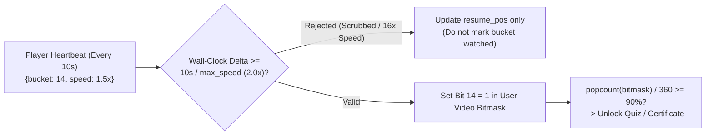

# Online Education & E-Learning

## What Is It?

An online education platform lets instructors create courses and learners consume them over the internet — video lectures, interactive exercises, quizzes, and live sessions. Think Udemy, Coursera, Teachable, or an internal corporate training portal. As a developer, you're building the content authoring pipeline, enrollment and access control, progress tracking, assessment engine, and the analytics that tell instructors whether students are actually learning.

## Why Should You Care?

E-learning is a massive market, and most companies now run some form of online training — customer onboarding, employee upskilling, or public-facing course marketplaces. The business logic goes far beyond "put a video on a page." You need to handle content dripping schedules, quiz grading with multiple question types, certificate generation, cohort management, and progress tracking that works even when learners jump between devices. Getting the learning experience wrong means low completion rates (industry average is under 15% for self-paced courses), and that kills retention and revenue.

## How It Works (The Business Flow)

### Course Creation and Authoring

1. Instructor creates a course shell — title, description, category, thumbnail, pricing.
2. Course is organized into a hierarchy: **Course → Sections (modules) → Lessons (units)**. Each lesson contains one or more content blocks.
3. Authoring tools let instructors upload video, write rich text, embed code playgrounds, attach downloadable resources, and create quizzes — all within a structured editor.
4. Content goes through a review/approval workflow before publishing (especially on marketplace platforms). Draft → In Review → Published.
5. Instructor sets pricing, enrollment limits, prerequisites, and scheduling options.

### Content Types

Courses mix multiple content formats to keep engagement high:

- **Video** — The backbone. Pre-recorded lectures, screencasts, talking heads. Requires transcoding to multiple resolutions (1080p, 720p, 480p) and adaptive bitrate streaming (HLS/DASH). Subtitles and captions are essential for accessibility.
- **Text/Articles** — Written lessons, tutorials, and reading materials rendered as rich text or markdown.
- **Interactive exercises** — Code editors, drag-and-drop activities, simulations. Often embedded via iframes or custom components.
- **Downloadable resources** — PDFs, worksheets, starter code, slide decks.
- **Live sessions** — Real-time video classes via WebRTC or third-party integrations (Zoom, Google Meet).

### Enrollment and Access Control

1. Learner browses the course catalog (search, filters, categories, ratings).
2. Learner enrolls — either free, paid (one-time or subscription), or via an access code (corporate training).
3. System creates an enrollment record linking the user to the course with a start date and access expiry (if applicable).
4. Access control checks enrollment status before serving any content. Unenrolled users see previews only.
5. Corporate/B2B scenarios: admins bulk-enroll employees, track compliance, and manage seat licenses.

### Progress Tracking and Completion

1. System tracks which lessons a learner has viewed or completed. A lesson is "complete" when the video is watched to a threshold (e.g., 90%), the article is scrolled through, or the exercise is submitted.
2. Course progress is calculated as `completed_lessons / total_lessons` and displayed as a progress bar.
3. Completion rules can be strict (every lesson required) or flexible (complete 80% of lessons + pass the final exam).
4. Progress syncs across devices — a learner starts on desktop and continues on mobile without losing their place.
5. Bookmarks and "resume where you left off" rely on storing the last-watched video timestamp per lesson.

### Quizzes and Assessments

1. Instructors create assessments with multiple question types: multiple choice, multi-select, true/false, short answer, essay, code submission, file upload, and matching.
2. Each question has a point value. Questions can be shuffled to prevent cheating.
3. Assessments can be graded automatically (objective types) or manually (essays, code reviews).
4. Settings include: time limit, number of attempts allowed, passing score threshold, and whether correct answers are shown after submission.
5. Some platforms support proctoring — webcam monitoring, screen recording, and lockdown browsers for high-stakes exams.

### Grading Systems

- **Automatic grading**: System evaluates answers against an answer key. Instant feedback.
- **Manual/peer grading**: Instructor or peers review subjective submissions using rubrics. Common for essays, projects, and code assignments.
- **Weighted grades**: Different assessment types carry different weights (quizzes 20%, assignments 30%, final exam 50%).
- **Grade book**: A central dashboard showing all student scores across all assessments, with export to CSV.

### Certificates and Credentialing

1. Upon meeting completion criteria, the system generates a certificate — usually a PDF with the learner's name, course title, date, and a unique verification ID.
2. Certificates are verifiable via a public URL (e.g., `platform.com/verify/ABC123`) so employers can confirm authenticity.
3. Some platforms issue digital badges (Open Badges standard) that learners can add to LinkedIn profiles.
4. Continuing education credits (CEUs) and accredited certifications have additional compliance requirements.

### Live Classes and Webinars

1. Scheduled sessions with a video conferencing integration. Learners see the session on their course calendar and get reminders.
2. During live sessions: screen sharing, chat, Q&A, polls, breakout rooms, hand-raising.
3. Sessions are recorded and made available as on-demand content for learners who missed the live event.
4. Attendance tracking logs who joined, when, and for how long.

### Discussion Forums

1. Each course (or lesson) has a threaded discussion board where learners post questions and discuss concepts.
2. Instructors and TAs can pin important threads, mark answers as "accepted," and moderate content.
3. Notifications alert instructors to new questions and learners to replies on their threads.
4. Peer engagement in forums correlates strongly with course completion rates.

### Instructor Dashboards

Instructors need visibility into how their courses perform:

- **Enrollment metrics**: Total students, new enrollments over time, revenue.
- **Engagement data**: Average watch time per video, lesson drop-off points, forum activity.
- **Assessment results**: Score distributions, pass/fail rates, commonly missed questions.
- **Completion rates**: Funnel showing where students drop off in the course.
- **Revenue reports**: Earnings, refunds, payout schedules (for marketplace models).

### Cohort-Based vs Self-Paced Learning

- **Self-paced**: Learner accesses all content immediately and progresses at their own speed. Maximum flexibility, but lowest completion rates. The default for most platforms.
- **Cohort-based**: A group of learners starts together on a fixed schedule. Content unlocks weekly. Includes live sessions, group assignments, and peer interaction. Higher completion rates (typically 50-70% vs 5-15% for self-paced) but more operational overhead.
- **Hybrid**: Self-paced content with scheduled live sessions or deadlines layered on top.

### Content Dripping

Instead of releasing all content at once, lessons unlock on a schedule:

- **Date-based**: "Module 3 unlocks on March 15th."
- **Relative**: "Module 3 unlocks 7 days after enrollment."
- **Prerequisite-based**: "Module 3 unlocks after passing the Module 2 quiz."

Dripping prevents learners from rushing through content and keeps them engaged over time. The system needs a scheduler that evaluates unlock conditions and updates access permissions.

### Learning Paths

A learning path is an ordered sequence of courses that builds toward a broader skill or certification. For example: "Web Developer Path" = HTML Basics → CSS Fundamentals → JavaScript → React → Capstone Project. The system tracks progress across multiple courses and awards a path-level certificate upon completion of all courses in the sequence.

### Pricing Models

| Model                  | How It Works                                                     | Example                                           |
| ---------------------- | ---------------------------------------------------------------- | ------------------------------------------------- |
| **One-time purchase**  | Pay once, access forever                                         | Udemy                                             |
| **Subscription**       | Monthly/annual fee for access to a library                       | Coursera Plus, LinkedIn Learning                  |
| **Freemium**           | Free content with paid upgrades (certificates, advanced courses) | Coursera (audit for free, pay for certificate)    |
| **Cohort premium**     | Higher price for cohort-based experience with live instruction   | Maven, On Deck                                    |
| **B2B / seat license** | Company pays per seat or per team for access                     | Udemy Business, Pluralsight                       |
| **Revenue share**      | Platform takes a percentage of instructor sales                  | Udemy (37-97% to instructor depending on channel) |

### Student Analytics

Beyond progress tracking, analytics help optimize the learning experience:

- **Video engagement**: Heatmaps showing which parts of a video are rewatched, skipped, or cause drop-offs.
- **Time-on-task**: How long learners spend on each lesson or module.
- **Assessment analytics**: Item analysis showing which questions are too easy, too hard, or poorly worded.
- **Cohort comparison**: How does this cohort's performance compare to previous ones?
- **Predictive signals**: Identifying at-risk learners (low engagement, missed deadlines) so instructors can intervene early.

## Key Terms You'll Hear

| Term                  | What It Means                                                                                                                 |
| --------------------- | ----------------------------------------------------------------------------------------------------------------------------- |
| **LMS**               | Learning Management System — the platform that hosts, delivers, and tracks courses (e.g., Moodle, Canvas, Blackboard)         |
| **SCORM**             | Sharable Content Object Reference Model — a legacy standard for packaging e-learning content so it works across LMS platforms |
| **xAPI (Tin Can)**    | Modern successor to SCORM. Tracks granular learning activities ("learner watched video," "learner scored 85%") as statements  |
| **Content Dripping**  | Releasing course content on a schedule rather than all at once                                                                |
| **Cohort**            | A group of learners progressing through a course together on a shared timeline                                                |
| **Learning Path**     | An ordered sequence of courses leading to a broader skill or credential                                                       |
| **Completion Rate**   | Percentage of enrolled learners who finish the course. Industry benchmark for self-paced: 5-15%                               |
| **Rubric**            | A scoring guide for subjective assessments, defining criteria and point values for each quality level                         |
| **Proctoring**        | Monitoring exam-takers to prevent cheating — via webcam, screen capture, or lockdown browser                                  |
| **CEU**               | Continuing Education Unit — a standardized credit for professional development courses                                        |
| **Open Badge**        | A portable, verifiable digital credential following the Open Badges standard                                                  |
| **Adaptive Learning** | Content that adjusts difficulty or sequence based on the learner's performance                                                |
| **Seat License**      | A per-user access right, typically sold to organizations in bulk                                                              |
| **Engagement Score**  | A composite metric combining video watch time, quiz participation, forum activity, and login frequency                        |

## Common Patterns

### Pattern 1: Marketplace (Udemy Model)

Anyone can create and sell courses. The platform handles hosting, payments, and discovery. Instructors compete for students. Revenue is split between instructor and platform. Works at scale but quality varies widely. Requires robust review processes and rating systems.

### Pattern 2: Curated Platform (Coursera/edX Model)

Content comes from vetted partners (universities, companies). Higher production quality and brand trust. The platform controls the curriculum and credentialing. Harder to scale content supply but commands premium pricing.

### Pattern 3: Creator-Owned (Teachable/Kajabi Model)

Instructors get their own branded site and keep most revenue. The platform provides the infrastructure (hosting, payments, course builder) as a SaaS product. The instructor handles marketing and audience building. Best for established creators with existing audiences.

### Pattern 4: Corporate LMS (Internal Training)

Companies deploy an LMS for employee onboarding, compliance training, and skill development. Content is internal and proprietary. Features emphasize compliance tracking (did everyone complete the mandatory security training?), reporting for managers, and integration with HR systems. Often uses SCORM/xAPI for content interoperability.

### Pattern 5: Cohort-Based Course (Maven/Reforge Model)

Instructor-led, time-bound programs with live sessions, group projects, and peer interaction. Premium pricing ($500-$5000+). Small class sizes. The value proposition is community and accountability, not just content. Requires scheduling, live video, and group management features.

## Gotchas

- **Video hosting costs add up fast**: A popular course with 10 hours of HD video, transcoded to 4 resolutions, served to thousands of learners globally via CDN, gets expensive quickly. Budget for storage and bandwidth or use a specialized provider (Mux, Cloudflare Stream).
- **Completion rates are brutally low**: Self-paced courses average 5-15% completion. Don't assume "build it and they'll finish." Design for engagement: dripping, reminders, community, and short focused lessons (under 10 minutes per video).
- **SCORM is painful**: If you need to support SCORM packages (especially for corporate clients), prepare for a world of outdated standards, inconsistent implementations, and iframes. Consider xAPI as a modern alternative.
- **Timezone chaos for live sessions**: A cohort with learners in 10 time zones. 9 AM for the instructor is 2 AM for someone else. Display all times in the learner's local timezone, offer recordings, and consider multiple session times.
- **Piracy and content protection**: Determined users will screen-record your videos. DRM (Widevine, FairPlay) helps but is not foolproof and adds complexity. Watermarking with the learner's email is a simpler deterrent. Accept that some leakage is inevitable and focus on the experience you provide beyond raw content.
- **Assessment integrity**: Online quizzes are easy to cheat on. Randomizing question order, drawing from question pools, and time limits help. For high-stakes exams, proctoring is necessary but adds friction and raises privacy concerns.
- **Refund abuse**: Learners buy a course, binge all the content in a day, then request a refund. Implement time-based or progress-based refund windows (e.g., refund only if less than 20% of the course is consumed within 30 days).
- **Accessibility compliance**: Video content needs captions, interactive elements need keyboard navigation, and screen readers need proper ARIA labels. Many jurisdictions legally require this (ADA, WCAG 2.1 AA). Retrofitting accessibility is expensive — build it in from the start.
- **Instructor payout complexity**: On marketplace models, you're handling payouts to potentially thousands of instructors across countries. Tax reporting (1099s in the US), currency conversion, minimum payout thresholds, and payment methods all add complexity. Use a platform like Stripe Connect.

## Industry War Stories & Non-Obvious Best Practices

### 1. Accurate Video Watch-Time Metering: Range-Bitmask Heartbeats vs. "Seek-to-End" Cheating

In corporate compliance training, continuing education (CEU/CME), and accredited university courses, certificates are legally valid only if the student actually watched $\ge 90\%$ of the video.
- **How Naive Progress Tracking Breaks**:
  1. Checking `video.onended` or `currentTime >= duration * 0.9` lets a student drag the scrub bar straight to `59:50` of a 60-minute lecture and get instant 100% completion.
  2. Simply incrementing `watched_seconds += 10` on a 10-second heartbeat breaks when the student opens the video in 3 tabs, re-watches the first 5 minutes 12 times (`12 × 5m = 60m`), or sets `playbackRate = 16.0` in DevTools!
- **Battle-Tested Interval Bitmask Architecture**:
  - Partition a 60-minute (`3600s`) video into `360` discrete 10-second buckets (a 360-bit bitmask or run-length encoded interval set `[[0, 120], [300, 450]]`).
  - Every heartbeat submits `{bucket_index, playback_rate, tab_focused}` signed with the session token. The backend validates that `elapsed_wall_clock_time * max_allowed_speed >= newly_claimed_buckets * 10s` before flipping those bits to `1`.
  - **Completion** is simply `popcount(bitmask) / total_buckets >= 0.90`, while `resume_position` is stored separately as the last seek position.



### 2. Server-Authoritative Timed Exams: Surviving Browser Crashes Without Allowing Clock Manipulation

If a student has a 60-minute timed certification exam and the countdown timer runs purely in React state (`setInterval`), refreshing the page resets the timer—or the student simply changes their laptop's system clock back 2 hours! Conversely, if a student's Wi-Fi drops at minute 58, losing all 50 answers they typed causes massive support escalations.
- **Production Exam State Machine**:
  - **Server-Authoritative Deadline**: Clicking "Start Exam" writes `started_at = server_now()` and `expires_at = server_now() + 60m` in the backend DB. Every question fetch and answer submission checks `server_now() <= expires_at + 30s_network_grace_buffer`.
  - **Debounced Auto-Save Drafts + Auto-Submit Sweeper**: Every radio selection or keystroke debounces an idempotent `PATCH /attempts/{id}/draft` (with monotonic `client_revision`). If the student's browser crashes at minute 55 and they never reconnect, a background scheduled job at `expires_at + 30s` automatically grades their last saved draft state rather than recording a `0` for an unsubmitted attempt.
  - **Randomized Question & Option Permutations**: Seed a deterministic PRNG with `hash(attempt_id, question_id)` on the server to shuffle both question order and multiple-choice option order (`A/B/C/D`), sending only display indices to the client—and **never** include `is_correct` or `explanation` in the client JSON payload until the attempt state transitions to `SUBMITTED`.

### 3. Certificate Revocation, Immutable Curriculum Snapshots & SCORM/xAPI Enterprise LMS Quirks

- **Curriculum Versioning vs. Historical Completions**: If an instructor adds 3 new lessons to a course in November, a student who already earned their certificate in August must **not** suddenly drop from `100% Complete` to `82% Complete` or have their certificate invalidated! Bind issued certificates to an immutable `course_snapshot_version`, and track "New Optional Updates Available" separately from core completion status.
- **Refund-After-Certificate Abuse**: In self-paced paid courses with a 30-day refund policy, serial abusers binge-download all PDFs, pass the final quiz, download the verifiable PDF/LinkedIn certificate in 48 hours, and immediately request a full refund. Production platforms gate refunds on `< 25%` video bitmask consumption *and* automatically flip the public certificate verification URL (`/verify/cert_98a7f`) to `REVOKED (Refunded)` if a chargeback or refund is processed.

## Quick Reference

```
Course Hierarchy:
  Course → Section (module) → Lesson (unit) → Content Block

Content Types:
  Video | Text/Article | Interactive Exercise | Downloadable | Live Session

Enrollment Flow:
  Browse catalog → Enroll (free/paid/code) → Access granted → Track progress → Complete → Certificate

Assessment Types:
  Multiple choice | Multi-select | True/false | Short answer | Essay |
  Code submission | File upload | Matching

Grading:
  Auto-graded (objective) | Manual/peer (subjective) | Weighted grade book

Learning Models:
  Self-paced     → all content available, learner controls speed (5-15% completion)
  Cohort-based   → fixed schedule, group learning, live sessions (50-70% completion)
  Hybrid         → self-paced content + scheduled live touchpoints

Content Dripping:
  Date-based | Relative to enrollment | Prerequisite-based

Pricing Models:
  One-time | Subscription | Freemium | Cohort premium | B2B seat license

Platform Models:
  Marketplace (Udemy) | Curated (Coursera) | Creator-owned (Teachable) |
  Corporate LMS | Cohort-based (Maven)

Standards:
  SCORM (legacy) | xAPI/Tin Can (modern) | Open Badges (credentials)

Key Metrics:
  Completion rate | Engagement score | Video watch time |
  Assessment pass rate | NPS | Revenue per student

Key Data to Store Per Enrollment:
  enrollment_id, user_id, course_id, enrolled_at, status,
  progress_percent, last_accessed_at, completed_at,
  certificate_id, payment_id, cohort_id, access_expires_at
```
