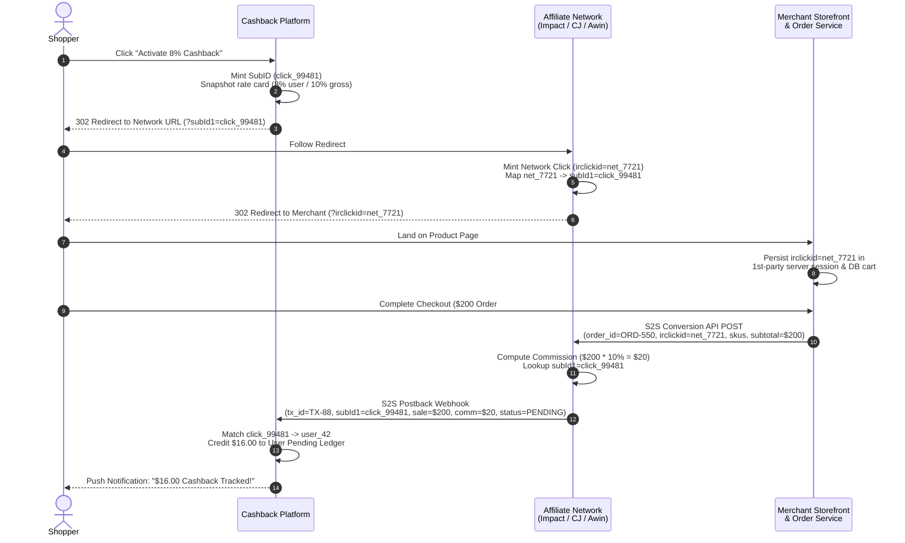
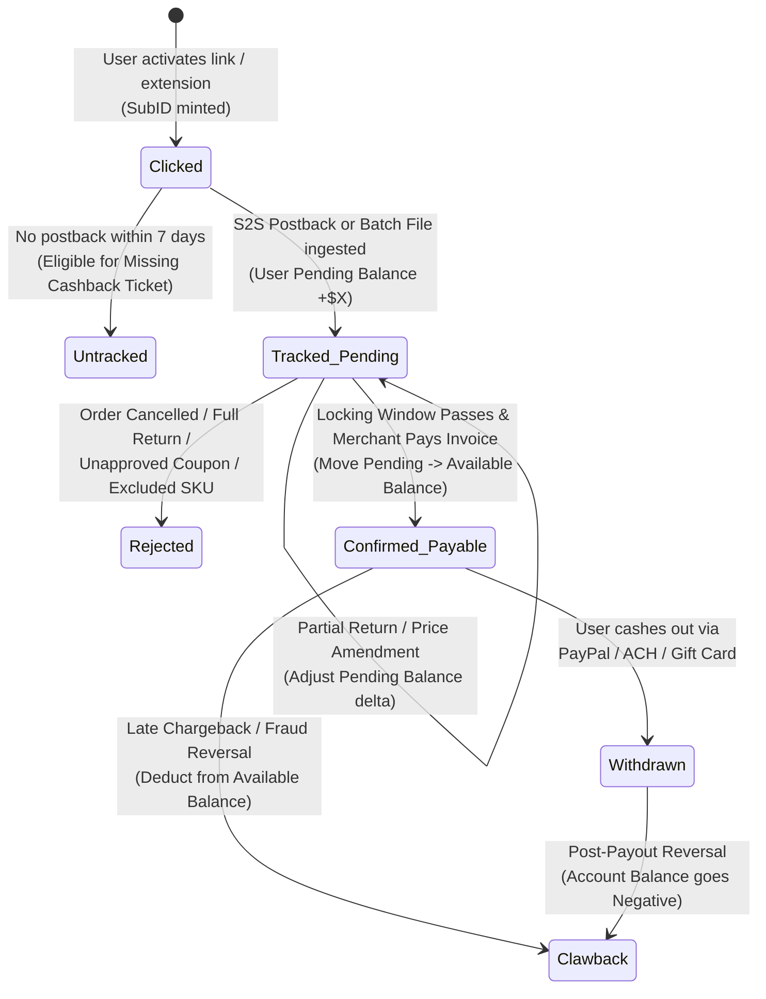

# Cashback, Affiliate Attribution & Deal Aggregation

## What Is It?

A cashback and affiliate marketing platform is a multi-sided performance marketing marketplace connecting shoppers, publishers (cashback portals, coupon browser extensions, deal communities, and review sites), affiliate networks, and online merchants. Think Rakuten, PayPal Honey, TopCashback, Capital One Shopping, ShopBack, RetailMeNot, or Slickdeals. Unlike display advertising where brands pay for impressions (CPM) or clicks (CPC), affiliate marketing runs on **Cost Per Acquisition (CPA)** or **Cost Per Sale (CPS)**: the merchant only pays commission when a tracked user completes a qualifying purchase.

A cashback platform shares that affiliate commission directly with the shopper. If Nike pays an affiliate publisher 10% commission on a $100 pair of shoes ($10), a cashback portal might keep $3 as platform revenue and credit $7 to the shopper's cashback wallet. As an engineer, you are building a cross-domain attribution tracker operating across thousands of merchant checkouts you do not control, an asynchronous multi-network ingestion pipeline, a double-entry ledger holding funds across 30-to-120-day return windows, a browser extension rules engine, and a fraud prevention layer defending against coupon hijacking and return-after-payout abuse.

## Why Should You Care?

Affiliate attribution and cashback systems power a huge share of e-commerce customer acquisition, yet they operate under a uniquely hostile constraint: **you have zero server-side control over the merchant's checkout page**. Once a user clicks an outbound link or activates your extension, they leave your domain. You rely on HTTP 302 redirects, first-party cookies stored by merchant landing scripts, mobile deep-link routers, and delayed server-to-server (S2S) postbacks or batch CSV settlements from intermediary affiliate networks.

If tracking fails, users buy items and never receive promised cashback — destroying trust and flooding support with "Missing Cashback" claims. If your ledger state machine is flawed, you will pay out real cash for orders users subsequently returned to the merchant. Understanding click attribution, SKU commission tiering, Stand-Down compliance, and delayed financial settlement is essential for building growth engines, creator commerce, card-linked offers, or loyalty ecosystems.

## How It Works (The Business Flow)

### The Four-Party Value Chain

Very few cashback platforms integrate directly with 5,000 individual merchants. Instead, the ecosystem relies on **Affiliate Network Aggregators** sitting between merchants and publishers:

1. **Shopper**: Seeks the lowest net price via promo codes and percentage cashback.
2. **Publisher (Cashback Portal / Deal Aggregator / Influencer)**: Drives high-intent traffic to merchants and assigns each outbound click a unique tracking identifier (`SubID` / `ClickID`).
3. **Affiliate Network Aggregator (Impact, CJ Affiliate, Rakuten Advertising, Awin, Partnerize, ShareASale)**: Provides tracking infrastructure, standardizes contracts, collects gross commissions from merchants, takes a network override fee (10–20% of commission), and disburses net commissions to publishers.
4. **Merchant (Retailer / Brand)**: Integrates the network's conversion script or Server-to-Server (S2S) Orders API into checkout, validates returns/cancellations, and funds monthly commission invoices.

### Click Generation, SubID Minting & Outbound Redirect

When a logged-in shopper clicks "Shop Now — 8% Cashback" on a portal or clicks "Activate Cashback" in a browser extension:

1. **Snapshot Offer Terms**: Record the exact commission contract active at click time (e.g., "8% Apparel, 3% Sale Items, 0% Gift Cards") so in-flight shoppers are evaluated against the promised rate even if the merchant lowers rates two hours later.
2. **Mint a Unique `ClickID` (`SubID`)**: Generate a high-entropy identifier (UUIDv7 or ULID) and persist an immutable click log entry: `(click_id, user_id, merchant_id, network_id, rate_snapshot_id, client_ip_hash, user_agent, created_at)`.
3. **Construct Network Redirect URL**: Append `click_id` using each network's pass-through parameter — CJ uses `sid`, Impact uses `subId1`, Rakuten uses `u1`, Awin uses `clickref`, and Partnerize uses `pubref`.
4. **Execute Redirect Hop**: The browser follows an HTTP 302 chain: `Cashback Portal -> Affiliate Network Tracker -> Merchant Landing Page`. On the landing page, the merchant's first-party script reads the network parameter (`?irclickid=...` or `?cjevent=...`) and persists it in a first-party cookie or server session alongside the cart.

### Click-to-S2S-Postback Attribution Flow

Because Safari ITP, Firefox ETP, and ad blockers block third-party cookies, production affiliate systems rely on first-party landing parameters paired with **Server-to-Server (S2S) Postbacks**:



### Commission Lifecycle State Machine

A tracked purchase is **not** settled cash. Because shoppers cancel orders, return items in a basket, or file chargebacks, every cashback transaction moves through a strict financial state machine over 30 to 120 days:



In affiliate marketing, a network marking a transaction "Approved/Locked" only means the return validation window expired; the merchant still must pay their monthly invoice. Under **Sequential Liability** clauses, if a retailer goes bankrupt before paying the network, the network will not pay the publisher. Mature platforms either wait for cash receipt (`Cleared`) or hold a statistical **Cashback Liability Reserve** to absorb merchant defaults.

### SKU-Level Tiered Commissions & Commissionable Subtotal

Conversion payloads are calculated at the **SKU line-item level** on the **Net Commissionable Subtotal**:

- **Excluded Charges**: Sales tax, VAT/GST, shipping fees, and gift-wrapping are stripped before calculating commission. A $100 jacket with $10 shipping and $9 tax ($119 total) has a $100 commissionable subtotal.
- **Category & SKU Tiers**: A single department store order might include cosmetics (12% commission), a designer handbag (4%), and an Apple iPad (0% excluded brand). The ingestion engine computes cashback per line item.
- **Customer Status Modifiers**: Merchants pay a premium for **New-to-File (NTF)** customers (e.g., 10% for first-time brand buyers vs. 2% for returning customers).
- **FX Conversion**: When a merchant reports in EUR/GBP and the user's wallet is in USD, record the spot FX rate at tracking time for display and reconcile the realized FX rate upon settlement.

### Browser Extension Mechanics: Auto-Activation & Coupon Testing

Browser extensions intercept shoppers who forgot to visit the cashback portal first:

1. **Merchant Domain Matching**: The background service worker syncs a ruleset of merchant domains, URL exclusions (ignoring `/login`, `/account`), and DOM selectors for checkout promo inputs.
2. **Stand-Down Check**: Before showing an "Activate Cashback" banner, the extension inspects navigation history and URL parameters to ensure compliance with network Stand-Down rules.
3. **Automated Coupon Applier**: When the user clicks "Try Codes" at checkout, the content script sequentially tests candidate promo codes against the merchant's cart input or internal XHR endpoint, measures cart price deltas, and re-applies the code that yields the highest net savings.

### Payout Settlement & Gift Card Multiplier Arbitrage

Once funds reach `Confirmed_Payable` and cross the minimum payout threshold ($5–$10), users withdraw via:

- **Direct Cash Rails**: PayPal Payouts, Venmo, ACH, SEPA, or Alipay/WeChat Pay.
- **Gift Card Multiplier Arbitrage**: Platforms buy digital gift cards in bulk from aggregators (Tango Card, Blackhawk, Tillo) at a 5–12% corporate discount. Offering a user a "$53 Amazon/Sephora Gift Card" for $50.00 of payable cashback gives the shopper a 6% bonus while the platform still captures an extra 2–4% margin and avoids ACH/PayPal fees.

## Key Terms You'll Hear

| Term | What It Means |
| --- | --- |
| **SubID / ClickID** | Unique identifier minted by the publisher on every outbound click (`sid`, `u1`, `subId1`, `clickref`) to tie a future conversion back to a specific user. |
| **S2S Postback (Conversion API)** | Server-to-server HTTP webhook fired from merchant to affiliate network (and network to publisher) on purchase, bypassing browser cookie restrictions. |
| **Affiliate Network Aggregator** | Intermediaries like Impact, CJ Affiliate, Rakuten Advertising, Awin, and Partnerize managing tracking, contracts, and billing across merchants and publishers. |
| **Last-Click vs. Multi-Touch** | In **Last-Click** (industry default), the final affiliate touchpoint before checkout wins 100% of commission. In **Multi-Touch**, credit is split across discovery and closing touchpoints. |
| **EPC (Earnings Per Click)** | Revenue metric `(Total Commission / Outbound Clicks) * 100` used to optimize merchant placement and deal ranking. |
| **Clawback / Reversal** | Cancellation or deduction of a previously tracked or paid commission due to product return, order cancellation, or chargeback. |
| **Cashback Liability Reserve** | Restricted balance-sheet reserve held to cover users' unwithdrawn `Available` balances and post-payout clawbacks. |
| **Stand-Down Rule** | Network compliance rule prohibiting browser extensions from popping up or overwriting attribution cookies when another affiliate already referred the session. |
| **Universal Link Deep-Linking** | iOS Universal Links and Android App Links that route mobile clicks into native merchant apps while preserving `ClickID` via a Mobile Measurement Partner (Branch, Button, AppsFlyer). |
| **Locking Window** | Contractual period (30–90 days post-purchase) during which a merchant can amend or reject a pending commission for returns. |
| **New-to-File (NTF)** | A shopper buying from a merchant for the first time, often earning 2x–5x higher commission than returning buyers. |
| **Breakage** | Confirmed cashback earned by users that is never withdrawn due to account abandonment. |

## Common Patterns

### Pattern 1: Multi-Network Adapter & Unified Ingestion Pipeline

Every network uses different payloads: Impact sends real-time JSON webhooks (`ActionId`, `SubId1`), CJ uses GraphQL/REST Commission Detail APIs (`orderId`, `sid`), and Awin/Rakuten combine S2S pings with daily CSV/SFTP settlement batches. Normalize all inbound feeds through an **Adapter Layer** into a canonical `ConversionEvent` schema keyed idempotently on `(network_id, network_transaction_id, order_id, line_item_seq)`.

### Pattern 2: Snapshot-Isolated Commission Contract Engine

Never compute user cashback using the merchant's *current* commission rate when the S2S webhook arrives hours or days later. During 2-hour "Double Cashback Flash Events" (15% instead of 5%), bind each `click_id` to an immutable `rate_card_version_id` at click time and evaluate incoming conversions against that snapshot.

### Pattern 3: Two-Bucket Double-Entry Cashback Ledger

Never store user balance as a single mutable float column. Use an append-only double-entry ledger with isolated user accounts:
- `USER_PENDING`: Tracks orders inside the merchant return window. Non-withdrawable.
- `USER_AVAILABLE`: Credited via atomic journal transfer (`USER_PENDING -> USER_AVAILABLE`) once locking clears.
- `USER_PAYOUT_HOLD`: Escrows funds while an async PayPal/ACH payout is in flight; rolls back to `USER_AVAILABLE` on rail failure.

### Pattern 4: Hybrid Push-Webhook + Sliding-Window Reconciliation Sweeper

Real-time S2S postbacks power instant user notifications, but webhooks drop during outages and merchants process offline returns via nightly ERP batches. Pair S2S webhooks with a **Sliding-Window Reconciliation Sweeper** that polls trailing 90-day transaction status diffs (`PENDING -> APPROVED`, `PENDING -> DECLINED`, `APPROVED -> AMENDED`) from each network API every 6 hours.

## Industry War Stories & Non-Obvious Best Practices

### 1. Promo-Code Attribution Wipeout (Unapproved Influencer Coupons)

**The Failure Mode**: A shopper clicks through your cashback portal to buy a $300 blender, setting your affiliate `ClickID`. At checkout, the shopper finds an influencer promo code (`FITNESS20`) on TikTok and applies it. The purchase completes, yet your platform receives **$0 commission** (or the pending commission is declined 30 days later), and the user angrily demands their missing cashback.

**Why It Happens**: E-commerce backends and affiliate networks enforce **Promo-Code Attribution (Clickless Tracking)** and **Channel Deduplication**. Codes like `FITNESS20` are bound exclusively to an influencer agency in the merchant's order system. Applying that code at checkout either reassigns 100% of attribution credit to the influencer (overwriting your click cookie) or flags the order as unauthorized coupon + cashback stacking, voiding the affiliate payout.

**The Production Fix**:
- Sync each network's official **Approved Promotional Deals / Coupon Feed API** hourly and whitelist only those codes as "Cashback-Safe."
- In your browser extension, attach a DOM listener to the merchant's promo input field. If the user pastes an external code not in your Approved Vault, display an immediate inline alert: *"Warning: Promo code `FITNESS20` is not approved for cashback and will void your 8% reward."*
- Log applied promo codes in extension checkout telemetry so support tickets automatically identify unapproved coupon wipeouts.

### 2. Browser Extension Last-Click Hijacking & Stand-Down Compliance

**The Failure Mode**: Aggressive browser extensions used to wait until a shopper reached `/checkout`, display a benign modal ("No coupons found, click OK"), and silently trigger a hidden background tab or `iframe` hop through their affiliate link. That overwrite stole `last_click` attribution milliseconds before order submission — wiping out commissions for creators and review sites that referred the shopper, leading to network bans and class-action lawsuits.

**Why It Happens**: Under Last-Click attribution, whoever writes the affiliate cookie last takes 100% of the payout. Because extensions observe every page load, an unrestrained extension can always hijack the final touchpoint. To prevent this, the IAB and networks (CJ, Impact, Rakuten, Awin) enforce strict **Stand-Down Rules**.

**The Production Fix**:
- Implement a deterministic **Affiliate Traffic Detector & Stand-Down State Machine** in the extension's background service worker.
- Inspect tab navigation chains (`chrome.webNavigation`) for affiliate domains and parameters (`anrdoezrs.net`, `ojrq.net`, `awin1.com`, `irclickid`, `cjevent`, `awc`, `utm_medium=affiliate`).
- When a competing affiliate referral is detected, place that merchant domain into a `STAND_DOWN` lock for the session (30–60 minutes), suppressing auto-activation prompts and background redirects unless the user explicitly clicks the extension toolbar icon.
- Persist signed audit logs of activation triggers (`USER_TOOLBAR_CLICK` vs `ORGANIC_DIRECT_NAV`) to pass network compliance audits.

### 3. Mobile WebView to Native App Universal Link Tracking Loss

**The Failure Mode**: Your desktop web portal tracks 96% of orders, but when mobile users tap "Shop at Nike / Walmart / Sephora" inside your iOS or Android app, **over 40% of mobile purchases fail to track**.

**Why It Happens**: When a mobile user taps an affiliate redirect (`https://www.merchant.com/?irclickid=net_7721`), **iOS Universal Links** or **Android App Links** intercept the URL and launch the merchant's native app directly, bypassing the mobile browser. Unless the merchant's native app integrates a Mobile Measurement Partner (MMP) SDK (Branch, Button, AppsFlyer, Adjust) configured to parse incoming Universal Link parameters and forward `irclickid` to native checkout APIs, the `SubID` is dropped during OS handoff.

**The Production Fix**:
- Route mobile links through a mobile commerce deep-linking router (**Button** or **Branch Affiliate**) that wraps affiliate URLs into MMP-compatible deep links passing `SubID` into the merchant app's native SDK.
- Track a real-time **Native App Attribution Health Ratio** (`mobile_conversion_rate / desktop_conversion_rate`) per merchant.
- For "App-Blind Merchants" whose native apps drop affiliate parameters, keep the session inside an in-app browser (`SFSafariViewController` / `Chrome Custom Tabs`) or show an explicit banner: *"Complete your purchase in this browser window — switching to the merchant's app will disable cashback tracking."*

### 4. Missing-Cashback Ticket Reconciliation & High-Trust Instant Credit Tiers

**The Failure Mode**: Ad blockers, Safari ITP 24-hour/7-day storage purges, and cross-device journeys cause 3–8% of legitimate orders to go untracked. When users file a "Missing Cashback" ticket, affiliate network manual inquiry queues take **45 to 90 days** to resolve, causing high user churn.

**The Production Fix**:
- Build an automated **Missing-Cashback Triage & Instant Credit Engine** evaluating four signals on claim submission:
  1. **Verified Pre-Order Click**: Confirm an outbound `click_id` exists for `(user_id, merchant_id)` within 5 minutes to 24 hours prior to the receipt timestamp.
  2. **Automated Receipt Parsing**: Validate DKIM/SPF signatures on forwarded confirmation emails or OCR uploaded invoices to extract `order_id`, `subtotal`, `timestamp`, and applied promo codes.
  3. **User Trust Tiering**: Score the user based on account age, settled `Confirmed_Payable` history, and prior claim rejection ratio.
  4. **Provisional Goodwill Credit**: For High-Trust users claiming under a cap (e.g., $\le$ $25), **instantly credit their wallet** from a *Goodwill Budget Pool* while submitting the network inquiry asynchronously in the background, recouping the pool when the network settles 60 days later.

### 5. Affiliate Self-Referral & Return-After-Payout Fraud

**The Failure Mode**: Fraud rings open hundreds of sockpuppet accounts to abuse "Refer a Friend — Get $30 when they spend $50" promos, or buy refundable travel/electronics with a 30-day affiliate lock window, cash out on Day 31, and return the item in-store on Day 35 where offline returns fail to trigger S2S clawbacks.

**The Production Fix**:
- **Consumption-Date Locking for Travel**: For hotels, flights, and events, never start the lock timer on `booking_date`; hold cashback in `Tracked_Pending` until `checkout_or_event_date + 14 days`.
- **Dynamic Category Hold Extensions**: Override short network auto-lock windows (30 days) in your internal ledger to match the merchant's actual consumer return policy (60–90 days, especially during Q4 holiday windows).
- **Payout Instrument & Graph Deduplication**: Enforce a lifetime 1-to-1 binding between a withdrawal instrument (PayPal email, bank account hash, Venmo handle) and a single user ID, and run graph clustering across `(device_fingerprint, ip_subnet, shipping_address_hash, card_bin_last4)` before unlocking referral bounties.

## Gotchas

- **Ad blockers block affiliate redirect domains**: Blocklists (EasyList, Pi-hole) block domains like `dpbolvw.net` and `tkqlhce.com`, causing `ERR_BLOCKED_BY_CLIENT` errors on click. Detect blocked redirects and guide users to allowlist your bounce domain or use your mobile app.
- **Gift card payment exclusions**: Most merchants pay 0% when buying gift cards and also pay 0% on orders *paid for* with a gift card or store credit. Surface these exclusions clearly before redirect.
- **Multi-shipment webhooks dropping line items**: Retailers like Amazon and Target fire S2S webhooks **upon shipment**, not checkout. A single `order_id` split into 3 shipments sends 3 webhooks days apart. Never key idempotency on `order_id` alone; always use `(network_id, network_tx_id, line_item_id)`.
- **Tax classification (Rebates vs. Bounties)**: In the US, percentage cashback on a purchase is a **non-taxable price adjustment**, whereas referral/signup bonuses are **taxable income** requiring W-9 collection and 1099-MISC reporting at $\ge$ $600/year. Tag every ledger entry with `REBATE_NON_TAXABLE` vs `BOUNTY_TAXABLE`.

## Quick Reference

```text
Four-Party Ecosystem:
  Shopper -> Publisher (Cashback Portal / Extension) -> Affiliate Network -> Merchant

Core Attribution Identifiers:
  Portal ClickID (SubID) <---> Network ClickID (irclickid / cjevent / awc) <---> Merchant OrderID

Network Pass-Through Parameter Names:
  Impact: subId1, subId2 | CJ: sid | Rakuten: u1 | Awin: clickref | Partnerize: pubref

Commission Lifecycle State Machine:
  Clicked -> Tracked_Pending -> Confirmed_Payable -> Withdrawn
          \-> Untracked (Missing Claim)
                             \-> Amended (Partial Return)
                             \-> Rejected (Cancelled / Unapproved Coupon)
                                                  \-> Clawback (Post-Payout Reversal)

Cashback Calculation Formula:
  Commissionable_Subtotal = Gross_Order_Total - Tax - Shipping - Gift_Wrap - Excluded_SKUs
  Gross_Commission        = SUM(Line_Item_Subtotal * Category_Rate * Customer_Tier_Multiplier)
  User_Cashback           = Gross_Commission * User_Share_Ratio (from Click-Time Rate Snapshot)

Double-Entry User Ledger Buckets:
  USER_PENDING      -> Tracked orders still inside merchant return/lock window
  USER_AVAILABLE    -> Cleared & funded rewards ready for withdrawal
  USER_PAYOUT_HOLD  -> Locked during in-flight PayPal / ACH / Gift Card redemption
```
