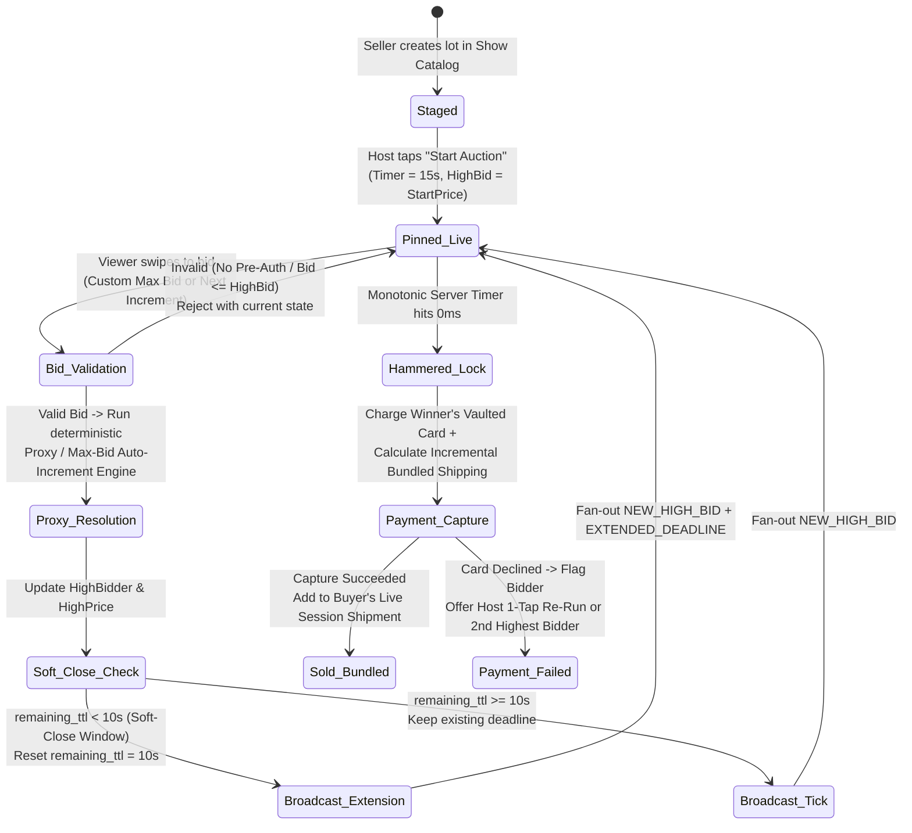
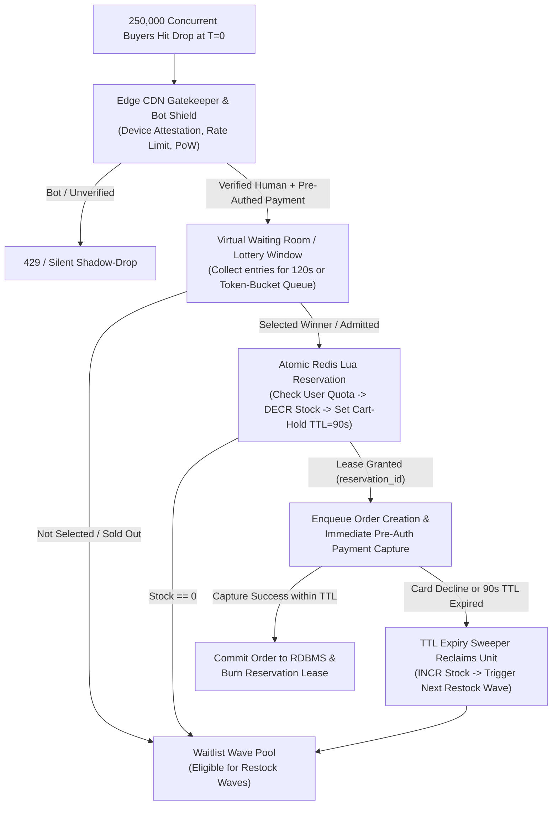

# Live Commerce, Real-Time Auctions & High-Demand Flash Sales

## What Is It?

Live commerce and high-demand flash sales sit at the intersection of ultra-low-latency live video streaming, rapid-fire real-time auctions, and extreme-concurrency inventory allocation. Think Whatnot, TikTok Shop Live, Taobao Live, Palmstreet, eBay Live, Nike SNKRS, or Shopify Flash Drops. In traditional e-commerce, shoppers browse asynchronously, take minutes to check out, and rarely collide on the same database row at the same millisecond. In live commerce and flash drops, a host holds a rare 1-of-1 trading card or announces a 1,000-unit sneaker drop to 100,000 live viewers, counts down "3, 2, 1, GO!", and triggers a synchronized stampede where tens of thousands of bids or purchase requests hit a single item within a 200-millisecond window.

From an engineering perspective, you are building two tightly coupled real-time engines:
1. **A Sub-Second Live Auction Engine** that arbitrates incoming bids, resolves proxy (maximum) auto-bids deterministically, extends countdown clocks under **Soft-Close (Popcorn Bidding)** anti-sniping rules, synchronizes bid overlays with live video frames, and captures pre-authorized payments the instant the hammer falls.
2. **A High-Concurrency Flash-Sale ("Drop") Pipeline** that shields core databases from bot floods via edge Virtual Waiting Rooms, executes fair lottery or token-bucket admission, enforces strict Cart-Hold TTL inventory leases, and dynamically bundles shipping across multiple items won during a single live session.

## Why Should You Care?

Standard CRUD e-commerce architectures collapse instantly under live commerce and flash-sale workloads. If 50,000 viewers try to decrement `stock_count` on a single PostgreSQL row (`WHERE sku_id = 'DROP-01'`), row-level lock contention exhausts your connection pool and takes down the platform. Even if your servers stay up, naive designs fail on business logic: scalper bots hoard 100% of inventory in unpaid shopping carts; video buffering causes viewers to bid on auctions that closed 3 seconds ago on the server; and a buyer who wins 10 separate $5 auctions in a single stream walks away if charged $6.00 shipping ten separate times ($60.00 shipping).

Mastering single-writer in-memory auction actors, presentation-timestamp (PTS) media synchronization, pre-verified payment queues, and live session shipping accumulators equips you to build any high-contention real-time transactional system — from concert ticketing and IPO allocations to live collectible marketplaces.

## How It Works (The Business Flow)

### Pre-Show Staging & "The Yellow Basket" Pinning

Before going live, the seller stages a **Show Catalog (Run-of-Show)** containing 50 to 300 lots across four transaction modes:
- **Live Auctions**: 1-of-1 items (vintage apparel, graded collectibles, plants, luxury goods) starting at $1 with a 10-to-30-second countdown timer.
- **Flash Drops ("Buy It Now" / Limited Quantity)**: Fixed-price inventory (e.g., 500 units at $29.99) unlocked when the host triggers the drop.
- **Group Breaks / Mystery Slots**: Viewers buy a randomized spot (e.g., 1 of 30 sports teams) before the host unseals boxes live on camera.
- **Follower & Buyer Giveaways**: Free promotional draws used to retain viewers and reward paying customers in the room.

When the host taps **"Pin to Stage"** on Lot #14, the backend publishes a `LOT_PINNED` event to the room's pub/sub fan-out layer, rendering the interactive bidding/buying overlay over every viewer's video player.

### Real-Time Auctions: Sudden-Death vs. Soft-Close (Popcorn Bidding)

Live auctions run in one of two clock modes:

- **Sudden-Death Mode**: When the 15-second timer hits `00:00.000`, the auction ends immediately regardless of last-second activity. This maximizes lots sold per hour but favors automated sniping scripts and viewers with the lowest network RTT.
- **Soft-Close / Popcorn Bidding (Anti-Sniping Mode)**: The standard for high-value live auctions. If a valid bid arrives when the remaining countdown is below a threshold (`soft_close_window`, typically 5 to 10 seconds), the server automatically resets the countdown timer back to `soft_close_window` (e.g., resetting `00:02` back to `00:10`). Every human viewer gets a fair window to counter-bid, and the auction closes only when no new bids arrive for a full 10-second window.



### Deterministic Proxy Bidding (Custom Max Bid)

In a fast 10-second auction, tapping `+ $1` repeatedly is error-prone. Viewers can enter a secret **Proxy Max Bid** (e.g., setting a $100 maximum while the current bid is $10 with a $2 increment):

1. The auction engine stores the viewer's ceiling ($100) privately in memory and raises the visible high bid only to the minimum needed to lead ($12).
2. If another viewer bids $20, the engine automatically counters on behalf of the proxy bidder at $22 in the same atomic step, without a network round-trip to the first bidder's phone.
3. **Tie-Breaking Rule**: If a second viewer submits an identical $100 Proxy Max Bid, the **earlier timestamp** retains the lead at $100 because they committed that price ceiling first.

### High-Concurrency Flash Sales & Virtual Waiting Room Flow

When 250,000 users try to buy 1,000 units of a limited drop simultaneously, pure First-In-First-Out (FIFO) rewards datacenter-colocated scalper bots and melts checkout databases. Production flash sales use an edge **Virtual Waiting Room / Fair Drop Lottery** paired with atomic inventory leases:



### Instant Payment Pre-Authorization & Live Bundled Shipping

- **Pre-Auth Bid Gate & Hammer Capture**: Before a viewer's "Swipe to Bid" slider unlocks, they must have a verified shipping address and a vaulted payment token that passed a `$0`/`$1` check or **Pre-Auth Bid Hold**. The millisecond the hammer falls, the backend calculates `winning_bid + marginal_bundled_shipping + tax` and captures payment immediately without a checkout screen.
- **Stateful Live Shipment Bundling**: A collector often wins 6 to 15 auctions in one 2-hour stream. Rather than charging $5.00 shipping 10 times, the platform groups purchases by `(livestream_id, seller_id, buyer_id)` into an open **Live Shipment Bundle**: Win #1 pays base shipping ($4.50), Wins #2–#8 pay only incremental weight deltas ($0.00–$0.50), and all wins consolidate into a single packing slip when the show ends.

## Key Terms You'll Hear

| Term | What It Means |
| --- | --- |
| **Soft-Close / Popcorn Bidding** | Anti-sniping rule where any bid inside the final $N$ seconds (e.g., last 10s) resets the countdown clock back to $N$ seconds, neutralizing last-millisecond bot snipers. |
| **Sudden-Death Auction** | Hard-deadline auction where the timer ends strictly at `00:00` with no extensions, regardless of late bids. |
| **Proxy / Max Bidding** | Vickrey-style auto-bidding where a user sets their maximum ceiling and the server automatically bids the minimum increment needed to lead. |
| **Pre-Auth Bid Hold** | Verifying or placing a temporary hold on a bidder's payment method prior to bidding to prevent non-paying winners. |
| **Virtual Waiting Room Lottery** | Holding flash-sale participants in an edge queue or short draw window (Nike SNKRS Draw, EQL) to filter bots and allocate scarce stock fairly. |
| **Cart-Hold TTL** | Short reservation lease (60–120 seconds) locking an allocated inventory unit while payment capture completes. |
| **Live Bundled Shipping** | Grouping multiple separate auction wins by the same buyer during a single live stream into one physical shipment, charging only marginal weight/box upgrades. |
| **LL-HLS / WebRTC PTS Sync** | Synchronizing WebSocket auction state with the video player's **Presentation Timestamp (PTS)** across Low-Latency HLS (2–4s) or WebRTC (<500ms). |
| **Swipe-to-Bid UX** | Drag-slider gesture replacing one-tap bid buttons to prevent accidental "pocket bids" while watching mobile video. |
| **Box Break** | Live format where buyers purchase randomized slots (e.g., sports teams) before the host unseals physical packs on camera. |
| **Shill Bidding** | Fraud where a seller uses accomplice or sockpuppet accounts to place fake bids, inflating prices or probing a buyer's Proxy Max Bid. |
| **Hot-Key Contention** | Database/cache bottleneck when tens of thousands of requests read/write the exact same SKU or auction key simultaneously. |

## Common Patterns

### Pattern 1: Single-Writer In-Memory Lot Actor (Zero Lock Contention)

Never process live auction bids via concurrent database `SELECT ... FOR UPDATE` locks. Route all bids for `auction_id` via consistent hashing to a **Single-Writer In-Memory Actor** (Erlang/Elixir GenServer, Akka/Orleans actor, Cloudflare Durable Object, or single-threaded Redis Lua script). One isolated event loop processes every bid for that lot sequentially in microseconds, making proxy-bid resolution, tie-breaking, and soft-close clock resets 100% deterministic with zero lock contention. Persist snapshots asynchronously and fan out diffs (`seq_id`, `high_bid`, `remaining_ms`) over edge WebSockets.

### Pattern 2: Two-Phase Redis Lua + Async Queue Flash-Sale Pipeline

For fixed-price flash drops (e.g., 5,000 units of a limited SKU):
1. **Pre-Warm Inventory**: Load `sku:{id}:available = 5000` into Redis before the drop.
2. **Atomic Lua Admission**: Execute a single Redis Lua script that checks `SISMEMBER sku:{id}:buyers {user_id}` (enforcing per-user limits), verifies `available > 0`, decrements `available`, and sets a 90-second reservation key.
3. **Async Order Persistence**: Publish an `InventoryReserved` event to Kafka/SQS so order workers write to PostgreSQL at steady concurrency without database spikes.

### Pattern 3: Monotonic Server Deltas & NTP-Style Client Clock Calibration

Never broadcast an absolute wall-clock timestamp (`ends_at: "2026-11-09T20:00:15Z"`) and rely on client `ends_at - Date.now()`. Mobile device clocks regularly drift by 1 to 15 seconds. Perform an RTT clock-offset handshake on WebSocket connect (`server_now - (client_send + rtt/2)`) and broadcast relative `remaining_ms` deltas with monotonic sequence numbers.

## Industry War Stories & Non-Obvious Best Practices

### 1. Video-vs-WebSocket Clock Drift ("Phantom Sniping") & Media Timestamp Sync

**The Failure Mode**: A host is auctioning a vintage watch. WebSocket bid messages reach the viewer's phone in 50ms, but the live video stream (over HLS or degraded LL-HLS) buffers **3.5 seconds behind real time**. Two severe UX failures occur:
1. When the auction ends, the WebSocket immediately pops up a **"SOLD TO @ALEX FOR $180!"** banner — while on video, the host is still shouting *"Three seconds left, anyone want in at $150?!"* spoiling the live excitement.
2. Worse, a viewer reacting to the host's voice hears *"Five seconds left!"*, swipes to bid, and gets `ERR_AUCTION_CLOSED` because the server timer expired 2 seconds ago. Viewers accuse the platform of rigged timers and "phantom sniping."

**Why It Happens**: Out-of-band WebSockets (50ms) and video encoding/CDN segment buffers (1,500–4,000ms) run on completely decoupled transport latencies.

**The Production Fix**:
- **Tiered Latency Transport**: Use **WebRTC** (<400ms glass-to-glass latency) for interactive 10-second auction rooms so the host's voice and the WebSocket clock stay within human perception (<500ms). Reserve LL-HLS (2–3s) for mega-streams (100k+ viewers) running longer 60-second flash drops.
- **SEI / ID3 Presentation Timestamp (PTS) Sync**: Inject the server's monotonic timestamp into video frames via **H.264/H.265 SEI (Supplemental Enhancement Information)** NAL units or HLS ID3 timed metadata tags. The player continuously computes `video_lag_ms = current_server_clock - current_frame_pts`.
- **Latency-Aware UI**: Delay visual celebration overlays (confetti, chat reactions, giveaway wheels) in a client buffer by `video_lag_ms` so they render on the exact video frame where the host speaks. Keep the authoritative auction countdown synced to true server time (`remaining_ms`) and display a `"Stream Delay: 2.1s — Bid by Timer Above"` badge when video lag exceeds 1 second.

### 2. Cart-Hold Denial-of-Service by Scalper Bots & Pre-Verified Payment Queue Entry

**The Failure Mode**: You launch a flash sale for 2,000 limited sneakers at 12:00 PM. Clicking "Add to Cart / Checkout" reserves 1 unit for a 10-minute `Cart-Hold TTL` while the user enters payment info. At 12:00:00.080, scalper bots spin up 20,000 headless sessions and lock all 2,000 units in carts within 80ms. Every real fan sees **"SOLD OUT"** at 12:00:01 and leaves. Over the next 10 minutes, scalpers only pay for 300 profitable sizes they flipped online, letting the other 1,700 units silently expire at 12:10 PM to an empty store.

**Why It Happens**: Allowing unpaid sessions to lock scarce inventory turns `Cart-Hold TTL` into a free **Inventory Denial-of-Service (DoS) vector**.

**The Production Fix**:
- **Eliminate Unpaid Cart Locks via Pre-Verified Queue Entry**: Never decrement stock on "Add to Cart." Before entering the Drop Queue / Virtual Waiting Room, require users to select their size, address, and complete a **Pre-Authorized Payment Token + 3DS / Apple Pay Biometric Attestation**. Winning the queue draw triggers immediate server-side payment capture — shrinking unpaid `Cart-Hold TTL` to **zero**.
- **Hardware & Payment-Fingerprint Sybil Deduplication**: Deduplicate queue entries by underlying `payment_card_fingerprint` (PAN hash across virtual cards), normalized physical shipping address, and iOS `DeviceCheck` / Android `Play Integrity` hardware tokens.
- **Announced Restock Waves**: Never trickle failed/expired inventory back one unit at a time (where only 50ms polling bots catch it). Pool reclaimed stock and release it in announced **Wave 2 Drops** every 3 minutes for verified humans still in the waiting room.

### 3. Live Session Shipping-Bundle Dimensional Weight Recalculation ("The 11th Item Dimensional Cliff")

**The Failure Mode**: Your platform promises: *"Pay $5.00 shipping on your first auction win, and $0.50 on each additional win in this stream!"* A buyer wins 8 small figurines (total 1.2 lbs, fits in a small $5 box). On Lot #9, the buyer wins a $15 oversized plush or framed poster. Packing all 9 items together requires a `20" x 16" x 14"` box that crosses the carrier's **Dimensional Weight (DIM Weight)** divisor (`(L * W * H) / 139 = 33 lbs billable weight`). The carrier charges **$29.50** while the buyer only paid $9.00 total shipping — wiping out the seller's entire profit.

**Why It Happens**: Flat item-count bundling ignores 3D box volume, carrier weight cliffs (USPS Ground Advantage < 1 lb vs. Priority Mail > 1 lb), and DIM-weight surcharges.

**The Production Fix**:
- **Structured Shipping Profiles per Lot**: Require sellers (via fast presets) to tag each lot with `weight_oz`, `volume_cubic_in` (or box preset: *Card Envelope, Padded Mailer, Small/Medium Box, Oversized Standalone*), and `can_bundle`.
- **Real-Time Marginal Shipping Preview Before Bidding**: Maintain an in-memory **Session Box Accumulator** per `(stream_id, buyer_id)`. Before the user swipes on Lot #9, compute `marginal_shipping = cost(current_bundle + lot_9) - cost(current_bundle)` and display it directly under the bid slider (`"+ $0.00 Bundled Shipping"` vs. `"+ $6.50 Box Upgrade"`).
- **Automatic Bundle Splitting & Label Locking**: If combining Lot #9 triggers a DIM-weight cliff where shipping a *separate* second box is cheaper than upgrading the single box, or if the seller already printed the label mid-stream for Wins #1–#8, automatically split Lot #9 into `Shipment Bundle #2`.

### 4. Host Giveaway Sybil Farming & Shill Bidding Detection

**The Failure Mode**: Live commerce faces two major collusion attacks:
1. **Giveaway Sybil Farming**: Bot farms monitor the platform for free giveaway timers, join with 3,000 headless accounts in the final 10 seconds, harvest 75% of prizes, and ship them to reshippers using slight address variations (`Apt 4B`, `Unit 4-B`, `#4B`).
2. **Seller Shill Bidding**: A dishonest seller lists a $500 item at $1 and uses an accomplice account to bid upward in $10 steps ($210, $220... $290) against a legitimate collector who set a $300 Proxy Max Bid — artificially extracting the collector's $300 ceiling instead of letting them win at $120. If the shill accidentally overtakes the buyer at $310, the shill's card intentionally declines or the seller cancels the order post-stream.

**The Production Fix**:
- **Engagement-Gated & Address-Normalized Giveaways**: Require giveaway entrants to have continuous media playback telemetry (verified HLS/WebRTC segment fetches, not an idle WebSocket) and canonicalize postal addresses (USPS CASS / Libpostal + geocoordinate clustering) so 50 accounts at the same household share a single lottery weight. Provide a rate-limited, CAPTCHA-protected Alternative Method of Entry (AMOE) for Buyer Giveaways to satisfy sweepstakes laws without exposing bot APIs.
- **Real-Time Shill Bidding Graph Detector**: Score every `(seller_id, bidder_id)` pair on four signals:
  1. **Seller Concentration**: Does `bidder_id` place >70% of their lifetime bids in this single seller's room while rarely winning?
  2. **Proxy-Ceiling Probing**: How often does `bidder_id` stop bidding within 1–2 increments below another buyer's hidden Proxy Max Bid?
  3. **Win-Default Rate**: When `bidder_id` wins in `seller_id`'s room, does payment fail or get cancelled at an abnormal rate?
  4. **Graph Proximity**: Do `seller_id` and `bidder_id` share IP subnets, BSSID/GPS proximity, device hashes, or payout bank links? Block bids between linked graph nodes in real time.

## Gotchas

- **Accidental "Pocket Bids" on One-Tap Buttons**: Standard tap buttons near the thumb zone cause thousands of accidental bids and chargebacks. Always use a **Swipe-to-Bid slider** (requiring a 75%+ drag gesture) and prompt for confirmation on custom bids >3x the current price (catching "$500" typos meant to be "$50").
- **Chat Flood Freezing the Bidding UI**: A 20,000-viewer room generates 300+ chat messages/sec. Sending unthrottled chat down the same WebSocket channel starves React/DOM rendering on mobile phones and drops touch events on the bid slider. Isolate `AUCTION_STATE` on a priority channel, conflate/sample chat server-side (e.g., max 10 msgs/sec), and isolate chat in a virtualized list.
- **Host Network Drop Mid-Auction**: If the seller's uplink drops with 4 seconds left on a $1,000 item sitting at $15, letting the clock expire robs the seller. Monitor the host's WebRTC keyframe ingest heartbeat; if video stalls >3 seconds during an active lot, auto-transition the auction to `PAUSED_HOST_DISCONNECT`.
- **Sales Tax Across Bundled Lots**: In many jurisdictions, shipping is taxable if the item is taxable, and states like NY apply price thresholds ($110 clothing exemption). Compute tax accurately on the marginal shipping delta added at each sub-order capture.

## Quick Reference

```text
Live Commerce Transaction Modes:
  1. Soft-Close Auction (Popcorn Bidding: bid in last 10s resets clock to 10s)
  2. Sudden-Death Auction (Hard timer cutoff at 00:00.000)
  3. High-Concurrency Flash Drop (Virtual Waiting Room -> Redis Lua Lease -> Async Order)
  4. Box Break / Mystery Slot & Live Giveaways

Authoritative Auction Engine Architecture:
  Client Swipe-to-Bid -> Consistent Hash by auction_id -> Single-Writer In-Memory Actor
  -> Validate Pre-Auth -> Resolve Proxy Max Bids (Earlier Timestamp Wins Ties)
  -> Check Soft-Close (<10s -> Reset to 10s) -> Broadcast Monotonic remaining_ms Delta
  -> Hammer at 0ms -> Immediate Vaulted Card Capture + Live Shipping Bundle Update

Flash-Sale Anti-Bot & Inventory Pipeline:
  Edge CDN + Device Attestation -> Pre-Verified Payment Token Required BEFORE Queue
  -> Windowed Fair Lottery / Token Bucket -> Redis Atomic Lua (Quota Check + DECR + TTL)
  -> Async Kafka Order Worker -> Reclaimed Expired Stock Released in Announced Waves

Live Session Bundled Shipping Formula:
  Bundle Key:        (livestream_session_id, seller_id, buyer_id)
  Marginal Shipping: Cost(Current_Bundle_Weight_Volume + New_Lot) - Cost(Current_Bundle)
  Auto-Split Trigger: Split to Bundle #2 if DIM Weight cliff exceeded or Label #1 printed
```
