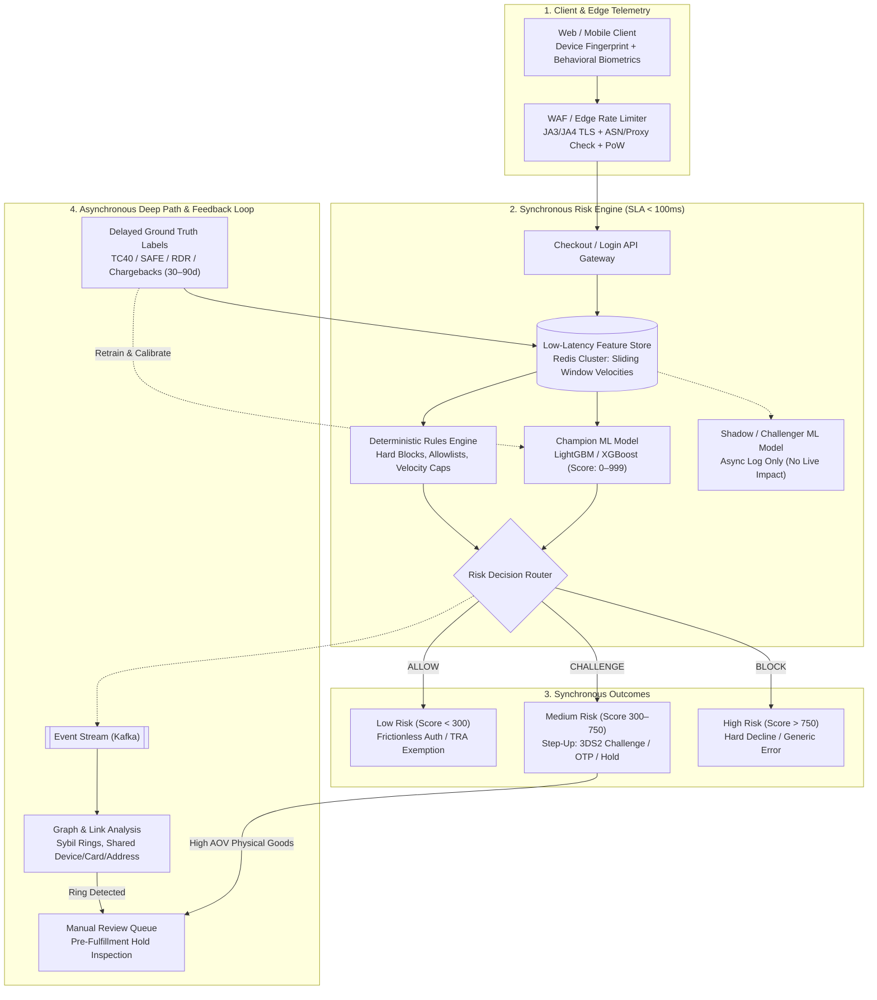
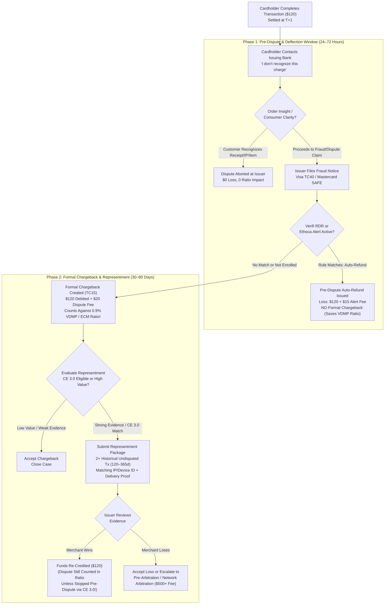

# Fraud Detection, Risk Engines & Chargeback Economics

## What Is It?

Every online business that accepts payments, issues promotional credits, or stores account value operates under constant attack from automated botnets, organized crime rings, and opportunistic consumers. **Fraud Detection, Risk Engines, and Chargeback Economics** encompass the real-time decision pipelines, identity verification protocols, and financial dispute lifecycles that allow a platform to maximize legitimate checkout conversion while keeping fraud losses and card network penalties below existential limits.

To a developer, payment processing looks like a simple API call: send a token to Stripe or Adyen, receive `200 OK`, and ship. In reality, card authorization is **not** final settlement. Card networks (Visa, Mastercard, American Express) grant cardholders the right to dispute transactions up to 120 days (and in some edge cases up to 540 days) after purchase. When a chargeback occurs, the issuing bank forcibly pulls the funds from the merchant's bank account, charges a non-refundable fee ($15–$50), and increments the merchant's network dispute ratio.

Beyond stolen cards, Risk and Trust & Safety systems defend the full user lifecycle: stopping **Account Takeovers (ATO)** from credential stuffing, blocking **Card Testing (BIN attacks)** that rack up thousands in gateway fees in minutes, dismantling **Promo & Referral Abuse Rings** across emulator farms, and deflecting **Friendly Fraud** where real buyers falsely dispute valid charges.

## Why Should You Care?

Engineering bugs usually degrade UX temporarily; risk and fraud failures can **bankrupt a company or permanently revoke its ability to accept credit cards**.

1. **Every fraud loss costs nearly 2x the transaction value**: When a fraudster buys a $100 physical item with a stolen card, you lose the $100 principal, wholesale cost of goods ($60), shipping ($10), non-refundable gateway processing fees (~$3.20), and a $15–$25 chargeback penalty. A single $100 fraudulent order causes ~$190+ in net loss, requiring 19 legitimate orders at a 10% margin just to break even.
2. **Breaching the 0.9% chargeback threshold triggers card network probation**: Visa and Mastercard strictly monitor dispute-to-transaction ratios. Crossing **0.9%** under Visa's VDMP/VAMP rules or **1.0%** under Mastercard's ECM program places your merchant account in monitoring, triggers escalating fines ($50–$100 per dispute), locks 10%–20% of revenue in a 180-day rolling reserve, or terminates your account and places company directors on the **MATCH list** (Terminated Merchant File)—a 5-year global blacklist across all acquiring banks.
3. **False positives silently destroy more revenue than fraud**: Blocking 5% of legitimate customers at checkout ("False Positives" or "Insult Rate") loses the immediate sale and permanently churns 30%–50% of declined buyers. Risk engineering is a precision-recall optimization balancing fraud loss against conversion.
4. **Evidence logging is an architectural requirement**: Winning a friendly fraud dispute under **Visa Compelling Evidence 3.0 (CE 3.0)** requires linking historical undisputed orders to the disputed transaction using cryptographic device fingerprints, IP addresses, and shipping records stored for 365+ days. If engineers don't persist these exact fields at login and checkout, finance cannot win representment.

## How It Works (The Business Flow)

### 1. Real-Time Synchronous vs. Asynchronous Risk Decision Pipeline

A risk engine cannot run slow graph queries on the critical path of checkout without ruining latency. Platforms split evaluation into a **Synchronous Fast Path** (budgeted under 50–100ms) and an **Asynchronous Deep Path** (running over seconds to days).



### 2. Device Fingerprinting & Behavioral Biometrics

Fraudsters clear cookies, rotate residential proxy IPs, and spoof `User-Agent` strings. To identify repeat offenders across sessions, client SDKs collect multi-layered telemetry:

- **Hardware & Browser Fingerprinting**: Renders hidden HTML5 Canvas 2D/WebGL scenes, measures `AudioContext` oscillator variations, enumerates system fonts and WebRTC local IPs, and checks `navigator.hardwareConcurrency`, screen dimensions, and timezone mismatches against IP geolocation.
- **Network & TLS Fingerprinting (JA3 / JA4)**: Before parsing HTTP payloads, the edge load balancer inspects TLS ClientHello cipher suites, extensions, and HTTP/2 frame settings. A Python scraper spoofing a Chrome `User-Agent` is immediately exposed by its TLS JA4 hash, while ASN lookups flag datacenter IPs, VPNs, and residential proxy networks.
- **Anti-Detect Browser & Emulator Detection**: Organized fraud rings use anti-detect browsers (Multilogin, Dolphin Anty) or Android emulators (LDPlayer, Nox) that inject noise into Canvas hashes. Risk SDKs (FingerprintJS, Sardine, ThreatMetrix, Forter) detect overridden browser prototypes (`HTMLCanvasElement.prototype.toDataURL`) or mobile gyroscope/accelerometer sensors showing zero natural micro-tremors.
- **Behavioral Biometrics**: Legitimate buyers type card numbers in bursts, hit `Backspace` on typos, move mice in curved trajectories, and hold phones at natural angles. Fraudsters paste stolen PANs (`Ctrl+V` / `paste` event on card inputs) or drive DOM elements via headless scripts (`webdriver=true`, zero mouse duration). Paste detection on the card field combined with a brand-new device ID is one of the strongest fraud signals in e-commerce.

### 3. Rules Engine + Shadow ML Scoring

Mature risk platforms combine deterministic rules with machine learning in a dual-layer architecture:

- **Real-Time Feature Store (Sliding Window Velocities)**: Using Redis sorted sets (`ZSET`) or Flink streaming aggregators, the system computes sub-10ms velocity counters such as `distinct_cards_by_device_1h`, `distinct_accounts_by_ip_24h`, `failed_cvv_by_user_15m`, and `ip_to_billing_zip_distance_km`.
- **Deterministic Rules Engine**: Executes fast, explainable boolean DSL expressions (`IF distinct_cards_by_device_1h > 3 AND ip_country != bin_country THEN BLOCK`). Rules are vital for zero-day attacks: when a novel BIN attack starts at 2:00 AM, an analyst can hot-reload a rule in 30 seconds without waiting weeks for ML retraining.
- **Gradient Boosted Trees & Shadow ML Scoring**: Because fraudsters probe static rule thresholds, ML models (LightGBM, XGBoost, CatBoost over 200+ features) score subtle non-linear interactions (`0–999`). Because a miscalibrated model can accidentally block 20% of legitimate revenue, new models are deployed in **Shadow Mode (Dark Launch)**: they score live production payloads and log predictions to the data warehouse without affecting checkout decisions.
- **Handling 30–90 Day Label Maturity Delay**: Fraud ground truth takes 30–90 days to arrive as chargebacks, and blocked transactions produce no labels (**Reject Inference**). Risk teams use early proxy signals (issuer declines, TC40 notices) and allow a 0.5% random exploration sample ("Control Group") through untouched to measure true false-positive rates.

### 4. 3DS2 Liability Shift & TRA Exemptions

For medium-risk payments—or transactions in Europe/UK governed by PSD2 **Strong Customer Authentication (SCA)**—merchants invoke **EMV 3-D Secure 2 (3DS2)**.

- **Frictionless vs. Challenge Flow**: Legacy 3DS1 redirected buyers to clunky bank popups and killed conversion by 30%. Modern 3DS2 sends 100+ device and order telemetry fields to the issuing bank via the Directory Server. If the issuer trusts the telemetry, it approves silently (**Frictionless Flow**); if suspicious, it triggers a biometric/OTP prompt in the user's banking app (**Challenge Flow**).
- **Liability Shift & ECI Codes**: Passing 3DS2 (Frictionless or Challenge, returning **ECI 05** on Visa or **ECI 02** on Mastercard; or **ECI 06/01** when attempted against a non-enrolled issuer) triggers **Liability Shift**: financial responsibility for fraud chargebacks (e.g., Visa 10.4) moves from the **Merchant** to the **Issuing Bank**. However, 3DS2 does *not* cover non-fraud consumer disputes ("Item Not Received"), and networks revoke liability shift if a merchant's 3DS fraud rate exceeds excessive thresholds.
- **PSD2 SCA & TRA (Transaction Risk Analysis) Exemptions**: To avoid 8%–15% conversion drop from mandatory challenges in Europe, merchants request SCA exemptions:
  - **Low-Value Exemption**: Under **€30** (up to 5 consecutive transactions or €100 cumulative).
  - **MIT (Merchant-Initiated Transactions)**: Recurring subscription renewals referencing the initial 3DS-authenticated `scheme_transaction_id`.
  - **TRA Exemption**: Low-fraud acquirers/merchants can skip SCA challenges up to specific ceilings based on the acquirer's rolling fraud rate: **€100** (if fraud `< 0.13%`), **€250** (`< 0.06%`), or **€500** (`< 0.01%`). Claiming a TRA exemption keeps fraud liability on the merchant.

### 5. Pre-Dispute to Chargeback Representment Flow

When fraud or buyer's remorse slips past checkout, post-transaction dispute defense determines whether the merchant absorbs a minor refund or suffers a network ratio penalty.



### 6. Visa VDMP / VAMP, Mastercard ECM, Early Fraud Warnings & CE 3.0

- **Visa VDMP / VFMP / VAMP & Mastercard ECM Thresholds**:
  - **Standard Threshold**: **0.9% dispute ratio** and **100+ disputes/month** for Visa VDMP ($\text{Month } T \text{ Disputes} \div \text{Month } T \text{ Settled Transactions}$), or **1.0%–1.5%** and **100+ disputes/month** for Mastercard ECM (using Month $T-1$ sales as denominator). Visa's unified **VAMP** program combines fraud notices (TC40) and non-fraud disputes (TC15) into a single basis-point ratio.
  - **Excessive Threshold**: **1.8% ratio** and **1,000+ disputes/month**, triggering immediate $50–$100 per-dispute fines, rolling reserves, and mandatory account termination (**MATCH list**).
- **Early Fraud Warnings (TC40 / SAFE) & Pre-Dispute Auto-Refund Deflection (Verifi RDR / Ethoca)**:
  - **Visa TC40 & Mastercard SAFE** are non-financial fraud notices emitted when an issuer marks a card stolen, arriving via webhook days before the chargeback. Backend handlers must immediately ban the account, cancel unshipped physical orders, and blocklist the device fingerprint.
  - **Verifi Order Insight & RDR (Rapid Dispute Resolution)** (Visa) and **Ethoca Alerts** (Mastercard) intercept disputes at the issuer inquiry stage. Order Insight shows the bank your receipt, item list, and IP to jog the buyer's memory. If the buyer still disputes, **RDR / Ethoca** automatically refunds the transaction based on merchant rules (e.g., auto-refund disputes `< $150`) for a $15–$25 alert fee—preventing a formal TC15 chargeback from ever hitting your 0.9% VDMP/ECM ratio.
- **Visa Compelling Evidence 3.0 (CE 3.0)**: Overturns Reason Code **10.4 (Other Fraud — Card Absent)** friendly fraud with a deterministic issuer liability shift. You must supply **at least 2 prior undisputed transactions** on the **same card** settled **120 to 365 days before** the disputed transaction, where **at least 2 of 4 core fields** match across all three transactions (`user_id`, `ip_address`, `shipping_address`, `device_id`) AND **at least one matched field is `ip_address` or `device_id`**.

## Key Terms You'll Hear

| Term | What It Means |
| --- | --- |
| **Chargeback (Dispute)** | A forced transaction reversal by the issuing bank that debits the merchant, charges a $15–$50 penalty fee, and increments the network dispute ratio. |
| **Representment** | Fighting a chargeback by submitting structured evidence (delivery confirmation, usage logs, CE 3.0 payload) to the issuer. |
| **Friendly Fraud (First-Party)** | When a legitimate cardholder buys and receives goods/services, then falsely disputes the charge with their bank as "unrecognized" or "not received." |
| **ATO (Account Takeover)** | Attackers hijacking legitimate accounts via credential stuffing, phishing, or session theft to drain balances or spend stored cards. |
| **Card Testing (BIN Attack)** | Bots enumerating thousands of stolen or Luhn-generated PAN/CVV combinations on low-friction checkouts to discover active cards. |
| **Promo / Sybil Abuse** | Fraud rings using Android emulators, SIM farms, and residential proxies to mass-harvest new-user coupons and referral bonuses. |
| **3DS2 & Liability Shift** | EMV 3-D Secure 2 protocol (`ECI 05`/`02`) that shifts financial liability for fraud chargebacks from the merchant to the issuing bank. |
| **TRA Exemption** | PSD2 Transaction Risk Analysis exemption allowing low-fraud acquirers to skip 3DS challenges up to €100/€250/€500 in Europe. |
| **VDMP / VFMP / VAMP / ECM** | Visa and Mastercard monitoring programs; crossing 0.9% (Visa) or 1.0% (Mastercard) triggers fines, reserves, or termination. |
| **TC40 / SAFE** | Non-financial early fraud warnings sent by Visa (TC40) and Mastercard (SAFE) when an issuer flags a transaction as fraudulent. |
| **Verifi RDR / Ethoca** | Pre-dispute deflection networks that auto-refund disputes at the issuer stage before they become formal TC15 chargebacks. |
| **Visa CE 3.0** | Compelling Evidence 3.0 standard requiring 2+ undisputed orders (120–365d old) matching IP or Device ID to defeat 10.4 friendly fraud. |
| **Shadow Mode (Dark Launch)** | Running a candidate ML fraud model on live traffic and logging predictions without blocking or challenging real customers. |
| **MATCH List (TMF)** | Global 5-year acquiring bank blacklist for merchants and directors terminated due to excessive chargebacks. |

## Common Patterns

### Pattern 1: Defending Against Card Testing (BIN Attacks)

Bots take a stolen card list or a 6/8-digit **BIN prefix** and use the **Luhn algorithm** to test thousands of cards against your checkout. Even when 99% decline, payment gateways charge **$0.05–$0.15 per authorization attempt**, costing tens of thousands of dollars in hours and causing issuers to block your Merchant ID.
- **Defense**: Never allow unauthenticated `PaymentIntent` creation without Proof-of-Work / Cloudflare Turnstile. Enforce Redis sliding-window velocity caps per `user_id` (max 3 declines/15m), `device_id`, and `/24 IPv4` subnet. Add a **BIN Velocity Circuit Breaker** that forces 3DS2 + CAPTCHA if a single BIN sees >20 rapid declines, and cache card token fingerprints locally so hard declines (`stolen_card`, `invalid_account`) are never re-submitted to the card network.

### Pattern 2: Dismantling Promo & Referral Abuse Rings (Sybil Defense)

Organized abuse rings use Android emulators, $0.08 SIM-box OTP numbers, and rotating proxies to harvest "New User $20 Off" and referral bonuses.
- **Defense**: Block VoIP/virtual carriers via telecom lookup APIs and normalize email aliases (`u.s.e.r+1@gmail.com`). Deduplicate eligibility by hardware `device_id` and PSP `card.fingerprint`. Standardize shipping addresses and apply **Jaro-Winkler / Levenshtein fuzzy matching** + geohash clustering to catch mutated apartment strings (`"Apt 4B"` vs `"#4-B"`). Model accounts, devices, cards, and addresses as a graph to block connected Sybil star topologies, and hold referral rewards in **Pending Escrow** until the referee's order ships and clears a 14-day refund window.

### Pattern 3: Stopping Account Takeover (ATO) & Post-Login Drain

Attackers run credential stuffing with breached `email:password` combo lists and immediately buy liquid digital gift cards or change payout bank accounts.
- **Defense**: Evaluate login telemetry for **Impossible Travel** (`velocity > 900 km/h`) and unseen devices to trigger Step-Up Auth (Passkey/TOTP). Enforce **Zero-Trust Session Gating** on high-risk post-login mutations (gift card checkout, email/phone change, payout bank change), and impose a **24–72 hour withdrawal cooling-off period** with an instant *"Freeze Account"* alert sent to the old email/phone whenever credentials change.

### Pattern 4: Adaptive 3DS2 & Dynamic RDR Deflection

Route low-risk transactions (`Score < 250`) through frictionless checkout or **TRA Exemptions**; route medium-risk (`250–700`) through **3DS2** for Liability Shift; and **Hard Block** high-risk (`> 700`) before calling 3DS2 so fraud doesn't pollute your 3DS fraud rate. Simultaneously, adjust **Verifi RDR** auto-refund rules dynamically: auto-refund only `< $50` disputes when your VDMP ratio is `< 0.45%` (fighting larger ones with CE 3.0), and raise RDR auto-refund ceilings to `$500+` if your rolling ratio approaches `0.65%`.

## Gotchas

- **Blocking Shared CGNAT or Corporate IP Addresses**: Mobile carriers share one public IPv4 address across thousands of phones via CGNAT. Never block by IP alone; combine IP with `device_id`, TLS JA4 hash, and session behavior.
- **Issuing a Manual Refund After a Chargeback Arrives ("Double Refund")**: A chargeback immediately debits your merchant account. If support also clicks "Refund" in your dashboard, the buyer gets paid **twice**! Automatically disable the internal refund button the instant a `chargeback.created` or `rdr.alert` webhook fires.
- **Leaking Risk Rules in Error Messages**: Never return `"Blocked: 4 cards attempted on device"`. Attackers use specific errors to tune their bots. Always return a generic payment decline or delay rejection on promo abuse.
- **Retrying Hard Declines**: Retrying `stolen_card`, `lost_card`, or `invalid_account` triggers $0.10–$1.50 card network misuse fines per attempt. Only retry soft declines (`insufficient_funds`, `issuer_unavailable`).
- **Assuming Winning Representment Removes the Chargeback from Your 0.9% Ratio**: Once a formal TC15 chargeback is filed, it counts against your VDMP/ECM ratio **even if you win representment** (unless resolved pre-dispute via RDR or CE 3.0 Order Insight).
- **Wiping IP and Device Logs Before 365 Days**: Purging `ip_address` or `device_id` after 30 days disqualifies you from **Visa CE 3.0**, which requires matching historical orders **120–365 days old**. Retain fraud telemetry for 13–18 months under GDPR Art. 6(1)(f).

## Quick Reference

```
Risk Engine SLA & Architecture:
  Synchronous Fast Path (< 100ms):
    Edge WAF (JA4 TLS + ASN) → Redis Velocity Features → Rules Engine + Champion GBDT Model
  Decision Tiers:
    Score 0–299   → ALLOW (Frictionless / Request PSD2 TRA Exemption)
    Score 300–749 → CHALLENGE (3DS2 Step-Up / Biometric OTP / Pre-Fulfillment Hold)
    Score 750–999 → BLOCK (Generic Decline / Do Not Call Payment Gateway)
  Asynchronous Deep Path (Seconds to Days):
    Kafka Event Stream → Graph Sybil Clustering → Manual Review Queue → 30-90d Label Feedback

Card Network Monitoring Thresholds:
  Formula: Monthly Chargebacks / Monthly Settled Transactions
  Safe Zone:          < 0.50% (Normal operations)
  Early Warning:      0.65% & 75+ disputes/mo (Remediation plan required)
  Standard Breach:    0.90% & 100+ disputes/mo (Visa VDMP) | 1.0% (Mastercard ECM)
  Excessive Breach:   1.80% & 1,000+ disputes/mo ($50-$100/dispute fines + MATCH risk)

PSD2 SCA & TRA Exemption Tiers (Europe / UK):
  Low-Value Exemption: < €30 (max 5 consecutive or €100 cumulative)
  TRA Ceiling €100:    Acquirer fraud rate < 0.13%
  TRA Ceiling €250:    Acquirer fraud rate < 0.06%
  TRA Ceiling €500:    Acquirer fraud rate < 0.01%

Visa Compelling Evidence 3.0 (CE 3.0) Checklist (Reason Code 10.4):
  [x] Provide 2+ prior undisputed transactions on the SAME card
  [x] Historical transactions settled 120 to 365 days BEFORE the disputed transaction
  [x] Match at least 2 of 4 fields: (1) User ID, (2) IP Address, (3) Shipping Address, (4) Device ID
  [x] MANDATORY: At least 1 matched field MUST be IP Address OR Device ID

Pre-Dispute vs. Formal Chargeback Economics ($100 Order):
  Order Insight Deflection: $0 principal lost  | ~$1-$3 inquiry fee | 0 ratio impact
  Verifi RDR / Ethoca:      $100 auto-refunded | ~$15-$25 alert fee | 0 VDMP CB count
  Formal Chargeback (Lost): $100 debited       | ~$20-$50 CB fee    | +1 VDMP CB count
```
