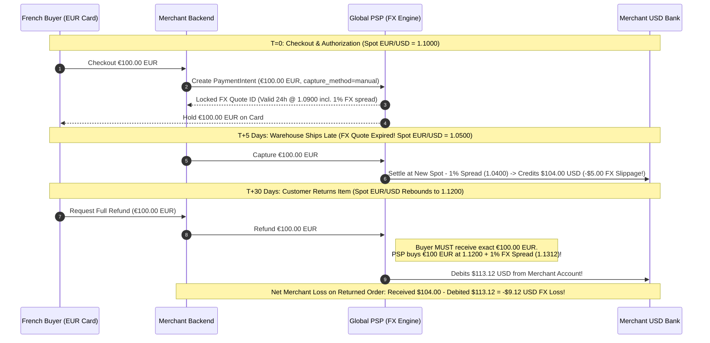

# Cross-Border Commerce, Global Tax/VAT, FX & Customs

## What Is It?

Selling a product or SaaS subscription to a buyer in another country looks deceptively simple: translate the UI, display prices in Euros or Yen, and pass a currency code to Stripe. Beneath the surface, **Cross-Border Commerce, Global Tax/VAT, Foreign Exchange (FX), and Customs** form a web of sovereign tax laws, local payment rails, currency conversion spreads, and physical border clearance protocols that determine whether international expansion is profitable or catastrophic.

When a domestic business sells to a buyer in Germany, Brazil, or Japan, four distinct systems collide:

1. **Indirect Taxation (Sales Tax, VAT, GST)**: Governments require remote sellers to calculate, collect, and remit consumption taxes based on where the *buyer* is located—even if the seller has zero employees or servers in that country.
2. **Acquiring & Local Payment Methods (LPMs)**: Charging a European or Latin American buyer through a US merchant account triggers cross-border interchange penalties (1.5%–2.0%), 15%–30% lower card approval rates, and excludes the 50%+ of global consumers who pay via non-card rails (**PIX** in Brazil, **iDEAL** in the Netherlands, **UPI** in India, **Konbini** in Japan).
3. **Foreign Exchange (FX) Lifecycle**: A transaction moves through Pricing, Authorization, Capture, Settlement, and Refund over days or months. If the buyer pays in EUR (`Presentment Currency`) while the merchant settles in USD (`Settlement Currency`), exchange rate movements during delayed capture or refunds create unhedged FX slippage.
4. **Customs, HS Codes & Landed Cost (Physical Goods)**: Every cross-border parcel requires a **Harmonized System (HS) tariff code**, customs valuation, duty calculation, and a choice between **DDP (Delivered Duty Paid)** and **DDU/DAP (Delivered Duty Unpaid)**—directly determining whether parcels clear customs smoothly or get refused at the doorstep.

## Why Should You Care?

Developers routinely hardcode domestic assumptions into checkout, invoicing, and order state machines that break globally:

1. **Uncollected Sales Tax / VAT comes straight out of your gross revenue (plus 20%–50% penalties)**: If your checkout fails to collect 20% UK VAT or 8.25% Texas Sales Tax after crossing statutory nexus thresholds, you cannot retroactively ask 50,000 customers to pay the tax later. Auditors assess uncollected tax plus interest and penalties directly against your company's bank account.
2. **External Government APIs (like EU VIES) go down constantly**: In B2B SaaS, European companies expect 0% VAT under the **Reverse Charge** mechanism when entering a valid EU VAT ID. However, the European Commission **VIES API** proxies requests in real time to 27 national tax databases—several of which go offline weekly for maintenance. A naive synchronous VIES call without fallback logic breaks B2B checkout across Europe whenever a member state's server times out.
3. **Async Local Payment Methods break synchronous inventory and order state machines**: Credit cards authorize in 2 seconds. Japanese **Konbini** convenience store vouchers and Brazilian **Boleto Bancário** slips take **1 to 5 days** for the buyer to walk into a store and pay cash, while **PIX** QR codes expire in 15–60 minutes. Hard-locking inventory for 5 days lets attackers hoard stock; releasing stock too early causes overselling when the cash payment webhook arrives days later.
4. **DDU shipping and Refund FX slippage silently bleed unit economics**: Shipping physical goods via **DDU (Delivered Duty Unpaid)** causes couriers to demand surprise cash duties plus a $15–$25 carrier advancement fee at the customer's door—leading to 15%–30% parcel refusal rates, two-way shipping losses, and lost chargebacks.

## How It Works (The Business Flow)

### 1. Direct Local Acquiring vs. Merchant of Record (MoR) Flow

Before writing tax or payment code, a business must choose its operating model: build an in-house global stack (**Direct Local Acquiring + Tax Engine**) or offload legal liability to a **Merchant of Record (MoR)** like Paddle, Global-e, Lemon Squeezy, or FastSpring.

```mermaid
flowchart TB
    subgraph Direct["Model A: Direct Local Acquiring + Tax Engine (Stripe + Avalara / Stripe Tax)"]
        BuyerA["Global Buyer<br/>Pays €120 (incl. €20 VAT)"] -->|1. Checkout| MerchA["Your Company<br/>(Legal Seller on Receipt & Card Statement)"]
        MerchA -->|2. Real-Time Rate Lookup| TaxEngine["Tax Engine (Stripe Tax / Avalara)<br/>Geocodes Address + Validates VIES VAT ID"]
        MerchA -->|3. Local Acquiring Route| PSP["Global PSP (Adyen / Stripe)<br/>Routes to Local EU/UK/BR Acquiring Entity"]
        PSP -->|"4. Net Settlement (€116.50)"| MerchBank["Your Multi-Currency Treasury"]
        MerchBank -->|5. You File & Remit Taxes<br/> Across 40+ Jurisdictions| TaxAuth["US States / EU OSS / UK HMRC<br/>(You Bear Audit & Penalty Liability!)"]
    end

    subgraph MoR["Model B: Merchant of Record (Paddle / Global-e / Lemon Squeezy)"]
        BuyerB["Global Buyer<br/>Pays €120 (incl. €20 VAT)"] -->|1. Buys From MoR| MoREntity["Merchant of Record (MoR)<br/>(Legal Seller on Card Statement & Invoice)"]
        MoREntity -->|2. MoR Owns Local Entities,<br/>LPMs, Fraud & Tax Calculation| MoRAcq["MoR Local Acquirers & Tax Registrations"]
        MoREntity -->|3. MoR Remits €20 VAT<br/>& Absorbs Tax Audit Liability| TaxAuthB["Global Tax Authorities"]
        MoREntity -->|"4. Wholesale Payout (€93.00)<br/>Single Monthly B2B Wire / Invoice"| YourCo["Your Company<br/>(Zero Tax Filings, Zero Local Entities)"]
    end
```



- **Merchant of Record (Paddle / Lemon Squeezy for SaaS; Global-e / Passport for E-Commerce)**: The MoR legally buys your product at a wholesale transfer price and immediately resells it to the consumer in its own name (`PADDLE.NET*ACME` on the card statement). The MoR handles all global tax registrations, quarterly VAT filings, VIES checks, local payment methods, and chargebacks. You pay a higher take rate (**5%–8% + $0.50**), but need zero international tax filings.
- **Direct Local Acquiring + Tax Engine**: Once GMV exceeds **$5M–$10M/year**, paying 5%–8% to an MoR exceeds the cost of CPA filings plus **Stripe Tax / Avalara / Vertex** (~2.2%–2.9% processing + ~0.5% tax engine fee). Many companies use a **Hybrid Graduation Strategy**: process directly in top markets (US, UK, EU via OSS) where they own local entities, while routing long-tail countries through an MoR.

### 2. US Economic Nexus (`South Dakota v. Wayfair`) & Rooftop Tax Calculation

Unlike Europe's national VAT rates, the United States has **no federal sales tax**. Instead, it has **13,000+ overlapping tax jurisdictions** across 45 states (plus DC), counties, cities, and special transit districts (the 5 **NOMAD** states—New Hampshire, Oregon, Montana, Alaska, Delaware—have no statewide sales tax, though Alaska permits local city taxes).

- **The `South Dakota v. Wayfair` (2018) Economic Nexus Shift**: Prior to 2018, states could only require sales tax collection if a merchant had **Physical Nexus** (an office, employee, or FBA warehouse in that state). In *Wayfair*, the US Supreme Court ruled that states can enforce **Economic Nexus** based purely on remote sales volume.
- **Standard Threshold ($100,000 or 200 Transactions)**: In most states, crossing **$100,000 in gross revenue OR 200 separate transactions** in a 12-month window (large states like CA, TX, and NY use **$500,000**, and many states have dropped the 200-transaction count) legally requires registering for a state tax permit and collecting sales tax.
- **SaaS Taxability Variance**: US states differ sharply on whether cloud software (SaaS) is taxable:
  - **100% Taxable**: New York, Washington, Pennsylvania, Massachusetts, Ohio.
  - **Partially Taxable**: Texas (**80% of a SaaS invoice is taxable**, 20% is statutorily exempt).
  - **Exempt (Non-Taxable)**: California, Florida, Virginia (when no tangible media is transferred).
- **Why 5-Digit ZIP Codes Fail (Rooftop Geocoding)**: In states like Colorado or Washington, two houses sharing the exact same 5-digit ZIP code (`80111`) can sit in different city or special stadium districts with a **2.5% tax rate difference**. Never use a static `ZIP -> Tax Rate` table; always pass full street address + `ZIP+4` to a real-time tax API for **rooftop-level lat/long geocoding**.

### 3. EU VAT OSS, IOSS & B2B Reverse Charge (With VIES Downtime Fallbacks)

In the EU, UK, Australia, and Japan, consumption tax is levied as **Value-Added Tax (VAT)** or **GST** (19%–27% across the EU: e.g., 19% Germany, 20% France/UK, 25% Sweden, 27% Hungary).

- **Tax-Inclusive vs. Tax-Exclusive Display**: US/Canada prices are displayed **Tax-Exclusive** ($99 on pricing page, tax added at checkout). EU, UK, Australian, and Japanese consumer laws mandate that B2C prices be shown **Tax-Inclusive** upfront.
- **B2C Place of Supply & Two Non-Contradictory Proofs**: For digital services sold to EU consumers, VAT is owed at the **buyer's country rate**. Merchants must collect **two non-contradictory pieces of location evidence** (e.g., `IP Country` + `Card BIN Country` or `Billing Address Country`) to prevent buyers from spoofing low-tax countries.
- **EU VAT OSS (One-Stop Shop)**: Once pan-EU B2C sales exceed **€10,000/year**, you must charge destination VAT rates. Instead of registering in all 27 EU member states, **OSS** (and **Non-Union OSS** for non-EU companies) lets you register in **one EU state** and file a **single quarterly VAT return** covering all 27 countries.
- **B2B Reverse Charge & VIES Downtime Fallbacks**: When selling B2B cross-border to a VAT-registered EU business that supplies a valid VAT ID (e.g., `DE123456789`), you apply **Reverse Charge**: charge **0% VAT** and add the legal note *"Reverse Charge — Article 196 Council Directive 2006/112/EC"* alongside both VAT IDs on the invoice.
  - **Resilient VIES Architecture**: You must verify the buyer's VAT ID via the EU **VIES API** and log the returned `consultationNumber`. Because VIES proxies to 27 national databases that frequently return `MS_UNAVAILABLE` or `TIMEOUT`, implement a **3-tier fallback**:
    1. **Tier 1 (Checksum Regex)**: Validate country prefix and check-digit math locally; reject bad syntax immediately.
    2. **Tier 2 (Cache)**: Reuse verified VIES consultation results cached within the last 7–30 days.
    3. **Tier 3 (Async Queue on `MS_UNAVAILABLE`)**: If syntax is valid but the national database is offline, **do not block B2B checkout**. Provisionally grant 0% Reverse Charge (`vies_status = PENDING_ASYNC_VERIFY`) and retry verification via an exponential-backoff worker over 48 hours.

### 4. HS Codes, De Minimis & DDP vs. DDU Landed Cost Calculation

Every physical SKU crossing a border requires a **Harmonized System (HS) Code**—a 6-digit universal WCO prefix extended to 8–10 digits nationally (10-digit **HTS** in the US, **TARIC** in the EU; e.g., `6109.10` for cotton T-shirts).

- **De Minimis Thresholds** (order value below which duties/taxes are waived):
  - **United States**: **$800 USD** (Section 321—subject to origin-country trade restrictions).
  - **European Union**: **€0 for Import VAT** (every parcel pays VAT!) and **€150 for Customs Duty**. For parcels **≤ €150**, merchants use **IOSS (Import One-Stop Shop)** to collect VAT at checkout for instant green-lane customs clearance.
  - **United Kingdom**: **£135 GBP** (orders ≤ £135 require point-of-sale UK VAT collection by the merchant).
  - **Canada**: **$20 CAD** postal / **$40 CAD** tax (**$150 CAD** duty) via courier.
- **Compound Landed Cost Formula**: Most countries assess duty on **CIF (Cost + Insurance + Freight)**, and then assess **Import VAT on top of CIF + Duty + Clearance Fees** (a compound tax-on-tax):

$$\text{CIF Value} = \text{Item Price} + \text{Shipping} + \text{Insurance}$$

$$\text{Customs Duty} = \text{CIF Value} \times \text{HS Tariff Rate}$$

$$\text{Import VAT} = (\text{CIF Value} + \text{Customs Duty} + \text{Clearance Fee}) \times \text{VAT Rate}$$

$$\text{Total Landed Cost} = \text{CIF Value} + \text{Customs Duty} + \text{Import VAT} + \text{Clearance Fee}$$

- **DDP (Delivered Duty Paid) vs. DDU / DAP (Delivered Duty Unpaid)**: Under **DDU**, you only collect item + shipping at checkout; when DHL/FedEx arrives at the customer's door, the courier demands Import VAT + Duty + a **$15–$25 carrier advancement/brokerage fee**, triggering 20%+ parcel refusals, return freight losses, and chargebacks. Under **DDP**, you collect the full **Landed Cost** at checkout, submit electronic customs invoices (**ETD**), and bill duties to your carrier account so the parcel arrives with zero doorstep fees.

### 5. Local Payment Methods (LPMs) & Asynchronous Expiration

| LPM | Region | Mechanism | Confirmation SLA | Chargeback Risk? | Native Refund Rail? |
| --- | --- | --- | --- | --- | --- |
| **PIX** | Brazil | Instant Central Bank QR / Push | 10 sec – 60 min | **No** (Push) | Yes (Instant return) |
| **iDEAL** | Netherlands | Online Bank Redirect (~70% share) | Immediate (15m timeout) | **No** (Irrevocable) | Yes (SEPA credit) |
| **UPI** | India | Real-Time Mobile Push / Intent | Immediate (5m timeout) | **No** | Yes |
| **Konbini** | Japan | Cash Payment at Convenience Store | **Async: 1 to 7 Days** | **No** (Cash) | **No** (Requires bank wire!) |
| **Boleto** | Brazil | Barcode Cash/Bank Payment Slip | **Async: 1 to 3 Business Days** | **No** | **No** (Collect bank info) |
| **SEPA DD** | Eurozone | Bank Pull (Direct Debit) | **Async: 2 to 5 Business Days** | **Yes!** (8-wk unconditional!) | Yes |

### 6. Authorization-to-Capture-to-Refund FX Slippage Lifecycle

When pricing in local currency (`EUR` presentment) while settling into a `USD` bank account, exchange rate movements between authorization, capture, and refund create unhedged FX slippage:



## Key Terms You'll Hear

| Term | What It Means |
| --- | --- |
| **MoR (Merchant of Record)** | Legal entity (Paddle, Global-e) that acts as seller on the buyer's receipt, remits global taxes, and absorbs audit/chargeback liability. |
| **Economic Nexus** | Threshold (*South Dakota v. Wayfair*, typically $100k revenue or 200 tx/year) triggering mandatory US state tax registration without physical presence. |
| **VAT OSS / IOSS** | EU **One-Stop Shop** (single quarterly VAT filing for 27 EU states) and **Import One-Stop Shop** (checkout VAT collection for imported goods ≤ €150). |
| **Reverse Charge** | B2B mechanism where a cross-border buyer provides a valid VAT ID (verified via **VIES**), allowing 0% VAT at checkout while the buyer self-assesses VAT. |
| **HS Code (HTS / TARIC)** | 6-to-10-digit customs tariff classification code determining import duty rates for physical products. |
| **De Minimis Threshold** | Order value below which imports enter free of customs duty and/or tax ($800 US, €150 EU duty, £135 UK). |
| **Landed Cost** | Total doorstep cost: $\text{Item} + \text{Shipping} + \text{Insurance (CIF)} + \text{Customs Duty} + \text{Import VAT} + \text{Brokerage Fee}$. |
| **DDP vs. DDU (DAP)** | **Delivered Duty Paid** (duties collected upfront at checkout) vs. **Delivered Duty Unpaid** (courier bills surprised buyer on delivery). |
| **Presentment vs. Settlement** | Currency shown and charged to the buyer (`EUR`) vs. currency deposited into the merchant's bank account (`USD`). |
| **LFL (Like-for-Like Settlement)** | Settling `EUR` charges directly into a `EUR` bank account to eliminate per-transaction PSP FX spreads (1%–2%) and refund FX slippage. |

## Common Patterns

### Pattern 1: Resilient VIES Validation for B2B Reverse Charge

Validate EU VAT numbers with local country regex/checksums first, then check a 7–30 day local cache of verified VIES `consultationNumber` records. If the live VIES API returns `MS_UNAVAILABLE` during a national database outage, provisionally grant 0% Reverse Charge (`PENDING_ASYNC_VERIFY`) so B2B checkout never blocks, and verify asynchronously via a background retry worker.

### Pattern 2: Async Voucher LPMs (Konbini / Boleto) Without Inventory Starvation

Distinguish between **Short-TTL Instant LPMs** (PIX / UPI: 15–30 min expiry with hard Redis TTL inventory lock) and **Multi-Day Cash Vouchers** (Konbini / Boleto: 1–5 day expiry; never hard-lock scarce flash-sale stock on unverified voucher creation, or attackers will lock 100% of inventory for free). Because cash vouchers lack native refund rails, build an automated **Bank Transfer Payout Collection Flow** for refunds.

### Pattern 3: Hedging FX Slippage via Like-for-Like (LFL) Multi-Currency Treasury

Instead of letting your PSP convert every `EUR` charge to `USD` at a 1%–2% spread on capture—and losing another 1%–2% plus spot drift on refunds—route `EUR` payments into a native **`EUR` Like-for-Like settlement balance** (Stripe Multi-Currency, Adyen, Wise, Airwallex). Pay `EUR` refunds and local expenses directly from that `EUR` bucket with **0% FX slippage**, and sweep surplus funds monthly at interbank wholesale rates (0.05%–0.15%).

### Pattern 4: Cosmetic Price Books & Tax-Inclusive Margin Absorption

Avoid live spot-converted prices like `€91.43` that hurt conversion and break CDN caching. Maintain regional **Price Books** (`$99 USD`, `€95 EUR`, `£85 GBP`, `¥14,800 JPY`). In tax-inclusive B2C markets (EU/UK), keep the displayed gross price constant (`€95`) and dynamically back-calculate net revenue based on destination VAT (`€95 / 1.19` in Germany vs. `€95 / 1.25` in Sweden).

## Gotchas

- **Charging 100x on Zero-Decimal Currencies (`JPY`, `KRW`, `VND`, `CLP`)**: Gateways expect minor units (`$10.00 USD` = `1000`). Because **Japanese Yen (`JPY`) and Korean Won (`KRW`) are 0-decimal currencies**, passing `amount * 100` for `¥1,000 JPY` charges the buyer **¥100,000 JPY**! Meanwhile, `KWD` and `BHD` are **3-decimal currencies** (`1000` = `1.000 KWD`). Always normalize amounts using an ISO 4217 currency exponent table.
- **Forgetting That Shipping Is Taxable**: In the EU, UK, and most US states (e.g., TX, NY), shipping fees are subject to VAT / Sales Tax at the same rate as the goods in the cart.
- **Assuming SEPA Direct Debit Cannot Be Reversed**: Unlike push rails (`iDEAL`, `PIX`), **SEPA Direct Debit** is a bank pull rail that grants Eurozone consumers an unconditional **8-week (56-day) no-questions-asked refund right** (and 13 months for unauthorized pulls) that merchants cannot fight.
- **Mutating Issued Tax Invoices Instead of Issuing Credit Notes**: EU VAT law prohibits editing or deleting an issued sequential invoice (`INV-2026-00412`) upon refund. Keep original invoices immutable and issue a sequential **Credit Note (`CN-2026-00089`)** referencing the original invoice.

## Quick Reference

```
MoR vs. Direct Tax Stack Decision Matrix:
  GMV < $5M/yr or Lean Eng Team → Merchant of Record (Paddle / Global-e): 5%-8% fee, 0 tax filings
  GMV > $10M/yr + High Volume   → Direct Local Acquiring + Stripe Tax/Avalara + LFL Multi-Currency

Major Global Tax & De Minimis Thresholds:
  US Economic Nexus:  $100,000 revenue OR 200 tx/yr per state ($500k in CA/TX/NY) | Rooftop Geocode
  US De Minimis:      $800 USD (Section 321 customs duty/tax exemption ceiling)
  EU Digital / B2C:   €10,000 pan-EU threshold → File single quarterly return via EU VAT OSS
  EU Physical Import: €0 VAT De Minimis | ≤ €150 Duty-Free & eligible for IOSS point-of-sale VAT
  UK Physical Import: ≤ £135 GBP → Merchant must collect 20% UK VAT at checkout

Compound Landed Cost Formula (Physical Cross-Border DDP):
  1. CIF Value     = Item Price + International Shipping + Insurance
  2. Customs Duty  = CIF Value × HS Code Tariff Rate (%)
  3. Import VAT    = (CIF Value + Customs Duty + Carrier Clearance Fee) × Country VAT Rate (%)
  4. Landed Cost   = CIF Value + Customs Duty + Import VAT + Carrier Clearance Fee

ISO 4217 Currency Minor Unit Exponents (Gateway Integer Serialization):
  0-Decimal (Pass 1000 for 1,000): JPY, KRW, VND, CLP, ISK
  2-Decimal (Pass 1000 for 10.00): USD, EUR, GBP, CAD, AUD, SGD, BRL, CNY, INR
  3-Decimal (Pass 1000 for 1.000): KWD, BHD, OMR, JOD, TND
```
