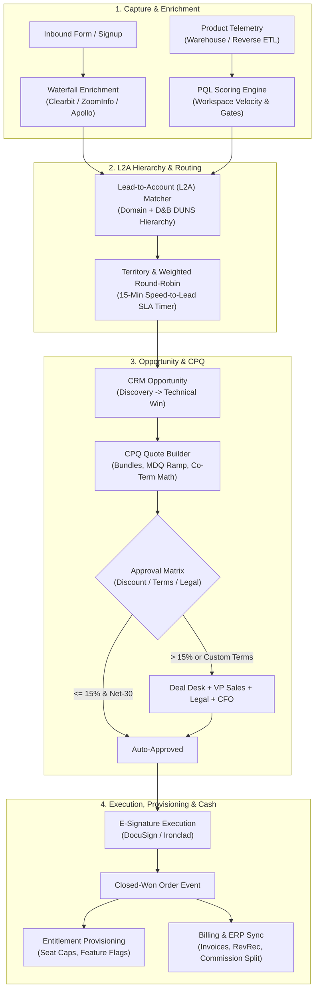

# CRM, RevOps & Enterprise CPQ (Lead-to-Cash Systems)

## What Is It?

A **Lead-to-Cash (L2C)** architecture connects a company's customer acquisition engine (**CRM** and **RevOps** automation) with its commercial contracting engine (**CPQ — Configure, Price, Quote**) and downstream billing, provisioning, and ERP ledgers. While a self-serve B2C checkout simply charges a credit card for a fixed monthly plan, enterprise B2B sales involve corporate hierarchies, multi-touch sales cycles, custom-negotiated multi-year ramp contracts, mid-term seat add-ons (**co-terming**), multi-department discount approvals, and bi-directional synchronization between product databases and external CRMs like Salesforce or HubSpot.

From a systems engineering perspective, building RevOps and CPQ infrastructure means designing an event-driven, financially exact state machine where marketing signals, product usage telemetry, sales rep actions, legal redlines, and billing schedules stay strictly consistent without causing infinite webhook sync loops or penny-level proration discrepancies.

## Why Should You Care?

Every B2B SaaS company moving upmarket from self-serve ($20/month) to enterprise contracts ($50,000–$5,000,000/year) hits the same architectural wall: hardcoded Stripe plans cannot model how enterprise buyers purchase software. Procurement teams demand **Multi-Year Ramp Deals** (e.g., 100 seats in Year 1, 250 in Year 2, 500 in Year 3), **Co-Termed Add-Ons** (buying 100 more seats mid-contract that expire on the same day as the master agreement), and custom terms (Net-60, quarterly billing, custom overage rates).

If your engineering team treats CRM sync and CPQ math as an afterthought:
- **Infinite Webhook Echo Loops** between your production database and Salesforce will exhaust API governor limits in minutes and halt operations.
- **Broken Lead-to-Account (L2A) Matching** will route a subsidiary lead from "Instagram LLC" to a junior SDR when a Strategic AE is already negotiating a $2M master agreement with parent company "Meta Platforms, Inc."
- **Naive Proration Math** on mid-contract amendments will miscalculate invoices, corrupt ARR (Annual Recurring Revenue) reporting, and fail financial audits.

## How It Works (The Business Flow)

### End-to-End Lead-to-Cash & PQL Lifecycle



### 1. Lead Capture & Waterfall Enrichment

When a prospect signs up or submits a "Contact Sales" form, the ingestion service captures first-touch and last-touch attribution (`utm_source`, `utm_campaign`, `gclid`, referrer URL) alongside identity fields. Because long forms destroy conversion rates, modern systems ask only for a work email and run an **asynchronous enrichment waterfall**:
1. **Identity Normalization & Deduplication**: Strip plus-addressing (`alice+test@acme.com` -> `alice@acme.com`), filter consumer domains (`gmail.com`, `yahoo.com`, `qq.com`), and compute an idempotency key on the normalized email.
2. **Multi-Vendor Waterfall**: Query Provider A (Clearbit) with a 1,500ms timeout. If firmographics (`employee_count`, `estimated_arr`, `industry`, `hq_country`, `duns_number`) are missing, fall back to Provider B (ZoomInfo) and Provider C (Apollo).
3. **Domain Caching**: Cache company firmographics by normalized domain (`acme.com`) for 30 days so 50 employees signing up from one enterprise do not trigger 50 redundant API calls.

### 2. Lead-to-Account (L2A) D&B Parent-Child Hierarchy Matching

A raw lead rarely maps 1-to-1 to a CRM Account by email domain alone. Global enterprises operate hundreds of subsidiaries and acquired brands with distinct domains (`youtube.com`, `deepmind.com`, `waymo.com` under Alphabet Inc.; `twitch.tv`, `audible.com` under Amazon).

To prevent channel conflict where multiple reps pitch the same conglomerate independently, the L2A engine resolves the **Dun & Bradstreet (D&B) Corporate Family Tree** using the 9-digit **DUNS Number**:

```
Ultimate Global Parent: Alphabet Inc. (DUNS: 00-123-4567) [Owner: Strategic AE - Global]
 ├── Domestic Parent: Google LLC (DUNS: 00-234-5678) [Owner: Enterprise AE - US West]
 │    └── Branch / Division: Google Cloud EMEA (DUNS: 00-345-6789) [Owner: Enterprise AE - EMEA]
 └── Subsidiary: Looker Data Sciences, Inc. (DUNS: 00-888-9999)
```

The deterministic L2A matching pipeline runs in four prioritized passes:
1. **Exact Domain + Contact Match**: Match against active CRM Contacts and Account `website_domain` arrays.
2. **D&B DUNS Exact Match**: Match enriched `duns_number` to an existing CRM Account's `duns_number`.
3. **D&B Parent Hierarchy Traversal**: If the subsidiary DUNS is absent, traverse upward (`parent_duns` -> `domestic_ultimate_duns` -> `global_ultimate_duns`). Inspect the parent's `account_buying_policy`:
   - **Centralized Buying Policy**: Attach the lead to the Global Parent Account and route to the Global Strategic AE.
   - **Regional / Subsidiary Autonomy Policy**: Auto-create a child Account linked via `parent_account_id` and route to the regional territory owner.
4. **Fuzzy Legal Name + Geo Normalization**: Strip legal suffixes (`Inc.`, `Corp.`, `GmbH`, `Pte. Ltd.`), normalize Unicode, and combine Jaro-Winkler similarity with HQ country/state confirmation.

### 3. Territory & Round-Robin SLA Routing

Once a lead is matched to an Account, the routing state machine assigns an owner:
- **Named Account Override**: If the matched Account (or Ultimate Parent) is on a Strategic Named Account list, assign immediately to the designated AE.
- **Territory Segmentation**: Partition leads by `Geo Region` (AMER, EMEA, APAC) $\times$ `Segment` (SMB: 1–99, Mid-Market: 100–999, Enterprise: 1,000+) $\times$ `Vertical` (Healthcare/FedRAMP).
- **Weighted Round-Robin Queue**: Assign leads using a weighted Deficit Round-Robin algorithm accounting for **Rep Ramp Weight** (`0.5` ramping vs `1.0` full quota), **Calendar/OOO Availability** (skipping reps on PTO or in customer meetings), and **Active Working Caps** (pausing reps with $>25$ unworked `New` leads).
- **Speed-to-Lead SLA Enforcement**: High-intent inbound leads ("Request a Demo") start a **15-minute business-hours SLA timer**:
  - **T + 10 mins** (No outbound call/email logged): Send high-priority Slack escalation alert to the assigned rep.
  - **T + 15 mins** (SLA Breach): Atomically revoke ownership, log an `sla_breach_event`, and re-assign the lead to the next available rep in the pool.

### 4. Product-Qualified Leads (PQLs)

In Product-Led Sales (PLS) companies (Slack, Datadog, Figma), top-converting leads come from self-serve workspaces exhibiting enterprise buying signals inside the product. A **PQL Engine** ingests telemetry (via Kafka or Warehouse Reverse ETL like Census/Hightouch) across three dimensions:
1. **Firmographic Fit**: Is the workspace registered to an enterprise domain (>500 employees, target industry)?
2. **Usage Velocity & Breadth**: Did active seats grow $>40\%$ week-over-week, span $\ge 3$ departments, or surpass $80\%$ of free-tier API/storage quotas?
3. **High-Intent Feature Gate Hits**: Did an admin view Enterprise Pricing 3 times in 48 hours, click the locked **SAML SSO / SCIM** toggle, or try to export an **Audit Log**?

Crossing the composite threshold (`Fit >= 70 AND (Usage >= 80 OR IntentGateHit)`) creates a **PQL Opportunity** in the CRM, injects a JSON snapshot of workspace telemetry (`active_seats`, `top_features`, `quota_pct`) into the AE's CRM view, and suppresses generic marketing drip emails.

### 5. CPQ (Configure-Price-Quote) & Approval Matrices

When an Opportunity moves to proposal stage, reps use a **CPQ Engine** to guarantee structural and financial validity:
- **Configure (Product Dependency Graph)**: Enforces *Requires* rules (`Enterprise Security Add-On` requires `Enterprise Base`), *Excludes* rules (`Self-Hosted` excludes `Managed Cloud`), and *Ratio* rules (1 mandatory `Dedicated TAM` SKU per 500 `Seats`).
- **Price (Price Books & Margin Floors)**: Applies tiered/volume formulas, multi-currency FX price books, and real-time **Gross Margin** checks (subtracting COGS like LLM token costs or dedicated cloud clusters).
- **Quote Approval Matrix**: Evaluates quotes across governance axes before unlocking PDF/DocuSign generation:

| Approval Dimension | Self-Approval (AE) | Manager / Director | Deal Desk + VP Sales | Legal + CFO Sign-Off |
| :--- | :--- | :--- | :--- | :--- |
| **Software Discount %** | $0\% - 15\%$ | $15.01\% - 25\%$ | $25.01\% - 40\%$ | $> 40\%$ or margin floor breach |
| **Payment & Billing Terms** | Annual Upfront, Net-30 | Net-45 | Semi-Annual, Net-60 | Quarterly/Monthly, Net-90+ |
| **Legal / MSA Redlines** | Standard MSA | Minor venue change | Custom SLA credits | Unlimited liability / IP indemnity |
| **Ramp / Termination** | Standard multi-year | Year-1 ramp $\le 20\%$ | Steep multi-year ramp | Convenience termination (opt-out) |

Approvals run as a **Hybrid DAG**: Deal Desk, Legal, and InfoSec evaluate in **parallel**, while VP Sales and CFO approve **sequentially** after Deal Desk clearance. Any edit to quote quantities, discounts, or terms invalidates active sign-offs and resets the DAG.

### 6. Multi-Year Ramp Deals & Mid-Contract Co-Terming Math

Enterprise customers frequently negotiate **Multi-Dimensional Quoting (MDQ) Ramp Deals** with stepped annual quantities, and later execute **Mid-Contract Add-Ons** that must **co-term** (share the exact expiration date) with the master contract.

```mermaid
gantt
    title 3-Year Enterprise Ramp Contract + Month-18 Co-Termed Add-On
    dateFormat  YYYY-MM-DD
    axisFormat  %Y-%m

    section Master Ramp (MDQ)
    Year 1: 100 Seats @ $1,200/yr ($120k)      :active, y1, 2025-01-01, 2025-12-31
    Year 2: 250 Seats @ $1,140/yr ($285k)      :active, y2, 2026-01-01, 2026-12-31
    Year 3: 500 Seats @ $1,080/yr ($540k)      :active, y3, 2027-01-01, 2027-12-31

    section Mid-Term Amendment
    Add-On: +100 Seats (Prorated 184/365d Yr 2) :crit, add2, 2026-07-01, 2026-12-31
    Add-On Rolled Into Year 3 (+100 Seats @ $1,080) :crit, add3, 2027-01-01, 2027-12-31
```

#### Multi-Year Ramp Metrics & Exact Co-Terming Proration Math
- **Master Ramp Schedule**: Year 1 (`2025`): $100 \times \$1,200 = \$120,000$; Year 2 (`2026`): $250 \times \$1,140 = \$285,000$; Year 3 (`2027`): $500 \times \$1,080 = \$540,000$. **TCV**: $\$945,000$ | **Average ACV**: $\$315,000/\text{yr}$ | **Exit ARR**: $\$540,000$.
- **Month-18 Co-Termed Add-On**: On **July 1, 2026** (`2026-07-01`), the customer adds **100 seats** co-termed to `2027-12-31`:
  - Remaining active days in Year 2 (`2026-07-01` through `2026-12-31` inclusive) = $184\text{ days}$ out of $365\text{ days}$:
    $$\text{Prorated Charge}_{\text{Yr2}} = 100\text{ seats} \times \$1,140 \times \frac{184}{365} = \$57,468.49$$
  - The co-termed +100 seats also propagate into **Year 3** (`2027-01-01` – `2027-12-31`, full 365 days) at the Year 3 contracted rate ($\$1,080/\text{seat/yr}$):
    $$\text{Delta Charge}_{\text{Yr3}} = 100\text{ seats} \times \$1,080 \times \frac{365}{365} = \$108,000.00$$
  - **Total Amendment Order Value**: $\$57,468.49 + \$108,000.00 = \$165,468.49$, raising Year 3 Exit ARR to $600 \times \$1,080 = \$648,000$.

### 7. Bi-Directional CRM Sync & Loop Prevention

Product databases (PostgreSQL) and CRMs (Salesforce / HubSpot) both mutate shared entities (`Account`, `Contact`, `Entitlement`). Without loop guards, System A updates System B $\rightarrow$ System B fires a webhook to System A $\rightarrow$ System A updates System B in an **infinite webhook storm**.

Production systems prevent sync loops using four mechanisms:
1. **Mutation Origin Tagging & Service-Account Filtering**: Outbound CRM writes use a dedicated integration user and attach `Last_Sync_Tx_Id__c = <uuid>`. The webhook listener drops any event where `LastModifiedById == Integration_User_Id` or `Last_Sync_Tx_Id__c` matches a locally emitted transaction ID.
2. **Field-Level Ownership & Version Clocks**: Partition fields into **Product-Authoritative** (`active_seats`, `api_usage_30d` — one-way App $\rightarrow$ CRM) and **CRM-Authoritative** (`account_owner_id`, `territory` — one-way CRM $\rightarrow$ App). For shared fields (`billing_address`), attach a monotonic `version_seq` or vector clock.
3. **Canonical Hash No-Op Short-Circuit**: Compute a canonical `SHA-256` hash of mapped fields before writing. If `incoming_hash == stored_hash`, return `200 OK` without executing a database write or emitting events.
4. **Governor-Limit Micro-Batching**: Queue outbound mutations in Kafka/Redis, group Contact updates by `ParentAccountId` (preventing Salesforce `UNABLE_TO_LOCK_ROW` contention), sort by ID, and flush via **Salesforce Composite / Bulk API 2.0** every 5–15 seconds.

### 8. Commission Split Attribution & Clawbacks

A closed enterprise deal credits multiple contributors in an immutable **Commission Split Ledger**:
- **Primary AE**: $100\%$ New Business ACV quota credit ($10\%$ base commission rate, accelerating to $15\%$ above $100\%$ annual quota attainment).
- **SDR / BDR**: Credited on Stage-2 Qualified Pipeline creation plus a $1.5\%$ Closed-Won kicker.
- **Solutions Engineer (SE)**: $2\% - 3\%$ overlay commission tied to technical win verification.
- **Territory / Co-Sell Split**: Split across regional reps (e.g., $60\%$ HQ AE in US / $40\%$ Subsidiary AE in EMEA) approved by Deal Desk prior to close.
- **Ramp Quota Retirement & Clawbacks**: Commissions on multi-year ramps typically pay upfront on Year 1 ACV and vest on Year 2/3 segments upon annual invoicing. If a customer churns or defaults within the **90–180 day Clawback Window**, an offsetting negative debit entry is posted against the rep's next payout cycle.

## Key Terms You'll Hear

| Term | What It Means |
| :--- | :--- |
| **L2C (Lead-to-Cash)** | Architecture linking lead capture, CRM opportunities, CPQ quoting, contract signing, billing, and ERP rev-rec |
| **L2A (Lead-to-Account)** | Matching individual leads to parent or subsidiary Company Accounts using domain and D&B hierarchy data |
| **DUNS Number** | 9-digit Dun & Bradstreet identifier linking corporate subsidiaries to Domestic and Global Ultimate Parents |
| **PQL (Product-Qualified Lead)** | Self-serve workspace whose usage velocity, seat growth, or enterprise feature-gate hits signal sales readiness |
| **CPQ (Configure, Price, Quote)** | Engine enforcing SKU bundle rules, tiered/ramp pricing, margin floors, approval routing, and order forms |
| **MDQ (Multi-Dimensional Quoting)** | Structuring a multi-year quote into annual/quarterly segments with distinct quantities and prices per segment |
| **Co-Terming** | Aligning a mid-contract add-on's end date with the master subscription end date and prorating the partial period |
| **ACV / TCV / ARR** | **ACV**: Annualized Contract Value; **TCV**: Total Contract Value across all years; **ARR**: normalized Annual Recurring Revenue |
| **Deal Desk** | Cross-functional RevOps/Finance governance team reviewing non-standard discounts, payment terms, and ramp deals |
| **Clawback** | Recovering paid sales commissions when a customer defaults or churns within a contractual retention window |

## Common Patterns

### Pattern 1: Exact Co-Terming & Mid-Term Amendment Engine

Never mutate historical order lines in place. Generate an immutable **Amendment Order** containing delta line items calculated in integer cents (`BigInt`) using UTC date arithmetic:

```typescript
interface SubscriptionSegment {
  segmentIndex: number;
  startDate: string;          // YYYY-MM-DD
  endDate: string;            // YYYY-MM-DD (inclusive)
  quantity: number;
  unitAnnualPriceCents: bigint;
}

function daysBetweenInclusive(startIso: string, endIso: string): number {
  const s = Date.UTC(+startIso.slice(0, 4), +startIso.slice(5, 7) - 1, +startIso.slice(8, 10));
  const e = Date.UTC(+endIso.slice(0, 4), +endIso.slice(5, 7) - 1, +endIso.slice(8, 10));
  return Math.round((e - s) / 86_400_000) + 1;
}

export function calculateCoTermAmendment(
  schedule: SubscriptionSegment[],
  amendmentDate: string,
  addedSeats: number
) {
  return schedule
    .filter((seg) => seg.endDate >= amendmentDate)
    .map((seg) => {
      const effectiveStart = amendmentDate > seg.startDate ? amendmentDate : seg.startDate;
      const totalDays = daysBetweenInclusive(seg.startDate, seg.endDate);
      const activeDays = daysBetweenInclusive(effectiveStart, seg.endDate);
      const numerator =
        BigInt(addedSeats) * seg.unitAnnualPriceCents * BigInt(activeDays) +
        BigInt(Math.floor(totalDays / 2));

      return {
        segmentIndex: seg.segmentIndex,
        effectiveStart,
        effectiveEnd: seg.endDate,
        deltaQuantity: addedSeats,
        activeDays,
        totalDays,
        proratedAmountCents: numerator / BigInt(totalDays),
      };
    });
}
```

**Why it works:** UTC date-only math eliminates Daylight Saving Time (23h/25h) errors, handles 366-day leap years per segment, and propagates co-termed seats across both the active partial segment and future ramp segments.

**Trade-off:** Enterprise buyers sometimes request a **30/360 day-count convention** so a July 1st mid-year add-on bills at $180/360 = 50.00\%$ instead of $184/365 = 50.41\%$. Support a `day_count_convention` enum (`ACTUAL_ACTUAL` vs. `THIRTY_360`) on the quote.

### Pattern 2: Idempotent Bi-Directional CRM Sync Ledger

Track sync state per entity to guarantee zero webhook echo loops:

```sql
CREATE TABLE crm_sync_ledger (
  entity_type          VARCHAR(32) NOT NULL,  -- 'ACCOUNT', 'CONTACT', 'ENTITLEMENT'
  internal_entity_id   UUID NOT NULL,
  crm_external_id      CHAR(18) NOT NULL,     -- 18-char Case-Safe Salesforce ID
  payload_sha256       CHAR(64) NOT NULL,     -- Canonical hash of mapped fields
  last_mutation_origin VARCHAR(16) NOT NULL,  -- 'APP' or 'CRM'
  last_sync_tx_id      UUID NOT NULL,
  version_seq          BIGINT NOT NULL DEFAULT 1,
  PRIMARY KEY (entity_type, internal_entity_id)
);
```

When an inbound CRM webhook arrives, drop it immediately if `event.Last_Sync_Tx_Id__c == last_sync_tx_id` (self-echo) or `sha256(mapped_fields) == payload_sha256` (no-op). Otherwise, commit the update with `last_mutation_origin = 'CRM'`, which the outbound worker ignores.

## Common Pitfalls

- **Storing 15-character Case-Sensitive Salesforce IDs**: Legacy Salesforce APIs emit 15-char IDs (`0015g00000XyZ1a`) that collide in case-insensitive SQL joins. Always normalize to the **18-character Case-Safe ID**.
- **Provisioning on raw Opportunity stage changes**: Reps flip Opportunities to `Closed-Won` before Legal countersigns. Trigger provisioning and commissions only from a signed, Deal Desk-verified CPQ Order event.
- **Overwriting Strategic Account owners during L2A automation**: Never let an automated round-robin workflow reassign a parent Account that has `ownership_locked = true` or an active open Opportunity.
- **Ignoring Salesforce `UNABLE_TO_LOCK_ROW` contention**: Updating multiple Contacts under the same parent Account concurrently locks the parent Account row. Group Contact batch updates by `AccountId` and sort by `Id`.
- **Mixing One-Time Services into ARR**: Including a $\$25,000$ implementation SOW in `ARR` corrupts valuation metrics and overpays AE recurring commission rates. Tag every SKU with `revenue_type = 'RECURRING' | 'USAGE' | 'ONE_TIME'`.

## Quick Reference

| Architectural Layer | Recommended Implementation |
| :--- | :--- |
| **Lead Enrichment** | Capture UTMs + work email; deduplicate idempotently; async waterfall (Clearbit $\rightarrow$ ZoomInfo) cached by domain |
| **L2A Hierarchy** | Match exact domain $\rightarrow$ 9-digit DUNS $\rightarrow$ traverse Parent/Ultimate DUNS tree $\rightarrow$ Centralized vs. Regional routing |
| **SLA Lead Routing** | Named-account check $\rightarrow$ Territory rules $\rightarrow$ Calendar-aware weighted round-robin $\rightarrow$ 15-min SLA timer with auto-reroute |
| **PQL Scoring** | Combine Firmographic Fit + Workspace Usage Velocity + Feature-Gate hits; push JSON context via Reverse ETL |
| **CPQ & Approvals** | Product dependency DAG + Margin floor validator + Hybrid parallel/sequential approval matrix (reset on quote edit) |
| **Ramp & Co-Term** | Model MDQ segments explicitly; integer-cent proration across active days in current segment + future ramp propagation |
| **Bi-Dir CRM Sync** | 18-char Salesforce IDs, `last_sync_tx_id` echo suppression, canonical `SHA-256` diffing, Parent-grouped Bulk API 2.0 |
| **Commissions** | Immutable split ledger (AE / SDR / SE / Partner), segment-aware ramp vesting, and automated 90–180 day clawbacks |
