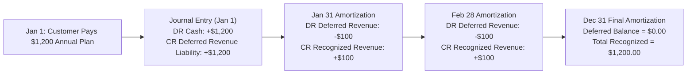
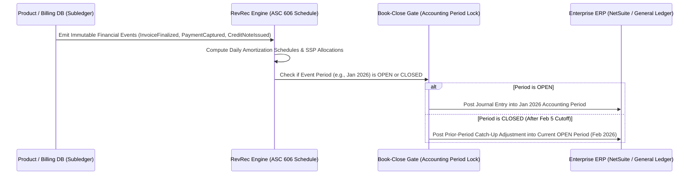

# Corporate Accounting, ERP Sync & Revenue Recognition (ASC 606)

## What Is It?

Charging a customer's credit card (`02-PAYMENT.md`) or creating a recurring subscription (`04-SUBSCRIPTION-BILLING.md`) is **cash collection** — it is **not** revenue. Under global accounting standards (**ASC 606** in the US and **IFRS 15** internationally), a company can only recognize revenue **as it delivers the promised service over time**.

If a customer pays `$1,200` upfront on January 1 for an annual SaaS subscription, your company has `$1,200` in the bank, `$0` in revenue, and a `$1,200` **Deferred Revenue (Unearned Revenue) liability** on its balance sheet. Every month as you deliver the software, `$100` moves from Deferred Revenue to Recognized Revenue. Corporate Accounting & Revenue Recognition systems bridge your product's billing database with the Finance team's **ERP / General Ledger (NetSuite, SAP, QuickBooks, Stripe Revenue Recognition)** so the company can close its monthly books and pass external financial audits.

## Why Should You Care?

Every startup begins by looking at Stripe's "Gross Volume" dashboard. Then the company raises a Series B or prepares for an IPO, hires a Controller/VP of Finance, and brings in Big-4 auditors. Suddenly, engineering is told: *"Our product database cannot answer how much deferred revenue we owed on March 31 at 11:59:59 PM UTC, and when engineers ran a migration last week, February's historical revenue numbers changed by $14,000."*

Bugs in revenue recognition and ERP synchronization don't just annoy users — they delay fundraising, trigger **Material Weakness** audit findings, force financial restatements, and block IPO filings. Understanding how accrual accounting, immutable journal entries, book-close cutoffs, and contract modifications work will make you the most trusted staff engineer in any B2B SaaS, marketplace, or fintech company.

## How It Works (The Business Flow)

### The ASC 606 / IFRS 15 Five-Step Model

1. **Identify the Contract with a Customer**: A signed enterprise order form or a completed self-serve checkout creates a legally enforceable contract with defined payment terms and service dates.
2. **Identify the Separate Performance Obligations**: What distinct promises did you make? (e.g., `12 months of SaaS access` + `40 hours of onboarding implementation services` + `100,000 API credits`).
3. **Determine the Transaction Price**: Total contract value minus discounts, rebates, credits, and estimated variable consideration (e.g., usage overages or SLA service credits).
4. **Allocate the Transaction Price to Performance Obligations**: Split the total price across each obligation based on its **Standalone Selling Price (SSP)** — even if the sales rep "bundled onboarding for free."
5. **Recognize Revenue When (or As) Each Performance Obligation Is Satisfied**:
   - **Ratable (Over Time)**: SaaS subscriptions recognize daily or monthly across the service period (`start_date` to `end_date`).
   - **Point-in-Time / Consumption**: Usage credits recognize as consumed (or upon expiration as breakage); hardware/one-time milestones recognize upon delivery acceptance.



### Order-to-Cash-to-General-Ledger (Subledger Architecture)

Your production Postgres database or Stripe instance acts as the **Billing Subledger** (tracking individual invoices, line items, and payment intents). Every night (or at month-end close), an automated RevRec pipeline aggregates subledger events into balanced **General Ledger (GL) Summary Journal Entries** and posts them to the ERP (NetSuite / SAP).



### Handling Mid-Cycle Upgrades, Downgrades, and Cancellations

1. **Mid-Cycle Upgrade**: Customer upgrades from `$100/mo` to `$300/mo` halfway through April. The system issues a prorated credit on the unused half of the old plan (`-$50`), bills the prorated new plan (`+$150`), and recalculates the remaining deferred revenue schedule from the modification timestamp forward.
2. **Refunds & Credit Notes**: Once an invoice is finalized, **you never edit or delete it**. If a customer is overcharged or cancels with a refund, the system issues an immutable **Credit Note** (or Credit Memo) that offsets Accounts Receivable or Deferred Revenue and reverses the remaining unrecognized portion.
3. **Bad Debt Write-Off**: If an enterprise customer receives an `OPEN` Net-30 invoice, uses the software for 2 months, and goes bankrupt without paying, the revenue already recognized is offset by a **Bad Debt Expense** journal entry rather than deleting the invoice.

## Key Terms You'll Hear

| Term | What It Means |
| --- | --- |
| **Cash Accounting vs. Accrual Accounting** | Cash accounting records revenue when money hits the bank; Accrual accounting records revenue when the service is earned/delivered, regardless of when cash moves |
| **ASC 606 / IFRS 15** | The mandatory accounting standard governing how software, subscription, and contract revenue must be recognized |
| **Deferred Revenue (Unearned Revenue)** | Money billed or collected for services not yet delivered. Recorded as a **liability** on the balance sheet because you still owe the customer the service |
| **Unbilled Receivables (Contract Asset)** | Revenue you have rightfully earned (e.g., Month 1 of a ramp deal or post-paid usage) but haven't invoiced the customer for yet |
| **Accounts Receivable (A/R)** | Money customers owe you for finalized, unpaid invoices (e.g., Net-30 or Net-60 enterprise invoices) |
| **Performance Obligation** | A distinct promise to transfer a good or service to the customer within a contract |
| **Standalone Selling Price (SSP)** | The price at which you would sell a product or service separately. Used to allocate revenue across bundled contracts |
| **Credit Note (Credit Memo)** | An immutable document that reduces the amount owed on a previously finalized invoice without mutating the original invoice |
| **Accounting Period Close (Book Close)** | The monthly cutoff (usually Business Day 3–5 of the following month) after which a month's financial numbers are locked forever |
| **Subledger vs. General Ledger (GL)** | The Subledger holds every granular customer transaction (millions of rows); the General Ledger holds summarized account balances (`Cash`, `A/R`, `Deferred Revenue`, `SaaS Revenue`) |
| **Chart of Accounts (COA)** | The numbered list of all financial buckets in the ERP (e.g., `1010 Cash`, `1200 Accounts Receivable`, `2400 Deferred Revenue`, `4000 Subscription Revenue`) |
| **Breakage** | Prepaid credits, gift cards, or loyalty points that customers never redeem before expiration, eventually recognized as revenue |

## Common Patterns

### Pattern 1: Bitemporal Immutable Financial Events (`effective_at` vs. `recorded_at`)

Every financial record stores two timestamps:
- **`service_period_start` / `service_period_end` (`effective_at`)**: When the economic activity actually occurred or applies.
- **`created_at` / `posted_at` (`recorded_at`)**: When the system learned about or recorded the event.

**When it's used:** Every audit-ready billing, RevRec, or ERP pipeline.

**Why it works:** Allows Finance to ask: *"Show me January's revenue as we knew it on February 5 at 5:00 PM when we closed the January books"* — and get the exact same number 3 years later during an IPO audit.

### Pattern 2: Subledger-to-GL Daily Summary Batching

Instead of syncing 2 million individual `$10` Stripe charges directly into NetSuite (which will choke the ERP and cost a fortune in per-line licensing fees), your subledger aggregates daily movements by `(date, currency, legal_entity, gl_account_code)` and posts one balanced summary journal entry per day into the ERP, keeping a drill-down `batch_id` pointer back to the subledger rows.

### Pattern 3: Standalone Selling Price (SSP) Re-Allocation for Enterprise Bundles

When an enterprise AE sells a `$100,000` annual contract and writes `$100,000` for Software and `$0` ("Free!") for 100 hours of Custom Integration Services (which normally sell for `$25,000` SSP), the RevRec engine automatically carves out `$20,000` (`25k / 125k * 100k`) into a separate Professional Services performance obligation recognized upon milestone completion, and `$80,000` into ratable SaaS revenue.

## Industry War Stories & Non-Obvious Best Practices

### 1. The "Mutating Closed Books" Audit Disaster (Why `UPDATE invoices` Is Illegal After Book Close)

In a typical product engineering team, if a bug caused 500 invoices on January 29 to be tagged with the wrong tax rate or service start date, an engineer writes a migration script on February 12: `UPDATE invoices SET amount = ... WHERE created_at >= '2026-01-29'`.
- **Why Finance Loses Their Minds**: On February 5, the Finance team closed the January accounting period and reported January's revenue to the Board, banks, and tax authorities. When the external auditors run the January revenue query in March and the total differs by `$4,200` from the February 5 board deck, **your system fails its SOX / financial audit** because historical closed books mutated!
- **Battle-Tested Practice (Accounting Period Locks & Catch-Up Entries)**:
  - Maintain an explicit `accounting_periods` table (`2026-01: CLOSED`, `2026-02: OPEN`).
  - Database triggers and application guards forbid **any** insert, update, or delete with a `posting_date` in a `CLOSED` period.
  - If a January invoice is corrected or voided on February 12, the system writes a **Credit Note / Reversal Entry** and a **Prior-Period Catch-Up Adjustment Entry** with `posting_date = '2026-02-12'` (in the current open month) while referencing `service_period = '2026-01'`.

### 2. Daily vs. Monthly Amortization & The "Leap-Year Penny Drift" Problem

Suppose a customer pays `$1,000.00` (`100,000` cents) for a 365-day annual subscription (`$2.739726027...` per day).
- **The Naive Bug**: If you compute recognized revenue for each day or month independently as `round(100000 / 365) = 274 cents/day`, after 365 days you have recognized `365 * 274 = 100,010 cents` (`$1,000.10`) — creating `$0.10` of phantom revenue out of thin air and leaving your Deferred Revenue account with a `-$0.10` negative balance that never clears!
- **Deterministic Cumulative Remainder Allocation**:

```
Day i cumulative recognized cents = round((total_cents * i) / total_days)
Day i daily entry                 = cumulative(i) - cumulative(i - 1)
```

Using cumulative rounding (`round(100000 * i / 365) - round(100000 * (i-1) / 365)`), every single day is an exact integer number of cents (`274` cents on most days, `273` cents on specific days), and on Day 365 the sum is guaranteed to equal **exactly `100,000` cents** with `0` cents left in Deferred Revenue.

### 3. Multi-Currency Deferred Revenue: Historical FX Rate Locking (ASC 830)

When a UK customer pays `£1,200 GBP` upfront on January 1 when `1 GBP = 1.25 USD` (`$1,500 USD`), and the GBP crashes to `1.10 USD` in June:
- **The Accounting Trap**: Many engineers re-convert the remaining GBP deferred revenue each month using that month's live spot FX rate (`£100 * 1.10 = $110` in June).
- **Why That Violates ASC 830**: Under foreign currency accounting rules (**ASC 830 / IAS 21**), **Deferred Revenue is a non-monetary liability**. Because the cash was already collected on January 1, the USD value of that deferred revenue is **permanently locked at the historical FX rate on the date cash was received (or invoiced)** (`1.25 USD/GBP`). Revaluing deferred revenue at current spot rates creates fake FX gains/losses and fails multi-currency audits. (By contrast, unpaid **Accounts Receivable** *is* a monetary asset and *must* be revalued at month-end spot rates!)

## Gotchas & Edge Cases

- **Usage Overages Arriving After Month-End Close**: Telemetry pipelines have lag. Decide on a strict **metering watermark cutoff** (e.g., 48 hours after month-end); any late usage events arriving after the invoice is finalized must roll into an adjustment line item on the *next* period's invoice.
- **Free Trials Extending Across Month Boundaries**: A 14-day free trial has `$0` transaction price until conversion—do not recognize revenue during a free trial unless there is an enforceable commitment without cancellation rights.
- **Gross vs. Net Marketplace Revenue (Principal vs. Agent)**: If you run a marketplace (`25-MARKETPLACE.md`) where a buyer pays `$100` and you keep a `$15` commission, is your company's revenue `$100` (Gross) or `$15` (Net)? Under ASC 606, unless you control the good/service before transfer and bear inventory risk (**Principal**), you are an **Agent** and can only recognize the `$15` net take-rate as revenue.
- **Refunds vs. Chargebacks in Accounting**: A voluntary refund reduces revenue (via Contra-Revenue / Returns Reserve), whereas an unrecovered fraud chargeback is often classified as a **Cost of Goods Sold (COGS) / Fraud Loss** expense rather than a revenue reduction—plus the `$15` dispute fee is a bank fee expense.

## Quick Reference

| Scenario | Recommended Accounting & Engineering Pattern |
| --- | --- |
| Annual upfront subscription (`$1,200/yr`) | Credit `Deferred Revenue` liability on billing; amortize daily/monthly into `Recognized Revenue` |
| Fixing a bug on last month's closed invoice | Never `UPDATE` closed period rows; issue a Credit Note + Catch-Up Entry in the current `OPEN` period |
| Allocating `$1,000` across 365 days | Use cumulative integer-cent formula `round(C * i / N) - round(C * (i-1) / N)` so residuals sum to 0 |
| Multi-currency upfront payment | Lock Deferred Revenue at the **historical FX rate** on the transaction date (ASC 830 non-monetary rule) |
| Bundled Enterprise SaaS + Setup Services | Split contract value across obligations by **Standalone Selling Price (SSP)** regardless of invoice text |
| Syncing millions of Stripe events to NetSuite | Maintain granular Postgres/Stripe Subledger; post daily aggregated, balanced Summary Journal Entries to ERP |
| Marketplace take-rate (`$15` on `$100` GMV) | Recognize `$15` Net Revenue as Agent; track `$85` seller payout in segregated `Funds Payable` liability |
