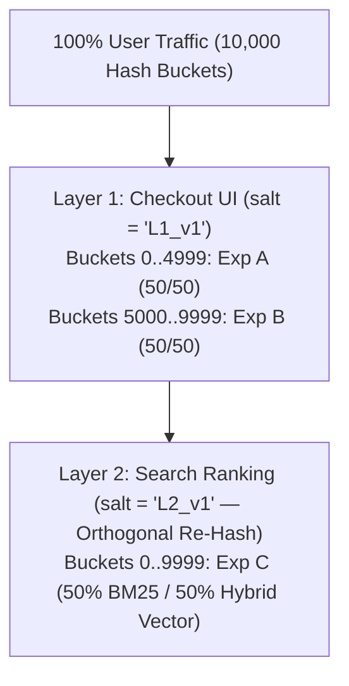

# Growth Engineering, Product-Led Growth (PLG) & Experimentation

## What Is It?

**Growth Engineering** is the discipline of building product mechanisms that turn users into the primary engine of acquisition, activation, retention, and monetization. In a **Product-Led Growth (PLG)** company (Notion, Figma, Canva, Dropbox, Slack, Linear), customers don't talk to a sales rep before trying the software — they sign up for free, experience immediate value (the **Aha Moment**), invite coworkers through natural collaboration loops, hit a usage or feature paywall, and self-serve upgrade with a credit card.

Beside viral and monetization loops, Growth teams build and operate the company's **Online Experimentation Platform (A/B Testing)** — using deterministic hashing, mutually exclusive experiment layers, statistical variance reduction (**CUPED**), and automated guardrail monitors to prove with mathematical rigor whether a product change actually increases revenue or silently hurts retention.

## Why Should You Care?

Growth features look deceptively simple on a whiteboard ("just give $10 credit for every referral" or "give new signups a 14-day Pro trial"), yet they are the #1 target for **automated financial abuse** and **statistical self-deception**:
- Launch a naive referral bonus on Friday, and by Monday morning bot scripts have farmed `$80,000` in free compute credits using disposable domains and virtual prepaid cards.
- Hard-lock a user's documents when their 14-day reverse trial expires, and your social media mentions explode with angry users accusing you of holding their data hostage.
- Log A/B test exposures at page boot instead of modal render, and you dilute your experiment sample by 20x — causing the team to ship broken features or throw away winning ones.

## How It Works (The Business Flow)

### The PLG Lifecycle: Acquisition -> Activation -> Viral Loop -> Monetization

1. **Frictionless Onboarding & Progressive Profiling**: Allow sign-up with one-click OAuth or magic link (`01-AUTHENTICATION.md`), deferring non-essential setup questions until after the user creates their first artifact.
2. **Activation Checklist ("Aha Moment" Tracking)**: Guide the user to the specific early behavioral milestone that correlates with long-term retention (e.g., Slack: *2,000 team messages sent*; Dropbox: *1 file placed in a synced folder*; Notion: *1 page created + 1 collaborator invited*).
3. **Reverse Trial (Full-Feature Onboarding)**: New signups start on the **Pro tier for 14 days with no credit card required** so they experience premium workflows immediately.
4. **Graceful Downgrade to Freemium (Soft-Lock)**: On Day 15, if they haven't upgraded, the workspace transitions to the Free tier without destroying any work they created during the trial.
5. **Contextual Paywalls & Self-Serve Upgrade**: When the user hits a usage ceiling (e.g., `3/3 projects used`, `100/100 AI credits consumed`) or clicks a Pro-only control (e.g., `"Export 4K without watermark"`), an inline upgrade modal unlocks the capability immediately upon payment.

```mermaid
stateDiagram-v2
    [*] --> ReverseTrial: New Signup (14-Day Pro, No Card Required)
    ReverseTrial --> Activated: Hits "Aha Moment" + Invites Teammates
    ReverseTrial --> SoftLockedFree: Day 15 Trial Expires (Created 8 Boards; Free Limit = 3)
    Activated --> PaidPro: Self-Serve Checkout Before Day 15
    SoftLockedFree --> PaidPro: Tries to Create 9th Board -> Hits Contextual Paywall
    SoftLockedFree --> Churned: Never Returns (Existing 8 Boards Remain Read/Export-Safe)
```

### The Experimentation Engine: Orthogonal Layers & Deterministic Bucketing

How does a company like Airbnb, Uber, or Booking.com run **1,000 concurrent A/B tests** on the same user base without the experiments contaminating each other?
- **Deterministic Hashing**: A user's variant is never chosen by `Math.random()` (which would flip between Control and Treatment on every page refresh) or stored in a giant database lookup table. Instead, it is computed statelessly via `murmurhash3(unit_id + ":" + experiment_salt) % 10000`.
- **Domains & Mutually Exclusive Layers**:
  - Experiments that touch **conflicting UI/logic** (e.g., two checkout button redesigns) are placed inside the **same Layer**, splitting the 10,000 hash buckets into disjoint ranges (`0–2499`: Exp A Control, `2500–4999`: Exp A Treatment, `5000–7499`: Exp B Control, `7500–9999`: Exp B Treatment) so no user is ever in both.
  - Experiments that are **independent** (e.g., Search Ranking vs. Checkout UI) live in **separate Layers** with distinct hash salts (`layer_salt_1`, `layer_salt_2`), re-shuffling the population orthogonally so every layer gets 100% of traffic!

## Key Terms You'll Hear

| Term | What It Means |
| --- | --- |
| **Product-Led Growth (PLG)** | Go-to-market motion where the product itself drives acquisition, conversion, and expansion without requiring sales reps |
| **Aha Moment / Activation Metric** | The specific early action where a user first realizes core product value and becomes dramatically more likely to retain |
| **Reverse Trial** | Giving every new user full Pro features for 7–14 days upfront (no credit card), then downgrading non-payers to the Free tier |
| **K-Factor (Viral Coefficient)** | $K = i \times c$, where $i$ is invites sent per user and $c$ is conversion rate per invite. $K > 1$ means exponential self-sustaining viral growth |
| **PQL (Product-Qualified Lead)** | A free or self-serve workspace whose product usage signals (seat velocity, SSO page visits, hitting enterprise limits) trigger sales outreach |
| **Sample Ratio Mismatch (SRM)** | When an A/B test configured for a 50/50 split observes a statistically skewed ratio (e.g., `50.6% / 49.4%`), proving assignment or telemetry bug |
| **CUPED** | *Controlled-experiment Using Pre-Experiment Data* — a statistical technique that subtracts pre-experiment baseline variance to cut required sample size by 30–50% |
| **Exposure Logging vs. Assignment** | Recording that a user *actually reached the code path where Control and Treatment differ*, not merely that their account was bucketed |
| **Guardrail Metrics** | Health metrics (crash rate, p95 latency, unsubscribe rate, refund rate) that automatically halt an experiment if degraded |
| **Novelty Effect vs. Primacy Effect** | Existing users clicking a new feature just because it's shiny (Novelty) or struggling because muscle memory changed (Primacy) |
| **Network Interference (SUTVA Violation)** | When Treatment users interact with Control users in the same marketplace/social graph, invalidating standard user-level A/B splits |

## Common Patterns

### Pattern 1: The "Soft-Lock" Over-Quota State on Trial Expiration

When a user's 14-day Reverse Trial ends and they have created 10 documents (while the Free tier allows 3):
- **Never delete or hide documents 4–10** (the "Data Hostage" anti-pattern).
- Keep all 10 documents readable, shareable, and exportable; block **creating new documents** (or editing beyond the 3 pinned documents) until they either upgrade to Pro or archive 7 documents.

### Pattern 2: Inherited Viral Loops (Artifact-Driven Acquisition)

The strongest viral loops aren't "Invite a friend for $5" banners — they are side effects of core usage:
- **Collaborative Invite Loop**: Sharing a Figma file, Notion page, or Loom video with a client or coworker.
- **Watermark / "Powered By" Loop**: Every free Calendly booking page, Typeform survey, or Superhuman email signature exposes 50 external recipients to the product brand.

### Pattern 3: Cluster / Switchback Experimentation for Two-Sided Marketplaces

In Uber, DoorDash, or Airbnb, you cannot randomize a pricing or dispatch algorithm 50/50 by user: if Treatment gives User A a `$5` discount to book the last rental car or courier in the neighborhood, Control User B sees `"No cars available"` — so Treatment steals supply from Control (**Cannibalization / SUTVA violation**), making the treatment effect look twice as big as it really is!
- **Solution**: Randomize by **Geo-Time Switchbacks** (e.g., flip an entire city H3 cluster between Control and Treatment in 2-hour blocks) or **Graph Cluster Randomization**.

## Industry War Stories & Non-Obvious Best Practices

### 1. Referral Loop Self-Dealing & Credit Farming Rings (Why Referrals Must Unlock on *Value*, Never on *Signup*)

A SaaS or AI startup launches a referral program: *"Invite a friend — you both get $20 in credits when they sign up!"*
- **What Happens Within 24 Hours**: A script kiddie writes a 40-line Puppeteer script using catch-all domains (`user1@mycustomdomain.xyz`, `user2@...`) or Gmail `+` aliases, refers their own main account 500 times, or spins up 500 throwaway accounts that burn `$10,000` of your OpenAI/AWS API bill overnight.
- **Battle-Tested Referral Defense Rules**:
  1. **Delayed Reward Unlock**: The referrer never receives credits on *signup*. Credits unlock only when the referred user completes a **high-friction qualifying event** (e.g., first paid invoice settled + 14-day chargeback hold passed, or verified payment method with unique `card_fingerprint` + phone verification).
  2. **Non-Transferable / Non-Cash Promotional Credits**: Referral credits apply only as a percentage discount (e.g., up to 50% off future subscription invoices) rather than raw API/compute cash equivalents.
  3. **Graph & Device Deduplication**: Block referral rewards whenever referrer and referee share a Stripe `card.fingerprint`, billing address hash, browser/device fingerprint, IP `/24` subnet, or corporate email domain.

### 2. Sample Ratio Mismatch (SRM): The Silent Killer of ~10% of Production A/B Tests

Suppose you launch a 50/50 A/B test across 200,000 users. After 3 days, your dashboard shows:
- **Control**: `100,950` users (`$4.10` revenue/user)
- **Treatment**: `99,050` users (`$4.35` revenue/user, **+6.1% lift!**)
- **Why Celebrating This Lift Is a Trap**: A chi-square goodness-of-fit test on `100,950 vs. 99,050` yields $p = 0.00002$ — a **Sample Ratio Mismatch (SRM)**. About `1,900` low-end users in Treatment are **missing**! Why? Because the new Treatment bundle added a 400KB JS dependency that crashed or timed out on slow Android devices *before* the analytics exposure event could fire — so Treatment silently dropped its lowest-converting, slowest-network users, artificially inflating the average revenue of the surviving 99,050 users!
- **Production Rule**: Run an automated chi-square SRM test on every experiment daily ($p < 0.001$ threshold). If SRM trips, **automatically quarantine all metric results and block experiment graduation** until the underlying instrumentation/crash bug is fixed.

### 3. Pre-Exposure Bias ("Assignment Dilution") vs. Triggered Exposure Logging

Where in your code do you log the `experiment_exposed` event?
- **The Common Mistake**: Evaluating all 50 active experiments when the user logs in or loads the homepage, and immediately logging `experiment_exposed` for all 50 experiments.
- **Why It Destroys Statistical Power**: If your experiment only changes the `"Annual Plan Discount Banner"` on the `/settings/billing` page — which only 4% of logged-in users ever visit — logging exposure at login mixes 96% unaffected noise (`0%` true effect) into your sample! To detect a 5% lift on the 4% who actually see the billing page, you now need **$25^2 = 625\times$ more total users** (`1 / 0.04^2`)!
- **Best Practice**: Separate `getVariant(user, exp)` (pure hash computation) from `logExposure(user, exp)` — fire the exposure event **strictly at the last possible moment right before rendering the divergent UI branch**, or use **Counterfactual Trigger Logging** in both Control and Treatment branches.

## Gotchas & Edge Cases

- **The Peeking Problem ($p$-Hacking by Refreshing the Dashboard Daily)**: If you check a standard $p < 0.05$ t-test every day for 14 days and stop the test the first day $p$ dips below `0.05`, your true false-positive rate balloons from **5% to ~26%**! Either enforce fixed-horizon sample sizes before looking, or use **Always-Valid Sequential Testing ($mSPRT$ / Confidence Sequences)**.
- **B2B User-Level vs. Workspace-Level Bucketing**: In a B2B tool, if Alice and Bob sit next to each other in the same company workspace (`acme_corp`), never bucket collaboration or workflow features by `user_id` — Alice will see a new workflow button that Bob doesn't have. Bucket B2B product experiments by `workspace_id` (and use cluster-robust standard errors).
- **Holdout Group Decay**: Long-term holdout groups (5% of users who receive *no* new growth features for a full quarter to measure cumulative team impact) get polluted if engineers forget to wrap a single hotfix or shared component in the universal holdout check.

## Quick Reference

| Scenario | Recommended Growth & Experimentation Pattern |
| --- | --- |
| Trial model for collaborative / creative SaaS | **14-day Reverse Trial** (no card upfront) -> **Soft-Lock Free tier** (read/export preserved, new creation gated) |
| Preventing referral credit bot farming | Unlock reward only after referee's **first paid invoice settles** + block matching `card.fingerprint` / device / IP |
| Running 100+ concurrent A/B tests | **Orthogonal Layer Architecture** with `murmurhash3(unit_id + layer_salt) % 10000` |
| Validating experiment health before reading lift | Automated **Chi-Square SRM check** ($p < 0.001$ halts analysis) + latency/crash Guardrail metrics |
| Logging experiment exposure on a deep funnel step | Log exposure **only at the exact code branch where Control & Treatment diverge** (never at app boot) |
| Cutting A/B test runtime in half | Apply **CUPED** using 14–28 days of pre-experiment user baseline metric as covariate |
| Testing pricing/dispatch in a 2-sided marketplace | Use **Geo-Time Switchback** or **Cluster Randomization** to prevent Control/Treatment supply cannibalization |
