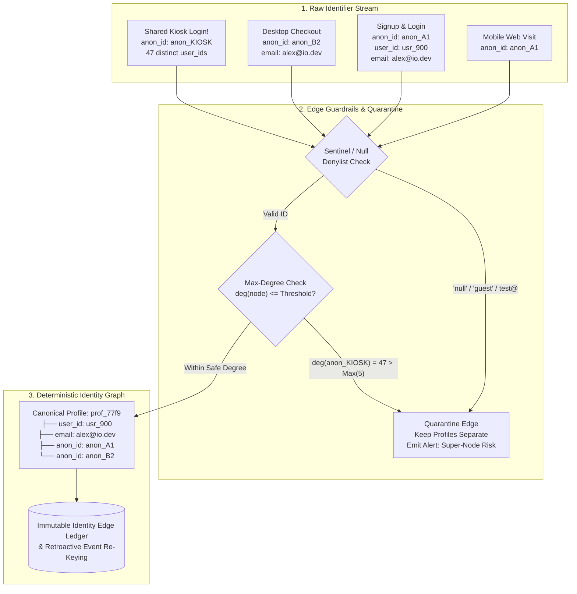
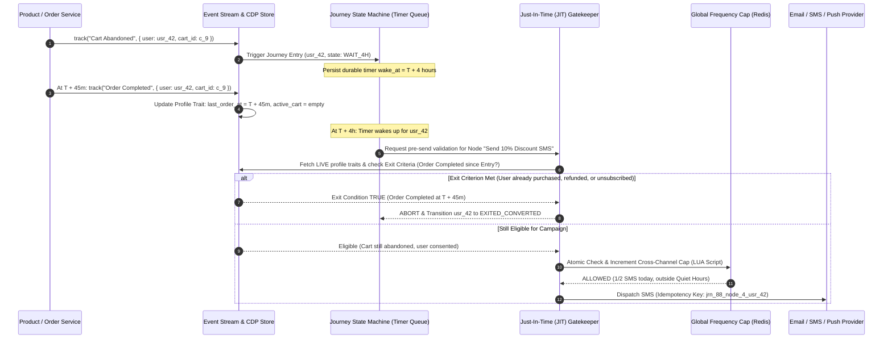

# Customer Data Platforms (CDP), Identity Graphs & Lifecycle Marketing

## What Is It?

A Customer Data Platform (CDP) and Lifecycle Marketing Engine is the central nervous system for user behavior, identity unification, audience segmentation, and automated multi-channel outreach (email, SMS, push notifications, in-app banners, and webhooks). Every time a user browses a pricing page anonymously on mobile web, signs up two days later on desktop, connects their workspace, or abandons a checkout cart, those signals are captured as structured events, stitched into a unified customer profile (the **Identity Graph**), enriched with data-warehouse metrics via **Reverse ETL**, and evaluated against stateful, multi-step **Lifecycle Journey Canvases**.

Unlike traditional web analytics tools (which aggregate anonymous funnels into charts) or traditional CRM systems (which store static contact lists entered by sales reps), a CDP operates on **real-time, individual-level event streams** combined with **historical warehouse state**, turning raw product telemetry into deterministic user actions within milliseconds to minutes.

## Why Should You Care?

Modern B2C and B2B SaaS stacks (Segment, RudderStack, Hightouch, Census, Braze, Iterable, Customer.io) drive activation, conversion, retention, and expansion. Yet this layer is notorious for catastrophic production bugs because it sits at the intersection of event streaming, graph theory, data warehousing, and external messaging gateways:

- **Identity Graph Poisoning**: A bug in how `anonymous_id` and `user_id` merge on shared devices (hospital nurse stations, retail kiosks, university labs) can merge 5,000 distinct humans into one "Super-Node" profile — emailing Patient A's appointment reminder to Patient B.
- **Stale Journey Embarrassment**: A user enters an "Abandoned Cart — Wait 24 Hours — Send 15% Discount" workflow, completes their full-price purchase 10 minutes later, and still receives the 15% discount email the next day because state was evaluated at entry time rather than Just-In-Time (JIT) before dispatch.
- **API Quota Starvation**: A nightly Reverse ETL sync pushes 800,000 updated LTV scores from Snowflake into Salesforce at 8:00 AM, burning 100% of the rolling 24-hour Salesforce API quota and breaking live enterprise checkout and support ticket creation for the rest of the day.
- **Notification Bombardment**: Three teams (Growth, Product Marketing, Billing) launch independent campaigns that simultaneously fire 4 emails, 2 SMS messages, and 3 push notifications to the same user within twenty minutes, triggering immediate unsubscribes and spam complaints.

---

## How It Works (The Business Flow)

### 1. Event Collection, Canonical Taxonomy & Schema Enforcement

A CDP ingests telemetry from mobile SDKs, browser snippets, backend services, and webhooks (Stripe, Shopify, Zendesk) using a strict canonical taxonomy:

| Call Type | Core Purpose | Key Payload Fields | Production Example |
| :--- | :--- | :--- | :--- |
| **`track`** | Records a discrete user action at a specific point in time | `event`, `properties`, `user_id`, `anonymous_id`, `timestamp`, `message_id` | `track("Order Completed", { order_id: "ord_91", revenue: 149.00, currency: "USD" })` |
| **`identify`** | Binds an anonymous session to a known user ID and updates traits | `user_id`, `anonymous_id`, `traits` (`email`, `plan`, `phone`) | `identify("usr_882", { email: "ada@acme.com", plan_tier: "pro" })` |
| **`group`** | Associates a user with an organization, workspace, or B2B account | `user_id`, `group_id`, `traits` (`company_name`, `seats`, `arr`) | `group("org_441", { name: "Acme Corp", arr_cents: 2400000 })` |
| **`page` / `screen`** | Logs navigation views across web URLs or mobile app screens | `name`, `properties` (`url`, `referrer`, `utm_campaign`) | `page("Pricing", { path: "/pricing", utm_source: "google_ads" })` |
| **`alias`** | Explicitly merges two distinct known identities (legacy migration) | `previous_id`, `user_id` | `alias("legacy_uid_104", "usr_882")` |

#### Tracking Plans & Edge Schema Gatekeeping

Without schema validation at the ingestion gateway, one frontend deploy that changes `properties.revenue` from numeric `149.00` to string `"$149.00"` breaks warehouse column types in Snowflake/BigQuery or silently causes every `"revenue > 100"` filter in Braze to evaluate to `false`. Production pipelines enforce a versioned **Tracking Plan** (JSON Schema registry) at the edge:

1. **Strict Type & Enum Validation**: Verify required fields, data types, and ISO currency/country codes before forwarding to Kafka/Kinesis.
2. **Dynamic Event Name Cardinality Guard**: Reject anti-patterns where developers embed IDs inside the event name (`track("Clicked_Product_98412")` instead of `track("Product Clicked", { product_id: "98412" })`), preventing millions of polluted warehouse tables.
3. **PII Scrubber & Violation Quarantine**: Scan payloads for unhashed credit cards, SSNs, or raw passwords. Events violating the Tracking Plan route to a **Schema Violation Quarantine Queue (Dead-Letter Topic)** that alerts the owning team and supports replay once patched.

---

### 2. Deterministic vs. Probabilistic Identity Resolution

Before logging in, a user interacts across multiple touchpoints (iPhone webview, work laptop, iOS app), each generating an ephemeral identifier (`anonymous_id`, cookie, IDFA, GAID). **Identity Resolution** stitches these identifiers into a single **Canonical Profile ID (`cdp_profile_id`)**:

- **Deterministic Identity Resolution (High Confidence — Product, CRM & Transactional Messaging)**: Links nodes only when hard authentication proof is observed — such as logging in (`anonymous_id` + authenticated `user_id`), clicking a signed email verification link, or completing checkout with a verified phone number.
- **Probabilistic Identity Resolution (Statistical Confidence — Ad-Tech Retargeting & Household Attribution)**: Infers links using co-location signals (residential IP + User-Agent + behavioral timing + screen entropy).

> **Critical Architectural Rule**: Never pollute your **Deterministic Graph** with probabilistic edges. If two roommates share a home Wi-Fi IP, probabilistic matching may group them into a household cluster for CTV ad targeting, but merging their deterministic CDP profiles leaks order receipts and account notifications between two separate people.



---

### 3. Warehouse-Native Reverse ETL & Diff Calculation

Modern stacks use a **Composable / Warehouse-Native CDP** pattern: raw events land in Snowflake, BigQuery, or Databricks, where data teams join product telemetry with Stripe billing ledgers, ERP inventory, and ML models (`churn_probability_score`, `ltv_12m`, `seat_utilization_pct`). **Reverse ETL** syncs those computed warehouse columns back into operational tools (Salesforce, HubSpot, Braze, Intercom).

1. **Snapshot Differencing (State Diffing)**: A warehouse query over 20 million users may run every 15 minutes, but only 4,200 users had their `churn_probability_score` change since the last sync. Reverse ETL maintains a `_sync_snapshot_previous` table in the warehouse, computes a row hash (`SHA256(col_1 || col_2 || ...)`), and emits only `INSERT`, `UPDATE`, and `DELETE` deltas via `EXCEPT` or hash comparison.
2. **Downstream Rate-Limit Pacing & Quota Partitioning**: Operational CRMs like Salesforce enforce strict 24-hour rolling API call limits. Production Reverse ETL routers switch to **Bulk API / Batch Upsert** endpoints (200–10,000 records per call) and enforce a **Quota Budget Reserve** (pausing background syncs if total org API usage exceeds 70% of the daily rolling limit).
3. **Ordering & Row-Level Quarantine**: Each mutation carries a monotonic `sync_version` so retries never overwrite newer values. If 3 rows in a 200-row batch fail validation, the engine commits the 197 successful rows in its snapshot and routes the 3 failures to a dead-letter table.

---

### 4. Stateful Lifecycle Journey Canvases & Just-In-Time (JIT) Re-Evaluation

A Lifecycle Journey Canvas is a long-running, stateful **Directed Acyclic Graph (DAG)** state machine instantiated per user across Delay/Wait nodes, Conditional Splits, A/B randomizers, and Action nodes.



---

## Key Terms You'll Hear

| Term | What It Means |
| :--- | :--- |
| **Tracking Plan** | A JSON Schema contract defining every valid event name, property key, data type, and PII classification allowed into the CDP |
| **Deterministic Stitching** | Merging two identity nodes only when backed by verified authentication proof (login binding `anonymous_id` to `user_id`) |
| **Probabilistic Stitching** | Inferring identity or household clusters using statistical signals (IP, User-Agent, device fingerprint) |
| **Super-Node / Hairball Cluster** | A corrupted identity graph component created when a shared device, kiosk, or sentinel value (`"null"`) merges hundreds of unrelated users |
| **Reverse ETL** | Extracting modeled tables from a Cloud Data Warehouse and syncing only changed deltas into operational SaaS tools (CRM, ESP, Ads) |
| **Snapshot Differencing** | Comparing current warehouse query results against the previous sync's snapshot table to emit minimal `INSERT` / `UPDATE` / `DELETE` deltas |
| **Computed Trait / SQL Trait** | A profile attribute calculated dynamically over historical events (`orders_last_30_days`, `is_power_user`) |
| **Journey Canvas (Lifecycle DAG)** | A stateful workflow engine moving individual users through time delays, conditional branches, and messaging actions |
| **Exit Criteria** | Global conditions (`Order Completed`, `Subscription Cancelled`, `Support Ticket Escalated`) that pull an in-flight user out of a Journey |
| **Just-In-Time (JIT) Evaluation** | Re-fetching live user traits, consent status, and exit conditions at the exact millisecond a message is about to send |
| **Global Frequency Capping** | A centralized rate limiter across all campaigns and channels ensuring a user receives at most $N$ non-transactional messages per window |
| **Quiet Hours / Send-Time Hold** | Suppressing promotional notifications during the recipient's local night hours (9 PM – 8 AM) and holding or dropping them by TTL |
| **Suppression List** | The authoritative denylist of hard bounces, spam complaints (`FBL`), unsubscribes, and GDPR erasure requests blocking outreach |

---

## Common Patterns

### Pattern 1: Immutable Identity Edge Ledger (Non-Destructive Graph Merging)

Never destructively overwrite `user_id` on historical raw event rows when two profiles merge. If you mutate 10 million historical rows in place to change `profile_id = P_2` into `profile_id = P_1`, and later discover the merge was caused by a shared conference-room iPad or an SDK bug, **you cannot unmerge them** because the original lineage was destroyed.
- Store all raw behavioral events append-only with their original observed `(source_id, anonymous_id, observed_user_id)`.
- Maintain an **Identity Edge Ledger** (`edge_id`, `node_a`, `node_b`, `link_reason`, `created_at`, `revoked_at`) and a materialized **Identity Mapping Table** (`identifier -> canonical_profile_id, graph_version`).
- To unmerge a poisoned cluster, mark the bad edge `revoked_at = NOW()` and recompute connected components for the affected subgraph.

### Pattern 2: Hybrid Real-Time Stream + Warehouse Batch Segmentation

- **Fast-Path Streaming Segments (<2s latency)**: Powered by Flink / Kafka Streams + Redis/RocksDB state stores for transactional triggers, onboarding nudges, and instant paywall conversion flows.
- **Deep-Path Warehouse Segments (15–60m cadence)**: Powered by Snowflake/BigQuery + Reverse ETL for multi-table cohorts joining product telemetry with Stripe invoices, Zendesk CSAT scores, and ML churn models.

### Pattern 3: Cascading Multi-Channel Fallback with Open Receipts

Instead of blasting Push, Email, and SMS simultaneously, orchestrate a **Cascading Channel Escalation**: send an In-App/Push notification first (zero marginal cost) -> wait 2 hours listening for `Push Opened` -> fall back to Email if unopened -> dispatch paid SMS ($0.01–$0.05/segment) after 24 hours only if `predicted_cart_value > $150`.

---

## Gotchas & Edge Cases

- **Passing `"null"`, `"undefined"`, `"guest"`, or `""` to `identify()`**: JavaScript SDK bugs often stringify `null` or `undefined` when an unauthenticated user visits a page, calling `identify("undefined")`. Without an edge denylist (`"null"`, `"undefined"`, `"none"`, `"anonymous"`, `"guest"`, `"0"`, `"false"`, `"test@test.com"`), every unauthenticated visitor merges into one massive `"undefined"` profile within minutes.
- **Bot & Link-Scanner Prefetch False Triggers**: Corporate email security gateways (Mimecast, Proofpoint) and Apple Mail Privacy Protection automatically fetch tracking pixels and click every URL milliseconds after delivery. Filter out scanner User-Agents and sub-second post-delivery clicks before branching Journeys on `Email Opened` or `Link Clicked`.
- **Journey Version Drift for In-Flight Users**: If 40,000 users sit inside a 7-day `Wait` node of Journey `v1`, and a marketer edits the canvas to delete that node in `v2`, mutating the DAG in place causes state pointer exceptions when timers wake up. Treat Journey versions as immutable: let in-flight users finish draining through `v1` while new entries enter `v2`.
- **Timezone & Flash-Sale Quiet-Hours Expiration**: If a "Midnight Flash Sale — Ends in 3 Hours!" message is queued at 10:30 PM into a Quiet Hours Hold Queue until 8:00 AM, the user receives an expired promo at breakfast. Every queued message must carry an explicit `expires_at` (TTL) timestamp; if `wake_time > expires_at`, drop the message.

---

## Industry War Stories & Non-Obvious Best Practices

### 1. The "Shared Kiosk / Nurse-Station Super-Node" Profile Merge Explosion

One of the most destructive CDP incidents occurs when an Identity Graph performs unconstrained transitive closure on `device_id` / `anonymous_id` ↔ `user_id` links:

1. A hospital floor uses a shared desktop browser at the nurse station, an airline uses a shared check-in kiosk, or an office QA team logs into 60 customer accounts from one browser without clearing storage.
2. All sessions share a single first-party cookie `anonymous_id = anon_shared_99`.
3. Nurse 1 (`u_101`) logs in → Graph links `anon_shared_99 ↔ u_101`. Nurse 1 logs out, **but the frontend fails to call `analytics.reset()` to rotate `anonymous_id`**.
4. Nurse 2 (`u_102`) logs in on the same browser → Graph links `anon_shared_99 ↔ u_102`.
5. By transitive closure (`u_101 ↔ anon_shared_99 ↔ u_102`), the CDP merges Nurse 1 and Nurse 2 into a single Canonical Profile. Within weeks, a snowballing **Hairball Super-Node** absorbs 4,000+ distinct accounts, timing out database queries and sending Nurse 1's personal account alerts to Nurse 400's email address.

| Defense Layer | Mechanism & Threshold | Behavior on Violation |
| :--- | :--- | :--- |
| **1. Client Logout Rotation** | Mandatory `analytics.reset()` hooked into auth logout / session switch | Generates a brand-new `anonymous_id` UUID and clears local trait cache on sign-out |
| **2. Sentinel Denylist** | Reject `user_id` / `email` matching `^(null\|undefined\|none\|guest\|admin\|test\|0\|-1)$` | Drops the identity link at ingestion while still recording the raw anonymous event |
| **3. Max-Degree Edge Cap** | Enforce `max_users_per_anon_id = 3`, `max_emails_per_profile = 3`, `max_nodes_per_cluster = 50` | Quarantines the over-connected `anon_id` as a **"Shared Device Node"** — stops transitive merges |
| **4. Primary Key Exclusivity** | Never merge two profiles that possess *different* immutable primary keys (`u_101` vs `u_102`) via a shared `anonymous_id` | Reassigns `anon_id` to the newly logged-in `u_102` for future events **without** merging `u_101` and `u_102` |

---

### 2. Wait-Step Stale State & Just-In-Time (JIT) Pre-Send Re-Verification

Pre-computing the target payload when a user enters a workflow and pushing `(send_at: T + 3 days, to: "user@acme.com", template: "winback_20pct")` into a delayed queue fails whenever the user renews at full price, opens an angry P1 support ticket, or requests GDPR erasure during those 72 hours.

1. **Store Only Pointer State in Timer Queues**: Delayed queues store only `(journey_instance_id, profile_id, current_node_id, wake_timestamp)` — never pre-rendered message bodies or cached email addresses.
2. **Pre-Send Live Gate Evaluation**: At the exact instant the worker dequeues a timer, it executes a synchronous **JIT Check Pipeline** against the live profile store: verify `marketing_opt_in == true` and `email NOT IN global_suppression_list`, re-evaluate Journey Exit Criteria (`has_completed_checkout == false AND open_p1_support_tickets == 0 AND item_in_stock == true`), and hydrate template variables from live state.

---

### 3. Atomic Global Cross-Channel Frequency Capping

An active user who triggers three product events in one afternoon can match four separate Journeys and two promotional blasts simultaneously. Every outbound dispatch must pass through a centralized **Outreach Policy Engine** backed by atomic Redis sliding-window counters (executed inside a single Redis Lua script):

```text
KEYS[1] = "fcap:global:24h:{profile_id}"       -- Max 2 marketing touches across ALL channels per 24h
KEYS[2] = "fcap:channel:email:7d:{profile_id}" -- Max 4 marketing emails per rolling 7 days
KEYS[3] = "fcap:channel:sms:7d:{profile_id}"   -- Max 1 marketing SMS per rolling 7 days
KEYS[4] = "fcap:dedup:msg:{idempotency_key}"   -- Exact dispatch deduplication lock
```

| Priority Tier | Message Examples | Frequency Cap Behavior | Quiet Hours Behavior |
| :--- | :--- | :--- | :--- |
| **P0: Critical Transactional & Security** | Password reset, 2FA OTP, payment receipt, fraud alert | **Bypasses all caps** (does not increment marketing counters) | **Sent immediately 24/7** |
| **P1: High-Intent User-Triggered Lifecycle** | Abandoned checkout reminder, trial-expiring warning | Checked against **Relaxed Cap** (reserves 1 dedicated slot above P2 broadcasts) | Held until 8:00 AM local time if `expires_at` permits |
| **P2: Scheduled Promotional Broadcast** | Weekly newsletter, feature announcement, seasonal sale blast | Strictly blocked if user hit `24h` or `7d` cap; **dropped or deferred** | Held until local morning window or dropped if TTL expires |

---

## Quick Reference

| Decision Area | Recommended Production Pattern |
| :--- | :--- |
| **Event Ingestion Contract** | Canonical `track` / `identify` / `group` API guarded by a JSON Schema Tracking Plan at the edge; route violations to a replayable quarantine topic |
| **Identity Graph Storage** | Append-only **Identity Edge Ledger** + materialized `identifier -> canonical_profile_id` lookup table; never overwrite `user_id` on historical raw events |
| **Super-Node Protection** | Denylist sentinel strings (`"null"`, `"undefined"`, `"guest"`), enforce max-degree caps (`<= 3` users per `anon_id`), and never merge two distinct `user_id`s via a shared cookie |
| **Reverse ETL Syncing** | Warehouse snapshot table differencing (`SHA256` row hash comparison) + CRM Bulk/Batch API + daily API quota circuit breaker (pause at 70% org quota) |
| **Journey Wait Nodes** | Persist only `(instance_id, profile_id, node_id, wake_at)` in timer store; run **JIT Re-Evaluation** of exit criteria, stock, and suppression list before send |
| **Cross-Channel Capping** | Redis Lua sliding-window counters per `profile_id` (Global 24h + Per-Channel 7d) with `P0 Transactional` bypass and `P1 Lifecycle > P2 Broadcast` prioritization |
