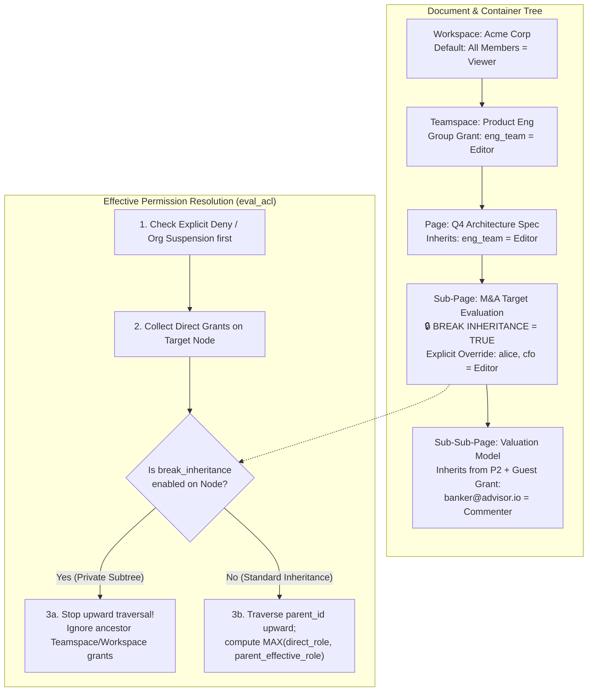
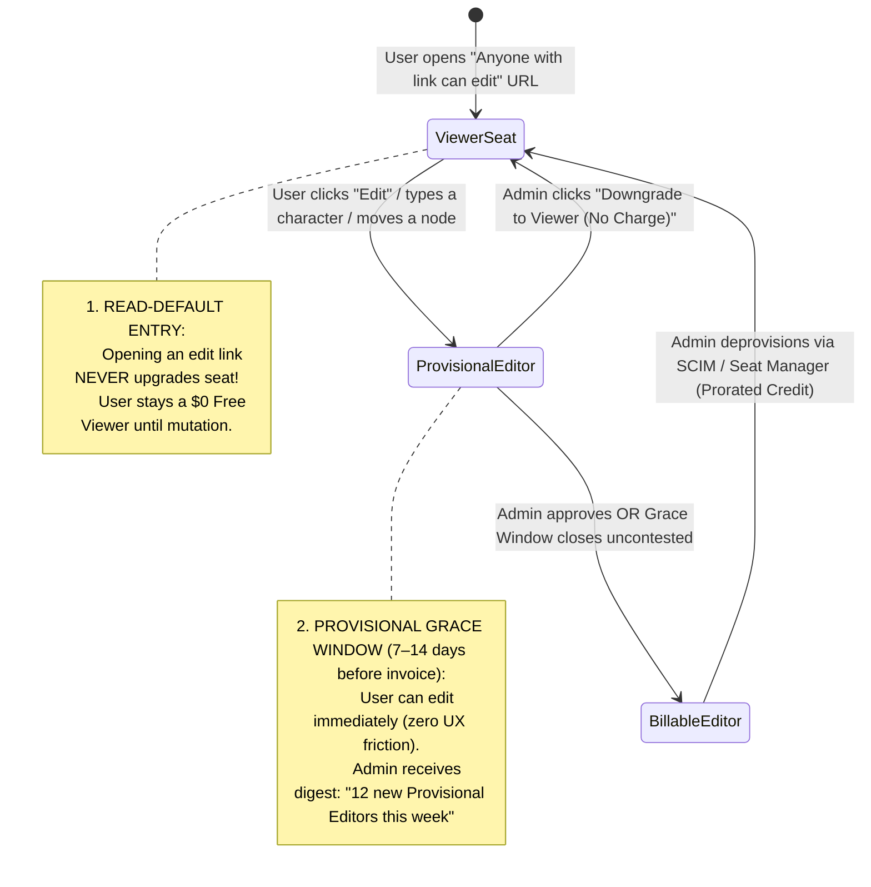

# Real-Time Collaborative Workspaces & Document SaaS

## What Is It?

Real-Time Collaborative Workspace and Document SaaS platforms (Notion, Figma, Linear, Coda, Google Workspace, Miro) replace static local files with multiplayer, cloud-native **Block Trees** and **Scene-Graph Node Canvases**. Instead of emailing file attachments back and forth, dozens of teammates simultaneously edit the same living document, rearrange nested blocks, leave inline comment threads anchored to moving text ranges, share capability links across organizational boundaries, and organize knowledge inside deeply nested hierarchies (`Organization -> Teamspace -> Folder -> Page -> Sub-Block`).

Under the hood, a collaborative workspace is far more than a rich-text editor attached to a WebSocket. It is a tightly coupled system combining **distributed state synchronization (CRDTs / Operational Transformation)**, **graph-based hierarchical access control (ReBAC)**, and **viral seat-based monetization (Editor vs. Viewer vs. External Guest billing state machines)**.

## Why Should You Care?

Collaborative workspace patterns have become the default architecture for modern B2B SaaS — whether you are building a document wiki, a design tool, an AI-assisted canvas, a spreadsheet database, or a collaborative workflow builder. Engineers who treat these systems like standard CRUD apps quickly run into famous production failures:

- **The "Accidental Editor" Viral Bill-Shock Disaster**: A product manager shares a roadmap link set to *"Anyone in `@acme.com` with the link can edit"* in a company-wide `#general` Slack channel. 200 engineers click the link just to read it. If your billing system immediately converts every viewer who opens an edit-capable link into a $16/month Billable Editor seat, Acme Corp gets hit with a surprise $38,400 annual invoice and churns in fury.
- **Inline Comment Character-Offset Drift**: User A highlights characters `[40..55]` (`"$120,000 budget"`) and attaches a comment: *"Approve this number."* Five seconds later, User B types a 30-character sentence at the top of the paragraph (`offset 0`). If comments are anchored to static integer character offsets instead of **CRDT Relative Positions**, the yellow highlight shifts 30 characters left onto unrelated words.
- **CRDT Tombstone Memory Bloat**: Because Conflict-Free Replicated Data Types (Yjs, Automerge) never truly delete characters (marking deleted items as invisible **tombstones** so offline peers can merge edits deterministically), a heavily edited team roadmap accumulates millions of tombstones over a year, bloating to 60 MB in RAM and crashing browser tabs on load.
- **Filtered Database View Data Leaks**: A manager creates a Master Compensation Table in Notion/Airtable, embeds a "Filtered View (Department = Marketing)" on a separate page, and shares that page with Marketing. Because client-side rendering fetches the underlying row schema, any marketing user who opens DevTools can read the CEO's salary unless row-level permission boundaries are enforced server-side.

---

## How It Works (The Business Flow)

### 1. Everything-Is-a-Block / Scene-Graph Node Tree & Fractional Indexing

Modern workspaces do not store a document as a monolithic HTML string or Markdown blob. Instead, every paragraph, heading, checklist item, database row, embed, or Figma vector frame is an addressable **Block / Node record** in a tree:

```json
{
  "id": "blk_01HXYZ98",
  "workspace_id": "ws_acme",
  "type": "todo_item",
  "parent_id": "page_roadmap_q4",
  "sort_key": "a0V",
  "properties": {
    "title": [["Launch Enterprise SSO", [["b"]]], [" by Friday"]],
    "checked": false
  },
  "alive": true,
  "version": 42
}
```

#### Why Integer Array Positions Break & How Fractional Indexing Works

If a page contains 500 blocks and you store their order using an integer column (`position = 1, 2, 3...`), dragging Block 500 to Position 2 requires executing `UPDATE blocks SET position = position + 1 WHERE position >= 2` across 498 database rows — causing lock contention and merge conflicts when two users drag blocks simultaneously.

Instead, production engines (Figma, Linear, Notion-style sync engines) use **Lexicographical Fractional Indexing**:
- Each block stores a base-62 string `sort_key` (`"a0"`, `"a1"`, `"a2"`).
- To insert a block between `"a0"` and `"a1"`, the client computes the lexicographical midpoint `"a0V"` and writes **only a single block mutation** ($O(1)$ database writes).
- **Concurrent Midpoint Collision Guard**: If User A and User B offline both insert a block between `"a0"` and `"a1"` simultaneously, both would compute `"a0V"`. Production fractional indexers append a 2-to-4 character deterministic **client jitter suffix** (`"a0V_c1"` vs. `"a0V_c2"`) or replica ID so sort order remains strictly total across all peers.
- **Tree Reparenting Cycle Guard**: When moving `Folder A` inside `Folder B`, concurrent moves (`User 1 moves A into B` while `User 2 moves B into A`) can create a detached cyclic ring (`A <-> B`) that disappears from the root sidebar. Server-side tree transactions must acquire an ancestor-path lock or run cycle-detection before committing `parent_id` mutations (or use Kleppmann's **Tree CRDT** move-operation log).

---

### 2. Multiplayer Presence & Ephemeral Cursor Channels

A collaborative workspace maintains two strictly separated real-time data planes over WebSockets:

| Data Plane | Payload Examples | Persistence & Reliability | Update Cadence & Fan-Out Strategy |
| :--- | :--- | :--- | :--- |
| **1. Durable Document State Channel (CRDT / OT)** | Text insertions/deletions, block property changes, node moves, comment anchors | **100% Durable**: Appended to WAL / object storage, guaranteed causal delivery, offline queue replay | Event-driven on mutation; merged via Yjs / Automerge / central OT sequencer |
| **2. Ephemeral Awareness Channel (Presence)** | Live mouse `(x, y)` coordinates, text selection range, active block focus ring, "Typing..." indicator | **Zero Database Persistence**: Stored only in-memory on the room gateway; dropped if network lags | Client throttles outbound emits to `15–20 Hz` (every 50–66ms); receivers apply **cubic spline / spring interpolation** to render `60–120 fps` cursor motion |

#### The "All-Hands 500-Viewer Room Storm" & Spectator Overflow Mode

If 500 employees open the company All-Hands document simultaneously and every client broadcasts cursor movements at 20 Hz to all 499 peers, the room server must fan out $500 \times 499 \times 20 \approx 5,000,000$ messages per second — melting both the WebSocket gateway and every user's browser main thread.

1. Limit full bidirectional cursor/presence broadcasting to the **first $K$ active editors** (e.g., $K = 50$ users who have typed or moved their cursor in the last 60 seconds).
2. Place viewers beyond $K$ into **Spectator Mode**: they receive durable document mutations in real time (batched every 250ms), while their individual cursor movements are suppressed and aggregated into a single header counter (`"+450 others viewing"`).

---

### 3. Hierarchical ACL Permission Inheritance & Breaking Inheritance

Workspaces organize content into deep directed graphs: `Organization -> Teamspace -> Folder -> Page -> Sub-Page -> Block`. Determining whether `user_88` can `read`, `comment`, `edit`, or `manage_permissions` on `Block_99` requires walking the authorization graph (modeled after Google Zanzibar / **ReBAC**).



#### Subtle Permission Edge Cases You Must Handle

1. **The "Shared Child Under Private Parent" Breadcrumb Leak**: Suppose `Page_Parent` is private to the Executive Team (`break_inheritance = true`), has the title `"Project Layoff Plan"`, and contains a child page `Page_Child` titled `"Severance FAQ"` shared directly with an HR contractor. If the top navigation breadcrumb renders `Executive Space / Project Layoff Plan / Severance FAQ`, the parent title leaks confidential M&A or layoff plans!
   - **Rule**: If a user has permission on `Node C` but `NONE` on `Parent P`, the API must **redact the parent's title, icon, and metadata** in the breadcrumb payload (`Private Page / Severance FAQ`) and mount `Node C` under the user's `"Shared with Me"` sidebar root.
2. **Moving a Page Across Permission Boundaries**: When a user drags `Page X` from a private folder into a public Teamspace folder, `Page X`'s effective audience expands instantly. Detect whenever `effective_principals(new_parent) != effective_principals(old_parent)` and prompt a confirmation modal (*"Moving this page grants Edit access to 140 members of Product Eng"*).
3. **Filtered Linked Database Views Are Not Security Boundaries**: In Notion/Coda-style block databases, embedding a "Linked View of Database X where `Assignee = current_user()`" inside a shared page only filters the UI query. To secure underlying rows, either require read permission on the entire source database (with an explicit warning to the sharer) or enforce **Row-Level ACLs / View-Scoped Server Queries** so clients cannot fetch unfiltered rows.

---

### 4. Inline Comments Anchored to CRDT Relative Positions

When a user highlights a phrase inside a collaborative paragraph and clicks **"Add Comment"**, how do you store where that highlight lives?

- **The Naive Mistake (Absolute Integer Offsets)**: Storing `{ block_id: "b1", start_index: 24, end_index: 39 }` breaks immediately in a multiplayer document. If another user inserts 12 characters at `index 0`, characters `24..39` are no longer the words the commenter highlighted.
- **The Production Solution (CRDT Relative Positions / Logical Item Anchors)**: In a sequence CRDT (Yjs YATA or Automerge RGA), every character ever inserted has a globally unique, immutable **Item Identifier `(client_id, lamport_clock)`**.
  - Instead of array indices `24..39`, the comment anchor stores `{ start_item_id: (client_7, clock_104), end_item_id: (client_7, clock_119), assoc: 0 }`.
  - No matter how many paragraphs are inserted or deleted above or below the phrase by concurrent peers, the client resolves `(client_7, clock_104)..(client_7, clock_119)` back to the exact surviving characters in $O(\log N)$ time.
  - **Deletion of the Anchored Text**: If a collaborator deletes the entire sentence containing `(client_7, clock_104)..(client_7, clock_119)`, the CRDT items become tombstones (`deleted = true`). The UI detects that the resolved range length is now `0`, displays the **cached snapshot quote string** stored on the comment record at creation time (`quoted_text_snapshot: "Q4 revenue target"`), and moves the thread into a **"Resolved / Context Deleted"** drawer so discussion history is preserved.

---

## Key Terms You'll Hear

| Term | What It Means |
| :--- | :--- |
| **Block Tree / Scene Graph** | Representing a document or canvas as a hierarchical tree of typed nodes (`paragraph`, `table_row`, `frame`) rather than a single blob |
| **Fractional Indexing** | Ordering sibling blocks using lexicographical strings (`"a0"`, `"a0V"`, `"a1"`) so inserting or reordering a block updates only 1 row |
| **CRDT (Conflict-Free Replicated Data Type)** | A data structure (Yjs, Automerge, Loro) where concurrent edits across offline/online peers merge deterministically without a central lock |
| **Operational Transformation (OT)** | An alternative sync model (Google Docs) where a central server serializes operations and transforms positional indices against prior ops |
| **Tombstone** | A metadata marker kept inside a CRDT when text or nodes are deleted so out-of-order/offline edits near that position still merge cleanly |
| **Relative Position Anchor** | Binding an inline comment or cursor selection to immutable CRDT character IDs `(client_id, clock)` instead of shifting integer array offsets |
| **Awareness / Ephemeral Channel** | A non-persisted, lossy pub/sub stream used for high-frequency cursor positions, viewport bounds, and active user avatars |
| **ReBAC (Relationship-Based Access Control)** | Resolving permissions by traversing graph relationships (`user -> member_of -> teamspace -> parent_of -> folder -> parent_of -> page`) |
| **Breaking Inheritance** | Toggling a child folder or page to ignore broader ancestor permissions (`Workspace`/`Teamspace`) and allow only explicitly listed principals |
| **Capability Link** | A cryptographic share URL granting anyone (or any domain member) holding the token a specific role (`view`, `comment`, `edit`) |
| **Provisional Editor / True-Up Grace Window** | Allowing a user to edit immediately for zero friction while giving the Workspace Admin a 7-to-14-day window before billing to approve or downgrade |
| **External Guest vs. Workspace Member** | Distinguishing outside contractors invited to specific pages (often free up to a ratio cap) from internal employees holding full workspace access |

---

## Common Patterns

### Pattern 1: Dual-Layer Storage — Hot Operation Log + Compacted Snapshot Blob

Loading a document by replaying 250,000 individual keystroke operations takes seconds of CPU parsing, whereas rewriting a 5 MB document snapshot to PostgreSQL/S3 on every keystroke destroys write throughput.
1. **Hot Incremental Op-Log (WAL)**: While users actively edit a room, the WebSocket server appends small binary CRDT update deltas (`100–500 bytes`) to a fast append-only store (Redis Streams / DynamoDB / Postgres WAL) every few hundred milliseconds.
2. **Compacted Base Snapshot**: When a room goes idle (all WebSockets disconnect for 60s) or incremental deltas exceed `500 ops`, a worker merges the deltas into the base CRDT state, writes `snapshot_vN.bin` to Object Storage (S3/R2), and truncates consumed WAL entries.
3. **Fast Cold Start**: On page open, the client fetches `snapshot_vN.bin` from CDN plus only the few uncompacted WAL rows where `seq > N`.

### Pattern 2: Intelligent Version History Coalescing ("Session Checkpoints")

Showing 40,000 individual character-level CRDT updates in a "Version History" sidebar is useless to humans. Group continuous edits into **Coalesced Editing Sessions** within a **10-minute sliding inactivity window** (up to a 30-minute hard boundary), and force an explicit checkpoint on high-signal events: **Named Version Save**, **permission change**, **bulk deletion (>20% of blocks removed)**, or **external guest join**.

---

## Gotchas & Edge Cases

- **Copy-Paste Block ID Collisions**: When a user copies 10 blocks and pastes them into the same page, the client must recursively regenerate fresh UUIDs for every pasted block and rewrite internal cross-block references before emitting the CRDT transaction.
- **Undo/Redo Stack Scope in Multiplayer (`Ctrl+Z` Trap)**: If Alice types a sentence, Bob types a heading at the top of the page, and Alice presses `Ctrl+Z`, a naive global undo stack undoes **Bob's** heading! Always use a **Local-Origin Undo Manager** (`Y.UndoManager` scoped strictly to `origin == local_user`), which inverts only Alice's operations while preserving Bob's concurrent changes.
- **Offline Permission Revocation Race**: Eve opens a sensitive M&A document, puts her laptop in Airplane Mode, and edits locally for 3 hours while the Admin revokes her access at hour 1. When Eve reconnects, the sync gateway must re-verify ACL permissions on **every incoming sync frame**, reject her queued deltas, and wipe her local IndexedDB cache with `403 Access Revoked`.
- **The Personal-Email Guest Billing Loophole**: To avoid paying $20/seat/month for 50 employees, a startup buys 1 Admin seat (`founder@startup.io`) and invites all 49 employees as "Free External Guests" via personal `@gmail.com` addresses onto the root folder. Combat this by capping Free Guests per Paid Seat (`5 guests per 1 paid seat`), blocking Guests from Teamspace roots, and flagging accounts where $>10$ "guests" log in from the same office IP/device cluster.

---

## Industry War Stories & Non-Obvious Best Practices

### 1. Link-Sharing Capabilities vs. The "Accidental Editor" Viral Bill-Shock Problem

In product-led growth (PLG) collaboration tools (Figma, Notion, Miro), a user clicks **"Share"**, sets the link capability to **"Anyone at `@acme.com` with the link can edit"**, and pastes the URL into Slack.

1. 120 coworkers click the Slack link solely to **read** the spec.
2. Because the URL token carries `capability = edit`, a naive backend inserts `{ user_id, role: "editor", billable: true }` upon page load and increments Stripe seat quantity by `+120`.
3. At month-end, Acme Corp receives a surprise $23,000 invoice for 120 "Editors" who never typed a character, causing immediate chargebacks and enterprise churn.

**Production Best Practice — View-First Entry + Provisional Seat True-Up State Machine:**



1. **View-First Lazy Upgrade**: Opening a document via an edit-capable link **never** mutates the user's billing role. Only when the user performs an actual write mutation (or clicks `"Edit Document"`) does a seat transition trigger.
2. **Provisional Grace Window & Seat Governance**: Users who edit upgrade to a **Provisional Editor** state. Admins receive a weekly digest and a 7-day pre-invoice review window to downgrade accidental editors back to `$0 Viewer` with zero charge, or enforce **Hard Seat Caps / Admin Approval Required** before any paid seat is added.

---

### 2. CRDT Tombstone Compaction & Safe Epoch Watermarking

Consider a 2-page weekly engineering status doc (`4 KB` of visible text). Every Monday for two years, 15 engineers delete last week's bullets and type this week's updates. In a sequence CRDT, deleting a character only flips `deleted = true` (creating a **tombstone**) so offline peers can still resolve relative insertion origins. After 100 weeks, that `4 KB` doc contains **1.8 million tombstones**, weighing `35 MB` and freezing the browser tab for `4.2 seconds` on load.

**How to Compact Tombstones Without Corrupting Offline Peers:**
1. **Track a Document Compaction Epoch**: Every compacted base snapshot increments a monotonic `compaction_epoch` (`epoch = 12 -> 13`).
2. **Garbage-Collect Cold Tombstones During Idle Windows**: When a document has zero active connections for $>24$ hours and its tombstone-to-live ratio exceeds `10:1`, strip tombstones older than a **Safe Retention Window** (`14 days`) into fresh `epoch = 13` while archiving `epoch = 12` to cold storage for Version History playback.
3. **Fork Stale-Epoch Offline Clients Safely**: If a laptop offline for 21 days reconnects with unmerged edits against `epoch = 12` (`client.epoch < doc.min_supported_epoch`), reject the binary CRDT merge (which would corrupt the compacted tree), save the offline delta as a **Forked Recovery Sub-Page** (`"Recovered Offline Edits — Oct 12"`), and reload the live `epoch = 13` document cleanly.

---

## Quick Reference

| Architectural Challenge | Production Solution |
| :--- | :--- |
| **Ordering sibling blocks/nodes** | **Lexicographical Fractional Indexing** (`"a0"`, `"a0V"`, `"a1"`) with deterministic client jitter suffixes; $O(1)$ single-row updates |
| **Multiplayer cursors & presence** | Separate **Ephemeral Awareness Channel** (15–20 Hz throttled emit + client-side 60fps cubic interpolation); cap at 50 active broadcasters, put 51+ into **Spectator Mode** |
| **Undo / Redo in multiplayer** | **Local-Origin Undo Manager** (`origin == local_client_id`) so `Ctrl+Z` never undoes a teammate's concurrent edits |
| **Inline comment anchoring** | Anchor start/end pointers to immutable **CRDT Item IDs `(client_id, clock)`** (Relative Positions), plus store a `quoted_text_snapshot` fallback for deleted text |
| **Hierarchical permissions** | Zanzibar-style **ReBAC** traversal with explicit `break_inheritance` flag; redact unauthorized parent titles in breadcrumbs (`Private Page / Child`) |
| **Preventing viral "Accidental Editor" bill shock** | **View-First Entry** on edit links + **Provisional Editor Grace Window** (7–14 days for Admin to downgrade before invoice charges) + Hard Seat Caps |
| **CRDT tombstone bloat** | Dual-layer WAL + S3 Snapshot storage; run **Epoch-Watermarked Tombstone Compaction** during idle windows and fork stale offline clients into a recovery sub-page |
