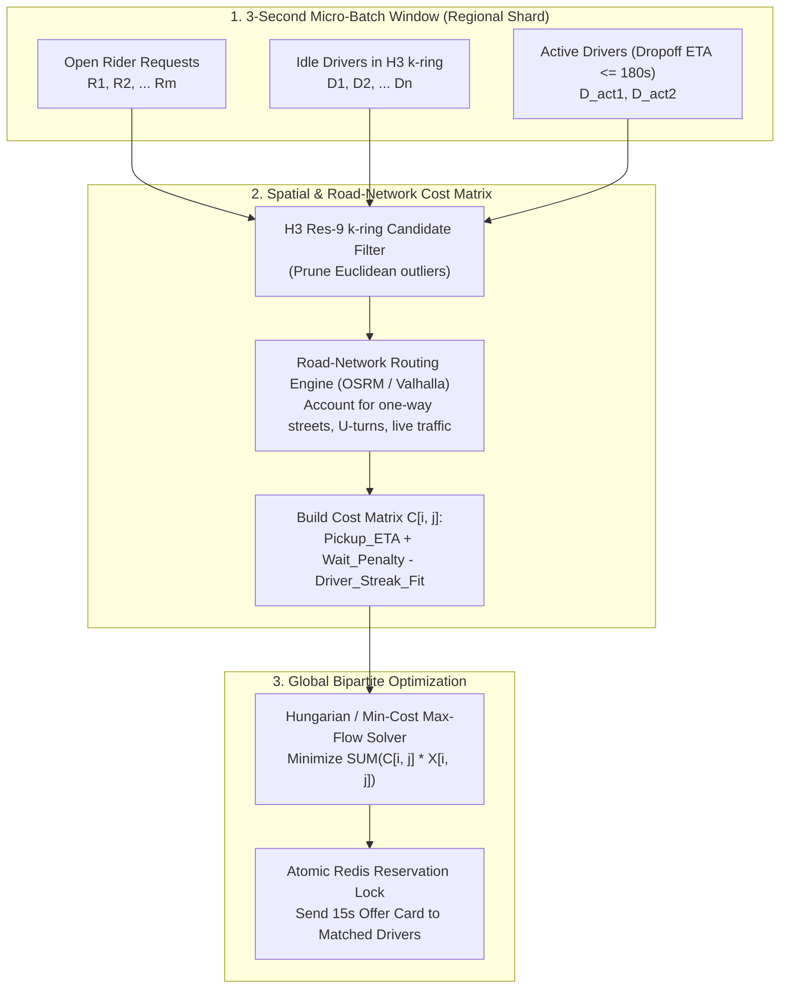
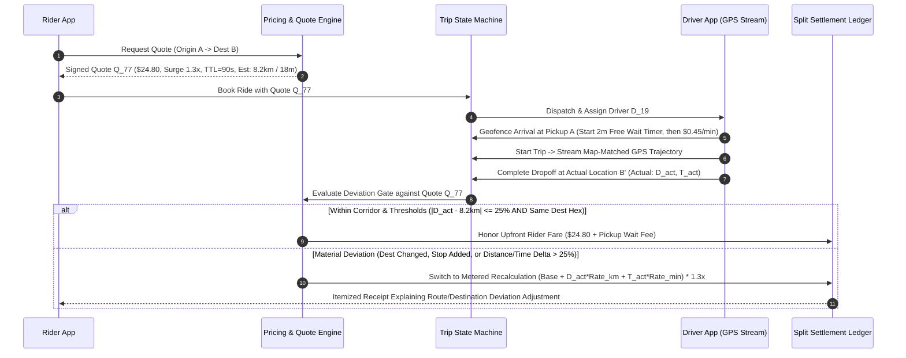

# Ride-Hailing, Mobility Dispatch & Local O2O Platforms

## What Is It?

Ride-hailing, mobility dispatch, and local Online-to-Offline (O2O) platforms (Uber, Lyft, DiDi, Grab, Gojek, DoorDash, Meituan) orchestrate real-time physical transactions in the real world. Unlike traditional e-commerce where inventory sits in a deterministic warehouse rack, mobility supply consists of thousands of independent human drivers moving continuously through congested road networks, with perishable capacity that vanishes every second a car sits idle.

At its core, a mobility platform runs a continuous, city-scale control loop: ingesting millions of noisy GPS telemetry pings per second, indexing supply and demand onto **hierarchical hexagonal spatial grids (H3)**, computing **upfront guaranteed fares** with dynamic spatiotemporal surge multipliers, solving **micro-batch bipartite matching problems** every few seconds, arbitrating two-sided cancellations and GPS fraud, and ranking local O2O merchants using statistically sound confidence intervals.

## Why Should You Care?

Mobility and local O2O systems represent the gold standard for geospatial engineering, real-time marketplace economics, and adversarial anti-fraud design. Naive implementations fail immediately when exposed to real-world physics and human incentives:

- **The Greedy Nearest-Driver Trap**: Assigning the closest available driver immediately to each incoming ride request (First-Come, First-Served Greedy) frequently steals the *only* nearby driver from a second rider who requests a trip 2 seconds later — increasing total fleet deadhead (empty pickup) miles by 15–25%.
- **"Hexagon Hopping" at Surge Boundaries**: If Hex Cell A has a `2.5x` surge multiplier and adjacent Hex Cell B across the street has `1.0x`, price-sensitive riders walk 20 meters across the street to book at `1.0x`, while drivers parked in Cell B decline all `1.0x` pings waiting for Cell A traffic.
- **Upfront Fare vs. Traffic Gridlock Bankruptcy**: You quote a rider an upfront locked fare of `$22.00` for an airport run estimated at 20 minutes. A multi-car highway closure turns the trip into 75 minutes. If you pay the driver only `$22.00`, drivers revolt; if you always absorb the difference or unexpectedly bill the rider `$68.00` for minor traffic, trust collapses.
- **Accept-and-Drive-Away Cancellation Gaming**: To preserve a `90%+` Acceptance Rate required for a weekend `$150 Quest Bonus`, a driver accepts an undesirable trip and intentionally drives in the opposite direction until the frustrated rider cancels — collecting a `$5` cancellation fee on top of protecting their streak unless your arbitration engine verifies net ETA progress.

---

## How It Works (The Business Flow)

### 1. H3 Hexagonal Spatial Indexing

Why did Uber invent **H3 (Hierarchical Hexagonal Spatial Index)** instead of using standard latitude/longitude bounding boxes, PostGIS `ST_DWithin` queries, or rectangular Geohashes?

1. **Uniform Adjacency Distance**: A square grid cell has two types of neighbors — 4 edge-sharing neighbors (distance $1.0d$) and 4 corner-sharing diagonal neighbors (distance $\sqrt{2}d \approx 1.414d$). A **hexagon** has **6 neighbors**, and the center-to-center distance to every single neighbor is strictly identical. Moving or smoothing surge pricing radially across `k-rings` around a point has zero directional distortion.
2. **$O(1)$ Integer Bitwise Indexing**: Every H3 cell on Earth at a given resolution (Res `0` through `15`) is encoded as a single **64-bit integer** (`uint64`, e.g., `0x8828308281fffff`). Converting a driver's `(lat, lng)` ping into an H3 cell or traversing from child cell (Res 9, ~105m edge) to parent cell (Res 7, ~1.22km edge) is a pure CPU bitwise operation requiring zero database I/O.

| H3 Resolution | Average Edge Length | Average Hexagon Area | Primary Mobility & O2O Use Case |
| :--- | :--- | :--- | :--- |
| **Res 7** | `~1.22 km` | `~5.16 km²` | Macro-zone supply/demand forecasting, driver repositioning heatmaps |
| **Res 8** | `~461 m` | `~0.74 km²` | **Surge pricing calculation cell** & `k-ring = 1..2` Gaussian spatial smoothing |
| **Res 9** | `~174 m` | `~0.105 km²` | **Real-time driver candidate lookup** (`k-ring = 2..4` around rider pickup pin) |
| **Res 11** | `~25 m` | `~0.002 km²` | Curbside pickup pin snapping (airport terminals, mall entrances, geofence arrival) |

---

### 2. Why Greedy Nearest-Driver Loses to Micro-Batch Bipartite Matching

Suppose **Rider A** requests a ride at $T = 0\text{s}$ and **Rider B** requests a ride at $T = 2\text{s}$:
- **Driver 1** is `2 mins` from Rider A and `3 mins` from Rider B.
- **Driver 2** is `4 mins` from Rider A and `12 mins` from Rider B.

If your dispatch engine runs **Greedy First-Come, First-Served** at $T = 0\text{s}$:
- Rider A immediately grabs the closest car (**Driver 1**, `2 mins`), leaving Rider B stuck with **Driver 2** (`12 mins`). **Total Pickup Wait = $2 + 12 = 14\text{ mins}$**.
- If instead the engine buffers requests in a **3-second Micro-Batch Window** and solves the global assignment across `{Rider A, Rider B} × {Driver 1, Driver 2}`, it assigns **Driver 2 -> Rider A (`4 mins`)** and **Driver 1 -> Rider B (`3 mins`)**. **Total Pickup Wait drops from `14 mins` to `7 mins`** (a 50% fleet efficiency gain!).

#### Matching "Ending-Soon" Active Trips (On-Trip Dispatch)

The closest driver to Rider A is often **not** an idle driver parked three blocks away — it is an active driver currently `90 seconds` away from dropping off their current passenger directly in front of Rider A's building! Including **On-Trip Drivers with $\text{Remaining Dropoff ETA} \le 3\text{ mins}$** in the candidate pool dramatically increases effective supply density during rush hour:

$$\text{Effective Pickup ETA}(d_{\text{active}}, r) = \text{Remaining Dropoff Time}(d_{\text{active}}) + \text{Dropoff Buffer}(30\text{s}) + \text{Road Drive Time}(\text{Dropoff}_{d}, \text{Pickup}_{r})$$

> **Why Haversine (Straight-Line) Distance Fails in Dispatch**: A driver on the northbound side of a divided highway or across a river may be `80 meters` away in Euclidean distance (`0.1 mins` Haversine), but `4.5 km` (`9 mins`) away in actual driving time because they must drive to the next exit and make a U-turn. Always use H3 `k-ring` only as a coarse Stage-1 filter (top 30 candidates), then compute Stage-2 bipartite edge weights using a road-graph routing engine (OSRM/Valhalla with turn penalties and live segment speeds).

---

### 3. Upfront Fare Guarantee vs. Route-Deviation Re-Metering

Early ride-hailing apps showed a rough range (`"$18–$26"`) and billed purely by a running taximeter at dropoff. Customers hated the uncertainty. Modern platforms use **Upfront Pricing**:

1. **Quote Lock with Signed Token TTL**: When the rider enters `Origin -> Destination`, the pricing engine computes predicted route distance $\hat{D}$, predicted duration $\hat{T}$, base fare, per-km/per-min rates, tolls, and the local H3 surge multiplier $S$, returning a cryptographically signed `quote_id` (`$24.80`, valid for `90 seconds`).
2. **Decoupled Rider Price vs. Driver Payout Ledger**: The platform acts as a market maker. The rider pays the locked upfront quote (`$24.80`), while the driver's earnings are computed from actual or upfront-transparent trip effort plus surge/boost incentives.
3. **When Does the Upfront Guarantee Break? (Corridor & Threshold Re-Metering)**: If a rider locks a `$15.00` quote for a 4 km trip, gets in the car, and tells the driver *"Actually, drop me off at my friend's house 18 km away"* (or makes the driver wait 25 minutes at a drive-thru), honoring the `$15.00` upfront quote would bankrupt the platform.

---

### 4. Spatiotemporal Surge Pricing & Hex-Boundary Gaussian Smoothing

When thunderstorm rain hits downtown at 5:30 PM, rider demand spikes 400% while driver supply drops. **Dynamic Surge Pricing** restores marketplace liquidity (completion rate) through two simultaneous mechanisms: *(a)* rationing demand among price-insensitive riders, and *(b)* pulling drivers from surrounding quiet neighborhoods into the high-demand zone.

#### The "Hexagon Hopping" Cliff Problem & Spatial Kernel Smoothing

If you compute a raw surge multiplier $S_{\text{raw}}(h) = f(\text{Demand}_h / \text{Supply}_h)$ independently inside each H3 Res-8 cell:
- Hex cell `h_center` (outside a concert stadium) has 120 requests and 4 drivers → $S_{\text{raw}} = 2.8\times$.
- Adjacent hex cell `h_neighbor` (`200 meters` down the avenue) has 2 requests and 3 drivers → $S_{\text{raw}} = 1.0\times$.
- **Result**: A sharp `2.8x -> 1.0x` price cliff cuts right down the middle of a city block. Riders walk across the street ("Hexagon Hopping"), and drivers refuse to accept rides originating on the `1.0x` side of the street.

**Production Two-Dimensional Smoothing (Spatial K-Ring + Temporal EMA):**

1. **Spatial Gaussian K-Ring Smoothing**: Compute the smoothed multiplier $S_{\text{spatial}}(h)$ as a distance-weighted average across cell $h$ and its `k-ring` neighbors ($k = 1, 2$), where ring $0$ has weight $w_0 = 1.0$, ring $1$ (6 neighbors) has weight $w_1 = 0.5$, and ring $2$ (12 neighbors) has weight $w_2 = 0.2$:

$$S_{\text{spatial}}(h) = \frac{\sum_{r=0}^{K} w_r \sum_{u \in \text{Ring}_r(h)} \text{SuppressedDemand}(u)}{\sum_{r=0}^{K} w_r \sum_{u \in \text{Ring}_r(h)} \text{EffectiveSupply}(u)}$$

2. **Temporal Rate-of-Change Damping (Hysteresis)**: Even if a concert lets out in 10 seconds, jumping surge from `1.0x` to `3.0x` in a single 30-second tick causes user shock and quote-expiration errors. Apply an **Exponential Moving Average (EMA)** with asymmetric step caps (e.g., max `+0.3x` increase per 60-second tick, max `-0.2x` decay per 60-second tick) so surge rises and cools smoothly.
3. **Include "Pre-Request App Opens" (Eyeballs) with Deduplication**: Counting only *confirmed bookings* misses latent demand when high prices suppress checkout. Counting *quote requests* acts as a leading indicator — but you must **deduplicate by `user_id` within a 5-minute sliding window** so one rider refreshing the app 15 times to wait out a surge doesn't get counted as 15 separate riders and drive the surge even higher!

---

## Key Terms You'll Hear

| Term | What It Means |
| :--- | :--- |
| **H3 Spatial Index** | Uber's hierarchical hexagonal discrete global grid system encoding Earth into 64-bit integer cell IDs across 16 resolutions |
| **K-Ring (`gridDisk`)** | All hexagonal cells within $k$ steps of a center hex ($k=1$ returns 7 cells; $k=2$ returns 19 cells) |
| **Deadhead Miles / ETA** | Unpaid distance and time a driver spends driving empty from their current location to the rider's pickup pin |
| **Micro-Batch Dispatch** | Buffering ride requests for 2–5 seconds and solving a global minimum-cost bipartite matching problem (Hungarian / Min-Cost Max-Flow) |
| **On-Trip / Ending-Soon Matching** | Dispatching a new ride to an active driver who is within 1–3 minutes of completing their current dropoff near the next pickup pin |
| **Map Matching** | Using a Hidden Markov Model (Viterbi algorithm) to snap noisy raw GPS coordinates onto physical road-network directed graph edges |
| **Upfront Fare Token** | A signed, short-TTL (60–90s) price quote locking the rider's price based on predicted distance, time, and surge unless the route deviates |
| **Hexagon Hopping** | Riders walking a few meters across an unsmoothed spatial cell boundary to escape a high surge multiplier |
| **Driver Quest / Streak Bonus** | Supply-shaping incentives (e.g., *"Complete 3 consecutive trips without declining to earn $18 extra"*) |
| **Bayesian / Wilson Lower-Bound** | Ranking O2O merchants by confidence-adjusted score so a 1-review `5.0` shop never outranks a 900-review `4.85` shop |

---

## Common Patterns

### Pattern 1: Hidden Markov Model (HMM) Map Matching for Noisy Urban Canyons

In dense downtown streets with glass skyscrapers ("urban canyons"), raw mobile GPS coordinates bounce by `30–80 meters` every few seconds — placing a car inside buildings, on parallel streets, or appearing to jump backward on a highway overpass.
- Never compute metered distance or ETA directly from raw `(lat, lng)` polylines (which inflates distance by 15–40% due to zig-zag noise).
- Pass the sliding window of GPS pings `(lat, lng, heading, speed, accuracy_m, timestamp)` through an **HMM Map-Matching Pipeline** (Viterbi algorithm over OpenStreetMap road segments) that resolves the most probable continuous legal driving path along directed road edges.

### Pattern 2: Local O2O Merchant Ranking via Bayesian Shrinkage & Wilson Lower Bound

In local O2O directories (restaurants, auto repair, home cleaning), how do you sort merchants by rating?
- **Why `ORDER BY avg_rating DESC` fails**: Merchant A opened yesterday and asked their cousin for 1 review (`5.00 stars`). Merchant B has served 2,400 customers with `4.88 stars`. Raw average ranks Merchant A #1.
- **Why `ORDER BY review_count DESC` fails**: Legacy mediocre chains with 10,000 `3.9-star` reviews permanently block high-quality new shops from ever being discovered.

**Production Ranking Formula — Time-Decayed Bayesian Average + Wilson Score:**

$$S_{\text{Bayesian}} = \frac{v}{v + m} \cdot R_{\text{decayed}} + \frac{m}{v + m} \cdot C$$

- $v$: Effective review count for the merchant (where a review of age $\Delta t$ days has weight $w_i = e^{-\lambda \Delta t}$ so recent service quality dominates).
- $R_{\text{decayed}}$: Time-decay weighted average star rating of the merchant.
- $C$: Prior mean star rating across all merchants in that city/category (e.g., `4.35 stars`).
- $m$: Minimum confidence smoothing prior (e.g., $m = 25$ reviews). A merchant with only 1 review is pulled 96% toward the city average $C$, while a merchant with 500 reviews reflects 95% of its own score $R_{\text{decayed}}$.

---

## Gotchas & Edge Cases

- **One-Way Airport / Bridge Boundary Asymmetry**: A driver who just dropped off a passenger at a highway toll plaza or on the departures level of an airport may be `15 meters` vertically or horizontally from a rider on the arrivals level, but requires a `14-minute` loop road to get back. H3 cells are 2D projections; airport and multi-level highway zones require **3D Geofence Layer Tags (`level: departures` vs `level: arrivals`)** and road-graph turn costs.
- **Ghost Cars & Stale Driver Supply Cache**: If a driver's phone loses cellular signal inside a tunnel or the driver force-kills the app without tapping "Go Offline," a naive spatial index leaves their car pinned at the tunnel entrance and keeps dispatching rides to a ghost. Enforce a **15-second Redis TTL heartbeat** on active driver locations; if no GPS ping arrives within 15s, transition the driver to `UNREACHABLE_HOLD` and exclude them from dispatch until the next live heartbeat.
- **Split-Payment & Pre-Auth Increment Adjustments**: When a rider adds a second stop mid-trip or accrues 15 minutes of pickup wait fees, the final fare (`$41.00`) exceeds the initial card authorization hold (`$24.80`). Payment flows must execute an **Incremental Authorization (`stripe.paymentIntents.incrementAuthorization`)** mid-trip when the route changes, or fall back to a secondary capture + account-arrears lock (`unpaid_balance_hold`) if the rider's prepaid card only had `$25.00`.

---

## Industry War Stories & Non-Obvious Best Practices

### 1. Two-Sided Cancellation Arbitration: Detecting "Accept-and-Drive-Away" & GPS Spoofing

When a ride is cancelled 4 minutes after dispatch, the platform must make an automated financial decision in milliseconds: **Charge the rider a `$5.00` cancellation fee (paid to the driver for wasted pickup gas), or waive the fee and penalize the driver?**

If your rule is simply *"If rider cancels $>2$ minutes after driver acceptance, charge rider `$5`"*, bad-faith drivers immediately exploit it:
1. A driver is on ride `2 of 3` of a lucrative `$25 Consecutive Trip Streak` (declining or cancelling breaks the streak).
2. The driver receives a ping for an undesirable direction, **accepts it** to keep their streak alive, and then **sits parked in a coffee shop lot (or drives in the opposite direction)** waiting for the rider to give up and cancel.
3. Even worse, organized fraud rings use rooted Android emulators with **Mock GPS Spoofing** to teleport the car icon into the rider's pickup geofence without moving a physical vehicle, wait out the 3-minute no-show timer, and harvest `$5` cancellation fees all day.

**Production Telemetry-Backed Cancellation Arbitration Matrix:**

| Cancellation Scenario | Telemetry & Trajectory Signals Verified | Automated Arbitration Outcome |
| :--- | :--- | :--- |
| **1. Rider cancels $>2\text{m}$ after match; Driver made normal progress** | `ETA_current <= ETA_at_match - elapsed + 90s_traffic_grace` AND driver moved toward pickup road path | **Charge Rider `$5` Fee**; pay Driver pickup compensation |
| **2. Rider cancels $>2\text{m}$ after match; Driver drove away or stayed stationary** | `ETA_current > ETA_at_match + 120s` OR road-graph distance to pickup **increased** for $>90\text{s}$ without traffic jam | **$0 Fee to Rider**; mark cancellation as **Driver-Fault Induced Cancel** (breaks driver streak!) |
| **3. Driver claims "Rider No-Show" at pickup** | Require **Physical Geofence Entry (`dist < 50m`)** + **Mandatory 3–5 min Countdown Timer** + **1 Attempted Masked Call/Chat** | Pay Driver No-Show Fee **only** if all 3 hardware/comms proofs pass |
| **4. GPS Spoofing / Teleportation Detected** | Implied speed between consecutive pings $>160\text{ km/h}$, zero accelerometer/gyroscope variance, or mismatch between GPS and cell-tower/Wi-Fi BSSID | **Block Fee Payout**; flag device for hardware attestation (`Play Integrity / DeviceCheck`) & suspend fraud account |

---

### 2. Driver Quest / Streak Collusion ("Burner-Phone Short-Trip Farming")

To ensure driver supply on New Year's Eve or rainy Friday nights, platforms offer nonlinear step-function bonuses: *"Complete 15 trips between 5 PM and 11 PM to earn a `$120` Quest Bonus."*

When a driver is at `13 of 15` completed trips at `10:35 PM`, the marginal value of completing 2 tiny rides in 25 minutes is `$120`. Fraudulent drivers pull into an empty parking lot, open a burner phone (or collude with a friend sitting in the back seat), book two `400-meter` rides around the parking lot for `$6` each, pay the platform `$3` in take-rate commission, and pocket the `$120` bonus!

**Multi-Layered Anti-Collusion Defenses:**
1. **Rider-Driver Pair Graph Frequency Cap**: At most `1` trip between the same `(rider_id, driver_id)` pair (or shared payment instrument / device fingerprint) counts toward Quest/Streak incentives within any 7-day window.
2. **Co-Location & Shared Sensor Telemetry Check**: Compare the rider phone's and driver phone's GPS trajectories, barometric pressure sensors, and Wi-Fi/Bluetooth BSSID scans *before* the ride was requested. If the rider and driver devices were already traveling together in the same vehicle 10 minutes prior to booking, flag the trip as `COLLUSION_INELIGIBLE`.
3. **Minimum Physical Displacement Gate**: Trips shorter than `600 meters` Euclidean displacement, circular loop trips (`distance(origin, dropoff) < 150m` without an intermediate stop dwell), or trips where payment fails capture are excluded from incentive quest counters.

---

## Quick Reference

| System Component | Production Design Standard |
| :--- | :--- |
| **Spatial Indexing** | **Uber H3** hexagonal grid (`Res 8` for surge pricing, `Res 9` for driver candidate lookup, `Res 11` for curbside pickup snapping); 15s Redis heartbeat TTL per driver |
| **Dispatch Algorithm** | **2–5s Micro-Batch Window** + Stage-1 H3 `k-ring` filter + Stage-2 Road-Network ETA matrix (OSRM/Valhalla) + **Hungarian / Min-Cost Bipartite Solver** including **Ending-Soon (`ETA <= 180s`) active drivers** |
| **GPS Trajectory Processing** | **Hidden Markov Model (Viterbi) Map Matching** to snap noisy urban-canyon pings onto directed road segments before metering distance |
| **Upfront Pricing vs. Re-Metering** | Cryptographically signed quote token (`TTL = 90s`); honor upfront fare unless destination hex changes, stops are added, or actual distance/duration deviates by `> 25%` |
| **Surge Pricing Stability** | **Spatial Gaussian K-Ring Smoothing** ($k=1,2$) to eliminate street-boundary "Hexagon Hopping" + **Temporal EMA Step Caps** + 5-min per-user eyeball deduplication |
| **Cancellation Arbitration** | Verify **net road-graph ETA progress toward pickup** before charging rider a cancel fee; treat stationary/driving-away drivers as Driver-Fault Induced Cancels |
| **O2O Merchant Ranking** | **Time-Decayed Bayesian Shrinkage** ($\frac{v}{v+m}R + \frac{m}{v+m}C$) or **Wilson Lower Bound** so 1-review `5.0` shops never outrank proven high-volume merchants |
