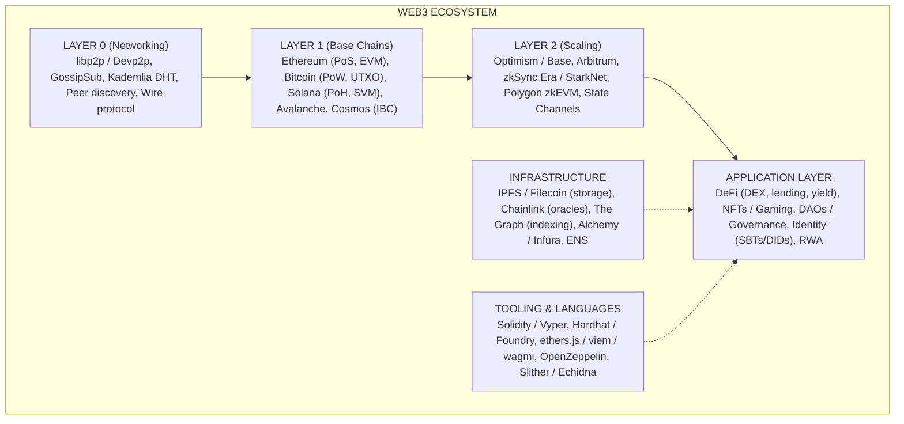
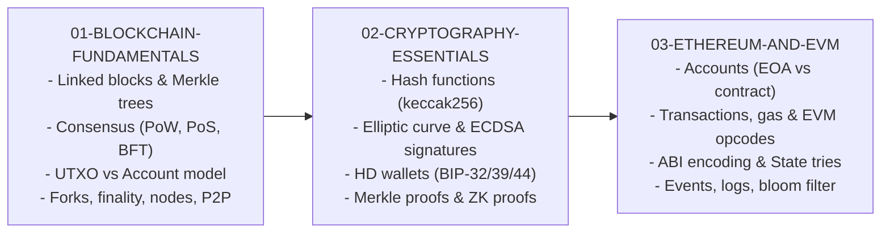
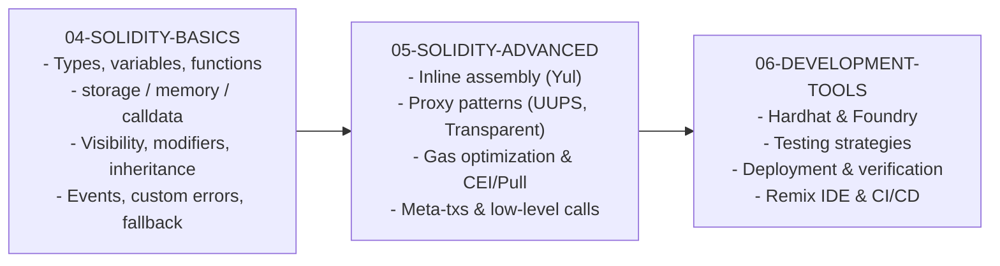
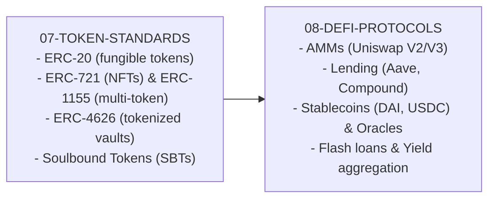
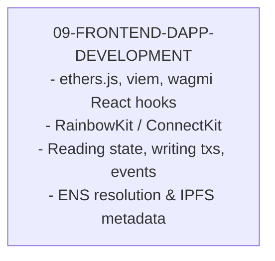
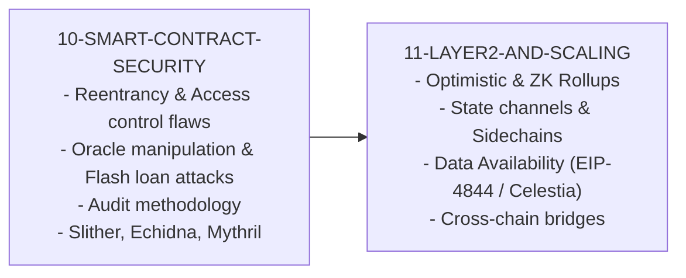
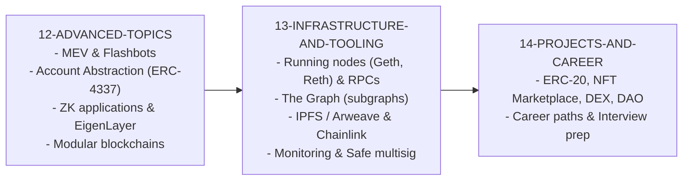
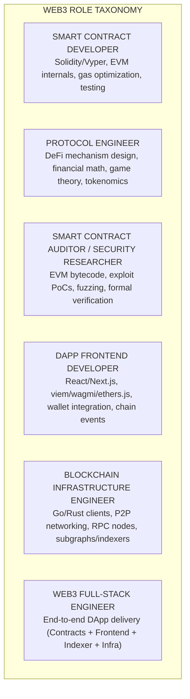
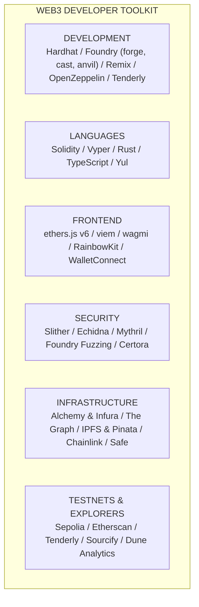

# Web3 Development: From Zero to Expert

## Why This Guide Exists

Web3 development sits at the intersection of cryptography, distributed systems, game theory, and financial engineering. Unlike traditional software development where bugs get patched with a hotfix, smart contract bugs can drain millions of dollars in minutes and deployed code cannot be changed. Every line of Solidity you write is adversarial code — bots scan the mempool 24/7 looking for exploitable contracts, and the attack surface includes not just your code but the entire economic environment around it.

This guide takes you from having zero blockchain knowledge to understanding and building production-grade decentralized applications. You will learn how blockchains work at the data structure level, master Solidity and the EVM, build and audit DeFi protocols, create frontends that connect wallets to smart contracts, and understand the cutting-edge research (ZK proofs, MEV, account abstraction) shaping the future of the ecosystem.

---

## The Web3 Landscape

---

## Learning Path Overview

### Phase 1: Foundations (Chapters 01-03)

**Goal**: Understand how blockchains work at the data structure and protocol level, master the cryptographic primitives that secure everything, and deeply understand Ethereum's architecture.

You cannot write secure smart contracts without understanding:

- **What** a blockchain actually is (not just "distributed ledger")
- **How** transactions get from your wallet to finalized on-chain
- **Why** gas exists and how EIP-1559 changed fee markets
- **Where** contract storage lives and how the EVM reads it

### Phase 2: Smart Contract Development (Chapters 04-06)

**Goal**: Master Solidity from basic types through advanced patterns, and become proficient with production development tools.

### Phase 3: Protocols & Standards (Chapters 07-08)

**Goal**: Understand token standards that power the ecosystem and the DeFi protocols that generate billions in volume.

### Phase 4: Frontend Integration (Chapter 09)

**Goal**: Build complete DApp frontends that connect wallets, read chain state, and submit transactions.

### Phase 5: Security & Scaling (Chapters 10-11)

**Goal**: Learn to think like an attacker to write secure code, and understand how Layer 2 solutions make Ethereum scalable.

### Phase 6: Advanced & Production (Chapters 12-14)

**Goal**: Master cutting-edge topics, build production infrastructure, and create portfolio projects.

---

## How the Roles Break Down

---

## Recommended Book List

### Beginner

| Book                    | Author                            | Focus                                  |
| ----------------------- | --------------------------------- | -------------------------------------- |
| _Mastering Ethereum_    | Andreas Antonopoulos & Gavin Wood | Ethereum fundamentals (free on GitHub) |
| _Mastering Bitcoin_     | Andreas Antonopoulos              | Bitcoin & blockchain foundations       |
| _The Infinite Machine_  | Camila Russo                      | Ethereum history (narrative)           |
| _How to DeFi: Beginner_ | CoinGecko                         | DeFi protocols explained simply        |

### Intermediate

| Book                                  | Author                 | Focus                           |
| ------------------------------------- | ---------------------- | ------------------------------- |
| _Ethereum Smart Contract Development_ | Solidity documentation | Official language reference     |
| _How to DeFi: Advanced_               | CoinGecko              | Advanced DeFi mechanisms        |
| _Blockchain and the Law_              | De Filippi & Wright    | Legal and regulatory landscape  |
| _Token Economy_                       | Shermin Voshmgir       | Tokenomics and mechanism design |

### Advanced

| Book                                                                              | Author        | Focus                     |
| --------------------------------------------------------------------------------- | ------------- | ------------------------- |
| _Proofs, Arguments, and Zero-Knowledge_                                           | Justin Thaler | ZK proof theory           |
| _Flash Boys 2.0 (MEV paper)_                                                      | Daian et al.  | MEV research paper        |
| _Foundations of Distributed Consensus_                                            | Heidi Howard  | Consensus protocol theory |
| _Decentralized Finance: On Blockchain and Smart Contract-Based Financial Markets_ | Fabian Schär  | Academic DeFi analysis    |

---

## Essential Tools & Platforms

---

## What Makes Web3 Hard

1. **Immutable deployments** — Once a smart contract is deployed, its code cannot be changed. Bugs become permanent vulnerabilities that attackers exploit for real money within minutes of discovery
2. **Adversarial environment** — MEV bots, sandwich attacks, and frontrunning bots scan the mempool 24/7 looking for profitable opportunities at your users' expense
3. **Gas economics** — Every computation costs real money. A function that wastes 10,000 gas costs your users real ETH on every call, and gas optimization requires deep EVM knowledge
4. **Asynchronous execution model** — Transactions are not instant. They sit in a mempool, may be reordered, may fail, and finality takes minutes. Your UI must handle all of these states
5. **Rapidly evolving standards** — New EIPs, new L2s, new tooling, and new attack vectors emerge weekly. The "best practice" from six months ago may be obsolete today
6. **Economic attack surfaces** — Flash loans let attackers borrow unlimited capital for a single transaction, enabling price manipulation, governance attacks, and oracle exploits that are impossible in traditional finance
7. **Multi-chain complexity** — The same protocol may need to work on Ethereum, Arbitrum, Optimism, Base, and zkSync, each with different gas costs, finality guarantees, and EVM quirks
8. **Regulatory uncertainty** — Token launches, DeFi protocols, and NFT projects face evolving and inconsistent regulatory scrutiny across jurisdictions

The rest of this guide will teach you how to navigate each of these challenges, starting from the very basics of how a blockchain works.
