# Chapter 1: Blockchain Fundamentals

## Introduction

You cannot write secure smart contracts without understanding the system they run on. A blockchain is not a magical "distributed ledger" — it is a specific combination of hash-linked data structures, Merkle trees, cryptographic signatures, and consensus protocols that together solve a 40-year-old computer science problem: how do untrusted parties agree on shared state without a central authority?

This chapter builds your mental model from the ground up: what blocks contain, how they link together, why consensus is hard, and how different blockchain architectures make different tradeoffs.

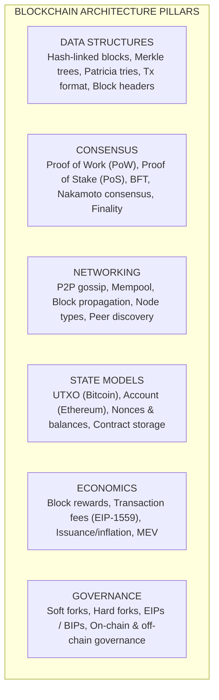

---

## 1. The Problem Blockchain Solves

### 1.1 The Byzantine Generals Problem

Imagine 10 generals surrounding a city. They must all attack at the same time or all retreat — a split decision means defeat. They can only communicate by messenger, and some generals may be traitors who send conflicting messages. How do the loyal generals agree on a plan?

This is the **Byzantine Fault Tolerance (BFT)** problem, formally defined by Lamport, Shostak, and Pease in 1982. It was proven that a system can tolerate up to `f` Byzantine (arbitrarily malicious) nodes as long as the total number of nodes `n >= 3f + 1`.

**Why this matters for blockchains**: A blockchain is a network of untrusted nodes that must agree on the order and validity of transactions. Some nodes may be offline, buggy, or actively malicious. The consensus protocol is what makes agreement possible despite this.

### 1.2 The Double-Spend Problem

In digital systems, data can be copied. If Alice has 10 digital coins, what prevents her from sending the same 10 coins to both Bob and Charlie?

In traditional finance, a central bank maintains the authoritative ledger. Bitcoin's breakthrough was solving double-spend without a central authority by using proof-of-work consensus to establish a single canonical ordering of transactions.

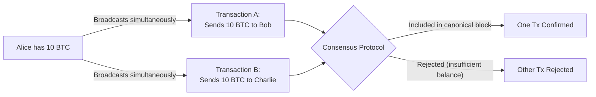

---

## 2. Data Structures: Blocks and Chains

### 2.1 What a Block Contains

Every block has two parts: a **header** and a **body** (list of transactions).

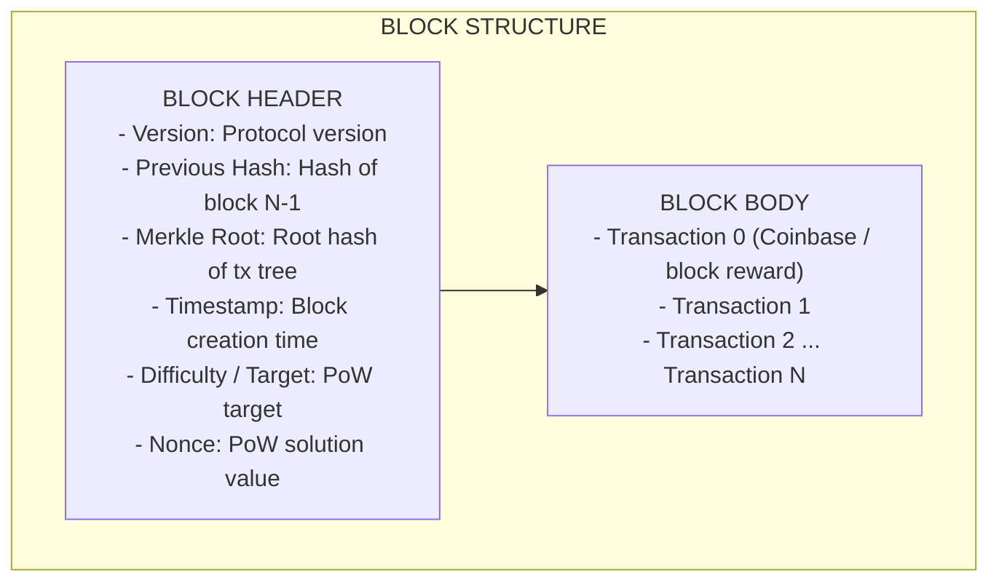

The **previous hash** field is what creates the "chain" — each block commits to the entire history before it. Changing any historical transaction would change that block's hash, which would break every subsequent block's previous hash reference.

### 2.2 Hash-Linked Chain

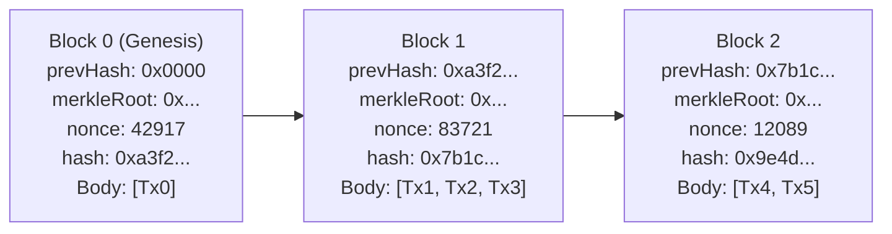

**Tamper resistance**: If an attacker changes Transaction 2 in Block 1:

1. Block 1's Merkle root changes
2. Block 1's hash changes
3. Block 2's `prevHash` no longer matches Block 1's new hash
4. Block 2's hash changes
5. Every subsequent block is also invalidated

To tamper with history, the attacker must re-mine every block from the tampered one forward — which requires more computational power than the rest of the network combined (51% attack).

### 2.3 Merkle Trees

A Merkle tree is a binary tree of hashes that lets you efficiently prove a transaction is included in a block without downloading all transactions.

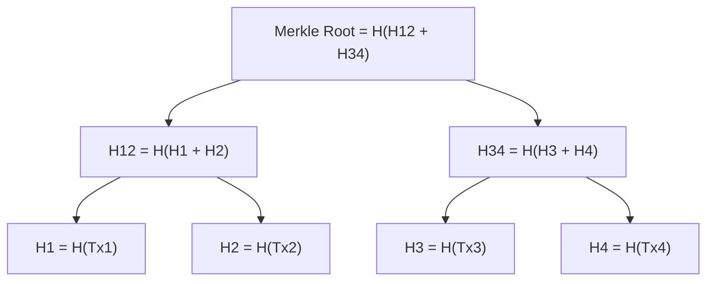

**Merkle proof for Tx3**: To prove Tx3 is in the block, you only need:

- H4 (sibling)
- H12 (uncle)
- Merkle Root (in block header)

The verifier computes: `H3 = H(Tx3)`, then `H34 = H(H3 + H4)`, then `Root = H(H12 + H34)` and checks against the block header.

**Proof size**: For a block with `n` transactions, the proof is `O(log n)` hashes. A block with 1 million transactions only needs ~20 hashes for a proof.

```python
import hashlib

def sha256(data: bytes) -> bytes:
    return hashlib.sha256(data).digest()

def build_merkle_tree(transactions: list[bytes]) -> bytes:
    """Build a Merkle tree and return the root hash."""
    if len(transactions) == 0:
        return sha256(b"")

    # Hash all leaves
    current_level = [sha256(tx) for tx in transactions]

    # If odd number of nodes, duplicate the last one
    while len(current_level) > 1:
        if len(current_level) % 2 == 1:
            current_level.append(current_level[-1])

        next_level = []
        for i in range(0, len(current_level), 2):
            combined = current_level[i] + current_level[i + 1]
            next_level.append(sha256(combined))

        current_level = next_level

    return current_level[0]

# Example usage
transactions = [b"Alice->Bob:10", b"Bob->Charlie:5", b"Charlie->Dave:3"]
root = build_merkle_tree(transactions)
print(f"Merkle root: {root.hex()}")
```

---

## 3. Consensus Mechanisms

### 3.1 Why Consensus Is Hard

In a distributed system with no central coordinator, nodes must answer three questions:

1. **Which transactions are valid?** (validation rules)
2. **In what order do they appear?** (ordering / sequencing)
3. **Which version of history is canonical?** (fork choice)

Different consensus mechanisms make different tradeoffs across the "blockchain trilemma":

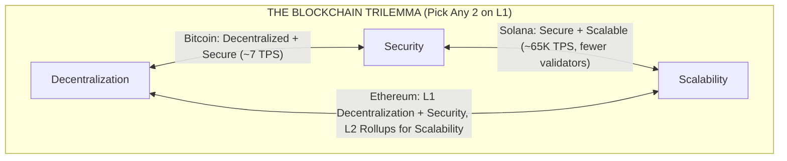

### 3.2 Proof of Work (PoW)

**How it works**: Miners compete to find a nonce value such that `H(block_header + nonce) < target`. The target is adjusted periodically to maintain a consistent block time (~10 min for Bitcoin).

```
Mining process:

block_header = prevHash + merkleRoot + timestamp + difficulty

for nonce in 0, 1, 2, 3, ...:
    hash = SHA256(SHA256(block_header + nonce))
    if hash < target:
        FOUND! Broadcast block to network
        Collect block reward + transaction fees
        break
```

**Key properties**:

- **Sybil resistance**: Creating fake identities doesn't help — you need real computational power
- **Probabilistic finality**: The deeper a block is buried, the harder it is to reverse. After 6 confirmations (~60 min), Bitcoin transactions are considered final
- **Energy cost**: Bitcoin uses ~150 TWh/year (comparable to a small country), which is the fundamental criticism of PoW

```python
import hashlib
import time

def mine_block(block_data: str, difficulty: int) -> tuple[int, str]:
    """Simulate mining: find nonce where hash starts with `difficulty` zeros."""
    target = "0" * difficulty
    nonce = 0
    start = time.time()

    while True:
        text = f"{block_data}{nonce}"
        hash_result = hashlib.sha256(text.encode()).hexdigest()
        if hash_result[:difficulty] == target:
            elapsed = time.time() - start
            print(f"Mined! Nonce: {nonce}, Time: {elapsed:.2f}s")
            print(f"Hash: {hash_result}")
            return nonce, hash_result
        nonce += 1

# Try different difficulties
mine_block("Block #1: Alice sends 5 BTC to Bob", difficulty=4)
mine_block("Block #1: Alice sends 5 BTC to Bob", difficulty=5)
```

### 3.3 Proof of Stake (PoS)

**How it works**: Instead of burning energy, validators lock up (stake) cryptocurrency as collateral. The protocol selects a validator to propose the next block based on their stake. If they behave dishonestly, their stake is destroyed (slashed).

```
Ethereum Proof of Stake:

Validator Requirements:
  - Stake 32 ETH (~$100K at $3K/ETH)
  - Run validator software 24/7
  - Maintain >95% uptime

Block Production:
  Epoch = 32 slots (each slot = 12 seconds, so 1 epoch = 6.4 minutes)

  Each slot:
    1. RANDAO selects a block proposer
    2. Proposer creates and broadcasts block
    3. Committee of validators attest (vote) to the block
    4. After 2 epochs of attestation: block is FINALIZED

Slashing Conditions:
  - Double voting: proposing 2 blocks for the same slot
  - Surround voting: contradictory attestations
  - Penalty: lose a portion (or all) of 32 ETH stake
```

**PoW vs PoS comparison**:

| Property         | Proof of Work             | Proof of Stake             |
| ---------------- | ------------------------- | -------------------------- |
| Security basis   | Computational power       | Economic stake             |
| Energy usage     | Very high                 | Very low (~99.95% less)    |
| Hardware         | Specialized ASICs         | Standard servers           |
| Finality         | Probabilistic (~60 min)   | Deterministic (~13 min)    |
| Attack cost      | 51% of hashrate           | 33% of staked ETH          |
| Entry barrier    | Capital for hardware      | Capital for stake          |
| Decentralization | Tends toward mining pools | Tends toward large stakers |

### 3.4 Other Consensus Mechanisms

| Mechanism                | Used By        | How It Works                                            |
| ------------------------ | -------------- | ------------------------------------------------------- |
| Delegated PoS (DPoS)     | EOS, Tron      | Token holders vote for a fixed set of validators        |
| Proof of History (PoH)   | Solana         | Cryptographic clock provides ordering before consensus  |
| Proof of Authority (PoA) | Private chains | Known, trusted validators (not decentralized)           |
| Tendermint BFT           | Cosmos         | Practical BFT with instant finality, 2/3 majority       |
| Avalanche                | Avalanche      | Repeated random subsampling for probabilistic consensus |
| Nakamoto + BFT hybrid    | Ethereum       | PoS with Casper FFG finality gadget on top              |

---

## 4. The UTXO vs Account Model

### 4.1 UTXO Model (Bitcoin)

Bitcoin does not track "balances." Instead, it tracks **Unspent Transaction Outputs (UTXOs)** — discrete chunks of Bitcoin that can be spent.

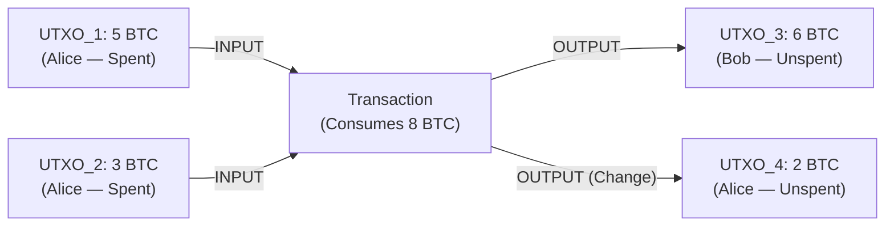

**Advantages**: Natural parallelism (UTXOs are independent), privacy (new addresses per transaction), no global state to track.

**Disadvantages**: Hard to implement smart contracts, change management is complex, no concept of "accounts."

### 4.2 Account Model (Ethereum)

Ethereum uses an **account-based** model similar to a traditional bank. The world state is a mapping of addresses to account objects.

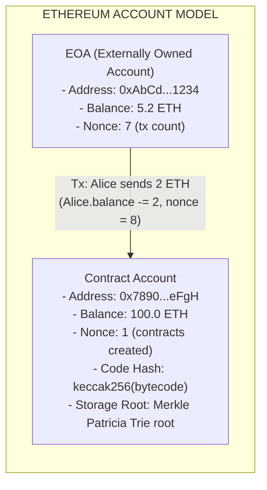

**Comparison**:

| Property             | UTXO (Bitcoin)                | Account (Ethereum)         |
| -------------------- | ----------------------------- | -------------------------- |
| State representation | Set of unspent outputs        | Map of address -> state    |
| Balance tracking     | Sum of UTXOs                  | Direct balance field       |
| Smart contracts      | Very limited (Bitcoin Script) | Full Turing-complete (EVM) |
| Parallelism          | Natural (independent UTXOs)   | Harder (shared state)      |
| Privacy              | New address per tx (easy)     | Address reuse (harder)     |
| Simplicity           | Complex change handling       | Simple state transitions   |

---

## 5. Forks: Soft vs Hard

### 5.1 What Causes Forks

A fork occurs when the blockchain diverges into two or more paths. This can happen:

- **Naturally**: Two miners find a block at nearly the same time (resolved in 1-2 blocks)
- **Intentionally**: Protocol upgrade that changes consensus rules

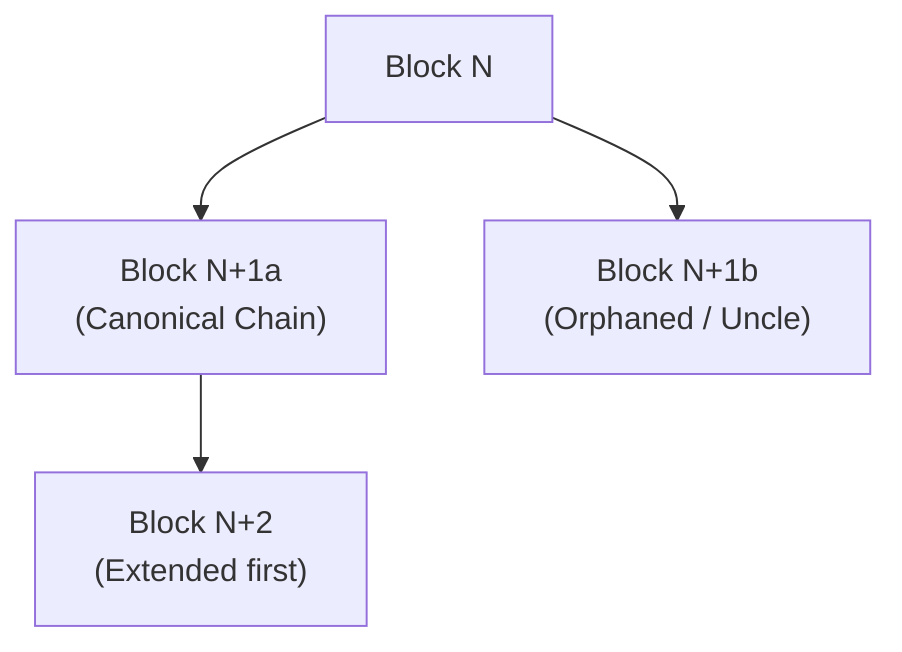

### 5.2 Soft Fork

A **soft fork** tightens the rules. Old nodes still accept new blocks (backwards compatible), but new rules are stricter.

**Example**: Bitcoin's SegWit upgrade separated signature data from transaction data. Old nodes saw valid (though differently structured) transactions; new nodes enforced the new format.

### 5.3 Hard Fork

A **hard fork** loosens or changes the rules. Old nodes reject new blocks (not backwards compatible), creating a permanent chain split unless all nodes upgrade.

**Example**: Ethereum's "The DAO" hard fork in 2016. After a $60M hack, the community voted to roll back the theft. Nodes that disagreed continued the original chain as "Ethereum Classic" (ETC).

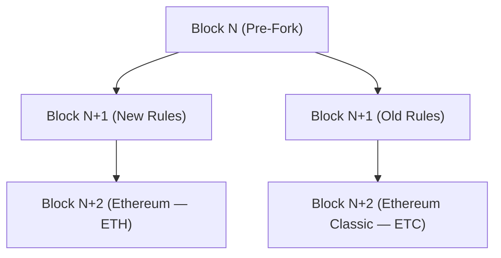

---

## 6. Finality and Confirmations

### 6.1 Probabilistic Finality (PoW)

In Bitcoin, finality is probabilistic. The probability of a transaction being reversed decreases exponentially with each confirmation (new block mined on top):

```
Confirmations vs Security (assuming attacker has 10% hashrate):

Confirmations    Probability of Reversal
    1            ~0.2% (not safe)
    2            ~0.02%
    3            ~0.002%
    6            ~0.00000002% (Bitcoin standard)
   12            negligible

For high-value transactions: wait for 6 confirmations (~60 min)
For small amounts: 1-2 confirmations may be acceptable
```

### 6.2 Deterministic Finality (PoS)

Ethereum's Casper FFG provides **deterministic finality** after 2 epochs (~12.8 minutes). Once a block is finalized, reversing it requires destroying at least 1/3 of all staked ETH (currently ~$30B+).

```
Ethereum Finality Timeline:

Slot 0          Slot 32         Slot 64
|-- Epoch 0 --|-- Epoch 1 --|-- Epoch 2 --|
                              ^
                              |
                    Block from Epoch 0 is now FINALIZED
                    (received attestations across 2 full epochs)

Time: ~12.8 minutes from block creation to finality
```

---

## 7. Nodes and Network Topology

### 7.1 Node Types

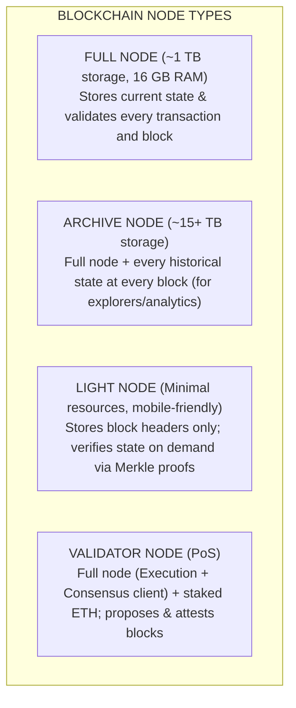

### 7.2 P2P Networking

Blockchain nodes communicate over a peer-to-peer network without a central server:

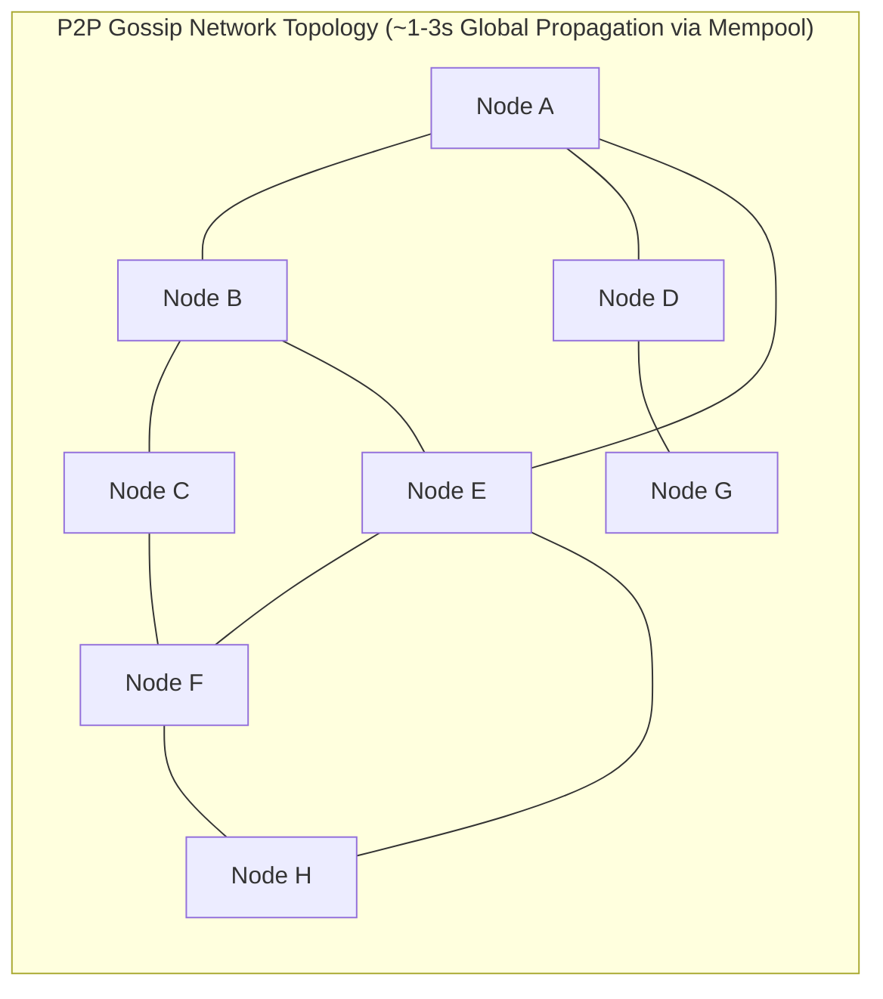

---

## 8. Blockchain Generations

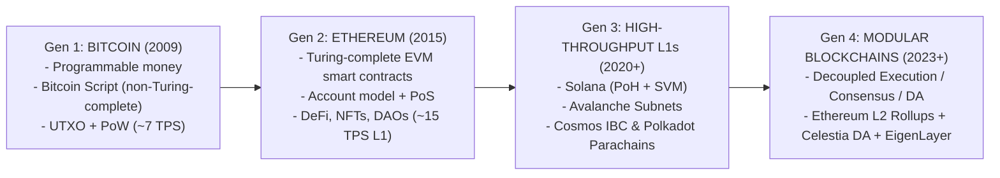

---

## 9. Worked Problems

### Problem 1: Block Verification

**Question**: You receive a block with the following header. The previous block had hash `0x00003a7f...`. The network requires hashes to start with 4 zeros. Is this block valid?

```
Block Header:
  prevHash:   0x00003a7f...
  merkleRoot: 0xabcdef...
  timestamp:  1709000000
  nonce:      847291
  hash:       0x000072b1...
```

**Solution**:

1. Check `prevHash` matches the previous block's hash: `0x00003a7f...` matches
2. Check `hash` starts with 4 zeros (meets difficulty): `0x000072b1...` has 4 leading zeros
3. Verify by recomputing: `H(prevHash + merkleRoot + timestamp + nonce)` should equal `hash`
4. Verify `merkleRoot` by recomputing from the block's transactions
5. Check `timestamp` is within acceptable range (not too far in future)

If all checks pass, the block is valid.

### Problem 2: Merkle Proof Verification

**Question**: A block contains 8 transactions. You want to prove Tx5 is included. What hashes do you need?

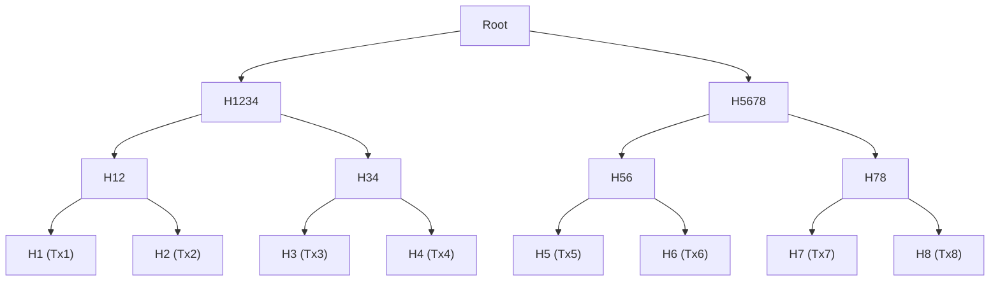

**Solution**: To prove Tx5, you need:

1. **H6** (sibling of H5)
2. **H78** (sibling of H56)
3. **H1234** (sibling of H5678)
4. **Root** (from block header, already known)

Verification:

- Compute `H5 = H(Tx5)`
- Compute `H56 = H(H5 + H6)`
- Compute `H5678 = H(H56 + H78)`
- Compute `Root = H(H1234 + H5678)`
- Compare with block header's Merkle root

Proof size: 3 hashes for 8 transactions. For `n` transactions: `log2(n)` hashes.

### Problem 3: 51% Attack Economics

**Question**: Bitcoin's network hashrate is 500 EH/s (exahashes/second). Each Antminer S21 produces 200 TH/s and costs $5,000. How much would a 51% attack cost in hardware alone?

**Solution**:

```
Required hashrate:   500 EH/s * 0.51 = 255 EH/s = 255,000,000 TH/s
Miners needed:       255,000,000 / 200 = 1,275,000 miners
Hardware cost:       1,275,000 * $5,000 = $6.375 billion
Electricity cost:    Not included (adds ~$10M+ per day)
```

This does not include the cost of electricity, cooling, or the physical space for 1.275 million mining rigs. The economic infeasibility of this attack is what secures the Bitcoin network.

---

## Appendix: Key Concepts Cheat Sheet

```
BLOCKCHAIN FUNDAMENTALS CHEAT SHEET

Block:          Header (prevHash, merkleRoot, timestamp, nonce) + Transactions
Chain:          Blocks linked by prevHash references (tamper-evident)
Merkle Tree:    Binary hash tree for O(log n) inclusion proofs
Consensus:      Agreement protocol among untrusted nodes

PoW:            Mine by finding nonce where H(header+nonce) < target
                Energy-intensive, probabilistic finality (~60 min)

PoS:            Stake collateral, selected to propose/attest blocks
                Energy-efficient, deterministic finality (~13 min)

UTXO:           Unspent Transaction Outputs (Bitcoin)
                Discrete chunks of value, consumed and created per tx

Account:        Address -> {balance, nonce, codeHash, storageRoot} (Ethereum)
                Simple state transitions, supports smart contracts

Soft Fork:      Backwards-compatible rule tightening
Hard Fork:      Non-backwards-compatible rule change (chain split possible)

Full Node:      Validates everything, stores current state (~1 TB)
Archive Node:   Full node + all historical states (~15+ TB)
Light Node:     Headers only, verifies with Merkle proofs

Byzantine Fault Tolerance: tolerates f faults with n >= 3f + 1 nodes
Blockchain Trilemma: decentralization vs security vs scalability (pick 2)
```
