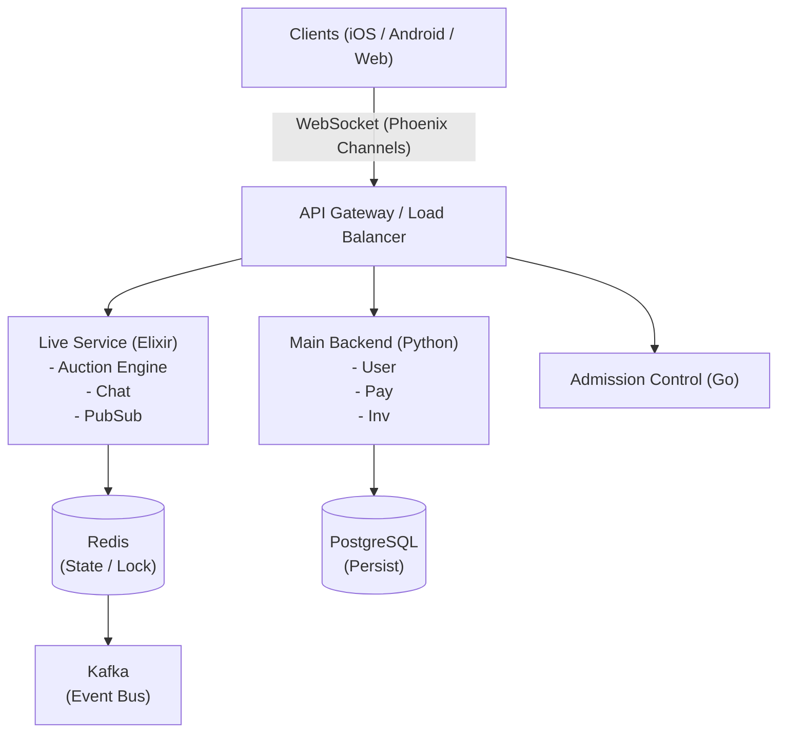
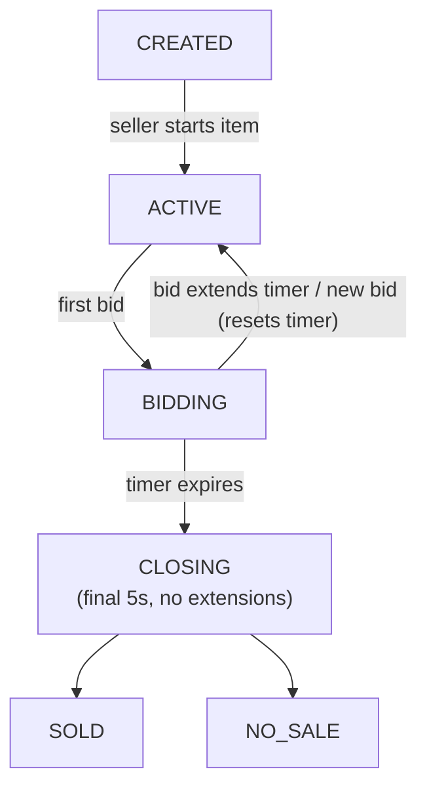
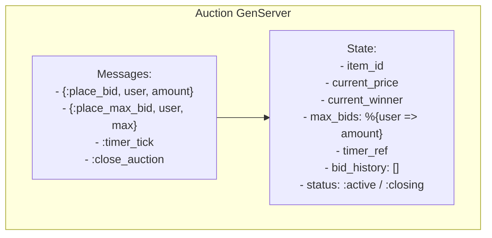
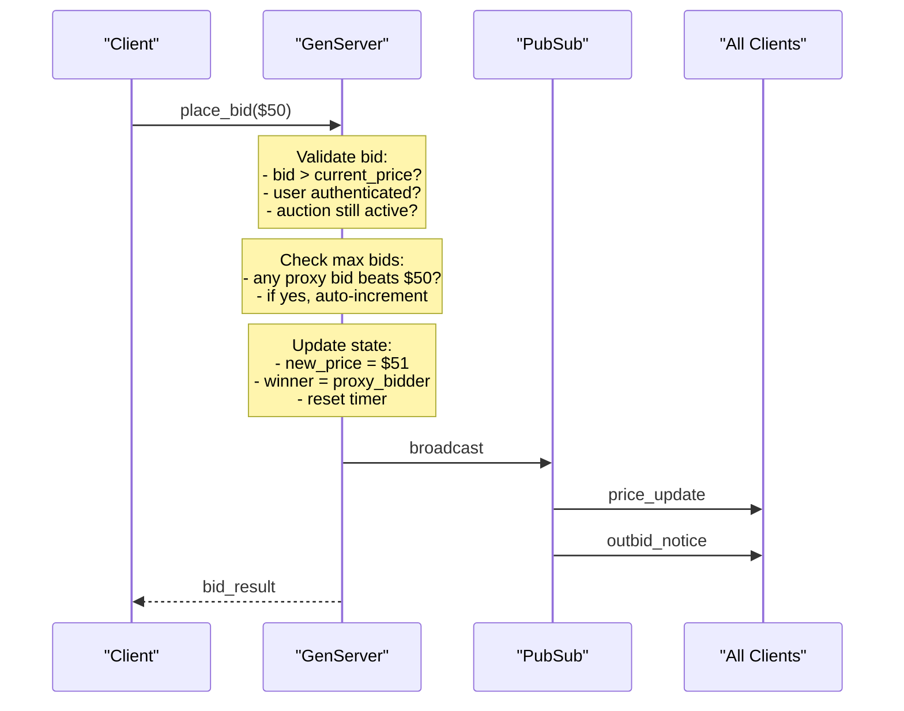
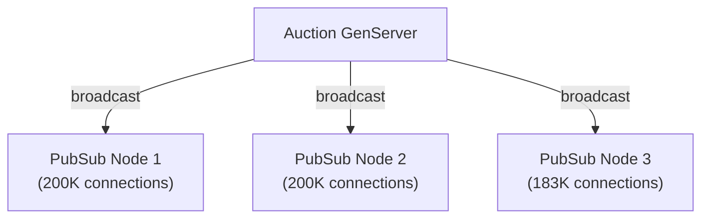

# Design: Real-Time Live Auction System

> This is Whatnot's **core business**. The most likely system design question will touch on real-time bidding, auction state management, or concurrency at scale.

## Problem Statement

Design a real-time auction system where sellers broadcast live video and buyers bid on items in 30-60 second windows, supporting hundreds of thousands of concurrent users.

---

## Step 1: Requirements

### Functional Requirements

- Seller starts a livestream and creates auction items
- Buyers place bids in real-time during the auction window
- Support "Secret Max Bid" (proxy bidding) — system auto-bids up to user's maximum
- Auction timer with countdown (30-60 seconds per item)
- Winner determination and payment initiation
- Real-time price updates to all viewers
- "Buy It Now" fixed-price listings alongside auctions

### Non-Functional Requirements

- **Latency**: Bid processing < 100ms
- **Consistency**: No double-winning, no lost bids, correct winner
- **Availability**: 99.9% — auction downtime = lost revenue
- **Throughput**: Handle 583K concurrent viewers per stream (peak)
- **Ordering**: Bids must be processed in order (first valid bid wins ties)

### Out of Scope

- Video streaming infrastructure (see [05-LIVESTREAM-PLATFORM.md](05-LIVESTREAM-PLATFORM.md))
- Payment processing details
- Fraud detection

---

## Step 2: High-Level Design



---

## Step 3: Deep Dive

### Auction State Machine



### Auction GenServer (Elixir Process)

Each auction item runs as an isolated Elixir GenServer process:



**Why GenServer?**

- Single-process = serialized bid processing = no race conditions
- Each auction is isolated — one crash doesn't affect others
- Erlang/OTP supervision tree auto-restarts crashed processes
- Horde distributes processes across cluster nodes

### Bid Processing Flow



### Secret Max Bid (Proxy Bidding)

This is a key Whatnot feature. The system auto-bids on behalf of users:

```
Example:
- Alice sets max bid: $100
- Bob bids: $30
- System auto-bids for Alice: $31 (one increment above Bob)
- Carol bids: $50
- System auto-bids for Alice: $51
- Dave bids: $110
- Alice is outbid (her max was $100)
- Dave wins at $101 (one increment above Alice's max)
```

**Implementation rules:**

1. Max bids are stored privately in GenServer state (not broadcast)
2. When a new bid arrives, check all max bids for auto-response
3. New price = min(highest_max_bid, second_highest_max_bid + increment)
4. Notify outbid users immediately
5. If two users have the same max bid, earlier bid wins (FIFO ordering)

### Data Model

```sql
-- Auction items
CREATE TABLE auction_items (
    id           UUID PRIMARY KEY,
    stream_id    UUID NOT NULL REFERENCES streams(id),
    seller_id    UUID NOT NULL REFERENCES users(id),
    title        VARCHAR(255) NOT NULL,
    description  TEXT,
    starting_bid INTEGER NOT NULL DEFAULT 1,  -- cents
    current_bid  INTEGER,
    winner_id    UUID REFERENCES users(id),
    status       VARCHAR(20) NOT NULL DEFAULT 'created',
    started_at   TIMESTAMPTZ,
    ended_at     TIMESTAMPTZ,
    created_at   TIMESTAMPTZ DEFAULT NOW()
);

-- Bid history (append-only event log)
CREATE TABLE bids (
    id           UUID PRIMARY KEY,
    item_id      UUID NOT NULL REFERENCES auction_items(id),
    user_id      UUID NOT NULL REFERENCES users(id),
    amount       INTEGER NOT NULL,  -- cents
    bid_type     VARCHAR(20) NOT NULL,  -- 'manual', 'proxy', 'buy_now'
    created_at   TIMESTAMPTZ DEFAULT NOW()
);
CREATE INDEX idx_bids_item_time ON bids(item_id, created_at);

-- Secret max bids (private)
CREATE TABLE max_bids (
    id           UUID PRIMARY KEY,
    item_id      UUID NOT NULL REFERENCES auction_items(id),
    user_id      UUID NOT NULL REFERENCES users(id),
    max_amount   INTEGER NOT NULL,  -- cents
    created_at   TIMESTAMPTZ DEFAULT NOW(),
    UNIQUE(item_id, user_id)
);
```

### API Design

```graphql
# Mutations
mutation PlaceBid($itemId: ID!, $amount: Int!) {
  placeBid(itemId: $itemId, amount: $amount) {
    success
    currentPrice
    isWinning
    error
  }
}

mutation PlaceMaxBid($itemId: ID!, $maxAmount: Int!) {
  placeMaxBid(itemId: $itemId, maxAmount: $maxAmount) {
    success
    currentPrice
    isWinning
    error
  }
}

# Subscriptions (via Phoenix Channels / WebSocket)
subscription AuctionUpdates($streamId: ID!) {
  auctionUpdate(streamId: $streamId) {
    itemId
    currentPrice
    currentWinner # display name only
    timeRemaining
    status
    bidCount
  }
}
```

---

## Step 4: Scaling & Trade-offs

### Scaling Strategies

**Horizontal scaling of GenServers:**

- Horde distributes auction processes across Elixir cluster nodes
- Each node handles subset of active auctions
- Process migration on node failure via Horde handoff

**Read scaling (viewer fan-out):**

- 583K viewers don't all connect to the auction GenServer
- Phoenix PubSub broadcasts state changes to all subscribers
- PubSub shards across nodes to distribute fan-out load
- Consider tiered fan-out: GenServer → PubSub nodes → edge nodes → clients



### Failure Handling

| Failure           | Solution                                                            |
| ----------------- | ------------------------------------------------------------------- |
| GenServer crash   | OTP supervisor restarts, recovers state from Redis snapshot         |
| Node failure      | Horde migrates processes to healthy nodes                           |
| Network partition | Auction pauses, resumes when healed (consistency over availability) |
| Redis failure     | Fall back to GenServer in-memory state + PostgreSQL event log       |
| Duplicate bids    | Idempotency key per bid (user_id + item_id + amount + timestamp)    |

### Trade-offs Discussed

| Decision                      | Choice                           | Why                                                     |
| ----------------------------- | -------------------------------- | ------------------------------------------------------- |
| Consistency vs Availability   | **Consistency**                  | Wrong winner is worse than brief downtime               |
| Single process vs distributed | **Single GenServer** per auction | Serialized bids eliminate race conditions               |
| In-memory vs persistent       | **Both**                         | In-memory for speed, persist to Kafka/DB for durability |
| WebSocket vs polling          | **WebSocket**                    | Real-time requirements demand push, not pull            |
| SQL vs NoSQL for bids         | **SQL (append-only)**            | Audit trail, ACID guarantees for financial data         |

### Monitoring & Observability

- **Bid latency percentiles**: p50, p95, p99 (target: p99 < 100ms)
- **Auction completion rate**: % of auctions that result in a sale
- **GenServer mailbox depth**: Early warning for processing backlog
- **WebSocket connection count**: Per-node and per-stream
- **Bid conflict rate**: How often proxy bids trigger (measure feature usage)
