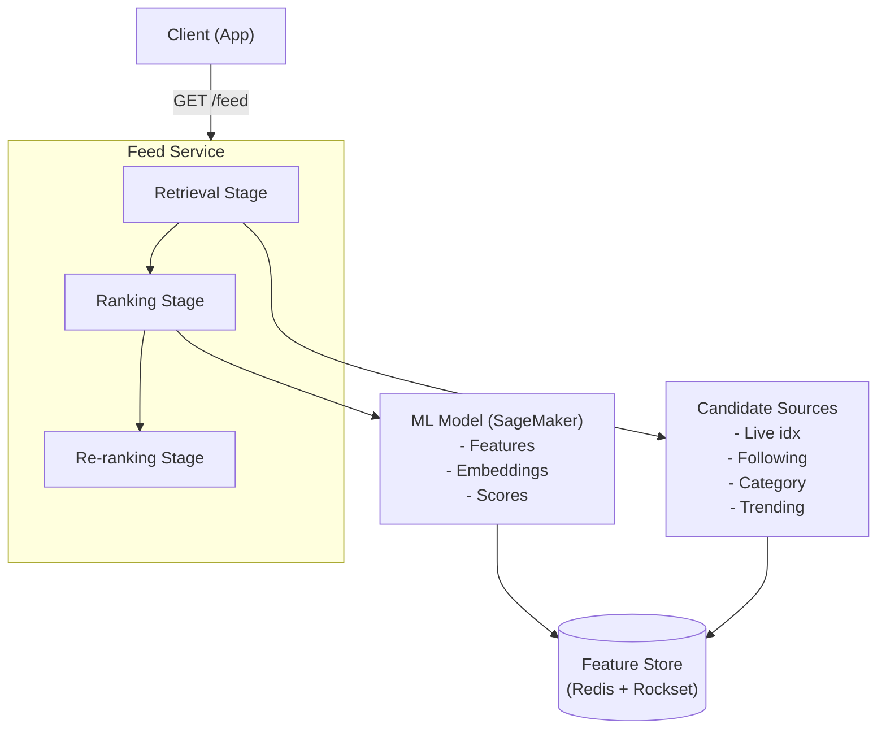
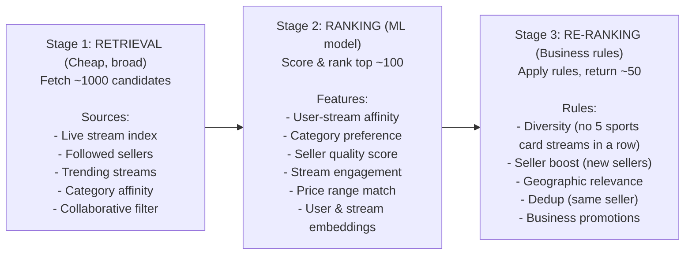
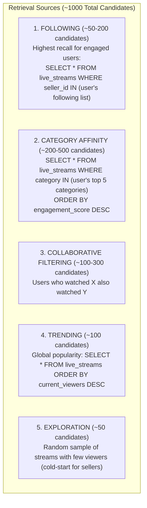
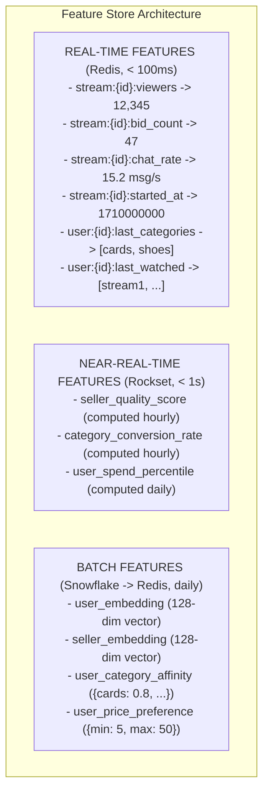
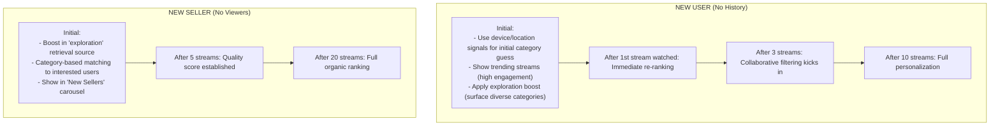
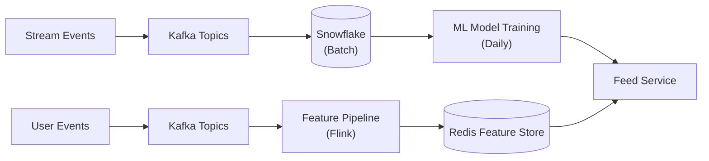

# Design: Real-Time Feed Ranking & Discovery

> Whatnot's unique challenge: livestreams are **ephemeral content** — you can't recommend yesterday's streams to today's users. The ranking system must work in real-time.

## Problem Statement

Design a feed ranking system that surfaces the most relevant live streams to users in real-time, handling cold-start for new users and adapting to rapidly changing content.

---

## Step 1: Requirements

### Functional Requirements

- Home feed shows ranked list of currently live streams
- Personalized ranking based on user interests and behavior
- Support new users with no history (cold-start)
- Category-based browsing (sports cards, sneakers, beauty, etc.)
- "For You" algorithmic feed + "Following" chronological feed
- Search with autocomplete across live and upcoming streams

### Non-Functional Requirements

- **Latency**: Feed generation < 200ms (p99)
- **Freshness**: New streams appear in feed within 30 seconds of going live
- **Scale**: 20M+ users, thousands of concurrent streams
- **Personalization**: Different rankings for different users
- **Cold-start**: Usable recommendations for brand-new users

### Out of Scope

- Push notification triggers
- Seller analytics
- Ad ranking

---

## Step 2: High-Level Design



---

## Step 3: Deep Dive

### Three-Stage Ranking Pipeline



### Retrieval Sources



### Feature Store Architecture



### Online vs Batch Inference

Whatnot migrated from batch to online inference. Here's why:

```
BATCH INFERENCE (old approach):
- Run ML model every 24 hours on all users
- Pre-compute ranking scores
- Store in lookup table

Problems:
- New users get NO recommendations for 24 hours (cold-start)
- Stream that went live 1 hour ago not in pre-computed results
- Stale: user watched 3 card streams today but batch still
  recommends sneakers based on yesterday's data

ONLINE INFERENCE (current approach):
- Run ML model at request time
- Use real-time features (what user just watched)
- Fresh signals for every feed request

Benefits:
- New users get recommendations immediately (use session signals)
- New streams ranked within seconds of going live
- Adapts to user's current session behavior
- A/B test model changes instantly

Cost:
- Higher compute (SageMaker inference on every request)
- Need low-latency feature store
- Model must run in < 50ms
```

### Cold-Start Strategy



### Data Flow



---

## Step 4: Scaling & Trade-offs

### Caching Strategy

```
Feed Cache (Redis, TTL = 30 seconds):
- Key: feed:{user_id}:{page}
- Value: ranked stream IDs
- Invalidation: on user action (watch, bid, follow)

Stream Metadata Cache (Redis, TTL = 5 seconds):
- Key: stream:{id}:meta
- Value: {title, seller, category, viewers, current_item}
- Updated by stream events via Kafka → Redis pipeline
```

### Trade-offs

| Decision                       | Choice                         | Why                                                                                   |
| ------------------------------ | ------------------------------ | ------------------------------------------------------------------------------------- |
| Online vs batch inference      | **Online**                     | Freshness critical for ephemeral content                                              |
| Precision vs latency           | **Latency** (< 200ms)          | Users won't wait; good-enough ranking fast > perfect ranking slow                     |
| Personalization vs exploration | **Mix** (80/20)                | Heavy personalization creates filter bubbles; 20% exploration surfaces new categories |
| Feature freshness              | **Tiered** (real-time + batch) | Some features need second-level freshness; others are fine daily                      |

### Experimentation (Statsig)

Whatnot runs 400+ experiments/year on feed ranking:

- **A/B test framework**: Split users into control/treatment groups
- **Metrics**: Stream watch time, bid rate, purchase rate, return visits
- **Guard rails**: Revenue per user, seller coverage, category diversity
- **Ramp process**: 1% → 5% → 20% → 50% → 100%

### Monitoring

| Metric                     | Target                      |
| -------------------------- | --------------------------- |
| Feed latency (p99)         | < 200ms                     |
| Model inference time       | < 50ms                      |
| Feature store read latency | < 10ms                      |
| Stream-to-feed latency     | < 30s (new stream appears)  |
| CTR (click-through rate)   | Tracked per model version   |
| Watch time per session     | Primary optimization metric |
| Category diversity score   | > 3 categories in top 10    |
