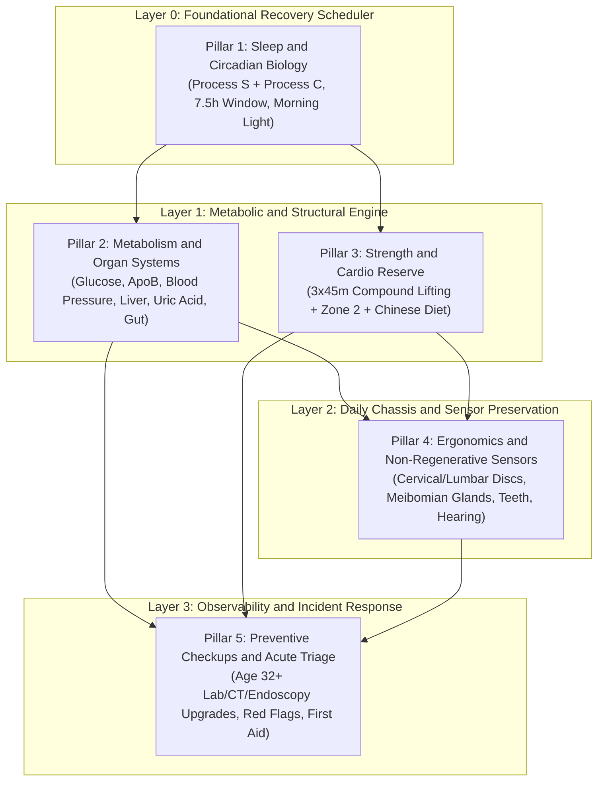
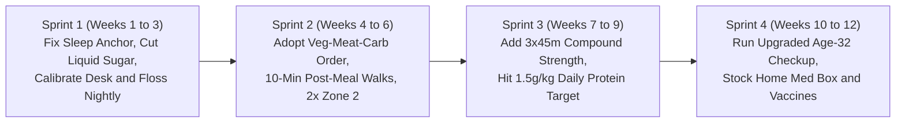

# Human Body Operating Manual: Health Common Sense at Age 32+

Most software engineers treat their bodies the way early-stage startups treat production infrastructure: zero observability, deferred maintenance, caffeinated hotfixes at 2:00 AM, and an implicit assumption that hardware never degrades. Throughout your twenties, an enormous **biological margin of safety** absorbs that abuse without throwing visible exceptions.

Around age 32, the underlying curve shifts. Recovery latency increases, post-lunch brain fog becomes predictable, waist circumference creeps upward even while body weight stays flat, neck and lower-back stiffness linger for days, and annual corporate checkup reports start accumulating subtle arrows (`脂肪肝`, `高尿酸`, `血脂边缘升高`, `甲状腺结节`). None of this means your hardware is broken. It means you have exited the warranty period where neglect was free, and entered the decade where **deliberate systems engineering** determines whether you operate at peak cognitive and physical output at age 45, 60, and 80.

---

## 1. Why Age 32 Is the Physiological Inflection Point

Aging is neither a cliff at 60 nor a linear slide; it is a set of compounding biological trajectories whose slopes steepen quietly in your early thirties if left unmanaged:

| Biological System                                     | Age 22 Baseline (Default Buffer)                             | Age 32+ Untrained Trajectory                                                                        | Engineering Countermeasure                                                               |
| :---------------------------------------------------- | :----------------------------------------------------------- | :-------------------------------------------------------------------------------------------------- | :--------------------------------------------------------------------------------------- |
| **Skeletal Muscle Mass**                              | Peak anabolic sensitivity; effortless maintenance            | Loses **3% to 8% per decade** after 30 (early sarcopenia), shrinking your primary glucose sink      | 2 to 3 weekly compound resistance sessions + $1.4\text{--}1.8\text{ g/kg}$ daily protein |
| **Cardiorespiratory Capacity** ($\text{VO}_{2\max}$) | High stroke volume and capillary density                     | Declines **$\sim 10\%$ per decade** when sedentary; strongest single predictor of all-cause mortality | Weekly Zone 2 aerobic base + periodic high-output intervals                              |
| **Metabolic & Hepatic Flexibility**                   | High peripheral insulin sensitivity; rapid glycogen disposal | Rising visceral fat and hepatic fat (`非酒精性脂肪肝`) even at normal BMI ("TOFI" phenotype)        | Eliminate liquid fructose, sequence meals (`菜 -> 肉 -> 饭`), walk 10 min post-meal      |
| **Intervertebral Discs & Fascia**                     | High nucleus pulposus proteoglycan hydration                 | Avascular discs lose water content; cumulative sitting shear stresses C5-C7 and L4-S1               | Ergonomic geometry + 45-minute posture cycling + deep cervical/core stabilization        |
| **Sleep Architecture**                                | Robust Slow-Wave Sleep (N3) even after erratic schedules     | N3 deep sleep amplitude declines naturally; late caffeine and alcohol fragment recovery             | Circadian light anchoring, 8-to-10-hour caffeine cutoff, cool dark bedroom               |
| **Vascular Endothelium**                              | Compliant arterial walls; minimal plaque burden              | Silent cumulative exposure to `ApoB` particles and borderline blood pressure ($130/85\text{ mmHg}$) | Track `ApoB`, `Lp(a)`, and home BP early; cut sodium via potassium-enriched salt         |

### The "TOFI" Trap in East Asian Software Engineers

A critical epidemiological blind spot for Chinese and East Asian adults is relying on Western BMI cutoffs. At the **exact same BMI** (for example, $22.5\text{ kg/m}^2$ — well inside the "normal" window), East Asians carry significantly higher **visceral adipose tissue (VAT)** and intrahepatic lipid than Caucasians. This phenotype is known clinically as **TOFI (Thin Outside, Fat Inside)**:

$$\text{BMI} = \frac{\text{Weight (kg)}}{\left[\text{Height (m)}\right]^2} \quad \text{vs.} \quad \text{WHtR (Waist-to-Height Ratio)} = \frac{\text{Waist Circumference (cm)}}{\text{Height (cm)}}$$

- **Chinese Adult BMI Cutoffs**: Normal is $18.5\text{--}23.9\text{ kg/m}^2$; Overweight begins at **$24.0\text{ kg/m}^2$**; Obesity at **$28.0\text{ kg/m}^2$** (stricter than WHO's $25.0$ and $30.0$).
- **Superior Metric — Waist-to-Height Ratio ($\text{WHtR}$)**: Measure horizontally across the navel after a normal exhale. Keep $\text{WHtR} < 0.50$ (for a $176\text{ cm}$ male, waist $< 88\text{ cm}$, and ideally $< 85\text{ cm}$ per Chinese metabolic syndrome criteria).

### Medicine 2.0 vs. Medicine 3.0 (Reactive Sick-Care vs. Proactive Engineering)

Traditional clinical care (**Medicine 2.0**, popularized as a framework by Dr. Peter Attia) excels at acute trauma, infections, and late-stage emergencies, but waits until a biomarker crosses a diagnostic disease threshold (e.g., Fasting Glucose $\ge 7.0\text{ mmol/L}$ for Type 2 Diabetes, or $70\%$ coronary stenosis for stenting) before intervening.

**Medicine 3.0** treats chronic disease the way Site Reliability Engineering (SRE) treats cascading failures: monitor leading indicators (`Fasting Insulin`, `ApoB`, `UACR`, `HbA1c`, `VO2max`, visceral fat) **10 to 20 years before symptom onset**, when lifestyle levers have $10\times$ the leverage of late-stage pharmacology. Your goal is not merely extending **Lifespan** (total years alive), but squaring the curve of **Healthspan** (years with sharp cognition, pain-free mobility, and metabolic freedom).

---

## 2. Evidence-Based Medicine (循证医学) vs. Folk Myths & Wellness Traps

When taking ownership of your health in your thirties, your first defensive filter is **scientific epistemology**. Health misinformation thrives because the human body exhibits two confounding phenomena:

1. **Self-Limiting Trajectories (`自限性疾病`)**: $90\%$ of upper respiratory viral infections resolve in 7 days on their own. Whatever tea, supplement, or folk remedy you took on Day 5 gets false causal credit on Day 7 (_post hoc ergo propter hoc_).
2. **Placebo & Regression to the Mean**: Chronic symptoms fluctuate naturally; people buy interventions at peak pain, then attribute the natural return toward baseline to the product.

### The Clinical Evidence Hierarchy

When evaluating any claim — whether from short-video influencers, family WeChat groups, or supplement ads — rank the evidence from highest to lowest reliability:

1. **Clinical Practice Guidelines & Systematic Reviews / Meta-Analyses of RCTs** (e.g., Cochrane, AHA/ACC, USPSTF, UpToDate, Chinese Medical Association `中华医学会` guidelines).
2. **Large Randomized Controlled Trials (RCTs)** with hard clinical endpoints (mortality, stroke, organ function) rather than surrogate marketing claims.
3. **Prospective Cohort Studies** (useful for long-term nutrition/epidemiology, but vulnerable to healthy-user bias).
4. **Animal / Cell-Culture (_In Vitro_) Studies** ("Compound X kills cancer cells in a Petri dish" — bleach also kills cancer cells in a Petri dish; $>90\%$ of murine findings fail in human trials).
5. **Expert Opinion, Celebrity Anecdotes, and Traditional Folk Lore (`偏方 / 祖传秘方`)**.

### High-Frequency Health Myths Debunked

| Common Myth (`常见误区`)                                                                                           | Physiological Reality                                                                                                                                                                                                                                                                        | Evidence-Based Replacement                                                                                                                                             |
| :----------------------------------------------------------------------------------------------------------------- | :------------------------------------------------------------------------------------------------------------------------------------------------------------------------------------------------------------------------------------------------------------------------------------------- | :--------------------------------------------------------------------------------------------------------------------------------------------------------------------- |
| **"Drink milky-white bone broth (`大骨汤`) to supplement calcium"**                                                | Milky color comes from emulsified animal fat and purines, not calcium. Calcium in bone is locked as insoluble hydroxyapatite; a bowl of bone broth contains **$< 5\text{ mg/100 mL}$** calcium (vs. $105\text{--}120\text{ mg/100 mL}$ in milk) while spiking uric acid and triglycerides.   | Drink $300\text{ mL}$ milk / lactose-free milk (`舒化奶`), eat firm tofu (`北豆腐`, coagulated with calcium sulfate), leafy greens, and maintain Vitamin D3.           |
| **"Take OTC 'liver-protecting pills' (`护肝片`) or herbal tonics to cure fatty liver and stay up late"**           | Every oral supplement must be metabolized by the liver's CYP450 enzymes. In China, **herbal and dietary supplements (`中药/保健品`, e.g., `何首乌`, `土三七`) are a leading cause of Drug-Induced Liver Injury (DILI / `药物性肝损伤`)**.                                                    | Lose $5\text{--}10\%$ body weight, cut liquid sugar/alcohol, do Zone 2 + resistance training. Black coffee (unsweetened) has genuine hepatoprotective cohort evidence. |
| **"Drink piping hot water / soup (`趁热喝`) to warm the stomach"**                                                 | Esophageal mucosa burns silently above $60^\circ\text{C}$. Chronic consumption of beverages **$> 65^\circ\text{C}$** causes repeated mucosal thermal injury and hyperplasia, classified by WHO/IARC as a **Group 2A Probable Carcinogen** for esophageal cancer.                             | Let tea, coffee, hotpot food, and soup cool below $50\text{--}55^\circ\text{C}$ (comfortable to hold against the lip for 3 seconds) before swallowing.                 |
| **"Sleep 5 hours Mon–Fri and 'catch up' by sleeping until noon Sat–Sun"**                                          | Weekend oversleeping recovers acute drowsiness poorly, leaves metabolic/cognitive deficits intact, and induces **Social Jetlag** — shifting your circadian clock 3 hours east every Sunday night, causing Monday insomnia.                                                                   | Anchor wake time within $\pm 45\text{ minutes}$ 7 days a week; use a 20-minute early-afternoon nap (`午休`) before 14:30 if sleep-deprived.                            |
| **"Never take Ibuprofen or Acetaminophen for headaches/fever because 'painkillers are addictive (`止痛药上瘾`)'"** | Confuses non-opioid NSAIDs/analgesics (`布洛芬 / 对乙酰氨基酚`) with narcotic opioids (`吗啡 / 羟考酮`). NSAIDs have **zero central addiction potential** when used occasionally at standard doses, whereas suffering severe pain spikes cortisol and blood pressure.                        | Use targeted single-ingredient Ibuprofen or Acetaminophen promptly for acute fever, migraine, or dental pain while respecting daily dose ceilings.                     |
| **"Sweating heavily or drinking detox juices 'flushes toxins' (`排毒`) from the body"**                            | Sweat is $99\%$ water plus $\text{Na}^+$, $\text{Cl}^-$, and $\text{K}^+$ for thermoregulation. Actual metabolic waste and xenobiotics are cleared almost $100\%$ by your **liver** (bile/stool) and **kidneys** (urine). Juice cleanses strip fiber and dump pure fructose onto your liver. | Hydrate adequately ($30\text{--}35\text{ mL/kg}$ water), eat $25\text{--}35\text{ g}$ whole dietary fiber, avoid alcohol, and protect liver/renal function.            |

---

## 3. The 5-Pillar Architecture & Curriculum Map

Think of your health as a five-layer stack. Optimizing supplements or esoteric biohacks while sleeping 5.5 hours on a slumped chair with untreated insulin resistance is the equivalent of tuning compiler flags while the database server is out of disk space.

### Clickable Curriculum Table of Contents

Work through this vault sequentially or jump directly to the subsystem experiencing friction today:

1. **[00-README.md](00-README.md) — Human Body Operating Manual: Health Common Sense at Age 32+** _(Current Document)_
   - Physiological inflection at 32, East Asian TOFI phenotype, Medicine 3.0 mental model, evidence-based myth-busting, baseline self-audit, and 90-day rollout plan.
2. **[01-METABOLISM-CARDIO-ORGAN-SYSTEMS.md](01-METABOLISM-CARDIO-ORGAN-SYSTEMS.md) — How Your Body Actually Works: Metabolism, Heart, Liver, Gut & Hormones**
   - Post-lunch brain fog (`晕碳`) and insulin resistance (`HOMA-IR`), reversing fatty liver (`脂肪肝`), `ApoB` and hypertension mechanics, uric acid and gout (`痛风`), kidney hydration, the gut-brain axis, and cortisol regulation.
3. **[02-SLEEP-CIRCADIAN-AND-DESK-ERGONOMICS.md](02-SLEEP-CIRCADIAN-AND-DESK-ERGONOMICS.md) — Sleep Architecture, Circadian Biology & Desk-Engineer Spine/Eye Protection**
   - Adenosine + melatonin mechanics, caffeine half-life math, curing revenge bedtime procrastination (`报复性熬夜`), cervical/lumbar disc pressure physics, anti-tech-neck mobility routine, dry-eye (`睑板腺`) care, Bass brushing/flossing, and hearing protection.
4. **[03-EXERCISE-AND-CHINESE-DIET-NUTRITION.md](03-EXERCISE-AND-CHINESE-DIET-NUTRITION.md) — High-ROI Exercise & Everyday Chinese Diet Optimization**
   - Minimum Effective Dose training ($3 \times 45\text{ min}$ strength + Zone 2 cardio), decoding Chinese home cooking and takeout (`外卖`) traps, meal eating order (`菜 -> 肉 -> 饭`), hand-portion macros, low-sodium potassium salt, and evidence-graded supplements.
5. **[04-ANNUAL-CHECKUPS-TRIAGE-AND-FIRST-AID.md](04-ANNUAL-CHECKUPS-TRIAGE-AND-FIRST-AID.md) — Age 32+ Medical Checkup Upgrades (体检加项指南), Symptom Triage & Home Medicine Box**
   - Upgrading corporate checkups (low-dose chest CT, `ApoB`, `HbA1c`, `C13` H. pylori, thyroid/carotid ultrasound, painless gastroscopy/colonoscopy timing), adult vaccines (flu, HPV, Hep B), ER red flags vs. viral colds, and a complete evidence-based home medicine box.

---

## 4. Age-32 Baseline Self-Audit Scorecard

Before changing ten habits at once, benchmark your current physical telemetry across objective physiological and functional metrics:

| Audit Dimension          | Metric / Simple Field Test                             | Warning Zone (Needs Action)                               | Optimal Age-32 Target                                                    |
| :----------------------- | :----------------------------------------------------- | :-------------------------------------------------------- | :----------------------------------------------------------------------- |
| **Visceral Adiposity**   | Waist-to-Height Ratio ($\text{WHtR}$) at navel         | $\ge 0.50$ (or male waist $\ge 85\text{ cm}$)             | **$0.43\text{--}0.48$**                                                  |
| **Resting Heart Rate**   | Morning seated/supine HR (wearable 7-day avg)          | $> 75\text{ bpm}$                                         | **$52\text{--}65\text{ bpm}$**                                           |
| **Blood Pressure**       | Validated upper-arm cuff, seated after 5 min rest      | $\ge 130/80\text{ mmHg}$                                  | **$< 120/80\text{ mmHg}$**                                               |
| **Sleep Regularity**     | Average actual sleep duration & wake-time variance     | $< 6.5\text{ h/night}$ or $> 90\text{ min}$ weekend drift | **$7.0\text{--}8.0\text{ h/night}$**, $\pm 30\text{ min}$ anchor         |
| **Postprandial Clarity** | Cognitive alertness at 14:30 after lunch               | Heavy eyelid crash requiring sugar/coffee                 | Sustained focus without somnolence                                       |
| **Grip & Upper Pulling** | Dead hang from pull-up bar (bodyweight, pronated)      | $< 30\text{ seconds}$                                     | **$\ge 60\text{--}90\text{ seconds}$**                                   |
| **Lower-Body & Core**    | Bodyweight deep squat (heels flat) + Front plank       | Heels lift / lumbar pain; plank $< 45\text{ s}$           | Comfortable 60s bottom squat + **$90\text{--}120\text{ s}$** clean plank |
| **Cervical Alignment**   | Occiput-to-Wall Test (heels, glutes, scapulae on wall) | Back of skull cannot touch wall without chin tipping up   | Occiput touches wall effortlessly with level gaze                        |
| **Oral & Ocular Health** | Gum bleeding when flossing; afternoon eye burning      | Bleeding gums (`牙龈出血`); gritty dry eyes               | Zero bleeding on nightly floss; comfortable blink film                   |
| **Preventive Telemetry** | Last comprehensive blood + imaging checkup             | $> 18\text{ months}$ ago or basic corporate X-ray only    | Annual upgraded panel + baseline `C13` & `LDCT`                          |

---

## 5. Execution Protocol: The 90-Day Incremental Rollout

The single most common failure mode among engineers is **all-or-nothing over-optimization**: buying RMB 5,000 of gym gear, supplements, and meal-prep containers on Sunday night, attempting 6 workouts a week on 1,500 kcal, pulling a lower-back muscle in Week 2, hitting a project crunch in Week 3, and abandoning everything by Week 4.

Biological adaptation obeys **consistency over intensity**. Roll out changes in four 3-week sprints so each layer becomes automatic before adding cognitive load:

### Five Golden Operating Rules for Busy Weeks

1. **Never Miss Twice (`绝不连续中断两次`)**: A production incident or business trip will inevitably disrupt a workout or dinner. One bad meal or missed gym session has zero measurable physiological impact; two weeks of abandonment resets neural habit loops. Scale down to a 15-minute bodyweight session rather than skipping completely.
2. **Automate the Environment, Never Rely on Willpower at 23:00**: Keep sugary drinks and ultra-processed snacks out of your apartment (`不在家里囤垃圾食品`), charge your phone outside bedroom arm's reach, keep dental floss right next to your toothbrush, and put a 500 mL water insulated flask directly under your monitor.
3. **Eliminate Asymmetric Downside Risks First**: Before chasing $2\%$ longevity marginal gains, eliminate catastrophic tail risks — always wear seatbelts (including rear seats in Didi/taxis), never drink heavy alcohol (`劝酒`), never ignore chest pressure or sudden neurological symptoms, never mix cephalosporins (`头孢`) or acetaminophen (`对乙酰氨基酚`) with alcohol, and keep smoke/CO detectors functional.
4. **Separate Diagnostic Facts from Health Anxiety (`疑病焦虑`)**: Discovering a `TI-RADS 2` thyroid cyst or mild fatty liver at age 32 is **good news** — observability caught a reversible or benign state early. Follow clinical stratification protocols rather than searching symptoms on unmoderated forums at midnight.
5. **Treat Health as Career Leverage**: A software engineer with stable blood glucose, pain-free posture, high $\text{VO}_{2\max}$, and 7.5 hours of restorative sleep produces higher-quality architectural judgment in 6 hours than an inflamed, sleep-deprived engineer produces in 12.

---

## 6. High-ROI Health Hardware & Services Worth Buying (vs. Traps to Skip)

Engineers love buying hardware to solve problems, yet wellness marketing is saturated with overpriced pseudoscience. Invest capital where clinical ergonomics and physics yield measurable daily returns:

| Domain                     | High-ROI Buy (Proven Daily Utility)                                                                                                                                                                                                                                                                                 | Money Pit / Health Trap to Skip                                                                                                                                                                                                                                                                                                                                             |
| :------------------------- | :------------------------------------------------------------------------------------------------------------------------------------------------------------------------------------------------------------------------------------------------------------------------------------------------------------------ | :-------------------------------------------------------------------------------------------------------------------------------------------------------------------------------------------------------------------------------------------------------------------------------------------------------------------------------------------------------------------------- |
| **Workstation & Spine**    | **27-inch+ 4K IPS/OLED Monitor + Hydraulic Monitor Arm** (frees desk depth, sets exact eye-level height); **Electric Sit-Stand Desk** (dual-motor, stable at standing height); **Adjustable Ergonomic Mesh Chair** (adjustable seat depth, 4D armrests, lumbar tension) + **$57^\circ$ Vertical Mouse** | **"Posture Corrector Straps" (`背背佳`)**: Passively pulls shoulders back while causing your deep postural muscles to atrophy further; **Aggressive Cervical Percussion Guns / Mall Massage Chairs**: Never use percussion guns (`筋膜枪`) on the neck — carotid artery dissection (`颈动脉夹层`) causing stroke in 30-year-olds is a documented medical emergency! |
| **Sleep & Indoor Air**     | **100% Blackout Curtains** + **Medium-Firm Pocket-Spring / Latex Mattress**; **HEPA Air Purifier** (for `PM2.5` & dust-mite allergies) + **NDIR** $\mathbf{CO_2}$ **/ Humidity Monitor** (alerts when bedroom $\text{CO}_2 > 1,000\text{ ppm}$)                                                         | **"Magnetic Therapy / Graphene / Negative-Ion Mattresses" (`磁疗/石墨烯床垫`)**: Pure pseudoscience sold at $10\times$ markup; **High-Dose Melatonin Gummies ($5\text{--}10\text{ mg}$ nightly)**: Supraphysiological hormone flooding; stick to light hygiene first.                                                                                               |
| **Oral, Ocular & Hearing** | **Sonic or Oscillating Electric Toothbrush with Pressure Sensor** + **PTFE/Waxed String Floss**; **Regulated $40^\circ\text{C}$ Heated Eye Mask** + **Single-Dose Preservative-Free Sodium Hyaluronate**; **Flagship ANC Headphones/Earbuds** (protects cochlea on subways/flights)                     | **Whitening Charcoal Powders / Acidic Lemon Rinses**: Abrade and demineralize tooth enamel permanently; **Cooling Vasoconstrictor Eye Drops** (`网红清凉去红血丝眼药水`): Rebound vasodilation and preservative corneal toxicity.                                                                                                                                   |
| **Kitchen & Diagnostics**  | **Low-Sodium Potassium-Enriched Salt (`低钠高钾盐`)** + **Oil Mist Sprayer Bottle** (caps stir-fry oil to $5\text{--}10\text{ g}$); **Validated Upper-Arm BP Monitor (Omron)** + **Digital Thermometer** + **Pulse Oximeter**                                                                            | **"Alkaline / Hydrogen-Rich / Small-Molecule Water Machines" (`碱性水/富氢水机`)**: Stomach acid ($\text{pH } 1.5$) neutralizes alkaline water in seconds; human blood $\text{pH}$ is tightly buffered at $7.35\text{--}7.45$ by lungs and kidneys regardless of water $\text{pH}$.                                                                                       |
| **Clinical Services**      | **Annual Public Grade-A Tertiary Hospital (`三甲医院`) Upgraded Checkup**; **Semi-Annual Ultrasonic Dental Scaling (`超声波洗牙`)**; **3 to 5 Sessions with a Certified Sports Physical Therapist (`运动康复师`)** or qualified strength coach to audit squat/deadlift/hinge mechanics                   | **Unlicensed Bone-Setting (`街边盲目正骨掰脖子`)**: High-velocity cervical thrust manipulation without prior imaging risks vertebral artery dissection and acute disc extrusion; **"Lymphatic Detox / Ovarian-Prostate Essential Oil Spa Packages"**: Zero anatomical basis.                                                                                        |

---

## 7. Navigating Grade-A Hospitals (`三甲医院`) Like an Engineer

In Chinese public Grade-A tertiary hospitals (`公立三甲医院`), outpatient doctors often must see 50 to 80 patients in a single morning, leaving **3 to 6 minutes per consultation**. Walking in unprepared ("Doctor, I haven't felt great lately") wastes half the window. Run a structured outpatient protocol:

### Step 1: Smart Triage Registration (`先挂普通/专病号开单，出结果再挂专家号`)

- For routine follow-ups, prescription refills, or ordering initial imaging/bloodwork (`开具彩超、CT、核磁、抽血单`), book an **Ordinary Outpatient or Disease-Specific Clinic (`普通号 / 专病门诊`, e.g., `脂肪肝门诊`, `肺结节门诊`, `睡眠门诊`)** via the hospital's official WeChat mini-program or Alipay — zero 3-week wait, exact same lab analyzers and CT scanners.
- Once all lab PDFs and radiology reports are finalized in the app, book a **Senior Specialist / Chief Physician (`副主任/主任医师专家号`)** so they spend $100\%$ of their time interpreting complete evidence and formulating your treatment plan.

### Step 2: The 60-Second "SBAR" Consultation Script

Prepare 4 bullet points on your phone notes before your number is called:

1. **Chief Complaint + Exact Timeline (`主诉与时间线`)**: _"Male, 32, software engineer. Intermittent dull epigastric burning for 3 weeks, mostly 2 hours after dinner and when lying flat at night."_
2. **Objective Telemetry & Prior Reports (`客观数据与既往对比`)**: _"Checkup 2 weeks ago showed `C13` breath test positive (`DOB = 18.4`), mild fatty liver (`ALT 46`), last year's ultrasound had normal gallbladder. No black stools, no weight loss."_
3. **Medications Tried & Drug Allergies (`已用药与过敏史`)**: _"Took 2 chewable hydrotalcite tablets (`达喜`) twice — relieved burning within 15 minutes. No antibiotic/PPI use in the past month. Allergic to penicillin (`青霉素过敏`)."_
4. **Clear Decision Question (`明确诉求`)**: _"Should I start a non-penicillin 14-day bismuth quadruple eradication regimen today, or schedule a baseline painless gastroscopy first?"_

Doctors immediately respect structured, objective histories — diagnostic precision skyrockets and miscommunication drops to near zero.

### Step 3: Longitudinal Personal Health Git Repo

Create one encrypted cloud/local folder (`Health-Telemetry/`) organized by year (`2026/`, `2027/`):

- Store every annual checkup PDF, immunization record, dental panoramic X-ray, endoscopy pathology report, and raw **DICOM chest CT files** (ask the hospital radiology self-service kiosk for the digital cloud link or DVD if monitoring any nodule).
- Comparing a $4\text{ mm}$ lung nodule across 3 consecutive annual DICOM scans proving **zero volume growth over 36 months** is far more reassuring than any single snapshot.

---

Proceed to **[01-METABOLISM-CARDIO-ORGAN-SYSTEMS.md](01-METABOLISM-CARDIO-ORGAN-SYSTEMS.md)** to understand the internal mechanics of your metabolic, cardiovascular, hepatic, renal, gut, and endocrine systems.
