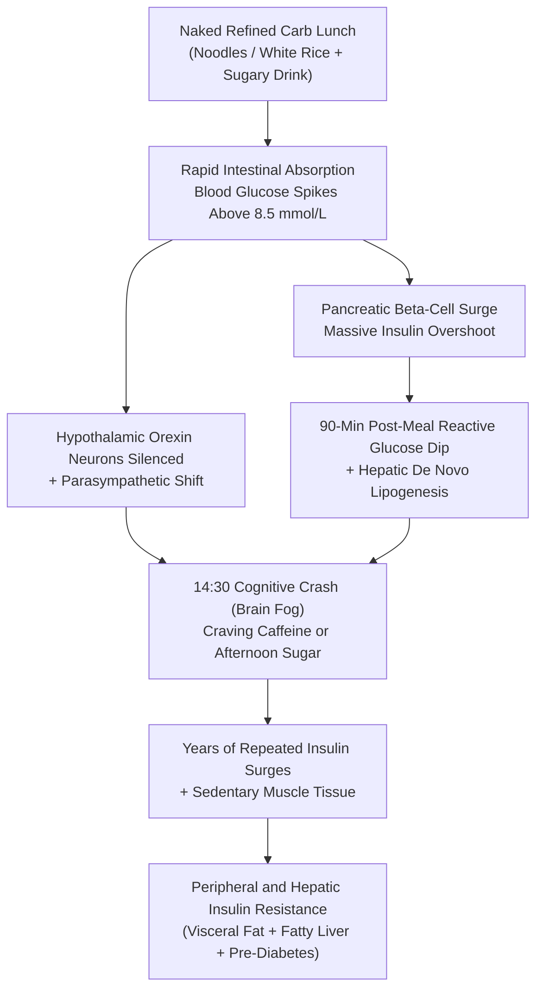
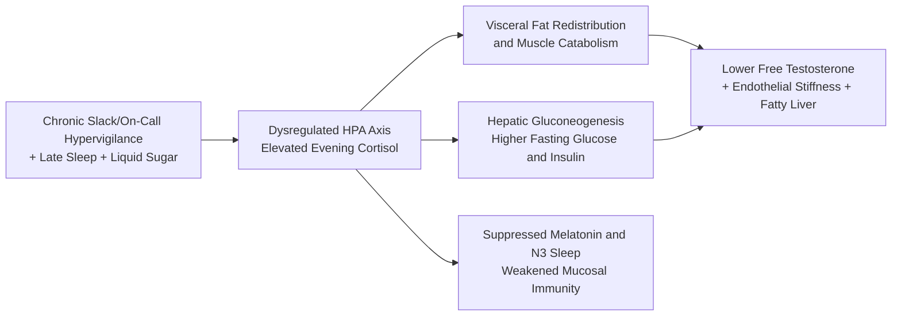

# How Your Body Actually Works: Metabolism, Heart, Liver, Gut & Hormones

Understanding internal physiology transforms vague symptoms — 2:30 PM brain fog, creeping belly fat, elevated transaminases (`转氨酶升高`), borderline uric acid, or deadline-induced stomach cramps — from mysterious bad luck into deterministic cause-and-effect loops you can debug at the root.

---

## 1. Blood Glucose, Insulin Resistance & Afternoon Brain Fog (晕碳)

### Why You Crash at 14:30 After a Bowl of Noodles

Every software engineer knows the feeling: you eat a large bowl of beef noodles, fried rice (`盖浇饭`), or white rice with starchy stir-fry at 12:15 PM, perhaps washed down with a half-sugar iced tea. By 14:15 PM, your eyelids feel weighted with lead and reading a pull request takes triple the effort. In Chinese office culture this is called **"carb dizziness" (`晕碳` / Postprandial Somnolence)**.

Three simultaneous physiological mechanisms drive that crash:

1. **Rapid Glycemic Spike & Insulin Overshoot**: Refined starches stripped of fiber digest rapidly into glucose across the small intestine, spiking blood glucose from a baseline of $\sim 4.8\text{ mmol/L}$ ($86\text{ mg/dL}$) up past $8.5\text{--}10.0\text{ mmol/L}$ within 45 minutes. Pancreatic $\beta$-cells respond with a massive bolus of **insulin**. Because insulin stays elevated longer than the rapidly absorbed starch, blood glucose plunges sharply around 90 to 120 minutes post-meal (**reactive dip**), starving prefrontal cortex neurons of steady fuel.
2. **Orexin (Hypocretin) Neuron Suppression**: Wakefulness and mental drive are maintained by **orexin-producing neurons** in the lateral hypothalamus. High extracellular glucose directly hyperpolarizes and silences orexin neurons, flipping the brain from sympathetic alertness into parasympathetic rest-and-digest lethargy.
3. **Tryptophan Transport Shift**: The large insulin surge drives branched-chain amino acids (BCAAs) into muscle tissue while leaving free **tryptophan** in the bloodstream to cross the blood-brain barrier unopposed, where it converts into **serotonin** and **melatonin**.

### Why Fasting Glucose Alone Misses Early Insulin Resistance by 5 to 10 Years

In a standard corporate checkup, most people look at **Fasting Blood Glucose (`空腹血糖`)**, see $5.2\text{ mmol/L}$ (reference $3.9\text{--}6.1\text{ mmol/L}$), and assume their carbohydrate metabolism is flawless.

That is a classic observability failure. When your skeletal muscles and liver become **insulin resistant** (from sitting 10 hours a day and carrying excess visceral fat), your pancreas compensates by secreting **$2\times$ to $4\times$ more insulin** to force glucose back down into the normal range. Your fasting glucose looks normal for a full decade while **chronic hyperinsulinemia** silently drives visceral fat storage, fatty liver, hypertension, and endothelial inflammation — until $\beta$-cells eventually exhaust and fasting glucose finally breaks above $6.1\text{ mmol/L}$.

Track the **three true leading indicators** of glucose metabolism instead:

$$\text{HOMA-IR} = \frac{\text{Fasting Insulin }(\mu\text{U/mL}) \times \text{Fasting Glucose }(\text{mmol/L})}{22.5}$$

- **`HOMA-IR` (Homeostatic Model Assessment for Insulin Resistance)**:
  - Optimal insulin sensitivity: **$< 1.5$**
  - Early insulin resistance warning: **$1.5\text{--}2.5$**
  - Significant insulin resistance: **$> 2.5$**
- **`HbA1c` (`糖化血红蛋白`)**: Measures the percentage of hemoglobin glycated over the lifespan of red blood cells (past 8 to 12 weeks). Clinical pre-diabetes starts at $5.7\%$; aim for **$4.8\%\text{--}5.3\%$**.
- **Triglyceride-to-HDL Ratio (`甘油三酯 / 高密度脂蛋白胆固醇`)**: In $\text{mmol/L}$ units, a ratio **$> 1.3\text{--}1.5$** strongly correlates with insulin resistance and small dense LDL particles; aim for **$< 0.9$**.

---

## 2. Reversing Non-Alcoholic Fatty Liver Disease (脂肪肝 / MASLD)

**Metabolic Dysfunction-Associated Steatotic Liver Disease (MASLD, formerly NAFLD / `非酒精性脂肪肝`)** is now the single most common abnormal finding in 30-to-40-year-old Chinese tech workers, affecting roughly $30\%$ of urban adults — including many men whose weight appears completely average.

### How Fat Accumulates Inside a "Thin" Engineer's Liver

Fatty liver is **not** primarily caused by eating fatty meat; it is driven by **substrate overflow and hepatic _de novo_ lipogenesis (DNL)**:

1. **The Liquid Fructose Express Lane**: Glucose can be used by every cell in your body, but **fructose** (`果糖` — half of sucrose `白砂糖` and the dominant sugar in high-fructose corn syrup `果葡糖浆` found in milk tea, iced lemon tea, cola, and fruit juice) is metabolized almost exclusively by the **liver** via fructokinase without negative feedback regulation. When a bolus of liquid fructose hits the portal vein faster than the intestine can buffer it, the liver converts the excess directly into **palmitate and triglycerides** droplets inside hepatocytes, while simultaneously generating uric acid.
2. **Skeletal Muscle Refusal**: When untrained leg and back muscles sit idle all day, their glycogen tanks stay full. Post-meal carbohydrates have nowhere to go except the liver, which packages them into VLDL triglycerides (`甘油三酯`) and intrahepatic fat.
3. **Progression Pipeline**: `Simple Steatosis (单纯性脂肪肝)` $\rightarrow$ `MASH / Steatohepatitis (脂肪性肝炎, elevated ALT/AST/GGT)` $\rightarrow$ `Hepatic Fibrosis (肝纤维化)` $\rightarrow$ `Cirrhosis / HCC (肝硬化)`. The first two stages are **100% reversible**.

### Decoding Liver Enzymes & Imaging

- **`ALT` (`谷丙转氨酶`) & `AST` (`谷草转氨酶`)**: Intracellular enzymes leaked into blood when hepatocytes are inflamed or damaged. Even though many hospital labs list the upper limit of normal for `ALT` as $40\text{ or }50\text{ U/L}$, hepatology guidelines note that **true healthy physiological `ALT` is $< 30\text{ U/L}$ in men and $< 19\text{--}25\text{ U/L}$ in women**.
- **`GGT` (`谷氨酰转肽酶`)**: Sensitive marker of oxidative stress, biliary irritation, alcohol intake, and visceral/hepatic fat. Aim for **$< 30\text{ U/L}$**.
- **B-Mode Ultrasound vs. FibroScan (`瞬时弹性成像`)**: Standard abdominal ultrasound only detects fatty liver once $> 20\%$ of hepatocytes contain fat droplets. If ultrasound shows moderate fatty liver or elevated `ALT`, a 5-minute **FibroScan** quantifies both exact fat attenuation (`CAP` in $\text{dB/m}$, normal $< 238\text{ dB/m}$) and fibrosis stiffness (`LSM` in $\text{kPa}$, normal $< 7.0\text{ kPa}$).

### Evidence-Based 4-Step Fatty Liver Reversal Protocol

1. **Zero Liquid Sugar & Zero Alcohol for 12 Weeks**: Cut all sweetened teas, sodas, fruit juices, and beer/spirits. Eat whole low-sugar fruits (berries, kiwi, apple, citrus) in moderation — intact fiber slows fructose delivery so intestinal enzymes handle most of it before it reaches the liver.
2. **Target a $5\%\text{--}10\%$ Body Weight Reduction (or Visceral Recomposition)**: Clinical biopsy trials prove that losing **$5\%$ of body weight** noticeably reduces liver fat, losing **$7\%$** resolves steatohepatitis (`MASH`), and losing **$\ge 10\%$** regresses early fibrosis (`F1/F2`) in the majority of patients.
3. **Combine Zone 2 Cardio + Resistance Training ($150\text{--}200\text{ min/week}$)**: Exercise reduces intrahepatic triglyceride content by **$20\%\text{--}30\%$ even if scale weight barely moves**, by restoring muscle GLUT4 uptake and hepatic $\beta$-oxidation.
4. **Drink Unsweetened Black Coffee, Skip "Liver Supplements" (`护肝片`)**: 2 cups of filtered black coffee before noon is consistently associated in meta-analyses with lower `ALT/GGT` and reduced hepatic fibrosis risk. Conversely, unregulated OTC "liver detox" pills, silymarin mega-stacks, or polygonum multiflorum (`何首乌`) add metabolic burden and risk **Drug-Induced Liver Injury (DILI)**.

---

## 3. Cardiovascular Mechanics: ApoB, LDL-C, Lp(a) & Blood Pressure

Atherosclerotic cardiovascular disease (heart attack and stroke — the #1 cause of mortality in China) does not appear suddenly at age 58. Autopsy and CT coronary angiography studies show fatty streaks and non-calcified plaques forming in the late twenties and thirties. Plaque accumulation follows a **cumulative exposure integral**:

$$\text{Cumulative Plaque Burden} \propto \int_{\text{Age } 0}^{\text{Age } T} \left(\text{ApoB Concentration} \times \text{Endothelial Shear Damage}\right) \, dt$$

Lowering `ApoB` and blood pressure modestly at age 32 prevents vastly more arterial damage than aggressive emergency statins at age 55 after plaques have already calcified.

### Lipids: Why `ApoB` Beats Total Cholesterol

Cholesterol is water-insoluble and travels inside spherical lipoprotein cargo ships. Every single atherogenic particle capable of penetrating the arterial wall — `LDL`, `VLDL`, `IDL`, and `Lp(a)` — carries **exactly one molecule of Apolipoprotein B (`载脂蛋白B`, ApoB)** on its surface.

- **`LDL-C` (`低密度脂蛋白胆固醇`)** measures the _mass of cholesterol cargo_ inside LDL particles, whereas **`ApoB`** counts the _exact number of plaque-forming ships_ crashing against your endothelium. In engineers with insulin resistance or elevated triglycerides, `LDL-C` can look borderline normal while `ApoB` particle count is dangerously high (**discordance**).
  - Standard low-risk optimal target at age 32: **`LDL-C` $< 2.6\text{ mmol/L}$ ($100\text{ mg/dL}$)** and **`ApoB` $< 0.80\text{ g/L}$ ($80\text{ mg/dL}$)** (stricter $< 0.65\text{ g/L}$ if family history or hypertension exists).
- **`Lp(a)` (`脂蛋白a`)**: A genetically determined, extra-sticky, pro-thrombotic LDL variant. Diet and exercise barely change it ($80\%\text{--}90\%$ genetic). **Test `Lp(a)` once in your thirties**; if elevated ($> 300\text{ mg/L}$ or $> 75\text{ nmol/L}$), you offset that inherited risk by keeping `ApoB`, blood pressure, and blood sugar impeccably low.

### Blood Pressure: Why $132/86\text{ mmHg}$ at Age 32 Is Not Benign

Think of blood pressure as mechanical PSI inside delicate microvascular tubing (brain, retina, renal glomeruli, coronary arteries). While many clinics traditionally diagnosed hypertension at $\ge 140/90\text{ mmHg}$, ACC/AHA and recent Chinese consensus trials recognize **$130\text{--}139 / 80\text{--}89\text{ mmHg}$** in young adults as elevated cardiovascular and renal risk:

- **White-Coat vs. Masked Hypertension**: Hospital measurements after rushing up stairs are notoriously noisy. Buy a validated upper-arm oscillometric cuff (e.g., Omron `上臂式血压计`, **never wrist cuffs**).
- **7-Day Home BP Protocol**: Measure twice (1 minute apart) in the morning after urination before breakfast/coffee, and twice before bed, seated quietly with back supported, feet flat, and cuff at heart level. Optimal 7-day average: **$< 120/80\text{ mmHg}$** (Home hypertension threshold: $\ge 135/85\text{ mmHg}$).
- **Chinese H-Type Hypertension (`H型高血压`)**: Roughly $75\%$ of hypertensive Chinese adults also have elevated **Homocysteine (`同型半胱氨酸`, $\ge 10\text{--}15\ \mu\text{mol/L}$)** due to common `MTHFR C677T` genetic variants and low folate intake from overcooked vegetables, which multiplies stroke risk synergistically. Eating lightly steamed dark leafy greens and supplementing low-dose folate ($0.4\text{--}0.8\text{ mg}$ if clinically indicated) directly lowers homocysteine.

---

## 4. Uric Acid (尿酸), Gout (痛风) & Kidney Hydration

Hyperuricemia (`高尿酸血症`, fasting serum uric acid **$> 420\ \mu\text{mol/L}$** on two separate days) has surged among Chinese men in their twenties and thirties. Above $420\ \mu\text{mol/L}$ ($7.0\text{ mg/dL}$), monosodium urate reaches physicochemical saturation in cooler peripheral joints (classic first metatarsophalangeal big-toe joint), precipitating needle-shaped crystals that trigger excruciating **acute gouty arthritis (`痛风`)** as well as silent urate kidney stones and renal microvascular damage.

### The 80/20 Purine Reality & the Hidden Fructose Trigger

Only **$\sim 20\%$** of serum uric acid comes directly from dietary purines; **$\sim 80\%$** comes from endogenous cellular turnover and **renal/intestinal excretion efficiency**. Four everyday habits choke renal urate excretion or overdrive hepatic synthesis:

1. **Sugary Drinks / Fructose (`果糖`)**: Rapid phosphorylation of fructose in the liver consumes intracellular phosphate and $\text{ATP}$, degrading $\text{AMP} \rightarrow \text{IMP} \rightarrow \text{Uric Acid}$ within 30 minutes of drinking iced tea or juice, while simultaneously stimulating `URAT1` transporters to reabsorb urate in the kidneys.
2. **Alcohol (Especially Beer & Spirits)**: Ethanol metabolism elevates blood **lactate** and **ketones**, which directly compete with uric acid for renal tubular secretion, slamming the exit door shut while beer adds highly absorbable **guanosine** purines.
3. **Concentrated Meat Broths & Organ Meats**: Purines are **water-soluble**. Simmering pork bones, chicken, or seafood for hours (`老火靓汤`, `火锅浓汤底`, `肉汤拌饭`) leaches huge purine loads directly into the soup. Boiled/blanched solid meat (`焯水后的瘦肉`) retains protein with far fewer purines than the broth.
4. **Crash Fasting / Intense Anaerobic Dehydration**: Sudden starvation ketosis or heavy sweating without water replacement spikes serum uric acid and can precipitate an acute gout attack.

### Protecting Your Kidneys (`双肾保养`)

Kidneys contain ~2 million fragile **nephrons** that do not regenerate once scarred, and remain completely asymptomatic until $> 50\%\text{--}70\%$ of function is lost:

- **Key Labs**: Track **Serum Creatinine (`血肌酐`)** alongside **Cystatin C (`胱抑素C`)** (Cystatin C is unaffected by muscle mass or creatine supplementation when calculating `eGFR`!), plus **Urinalysis (`尿常规`)** and **Urine Albumin-to-Creatinine Ratio (`尿微量白蛋白/肌酐比值`, UACR $< 30\text{ mg/g}$)** to catch early glomerular leakage.
- **Daily Hydration Formula**: Target **$30\text{--}35\text{ mL/kg}$** of total fluids daily (approx. **$2.0\text{--}2.5\text{ L/day}$** of plain water, sparkling water, or unsweetened weak tea for a $70\text{ kg}$ adult; add $500\text{ mL}$ per hour of sweaty exercise).
- **Practical Telemetry**: Urine should be **pale straw yellow (`淡柠檬色`)** by mid-morning. Never hold urine for 3 hours during deep coding blocks (`不憋尿`), and avoid nephrotoxic abuse of NSAIDs when dehydrated or unproven herbal compounds containing aristolochic acid (`马兜铃酸`).

---

## 5. The Gut-Brain Axis, Microbiome & Digestive Common Sense

Your gastrointestinal tract houses **100 million enteric neurons** (the Enteric Nervous System) connected bidirectionally to your brainstem via the **vagus nerve (`迷走神经`)**, produces $\sim 90\%\text{--}95\%$ of the body's serotonin (regulating motility and visceral sensation), and hosts trillions of microbes fermenting dietary fiber into **Short-Chain Fatty Acids (SCFAs)** like **butyrate**, which fuel colonocytes and seal intestinal tight junctions.

### Solving Common Engineer GI Failure Modes

- **Deadline Diarrhea / Bloating (`肠易激综合征` IBS)**: Acute sympathetic stress diverts splanchnic blood flow away from the gut, alters vagal tone, increases colonic motility, and heightens visceral pain sensitivity. Slowing eating speed (chew 15 to 20 times per bite, minimum 15 minutes per meal away from Slack), soluble fiber (oats, psyllium), and diaphragmatic breathing calm visceral hypersensitivity.
- **Adult Lactose Intolerance (`乳糖不耐受`)**: Roughly **$80\%\text{--}90\%$ of East Asian adults** downregulate intestinal lactase expression after childhood (`LCT` gene persistence is rare). Undigested lactose reaches the colon, causing osmotic diarrhea, gas, and cramping within 1 to 2 hours of drinking regular milk or caffe latte. **Fix**: Switch to zero-lactose milk (`舒化奶` / lactase-treated milk), strained Greek yogurt, aged cheese, soy milk (`无糖豆浆`), or oat milk.
- **Silent Acid Reflux (`胃食管反流` GERD / LPR)**: Eating heavy, greasy late-night takeout (`夜宵烧烤/小龙虾`) at 22:30 and lying flat at 23:30 allows gastric acid and pepsin to wash past a relaxed lower esophageal sphincter (LES), causing morning throat clearing, chronic cough, or retrosternal burning. **Fix**: Finish your last meal **at least 3 hours before lying flat**, limit evening fat/mint/alcohol, and sleep slightly inclined or on your **left side** (anatomically keeps the gastric fundus below the gastroesophageal junction).
- **Daily Fiber Titration**: Aim for **$25\text{--}35\text{ g/day}$** from diverse plants (leafy greens, mushrooms `菌菇类`, seaweed `海带/木耳`, legumes, oats, berries). Increase fiber gradually over 2 weeks with extra water to avoid transient gas.

---

## 6. Stress Cortisol, Thyroid & Age-32 Hormone Preservation

### Mastering Cortisol (`皮质醇`) Without Demonizing It

Cortisol is not an "evil hormone" — a sharp **Cortisol Awakening Response (CAR)** within 30 to 45 minutes of waking (triggered by morning daylight) makes you focused, energized, and anti-inflammatory. Pathology arises when cortisol curve **flattens** — sluggish in the morning and **chronically elevated at 22:00** from unresolved psychological threat loops, sleep restriction, and over-caffeination:

- **60-Second Physiological Sigh (`生理性叹息`)**: Proven in Stanford respiratory psychophysiology trials (Balban et al., _Cell Reports Medicine_) as the fastest real-time brake on sympathetic arousal. Inhale deeply through the nose, immediately take a **second short sharp inhale** at the top to pop open collapsed pulmonary alveoli, then **exhale slowly and completely through the mouth** for twice the duration of the inhale. Repeat 2 to 3 cycles before high-stakes meetings or after stressful incidents; long exhales activate cardiac vagal efferents via respiratory sinus arrhythmia.
- **Hard Shutdown Ritual**: Close work laptops, mute non-paging notifications after a defined cutoff hour, and take a 10-minute outdoor decompression walk to signal safety to the amygdala.

### Thyroid & Androgen / Sex Hormone Basics

- **Thyroid (`甲状腺`)**: Master thermostat of basal metabolic rate. Unexplained fatigue, cold intolerance, constipation, dry skin, and weight gain point toward **hypothyroidism** (`甲减`, high `TSH`, low `FT4`); unexplained palpitations, anxiety, heat intolerance, hand tremor, and weight loss point toward **hyperthyroidism** (`甲亢`, suppressed `TSH`, high `FT3/FT4`). Note that coastal Chinese residents eating heavy kelp/laver (`海带/紫菜`) plus iodized salt should avoid excessive iodine overload if positive for `TPOAb` (`桥本甲状腺炎` Hashimoto's).
- **Testosterone & Vitality at 32+**: Natural serum testosterone declines $\sim 1\%$ per year after 30, accelerated dramatically by **visceral obesity** (adipose aromatase converts testosterone into estradiol), **sleep under 6 hours** (1 week of 5-hour sleep drops young men's daytime testosterone by **$10\%\text{--}15\%$** — equivalent to aging 10 to 15 years!), extreme low-fat crash dieting (`脂肪摄入过低 < 0.6g/kg`), and Vitamin D / Zinc deficiency. Fix sleep, body composition, compound leg/back lifting, and dietary healthy fats before ever falling for questionable "testosterone booster" supplements.

---

## 7. Master Internal Telemetry Reference Table

Use this reference table alongside your annual bloodwork (covered in detail in **[04-ANNUAL-CHECKUPS-TRIAGE-AND-FIRST-AID.md](04-ANNUAL-CHECKUPS-TRIAGE-AND-FIRST-AID.md)**):

| Organ System          | Biomarker (`指标名称`)                | Standard Hospital Range                | Optimal Age-32 Target                  | Primary Lifestyle Lever                                               |
| :-------------------- | :------------------------------------ | :------------------------------------- | :------------------------------------- | :-------------------------------------------------------------------- |
| **Glucose / Insulin** | Fasting Glucose (`空腹血糖`)          | $3.9\text{--}6.1\text{ mmol/L}$        | **$4.4\text{--}5.1\text{ mmol/L}$**    | Meal order (`菜->肉->饭`), 10-min post-meal walk                      |
| **Glucose / Insulin** | `HbA1c` (`糖化血红蛋白`)              | $4.0\%\text{--}6.0\%$                  | **$4.8\%\text{--}5.3\%$**              | Cut refined carbs & liquid sugars; build muscle                       |
| **Glucose / Insulin** | `HOMA-IR` (`胰岛素抵抗指数`)          | Often uncalculated ($< 2.5$)           | **$< 1.5$**                            | Zone 2 cardio + compound strength + sleep $\ge 7\text{ h}$            |
| **Liver**             | `ALT` / `GGT` (`谷丙 / 谷氨酰转肽酶`) | $0\text{--}40\text{ or }50\text{ U/L}$ | **$< 25\text{--}30\text{ U/L}$**       | Lose $5\text{--}10\%$ weight, zero fructose/alcohol, black coffee     |
| **Cardiovascular**    | `ApoB` (`载脂蛋白B`)                  | $0.60\text{--}1.10\text{ g/L}$         | **$< 0.80\text{ g/L}$**                | Swap saturated animal fat/palm oil for olive/fish/nuts; soluble fiber |
| **Cardiovascular**    | `LDL-C` (`低密度脂蛋白`)              | $< 3.4\text{ mmol/L}$                  | **$< 2.6\text{ mmol/L}$**              | Reduce deep-fried takeout, trans fats, butter/lard                    |
| **Cardiovascular**    | Triglycerides (`甘油三酯`)            | $< 1.70\text{ mmol/L}$                 | **$< 1.0\text{ mmol/L}$**              | Cut refined starch, alcohol, sugary beverages; Omega-3                |
| **Cardiovascular**    | Home Blood Pressure (`家庭血压`)      | $< 135/85\text{ mmHg}$                 | **$< 120/80\text{ mmHg}$**             | Potassium-enriched low-sodium salt, aerobic training, waist loss      |
| **Cardiovascular**    | Homocysteine (`同型半胱氨酸`)         | $< 15\ \mu\text{mol/L}$                | **$< 10\ \mu\text{mol/L}$**            | Lightly cooked leafy greens, B-vitamins / folate if elevated          |
| **Purine / Renal**    | Serum Uric Acid (`血尿酸`)            | $< 420\ \mu\text{mol/L}$               | **$240\text{--}360\ \mu\text{mol/L}$** | $2.2\text{ L}$ water/day, zero fructose/beer/meat broth, dairy intake |
| **Renal**             | `UACR` (`尿微量白蛋白/肌酐比`)        | $< 30\text{ mg/g}$                     | **$< 10\text{ mg/g}$**                 | Control BP & glucose, hydrate, avoid nephrotoxic drugs                |
| **Endocrine / Bone**  | `25-OH Vitamin D` (`25羟维生素D`)     | $20\text{--}100\text{ ng/mL}$          | **$30\text{--}50\text{ ng/mL}$**       | $1000\text{--}2000\text{ IU/day}$ Vitamin D3 + brief midday sun       |

---

## 8. Immune Common Sense, Decoding CBC (`血常规`) & Urban Allergies

Many adults talk vaguely about "boosting immunity (`提高免疫力`)," unaware that an overactive, misdirected immune system causes allergies, asthma, eczema, and autoimmune thyroiditis, while chronic sleep deprivation and visceral fat drive **sterile low-grade systemic inflammation (`慢性低度炎症`, measured via `hs-CRP`)**. You want **immune calibration**, not blind hyper-stimulation.

### How to Read a 5-Minute Complete Blood Count (`血常规 + CRP`) at the Clinic

Whenever you visit an outpatient clinic with a fever or throat pain, a finger-prick or venous `CBC + CRP` (`血常规 + C反应蛋白`) differentiates the broad physiological picture in 20 minutes:

| `CBC` Line Item (`血常规核心项`)                                                | Physiological Role                | Elevated (`↑`) Common Meaning                                                                                                       | Decreased (`↓`) Common Meaning                                                                                                                                                                                                      |
| :------------------------------------------------------------------------------ | :-------------------------------- | :---------------------------------------------------------------------------------------------------------------------------------- | :---------------------------------------------------------------------------------------------------------------------------------------------------------------------------------------------------------------------------------- |
| **White Blood Cells (`WBC / 白细胞计数`) + Neutrophils (`NEUT% / 中性粒细胞`)** | Frontline bacterial phagocytes    | Acute bacterial infection, severe tissue stress, or steroid drug effect (especially when paired with **`CRP > 20–40 mg/L`**)        | Viral suppression (influenza/EBV/dengue often _drop_ total `WBC`!), drug reaction                                                                                                                                                   |
| **Lymphocytes (`LYMPH / 淋巴细胞`) & Monocytes (`MONO / 单核细胞`)**            | Antiviral T/B cells & macrophages | Acute viral respiratory/GI infection (`普通感冒 / 甲乙流 / 诺如`)                                                                   | Acute cortisol stress or early-phase influenza lymphopenia                                                                                                                                                                          |
| **Eosinophils (`EOS / 嗜酸性粒细胞`)**                                          | Allergy & anti-parasite effector  | Allergic rhinitis (`过敏性鼻炎`), asthma, urticaria, drug allergy, or raw-fish parasites (`肝吸虫` from freshwater sashimi `鱼生`!) | Usually clinically insignificant                                                                                                                                                                                                    |
| **Hemoglobin (`HGB / 血红蛋白`) & `MCV` (`平均红细胞体积`)**                    | Oxygen transport capacity         | Dehydration (`血液浓缩`), high-altitude adaptation, chronic smoking hypoxia, or sleep apnea                                         | **Low `HGB` + Low `MCV`**: Iron-deficiency anemia (check `Ferritin 铁蛋白` & GI occult blood in men!); **Low `HGB` + Very Low `MCV` with Normal Iron**: Thalassemia trait (`地中海贫血基因携带`, common in Guangdong/Guangxi/Fujian!) |
| **Platelets (`PLT / 血小板计数`)**                                              | Primary hemostatic clotting       | Reactive inflammation or iron deficiency                                                                                            | Viral fever (e.g., dengue), immune thrombocytopenia (`< 100` monitor; `< 50` hematology consult)                                                                                                                                    |

> **Critical Food-Safety Note for Southern China (`淡水鱼生与肝吸虫`)**: Never eat raw or undercooked **freshwater fish or shrimp (`淡水鱼生 / 醉虾 / 未煮熟的生滚鱼片粥`)**! Unlike deep-sea frozen marine salmon, freshwater cyprinids frequently carry _Clonorchis sinensis_ (`华支睾吸虫 / 肝吸虫`) metacercariae. Neither dipping in wasabi, vinegar, nor $53^\circ$ Moutai liquor kills them — they migrate into your bile ducts and live for 20 to 30 years, causing biliary stones and cholangiocarcinoma (`胆管癌`). Check `EOS` eosinophils + stool/antibody screening if you have eaten freshwater sashimi in the past.

### Managing Allergic Rhinitis (`过敏性鼻炎`) Without Fear of Nasal Sprays

Seasonal pollen or year-round dust-mite allergic rhinitis causes chronic turbinate swelling, forcing nocturnal mouth-breathing, dry throat, snoring, and fragmented sleep:

1. **Environmental Source Control**: Wash bedsheets weekly in **$55\text{--}60^\circ\text{C}$ hot water** (cold water washes dust-mite allergens minimally without killing mites!), encase pillows/mattresses in dust-mite-proof covers, and run a HEPA purifier.
2. **Daily Saline Irrigation + Intranasal Corticosteroid Spray (`海盐水洗鼻 + 鼻用糖皮质激素`)**: Guidelines worldwide rank **Mometasone (`糠酸莫米松 / 内舒拿`)** or **Fluticasone / Budesonide (`辅舒良 / 雷诺考特`)** nasal sprays as the **#1 safest, most effective first-line therapy** for moderate allergic rhinitis. Many Chinese patients refuse them out of "hormone phobia (`谈激素色变`)" and buy unregulated "pure herbal nasal sprays" online (which frequently illegally adulterate vasoconstrictors, causing permanent `药物性鼻炎`!). Modern intranasal steroids act locally in micrograms with **$< 0.5\%$ systemic bioavailability** — zero systemic moon-face or bone side effects when sprayed properly (aim nozzle slightly outward toward the outer corner of the eye, away from the central nasal septum).

---

## 9. Real-World Physiological Debugging Case Studies

### Case 1: The "Normal-Weight" Backend Tech Lead With 4 Checkup Arrows

- **Profile**: Male, 32, $175\text{ cm}$, $69\text{ kg}$ ($\text{BMI } 22.5$), waist $87\text{ cm}$. Drinks 1 iced lemon tea daily, orders stir-fry rice bowls, sits 10 hours, sleeps at 01:30.
- **Checkup Telemetry**: `ALT = 64 U/L (↑)`, `GGT = 58 U/L (↑)`, `Triglycerides = 2.35 mmol/L (↑)`, `Uric Acid = 492 umol/L (↑)`, Ultrasound: `Moderate Fatty Liver (中度脂肪肝)`, Fasting Glucose `5.3 mmol/L`, `Fasting Insulin = 14.8 uU/mL` ($\text{HOMA-IR} = 3.49$!).
- **Root-Cause Diagnosis**: Classic East Asian **TOFI hepatic insulin resistance** driven by daily liquid fructose + refined starch overflow + zero skeletal muscle glycogen turnover.
- **12-Week Refactoring Plan**:
  1. Replace iced lemon tea with sparkling water / unsweetened oolong tea + $2.3\text{ L}$ total daily water + morning black coffee.
  2. Apply `菜 -> 肉 -> 饭` meal order, swap half of lunch white rice for corn/multigrain, walk 12 minutes outdoors after lunch and dinner.
  3. Run $3 \times 40\text{ min}$ full-body dumbbell/gym resistance sessions + $2 \times 40\text{ min}$ incline treadmill walks (`Zone 2` at $140\text{ bpm}$).
- **12-Week Retest Outcome**: Weight $69 \rightarrow 65.5\text{ kg}$, waist $87 \rightarrow 80.5\text{ cm}$, `ALT 64 -> 21 U/L`, `Triglycerides 2.35 -> 0.95 mmol/L`, `Uric Acid 492 -> 355 umol/L`, `HOMA-IR 3.49 -> 1.25`. Zero "liver pills" required.

### Case 2: Borderline Blood Pressure ($136/88\text{ mmHg}$) & Afternoon Occipital Tension

- **Profile**: Male, 33, heavy Sichuan takeout sodium intake, sleeps 6 hours, checkup clinic BP reads `138/90 mmHg`.
- **Debugging Protocol**:
  1. Run a **7-day home upper-arm BP log** to separate white-coat spike from sustained elevation (average returns `133/86 mmHg` — true Stage 1 / high-normal elevation).
  2. Check `Homocysteine` (`16.8 umol/L ↑`), `UACR` (`normal`), `Potassium/Renal panel` (`normal`), and screen for snoring/sleep apnea.
  3. Switch home cooking to **Low-Sodium Potassium-Enriched Salt**, rinse oily takeout sauces, add $150\text{ min/week}$ Zone 2 cardio, sleep 7.5 hours, and supplement low-dose folic acid ($0.8\text{ mg}$) per physician advice. Within 8 weeks, resting home BP stabilizes at **`116/75 mmHg`**.

---

Continue to **[02-SLEEP-CIRCADIAN-AND-DESK-ERGONOMICS.md](02-SLEEP-CIRCADIAN-AND-DESK-ERGONOMICS.md)** to configure your daily sleep architecture, circadian timing, spine biomechanics, and ocular/dental/hearing preservation.
