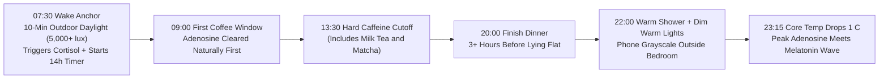
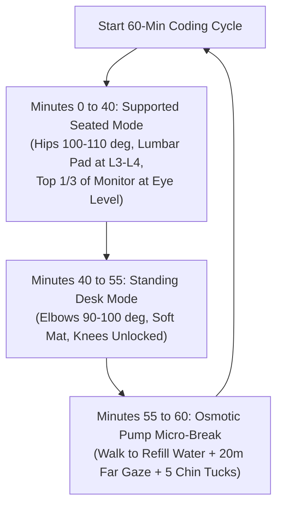

# Sleep Architecture, Circadian Biology & Desk-Engineer Spine/Eye Protection

A full-time software engineer spends roughly **2,500 hours per year** seated in front of emissive displays and **2,700 hours per year** in bed. Small mechanical or circadian misconfigurations across those 5,200 hours compound into chronic insomnia, cervical/lumbar disc herniation, meibomian gland atrophy, periodontal bone loss, and noise-induced tinnitus. Unlike refactored code, intervertebral discs, cochlear hair cells, retinal photoreceptors, and alveolar bone **do not regenerate** once destroyed.

---

## 1. Sleep Architecture & Circadian Synchronization

Sleep is not passive unconsciousness; it is an active, metabolically orchestrated neurobiological maintenance window governed by **Borbely's Two-Process Model**:

### Process S (Adenosine) + Process C (Suprachiasmatic Master Clock)

1. **Process S — Homeostatic Sleep Pressure**: From the moment you wake up, neuronal $\text{ATP}$ consumption accumulates extracellular **adenosine (`腺苷`)** in the basal forebrain. Rising adenosine binds $\text{A}_1$ and $\text{A}_{2\text{A}}$ receptors, progressively building sleepiness until Slow-Wave Sleep clears it overnight.
2. **Process C — Circadian Rhythm**: Independent of how tired you are, roughly 20,000 neurons in the **Suprachiasmatic Nucleus (SCN)** run an endogenous 24.2-hour clock synchronized daily by light hitting **intrinsically photosensitive retinal ganglion cells (ipRGCs)** sensitive to $\sim 480\text{ nm}$ blue-cyan wavelengths. Process C drives morning cortisol/body-temperature elevation and triggers pineal **Dim-Light Melatonin Onset (DLMO)** 12 to 14 hours after morning light exposure.

High-quality sleep happens **only when peak Process S coincides with the falling-temperature / rising-melatonin phase of Process C**.

### Why Sleeping 02:30 to 09:30 Does Not Equal 23:30 to 07:00

Healthy sleep cycles through four to five **90-minute ultradian cycles**, but their internal composition shifts across the night:

- **First Half of the Night (23:00–03:00) — Dominated by N3 Slow-Wave Sleep (SWS / `深睡眠`)**: Pituitary secretes $\sim 70\%$ of daily **Growth Hormone** for tissue repair; glial cells shrink by $60\%$ to activate the **glymphatic system**, flushing metabolic neurotoxins ($\beta$-amyloid and tau proteins) out of brain parenchyma; adenosine is cleared; blood pressure dips $10\%\text{--}20\%$ (**nocturnal dipping**).
- **Second Half of the Night (03:00–07:00) — Dominated by REM Sleep (`快速眼动睡眠`)**: Norepinephrine shuts completely off in the locus coeruleus while limbic/hippocampal networks replay emotional memories ("overnight emotional therapy"), preventing irritability and anxiety while integrating abstract architectural patterns.

When you delay sleep until 02:30 AM, your circadian clock still biases the late-night window toward REM, **amputating your N3 deep-sleep physical and glymphatic recovery** even if total hours look adequate. Conversely, waking up at 05:00 AM after sleeping at midnight amputates your final REM cycles, leaving you emotionally reactive and cognitively rigid.

### Caffeine Pharmacokinetics & The Hidden Milk-Tea Trap

Caffeine does **not** create cellular energy; it is a competitive antagonist that parks inside adenosine receptors, masking fatigue while adenosine continues piling up behind the dam. Caffeine elimination follows first-order exponential decay governed by hepatic `CYP1A2` enzymes, with an average adult half-life of $t_{1/2} \approx \mathbf{5\text{--}7\text{ hours}}$:

$$C(t) = C_0 \cdot \left(\frac{1}{2}\right)^{\frac{t}{t_{1/2}}}$$

- **Concrete Calculation**: Suppose you drink an iced Americano or a large fresh-brewed milk tea (`霸王茶姬 / 喜茶 / 奈雪 / 港式冻柠茶`, which routinely contain **$120\text{--}220\text{ mg}$ of caffeine** from concentrated tea leaves!) at **16:00** ($C_0 = 180\text{ mg}$, $t_{1/2} = 6\text{ h}$). At **22:00**, **$90\text{ mg}$** remains active; at **04:00 AM**, **$45\text{ mg}$** is still circulating in your brain.
- **Polysomnography Reality**: Even in people who boast _"I can drink espresso at dinner and fall right asleep,"_ EEG sleep studies prove evening caffeine slashes **N3 Slow-Wave Sleep power by $15\%\text{--}20\%$** — aging your brain's nightly deep-sleep electrical signature by over a decade.
- **Two Caffeine Rules**:
  1. **Delay morning caffeine 60 to 90 minutes after waking** so residual morning adenosine clears naturally rather than rebounding at 14:30.
  2. **Enforce a strict 9-to-10-hour pre-bed cutoff** (no coffee, tea, matcha, cola, or energy drinks after **13:30–14:00**).

---

## 2. Defeating Revenge Bedtime Procrastination (报复性熬夜)

If you feel exhausted at 23:00 yet compulsively scroll Douyin, Bilibili, Reddit, or Hacker News until 01:45 AM, you are experiencing **Revenge Bedtime Procrastination**: when daytime hours feel entirely owned by meetings, tickets, and obligations, your brain refuses to surrender the only quiet window of perceived autonomy — because going to sleep makes tomorrow's workday arrive instantaneously.

Willpower fails at 23:00 because prefrontal executive inhibition is depleted. Engineer the environment instead:

1. **Reclaim Daytime Autonomy First**: Carve out a sacred **30-to-45-minute personal sovereignty block** earlier in the evening (e.g., 19:30–20:15 for gaming, hobbies, vlog editing, or walking) so your brain does not feel cheated out of "me time" at midnight.
2. **Physical Charger Exile + Automated Grayscale**: Place your phone charger in the living room or study — **never within arm's reach of the pillow**. Buy a RMB 30 physical alarm clock. Set iOS/Android Shortcuts to flip the screen to **100% Grayscale (`色彩滤镜 -> 灰度`)** automatically at 22:15; removing saturated red badges and video color drops variable-ratio dopamine engagement immediately.
3. **Thermal Dump via Warm Shower**: To initiate sleep, your core body temperature must drop by **$\sim 1.0^\circ\text{C}$**. Taking a $40^\circ\text{C}$ warm shower or foot bath (`温水泡脚`) 60 to 90 minutes before bed dilates peripheral blood vessels in your hands and feet, radiating internal core heat rapidly once you step into a cool room.
4. **Bedroom Environmental Spec**:
   - **Temperature**: **$18\text{--}20^\circ\text{C}$** with breathable cotton/tencel bedding.
   - **Light**: Total blackout curtains (`全遮光窗帘`) + cover standby LEDs with black electrical tape.
   - **Ventilation** ($\text{CO}_2 < 1,000\text{ ppm}$): A single adult sleeping in a sealed $12\text{ m}^2$ bedroom with closed doors and windows pushes indoor $\text{CO}_2$ past **$2,500\text{--}3,000\text{ ppm}$** by 05:00 AM, measurably impairing next-day cognitive test scores and causing morning headaches. Crack a window or run an ERV fresh-air system (`新风系统`) overnight.
5. **CBT-I 20-Minute Stimulus Control Rule**: If you cannot fall asleep within ~20 minutes, **do not lie in bed scrolling or catastrophizing** (which trains Pavlovian association between bed and anxious wakefulness). Step into dim warm light, read a boring paper book until eyelids droop, then return to bed. Skip alcohol nightcaps (ethanol sedates the cortex while severely fragmenting REM sleep and worsening snoring/sleep apnea).

---

## 3. Spine Biomechanics: Cervical & Lumbar Intervertebral Disc Physics

Your spine stacks 24 articulating vertebrae separated by **intervertebral discs (`椎间盘`)** — tough outer collagen rings (**annulus fibrosus `纤维环`**) surrounding a pressurized gel core (**nucleus pulposus `髓核`**).

### Cervical Lever-Arm Physics (Why Laptop & Phone Posture Destroys C5–C7)

An adult human skull weighs **$4.5\text{--}5.5\text{ kg}$**. When balanced directly above the shoulders ($0^\circ$ neutral cervical lordosis), neck muscles barely work. As your head juts forward (`头前伸`) or tilts down at a phone/unraised laptop, torque multiplies shear and compressive load across lower cervical discs (`C5–C6` and `C6–C7`, per Hansraj surgical biomechanics modeling):

| Neck Flexion Angle      | Effective Load on Cervical Spine | Typical Daily Engineer Scenario                                                                               |
| :---------------------- | :------------------------------- | :------------------------------------------------------------------------------------------------------------ |
| **$0^\circ$ (Neutral)** | **$4.5\text{--}5.5\text{ kg}$**  | Ears aligned directly over acromion (shoulder); eyes gazing at raised external monitor                        |
| **$15^\circ$**          | **$\sim 12\text{ kg}$**          | Slight downward gaze at low monitor                                                                           |
| **$30^\circ$**          | **$\sim 18\text{ kg}$**          | Typing on laptop placed directly on desk surface                                                              |
| **$45^\circ$**          | **$\sim 22\text{ kg}$**          | Slumped forward debugging or reading tablet on lap                                                            |
| **$60^\circ$**          | **$\sim 27\text{ kg}$**          | Standing on subway or lying on sofa chin-to-chest scrolling phone (carrying a 7-year-old child on your neck!) |

Sustained forward flexion flattens or reverses the natural C-shaped cervical curve (`颈椎生理曲度变直 / 反弓`), causing myofascial trigger points in the upper trapezius and levator scapulae, and eventually posterior disc bulging compressing nerve roots (`神经根型颈椎病` — radiating pain or numbness into the scapula, forearm, or fingers).

### Lumbar Intradiscal Pressure Physics (Why Slouched Sitting Beats Standing)

Classic _in vivo_ intradiscal pressure transducer measurements (Nachemson & Wilke) reveal a counterintuitive truth — **sitting slumped forward loads your L4–L5 and L5–S1 discs almost twice as hard as standing upright**:

| Body Posture                                                          | Relative L4–L5 Disc Pressure (Standing = 100%) | Mechanical Explanation                                                                                     |
| :-------------------------------------------------------------------- | :--------------------------------------------- | :--------------------------------------------------------------------------------------------------------- |
| **Lying Supine (Flat on Back)**                                       | **$20\%\text{--}25\%$**                        | Gravity removed from axial column (only position that truly unloads acute disc flare-ups)                  |
| **Lying on Side (Pillow Between Knees)**                              | **$\sim 75\%$**                                | Neutral alignment if mattress supports waist                                                               |
| **Standing Upright**                                                  | **$100\%$**                                    | Natural lumbar lordosis distributes load across facet joints and disc evenly                               |
| **Seated Reclined $105^\circ\text{--}110^\circ$ with Lumbar Support** | **$105\%\text{--}115\%$**                      | Backrest carries upper-body weight; lordosis preserved                                                     |
| **Seated Upright $90^\circ$ Without Backrest**                        | **$\sim 140\%$**                               | Pelvis tilts posteriorly, flattening lumbar curve                                                          |
| **Seated Slouched Forward Toward Screen**                             | **$185\%\text{--}190\%$**                      | Anterior disc wedging pinches front of disc and forces nucleus pulposus **backward** toward spinal nerves! |
| **Seated Slouched + Leaning to Pick Up Heavy Object**                 | **$\sim 275\%$**                               | Classic mechanical trigger for acute annulus tear / sciatica (`腰椎间盘突出`)                              |

**Crucial Biological Rule — Discs Have Zero Blood Vessels**: Adult intervertebral discs are the largest avascular structures in the body. Nutrients and water enter **only via cyclic osmotic pumping** when pressure alternates. Even the most expensive RMB 10,000 ergonomic chair (Herman Miller Aeron/Embody) cannot save a disc held motionless for 4 hours. **Your best posture is your next posture.**

---

## 4. Workstation Ergonomics & The 8-Minute Daily Mobility Reset

### Exact Desk Hardware Calibration Checklist

- **Display Geometry**: Never work > 30 minutes on a bare laptop on a desk. Use an external 27-inch 4K high-DPI monitor (or steep laptop stand + external keyboard) placed **$55\text{--}75\text{ cm}$** (one full arm's length) away, with the **top edge or top $1/3$ of the active code area at horizontal eye level** so gaze angles gently downward $10^\circ\text{--}15^\circ$ without neck flexion. Scale macOS/Windows UI font size up — **if you catch yourself leaning your chin forward to read terminal text, your font is too small**.
- **Keyboard & Mouse**: Keep elbows close to ribs at **$90^\circ\text{--}105^\circ$** with wrists flat (no upward wrist extension on thick keyboards without palm rests; remove chair armrests if they block pulling close to the desk). If ulnar/median wrist ache (`鼠标手` carpal/pronator tunnel) develops, switch to a $57^\circ$ **vertical ergonomic mouse** (e.g., Logitech Lift / MX Vertical) and a split tented keyboard.
- **Chair & Pillow**: Adjust seat height so thighs slope slightly downward ($95^\circ\text{--}105^\circ$ hip angle), leaving a 2-to-3-finger gap behind the knees. For sleeping, a pillow supports your **neck curve (`颈弧`)**, not just the back of your skull: fist-height **$8\text{--}10\text{ cm}$** compressed height when lying supine, shoulder-width **$12\text{--}15\text{ cm}$** when side-sleeping, paired with a medium-firm mattress (`软硬适中支撑床垫`, neither sagging plush hotel foam nor bare wooden boards).

### Daily 8-Minute Anti-Tech-Neck & Lumbar Armor Routine

Perform once mid-afternoon or right after closing your laptop to reverse **Upper-Crossed Syndrome** (tight chest/upper traps, weak deep neck flexors/lower traps) and **Lower-Crossed Syndrome** (shortened psoas hip flexors from sitting, inhibited glutes/core):

1. **Deep Cervical Flexor Chin Tucks (`收下巴水平后缩`, 10 reps $\times$ 5s hold)**: Sit or stand tall looking straight ahead (do _not_ drop eyes down). Glide your head straight backward horizontally as if making a double chin against a headrest until you feel gentle stretching at the base of your skull (`枕下肌群`).
2. **Doorway Pectoralis Stretch + Scapular Y-W Retractions (`门框扩胸 + YTW肩胛后缩`, 90s)**: Forearms on a doorframe at $90^\circ$, step gently through for 30 seconds to open shortened chest fascia, then perform 12 slow standing `W -> Y` arm raises squeezing lower shoulder blades down and back (never shrugging ears).
3. **Half-Kneeling Hip Flexor Stretch (`半跪姿髂腰肌拉伸`, 45s per leg)**: Kneel on one knee (pad under knee), tuck your tailbone slightly under (**posterior pelvic tilt / squeeze back glute** — critical so you stretch the psoas rather than hyperextending your lumbar spine!), and shift hips 3 cm forward. Sitting 10 hours shortens the psoas, which attaches directly to `L1–L5` lumbar vertebrae and yanks your lower back into painful compression when you stand up!
4. **Stuart McGill "Big 3" Spine Stabilizers (4 minutes, zero spinal flexion damage)**:
   - **Modified Curl-Up** (hands under lumbar curve to preserve natural arch, lift head/shoulders just $2\text{ cm}$ off floor, hold 8s $\times$ 5 reps — replaces disc-crushing sit-ups `仰卧起坐`!).
   - **Side Bridge / Side Plank** (30s per side — activates quadratus lumborum and obliques).
   - **Bird-Dog (`鸟狗式`)** (on all fours, extend opposite arm and heel horizontally without rotating pelvis, hold 8s $\times$ 6/side).

---

## 5. Preserving Non-Regenerative Sensors: Eyes, Teeth & Hearing

### Ocular Care: Meibomian Glands (睑板腺) & High-Myopia Safety

85% of chronic dry, gritty, burning eyes in programmers is **evaporative dry eye caused by Meibomian Gland Dysfunction (`睑板腺功能障碍`, MGD)**, not lack of watery tears:

- **Mechanism**: Normal humans blink **15 to 20 times per minute**, squeezing ~30 tiny vertical sebaceous glands inside the upper and lower eyelids (`睑板腺`) to coat the cornea with protective lipid oil (`睑脂`) that prevents tear evaporation. When reading code, blink rate plummets by **$70\%$ down to 4 to 6 incomplete blinks per minute**. Stagnant meibum solidifies like cold butter, clogging and permanently atrophying the glands!
- **4-Step Daily Eye Protocol**:
  1. **20-20-20 + Deliberate Full-Blink Squeeze**: Every 20 minutes, look out a window at an object $\ge 6\text{ meters}$ (20 feet) away for 20 seconds to relax ciliary accommodation, and perform **3 slow, complete, gentle eyelid closures** ("close – pause 2s – squeeze lightly – open").
  2. **Nightly $40\text{--}42^\circ\text{C}$ Warm Compress (`恒温热敷`, 10 min)**: Melts thickened meibum (melting point jumps from $32^\circ\text{C}$ to $\sim 38\text{--}40^\circ\text{C}$ in MGD). Use a regulated $40\text{--}42^\circ\text{C}$ steam mask or USB mask — never scalding towels $> 45^\circ\text{C}$.
  3. **Preservative-Free Single-Dose Artificial Tears Only**: Keep single-use vials (`单支装不含防腐剂`) of **$0.1\%\text{ or }0.3\%$ Sodium Hyaluronate (`玻璃酸钠滴眼液`, e.g., Hylo / 海露 single-unit or 爱丽单支装)** at your desk. **NEVER chronically use "icy redness-relief Japanese eye drops"** containing vasoconstrictors (`盐酸四氢唑啉 / 奈甲唑啉`) or `BAK` (`苯扎氯铵`) preservatives — they strip corneal epithelium and cause severe rebound redness!
  4. **High-Myopia Retinal Rule (`高度近视 > 600度`)**: Axial eyeball elongation stretches the retina paper-thin. Get an annual **dilated fundus exam (`散瞳眼底检查`)** and avoid extreme Valsalva head-impact sports (bungee jumping, boxing). If you ever see a sudden shower of dark floaters, lightning flashes (`闪光感`), or a dark curtain blocking peripheral vision, go to an ophthalmic ER **the same day** to rule out **retinal tear/detachment (`视网膜裂孔/脱离`)**.

### Dental & Periodontal Care: Preventing Irreversible Gum Recession

In China, **chronic periodontitis (`慢性牙周炎`)** affects over $80\%$ of adults in their thirties and is the #1 cause of tooth loss after age 40 — plus chronic gingival bacteria (_Porphyromonas gingivalis_) enter systemic circulation and elevate cardiovascular risk. Once alveolar jawbone resorbs and gums recede (`牙龈萎缩`), **bone does not grow back naturally**; and a single titanium dental implant (`种植牙`) costs RMB 6,000 to 15,000 and months of surgery.

- **Modified Bass Brushing (`巴氏刷牙法`)**: Soft small-head brush (or sonic/oscillating electric toothbrush with pressure sensor, e.g., Sonicare / Oral-B iO) angled at **$45^\circ$ into the gingival sulcus (`牙龈沟`)** for 2 full minutes morning and before bed using **$1100\text{--}1450\text{ ppm}$ fluoride toothpaste**. _Pro tip_: After brushing at night, **spit out the foam thoroughly without rinsing aggressively with cups of water**, leaving a protective fluoride film on enamel overnight.
- **Nightly String Floss (`牙线`) Is Non-Negotiable**: Toothbrush bristles reach only $60\%$ of tooth surfaces. A **water flosser (`冲牙器`) flushes loose food fragments after lunch, but CANNOT mechanically scrape sticky bacterial biofilm (`牙菌斑`) off tight interproximal contact points** — only string floss (`牙线 / 牙线棒`) wrapped in a **"C-shape"** hugging each side of the tooth $1\text{--}2\text{ mm}$ below the gumline removes interdental plaque before salivary minerals calcify it into rock-hard calculus (`牙结石`) within 48 hours. _(If healthy flossing causes slight bleeding during Week 1, that is pre-existing gingivitis inflammation — keep flossing gently and get a professional cleaning; bleeding stops within 7 to 10 days.)_
- **Ultrasonic Scaling (`超声波洗牙`) Every 6 to 12 Months**: Ultrasonic cavitation shakes off supragingival/subgingival calculus without harming enamel (enamel is harder than steel; scaling never "widens tooth gaps" — calculus was merely filling the gap left by receding gums!).
- **Wisdom Teeth Audit (`智齿全景片评估`)**: Take one panoramic dental X-ray (`口腔全景片`). If lower wisdom teeth (`8号牙`) are horizontally or mesially impacted against the roots of your vital second molars (`7号牙`), extract them proactively in your early thirties while bone healing is fast — waiting until pain strikes often means **both the wisdom tooth and the irreplaceable second molar are decayed beyond saving**.

### Auditory & Cochlear Protection: The Decibel Halving Law

Inner-ear stereocilia hair cells never regenerate; cumulative overload causes permanent high-frequency hearing loss and incurable **24/7 ringing tinnitus (`神经性耳鸣`)**. Occupational acoustics (NIOSH standard) obeys a strict logarithmic **$3\text{ dB}$ exchange rate**:

$$T_{\max}\text{ (hours/day)} = \frac{8}{2^{\frac{L - 85}{3}}}$$

- **$85\text{ dBA}$**: Safe up to **8 hours/day**
- **$88\text{ dBA}$**: Safe for **4 hours/day**
- **$91\text{ dBA}$**: Safe for **2 hours/day**
- **$94\text{ dBA}$**: Safe for **1 hour/day**
- **$100\text{ dBA}$**: Safe for **15 minutes/day**

**The Commuter Trap**: Subway cars and aircraft cabins average **$80\text{--}85\text{ dBA}$** background rumble. Wearing open/non-sealing earbuds forces you to crank volume to **$92\text{--}98\text{ dBA}$** just to hear podcasts clearly!

- **Fix**: Always use **Active Noise Cancellation (ANC)** headphones/earbuds (`主动降噪耳机`) on transit or flights so volume stays clear at **$\le 50\%\text{--}60\%$** ($< 72\text{ dBA}$). Enable `Headphone Safety -> Reduce Loud Sounds (80 dB limit)` in iOS Settings -> Sounds & Haptics, and carry reusable acoustic earplugs (`音乐降噪耳塞`) to concerts or loud clubs.

---

## 6. Snoring & Obstructive Sleep Apnea (`OSA / 睡眠呼吸暂停`) Screening

Many 32-year-old men believe loud snoring (`打呼噜`) means "sleeping soundly (`睡得香`)." Clinically, loud irregular snoring punctuated by silent pauses and gasps is the hallmark of **Obstructive Sleep Apnea (OSA)** — a silent destroyer of cardiovascular and cognitive health that is especially common in East Asian men even at modest BMI due to narrower craniofacial/mandibular airway geometry (`下颌偏小/后缩`).

### What Happens Inside Your Brain & Heart During Untreated OSA

When pharyngeal soft tissue collapses during deep or REM sleep, airflow stops for $10\text{--}45\text{ seconds}$ dozens of times per hour (`AHI` Apnea-Hypopnea Index):

1. Blood oxygen saturation ($\text{SpO}_2$) plunges from $98\%$ down to **$80\%\text{--}88\%$** (intermittent nocturnal hypoxia).
2. Your brainstem panics ("we are suffocating!"), firing massive bursts of **epinephrine and sympathetic tone**, spiking nocturnal blood pressure past $160/100\text{ mmHg}$, and ripping your brain out of N3/REM sleep via micro-arousals you don't consciously remember.
3. You wake up after "8 hours in bed" with a **parched dry mouth (`晨起口干口苦`), dull morning headache, unrefreshed brain fog, and stubborn daytime hypertension**.

### Quick Self-Check (`STOP-Bang` Red Flags) & Action Path

Suspect OSA if **2 or more** apply:

- Partner or sleep-recording app (`SnoreLab` / Apple Watch breathing disturbances) catches loud snoring or breathing pauses.
- Waking up with a bone-dry throat (chronic nocturnal mouth-breathing) or morning headache.
- Unexplained daytime sleepiness despite $\ge 7.5\text{ hours}$ in bed.
- Elevated blood pressure ($\ge 130/85\text{ mmHg}$) or neck circumference $> 40\text{ cm}$ (or BMI $> 25$).

**Evidence-Based Fixes**:

1. **Positional & Nasal Optimization (Mild Cases)**: Clear nasal obstruction (treat allergic rhinitis with saline + mometasone spray so you can breathe through your nose!) and **sleep on your side (`侧卧位睡眠`)** — supine back-sleeping lets gravity drop the tongue base straight backward into the airway.
2. **Diagnostic Gold Standard**: Book a hospital **Sleep Medicine Clinic (`睡眠医学中心 / 耳鼻喉科`)** for an overnight **Polysomnography (`PSG 多导睡眠监测`)** or portable home sleep apnea test (`HSAT`).
3. **Visceral Weight Reduction + Auto-CPAP (`家用全自动无创呼吸机`)**: Losing $7\%\text{--}10\%$ body weight shrinks parapharyngeal fat pads; for moderate-to-severe OSA ($\text{AHI} \ge 15$), modern whisper-quiet nasal-pillow **Auto-CPAP** restores 100% oxygenation and crisp morning energy from Night 1. _(Skip gimmicky anti-snore rings or nasal-bridge stickers when pharyngeal collapse is the cause.)_

---

## 7. Surviving Production On-Call Incidents & International Jet Lag

### Protocol A: Damage Control After a 03:00 AM Pager (`夜间值班应急恢复`)

Production incidents happen. How you manage the 24 hours _after_ a 03:00 AM page determines whether you lose one morning or wreck an entire week of sleep:

1. **During the 03:00 AM Incident**: Turn on macOS `Night Shift` / `f.lux` warm amber mode + dim room lighting (bright overhead white LEDs at 03:00 AM slam your SCN circadian phase backward by 2 hours!). **Never drink coffee/tea or eat sugary snacks at 03:00 AM** — drink plain water only.
2. **Morning After**: Even if you went back to sleep at 04:30 AM, **wake up within $+60\text{--}90\text{ minutes}$ of your normal wake time** (e.g., 08:30 AM instead of sleeping until 13:00 PM) and get 10 minutes of outdoor daylight so tonight's melatonin clock stays anchored.
3. **Midday Recovery Bridge**: Run a **20-minute Non-Sleep Deep Rest (`NSDR` / Yoga Nidra audio)** or a strict **20-to-25-minute power nap before 14:00** (sleeping 90 minutes at 16:00 drains Process S adenosine and causes midnight insomnia!), do light walking instead of heavy maximal deadlifts, and go to bed 45 minutes early that night.

### Protocol B: Fast Circadian Phase-Shifting for International Travel (`跨时区出国倒时差`)

Your SCN clock naturally shifts only **$\sim 1\text{ hour/day}$ traveling East** (harder — shortening the day, e.g., US/Europe $\rightarrow$ China, or China $\rightarrow$ US West Coast effective phase) and **$\sim 1.5\text{ hours/day}$ traveling West** (easier — lengthening the day, e.g., China $\rightarrow$ Europe):

- **Core Rule — Temperature Minimum** ($T_{\min}$): Your body's lowest core temperature occurs roughly **2 hours before your habitual home wake time** (e.g., **05:30 home time** if you normally wake at 07:30).
  - Viewing bright sunlight in the **4 hours AFTER** $T_{\min}$ **advances your clock earlier** (helps Eastbound travel).
  - Viewing bright light in the **4 hours BEFORE** $T_{\min}$ **delays your clock later** (helps Westbound travel; wear sunglasses if outdoors at the wrong biological window!).
- **Destination Meal & Movement Anchor**: Immediately eat a high-protein breakfast at **08:00 local destination time** and walk outdoors for 20 minutes (liver/gut peripheral clocks sync to meal timing!). For Eastbound trips $> 6\text{ time zones}$, **low-dose melatonin ($0.5\text{--}1.0\text{ mg}$)** taken 30 minutes before target local bedtime for the first 3 nights accelerates SCN entrainment safely.

---

## 8. Skin Barrier, Photoaging & Male Hair Preservation at Age 32+

### Minimalist Evidence-Based Skincare (`极简循证护肤：清洁 + 保湿 + 防晒`)

Roughly **$80\%$ of visible facial aging** (deep coarse wrinkles, sunspots `晒斑`, leathery texture, sagging elastin) is **extrinsic UVA photoaging (`光老化`)**, not chronological age. Unlike UVB (which causes summer sunburn), **long-wave UVA ($320\text{--}400\text{ nm}$) maintains strong intensity year-round and penetrates clouds and office window glass**:

1. **Cleanse Gently (`氨基酸洁面`)**: Wash morning (water or mild cleanser) and night with a gentle **amino-acid surfactant cleanser** (`椰油酰甘氨酸钠/谷氨酸钠` base). Throw away harsh alkaline soap-base cleansers (`皂基洁面` = myristic/lauric acid + potassium hydroxide) that strip intercellular ceramide lipids and trigger reactive oiliness.
2. **Moisturize Barrier (`神经酰胺清爽乳液`)**: Apply a fragrance-free ceramide/niacinamide lotion (`含神经酰胺/烟酰胺乳液`) within 2 minutes of washing while skin is slightly damp.
3. **Broad-Spectrum Sunscreen (`SPF 30–50, PA+++/PA++++`)**: Apply a 1-RMB-coin-sized amount ($0.8\text{--}1.0\text{ g}$) before outdoor commutes, weekend hikes, or vlogging outdoors — or wear a UPF50+ cap and UV400 sunglasses.
4. **Optional Nighttime Retinoid (`晚间低浓度A醇 / 水杨酸`)**: If targeting fine lines or clogged oily T-zone pores (`黑头闭口`), 2% salicylic acid pads (`水杨酸棉片` 2x/week) or $0.05\%\text{--}0.1\%$ retinol (`视黄醇` at night, build tolerance slowly, pair with daytime sunscreen) are the only OTC topicals backed by decades of dermatology RCTs.

### Early Intervention for Androgenetic Alopecia (`雄激素性脱发 / 发际线后移`)

If you notice M-shaped temporal recession (`M型发际线后移`) or vertex crown thinning (`头顶稀疏`) in your early thirties, understand the exact biology so you do not waste thousands on **ginger shampoos (`生姜洗发水`) or black sesame paste (`黑芝麻糊`)**:

- **Mechanism**: Hair follicles on the frontal hairline and crown genetically express $5\alpha$-reductase, converting testosterone into **dihydrotestosterone (`DHT / 双氢睾酮`)**, which progressively shrinks follicles (`毛囊微小化`) until they atrophy permanently. _(Gingerol in ginger actually showed mild hair-follicle **inhibition** in laboratory studies, and eating black sesame adds calories/fat with zero effect on `DHT`!)_
- **The Only Two FDA/NMPA Gold-Standard First-Line Treatments** (visit a Grade-A Dermatology Hair Clinic `三甲皮肤科毛发专病门诊` **early while follicles are still alive**):
  1. **Topical $5\%$ Minoxidil Foam/Tincture (`5% 米诺地尔泡沫/搽剂`, OTC)**: Prolongs anagen growth phase and dilates follicular microcirculation (expect a benign temporary shedding replacement phase `狂脱期` in Weeks 3–6 as resting telogen hairs are pushed out by thicker new hairs!). _Warning: Toxic to pet cats (`对宠物猫剧毒`) — wash hands thoroughly and never let cats lick treated hair or pillows!_
  2. **Oral $1\text{ mg}$ Finasteride (`非那雄胺 1mg`, Prescription Only)**: Selectively blocks Type II $5\alpha$-reductase, cutting scalp `DHT` by $\sim 65\%$ and halting hair loss in **$> 85\%\text{--}90\%$** of men (reversible mild sexual side effects occur in only $\sim 1.5\%\text{--}2\%$ in blinded RCTs; discuss timing with your dermatologist if actively trying to conceive, and note it halves serum `PSA` values).

---

Proceed to **[03-EXERCISE-AND-CHINESE-DIET-NUTRITION.md](03-EXERCISE-AND-CHINESE-DIET-NUTRITION.md)** for a sustainable, time-efficient strength/cardio system and everyday Chinese diet optimization.
