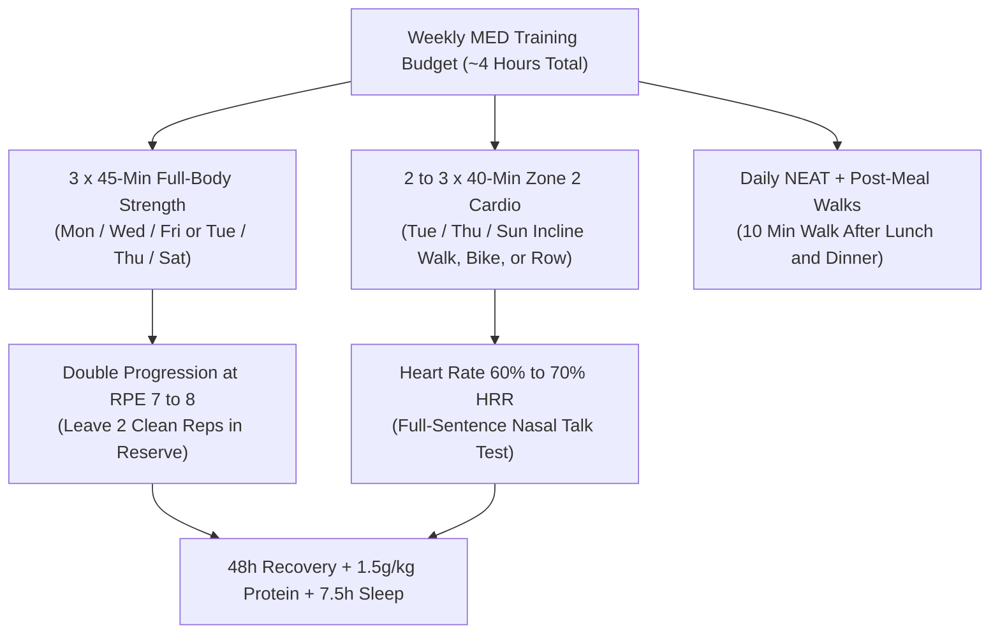
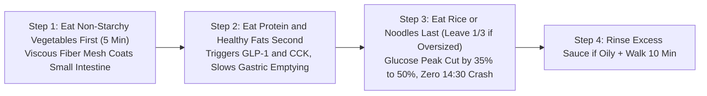

# High-ROI Exercise & Everyday Chinese Diet Optimization

You do not need a bodybuilder's 12-hour gym split or bland boiled chicken breasts (`水煮鸡胸肉`) to achieve elite metabolic and cardiovascular health at age 32. Sustainable fitness for a full-time software engineer comes down to two principles: **Minimum Effective Dose (MED) mechanical loading** (~3.5 to 4 hours per week) and **refactoring everyday Chinese meals and takeout (`外卖`)** without sacrificing culinary enjoyment.

---

## 1. Why Exercise Is the Highest-ROI Longevity Intervention

In large prospective cohorts (such as Mandsager et al., _JAMA Network Open_, tracking 122,007 adults via treadmill testing), moving from the **bottom 25th percentile** of cardiorespiratory fitness ($\text{VO}_{2\max}$) to just **above average** reduces all-cause mortality risk by **$\sim 50\%$**, and reaching the top quartile reduces mortality hazard by **$\sim 70\%\text{--}80\%$** — an effect size larger than reversing smoking, diabetes, or hypertension individually.

Simultaneously, **skeletal muscle** is not cosmetic vanity tissue; it is your body's **primary metabolic sink and structural exoskeleton**:

- **Insulin-Independent Glucose Disposal**: Contracting muscle fibers activate `AMPK`, translocating `GLUT4` glucose transporters directly to the cell membrane **even without insulin**, soaking up $\sim 80\%$ of circulating post-meal glucose.
- **Myokine Signaling & Neuroprotection**: Contracting muscles secrete **BDNF (Brain-Derived Neurotrophic Factor)** and **irisin**, promoting hippocampal neurogenesis, executive focus, and stress resilience.
- **Joint & Bone Armor**: Axial mechanical tension stimulates osteoblasts to increase bone mineral density (`骨密度`, which peaks around age 30) and stabilizes cervical, lumbar, and knee joints.

---

## 2. The Engineer's Minimum Effective Dose (MED) Weekly Protocol

Total weekly time commitment: **~3.5 to 4.2 hours/week**, structured so you never leave the gym wrecked or injured.

### Component A: $3 \times 45\text{-Minute}$ Compound Resistance Training

Instead of isolating tiny muscles ("chest day / arm day"), train **six foundational multi-joint human movement patterns** across Full-Body A/B alternating sessions.

> **Engineer Posture Rule (1.5 : 1 Pull-to-Push Ratio)**: Typing all day internally rotates your humerus and shortens your chest (`圆肩驼背`). For every 2 sets of horizontal pressing (`卧推 / 俯卧撑`), perform **3 sets of upper-back pulling (`划船 / 引体 / 面拉`)** to pull your shoulder blades back into neutral alignment.

| Movement Pattern                              | Commercial Gym Option                                                                   | Minimalist Home Option (Adjustable DBs + Pull-Up Bar + Band)                                     | Sets $\times$ Reps            | Target Muscle & Postural Benefit                                 |
| :-------------------------------------------- | :-------------------------------------------------------------------------------------- | :----------------------------------------------------------------------------------------------- | :---------------------------- | :--------------------------------------------------------------- |
| **1. Knee-Dominant (Squat)**                  | Goblet Squat, Barbell Back Squat, or $45^\circ$ Leg Press                               | Dumbbell Goblet Squat or Bulgarian Split Squat (`保加利亚分腿蹲`)                                | $3 \times 8\text{--}12$       | Quadriceps, glutes; largest lower-body glucose sink              |
| **2. Hip-Dominant (Hinge)**                   | Dumbbell or Barbell Romanian Deadlift (`罗马尼亚硬拉` RDL)                              | Dumbbell RDL or Single-Leg Hip Thrust (`臀桥`)                                                   | $3 \times 8\text{--}12$       | Posterior chain (hamstrings, glutes, erector spinae)             |
| **3. Horizontal Pull**                        | Seated Neutral-Grip Cable Row or Chest-Supported Row                                    | One-Arm Dumbbell Row (hand braced on bench/chair)                                                | $3 \times 10\text{--}12$      | Rhomboids, mid/lower traps, lats; fixes rounded shoulders        |
| **4. Vertical Pull**                          | Lat Pulldown (`高位下拉`) or Assisted Pull-Up                                           | Assisted Band Pull-Up or Controlled Eccentric Chin-Up                                            | $3 \times 8\text{--}12$       | Latissimus dorsi, biceps, spinal decompression                   |
| **5. Push (Alternate Horizontal / Vertical)** | Session A: $30^\circ$ Incline DB Press; Session B: Standing/Seated DB Overhead Press | Session A: Push-Ups (hands elevated or weighted); Session B: Standing Dumbbell Overhead Press | $3 \times 8\text{--}12$       | Pectorals, anterior/lateral deltoids, triceps                    |
| **6. Scapular + Core Finisher**               | Rope Face Pulls (`绳索面拉`) + Heavy Farmer's Carry (`农夫行走`)                        | Band Face Pulls ($2 \times 15$) + Suitcase DB Carry ($2 \times 40\text{ s}$)                     | $2 \times 15$ / $40\text{ s}$ | External rotators (`冈下肌/小圆肌`), grip strength, lateral core |

#### Safe Progressive Overload & Joint Longevity Rules

1. **5-Minute Dynamic Warm-Up Only**: Never stretch cold muscles statically before lifting. Do 3 minutes of brisk walking/rowing, arm circles, bodyweight squats, and 1 to 2 light warm-up sets at $50\%$ working weight.
2. **Train at RPE 7.5–8.5 (`2–3 Reps in Reserve`, RIR)**: Stop every set when you could still perform **2 more reps with textbook spinal alignment**. Grinding ugly, ego-driven final reps with a rounded lower back (`腰椎代偿弓背`) generates $90\%$ of gym disc injuries for $< 5\%$ extra hypertrophy stimulus.
3. **Double Progression Algorithm**: Pick a weight you can lift cleanly for $3 \times 8$ reps. Keep the weight fixed across sessions until you achieve **$3 \times 12$ clean reps** with $2\text{ s}$ controlled lowering. Only then increment load by the smallest step ($2\text{--}2.5\text{ kg}$) and reset to $3 \times 8$.

### Component B: Zone 2 Cardio ($2\text{--}3 \times 40\text{ Min}$) + Optional $\text{VO}_{2\max}$ Pulse

Many beginners make the mistake of running way too fast (`Zone 4` gasping red-faced pace for 20 minutes), spiking cortisol, aching knees, and dreading cardio. **80% of endurance volume belongs in Zone 2** — the highest aerobic output where ATP is still fueled predominantly by **mitochondrial fat oxidation** and blood lactate stays below $2.0\text{ mmol/L}$:

$$\text{HR}_{\max} \approx 208 - (0.7 \times \text{Age}) \qquad \text{HR}_{\text{Zone 2}} = \text{HR}_{\text{rest}} + p \cdot \left(\text{HR}_{\max} - \text{HR}_{\text{rest}}\right) \quad (p \in [0.60, 0.70])$$

- **Worked Example** (Age 32, $\text{HR}_{\text{rest}} = 62\text{ bpm}$):
  - $\text{HR}_{\max} \approx 208 - 22.4 \approx 186\text{ bpm}$
  - Heart Rate Reserve ($\text{HRR}$) $= 186 - 62 = 124\text{ bpm}$
  - **Zone 2 Target Window**: $62 + (0.60\text{ to }0.70) \times 124 =$ **$136\text{ to }149\text{ bpm}$**.
- **Zero-Watch Field Check (The Talk Test)**: You should be able to **speak a complete 12-word sentence aloud** without gasping mid-sentence, yet someone on the phone with you can immediately tell you are exercising.
- **Best Knee-Friendly Modalities**: If you carry extra weight ($\text{BMI} \ge 24$) or have rusty ankles/knees, **skip concrete pavement running for the first 8 weeks**. Use **Incline Treadmill Brisk Walking (`坡度快走`: incline $8\%\text{--}12\%$, speed $4.6\text{--}5.4\text{ km/h}$, hands off the rails!)**, indoor cycling, rowing, or swimming. You can literally watch technical talks or listen to audiobooks during Zone 2!
- **Optional** $\mathbf{VO_{2\max}}$ **Ceiling Raiser (Once Weekly After Base Is Built)**: After 6 weeks of consistent Zone 2, replace the end of one session with 4 rounds of **3 minutes brisk hard effort** ($\sim 85\%\text{--}90\%\ \text{HR}_{\max}$) **+ 3 minutes easy recovery** (Norwegian $4 \times 4$ lite).

### Component C: The 10-Minute Post-Meal Walk (`饭后百步走`)

Meta-analyses show that a gentle **10-to-15-minute walk starting within 15 to 30 minutes after lunch and dinner** blunts post-meal blood glucose spikes by **$22\%\text{--}30\%$** — outperforming a single 45-minute walk taken randomly at another time of day! Walk around the office park after lunch instead of collapsing directly back into your desk chair.

---

## 3. Structural Audit of the Everyday Chinese Diet

Traditional home-cooked southern/coastal Chinese cuisine (`蒸、煮、白灼、清炖`) is remarkably healthy, yet modern urban Chinese eating (`外卖、快餐、重口味川湘馆子`) routinely suffers from **four compounding structural defects**:

1. **Carb-on-Carb Stacking (`主食叠主食`)**: Pairing white rice or steamed buns with stir-fried shredded potatoes (`酸辣土豆丝`), lotus root (`炒藕片`), vermicelli (`蚂蚁上树 / 粉丝煲`), or eating `油条 + 白粥 + 包子` at breakfast. Visually it looks like "staple + dish," chemically it is **90% refined starch + oxidized oil with almost zero complete amino acids**.
2. **"Fake Vegetables" Soaked in Deep-Fry Oil & Cornstarch (`过油蔬菜与勾芡陷阱`)**: Restaurant dishes like `地三鲜` (eggplant/potato/pepper), `干煸四季豆`, `红烧茄子`, `鱼香肉丝`, and `糖醋里脊` pass ingredients through a deep-fry vat first (`宽油过油`) so porous eggplant/beans absorb **$35\text{--}50\text{ g}$ of oil**, then coat everything in a glossy **cornstarch + sugar glaze (`水淀粉勾芡`)** — turning healthy vegetables into a $900\text{ kcal}$ glycemic-lipid bomb.
3. **Chronic Protein Deficit at Breakfast & Lunch**: Many urban Chinese adults eat $< 10\text{ g}$ protein at breakfast (`粥/面条`) and $< 20\text{ g}$ at takeout lunch ($80\%$ of the box is white rice), then binge on greasy fatty meat at 20:30 dinner — missing the **$\sim 25\text{--}35\text{ g}$ per-meal protein threshold** ($\sim 2.5\text{ g}$ leucine) needed to stimulate Muscle Protein Synthesis throughout the day.
4. **Hyper-Sodium & Cooking-Fume Carcinogens**: Restaurant takeout boxes average **$2,200\text{--}3,500\text{ mg}$ of sodium in a single meal** (exceeding the entire WHO daily ceiling of $< 2,000\text{ mg}$ sodium / $5\text{ g}$ salt), while traditional home "heat wok until oil smokes (`油冒烟才下锅`)" generates acrolein and polycyclic aromatic hydrocarbons (`PM2.5` cooking fumes — the #1 driver of non-smoking lung adenocarcinoma in East Asian households!).

---

## 4. Macronutrient Targets, Hand-Portions & Kitchen Upgrades

### Daily Nutritional Math (Reference: $70\text{ kg}$ Software Engineer)

_(If overweight with $\text{BMI} > 25$, plug your **target healthy body weight** into the protein formula rather than total fat-inflated weight.)_

| Nutrient                                  | Daily Formula                                                                      | $70\text{ kg}$ Daily Target                                                     | Practical Zero-Scale Hand Rule (`211健康餐盘法`)                                                            |
| :---------------------------------------- | :--------------------------------------------------------------------------------- | :------------------------------------------------------------------------------ | :---------------------------------------------------------------------------------------------------------- |
| **Protein (`优质蛋白质`)**                | **$1.4\text{--}1.8\text{ g/kg}$**                                                  | **$100\text{--}125\text{ g/day}$** ($\sim 35\text{ g}$ per meal $\times 3$) | **1 full palm** (thickness & area of palm) of lean meat/fish/tofu/eggs at **every** meal ($25\%$ of plate)  |
| **Non-Starchy Vegetables (`非淀粉蔬菜`)** | **$\ge 400\text{--}500\text{ g/day}$** raw weight ($25\text{--}35\text{ g}$ fiber) | **$500\text{ g/day}$** (at least half dark leafy greens `深色绿叶菜`)       | **2 clenched fists** per lunch & dinner ($50\%$ of plate; mushrooms, greens, broccoli, tomato, cucumber)    |
| **Smart Carbohydrates (`优质复合碳水`)**  | **$2.5\text{--}3.8\text{ g/kg}$** (lower on rest days, higher on lift days)        | **$175\text{--}260\text{ g/day}$**                                          | **1 cupped fist** cooked grain/tuber per meal ($25\%$ of plate; swap $50\%$ of white rice for whole grains) |
| **Healthy Fats (`健康脂肪`)**             | **$0.8\text{--}1.0\text{ g/kg}$**                                                  | **$55\text{--}70\text{ g/day}$**                                                | **1 thumb** cooking oil/nuts per meal ($25\text{--}30\text{ g}$ total home cooking oil/day)                 |

### Practical Chinese High-Protein Reference Table

Mix animal and soy proteins seamlessly across your day to hit $105\text{--}125\text{ g}$ without monotony:

| Everyday Chinese Food Item                                            | Typical Portion                                     | Protein                      | Calories & Practical Notes                                                                                                                          |
| :-------------------------------------------------------------------- | :-------------------------------------------------- | :--------------------------- | :-------------------------------------------------------------------------------------------------------------------------------------------------- |
| **Whole Chicken Eggs (`水煮蛋 / 蒸水蛋`)**                            | 2 whole eggs                                        | **$12\text{--}14\text{ g}$** | $\sim 140\text{ kcal}$; dietary yolk cholesterol minimally impacts `ApoB` in most healthy adults ($1\text{--}2\text{ eggs/day}$ is completely safe) |
| **Lactose-Free Milk (`舒化奶`) or Unsweetened Soy Milk (`无糖豆浆`)** | $300\text{ mL}$ carton/cup                          | **$9\text{--}11\text{ g}$**  | Zero bloating for lactose-intolerant East Asians; rich in calcium (`牛奶`) or isoflavones (`豆浆`)                                                  |
| **Skinless Chicken Thigh or Breast (`去皮琵琶腿 / 鸡胸肉`)**          | $150\text{ g}$ raw weight                           | **$30\text{--}34\text{ g}$** | Skinless chicken thigh (`去皮鸡腿肉`) is juicy, tender, and has only $3\text{ g}$ more fat than dry chicken breast!                                 |
| **Peeled Shrimp / Prawns (`白灼基围虾 / 清炒虾仁`)**                  | $150\text{ g}$ edible meat                          | **$28\text{--}32\text{ g}$** | $< 2\text{ g}$ fat, ultra-fast cooking; skip frozen crystal shrimp soaked in heavy sodium tripolyphosphate if hypertensive                          |
| **Steamed Sea Bass / Cod / Salmon (`清蒸鲈鱼 / 鳕鱼 / 三文鱼`)**      | $150\text{ g}$ fillet                               | **$27\text{--}30\text{ g}$** | Rich in marine `EPA + DHA` Omega-3; steam with ginger/scallion (`清蒸`) instead of pan-frying                                                       |
| **Lean Beef Shank / Sirloin (`卤牛腱子 / 潮汕吊龙瘦牛肉`)**           | $120\text{ g}$ cooked                               | **$30\text{--}34\text{ g}$** | High bioavailable heme iron, zinc, and natural creatine; slice homemade spiced `五香卤牛腱` for instant snacks                                      |
| **Firm Tofu / Pressed Tofu (`北豆腐 / 香干 / 千张`)**                 | $150\text{ g}$ (`北豆腐`) or $80\text{ g}$ (`香干`) | **$15\text{--}18\text{ g}$** | Coagulated with calcium/magnesium salts (`卤水/石膏`), doubling as a stellar dairy-free calcium source! _(Avoid fried `油豆腐/响铃卷`!)_            |
| **Whey Protein Isolate (`分离乳清蛋白粉`)**                           | 1 scoop ($30\text{ g}$)                             | **$24\text{--}26\text{ g}$** | Pure filtered milk protein ($< 1\text{ g}$ lactose, convenient RMB 6–8 per serving backup on hectic afternoons)                                     |

### Three Effortless Home Kitchen Upgrades

1. **50/50 Multigrain Rice (`杂粮饭升级`)**: Keep using your electric rice cooker, simply mix **`50% 精白米 + 50% 燕麦米 / 糙米 / 黑米 / 藜麦`** (many modern rice cookers have a `杂粮饭` soak-and-cook button, or use pre-steamed sweet potato/corn sections on top of the rice). Bonus: Leftover cooked rice cooled overnight in the fridge at $4^\circ\text{C}$ and reheated undergoes **starch retrogradation (`老化回生`)**, converting a meaningful fraction into **Type 3 Resistant Starch (`抗性淀粉`)** that feeds gut bacteria and lowers glycemic impact!
2. **Cooking Oil Rotation & Zero-Smoke Technique (`水油焖菜 & 换油`)**:
   - Stock two bottles in a cool dark cabinet: **Extra-Virgin Olive Oil or Cold-Pressed Camellia Oil (`特级初榨橄榄油 / 山茶油`)** + **Low-Erucic Double-Low Rapeseed Oil or Avocado Oil (`双低菜籽油 / 牛油果油`)** (balanced monounsaturated oleic acid + alpha-linolenic acid). Avoid lard (`猪油`), palm oil, and reheated frying oil.
   - **Water-Oil Steaming (`水油焖炒`)**: Put $1\text{ tbsp}$ oil + garlic + $3\text{ tbsp}$ water into a **cold/warm pan**, toss in leafy greens, cover lid for 90 seconds, season at the end. Zero carcinogenic smoke (`零油烟`), bright green color, crisp texture! Always turn on the range hood **before igniting the stove** and leave it running **5 minutes after turning off heat**.
3. **Switch Home Table Salt to Low-Sodium Potassium-Enriched Salt (`低钠高钾盐`)**: Validated in the landmark 20,995-person _New England Journal of Medicine_ China Salt Substitute Study (`SSaSS`), swapping regular salt for **$75\%\ \text{NaCl} + 25\%\ \text{KCl}$** lowered stroke risk by **$14\%$**, major cardiovascular events by **$13\%$**, and total mortality by **$12\%$** with almost indistinguishable taste. _(Contraindication: Use standard salt ONLY if you have impaired kidney function / CKD or take potassium-retaining drugs like spironolactone/ACEi without physician clearance.)_

---

## 5. Meal Sequencing (`菜 -> 肉 -> 饭`) & Takeout (外卖) Survival Guide

Even when you cannot control restaurant ingredients, **changing the chronological order in which food enters your stomach** dramatically reshapes your hormonal curve (clinical crossover trials by Shukla et al., _Diabetes Care_):

### Real-World Chinese Takeout (`外卖`), Canteen & Dining-Out Playbook

| Scenario                                               | What Most People Order (Metabolic Trap)                                                                                         | Upgraded High-Protein / Low-Spike Order                                                                                                                                                                                                                               |
| :----------------------------------------------------- | :------------------------------------------------------------------------------------------------------------------------------ | :-------------------------------------------------------------------------------------------------------------------------------------------------------------------------------------------------------------------------------------------------------------------- |
| **Breakfast (`早餐`)**                                 | `油条 + 白粥` or `葱油拌面` or `手抓饼加烤肠`                                                                                   | **2 boiled/tea eggs + $300\text{ mL}$ 无糖豆浆/舒化奶 + 1 steamed corn/sweet potato** (or whole-wheat beef/egg sandwich)                                                                                                                                              |
| **Malatang / Maocai (`麻辣烫 / 冒菜`)**                | Red tallow spicy broth + `方便面` + `油条/响铃卷` + processed starch balls (`鱼丸/蟹棒`) + heavy sesame paste (`麻酱`)          | **Clear bone/tomato soup (don't drink broth)** + **2x leafy greens/kelp/enoki mushrooms** + **shrimp paste (`纯虾滑`), beef slices, quail eggs, firm tofu** + **buckwheat noodles (`荞麦面`) or corn**; dip lightly in vinegar + garlic + soy + chili                 |
| **Cantonese / Roast Meats (`粤式烧腊 / 蒸菜`)**        | Fatty roast pork belly (`烧腩仔`) / crispy roast goose skin + oily sauce-drenched rice                                          | **Skinless soy-sauce chicken leg (`去皮豉油鸡腿 / 白切鸡`) or steamed ribs/sea bass + blanched choy sum (`白灼菜心`, oyster sauce on the side)** + half portion rice                                                                                                  |
| **Hotpot (`火锅聚餐`)**                                | Spicy butter tallow pot (`牛油红锅`) cooked last for vegetables (soaks up $100\%$ floating fat!) + sugary plum juice + `肥牛卷` | **Chaoshan clear beef broth (`潮汕清汤锅 / 菌汤锅`)**: cook vegetables early before broth gets oily; order `吊龙/匙柄/鲜虾/毛肚/冻豆腐`; dip in `沙茶少许 or 醋+蒜泥+香菜+小米辣`; drink sparkling water or unsweetened oolong tea (`三得利无糖乌龙茶`)               |
| **Hunan / Sichuan Stir-Fry (`湘菜 / 川菜外卖`)**       | `农家小炒肉盖饭` (70% pork belly fat + 400g rice soaked in chili oil) or `毛血旺`                                               | **`小炒黄牛肉` (lean beef) + `清炒时蔬 / 上汤娃娃菜` + `荷包蛋`**, order rice in a **separate box (`米饭分装`)** so oil doesn't soak into the rice; prepare a bowl of hot water to briefly dip overly greasy dishes (`涮油水`)                                        |
| **Poke / Light Meals (`轻食 / 沙县`)**                 | Salad drowned in $300\text{ kcal}$ creamy Thousand Island / Caesar dressing (`千岛酱/沙拉酱`)                                   | Warm grain bowl (`杂粮底`) + grilled chicken/salmon/beef + edamame + **vinaigrette (`油醋汁`) poured half-packet only**; or Shaxian **steamed chicken drumstick (`去皮大鸡腿`) + boiled egg + blanched greens**                                                       |
| **Convenience Store (`7-11 / 罗森 / 全家` Emergency)** | Creamy pastry bread + sweetened iced coffee + instant cup noodles                                                               | **1 pack chilled ready-to-eat chicken breast or spiced beef + 2 soft-boiled eggs (`溏心蛋`) + 1 cup cherry tomatoes/cucumber + 1 bottle unsweetened soy milk or `无糖茶` + 1 steamed purple potato**                                                                  |
| **Business Alcohol Banquet (`商务应酬不得不喝酒`)**    | Drinking spirits/beer on an empty stomach (`空腹闷酒`), chasing with carbonated soda (accelerates gastric ethanol absorption!)  | Eat **yogurt, tofu, or meat/vegetables 20 min BEFORE first sip** to slow gastric emptying; match every 1 glass of wine/spirits with **$250\text{ mL}$ plain water**; never mix alcohol types or carbonated mixers; **zero cephalosporin/acetaminophen within 7 days** |

---

## 6. Evidence-Graded Supplement Guide (Skip the 90% Noise)

Supplements contribute at most **$5\%$** on top of sleep, lifting, cardio, and whole food. Buy only USP / NSF / IFOS third-party tested single-ingredient staples where clear physiological gaps exist:

| Tier                         | Supplement                                                                     | Daily Dose & Timing                                                                                                  | Why It Earns Its Place (and Caveats)                                                                                                                                                                                                                                                                                                                                                                      |
| :--------------------------- | :----------------------------------------------------------------------------- | :------------------------------------------------------------------------------------------------------------------- | :-------------------------------------------------------------------------------------------------------------------------------------------------------------------------------------------------------------------------------------------------------------------------------------------------------------------------------------------------------------------------------------------------------- |
| **Tier 1 (High Evidence)**   | **Vitamin D3 (`维生素D3`)**                                                    | **$1,000\text{--}2,000\text{ IU/day}$** with a fat-containing meal                                                   | Over $80\%$ of indoor Chinese office workers test deficient ($< 20\text{ ng/mL}$). Supports bone calcium absorption, immunity, mood, and hormone synthesis. Verify via annual `25-OH Vit D` lab ($30\text{--}50\text{ ng/mL}$).                                                                                                                                                                           |
| **Tier 1 (High Evidence)**   | **Omega-3 Fish Oil (`高纯度鱼油 EPA+DHA`)**                                    | **$1,000\text{--}2,000\text{ mg}$ combined `EPA + DHA`** with meals _(if eating fatty fish $< 2\times/\text{week}$)_ | Check the nutrition label carefully: a $1,000\text{ mg}$ cheap capsule with only $300\text{ mg}$ `EPA+DHA` is $70\%$ filler oil! Choose **rTG/EE purity $\ge 80\%$ (IFOS 5-star)** to lower triglycerides and vascular inflammation.                                                                                                                                                                      |
| **Tier 1 (High Evidence)**   | **Creatine Monohydrate (`一水肌酸`)**                                          | **$3\text{--}5\text{ g/day}$** dissolved in water anytime (no "loading phase" needed)                                | Most studied ergogenic compound in sports medicine: boosts intramuscular phosphocreatine ATP regeneration AND supports brain cognitive resilience under sleep deprivation. **Lab caveat**: Creatine benignly raises **Serum Creatinine (`血肌酐`)** slightly because creatinine is its breakdown byproduct — request **Cystatin C (`胱抑素C`)** on checkups so doctors don't misread it as kidney stress! |
| **Tier 2 (Situational)**     | **Magnesium Glycinate (`甘氨酸镁`)**                                           | **$200\text{--}300\text{ mg}$ elemental Mg** 60 min before bed                                                       | Gentle on the GI tract (unlike Magnesium Oxide/Citrate which cause diarrhea); supports GABAergic relaxation, sleep quality, and blood pressure when dietary leafy-green/nut intake is low.                                                                                                                                                                                                                |
| **Tier 2 (Situational)**     | **Psyllium Husk (`洋车前子壳粉`)**                                             | **$5\text{ g}$** stirred into $300\text{ mL}$ water before high-carb meals                                           | Pure soluble gel-forming fiber; clinically lowers `LDL-C / ApoB` by $5\%\text{--}10\%$, normalizes stool consistency in IBS, and blunts glucose spikes when takeout lacks vegetables. _(Always drink plenty of water with it!)_                                                                                                                                                                           |
| **Tier 3 (Avoid / Harmful)** | **"Detox Enzyme Plums" (`酵素梅 / 清肠茶`), Fat Burners, Herbal Liver Stacks** | **$0\text{ mg}$ — Throw Away**                                                                                       | Almost all "natural detox plums/jellies/teas" secretly spike **anthraquinone stimulant laxatives (`番泻叶 / 大黄 / 芦荟苷 / 决明子`)** — chronic use destroys enteric nerve plexuses and turns your colon lining pitch-black (**Melanosis Coli `结肠黑变病`**)!                                                                                                                                            |

---

## 7. Complete 7-Day Busy-Engineer Meal & Training Blueprint

Use this concrete Monday-to-Sunday template ($70\text{ kg}$ reference engineer, $\sim 2,050\text{ kcal}$, $\sim 115\text{ g}$ protein/day) combining zero-prep breakfasts, real office canteen/takeout lunches, and fast 15-minute home dinners:

| Day     | Training Slot                                                       | Breakfast (5 Min)                                                                 | Office Lunch (`食堂 / 外卖`, `菜->肉->饭`)                                                                                          | Dinner (15-Min Home or Light Out)                                                                                    |
| :------ | :------------------------------------------------------------------ | :-------------------------------------------------------------------------------- | :---------------------------------------------------------------------------------------------------------------------------------- | :------------------------------------------------------------------------------------------------------------------- |
| **Mon** | **18:30 Full-Body Strength A** ($45\text{ min}$)                    | 2 boiled eggs + $300\text{ mL}$ 无糖豆浆 + 1 small steamed corn                   | **Cantonese Roast**: Skinless soy chicken leg (`去皮豉油鸡腿`) + blanched choy sum (`白灼菜心`) + $120\text{ g}$ rice + 10-min walk | Steamed sea bass (`清蒸鲈鱼` 12 min in steamer) + water-sautéed spinach + multigrain rice (`杂粮饭`)                 |
| **Tue** | **19:00 Zone 2 Cardio** ($40\text{ min}$ incline walk / bike)       | Overnight oats (`燕麦 50g` + $250\text{ mL}$ 舒化奶 + 1 scoop whey + blueberries) | **Malatang (`清汤麻辣烫`)**: Spinach, kelp, enoki, firm tofu, `纯虾滑` + lean beef slices + buckwheat noodles                       | Tomato & 2-egg stir-fry + sliced homemade spiced beef shank (`卤牛腱 100g`) + steamed sweet potato                   |
| **Wed** | **18:30 Full-Body Strength B** ($45\text{ min}$)                    | 2 pan-steamed eggs + $250\text{ g}$ plain Greek yogurt + 10 walnuts               | **Hunan/Home-Style Stir-Fry**: `小炒黄牛肉` + `上汤娃娃菜` + separate multigrain/white rice ($2/3$ box) + 10-min walk               | Garlic shrimp & broccoli stir-fry (`西蓝花炒虾仁`) + miso/seaweed tofu soup + small multigrain rice                  |
| **Thu** | **Active Recovery** ($8\text{-min}$ mobility + $8,000$ steps)       | Whole-wheat beef/egg sandwich + Americano (90 min post-wake)                      | **Warm Grain Poke Bowl**: Grilled salmon/chicken + edamame + mushrooms + cucumber + half-packet vinaigrette                         | Cold-tossed chicken thigh strips (`手撕去皮鸡腿`) with cucumber/wood-ear mushrooms (`凉拌黑木耳`) + `杂粮粥/芋头`    |
| **Fri** | **18:00 Full-Body Strength A** ($45\text{ min}$)                    | 2 tea eggs (`茶叶蛋`) + $300\text{ mL}$ 舒化奶 + 1 banana                         | **Canteen 211 Plate**: Braised tofu (`北豆腐`) + steamed pork/fish patty + stir-fried bok choy + $1\text{ fist}$ rice               | **Social Hotpot Night**: Chaoshan clear beef pot (`潮汕清汤锅`), greens first, `吊龙/鲜虾/冻豆腐`, sparkling water   |
| **Sat** | **Morning Zone 2 + 4x3m Interval** ($45\text{ min}$ outdoor/gym)    | Steamed shrimp dumplings (`虾饺 4颗`) or eggs + soy milk + kiwifruit              | Home stir-fried lean pork tenderloin with bell peppers (`青椒炒里脊`) + `蒜蓉油麦菜` + multigrain rice                              | Pan-seared cod/salmon + roasted mushrooms & asparagus + small bowl soba noodles (`荞麦面`)                           |
| **Sun** | **Rest, Meal Prep & Outdoor Walk** (Batch-braise `卤牛腱` for week) | Veggie & 3-egg omelet + whole-grain toast + black coffee                          | Flexible family/friends meal (apply `菜 -> 肉 -> 饭`, skip sugary drinks, stop at $80\%$ full `八分饱`)                             | Light ginger-scallion blanched shrimp (`白灼基围虾`) + winter-melon clam soup (`冬瓜花甲汤`) + small multigrain rice |

> **30-Minute Sunday Batch Prep (`周日备菜外挂`)**: Simmer $1\text{ kg}$ of raw beef shank (`牛腱子`) in water + soy sauce + star anise + ginger/scallion for 75 minutes, chill overnight in broth, and slice into 5 portion bags in the fridge/freezer. Whenever you work late at 20:30, slicing $100\text{ g}$ cold spiced beef + microwaving frozen broccoli + multigrain rice beats greasy takeout in 4 minutes!

---

## 8. Sustainable Fat-Loss Math vs. Crash-Diet Traps

When an engineer decides to lose belly fat (`减肚子`), the worst mistake is **skipping breakfast or dinner (`不吃早饭 / 过午不食`)** or eating $900\text{ kcal/day}$ of fruit and boiled lettuce.

### Why Extreme Starvation Fails Physiologically

1. **Gallstone Formation (`胆结石高危诱因`)**: Your liver secretes bile continuously into the gallbladder, which only squeezes and empties (`胆囊排空`) when dietary fat/protein enters the duodenum (`CCK` hormone trigger). Skipping breakfast or eating near-zero fat for weeks leaves bile stagnant and supersaturated with cholesterol crystals — precipitating **gallstones (`胆囊结石`)**!
2. **Skeletal Muscle Cannibalization ($40\%$ of Weight Lost Is Muscle)**: Without resistance training and $1.6\text{ g/kg}$ protein, an aggressive starvation deficit forces hepatic gluconeogenesis to strip amino acids out of your muscle tissue. Scale weight drops $5\text{ kg}$, basal metabolic rate crashes, you look "skinny-fat" (`泡芙人`), and within 3 months hunger hormones (`Ghrelin`) force a $7\text{ kg}$ pure-fat rebound.
3. **Telogen Effluvium (`休止期脱发`)**: Sudden caloric/iron/zinc/protein restriction shocks hair follicles into synchronous resting phase, causing alarming handfuls of hair shedding 8 to 12 weeks later.

### The High-Retention Recomposition Formula

Estimate Total Daily Energy Expenditure ($\text{TDEE}$, roughly **$28\text{--}31\text{ kcal/kg/day}$** for an office engineer training $3\text{--}4\times/\text{week}$, or $\sim 2,000\text{--}2,250\text{ kcal}$ at $70\text{ kg}$) and subtract a calm **$300\text{ to }500\text{ kcal/day}$**:

$$\text{Target Fat-Loss Intake} = \text{TDEE} - (350\text{ to }500\text{ kcal/day}) \implies \Delta\text{Body Fat} \approx -0.4\text{ to }-0.6\text{ kg/week}$$

- Keep protein anchored high (**$1.6\text{--}1.8\text{ g/kg}$**) and lift weights $3\times/\text{week}$ — losing $0.5\text{ kg/week}$ equals **$-6\text{ kg}$ of pure visceral and trunk fat in 12 weeks** with zero hunger misery, zero muscle loss, and sharper afternoon focus.
- Weigh yourself every morning after urination in underwear, and track **only the 7-day rolling median** (single-day jumps of $\pm 1.2\text{ kg}$ after salty hotpot or hard leg workouts are $100\%$ water/glycogen retention — $1\text{ kg}$ of actual body fat requires a $7,700\text{ kcal}$ surplus!).

---

## 9. Exercise Safety: Muscle Soreness (`DOMS`) vs. Structural Joint Pain

Longevity lifting has one cardinal rule: **never get injured in the gym**. Learn to distinguish healthy muscular adaptation from connective-tissue warning alarms immediately:

| Signal Characteristic   | Benign `DOMS` (`延迟性肌肉酸痛`) — Safe                                                  | Structural Joint / Tendon / Nerve Injury — STOP Immediately                                                                                                                           |
| :---------------------- | :--------------------------------------------------------------------------------------- | :------------------------------------------------------------------------------------------------------------------------------------------------------------------------------------ |
| **Onset Timing**        | Peaks **24 to 48 hours AFTER** a novel workout                                           | **Instantaneous sharp/popping/pinching pain DURING** a rep, or stiff morning joint pain                                                                                               |
| **Anatomical Location** | Broad, symmetrical **muscle belly** (`大腿股四头肌 / 臀大肌 / 背阔肌酸胀`)               | Pinpoint inside a **joint line or tendon insertion** (front of shoulder acromion, kneecap tendon, inner elbow, L5 spine)                                                              |
| **Sensory Quality**     | Dull ache, tight tenderness when pressed; **feels 50% better after 5 min light warm-up** | Sharp, stabbing, electric/shooting numbness (`触电放射感`), joint locking/clicking, or **worsens as you keep lifting**                                                                |
| **Correct Action**      | Light walking, hydration, normal sleep; train as scheduled once soreness subsides        | **Abort the exercise immediately** (swap to a pain-free variation), never push through sharp joint pain with NSAIDs, consult sports medicine (`运动医学科`) if unchanged after 7 days |

- **Schedule a Deload Week (`减载周`) Every 6 to 8 Weeks**: Muscle fibers recover in 48 hours, whereas **tendons and ligaments (`肌腱与韧带`) have sparse blood supply and recover $3\times$ slower**. Every 7th week, cut your lifting sets and weights by **$40\%$** for one week — you return in Week 8 stronger with bulletproof elbows, shoulders, and knees.

---

Proceed to **[04-ANNUAL-CHECKUPS-TRIAGE-AND-FIRST-AID.md](04-ANNUAL-CHECKUPS-TRIAGE-AND-FIRST-AID.md)** to configure your Age 32+ annual medical checkup upgrades (`体检加项指南`), adult vaccination catch-up, emergency symptom triage, and home medicine box.
