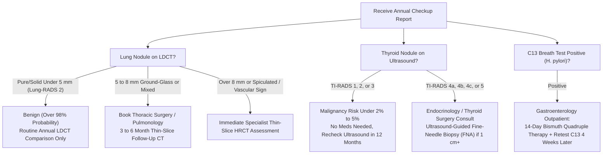
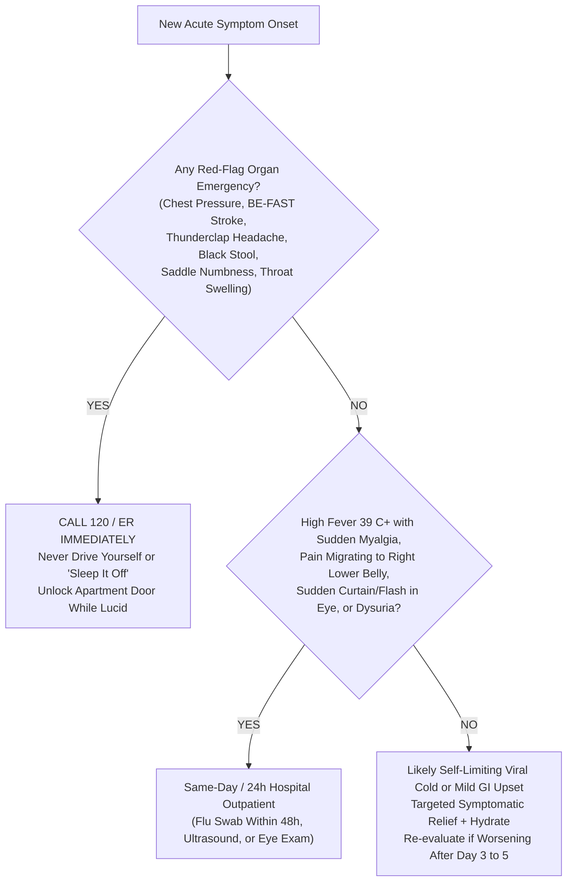

# Age 32+ Medical Checkup Upgrades (体检加项指南), Symptom Triage & Home Medicine Box

At age 32, your relationship with clinical medicine shifts from passive patient to **chief reliability officer of your own biology**. Knowing which screening tests actually catch silent killers early, how to read checkup reports without panic, when to dial `120` immediately versus resting at home, and how to stock an evidence-based medicine cabinet eliminates both preventable tragedies and unnecessary medical anxiety.

---

## 1. Why Standard Corporate Checkups (公司基础体检) Create False Reassurance

Most RMB 300 to 600 employer-sponsored checkup packages (`入职/年度基础套餐`) were designed decades ago to screen basic occupational fitness. Relying on them unchanged after age 30 leaves **four critical blind spots** and **two anxiety traps**:

1. **Blind Spot 1 — Chest X-Ray (`胸片 DR`) Misses Early Lung Cancer**: A 2D chest X-ray has low spatial resolution and superimposes ribs, clavicle, heart, and diaphragm over lung tissue, missing **$> 70\%$ of sub-centimeter ground-glass nodules (`磨玻璃结节`)**. Lung cancer is the #1 cancer in China — including among non-smokers exposed to secondhand smoke, air pollution, or kitchen cooking fumes. **Upgrade**: Replace Chest X-ray with **Low-Dose Spiral Chest CT (`胸部低剂量螺旋CT`, LDCT)**.
2. **Blind Spot 2 — Superficial Metabolic Labs**: Basic packages check `Fasting Glucose` and `Total Cholesterol`, missing early insulin resistance (`HbA1c`, `Fasting Insulin`), true atherogenic particle count (`ApoB`, `Lp(a)`), Chinese stroke-linked `Homocysteine` (`同型半胱氨酸`), and early glomerular kidney stress (`UACR`).
3. **Blind Spot 3 — Zero _H. pylori_ & Gastrointestinal Screening**: Gastric, esophageal, and colorectal cancers represent **over one-third of all cancer deaths in China**, yet basic packages omit `C13` breath testing and gastrointestinal endoscopy (`胃肠镜`), while relying on digital rectal exams that people routinely skip (`弃检率最高项目`, even though a 10-second exam catches low rectal lesions!).
4. **Trap — Blind "Pan-Cancer Blood Tumor Marker Bundles" (`广谱肿瘤标志物套餐`)**: Commercial checkup centers aggressively upsell RMB 1,500 blood panels (`CEA`, `CA19-9`, `CA72-4`, `CA125`, `NSE`) to healthy 32-year-olds. Clinical oncology guidelines warn against routine pan-marker screening in average-risk young adults: sensitivity for Stage I tumors is poor, while **false positives are rampant** (for example, `CA72-4` frequently spikes from benign gastritis, poor sleep, ibuprofen, or supplements), triggering weeks of terror and unnecessary repeat scans. _(Exception: `AFP` + liver ultrasound every 6 months IS mandatory if you carry Hepatitis B or cirrhosis.)_

> **Where to Book**: Whenever possible, book your annual checkup (or add-on follow-ups) at a **Public Grade-A Tertiary Hospital Health Management Center (`公立三甲医院体检中心`)** rather than budget commercial chains. Tertiary hospitals save full thin-slice (`1 mm`) DICOM CT images directly in the hospital PACS system, so if a specialist needs to compare nodule growth 12 months later, you do not have to re-irradiate yourself.

---

## 2. The Complete Age 32+ Checkup Upgrade Matrix (体检加项清单)

Bring this exact table when customizing your annual checkup package:

| Upgrade Item (`中英文项目名称`)                                                 | Cadence at Age 32+                                                                               | Est. Add-On Cost                                                 | What It Detects Early                                                                                              | Critical Preparation & Reading Notes                                                                                                                                                                                                                                        |
| :------------------------------------------------------------------------------ | :----------------------------------------------------------------------------------------------- | :--------------------------------------------------------------- | :----------------------------------------------------------------------------------------------------------------- | :-------------------------------------------------------------------------------------------------------------------------------------------------------------------------------------------------------------------------------------------------------------------------- |
| **Low-Dose Spiral Chest CT (`胸部低剂量螺旋CT`, 薄层)**                         | Baseline at 30–32; every **1–2 years**                                                           | RMB 180 to 320                                                   | Early lung nodules (`< 5 mm` to `10 mm`), old TB scars, emphysema                                                  | Radiation is only **$\sim 1.0\text{ mSv}$** ($\sim 1/5$ standard CT; **skip if pregnant or actively trying to conceive this cycle** — note men have no prolonged sperm delay needed after diagnostic LDCT, though shield gonads if desired).                                |
| **Glycated Hemoglobin & Insulin (`糖化血红蛋白 HbA1c + 空腹胰岛素`)**           | **Annually**                                                                                     | RMB 90 to 160                                                    | 90-day glucose average + `HOMA-IR` insulin resistance 5–10 yrs early                                               | Fast $8\text{--}12\text{ hours}$ (plain water $100\text{ mL}$ is fine; do not dehydrate for 16 hours!).                                                                                                                                                                     |
| **Advanced Lipid + Vascular Panel (`ApoB + Lp(a) + 同型半胱氨酸 + hs-CRP`)**    | `ApoB / Hcy / hs-CRP` **Annually**; `Lp(a)` **Once in lifetime**                                 | RMB 150 to 260                                                   | True plaque particle burden, genetic `Lp(a)`, H-type hypertension stroke risk                                      | Avoid heavy hotpot/alcohol for 3 days prior so triglycerides aren't artificially spiked.                                                                                                                                                                                    |
| **Renal Microvascular Check (`尿微量白蛋白/肌酐比 UACR + 胱抑素C`)**            | **Annually**                                                                                     | RMB 80 to 130                                                    | Earliest glomerular leakage (hypertension/glucose damage); muscle-neutral `eGFR`                                   | Avoid intense heavy squats or running in the 48 hours before urine collection (prevents benign exercise proteinuria!).                                                                                                                                                      |
| **C13 Urea Breath Test (`碳13尿素呼气试验`)**                                   | Baseline now; retest if GI symptoms or family positive                                           | RMB 120 to 220                                                   | Active _Helicobacter pylori_ (`幽门螺杆菌`, WHO Class 1 gastric carcinogen)                                        | Choose **`C13`** (non-radioactive stable isotope, superior to `C14`). **Must stop antibiotics/bismuth 4 weeks & PPIs (`奥美拉唑` etc.) 2 weeks prior** to prevent false negatives!                                                                                          |
| **Abdominal Ultrasound (`肝胆脾胰双肾彩超`)**                                   | **Annually**                                                                                     | Usually included                                                 | Fatty liver grading, gallbladder polyps/stones, renal stones/cysts                                                 | Strictly **fast 8–12h** (eating contracts the gallbladder, blinding the sonographer to polyps!).                                                                                                                                                                            |
| **Thyroid Ultrasound + Panel (`甲状腺及颈部淋巴结彩超 + 甲功五项`)**            | **Annually** (US); every 2 yrs (blood)                                                           | RMB 220 to 380                                                   | Thyroid nodules (`TI-RADS`), Hashimoto's (`TPOAb`), hyper/hypothyroidism                                           | Do not panic over `TI-RADS 2` or `3` nodules (see routing workflow below).                                                                                                                                                                                                  |
| **Carotid Ultrasound + Resting ECG (`颈动脉彩超 + 十二导联心电图`)**            | Every **1–2 years** (annual if BP/ApoB high)                                                     | RMB 140 to 220                                                   | Carotid intima-media thickness (`IMT < 0.9 mm`), early plaque, arrhythmias                                         | Add **Echocardiogram (`心脏彩超`)** once every 3–5 years as a structural valve/wall baseline.                                                                                                                                                                               |
| **Quantitative Fecal Occult Blood (`定量便潜血 FIT`)**                          | **Annually**                                                                                     | RMB 30 to 60                                                     | Microscopic GI bleeding from silent colon polyps or ulcers                                                         | Unlike old guaiac tests, modern immunochemical `FIT` is **not** affected by eating red meat or duck blood.                                                                                                                                                                  |
| **Painless Gastroscopy + Colonoscopy (`无痛胃肠镜联合检查`)**                   | Baseline at **35–40** (or **Age 32 now** if high-risk — see below); then every 5–10 yrs if clean | RMB 1,200 to 2,500 (mostly reimbursable in outpatient insurance) | Esophagitis, Barrett's, early gastric cancer, **resects pre-cancerous colon adenomas (`腺瘤性息肉`) on the spot!** | **Book at 32 immediately if**: 1st-degree family history of GI cancer/polyps, positive _H. pylori_ + chronic stomach symptoms, positive `FIT`, or blood in stool. Propofol sedation (`无痛全麻`) feels like a painless 20-minute nap; requires 1 family/friend escort home. |
| **25-OH Vitamin D + Eye Fundus + Dental Scaling (`维生素D + 眼底眼压 + 洗牙`)** | **Annually**                                                                                     | RMB 300 to 600 total                                             | Severe indoor Vit D deficiency; glaucoma/retinal thinning; subgingival calculus                                    | High myopia ($> -6.00\text{ D}$) should get a dilated retinal check at ophthalmology annually.                                                                                                                                                                              |

---

## 3. How to Read Common "Scary" Checkup Findings Without Panic

Over $60\%$ of 32-year-olds see words like `肺结节` (lung nodule), `甲状腺结节` (thyroid nodule), `肝囊肿` (liver cyst), or `窦性心律不齐` (sinus arrhythmia) and lose sleep searching terrifying posts online. Use clinical risk stratification:

- **Simple Hepatic / Renal Cysts (`单纯性肝囊肿 / 肾囊肿 < 4 cm`)**: Benign fluid pockets ("water blisters on an organ"); require zero medication and never turn into cancer — just observe annually.
- **Gallbladder Polyps (`胆囊息肉`)**: $70\%+$ of `< 5 mm` "polyps" are actually **cholesterol crystals (`胆固醇结晶`)** adhered to the wall from skipping breakfast or high lipid bile. Only true solitary sessile polyps **$\ge 10\text{ mm}$** (or rapidly growing) warrant surgical consult.
- **Sinus Arrhythmia (`窦性心律不齐`)**: Completely normal physiological respiratory heart-rate variability in healthy young adults (sign of strong vagal tone!).

---

## 4. Adult Vaccination Catch-Up Schedule at Age 32 (成人疫苗清单)

Vaccines are not just for infants. Immunity wanes, and several high-ROI adult vaccines protect you and your household:

| Vaccine (`疫苗名称`)                                                                                                                             | Schedule & Doses                                                                                                        | Target Protection & Practical Guidance                                                                                                                                                                                                                                                                                                                                       |
| :----------------------------------------------------------------------------------------------------------------------------------------------- | :---------------------------------------------------------------------------------------------------------------------- | :--------------------------------------------------------------------------------------------------------------------------------------------------------------------------------------------------------------------------------------------------------------------------------------------------------------------------------------------------------------------------- |
| **1. Quadrivalent Influenza (`四价流感灭活疫苗`)**                                                                                               | **1 dose annually** every Sept–Oct (`RMB 100–160` at community health centers `社区卫生服务中心`)                       | Cuts risk of severe $39.5^\circ\text{C}$ week-long Influenza A/B knockouts and myocarditis complications by $40\%\text{--}60\%$. Best ROI productivity shield every autumn.                                                                                                                                                                                                  |
| **2. 9-Valent HPV (`九价HPV疫苗`, Gardasil 9)**                                                                                                  | **3 doses (`0–2–6 months`)**                                                                                            | Blocks 7 oncogenic HPV strains (`16, 18, 31, 33, 45, 52, 58`) + 2 genital-wart strains (`6, 11`). Approved for females up to age 45 in Mainland China, and approved/recommended for males (prevents male oropharyngeal/anal/penile lesions AND breaks asymptomatic partner transmission to wives/girlfriends; accessible via approved male indications or HK/Macau clinics). |
| **3. Hepatitis B Booster (`重组乙肝疫苗`)**                                                                                                      | Check quantitative `HBsAb` first: if **$< 10\text{ mIU/mL}$**, take **1 to 3 doses (`0–1–6 m`, $20\ \mu\text{g}$)**     | Childhood Hep B antibodies fade to undetectable in roughly 40% of 32-year-olds. China has roughly 70 million HBV carriers; keeping `HBsAb > 10–100 mIU/mL` provides ironclad protection during dental work, endoscopy, or accidental blood exposure.                         |
| **4. Tetanus / Tdap (`破伤风 / 成人百白破`)**                                                                                                    | Booster **every 10 years** (or within 24h of deep/rusty/soil-contaminated wounds)                                       | Tetanus fatality remains high once symptomatic; if childhood history is clear and $>10\text{ yrs}$ elapsed, 1 tetanus toxoid booster restores immunity without needing horse-serum skin tests (`TAT`)!                                                                                                                                                                       |
| **5. High-ROI Gift for Parents (Age $50+ / 60+$): Recombinant Shingles (`重组带状疱疹疫苗` Shingrix) + 23-Valent Pneumococcal (`23价肺炎疫苗`)** | Shingrix: **2 doses (`0–2 months`)** for parents $\ge 50\text{ yrs}$                                                    | 1 in 3 older adults develops shingles (`缠腰龙`), whose nerve pain (`带状疱疹后遗神经痛`) can cause excruciating insomnia for years; Shingrix provides **$> 90\%$ efficacy**.                                                                                                                                                                                                |

---

## 5. Acute Symptom Triage: ER Red Flags vs. Self-Limiting Illness

Knowing the boundary between **"drink ORS water and sleep"** and **"call 120 right now"** saves lives — especially for solo-living engineers (`独居程序员`).

### Six Non-Negotiable Red-Flag Syndromes (`绝不能硬扛睡一觉的红旗征`)

1. **Acute Coronary Syndrome / Pulmonary Embolism (`心梗 / 肺栓塞`)**: Crushing, heavy, or band-like pressure behind the breastbone (or unexplained pain radiating to the **left shoulder, inner arm, jaw, teeth, or upper back**) lasting $> 5\text{--}10\text{ minutes}$ accompanied by cold sweat, nausea, or shortness of breath — OR sudden dyspnea + sharp chest pain after a 12-hour flight / marathon coding session with one swollen calf (`下肢深静脉血栓脱落`). **Action**: Call `120`, sit/recline quietly, unlock your front door; do _not_ walk down stairs or drive yourself.
2. **Acute Stroke (`BE-FAST / 中风120`)**: Sudden **B**alance loss, **E**ye vision loss/double vision, **F**acial asymmetry when smiling (`口角歪斜`), **A**rm drift when raising both arms (`单侧肢体无力麻木`), or **S**lurred/nonsensical speech (`言语不清`). **Action**: Call `120` to a certified **Stroke Center (`卒中中心`)** — intravenous thrombolysis has a strict **$4.5\text{-hour}$ golden window** before brain tissue dies permanently!
3. **Thunderclap Headache or Meningism (`蛛网膜下腔出血 / 颅内感染`)**: A sudden headache reaching $10/10$ explosive intensity within $< 60\text{ seconds}$ ("like being hit in the head with a bat"), OR headache accompanied by high fever, stiff neck (`低头下巴碰不到胸口`), confusion, or projectile vomiting.
4. **Cauda Equina Syndrome (`马尾综合征` — Spine Surgical Emergency)**: Lower back pain or sciatica suddenly accompanied by **numbness in the groin/perineum ("saddle anesthesia" `会阴骑跨区麻木`)**, difficulty initiating urination (`尿潴留`), or bowel/bladder incontinence. Requires surgical decompression within 24 to 48 hours to prevent permanent paralysis/incontinence.
5. **Acute Surgical Abdomen (`急腹症`)**:
   - Dull pain around the navel that migrates to the **right lower quadrant** over 6 to 12 hours (`转移性右下腹痛` — **acute appendicitis `急性阑尾炎`**).
   - Severe, boring upper abdominal pain radiating straight through to the back after a heavy meal, hotpot, or alcohol (`急性胰腺炎` — **stop all food and water immediately `严格禁食禁水`** and go straight to ER!).
   - Vomiting dark coffee-ground material or passing shiny **jet-black tarry stools (`柏油样黑便`)** (upper GI hemorrhage — _unless_ you recently ate bismuth `枸橼酸铋钾`, duck blood, or iron tablets).
6. **Anaphylaxis (`严重过敏反应`)**: Generalized hives (`荨麻疹`) accompanied by **voice hoarseness, throat tightness, wheezing, lip/tongue swelling, or dizziness** minutes after eating seafood/nuts or taking medication — airway edema can close the larynx in 15 minutes!

### Common Cold (`普通感冒`) vs. Influenza (`甲乙流`) vs. Bacterial Infection

**Antibiotics (`阿莫西林 / 头孢克肟 / 阿奇霉素 / 左氧氟沙星`) kill ONLY bacteria — they have ZERO effect on viral colds or flu**, while wiping out beneficial gut flora and breeding drug-resistant superbugs!

| Feature               | Common Viral Cold (`普通感冒`, Rhinovirus/Coronavirus)                                                                                                        | Influenza (`流行性感冒`, Flu A / Flu B)                                                                                                                                   | Secondary Bacterial Tonsillitis / Sinusitis                                                                                      |
| :-------------------- | :------------------------------------------------------------------------------------------------------------------------------------------------------------ | :------------------------------------------------------------------------------------------------------------------------------------------------------------------------ | :------------------------------------------------------------------------------------------------------------------------------- |
| **Onset & Fever**     | Gradual; low-grade or no fever ($< 38.0^\circ\text{C}$)                                                                                                       | **Abrupt within hours**; high fever **$39.0\text{--}40.0^\circ\text{C}$** + chills                                                                                        | Fever persists $> 5\text{ days}$ or "double-sickening" (improves then worsens sharply on Day 6)                                  |
| **Dominant Symptoms** | Sneezing, clear/thick nasal congestion, scratchy throat _(note: yellow/green snot on Day 4 is dead neutrophils, NOT automatic proof of bacterial infection!)_ | Crushing **whole-body muscle aches (`全身酸痛`), headache, extreme prostration**, dry cough                                                                               | Purulent white exudate on tonsils + tender neck lymph nodes + **zero cough**; or unilateral facial sinus pain $> 10\text{ days}$ |
| **Correct Action**    | Purely symptomatic care: saline nasal rinse, honey/lozenges, Ibuprofen if achy, rest 5–7 days                                                                 | Run home combo antigen swab (`甲乙流试纸`); if positive within **48h**, doctor-prescribed **Baloxavir (`玛巴洛沙韦` single dose)** or **Oseltamivir (`奥司他韦` 5 days)** | Outpatient `CBC + CRP` / strep check; take full prescribed course of targeted antibiotic if confirmed                            |

---

## 6. The Evidence-Based Home Medicine Box (家庭常备药箱)

Audit your home drawer every 6 months (discard expired blisters and **any multi-dose eye drop opened $> 28\text{ days}$ ago**). Always buy medications by **Generic Chemical Name (`国家通用名`)**, never flashy compound brand names:

### Core Pharmaceutical & Hardware Inventory

| Category                 | Generic Medication / Item (`通用名`)                                                                                                                                                         | Exact Clinical Use                                                                                                                                | Hard Dose Ceiling & Safety Rules                                                                                                                                                                                                                          |
| :----------------------- | :------------------------------------------------------------------------------------------------------------------------------------------------------------------------------------------- | :------------------------------------------------------------------------------------------------------------------------------------------------ | :-------------------------------------------------------------------------------------------------------------------------------------------------------------------------------------------------------------------------------------------------------- |
| **Fever & Pain**         | **Ibuprofen (`布洛芬片/胶囊`, $200\text{--}400\text{ mg}$)** _(not sustained-release `缓释` if fast relief needed)_                                                                          | Fever $\ge 38.5^\circ\text{C}$ (or uncomfortable), headache, toothache, muscle/menstrual pain                                                     | Max $1,200\text{ mg/day}$ OTC; take with food/milk; **avoid in stomach ulcers, kidney disease, dehydration, or pregnancy**.                                                                                                                               |
| **Fever & Pain**         | **Acetaminophen (`对乙酰氨基酚片`, $500\text{ mg}$)**                                                                                                                                        | Gentle stomach-safe antipyretic/analgesic                                                                                                         | Strict max **$2,000\text{--}3,000\text{ mg/day}$** (clinical ceiling $4,000\text{ mg}$). **NEVER stack with compound cold drugs (`泰诺/感康/999感冒灵`) or alcohol -> fatal acute liver necrosis!**                                                       |
| **Acute Diarrhea**       | **Oral Rehydration Salts III (`口服补液盐III`, ORS III)** + **Montmorillonite (`蒙脱石散`)**                                                                                                 | #1 priority in diarrhea/vomiting: prevents hypokalemic/dehydration shock                                                                          | Dissolve 1 sachet `ORS III` in **exactly $250\text{ mL}$ warm water** (do not dilute wrong; sports drinks have too much sugar and too little sodium!). Space `蒙脱石散` **2 hours apart** from any other pill.                                           |
| **Heartburn / Reflux**   | **Hydrotalcite (`铝碳酸镁咀嚼片 / 达喜`)** or **Famotidine (`法莫替丁`, $20\text{ mg}$)**                                                                                                    | Acute acid reflux, burning epigastric discomfort after spicy/late meal                                                                            | Chew `铝碳酸镁` thoroughly between meals/bedtime for instant mucosal coating.                                                                                                                                                                             |
| **Constipation**         | **Lactulose (`乳果糖口服液`)** or **PEG 4000 (`聚乙二醇4000散`)**                                                                                                                            | Travel or low-fiber constipation                                                                                                                  | Safe gentle osmotic action; **never use senna/rhubarb stimulant teas (`番泻叶`)**.                                                                                                                                                                        |
| **Allergy / Hives**      | **Cetirizine (`西替利嗪`, $10\text{ mg}$)** or **Loratadine (`氯雷他定`, $10\text{ mg}$)**                                                                                                   | Allergic rhinitis sneezing, acute hives (`荨麻疹`), itchy bug bites                                                                               | 1 tablet once daily (2nd-gen antihistamines; take Cetirizine in evening if mildly drowsy).                                                                                                                                                                |
| **Nasal / Ocular**       | **Isotonic Sea Salt Nasal Spray (`生理性海盐水鼻喷`)** + **Single-Vial Sodium Hyaluronate (`单支无防腐剂玻璃酸钠滴眼液`)**                                                                   | Clogged nose / rhinitis flushing; dry eyes or flushing foreign eyelash/dust                                                                       | If using decongestant **Oxymetazoline (`羟甲唑啉鼻喷`)** before a flight with severe congestion, use **strictly $\le 3\text{--}5\text{ days}$** to prevent rebound `药物性鼻炎`.                                                                          |
| **Wound & Skin**         | **Povidone-Iodine $0.5\%$ Swabs (`独立包装碘伏棉签`)** + **Mupirocin $2\%$ (`莫匹罗星软膏`)** + **Mometasone $0.1\%$ (`糠酸莫米松乳膏`)** + **Hydrocolloid Dressings (`水胶体创可贴/敷料`)** | Clean cuts/scrapes (`碘伏`); minor bacterial infected pimple/cut (`莫匹罗星`); acute eczema/mosquito welts (`莫米松` short-term $\le 7\text{ d}$) | **Retire $75\%$ alcohol, hydrogen peroxide, `红药水`, and `紫药水` on open wounds** — alcohol stings brutally and kills regenerating fibroblasts, while `碘伏` is painless and broad-spectrum! Moist healing under hydrocolloid prevents scabs and scars. |
| **4 Diagnostic Devices** | **Validated Upper-Arm BP Cuff (`欧姆龙上臂式血压计`)** + **Digital Thermometer (`电子体温计`)** + **Pulse Oximeter (`指夹式血氧仪`)** + **Flu A/B Antigen Swabs**                            | Objective vital signs before telemedicine or hospital triage ($\text{SpO}_2 \ge 96\%$ normal; $< 93\%$ ER immediately)                            | Discard glass **mercury thermometers (`水银体温计`)** — broken elemental mercury evaporates into neurotoxic indoor vapor!                                                                                                                                 |

### Decoding Chinese Regulatory Box Codes & Package Inserts (`看懂国药准字与说明书`)

Never buy an unverified cream, spray, or pill without checking the regulatory registration number printed on the box:

- **`国药准字 H / Z + 8 digits` (`正规药品`)**: True NMPA-approved clinical pharmaceuticals (`H` = chemical/Western drug; `Z` = Chinese patent medicine; `S` = biologics) tested via human clinical trials.
  - **Green `OTC` Logo (`乙类非处方药`)**: Highest OTC safety margin (e.g., saline spray, artificial tears).
  - **Red `OTC` Logo (`甲类非处方药`)**: Safe self-care under pharmacist guidance (e.g., Ibuprofen).
  - **`Rx` (`处方药`)**: Requires physician diagnosis (all oral antibiotics, antihypertensives, statins, antivirals).
- **`国食健字 / 蓝帽子` (`保健食品`)**: Dietary supplement ONLY — legally **prohibited from claiming disease treatment**.
- **`卫消证字` (`消字号消毒产品`) — Major Skincare/Nasal Scam Alert**: Approved ONLY as surface disinfectants/sanitizers (`消毒抑菌`), NOT medicines! Unscrupulous sellers frequently market `"100% pure herbal miracle eczema cream / rhinitis spray"` under a `消字号` license while illegally spiking ultra-potent glucocorticoids (`氯倍他索`) or antifungals. **Rule**: Never put a `消字号` cream or nasal spray onto inflamed skin or mucosa!
- **Reading Package Inserts Without Panic**: A 2-page list of rare adverse reactions (`不良反应`) on a Western drug insert (`布洛芬`) means the manufacturer ran rigorous Phase III/IV pharmacovigilance trials and recorded every $0.01\%$ event. Conversely, a patent tonic whose insert claims **`不良反应：尚不明确` ("Adverse reactions: Currently unclear")** does **not** mean zero side effects — it means systematic safety monitoring was never completed! Also distinguish **`慎用` (Use with caution / monitor)** from **`忌用` (Avoid unless benefits clearly outweigh risks)** and **`禁用` (Absolute hard contraindication — NEVER take)**.

---

## 7. Five Life-Saving Drug Safety & First-Aid Rules

1. **The Deadly Compound Cold-Medicine Trap (`复方感冒药叠吃致肝衰竭`)**: Almost every Chinese OTC cold packet — including "Chinese herbal" packets like **`999感冒灵颗粒`**, **`维C银翘片`**, plus Western packets like **`泰诺 (酚麻美敏)`**, **`白加黑`**, **`感康`**, **`快克`** — secretly contains **$200\text{--}500\text{ mg}$ of Acetaminophen (`对乙酰氨基酚`)**! Taking `999感冒灵` + `泰诺` + a `布洛芬/散利痛` tablet together easily overdoses acetaminophen and causes irreversible acute hepatic failure within 72 hours. **Rule**: Never combine two cold remedies; treat individual symptoms with single-ingredient drugs.
2. **Zero Alcohol Window With Cephalosporins & Metronidazole (`双硫仑样反应`)**: Cephalosporin antibiotics (anything with **`头孢`** in the name, plus `甲硝唑 / 替硝唑 / 呋喃唑酮`) block hepatic **acetaldehyde dehydrogenase**, causing extreme acetaldehyde poisoning, blood pressure collapse, and cardiac arrest when combined with even a sip of beer, cooking wine (`料酒`), drunken shrimp / liquor chocolates (`醉虾 / 酒心巧克力`), or medicinal tinctures (`藿香正气水` contains $40\%\text{--}50\%$ ethanol!). Enforce **zero alcohol for 7 days before and 7 days after** taking these drugs. _(Also never drink grapefruit juice `西柚汁` while taking statins or calcium-channel blood pressure meds like felodipine/amlodipine — `CYP3A4` inhibition spikes drug levels dangerously.)_
3. **Thermal Scalds & Kitchen Burns (`冲 – 脱 – 泡 – 盖 – 送`)**:
   - **Rinse (`冲`)**: Immediately hold the burned skin under gentle **cool running tap water ($15\text{--}20^\circ\text{C}$) for a full 15 to 20 minutes** to halt deep dermal heat conduction! _(Never apply ice cubes directly — causes frostbite necrosis.)_
   - **Never Apply Folk Substances**: **NEVER smear toothpaste (`牙膏`), soy sauce (`酱油`), sesame oil, or flour** onto a burn — they trap heat, breed bacteria, and force ER nurses to scrub your raw nerve endings to clean them off! Leave intact small blisters unbroken (`不要挑破水泡`), cover loosely with sterile Vaseline gauze, and visit a burn clinic if larger than a coin or on the face/joints/hands.
4. **Acute Ankle or Joint Sprains (`急性扭伤 48小时内严禁热敷或揉红花油`)**: Within the first **24 to 48 hours** of twisting an ankle, torn micro-vessels are actively bleeding internally. Elevate the limb above heart level, wrap gently with an elastic bandage, and apply wrapped ice packs ($15\text{ min}$ on, $1\text{ h}$ off) for pain relief (`PEACE & LOVE` modern sports medicine protocol). **NEVER vigorously massage or rub heating safflower oil (`红花油 / 正骨水`)** onto an acute sprain — it dilates ruptured vessels and balloons swelling to the size of a steamed bun!
5. **Airway Choking (`海姆立克急救法`) & Nosebleed (`鼻出血`)**:
   - **Choking While Alone (`独居异物卡喉自救`)**: If unable to cough or speak, make a fist with thumb side pressed just above your navel below the breastbone (`肚脐上方两横指`), grasp fist with other hand, and **thrust inward and upward forcefully**, OR lean hard over the rounded top edge of a **sturdy chair backrest**, driving your upper abdomen sharply against the edge to pop the airway obstruction out with residual lung air.
   - **Nosebleed (`流鼻血`)**: **NEVER tilt your head backward** (causes blood to drain down the pharynx into the trachea or stomach, triggering choking/vomiting) and **never stuff dry toilet paper** into nostrils (tears the fragile clot off upon removal). Sit **leaning slightly forward**, and pinch both soft nasal wings (`鼻翼软骨部分`, below the hard nasal bridge) firmly together for **10 to 15 continuous minutes** while breathing through your mouth and placing a cool pack across the bridge of your nose.

---

## 8. International Travel Medical Kit & Foreign Customs Drug Traps

When traveling abroad (`出国自由行 / 商务差旅`), buying unfamiliar drugs at midnight in a foreign language or facing USD 3,000+ out-of-pocket ER bills in North America/Europe is stressful — while bringing the _wrong_ Chinese household pills can trigger **felony narcotics detention at foreign airport customs**!

### Foreign Customs Red-Line Ingredients (`严禁盲目携带出境的国内常见药成分`)

Many everyday Chinese OTC cold and cough medicines contain precursors or opiates strictly regulated at US, Japanese, Australian, New Zealand, and European borders:

1. **Morphine / Opium Powder (`阿片粉 / 樟脑酊`)**: Present in **`复方甘草片`** (licorice cough tablets) and **`强力枇杷露`** — strictly prohibited narcotics at US/AU/NZ/JP customs!
2. **Ephedrine / Pseudoephedrine (`麻黄碱 / 伪麻黄碱`)**: Present in **`新康泰克 (美扑伪麻 / 盐酸伪麻黄碱)`**, **`白加黑`**, **`泰诺`**, **`急支糖浆`**, and **`鼻炎片`** — methamphetamine precursor strictly capped or banned in Japan, New Zealand, Australia, and Schengen/UK in large quantities!
3. **Codeine (`可待因`)**: Present in central prescription cough syrups (`复方磷酸可待因口服溶液`).
4. **Strychnine / Endangered Animal/Plant Ingredients (`士的宁 / 麝香 / 虎骨 / 石斛`)**: Present in certain traditional Chinese patent medicines (`马钱子`, natural musk `安宫牛黄丸 / 片仔癀`, CITES-protected flora/fauna).

**Safe Customs Rules**:

- Carry **single-ingredient Western generics in original factory foil/boxes** with English generic names visible (`Ibuprofen`, `Acetaminophen/Paracetamol`, `Cetirizine`, `Loratadine`, `Oral Rehydration Salts`, `Montmorillonite`, `Famotidine`, `Melatonin 0.5–1 mg`) in a 7-to-14-day personal supply.
- If carrying prescription chronic medications (e.g., antihypertensives, finasteride, inhalers, EpiPen), carry a **bilingual hospital prescription/diagnosis summary (`中英文处方/诊断证明`)** matching your passport name.
- **Always Buy Comprehensive Travel Medical Insurance (`境外旅行医疗及紧急救援保险`)** covering at least **RMB 500,000 to 1,000,000** in acute inpatient care and medical evacuation before flying (costs only RMB 60 to 180 for a 10-day trip!).
- **Long-Haul Flight DVT Prevention (`经济舱综合征预防`)**: Flights $> 6\text{ hours}$ triple the risk of calf **Deep Vein Thrombosis (`下肢深静脉血栓`)**. Wear graduated **$15\text{--}20\text{ mmHg}$ compression socks (`医用一级渐进式压力袜`)**, drink $200\text{ mL}$ plain water every hour (skip cabin alcohol), book an aisle seat, and pump your ankles (`勾脚尖踝泵运动` 20 reps) + walk the cabin every 90 minutes.

---

## 9. Solo-Living Emergency Readiness & Annual Health Calendar

If you live alone (`独居青年`) or travel frequently, spend **20 minutes once** configuring passive emergency safety nets so a sudden 02:00 AM medical crisis never traps you without help:

### Solo-Living 5-Point Emergency Checklist

- [ ] **Configure Lock-Screen Medical ID (`手机锁屏医疗急救卡`)**: Open iOS **Health App $\rightarrow$ Medical ID (`健康 -> 医疗急救卡`)** (or Android Emergency Info) and enable _"Show When Locked."_ Fill in your **Blood Type**, **Known Drug/Food Allergies (`药物过敏史`)**, current medications, and **2 local emergency contacts (`紧急联系人`)** — paramedics can read this without unlocking FaceID!
- [ ] **Pin Your Nearest 24/7 Grade-A Hospital ER (`15分钟车程内三甲急诊定位`)**: Look up which nearby `三甲医院` has a **24-hour Chest Pain Center (`胸痛中心`), Stroke Center (`卒中中心`), and Ophthalmology/GI Night ER** _(not all hospitals run eye or ENT night emergencies — know which one in your city does ahead of time!)_.
- [ ] **Save Exact Text Address Beside Your Door**: When dizzy or febrile at 03:00 AM, people frequently blank out on exact building/unit numbers when speaking to `120` dispatchers (`XX区XX路XX弄XX号楼XX室`). Keep a clear card on the fridge/phone favorites, and **if calling `120` while living alone, immediately unlatch/unlock your apartment door (`第一时间先把防盗门打开虚掩`)** while still conscious so paramedics don't lose 25 minutes breaking a security door!
- [ ] **Keep 2 Days of Shelf-Stable Fever Supplies**: Stock 6 sachets of `ORS III` (`口服补液盐III`), 2 bottles of electrolyte water, 1 pack of soft porridge/crackers, single-ingredient `Ibuprofen`, and a digital thermometer in one reachable bedside/living-room bin so a sudden $39.5^\circ\text{C}$ norovirus or influenza night never forces you to stagger downstairs alone.
- [ ] **Install Smoke & Natural-Gas Alarms**: Verify kitchen gas shutoff valves and bathroom water-heater ventilation annually to eliminate silent carbon monoxide (`一氧化碳中毒`) risk.

### Your Annual Preventive Maintenance Calendar (`年度健康日历`)

| Month / Quarter    | Scheduled Preventive Action (`固定动作`)                                                                                                                                                                                                    | Est. Time Required           |
| :----------------- | :------------------------------------------------------------------------------------------------------------------------------------------------------------------------------------------------------------------------------------------ | :--------------------------- |
| **March (Q1)**     | **Dental Scaling #1 (`上半年洗牙`)** + Replace electric toothbrush head + Check home medicine box expirations                                                                                                                               | $45\text{ minutes}$          |
| **June (Q2)**      | **Mid-Year Body-Comp & Ergonomic Audit**: Check waist circumference ($\text{WHtR} < 0.50$), 7-day home BP average, sunscreen restock, bedroom AC filter disinfection (`空调滤网清洗防军团菌/尘螨`)                                          | $30\text{ minutes}$          |
| **September (Q3)** | **Annual Quadrivalent Influenza Vaccine (`接种四价流感疫苗`)** + **Dental Scaling #2 (`下半年洗牙`)** + Eye fundus check (if high myopia)                                                                                                   | $60\text{ minutes}$          |
| **November (Q4)**  | **Comprehensive Age 32+ Upgraded Checkup (`三甲医院年度深度体检`)**: `LDCT`, `ApoB`, `HbA1c`, `Fasting Insulin`, `Hcy`, `UACR`, `Vit D`, Abdominal/Thyroid/Carotid Ultrasounds, `FIT` (`C13` / Endoscopy per cadence) + Archive PDFs/DICOMs | $3\text{ hours}$ (1 morning) |

---

Return to **[00-README.md](00-README.md)** to review the complete 5-Pillar Human Body Operating Architecture and your 90-Day Incremental Execution Plan.
