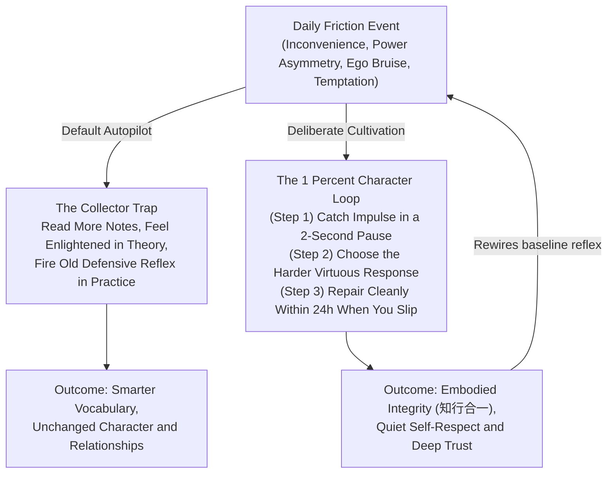
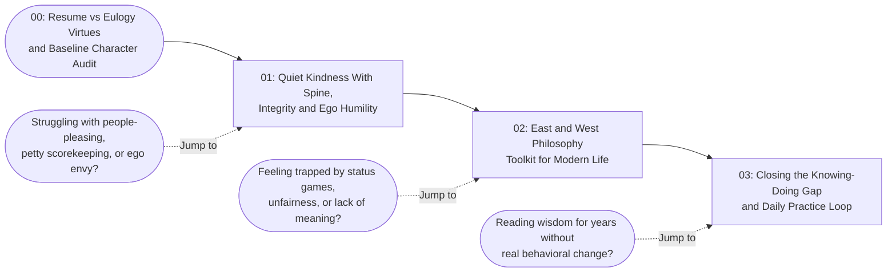

# Character, Kindness & Life Philosophy: What Actually Makes Someone a Better Person (修身)

## 1. Why Competence, Style, and Optimization Are Not Enough

If you spend enough time building a modern "Life OS," you eventually notice a quiet, unsettling gap. You can optimize your sleep architecture, lift heavy weights, dress sharply, master distributed systems and AI engineering, negotiate great flight deals, and learn charisma frameworks—and still ask yourself late at night: **"Does any of this actually make me a *better* human being, or just a higher-performing, better-packaged one?"**

That question marks the exact transition from **self-optimization** to **character cultivation (修身)**.

In *The Road to Character*, writer David Brooks names the two distinct sets of virtues every adult must reckon with:

- **Resume Virtues (External Capability)**: The skills and assets you bring to the marketplace—technical brilliance, career velocity, wealth, physique, personal style, productivity systems, and social polish. They make you *impressive from a distance*.
- **Eulogy Virtues (Internal Moral Core)**: The qualities that sit at the core of your being—whether you are honest when a lie would be convenient, how you treat people who cannot help your career, whether your kindness has courage behind it, how gracefully you admit fault, and how safe and uplifted people feel after spending an hour with you. They make you *trusted and deeply loved up close*.

Most ambitious 30-somethings spend 95% of their deliberate effort engineering Resume Virtues while assuming Eulogy Virtues will somehow take care of themselves. They do not. Without deliberate cultivation, high competence paired with an unexamined ego easily curdles into impatience, subtle arrogance, transactional relationships, or defensive pride.

### Resume Virtues vs. Eulogy Virtues

| Dimension | Resume Virtues ("Adam I": External Builder) | Eulogy Virtues ("Adam II": Moral Character) |
| :--- | :--- | :--- |
| **Core Question** | *"How can I succeed, win leverage, and look sharp?"* | *"Who am I becoming, and how should I live when nobody is applauding?"* |
| **Primary Logic** | Input-output ROI; efficiency; competitive differentiation | Covenant; integrity; reciprocity without petty scorekeeping |
| **How Failure Is Viewed** | A bottleneck to debug, hide, or optimize away | Tuition in humility; an invitation to courage, empathy, and repair |
| **Social Orientation** | Networking upward or laterally toward high-status peers | Consistent warmth across every rung—couriers, juniors, elders, partners |
| **Source of Peace** | Fragile; rises and falls with external KPIs, money, and praise | Durable; rooted in self-respect (问心无愧) that survives bad quarters |
| **Failure Mode If Neglected** | Ineffectiveness, financial vulnerability, unfulfilled capability | Hollow success; impressive resume paired with lonely or strained relationships |

**Crucial Synthesis**: Becoming a better person does *not* mean abandoning ambition, style, or technical excellence. Competence gives your kindness reach—a skilled, financially stable, healthy adult can protect their family and lift others far more effectively than someone who is helpless. Resume Virtues build the **engine**; Eulogy Virtues steer the **wheel**.

---

## 2. Why Hoarding 100 Self-Improvement Notes Changes Nothing

Analytical thinkers face a seductive cognitive trap: mistaking **reading about virtue** for **possessing virtue**.

When you read a moving passage on humility, stoic calm, or generosity, your brain experiences a mild warm glow of moral elevation. Because the concept makes logical sense, your mind files it under *"Understood"*—as if human character worked like downloading a library documentation file. Then, six hours later, a food delivery rider calls from the wrong gate in the rain, a junior teammate breaks a build, or your partner points out a blind spot, and your old reflex (irritation, sarcasm, or defensiveness) fires in 200 milliseconds.

Character is **not** declarative knowledge stored in Markdown files; character is **procedural muscle memory under load**.



### The Compounding Math of Micro-Moments

People often imagine moral character is forged in dramatic movie-like crises—saving a stranger from a fire or turning down a USD 1,000,000 bribe. In reality, you almost never rise to a crisis with a virtue you have not practiced in ordinary Tuesday inconveniences.

If we think of baseline moral reflex $C_t$ across $n$ daily friction moments, occasional grand gestures fade quickly if daily interactions erode trust, whereas tiny, consistent 1% choices of honesty, patience, and repair compound:

$$C_n = C_0 \cdot \prod_{k=1}^{n} (1 + r_k)$$

Where $r_k$ is small and positive whenever you keep a minor word, swallow an unnecessary cruel remark, or apologize cleanly—and negative whenever you rationalize a "just this once" shortcut. Over 365 days, your life philosophy is simply the sum of those small $r_k$ decisions.

---

## 3. Four Shifts From "Self-Improvement" to Genuine Goodness

If physical health, career craft, and psychological regulation are the foundation of your Life OS, these four shifts represent the upper architecture of becoming a truly admirable human being:

1. **Zero-Leverage Decency & Unseen Integrity**: Anyone can be charming to a VP, an attractive date, or an interviewer. Your real character is measured by your baseline tone toward people who hold zero leverage over your future, and the promises you keep when breaking them would go completely unnoticed.
2. **Kindness With Spine (善良但有锋芒)**: True goodness is never spineless people-pleasing (讨好型人格). People-pleasing is fear dressed up as niceness, and it breeds hidden resentment. Real kindness is chosen from inner abundance, backed by clear boundaries and the courage to say a calm, clean "no."
3. **Battle-Tested East-West Life Philosophy**: Good intentions collapse under unfairness, grief, or status anxiety unless anchored in a coherent worldview—combining Wang Yangming's unity of knowing and acting (知行合一), Zhuangzi's inner freedom (精神自由), Aristotle's Golden Mean, Kantian respect for persons, and Viktor Frankl's existential responsibility.
4. **Fast, Unconditional Repair**: Becoming a better person does *not* mean becoming a sinless saint who never gets tired or snappy. It means shrinking your **Mean Time to Repair (MTTR)**—owning mistakes without excuses within 24 hours and leaving rooms warmer than you found them.

---

## 4. Three Real-World Litmus Tests: Polished vs. Genuinely Good

Why do so many smart, well-read adults feel admired by strangers yet subtly exhausting to those closest to them? Look at how external polish and internal character diverge in three ordinary Tuesday situations:

### Litmus Test A: Shared Credit vs. Quiet Blame at Work

- **Resume-Only Reflex**: When a launch succeeds, subtly centering your own architectural contribution in public Slack channels; when an edge case breaks production, pointing out that the product spec was ambiguous or a junior engineer merged the PR.
- **Eulogy-Virtue Reflex**: **Window and Mirror Leadership** (Jim Collins). When things go well, you look out the *window* to name specific teammates whose unglamorous work made it happen. When things break, you look in the *mirror* first: *"I reviewed that design and missed the timeout boundary—here is how we are fixing it."* Paradoxically, engineers who do this become the most trusted leaders in any organization.

### Litmus Test B: Tired Evening Friction With Partner or Parents

- **Resume-Only Reflex**: Spending peak emotional warmth, humor, and patience on colleagues and acquaintances all day, then bringing home only irritable leftovers (窝里横)—snapping over a misplaced key or a repeated question from an aging parent because *"they won't leave me anyway."*
- **Eulogy-Virtue Reflex**: Guarding a non-negotiable 10% reserve of gentleness for the people inside your home. If you are depleted, naming your state cleanly rather than discharging frustration onto safe targets:
  - *"I'm completely fried from back-to-back incidents today and my patience is near zero—give me 20 quiet minutes to shower and reset so I don't bring bad energy to dinner."*

### Litmus Test C: Discovering an Invisible Error in Your Favor

- **Resume-Only Reflex**: A small neighborhood restaurant forgets to put a RMB 68 dish on your bill, or a seller accidentally ships two items instead of one, and you tell yourself *"Their mistake, lucky break."*
- **Eulogy-Virtue Reflex**: Pointing it out calmly and paying what is fair—not out of rigid rule-worship, and not so anyone calls you noble, but because **your self-respect is worth infinitely more than RMB 68**. Every time you refuse cheap, unfair advantage when nobody would ever catch you, an invisible steel spine forms inside your psyche.

| Everyday Situation | Superficial "Nice / Optimized" Person | Deeply Grounded Person (君子慎独) |
| :--- | :--- | :--- |
| **Small restaurant undercharges bill** | Takes the freebie quietly; calls it good luck | Mentions the missing item warmly so staff do not eat the loss |
| **Friend cancels plans due to burnout** | Says *"No worries!"* then complains to mutual friends | Offers genuine grace; drops off soup or checks in three days later |
| **Disagreement with a junior colleague** | Uses jargon and seniority to win the argument fast | Steelmans the junior's point first; admits openly if the junior is right |
| **Making a promise while busy** | Over-promises to feel generous in the moment, then ghosts | Promises conservatively, writes it down immediately, delivers on time |

---

## 5. Five Counterfeit Versions of "Being a Good Person"

Before auditing your habits, watch out for five common moral counterfeits. Because each one avoids obvious villainy, smart adults often wear them for years without realizing they are substitutes for real character:

1. **Conflict-Averse Niceness (老好人) Mistaken for Kindness**
   - *The Counterfeit*: Never disagreeing, never giving honest feedback when a friend or teammate is heading toward a cliff, and telling comforting half-truths so *you* do not have to feel 30 seconds of awkwardness.
   - *Real Character*: Caring enough about the other person's long-term good to absorb temporary discomfort and speak warm, constructive truth behind closed doors.
2. **Distant Halo / Home Coldness (远香近臭) Mistaken for Compassion**
   - *The Counterfeit*: Donating to causes online, writing eloquent posts about empathy, and charming strangers at dinner parties—while speaking impatiently to your mother or leaving your partner to carry emotional labor alone at home.
   - *Real Character*: Treating the people closest to you—who see you unvarnished every day—with at least as much courtesy and patience as a new acquaintance.
3. **Moral Superiority (道德绑架与优越感) Mistaken for Integrity**
   - *The Counterfeit*: Following rules rigidly primarily so you can judge, lecture, or look down on imperfect people who stumble.
   - *Real Character*: Humility born from knowing your own flaws—strict discipline on your own conduct paired with quiet grace toward others' struggles.
4. **Favor-Banking (人情算计) Mistaken for Generosity**
   - *The Counterfeit*: Helping colleagues or friends while mentally stamping an invisible invoice onto the favor, then turning bitter if the return ROI falls short.
   - *Real Character*: Giving cleanly within boundaries where you want nothing back—and saying "no" up front whenever giving would breed resentment.
5. **Harmless Detachment ("At Least I Hurt Nobody") Mistaken for Goodness**
   - *The Counterfeit*: Staying hermetically sealed inside solo comfort—never lying or stealing, yet never mentoring anyone, never hosting, never checking on a grieving friend, and never contributing warmth to shared spaces.
   - *Real Character*: Active stewardship—recognizing that mature strength exists to shelter, encourage, and lift the people around you.

| Counterfeit Pattern | Hidden Ego Payoff | Honest Mirror Question |
| :--- | :--- | :--- |
| **Conflict-Averse Niceness** | Protects *me* from awkwardness right now | *"Am I staying silent to protect them, or to protect my own comfort?"* |
| **Distant Halo, Home Coldness** | Cheap public applause with zero daily discipline | *"Would my partner or parents describe me as gentle when tired?"* |
| **Moral Superiority** | Status high from feeling cleaner than others | *"Does my 'principle' make me kinder, or just more judgmental?"* |
| **Transactional Favor-Banking** | Control and unspoken leverage over peers | *"Would I still do this favor if they could never repay me?"* |
| **Harmless Detachment** | Zero vulnerability, effort, or inconvenience | *"Whose life was noticeably lighter this month because I showed up?"* |

---

## 6. Curriculum Map & Learning Path

Work through modules `01` to `03` in order for the full philosophical and practical arc, or jump directly to the friction point you are navigating right now.



### Complete Curriculum Table of Contents

1. **[00-README.md](00-README.md) — What Actually Makes Someone a Better Person: Resume vs. Eulogy Virtues**
   - Why external optimization leaves a moral gap; David Brooks' Resume vs. Eulogy framework; the 1% Daily Practice Loop; three everyday litmus tests; and the 8-point Self-Honesty Audit below.
2. **[01-INTEGRITY-KINDNESS-WITH-SPINE-AND-HUMILITY.md](01-INTEGRITY-KINDNESS-WITH-SPINE-AND-HUMILITY.md) — Quiet Kindness With Spine (善良但有锋芒), Integrity & Ego Humility**
   - The Zero-Leverage Test (waiters, couriers, juniors, strangers); keeping unseen micro-promises; generous spirit vs. petty scorekeeping (不斤斤计较); distinguishing strong kindness from people-pleasing (讨好型人格); and taming envy, arrogance, and victimhood.
3. **[02-EAST-AND-WEST-LIFE-PHILOSOPHY-TOOLKIT.md](02-EAST-AND-WEST-LIFE-PHILOSOPHY-TOOLKIT.md) — Practical Philosophy for Modern Life: Wang Yangming, Zhuangzi, Aristotle & Existentialism**
   - Wang Yangming's *Zhi Xing He Yi* (知行合一) and *Shi Shang Lian* (事上练—polishing character inside daily chaos); Zhuangzi's spiritual freedom beyond status cages; Aristotle's Golden Mean; Kant's rule against using people merely as tools; and Camus & Frankl on choosing meaning.
4. **[03-FROM-KNOWING-TO-BECOMING-DAILY-PRACTICE.md](03-FROM-KNOWING-TO-BECOMING-DAILY-PRACTICE.md) — Closing the Knowing-Doing Gap: Turning Wisdom Into Muscle Memory**
   - Escaping the Engineer's Collector Fallacy; the Minimum Viable Virtue (MVV) habit loop; the Sunday 10-minute Honest Mirror Reflection; the 24-Hour Clean Apology protocol; and quiet service that leaves every room warmer.

---

## 7. The Brutally Honest Self-Audit (Baseline Character Mirror)

Abstract questions like *"Am I a kind, ethical person?"* are useless because the human ego grades itself on intentions while grading everyone else on behavior. Audit your **observable actions over the past 30 days** from `1` (rarely true) to `5` (consistently true):

| Audit Axis | Concrete 30-Day Behavioral Check | Score (`1 to 5`) | Primary Module |
| :--- | :--- | :--- | :--- |
| **1. Zero-Leverage Warmth** | When tired, hurried, or inconvenienced, I still spoke with genuine respect to couriers, servers, security guards, and junior staff. | `___ / 5` | [01-INTEGRITY-KINDNESS-WITH-SPINE-AND-HUMILITY.md](01-INTEGRITY-KINDNESS-WITH-SPINE-AND-HUMILITY.md) |
| **2. Micro-Promise Reliability** | When I said *"I'll send that over"* or *"Let's catch up soon,"* I followed through or proactively updated them without making them chase me. | `___ / 5` | [01-INTEGRITY-KINDNESS-WITH-SPINE-AND-HUMILITY.md](01-INTEGRITY-KINDNESS-WITH-SPINE-AND-HUMILITY.md) |
| **3. Generosity Without Ledger** | In close relationships and teamwork, I gave help or grace without silently keeping a petty scoreboard to weaponize during future disagreements. | `___ / 5` | [01-INTEGRITY-KINDNESS-WITH-SPINE-AND-HUMILITY.md](01-INTEGRITY-KINDNESS-WITH-SPINE-AND-HUMILITY.md) |
| **4. Spine Over Fawning** | When I needed to decline a request, I gave a warm, honest "no" early rather than saying a fake "yes" and leaking passive resentment later. | `___ / 5` | [01-INTEGRITY-KINDNESS-WITH-SPINE-AND-HUMILITY.md](01-INTEGRITY-KINDNESS-WITH-SPINE-AND-HUMILITY.md) |
| **5. Compersion Over Envy** | When a peer, friend, or colleague succeeded, I celebrated them genuinely rather than privately searching for reasons their win was "just luck." | `___ / 5` | [01-INTEGRITY-KINDNESS-WITH-SPINE-AND-HUMILITY.md](01-INTEGRITY-KINDNESS-WITH-SPINE-AND-HUMILITY.md) |
| **6. Friction as Training** | When plans broke or unfair friction hit this month, I treated the annoyance as live character training (事上练) rather than spiraling into grievance. | `___ / 5` | [02-EAST-AND-WEST-LIFE-PHILOSOPHY-TOOLKIT.md](02-EAST-AND-WEST-LIFE-PHILOSOPHY-TOOLKIT.md) |
| **7. Non-Instrumental Respect** | I stayed in touch with friends and elders out of genuine care—not only pinging people when I needed a referral, favor, or emotional dump. | `___ / 5` | [02-EAST-AND-WEST-LIFE-PHILOSOPHY-TOOLKIT.md](02-EAST-AND-WEST-LIFE-PHILOSOPHY-TOOLKIT.md) |
| **8. 24-Hour Clean Repair** | The last time I spoke sharply or got facts wrong, I delivered a clean apology within 24 hours without tacking *"but you made me..."* onto the end. | `___ / 5` | [03-FROM-KNOWING-TO-BECOMING-DAILY-PRACTICE.md](03-FROM-KNOWING-TO-BECOMING-DAILY-PRACTICE.md) |

> **Diagnostic Rule of Thumb**: Pick **only the single lowest-scoring row** above to practice for the next 14 days. Trying to overhaul eight character dimensions simultaneously guarantees you revert to autopilot by Wednesday.

### Copy-Pasteable Baseline & 90-Day Re-Check Block

Save a dated snapshot in a private local note today, then score yourself again in 90 days based strictly on real actions:

```markdown
## Character Baseline Mirror — YYYY-MM-DD
- Zero-Leverage Warmth (1-5): 
- Micro-Promise Reliability (1-5): 
- Generosity Without Ledger (1-5): 
- Kindness With Spine Over Fawning (1-5): 
- Compersion Over Peer Envy (1-5): 
- Friction as Training / Shi Shang Lian (1-5): 
- Non-Instrumental Respect (1-5): 
- 24-Hour Clean Repair (1-5): 
- Single Lowest Pillar Chosen for Next 14 Days: 
- Concrete Daily Trigger I Will Watch For: 
```

---

## 8. One Foundational Guardrail: A Mirror, Never a Club

Before reading further, lock in one timeless principle from classical Chinese moral philosophy: **严于律己，宽以待人** (*hold yourself to high standards; meet others with generous understanding*).

The moment someone learns ethical frameworks and starts weaponizing them—silently grading their partner's "lack of Wang Yangming awareness," lecturing their parents on philosophical fallacies, or feeling morally superior to colleagues—they have failed the very first test of character.

- **Use ethics inward** to spot your own rationalizations, sharpen your integrity, and soften your ego.
- **Use empathy outward** to remember that everyone around you is carrying invisible fatigue, fear, and unfinished history.

---

## 9. Primary Reading Shelf (High-Signal Classics)

Do not speed-read these books to check off a list. Read ten pages at a time, close the cover, and test one idea against your actual week:

1. **David Brooks** — *The Road to Character* (the modern tension between Resume Virtues and Eulogy Virtues).
2. **Wang Yangming (王阳明)** — *Instructions for Practical Living (传习录)* (innate moral knowing 致良知, unity of thought and action 知行合一, and training inside real affairs 事上练).
3. **Zhuangzi (庄子)** — *The Complete Works of Zhuangzi* (translated by Burton Watson or Brook Ziporyn; inner freedom, playfulness, and stepping out of status traps).
4. **Aristotle** — *Nicomachean Ethics* (virtue as habitual excellence and the calibrated Golden Mean).
5. **Viktor E. Frankl** — *Man's Search for Meaning* (human dignity and existential choice under extreme suffering).
6. **Albert Camus** — *Return to Tipasa & The Myth of Sisyphus* (lucid joy, solidarity, and keeping an "invincible summer" inside hard winters).

