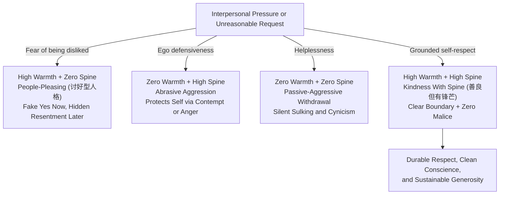
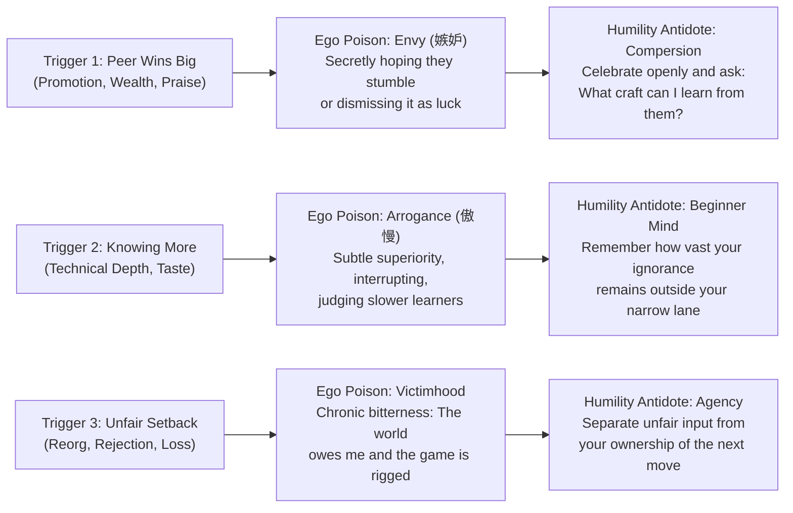

# Quiet Kindness With Spine (善良但有锋芒), Integrity & Ego Humility

## 1. The Zero-Leverage Test: Who Are You When Status Does Not Matter?

If you want to know someone's true character within ten minutes, ignore how they speak to their skip-level director, an investor, or someone they are trying to impress on a first date. Watch how they behave across **power asymmetries**—toward people who hold zero leverage over their income, reputation, or comfort.

In Chinese classical ethics, this is tied to **慎独 (Shendu)**—guarding your conduct when you are unseen or unaccountable to authority. In everyday urban life, the Zero-Leverage Test plays out a dozen times a week:

- **Waiters, Baristas, and Flight Attendants**: When an order comes out wrong during a dinner rush, do you make eye contact, use a calm human tone, and treat the server as an ally solving a small mix-up, or do you sigh loudly and talk down to them to look "high-standards" in front of guests?
- **Couriers, Delivery Riders, and Ride-Share Drivers**: When heavy rain delays a RMB 35 takeout order by 15 minutes, do you remember that a human being is navigating wet asphalt on an electric scooter for RMB 5 of margin, say *"Thank you, ride safe in the rain,"* and skip punitive ratings unless there was genuine malice?
- **Junior Engineers, Interns, and Support Staff**: When a new grad asks a naive architectural question or breaks a staging pipeline, do you make them feel stupid so you can feel senior, or do you protect their dignity while teaching the engineering guardrail?
- **Strangers in Shared Spaces**: Holding an elevator door three extra seconds, wiping down gym equipment, returning a shopping cart, not playing speakerphone audio in a train cabin, and leaving a public washroom sink cleaner than you found it.

### Why Zero-Leverage Decency Matters Internally

Cruelty or condescension toward powerless people is never a sign of high standards; it is a diagnostic leak of **inner insecurity**. Secure adults never need to push someone down to feel tall. Conversely, treating every human being with baseline dignity builds an unshakeable internal coherence: your nervous system stops switching between "performing charm upward" and "venting contempt downward." You become the same grounded person in every room.

---

## 2. Micro-Promise Integrity: Word-to-Action Ratio

Most people believe they are honest because they do not commit fraud or tell dramatic lies. Yet trust in adult friendships, romantic partnerships, and engineering teams rarely dies from one giant betrayal—it erodes from **casual, unkept micro-promises**:

- Saying *"I'll send you that article tonight"* and forgetting completely.
- Saying *"Let's definitely grab dinner next week!"* as polite filler when you have zero intention of scheduling it.
- Telling your partner *"I'll be ready in five minutes"* when you have not even stood up from your desk.
- Committing to review a colleague's document by Thursday afternoon and letting them awkwardly ping you on Monday.

Each broken micro-promise teaches both the other person *and your own subconscious* that your words carry a discount rate. High-integrity people treat spoken commitments like production SLAs:

| Low-Integrity Habit (Casual Drift) | High-Integrity Protocol (High Word-to-Action Ratio) |
| :--- | :--- |
| Using fake future promises (*"Let's hang out soon!"*) to exit conversations | Warm honesty without fake debt: *"It was genuinely great running into you—wishing you a smooth launch month!"* |
| Agreeing to favors in the moment and relying on memory | Capturing any promised action into a task list within 60 seconds, or declining on the spot |
| Going silent when running late on a deliverable or meetup | **Proactive Renegotiation** *before* the deadline hits: *"Heads up, I hit a blocker—I will have this to you by 11:00 tomorrow instead of 18:00 today."* |
| Stretching small facts in stories to sound sharper or funnier | Precision without exaggeration; saying *"I actually don't know"* cleanly when uncertain |

### Three Unseen Integrity Arenas Where Character Is Forged

Beyond punctuality and spoken tasks, watch how you handle three domains where nobody polices you closely:

1. **Engineering & Attribution Integrity**: Never silently adopt a junior colleague's debugging insight or design sketch and present it in an architecture review as your own solo brainstorm. Explicitly write *"Credit to @Name for spotting the race condition"* in commit messages, PR descriptions, and Slack summaries. Conversely, when your commit breaks production, be the first voice in the incident channel owning it before anyone runs `git blame`.
2. **Vaulted Confidentiality (绝不出卖旧友隐私)**: When someone trusts you with a fear, family struggle, salary number, or embarrassing mistake, that confidence has **no expiration date**—even if you drift apart as friends or break up as partners years later. Forwarding private screenshots for group-chat entertainment is an instant disqualifier of serious character.
3. **Clean Financial Boundaries**: Pay your share of group dinners or split travel bookings within five minutes—never force friends into the awkward position of chasing RMB 180. If you borrow a tool, book, or car, return it cleaner or with a fuller tank than when you picked it up.

---

## 3. Generous Spirit vs. Petty Scorekeeping (大气 vs. 斤斤计较)

One of the most attractive qualities in a mature adult is **大气 (generosity of spirit / magnanimity)**—and one of the most suffocating qualities to live or work beside is **斤斤计较 (petty scorekeeping)**.

Petty scorekeeping turns human relationships into double-entry accounting ledgers where every favor, RMB 40 coffee, household chore, or minor slight is silently logged with compound interest:

- *"I paid RMB 260 for hotpot last month and tonight's bill was only RMB 210."*
- *"I unloaded the dishwasher three times this week and you only did it twice."*
- *"I helped debug your service in Q1, and today you took two hours to answer my Slack message."*

### The Architecture of Magnanimity (Without Being Naive)

Being generous of spirit does **not** mean letting chronic takers drain your wallet or time. It means distinguishing between **healthy high-trust circles** and **extractive actors**:

1. **Inside High-Trust Circles (Partner, Family, Real Friends, Solid Teammates)**: Drop 50/50 microscopic accounting. Aim for the **60/40 Rule**—both sides quietly try to contribute 60% without demanding applause. Let small accidents, clumsy phrasing, and RMB 50 imbalances evaporate instantly. Life is too short to trade peace at home for winning a petty argument over who forgot to buy paper towels.
2. **With New Acquaintances (Iterative Reciprocity)**: Lead with warmth and a small act of generosity first (game theory's *Generous Tit-for-Tat*). Give people the benefit of the doubt once or twice in case they were simply overwhelmed.
3. **With Proven Takers (Silent Distance, Zero Drama)**: If someone repeatedly takes credit, borrows without returning, or only calls when they want something, do not turn bitter or lecture them. Simply stop extending extra access, downgrade the relationship to polite surface distance, and save your generosity for reciprocators.

---

## 4. Kindness With Spine (善良但有锋芒) vs. People-Pleasing

Many gentle, conscientious people confuse **goodness** with **compliance**. They swallow unfair requests, laugh at disrespectful jokes, lend money they cannot afford to lose, and never voice disagreement—until months of suppressed anger explode or turn into cold withdrawal.

Psychologically, **people-pleasing (讨好型人格) is not kindness**. It is conflict-avoidance driven by fear of disapproval. Because a people-pleaser cannot say "no," their "yes" has no real moral weight—they are complying as a hostage, not choosing generously as a free adult.

As the Chinese maxim puts it: **你的善良，必须有点锋芒** (*Your kindness must have a sharp edge*). Real kindness requires **capacity for firmness**. Only someone who is fully capable of standing their ground, saying a calm "no," and walking away from disrespect can offer genuine, resentment-free warmth.

### Word-for-Word Scripts: Warm Tone, Steel Boundary

Notice the pattern across every script below: **zero apology for having a boundary, zero villainizing the other person, zero 300-word fake excuses**.

| Scenario | People-Pleasing Trap | Abrasive Overcorrection | Kindness With Spine Script (善良但有锋芒) |
| :--- | :--- | :--- | :--- |
| **Colleague dumps last-minute scope onto your Friday evening** | *"Uh, okay sure, no problem..."* (cancels personal plans, fumes all weekend) | *"Do you never plan ahead? That's your problem, not mine."* | *"I want this release to go smoothly, and my evening is already committed tonight. I can look at the PR Monday at 09:30, or if it must ship tonight, let's loop in the on-call lead."* |
| **Acquaintance asks to borrow RMB 10,000 vaguely** | Transfers money out of awkwardness, then dreads texting them | Lectures them on financial irresponsibility | *"I have a personal rule against lending money between friends because I value keeping friendships clean. If RMB 500 as a no-strings gift helps right now, I'm happy to send that."* |
| **Friend or relative makes a subtle mocking "joke" at your expense** | Laughs along nervously while feeling humiliated inside | Snaps back with a personal insult that ruins dinner | Pause two full seconds, hold calm eye contact, no smile: *"What did you mean by that?"* or *"I like joking around, though let's skip shots like that."* |
| **Relative pushes intrusive life-timeline advice** | Argues defensively for an hour or promises fake compliance | Storms out or cuts contact impulsively | *"I know you're asking because you care about my future. My partner and I have a clear plan we feel good about—now tell me how your knee recovery has been going."* |

---

## 5. Taming the Three Quiet Ego Poisons: Envy, Arrogance & Victimhood

Even when outward behavior looks polite, three subtle inner habits rot character from the inside if left unchecked:

### 1. Transmuting Envy Into Compersion and Curiosity

Envy hurts most when someone *close* to your baseline—a former classmate, a fellow senior engineer, a friend of the same age—achieves a breakthrough you wanted. Notice that you never envy an Olympic sprinter; you envy people in your own reference group.

- **The Honest Move**: Never pretend to yourself *"I don't care."* Admit privately in two seconds: *"That sharp pinch in my chest is envy—it shows me something I value."* Then deliberately choose **mudita / compersion** (随喜赞叹): send them a warm, unguarded congratulatory message within five minutes. Refusing to let someone else's sunshine dim your spirit immediately breaks scarcity mentality.

### 2. Curing Intellectual Arrogance (Superiority Detox)

Smart engineers easily slip into **epistemic trespassing and condescension**—rolling their eyes at non-technical people, correcting minor phrasing at dinner tables to look sharp, or equating someone's IQ/salary with their human worth.

- **The Humility Anchor**: True intellectual humility (what C.S. Lewis defined as *"not thinking less of yourself, but thinking of yourself less"*) remembers two facts: first, 90% of your cognitive capability and early opportunities were an unearned lottery of genetics, era, and people who patiently taught you; second, every human you meet—a chef, a nurse, an auto mechanic, your grandmother—knows entire worlds of lived reality where you are a complete novice.
- **Conversation Rule**: Before correcting someone in casual conversation, ask: *"Does this factual error actually cause harm, or does my ego just want ten seconds of feeling smart?"* Nine times out of ten, let it go.

### 3. Rejecting Chronic Victimhood Without Denying Pain

Life genuinely deals unfair hands—bad managers, macroeconomic downturns, health scares, family blind spots. Acknowledging pain is healthy; **marrying a victim identity** is fatal to character. Why? Because chronic victimhood hands you a permanent moral blank check (*"Because I was wronged, I am entitled to be bitter, selfish, or cynical"*).

- Separate **blame** (who caused the mess—often genuinely not your fault) from **stewardship** (who is responsible for how you show up tomorrow—always 100% yours).

---

## 6. Ego Humility in Disagreements: Scout Mindset & Changing Your Mind Cleanly

One of the clearest tells of a fragile ego in smart engineers is **treating every disagreement like a cage match**. When someone challenges your technical design, travel plan, or household habit, an unexamined ego enters what Julia Galef calls **Soldier Mindset**—treating your initial opinion as sacred territory to defend at all costs, moving goalposts, nitpicking tone, and refusing to yield an inch even after you privately realize your premise had a hole.

Grounded adults cultivate **Scout Mindset**: your pride is attached to *seeing reality accurately and treating people fairly*, never to *having been right on the first guess*.

### Four Moves of High-Humility Disagreement

1. **Steelman Before Countering**: Before explaining why you disagree, summarize the strongest, most charitable version of the other person's point until they say *"Yes, that's exactly what I mean."* Half of heated arguments dissolve right there because the other person finally feels heard.
2. **Separate "Who Is Right" From "What Is Right"**: Use collaborative framing (*"Let's look at the trade-offs on the whiteboard together"*) rather than adversarial framing (*"Your approach won't scale"*).
3. **Update Publicly and Cheerfully When Proven Wrong**: Few moments earn deeper respect than an intelligent adult pausing mid-discussion and saying cleanly:
   - *"Wait—you just changed my mind. I hadn't factored in the cold-start latency at all. Your approach is cleaner; let's go with yours."*
4. **Never Confuse Winning an Argument With Winning a Relationship**: In romantic partnerships and family life, if you use superior verbal speed to crush your partner in an argument and leave them silent and defeated, **you did not win—you both just lost**.

| Disagreement Habit | Soldier Ego (Fragile Pride) | Scout Humility (Grounded Strength) |
| :--- | :--- | :--- |
| **Listening Mode** | Reloading ammunition while waiting for them to stop talking | Listening specifically for the 20% of truth you might have missed |
| **Discovering You Were Wrong** | Pivots topic, blames unclear specs, or sulks quietly | Names the update openly within seconds with zero shame |
| **Tone Under Pushback** | Gets louder, faster, or subtly sarcastic | Gets calmer, slower, and genuinely curious (*"Walk me through that part"*) |
| **Post-Discussion Outcome** | You feel clever; the other person dreads working with you | Truth gets sharper *and* mutual psychological safety grows |

---

## 7. Protecting Others' Dignity: Behind-the-Back Loyalty & Graceful Exits

Beyond avoiding harm, deeply admirable people practice **active dignity protection** (厚道 / 给别人留体面)—making sure people around them never feel unnecessarily cornered, humiliated, or gossiped about.

### Four High-Character Social Habits

1. **Praise in Public, Correct in Private**: If a colleague, partner, or junior makes a factual mistake in a group setting and it does not threaten immediate safety, never pounce on it to display your sharpness. Message them privately afterward with warmth. Conversely, when someone does quiet, unglamorous work well, name them explicitly in front of the room.
2. **Build Golden Bridges (给台阶下)**: When someone realizes mid-argument that they are wrong, an immature ego rubs their nose in it (*"See? I told you five times!"*). A mature adult hands them a dignified off-ramp: *"Honestly that edge case tripped me up the first time too—glad we caught it early."* People remember forever who protected their pride when they stumbled.
3. **Zero Recreational Gossip (不在背后论人是非)**: Bonding with coworkers or acquaintances by tearing down an absent third person feels like fast intimacy, yet everyone listening subconsciously registers one truth: *"The moment I leave the table, he will dissect me the exact same way."* Make a quiet rule: never say behind someone's back what you would not stand behind calmly if they walked in—and try **reverse gossip** (speaking warmly about someone's strengths when they are not in the room).
4. **Receiving Help and Compliments Cleanly**: Humility is not self-deprecation that forces others to reassure you. When someone praises your work or cooks you a meal, skip awkward deflection and offer warm eye contact: *"Thank you, that means a lot—and your feedback on the draft really sharpened it."*

| Interpersonal Moment | Small-Minded / Insecure Reflex (刻薄) | Deep-Character Reflex (厚道) |
| :--- | :--- | :--- |
| **Someone mispronounces a term or cites an outdated stat** | Publicly corrects them in front of the group | Ignores it if harmless; shares updated context privately if load-bearing |
| **Coworker vents gossip about a mutual teammate** | Piles on with extra complaints to bond | Listens neutrally without adding fuel, then pivots to constructive work |
| **Someone backs down after being stubborn** | Gloats (*"Finally you admit it!"*) | Smooths the landing immediately and moves forward without scorekeeping |
| **Splitting credit on a messy cross-team win** | Highlights personal late nights | Spotlights the quiet contributors whom leadership might overlook |

---

## 8. Three Everyday Field Walkthroughs: Strength vs. Insecurity

When you are unsure what "kindness with spine and humility" looks like in motion, compare how inner insecurity and grounded strength handle the exact same moment:

### Field Case 1: Travel Delayed at a Crowded Airport Gate or Hotel Desk

- **Insecure Reflex**: Raising your voice at the gate agent, flashing frequent-flyer status, and demanding *"Do you know how long I've been waiting?"*—punishing a front-line employee who did not cause the thunderstorm.
- **Grounded Strength**: Approaching the counter calmly after five furious passengers just yelled at the agent:
  - *"Looks like a brutal afternoon on your side of the desk. Whenever you catch a breath, could we check whether rebooking via the 19:40 train or waiting on standby makes more sense?"*
  - Not only is this basic human decency, agents routinely go out of their way to help the one calm adult in the line.

### Field Case 2: Receiving Blunt Criticism on Your Code or Creative Work

- **Insecure Reflex**: Feeling personally attacked, firing back five defensive comments explaining why you were rushed, or brooding all evening that the reviewer "has it out for you."
- **Grounded Strength**: Separating **the artifact** from **your human worth**. Pausing ten minutes before replying, extracting the 80% of valid critique, thanking the reviewer cleanly for making the output stronger, and calmly declining the 20% you disagree with using objective trade-offs.

### Field Case 3: Discovering Someone Took Advantage of Your Generosity Twice

- **Insecure Reflex**: Either continuing to let them walk over you while complaining bitterly to mutual friends, or staging a dramatic confrontation where you list every favor you ever did for them since 2024.
- **Grounded Strength**: Zero theatrics, zero bitterness, firm gate closure:
  - *"I won't be able to take that on this time—wishing you luck getting it sorted."*
  - You keep your warm heart intact for trustworthy people while quietly revoking VIP access from chronic takers.

---

## 9. 14-Day Integrity, Spine & Humility Calibration Checklist

Pick **two** micro-commitments from this list to run consciously over the next two weeks before moving to [02-EAST-AND-WEST-LIFE-PHILOSOPHY-TOOLKIT.md](02-EAST-AND-WEST-LIFE-PHILOSOPHY-TOOLKIT.md) and [03-FROM-KNOWING-TO-BECOMING-DAILY-PRACTICE.md](03-FROM-KNOWING-TO-BECOMING-DAILY-PRACTICE.md):

- [ ] **Zero-Leverage Warmth**: Look every server, courier, cleaner, and security guard in the eye, smile briefly, and say a genuine *"Thank you"*—especially on days when you are rushed or stressed.
- [ ] **Micro-Promise Capture**: For 14 days, do not utter *"I'll send/check/schedule that"* unless you either do it on the spot or write it into your task list within 60 seconds.
- [ ] **Drop One Petty Ledger**: Identify one recurring minor annoyance with your partner, parents, or roommate (under RMB 100 or 5 minutes of effort) and consciously absorb it with zero commentary.
- [ ] **One Clean "No" Without Over-Explaining**: Decline one low-priority request this week using two warm, direct sentences—no fake excuses, no apology for having priorities.
- [ ] **5-Minute Compersion Reflex**: The next time you feel a flash of envy at someone's good news on WeChat, LinkedIn, or Slack, send them a genuine congratulatory note within five minutes.
- [ ] **Zero Behind-the-Back Cheap Shots**: Go 14 consecutive days without joining a gossip pile-on; say one specific positive thing about an absent friend or teammate instead.

