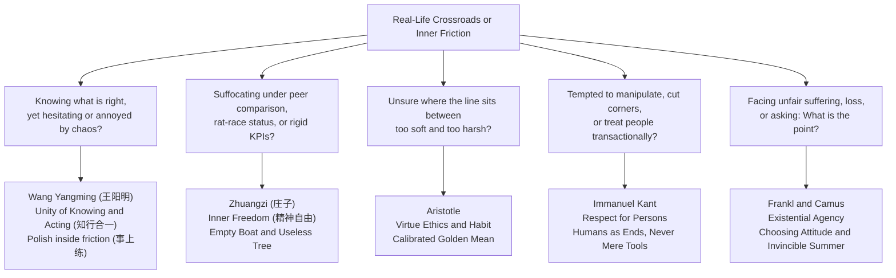
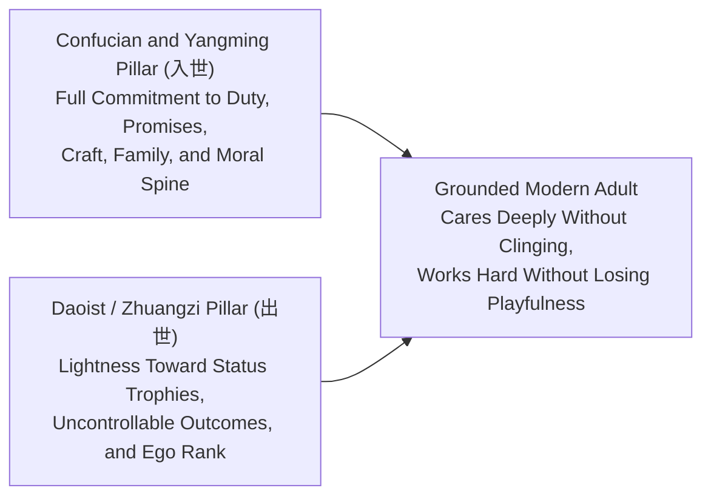

# Practical Philosophy for Modern Life: Wang Yangming, Zhuangzi, Aristotle & Existentialism

## 1. Why Modern Builders Need Applied Philosophy (Not Ivory-Tower Trivia)

Many engineers treat philosophy as dusty museum history—abstract debates with zero bearing on shipping software, loving a partner, or surviving a chaotic decade. Then real life arrives: a sudden layoff or unfair reorganization, an aging parent's diagnosis, peers racing ahead on artificial status treadmills, or a subtle temptation to compromise your integrity for fast gain.

In those moments, shallow productivity hacks evaporate. What governs your choices is your **operating philosophy**—whether you have consciously chosen a coherent one or unconsciously absorbed consumerism and peer anxiety.

You do not need twenty philosophical systems. Five battle-tested frameworks—two from Chinese thought and three from Western philosophy—cover almost every moral and existential crossroads an adult faces:



---

## 2. Wang Yangming (王阳明): *Zhi Xing He Yi* (知行合一) & *Shi Shang Lian* (事上练)

Ming Dynasty philosopher, general, and governor **Wang Yangming (1472–1529)** did not formulate his philosophy in a comfortable university study. After speaking up for imprisoned officials against a corrupt palace eunuch, he was publicly beaten, banished to a malaria-ridden frontier post in Guizhou (*Longchang*), and hunted by assassins. Out of that crucible came **Yangming School of Mind (阳明心学)**—arguably East Asia's sharpest manual for embodied character.

### Three Core Directives for Everyday Life

1. **Innate Moral Knowing (致良知 — *Zhi Liang Zhi*)**: Beneath your ego's clever rationalizations, you already possess an immediate, pre-verbal moral radar (*Liangzhi*). Nobody needs a PhD in ethics to sense when they are being petty to their partner, taking unfair credit, or bullying a courier. Evil and smallness almost always require **rationalization**—talking yourself *out* of what your conscience spotted in the first half-second.
2. **Unity of Knowing and Acting (知行合一 — *Zhi Xing He Yi*)**: Wang Yangming famously argued in *Instructions for Practical Living (传习录)* that someone who claims to "know" filial love or courage while acting selfishly or cowardly **does not actually know it at all**. Just as nobody truly "knows" bitter melon until they bite it, moral truth only exists at the moment of real action:
   - *知是行的主意，行是知的功夫；知是行之始，行是知之成。* (Knowing is the direction of action, and action is the effort of knowing; knowing is the beginning of action, and action is the completion of knowing.)
3. **Polishing on Real Affairs (事上练 — *Shi Shang Lian*)**: One of Wang's students complained that official paperwork and messy human disputes ruined his peaceful meditation. Wang told him directly: **do not flee into quiet caves**. Anyone feels serene sitting alone with tea and lo-fi music. Real cultivation happens *inside* chaotic PR reviews, crying toddlers, flight cancellations, and difficult relatives. When annoyance flares, do not curse the interruption—say quietly: *"Good, here is live resistance for my heart-mind."*

### Pairing Wang Yangming With Mencius & Confucius: Courage and Reciprocity

Two older pillars of classical Chinese philosophy complete Wang Yangming's inner compass:

- **Confucius' Thread of *Shu* (恕 — Empathetic Reciprocity)**: *己所不欲，勿施于人* (*Do not impose on others what you yourself do not desire*)—upgraded with mature perspective-taking: also do not force what *you* love onto others without asking what *they* actually value.
- **Mencius' *Haoran Zhi Qi* (浩然之气 — Vast Moral Courage)**: Where does quiet fearlessness come from when groupthink or authority pressures you to do something shady? Mencius gave the cleanest psychological formula in history: *"If upon self-examination I find that I am not upright, I carry fear even before a humble villager; if upon self-examination I find that I am upright, I will go forward even against thousands and tens of thousands" (自反而缩，虽千万人，吾往矣).* A clean conscience is the ultimate anti-anxiety medication.

---

## 3. Zhuangzi (庄子): Spiritual Freedom (精神自由) & Escaping Status Cages

If Wang Yangming gives you iron moral discipline, **Zhuangzi** saves you from turning rigid, self-important, or crushed by modern status treadmills (*内卷*). Living during China's brutal Warring States era, Zhuangzi watched brilliant people destroy their health and integrity chasing official titles—and responded with humor, perspective, and radical inner freedom.

### Three Parables Every 30-Something Should Carry

- **The Useless Giant Tree (无用之用)**: A carpenter dismisses a massive, gnarled oak tree as "useless" because its twisted timber cannot be sawed into straight planks. That night, the tree appears in his dream: *"Every straight fruit tree and fine lumber tree gets chopped down young. My uselessness to your market is the exact reason I lived for centuries and offer cool shade to travelers."*
  - **Modern Application**: Stop forcing every hobby, evening walk, guitar session, or friendship to justify itself on your resume or bank account. Protect spaces in your week that are gloriously "useless" to capitalism; they keep your spirit alive.
- **The Empty Boat (虚舟)**: If an empty boat drifts across a river and bumps your canoe, even a short-tempered person simply pushes it aside without anger. Yet if a person is sitting inside that boat, you immediately shout and take it personally.
  - **Modern Application**: Ninety percent of rude drivers, grumpy bureaucrats, and prickly internet commenters are essentially **empty boats**—drifting on gusts of their own exhaustion, upbringing, and unprocessed fear. Steer around the collision calmly without letting them rent space in your head.
- **Dragging One's Tail in the Mud (曳尾涂中)**: When two high ministers arrived to offer Zhuangzi the Prime Ministership of Chu, he kept fishing and asked whether the King's sacred dead tortoise—wrapped in silk inside the palace temple—would rather be dead and worshipped on an altar, or alive and wagging its tail in the mud. They answered *"Alive in the mud."* Zhuangzi smiled: *"Go on home then; I will keep wagging my tail in the mud."*
  - **Modern Application**: Audit prestige traps ruthlessly. Never trade your health, integrity, and daily aliveness just to look impressive inside someone else's golden cage.

### The Classic Chinese Synthesis: *Rú-Dào* Complementarity (外儒内道)

Chinese wisdom traditions were never meant to be single-tool dogmas. Mature character pairs **Confucian commitment** with **Daoist spaciousness**:



---

## 4. Aristotle's Virtue Ethics: Excellence as Habit & The Golden Mean

In ancient Greece, **Aristotle** (*Nicomachean Ethics*) asked a foundational question: *What constitutes a genuinely good, flourishing human life (eudaimonia)?* His answer aligns remarkably with East Asian *Xiushen*:

1. **Virtue Is a Habit, Not a Trait**: As Will Durant summarized Aristotle, *"We are what we repeatedly do. Excellence, then, is not an act, but a habit."* You become courageous by doing courageous acts while afraid; you become temperate by practicing restraint when tempted.
2. **The Doctrine of the Golden Mean**: Moral failure rarely comes from having a bad raw instinct; it comes from **uncalibrated extremes**—either *deficiency* (too little) or *excess* (too much). Practical wisdom (*phronesis*) is knowing how to hit the proportionate middle for the specific context.

### The Aristotelian Golden Mean in Everyday Adult Life

| Life Domain | Vice of Deficiency (Too Little) | The Golden Mean (Calibrated Virtue) | Vice of Excess (Too Much) |
| :--- | :--- | :--- | :--- |
| **Facing Risk & Fear** | **Cowardice**: Hiding from hard talks, career leaps, or moral stands | **Courage**: Acting on principle despite fear after sober risk assessment | **Recklessness**: Blind gambling, impulsive bridges burned for ego |
| **Truth in Speech** | **Deceit / Fawning**: Telling people whatever they want to hear | **Warm Candor**: Speaking truth with care, timing, and good intent | **Brutality**: Using *"I'm just brutally honest"* as an excuse for cruelty |
| **Giving Time & Money** | **Stinginess (吝啬)**: Hoarding resources; petty RMB-level scorekeeping | **Generosity**: Sharing gladly within sustainable means without a ledger | **Profligacy / Martyrdom**: Giving away rent money or burning out to please others |
| **Self-Evaluation** | **Self-Erasure**: Imposter shame; refusing credit you genuinely earned | **Grounded Humility**: Accurate view of both your strengths and blind spots | **Arrogance**: Acting superior; dismissing input from "lesser" titles |
| **Response to Wrongdoing** | **Spinelessness**: Letting bullies mistreat you or your team unchecked | **Righteous Firmness**: Calmly enforcing clear boundaries and consequences | **Vindictive Rage**: Escalating small slights into scorched-earth feuds |
| **Drive & Craft** | **Apathy (摆烂)**: Cynical resignation; refusing to develop your gifts | **Purposeful Craft**: Striving for mastery in service of meaningful work | **Status Obsession**: Sacrificing health, ethics, and loved ones for rank |

---

## 5. Immanuel Kant: Never Treat Humans Merely as Instruments

Modern urban and digital culture constantly nudges us toward **instrumentalizing people**: swiping through dates like consumer catalogs, keeping "friends" warm only for Big Tech referrals, or viewing service workers purely as delivery APIs.

Eighteenth-century philosopher **Immanuel Kant** offered the clearest moral firewall ever written—the **Formula of Humanity**:

> *"Act in such a way that you treat humanity, whether in your own person or in the person of any other, never merely as a means to an end, but always at the same time as an end in itself."*

Notice Kant's precise word **merely** (*bloß als Mittel*). Of course we rely on a chef to cook dinner and an engineer to write code—those are mutually consented roles. What violates human dignity is treating someone **merely** as a tool while disregarding their autonomy, truth, or humanity:

- **In Love and Dating**: Never string someone along for companionship, physical intimacy, or domestic comfort while hiding vital truth that would change their consent (for example, pretending you want commitment when you know you plan to leave). Give them full truth so they can choose freely as an equal adult.
- **In Friendships and Career**: Do not reach out to people *only* when you need an introduction or favor. Check in when you want nothing at all; celebrate their milestones when there is zero upside for your career.
- **Toward Yourself**: Kant explicitly included *"whether in your own person."* Degrading your integrity through lies, destroying your body for vanity metrics, or tolerating chronic disrespect violates your duty to respect the humanity inside yourself too.

---

## 6. Viktor Frankl & Albert Camus: Choosing Meaning When Life Hurts

Easy philosophies work fine when you are healthy, well-paid, and lucky. What about seasons when life is genuinely brutal—grief, chronic illness in the family, broken plans, or existential emptiness?

### Viktor Frankl: The Last of the Human Freedoms

Neurologist and psychiatrist **Viktor Frankl** survived three years in Nazi concentration camps, losing his parents, brother, and pregnant wife. Watching how prisoners responded to identical horror in *Man's Search for Meaning*, he observed that while external circumstances strip away comfort, wealth, and safety, one final sovereignty remains: **the freedom to choose one's attitude in any given set of circumstances**.

Frankl identified three concrete sources of human meaning—none of which require fame or perfection:
1. **By creating a work or doing a deed** (building something useful, solving a real problem with care).
2. **By experiencing something or encountering someone** (loving another person deeply in their uniqueness; pausing to truly witness music, nature, or art).
3. **By the attitude we take toward unavoidable suffering** (bearing hardship with dignity, protecting gentler people around us rather than passing our pain downward).

### Albert Camus: Lucid Joy Without Waiting for a Finish Line

French-Algerian writer **Albert Camus** tackled the modern feeling of **the Absurd**—our deep human hunger for cosmic guarantees colliding with an unpredictable, silent universe. In *The Myth of Sisyphus*, Camus refuses both suicide/despair and comforting illusions. Instead, he imagines Sisyphus walking back down the mountain in full lucidity: *"The struggle itself toward the heights is enough to fill a man's heart. One must imagine Sisyphus happy."*

For a modern builder, Camus cures the **"Once I reach X, then I'll live"** delusion. There is no permanent finish line where dishes stay washed, codebases stay bug-free, and uncertainty disappears. Making morning coffee, writing clean code, lifting weights, laughing over noodles with someone you love, and keeping your character intact in winter—*that daily rhythm itself is the whole point*.

---

## 7. Live Moral Debugging: Applying the Five Lenses to Real 30s Dilemmas

Philosophy earns its keep when multiple emotions collide in real time. See how these lenses combine in three concrete situations:

### Dilemma 1: A Tempting Gray-Zone Shortcut at Work

- **The Setup**: Your service hit an embarrassing data bug affecting a small subset of customers. Nobody outside your squad noticed yet. Silently patching it and burying the incident report saves your team a painful post-mortem right before performance review season.
- **Philosophical Dispatch**:
  - **Wang Yangming (*Liangzhi*)**: Your first-second gut check already knows burying it is dishonest; everything after second two is your ego writing excuses.
  - **Kant**: Hiding material impact from affected users or downstream teams treats them as mere pawns to protect your review score.
  - **Aristotle (Golden Mean)**: Skip both *cowardly concealment* and *theatrical self-flagellation*. Write a calm, factual incident summary, notify affected stakeholders, ship the fix + automated regression test, and move forward with a clean conscience.

### Dilemma 2: Late-Night Status Spiral Over a Peer's Big Exit

- **The Setup**: At 23:00 you see a former classmate announce a major startup acquisition or Staff promotion abroad while you had a frustrating, ordinary Tuesday. Your chest tightens and your current life suddenly looks small.
- **Philosophical Dispatch**:
  - **Zhuangzi (*Sacred Tortoise & Useless Tree*)**: Notice that your mind just collapsed the infinite richness of human life onto a single financial/title axis. You are comparing your full, messy backstage against one curated frame of someone else's highlight reel.
  - **Camus**: Step away from the screen, drink a glass of water, and return to tangible reality—your health, your craft, the people who love you today. Send a sincere congratulation if they are a friend ([01-INTEGRITY-KINDNESS-WITH-SPINE-AND-HUMILITY.md](01-INTEGRITY-KINDNESS-WITH-SPINE-AND-HUMILITY.md)), then go to sleep.

### Dilemma 3: Repeated Friction With an Anxious, Stubborn Aging Parent

- **The Setup**: Your mother or father falls for exaggerated health rumors on short-video apps and lectures you repetitively during dinner. You feel the urge to snap: *"Why do you always believe garbage?!"*
- **Philosophical Dispatch**:
  - **Zhuangzi (*Empty Boat*)**: Their nagging is not calculated malice; it is aging anxiety + shrinking world + clumsy love bumping into your boat.
  - **Wang Yangming (*Shi Shang Lian*)**: Being gentle to polite strangers is easy; keeping warm respect toward repetitive parents *is* the real test of filial character.
  - **Aristotle (Warm Candor)**: Validate their care first (*"I know you're sharing this so I stay healthy"*), gently show them one reliable doctor's explanation without mocking their intelligence, and steer dinner back to shared warmth.

---

## 8. Philosophical Anti-Patterns: Never Twist Wisdom Into Ego Armor

Every great philosophy has a cheap counterfeit version that clever adults use to excuse bad behavior. Audit yourself against these five common misuses:

1. **Weaponizing Zhuangzi to Excuse Lazy Irresponsibility (伪道家摆烂)**
   - *The Misuse*: Quoting *"nothing matters, status is an illusion"* to justify breaking promises to teammates, neglecting your health, or leaving your partner to pay all the bills.
   - *The Correction*: Zhuangzi lets go of **vanity and uncontrollable outcomes**, never basic human trustworthiness. Earn your independence cleanly first so nobody else has to carry your neglected weight.
2. **Weaponizing Wang Yangming or Stoicism to Repress Grief**
   - *The Misuse*: Pretending to be an unfeeling marble statue when someone dies, a relationship ends, or burnout hits—or telling a hurting friend *"Just practice Shi Shang Lian!"*
   - *The Correction*: Even Wang Yangming wept openly for friends and students. Emotional regulation means not letting feelings force you into *cruel or cowardly actions*; it never means amputating natural human tenderness.
3. **Misreading Aristotle's Golden Mean as Spineless Fence-Sitting**
   - *The Misuse*: Assuming the "moderate" answer between truth and a lie is a 50% half-lie, or the "middle ground" on bullying is watching quietly from the sidelines.
   - *The Correction*: Aristotle explicitly wrote in Book II of *Nicomachean Ethics* that actions like betrayal, malice, and theft **have no Golden Mean**—they are wrong at any dosage. Moderation applies to *passions and responses*, never to compromising core integrity.
4. **Turning Kantian Principle Into Cold, Self-Righteous Policing**
   - *The Misuse*: Treating moral rules like a loveless compliance checklist used to lecture partners, look down on imperfect friends, or deliver harsh truths with zero human warmth.
   - *The Correction*: Kant's Formula of Humanity commands honoring the **dignity of real persons**—governing your own integrity strictly while meeting others with respect, never cold superiority.
5. **Twisting Existential Freedom Into Selfish Individualism**
   - *The Misuse*: Treating *"I author my own meaning"* as permission to ghost commitments whenever your mood shifts.
   - *The Correction*: Both Frankl and Camus anchored meaning in **solidarity and responsibility toward concrete human beings**. Freedom without fidelity is just impulse.

| Philosophy | Counterfeit Distortion | Authentic Practice |
| :--- | :--- | :--- |
| **Wang Yangming** | Harsh moral perfectionism and scolding others | Checking your own conscience (*Liangzhi*) first under real pressure |
| **Zhuangzi** | Cynical apathy (*摆烂*) when effort gets hard | Wholehearted craft paired with zero obsession over external applause |
| **Aristotle** | Lukewarm compromise ("splitting the difference" with wrong) | High-courage, context-calibrated judgment (*Phronesis*) |
| **Kant** | Cold, robotic rule-following devoid of warmth | Treating every human—and yourself—with non-negotiable dignity |
| **Frankl / Camus** | Hedonistic *"nothing matters so do whatever"* | Choosing lucid warmth, courage, and contribution without cosmic guarantees |

---

## 9. Quick-Reference Synthesis Across Traditions

| Tradition | Core Concept | 5-Second Field Question | Failure Mode It Prevents |
| :--- | :--- | :--- | :--- |
| **Wang Yangming** | *Zhi Xing He Yi* & *Shi Shang Lian* | *"What does my conscience know right now, and how do I enact it inside this mess?"* | Hypocrisy, procrastination on integrity, fragility under chaos |
| **Zhuangzi** | *Jing Shen Zi You* & *Empty Boat* | *"Am I trapped in a status game or yelling at an empty drifting boat?"* | Rat-race burnout, status envy, taking impersonal friction personally |
| **Aristotle** | *Habitual Excellence* & *Golden Mean* | *"Where is the calibrated middle between spineless and harsh here?"* | People-pleasing ([01-INTEGRITY-KINDNESS-WITH-SPINE-AND-HUMILITY.md](01-INTEGRITY-KINDNESS-WITH-SPINE-AND-HUMILITY.md)) or reckless overreaction |
| **Kant** | *Formula of Humanity* | *"Am I treating this person—or myself—as a full human or a mere tool?"* | Manipulation, selfish dating/networking, self-exploitation |
| **Frankl & Camus** | *Tragic Optimism* & *Invincible Summer* | *"Even if this season is unfair, who do I choose to be inside it today?"* | Cynical nihilism, victimhood, waiting for perfection to enjoy life |

---

## 10. Writing Your Own 5-Line "Pocket Creed" (现代君子座右铭)

During an emotional storm or ethical gray zone, nobody remembers a 300-page treatise. Both Roman Stoics (*hypomnemata*) and Chinese scholars (*座右铭 — desk-side inscriptions*) distilled their philosophy into five or six crisp personal rules they could recall in three seconds.

Use the example below as a starting template, then rewrite any line in your own honest voice:

```markdown
## Personal Operating Creed (Under High Load)
1. **Conscience First (王阳明)**: Trust the first-second gut check of Liangzhi before my ego starts writing clever excuses; treat today's annoyance as live training (事上练).
2. **Light on Status, Heavy on Craft (庄子)**: Pour full care into my work and loved ones, while treating titles, peer flexes, and rude strangers like drifting empty boats.
3. **Warmth With Spine (Aristotle)**: Aim for the calibrated middle—never spineless people-pleasing, never cruel superiority.
4. **Humans Are Never Mere Tools (Kant)**: Speak truth, credit fairly, and never use a partner, friend, or stranger merely as an instrument for my comfort or career.
5. **Lucid Joy Today (Frankl & Camus)**: Stop waiting for a mythical bug-free future to start living; keep my dignity in winter and enjoy tonight's ordinary bowl of noodles.
```

Understanding these five lenses intellectually takes thirty minutes; wiring them into your nervous system takes a repeatable daily loop. Continue to [03-FROM-KNOWING-TO-BECOMING-DAILY-PRACTICE.md](03-FROM-KNOWING-TO-BECOMING-DAILY-PRACTICE.md) (or revisit the baseline audit in [00-README.md](00-README.md)) to turn philosophy into muscle memory.
