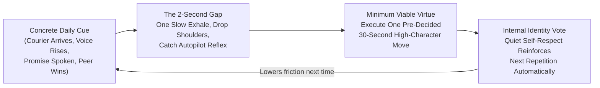
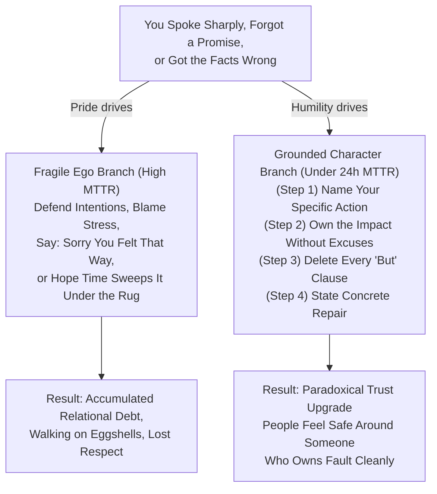

# Closing the Knowing-Doing Gap: Turning Wisdom Into Muscle Memory

## 1. Escaping the Engineer's Collector Fallacy (收藏即修身)

Let us name the elephant in the room with complete honesty: **software engineers are world-class procrastinators disguised as knowledge architects**.

When an engineer wants to get healthier, dress sharper, or become a wiser human being, our favorite instinct is to build a taxonomy—organizing clean Markdown folders, comparing frameworks, highlighting books, and admiring a well-structured documentation vault. Psychologists call this the **Collector's Fallacy**: your brain mistakes *categorizing good ideas* for *embodying good character*.

Every hour spent polishing notes about kindness while still snapping at your partner when tired, dodging hard conversations, or forgetting promises to friends is **moral theater**. Books and vaults are only blueprints; nobody stays dry in a rainstorm by sleeping under a blueprint.

### Collector Mode vs. Embodied Practitioner Mode

| Dimension | Vault Collector Mode (Illusion of Growth) | Embodied Practitioner Mode (Real 修身) |
| :--- | :--- | :--- |
| **Primary Metric** | How many books, podcasts, or Markdown notes I consumed | How I actually behaved during my 3 hardest moments this week |
| **Scope Strategy** | Tries to memorize 25 virtues at once; forgets all 25 under stress | Practices **1 single micro-virtue** for 14 days until automatic |
| **Response to Slipping Up** | Hides the mistake, rationalizes it, or reads another self-help essay | Delivers a clean, excuse-free repair within 24 hours |
| **Visibility Preference** | Loves grand, noticeable gestures or talking about philosophy | Practices quiet, unseen stewardship when nobody is watching |
| **12-Month Result** | Encyclopedic vocabulary paired with the exact same ego reflexes | Calmer home, deeper trust, fewer regrets, genuine inner warmth |

> **The Shutdown Rule for This Vault**: Once you finish reading this file, **stop adding more philosophy notes for 90 days**. Go live inside messy human reality and test what is already here.

---

## 2. The Minimum Viable Virtue (MVV) Habit Loop

Why do sincere Sunday night resolutions (*"Starting Monday I will be super patient, generous, and grounded!"*) evaporate by Tuesday at 16:00?

Because "be more patient" is an abstract wish, not an executable trigger. When blood glucose drops, Slack notifications pile up, or someone speaks rudely, your amygdala fires in milliseconds while abstract resolutions sit offline. Behavioral scientist Peter Gollwitzer's research on **Implementation Intentions** shows that bridging the knowing-doing gap requires binding a **specific situational cue** to a **tiny, concrete physical behavior** (*If Cue X occurs, I immediately execute Micro-Action Y*).

In James Clear's habit terminology, every completed micro-virtue casts a concrete **identity vote**—proving to yourself through evidence, not affirmations, who you are becoming.



### Six High-ROI "If-Then" Character Protocols

Pick **only one** protocol below as your active 14-day Minimum Viable Virtue:

1. **The Zero-Leverage Greeting**: *If* a courier, server, cleaner, ride-share driver, or security guard interacts with me, *then* I take out one AirPod, make brief eye contact, and say a warm *"Thank you"* ([01-INTEGRITY-KINDNESS-WITH-SPINE-AND-HUMILITY.md](01-INTEGRITY-KINDNESS-WITH-SPINE-AND-HUMILITY.md)).
2. **The 60-Second Promise Ledger**: *If* the words *"I'll send / check / schedule..."* leave my mouth, *then* I either complete it on the spot or type it into my task inbox within 60 seconds.
3. **The Volume Circuit Breaker**: *If* I feel my jaw tighten or my speaking volume rise by 20% toward my partner or parents, *then* I stop mid-sentence, exhale slowly, lower my voice, and name my fatigue instead of attacking.
4. **The Instant Compersion Ping**: *If* I feel a flash of status envy seeing a friend or colleague succeed, *then* I send them a genuine two-sentence congratulation within five minutes.
5. **The Boundary Pause**: *If* someone asks for a non-urgent favor and my gut feels cornered, *then* I say *"Let me check my calendar and get back to you by 17:00"* rather than blurting out a people-pleasing fake *"Yes."*
6. **The Empty-Boat Breath**: *If* a stranger cuts me off in traffic, bumps me on the subway, or leaves a snarky comment, *then* I mentally whisper *"Empty boat"* ([02-EAST-AND-WEST-LIFE-PHILOSOPHY-TOOLKIT.md](02-EAST-AND-WEST-LIFE-PHILOSOPHY-TOOLKIT.md)) and release my grip within ten seconds.

---

## 3. The 24-Hour Clean Apology Protocol (Shrinking Moral MTTR)

Becoming a better person does **not** mean never getting irritable, misjudging a teammate, or saying something clumsy. Anyone waiting for moral perfection will simply become a hypocrite who denies their mistakes.

In distributed systems engineering, elite reliability teams measure **MTTR (Mean Time to Recovery)** alongside uptime. Human relationships work the exact same way: what destroys love and respect is rarely an occasional human slip—it is **stubborn ego defense**, sulking for four days, or offering fake apologies that shift blame onto the hurt person.



### Fake Apologies vs. Clean Adult Apologies

Never let these three counterfeit apologies leave your mouth:
- **The Phantom Non-Apology**: *"I'm sorry you felt hurt by my tone."* (Translates to: *My tone was fine; your sensitivity is the bug.*)
- **The "But" Eraser**: *"I'm sorry I snapped, **but** I had three back-to-back incidents and you asked at the worst time."* (Everything before *"but"* is immediately canceled.)
- **The Hostage Guilt-Flip**: *"Fine, I guess I'm just a terrible partner who can never do anything right!"* (Forces the injured person to stop being hurt and comfort *your* ego.)

### Word-for-Word 24-Hour Repair Scripts

| Context | What Happened | Clean, High-Character Apology Script |
| :--- | :--- | :--- |
| **Romantic Partner / Home** | Snapped impatiently over a small question after an exhausting workday | *"Hey, earlier when you asked about weekend plans, I answered in a really sharp, dismissive tone. That wasn't fair to you—being tired from work is my responsibility to manage, not take out on you. I'm sorry. Let's look at Saturday together over tea."* |
| **Engineering Teammate** | Dismissed their edge-case concern in a meeting; turned out they were right | *"In yesterday's design review I brushed past your question on retry storms too quickly, and looking at the trace today, you were spot on. Sorry for cutting that short—thank you for flagging it, and I credited your catch in the design doc."* |
| **Aging Parent** | Lost patience explaining a smartphone step or medical appointment detail | *"Mom/Dad, I spoke way too impatiently on the phone earlier. You were just asking to make sure things go smoothly, and I rushed you. I'm sorry—I wrote out the three steps clearly on a screenshot for you here."* |

---

## 4. The Sunday 10-Minute Honest Mirror (现代版三省吾身)

Two thousand five hundred years ago, Confucius' student **Zengzi (曾子)** practiced a daily three-question audit (*吾日三省吾身*): *In acting on behalf of others, have I been wholehearted? In intercourse with friends, have I been trustworthy? Have I practiced what I was taught?* Two millennia later, **Benjamin Franklin** tracked 13 virtues in a small pocket booklet, focusing on just one virtue per week.

Most modern journaling systems fail because they demand 45 minutes of essay writing. Instead, run a **strict 10-minute Sunday evening Honest Mirror**—no self-flagellation, no poetic performance, just calm telemetry like a blameless engineering retrospective.

### Copy-Pasteable Sunday 10-Minute Reflection Template

Drop this lightweight block into a private note once a week on Sunday evening:

```markdown
## Honest Mirror — Week YYYY-Www
1. **Active 14-Day MVV Check**: Which single micro-virtue am I practicing right now, and roughly how many days out of 7 did it fire?
2. **Proud Unseen Moment**: One small moment this week where I kept my word, held a warm boundary, or showed kindness with zero audience:
3. **Friction & Unrepaired Debt**: Did I leave any broken micro-promise, petty resentment, or owed apology open? (If yes -> send the 2-sentence repair tonight.)
4. **Proactive Warmth Next Week**: Who is 1 person (parent, partner, quiet friend, junior colleague) I can check in on or support with zero agenda this week?
```

---

## 5. Friction Engineering for Virtue: Environment Defaults That Beat Willpower

Good people routinely act below their values when sleep-deprived, hungry, or overloaded—because moral restraint draws from the exact same prefrontal executive budget as complex engineering work. Instead of trusting raw willpower at 22:30, install four **structural guardrails**:

1. **The 22:00 Draft Quarantine**: Never press *Send* on a frustrated, sarcastic, or defensive Slack, email, or WeChat message after **22:00**. Write it into a private draft if you need to vent, sleep eight hours, and re-read it at 09:00. Nine times out of ten, you will delete 80% of the heat and save months of relational damage.
2. **The Monthly RMB 400 Warmth Envelope (随手善意基金)**: Set aside RMB 300 to RMB 500 every month as pre-spent "generosity money." Use it without hesitation to buy coffee for a stressed junior colleague, add a RMB 15 rainy-day tip for a drenched delivery rider, send hot soup to a sick friend, or mail a small surprise to your parents. Because the money is already allocated, checkout stinginess disappears completely.
3. **The 90-Second Front-Door Airlock**: Before unlocking your front door after a chaotic workday (or walking out of your home-office room for dinner), pause 90 quiet seconds, take three slow exhales, and consciously put down work armor. Never let the people who love you absorb residual shrapnel from meetings they were not even in.
4. **Calendarized Non-Transactional Care**: Put two lightweight recurring blocks on your calendar—a 10-minute midweek walk call with parents, and a Friday afternoon *"Zero-Agenda Ping"* to check in on one friend or former mentor when you need nothing from them.

---

## 6. Quiet Stewardship: Leaving Every Room Warmer Than You Found It

Ultimately, character is not an internal museum piece you polish in solitude; character is felt in your **emotional wake**—what happens to the psychological temperature of a room, a Slack channel, a dinner table, or a household after you walk through it.

Think of the best mentor, elder, or friend you have ever known. Chances are you do not admire them primarily because of their net worth or resume bullets. You remember how *safe, respected, energized, and unjudged* you felt in their presence.

### Five Practices of Quiet Everyday Stewardship (阴德)

Classical Chinese ethics speaks of **阴德 (Yin De—unseen virtue)**: doing good quietly without posting about it, announcing your generosity, or waiting to be thanked.

1. **Be the First to Reach Out in Quiet Seasons**: Most adult friendships wither because two people both wait for the other to text first. Be the generous initiator—send a short voice note or photo saying *"Walked past that noodle spot we liked—hope your autumn is treating you well, zero rush to reply."*
2. **Hoard Zero Ladders for Junior Builders**: Remember how disorienting your early twenties felt. When a sincere junior engineer or younger cousin asks for guidance, give them the clearest 15-minute mental model or code pointer you wish someone had handed you—with zero gatekeeping or condescension.
3. **Protect Shared Commons Automatically**: Wipe water off a shared counter, pick up litter on a hiking trail, document the tricky setup step in a repo README so the next engineer does not lose three hours, and return borrowed items cleaner or fuller than you received them.
4. **Call Aging Parents Before They Have to Hesitate**: Parents in their sixties and seventies often hold back from calling because they worry about interrupting your "important city work." Calling for ten warm, unhurried minutes while walking home costs you almost nothing and lights up their entire evening.
5. **Regulate Yourself So Others Never Walk on Eggshells**: Perhaps the greatest gift you can give a partner, future child, or team is **emotional predictability**—knowing that even when you disagree or have had a brutal week, you will remain fair, non-cruel, and open to reason.

---

## 7. A Concrete 90-Day Character Cultivation Roadmap (Six 14-Day Sprints)

Rather than trying to practice everything simultaneously, run six sequential two-week sprints. Each sprint installs **one** baseline reflex while previous sprints run in the background:

| Sprint Window | Focus Pillar | Single Active 14-Day Minimum Viable Virtue (MVV) | Success Metric at Day 14 |
| :--- | :--- | :--- | :--- |
| **Weeks 1 to 2** | **Zero-Leverage Decency** | Eye contact + genuine *"Thank you"* to every courier, server, cleaner, and guard | Fires automatically even on rushed, rainy mornings |
| **Weeks 3 to 4** | **Word-to-Action Integrity** | Capture every spoken micro-promise within 60 seconds; renegotiate early if delayed | Zero dropped small promises across work and home |
| **Weeks 5 to 6** | **Kindness With Spine** | Deliver at least 2 warm, excuse-free *"No"* boundaries where you normally fawn | Zero hidden post-yes resentment all week |
| **Weeks 7 to 8** | **Magnanimity & Anti-Envy** | Drop one petty household ledger; send 5-minute congratulatory notes on peer wins | Noticeably lighter chest and warmer home atmosphere |
| **Weeks 9 to 10** | **Shi Shang Lian Under Chaos** | Label daily annoyances *"Live training"* or *"Empty boat"* within 10 seconds | Emotional recovery after annoyances drops under 3 minutes |
| **Weeks 11 to 12** | **Clean Repair & Warm Wake** | Under-24h clean apologies when wrong + 1 non-transactional care ping every Friday | Sunday Honest Mirror shows zero open relational debt |

### The "Never Miss Twice" Rule Against Moral Perfectionism

On some Wednesday afternoon, you *will* sleep five hours, get blindsided by a production outage, and snap at someone or act pettily. Beware the **What-the-Hell Effect**—telling yourself *"Well, I blew my calm character streak, clearly I haven't changed at all."*

Reject all-or-nothing perfectionism:
- **Missing once is human biology; missing twice is the start of a new drift.**
- Run a 60-second blameless post-mortem (*"I was sleep-deprived and skipped lunch"*), send the 2-sentence Clean Apology before bed, forgive yourself without drama, and resume your sprint the next morning.

---

## 8. Troubleshooting: Four Reasons Character Practice Stalls (And Exact Fixes)

Even sincere practitioners hit walls around Week 3 or Week 6. Diagnose which failure mode is blocking you:

1. **Mistaking Physiological Depletion for Moral Failure**
   - *Symptom*: You are patient and generous on Saturday morning, then irritable, stingy, and cynical every Wednesday at 20:00.
   - *Root Cause*: Chronic 6-hour sleep, low blood sugar, and zero daylight deplete ventromedial prefrontal cortex inhibition.
   - *Fix*: Protect sleep and meal timing as **moral infrastructure**. Being well-rested is one of the kindest gifts you can offer the people who live and work with you.
2. **Waiting for Your Partner, Parents, or Boss to Change First**
   - *Symptom*: Thinking *"I will stop being defensive as soon as she stops nagging"* or *"I'll be generous once my team appreciates me more."*
   - *Root Cause*: Conditional virtue is just bargaining.
   - *Fix*: Unilateral disarmament on tone. Hold firm boundaries where needed ([01-INTEGRITY-KINDNESS-WITH-SPINE-AND-HUMILITY.md](01-INTEGRITY-KINDNESS-WITH-SPINE-AND-HUMILITY.md)), while owning 100% of your own warmth and integrity regardless of who goes first.
3. **Fantasizing About Heroic Moments While Ignoring Tuesday Dishes**
   - *Symptom*: Daydreaming about sacrificing nobly in a movie-like crisis while leaving wet towels on the floor or ignoring a friend's message for ten days.
   - *Root Cause*: The ego loves dramatic applause and hates unglamorous repetition.
   - *Fix*: Shrink the arena back to the next three hours—wash the shared mug, send the two-line check-in, keep the 15:00 promise.
4. **Confusing Brutal Self-Flagellation With Humility**
   - *Symptom*: Beating yourself up for two hours after a minor social awkwardness or mistake (*"I'm such an idiot"*).
   - *Root Cause*: Obsessive self-hatred is still **self-absorption**—your camera is still pointed 100% at your own ego rather than outward toward useful repair.
   - *Fix*: Trade 2 hours of inward shame for 2 minutes of outward repair, then put your attention back on serving the work and people in front of you.

| Stall Pattern | What It Pretends to Be | Real Root Cause | Immediate 2-Minute Reset |
| :--- | :--- | :--- | :--- |
| **Evening Irritability** | *"People around me are annoying"* | Sleep debt + glucose crash + screen fatigue | Eat real food, step offline, delay hard talks until morning |
| **"You Go First" Standoff** | *"Fairness"* | Conditional, ledger-keeping ego | Make the first warm, non-defensive move unilaterally |
| **Grand-Gesture Daydreaming** | *"High ideals"* | Dodging unglamorous daily stewardship | Execute 1 tiny unseen chore or promise in the next 10 minutes |
| **Ruminative Self-Beating** | *"Conscientiousness"* | Wounded pride disguised as guilt | Send a clean repair if needed, then redirect focus outward |

### Three Pocket Emergency Scripts When Autopilot Tries to Hijack You

Keep these three short scripts ready for moments when social awkwardness usually makes people freeze or act small:

1. **When You Realize Three Days Late That You Forgot a Small Promise**
   - *Never ghost out of embarrassment.* Send immediately:
   - *"Hey—realizing I dropped the ball on sending over that repo link I promised Tuesday. No excuse, totally slipped my radar. Here it is now, with the two key files highlighted."*
2. **When You Catch Yourself About to "One-Up" Someone's Story at Dinner**
   - *Swallow the impulse to top their story with your bigger trip or harder bug.* Ask instead:
   - *"Wait, that sounds wild—what surprised you most when you actually got there?"* (Giving someone the spotlight is effortless generosity.)
3. **When You Need 15 Minutes Before Answering a Heated Question**
   - *Protect the relationship from an unregulated tongue:*
   - *"I care too much about getting this right to answer while I'm still heated. Let me take a 15-minute walk so I can listen properly."*

---

## 9. How You Will Know in 12 Months That This Actually Worked

Do not look for dramatic halos or overnight enlightenment. If you practice the principles across [00-README.md](00-README.md), [01-INTEGRITY-KINDNESS-WITH-SPINE-AND-HUMILITY.md](01-INTEGRITY-KINDNESS-WITH-SPINE-AND-HUMILITY.md), [02-EAST-AND-WEST-LIFE-PHILOSOPHY-TOOLKIT.md](02-EAST-AND-WEST-LIFE-PHILOSOPHY-TOOLKIT.md), and this daily playbook over the next year, you will notice five quiet, unmistakable shifts:

- **Your words weigh more**: When you say you will do something, people relax completely because they know it is already as good as done.
- **Saying "no" stops feeling guilty, and saying "yes" stops feeling resentful**: Your kindness comes from choice and strength rather than people-pleasing fear.
- **Annoying Tuesday friction loses 80% of its sting**: Delayed trains, clumsy strangers, and peer status flexes pass by like Zhuangzi's empty boats rather than ruining your evening.
- **Mistakes no longer trigger three-day ego spirals**: You catch yourself faster, apologize cleanly within hours, laugh at your own imperfection, and move forward lighter.
- **You genuinely like who you are at 23:00 in a silent room**: External wins remain fun to build, yet your baseline self-respect (问心无愧) no longer depends on applause—because your outer capability and your inner character finally match.
