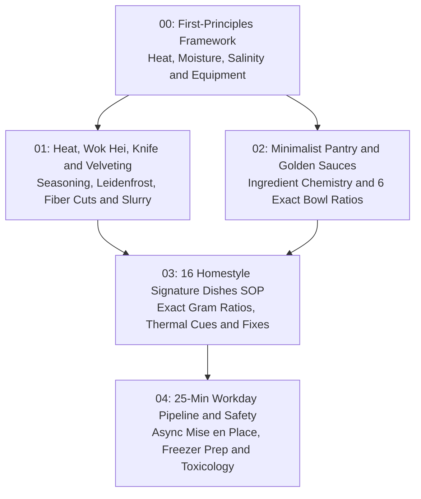

# First-Principles Chinese Cooking (中餐烹饪科学体系)

Cooking Chinese food well at home is not an innate artistic talent or decades-long apprenticeship secret. At its physical core, every Chinese dish is a deterministic chemical and thermodynamic pipeline governed by four measurable variables: **thermal flux**, **surface moisture**, **osmotic salinity**, and **protein denaturation time**.

Traditional Chinese recipes fail analytically minded beginners because they rely on non-deterministic heuristics—phrases like `盐少许` (a pinch of salt), `生抽适量` (soy sauce to taste), `油热下锅` (add when oil is hot), and `炒至断生` (fry until just cooked). When an experienced chef says `适量`, their brain is subconsciously computing salt-to-mass ratios and reading visual water-vapor cues. Without those calibrated sensors, a beginner guesses, causing wild variance: rubbery dry pork one night, watery grey vegetables the next, and scorched bitter garlic the third.

This curriculum replaces culinary folklore with reproducible kitchen engineering. Once you understand the underlying physics and standardize ratios to grams, milliliters, and visual temperature milestones, you can execute restaurant-caliber Chinese dishes on a standard home stove in under 25 minutes on a Tuesday evening.

---

## Curriculum Architecture & Learning Path

### Module Directory

| Module | File | Core Engineering Focus | Primary Outcome |
| :--- | :--- | :--- | :--- |
| **00** | [00-README.md](00-README.md) | Thermodynamic state variables, decoding `适量`, core hardware stack | Stop guessing; treat recipes as reproducible systems |
| **01** | [01-HEAT-WOK-HEI-KNIFE-AND-VELVETING.md](01-HEAT-WOK-HEI-KNIFE-AND-VELVETING.md) | Carbon steel seasoning (`开锅`), Leidenfrost non-stick (`热锅凉油`), fiber geometry (`横切牛羊竖切猪`), restaurant velveting (`上浆滑炒`) | Zero-stick searing on bare steel and silky-tender meat every time |
| **02** | [02-PANTRY-AND-GOLDEN-SAUCE-FORMULAS.md](02-PANTRY-AND-GOLDEN-SAUCE-FORMULAS.md) | Pantry chemistry (`生抽/老抽/蚝油/醋/豆瓣酱`), 6 exact bowl sauce formulas (`鱼香/宫保/糖醋/红烧/蒜蓉/凉拌`) | Eliminate clutter; mix foolproof sauces before turning on the stove |
| **03** | [03-SIGNATURE-HOMESTYLE-DISHES-PLAYBOOK.md](03-SIGNATURE-HOMESTYLE-DISHES-PLAYBOOK.md) | Step-by-step SOPs for 16 classic dishes across eggs, stir-fries, braises, greens, soups, and staples | Build an undefeatable repertoire of 16 zero-failure homestyle dishes |
| **04** | [04-WORKDAY-MEAL-PREP-AND-KITCHEN-WORKFLOW.md](04-WORKDAY-MEAL-PREP-AND-KITCHEN-WORKFLOW.md) | CPU-pipelined 25-min dinner workflow, freezer flat-pack prep, and fatal toxin prevention (`米酵菌酸`) | Cook 2 dishes + rice in 25 minutes safely with zero sink backlog |

---

## 1. Why Traditional Recipes Fail on Home Stoves

When you follow a short video or traditional cookbook and the result tastes flat, soggy, or tough, the root cause almost always maps to one of four unstated environmental discrepancies:

1. **Thermal Power Mismatch (BTU Bottleneck)**: A commercial Chinese restaurant wok range delivers $30\text{–}45\text{ kW}$ ($100,000\text{–}150,000\text{ BTU/hr}$). A typical residential gas burner delivers $3.5\text{–}4.5\text{ kW}$ ($12,000\text{–}15,000\text{ BTU/hr}$), and a standard induction hob delivers $2.0\text{–}2.2\text{ kW}$. Dumping $600\text{ g}$ of wet cold ingredients into a home pan collapses pan surface temperature below $100^\circ\text{C}$, turning a stir-fry (`爆炒`) into a grey boil (`水煮`).
2. **Uncontrolled Surface Water**: Water has an enormous latent heat of vaporization ($\Delta H_{\text{vap}} \approx 2,260\text{ J/g}$—more than five times the energy needed to heat liquid water from $0^\circ\text{C}$ to $100^\circ\text{C}$). Every $15\text{ mL}$ (1 tablespoon) of residual wash water clinging to leafy greens or un-blotted meat consumes $33.9\text{ kJ}$ of stove energy just to boil off, pinning surface temperature at $100^\circ\text{C}$ and blocking the Maillard browning window ($140^\circ\text{C}\text{–}165^\circ\text{C}$).
3. **Sequential Seasoning Latency**: In high-heat Chinese stir-frying, the window between optimal tenderness and overcooked toughness is 15 to 25 seconds. Reaching sequentially for soy sauce, vinegar, sugar, salt, and starch while food sits over high heat adds 45 to 60 seconds of uncontrolled thermal exposure.
4. **Salinity Drift**: Soy sauces vary from $1,100\text{ mg}$ to $1,900\text{ mg}$ of sodium per $15\text{ mL}$ tablespoon, and oyster sauce, Pixian doubanjiang (`郫县豆瓣酱`), and salted cooking wine (`加盐料酒`) all inject hidden sodium. Adding salt on top of fermented sauces without calculating total sodium overshoots human palatability thresholds.

---

## 2. The Four State Variables of Every Chinese Dish

Every culinary technique in this vault manipulates four physical state variables.

### 2.1 State Variable 1: Thermal Flux and Temperature Bands ($T$)

Heat drives two distinct classes of chemical reactions: **internal protein/starch structural changes** ($50^\circ\text{C}\text{–}95^\circ\text{C}$) and **surface flavor generation** ($140^\circ\text{C}\text{–}220^\circ\text{C}$).

| Temperature Band | Physical & Chemical Milestone | Practical Kitchen Application |
| :--- | :--- | :--- |
| **$50^\circ\text{C}\text{–}60^\circ\text{C}$** | Myosin (muscle protein) begins denaturing; collagen begins relaxing | Gentle water-velveting; rare-to-medium steak core |
| **$62^\circ\text{C}\text{–}72^\circ\text{C}$** | Egg proteins coagulate ($62^\circ\text{C}$ white, $68^\circ\text{C}$ yolk); cornstarch/potato starch gelatinizes | Silky scrambled eggs (`滑蛋`), glossy starch thickening (`勾芡`) |
| **$68^\circ\text{C}\text{–}75^\circ\text{C}$** | Actin contracts sharply in lean pork/chicken/shrimp, squeezing out intracellular water | Target pull-temperature for stir-fried pork, chicken breast, fish, and shrimp |
| **$85^\circ\text{C}\text{–}95^\circ\text{C}$** | Collagen triple-helix hydrolyzes into silky liquid gelatin over time ($45\text{–}90\text{ min}$); plant pectin softens | Pork ribs (`红烧排骨`), pork belly (`红烧肉`), clear bone soups |
| **$100^\circ\text{C}$** | Phase transition of liquid water to steam (high heat transfer via steam condensation) | Cantonese steaming (`清蒸鱼`), vegetable blanching (`焯水`) |
| **$110^\circ\text{C}\text{–}130^\circ\text{C}$** | Lipid-soluble aromatics infuse oil without scorching sugars or allicin | Frying `郫县豆瓣酱` for red oil, making golden garlic (`金蒜`), scallion oil (`葱油`) |
| **$140^\circ\text{C}\text{–}165^\circ\text{C}$** | **Maillard Reaction** peak (amino acids + reducing sugars -> hundreds of savory pyrazines/furans) | Searing beef, browning ribs, blistering green peppers (`虎皮青椒`) |
| **$170^\circ\text{C}\text{–}175^\circ\text{C}$** | Sucrose caramelization peak (`枣红色`); turns acrid and bitter above $185^\circ\text{C}$ | Red-braise sugar coloring (`炒糖色`) |
| **$190^\circ\text{C}\text{–}220^\circ\text{C}$** | Leidenfrost vapor cushion on bare steel; flash volatilization of wine/vinegar (`锅边酒/醋`) | Preheating seasoned carbon steel wok (`热锅凉油`), final high-heat wok toss |

### 2.2 State Variable 2: Surface Moisture and Water Activity ($a_w$)

Water is both a heat-transfer medium inside food and the primary enemy of browning on the outside of food.

- **When you want browning and aroma** (searing beef, pan-frying fish, blistering beans): Surface moisture must approach zero. Pat ingredients bone-dry with paper towels, limit batch mass to $\le 250\text{–}300\text{ g}$ on a home stove so evaporated steam escapes faster than it condenses, and salt vegetables *at the very end* so osmotic pressure does not draw cell water into the pan early.
- **When you want tenderness without desiccation** (lean pork loin, chicken breast, shrimp): Coat hydrated meat in a thin starch-and-oil hydrogel barrier (`上浆`). The outer starch gelatinizes instantly upon hitting $130^\circ\text{C}$ oil, trapping intracellular moisture inside while the exterior slides smoothly across the metal.

### 2.3 State Variable 3: Salinity and Umami Synergy

Human taste receptors perceive savory dishes as balanced and deeply flavorful when total sodium chloride ($\text{NaCl}$) concentration falls within **$0.8\%$ to $1.1\%$ of final cooked weight** ($0.6\%$ for light soups, $1.0\%$ for stir-fries, up to $1.2\%$ for concentrated braises eaten over plain rice).

To calculate deterministic seasoning without tasting raw meat, use the **Sodium Equivalency Rule**:

$$\text{Target Dish Salt Equivalent (g)} = \text{Total Ingredient Weight (g)} \times 0.01$$

Convert common Chinese condiments into **Salt Equivalents** before adding table salt:

| Condiment | Standard Volume | Approximate Mass | Sodium (mg) | Equivalent Table Salt ($\text{NaCl}$) |
| :--- | :--- | :--- | :--- | :--- |
| **Table Salt (`食盐`)** | `1 tsp` (level) | `5.0 g` | `1,960 mg` | **`5.0 g` (100% baseline)** |
| **Light Soy Sauce (`生抽`)** | `1 tbsp` (`15 mL`) | `17.5 g` | `1,150–1,350 mg` | **`~3.0 g` salt** |
| **Dark Soy Sauce (`老抽`)** | `1 tsp` (`5 mL`) | `6.0 g` | `400–500 mg` | **`~1.1 g` salt** |
| **Oyster Sauce (`蚝油`)** | `1 tbsp` (`15 mL`) | `19.0 g` | `650–800 mg` | **`~1.8 g` salt** |
| **Pixian Doubanjiang (`郫县豆瓣酱`)** | `1 tbsp` (minced) | `18.0 g` | `1,200–1,400 mg` | **`~3.3 g` salt** |
| **Chicken Bouillon (`鸡精`)** | `0.5 tsp` | `2.5 g` | `450–500 mg` | **`~1.2 g` salt** |

**Worked Engineering Example (`青椒肉丝`, Total Mass = $350\text{ g}$: $200\text{ g}$ pork + $150\text{ g}$ peppers):**
- Target total salt equivalent at $1.0\%$ = **$3.5\text{ g}$ salt equivalent**.
- Pork marinade uses `1 tsp` (`5 mL`) light soy sauce ($\approx 1.0\text{ g}$ salt eq) + `1 g` pinch of salt = **$2.0\text{ g}$**.
- Stir-fry bowl sauce uses `0.5 tbsp` (`7.5 mL`) light soy sauce ($\approx 1.5\text{ g}$ salt eq) + `0.5 tbsp` oyster sauce ($\approx 0.9\text{ g}$ salt eq) = **$2.4\text{ g}$** (slightly higher because ~15% sauce clings to the plate).
- Notice you need **zero extra table salt** at the end—if you blindly added `1 tsp` (`5 g`) of salt on top of the soy and oyster sauce, the dish would jump to $2.4\%$ salinity and become inedibly salty!

**Umami Synergy ($1 + 1 = 8$)**: Free **L-glutamate** (abundant in soy sauce, oyster sauce, tomatoes, fermented black beans, MSG) binds to the T1R1/T1R3 taste receptor. When paired with **5'-ribonucleotides**—specifically **inosinate (IMP)** from pork, chicken, beef, and fish, or **guanylate (GMP)** from dried shiitake mushrooms—allosteric receptor binding amplifies perceived umami intensity up to **7 to 8 times** compared to either compound alone. A tiny `1–2 g` pinch of sugar (`白糖提鲜`, below the sweetness detection threshold) further rounds sharp sodium and acidic edges without making savory dishes taste sweet.

### 2.4 State Variable 4: Thermal Diffusion and Geometry

Heat penetrates solid food via Fourier conduction, where equilibration time scales with the **square of thickness**:

$$t_{\text{cook}} \propto \frac{L^2}{\alpha}$$

where $L$ is the shortest half-thickness of the cut piece and $\alpha$ is thermal diffusivity ($\approx 1.4 \times 10^{-7}\text{ m}^2/\text{s}$ for water-rich meat and vegetables).
- Doubling the thickness of a potato sliver from $2\text{ mm}$ to $4\text{ mm}$ **quadruples** the time required for its core to cook ($4\times$).
- If one bowl contains both $1.5\text{ mm}$ slivers and $5\text{ mm}$ chunks, the thin pieces turn to mush while the thick pieces remain raw. **Consistent knife geometry matters solely because of $L^2$ physics, not visual vanity.**

---

## 3. Decoding Traditional Chinese Culinary Jargon into Engineering Specs

Use this lookup table whenever translating legacy Chinese recipes or family instructions:

| Traditional Term | Literal Meaning | Exact Engineering Specification |
| :--- | :--- | :--- |
| **`少许` (Shǎo xǔ)** | A tiny bit | **`1.0–1.5 g`** (`1/4 tsp`) for dry powders/salt/sugar; **`2.5 mL`** (`1/2 tsp`) for liquids |
| **`适量` (Shì liàng)** | Appropriate amount | Compute via **$1.0\%$ total mass salinity target** minus sodium from soy/pastes |
| **`一勺` (Yī sháo)** | One spoon | **`15 mL` (`1 tbsp`)** in modern recipes; note traditional porcelain soup spoon (`白瓷勺`) holds **`10–12 mL`** |
| **`热锅凉油` (Rè guō liáng yóu)** | Hot wok, cool oil | Heat dry bare steel wok to **$195^\circ\text{C}\text{–}210^\circ\text{C}$** (faint wisps of smoke), swirl in room-temp oil, immediately add protein before oil smokes |
| **`滑炒 / 滑油` (Huá chǎo)** | Slip-frying | Cook starch-velveted meat in generous warm oil (**$120^\circ\text{C}\text{–}140^\circ\text{C}$**, `四成热`) for 20–30s until 80% opaque, then remove |
| **`爆香 / 炝锅` (Bào xiāng)** | Explode fragrance | Fry aromatics (`葱姜蒜/干辣椒/花椒`) in **$130^\circ\text{C}\text{–}150^\circ\text{C}$** oil for 8–15s until fragrant; never brown garlic dark or it turns bitter |
| **`断生` (Duàn shēng)** | Rawness severed | Core reaches **$68^\circ\text{C}\text{–}72^\circ\text{C}$** (meat color just changes from pink to opaque; veg turns bright translucent green while retaining crisp snap) |
| **`冷水焯水` vs `沸水焯水`** | Cold vs boiling blanch | **Cold water start** for raw meat/bones (slowly expels internal blood/myoglobin before surface seals); **Boiling water start** for vegetables/tofu (locks chlorophyll and pectin fast) |
| **`烹入锅边酒/醋`** | Splash wine/vinegar on rim | Pour **`10–15 mL`** liquid in a thin arc along the scorching upper wok wall (**$>200^\circ\text{C}$**), **not** into the wet pool at the bottom, triggering flash azeotropic evaporation |
| **`勾薄芡 / 包汁芡`** | Thin / clinging starch glaze | Stir `5 g` starch + `25 mL` cold water (`1:5` slurry), pour in stages while simmering (**$>75^\circ\text{C}$**) until sauce coats ingredients with zero watery puddle on the plate |
| **`淋明油` (Lín míng yóu)** | Drizzle bright oil | Swirl `5 mL` (`1 tsp`) aromatic oil (`香油/葱油/红油`) off-heat right before plating for mirror gloss and volatile top-notes |

---

## 4. The Five Core Cooking Topologies in Chinese Home Cuisine

Instead of memorizing 500 unrelated recipes, recognize that 95% of Chinese home cooking is an instance of just five structural state machines:

| Topology | Representative Dishes | Heat Profile | Moisture Strategy | Key Success Lever |
| :--- | :--- | :--- | :--- | :--- |
| **1. Flash Stir-Fry (`生炒 / 小炒`)** | `小炒黄牛肉`, `酸辣土豆丝`, `蒜蓉油麦菜` | Maximum stove power ($190^\circ\text{C}+$) for 30–90 seconds | Bone-dry ingredients; late salting | Speed + pre-mixed bowl sauce; zero lingering |
| **2. Velvet-and-Combine (`滑炒 / 碗汁快炒`)** | `青椒肉丝`, `鱼香肉丝`, `宫保鸡丁` | Stage 1: $130^\circ\text{C}$ velvet protein -> pull; Stage 2: $180^\circ\text{C}$ aromatics + veg + combine + glaze | Starch-and-oil hydrogel locks meat juices | Two-stage cooking prevents meat from overcooking while veg softens |
| **3. Red Braise (`红烧 / 焖烧`)** | `红烧排骨`, `红烧肉`, `可乐鸡翅` | Sear -> $170^\circ\text{C}$ caramel -> $92^\circ\text{C}$ gentle covered simmer (45m) -> high-heat glaze reduction | Submerged in hot braising liquid, reduced to an oil-in-syrup emulsion at end | Cold blanch -> hot boiling water -> patience during collagen hydrolysis |
| **4. Steam Condensation (`清蒸`)** | `清蒸鲈鱼`, `蒜蓉粉丝蒸虾`, `水蒸蛋` | Strict $100^\circ\text{C}$ saturated steam, timed to the minute | Sealed vapor chamber | Boiling-water entry (`水开计时`), discard fishy condensate, finish with $190^\circ\text{C}$ sizzling oil |
| **5. Blanch-and-Dress (`白灼 / 凉拌`)** | `白灼西兰花/生菜`, `凉拌木耳黄瓜` | $100^\circ\text{C}$ salted-oil water for 30–90s (or raw crisp prep) | Drained thoroughly; dressed with concentrated emulsion | Sizzling hot oil poured over raw garlic/chili + `2:2:1` soy-vinegar-oil |

---

## 5. Minimalist High-ROI Home Kitchen Hardware Stack

You do not need 15 specialty pans, single-use gadgets, or expensive Damascus knives. A lean, high-performance Chinese kitchen requires exactly six tools:

| Equipment | Exact Specification to Buy | Approx. Cost | Why It Beats Alternatives |
| :--- | :--- | :--- | :--- |
| **1. Primary Wok** | **32 cm Hand-Hammered or Spun Carbon Steel Wok (`无涂层熟铁锅` or `氮化熟铁锅`)**, `1.2–1.5 mm` thickness, flat bottom (`14–16 cm` flat base) if on induction/flat grates, wooden helper handle + domed glass/metal lid | RMB 120 to 300 (USD 25 to 55) | Heats in 30 seconds, indestructible with metal spatulas/bones/clams, naturally non-stick once seasoned, lasts 20+ years. Avoid coated PTFE non-stick woks as your primary stir-fry pan—coatings degrade above $260^\circ\text{C}$ and peel within 12–18 months. |
| **2. Secondary Pan / Pot** | **24 cm Ceramic/PTFE Non-Stick Skillet** (strictly low/medium heat for `煎饺`, `番茄滑蛋`, breakfast eggs) + **20–22 cm Clad Stainless Steel Saucepan / Casserole** (for soups, blanching, acidic tomato/vinegar simmering) | RMB 150 to 350 (USD 30 to 60) | Protects your carbon steel wok's seasoning from prolonged boiling of acidic vinegar/tomato broths and makes zero-oil breakfast eggs effortless. |
| **3. Primary Knife** | **18–20 cm Chinese Slicing Cleaver (`桑刀 / 文武刀`, `1.8–2.2 mm` spine, 300–360 g)** in high-carbon stainless steel (e.g., 9Cr18MoV / VG10, Shibazi `十八子作` or Chopper King) + ceramic honing rod (`1000#`) | RMB 100 to 280 (USD 20 to 50) | Tall rectangular blade acts as both precision slicer (safe flat knuckle guide against the wide blade face) and bench scraper to scoop minced garlic/vegetables straight into the wok in one motion. |
| **4. Dual Cutting Boards** | **Board A (Raw Meat/Fish)**: Dishwasher-safe high-density PP or TPU board (`生食专用`). **Board B (Veg/Cooked/Fruit)**: End-grain wood (`相思木/银杏木`) or distinct-colored TPU board (`熟食果蔬专用`). | RMB 120 to 250 (USD 25 to 45) | Eliminates *Salmonella* / *Campylobacter* cross-contamination between raw poultry/pork and ready-to-eat scallions, cilantro, or cold dishes. |
| **5. Precision Scale & Spoons** | **0.1 g Precision Digital Kitchen Scale** (waterproof silicone mat, up to 3–5 kg) + **Stainless Steel Measuring Spoon Set (`15 mL tbsp` / `5 mL tsp` / `2.5 mL 1/2 tsp`)** | RMB 40 to 80 (USD 10 to 18) | Calibrates your eyes and hands during your first 20 cooks; turns every sauce formula in [02-PANTRY-AND-GOLDEN-SAUCE-FORMULAS.md](02-PANTRY-AND-GOLDEN-SAUCE-FORMULAS.md) into a 100% repeatable operation. |
| **6. Wok Spatula & Spider** | **304 Stainless Steel Rounded Wok Chuan (`圆口锅铲`)** + **16 cm Fine-Mesh Stainless Skimmer/Strainer (`漏勺`)** | RMB 35 to 70 (USD 8 to 15) | Rounded spatula curvature matches the 32 cm wok radius for rapid scooping and scraping fond; wide skimmer rescues blanched vegetables or velveted meat in 2 seconds instead of fishing piece-by-piece with chopsticks (which overcooks the last pieces). |

---

## 6. How to Progress Through This Curriculum (4-Week Ramp-Up)

Do not attempt to cook complex multi-stage banquet dishes on day one. Build muscle memory in layers:

1. **Week 1 — Calibrate Hardware & Pantry**: Season your carbon steel wok and master `热锅凉油` + `上浆` using [01-HEAT-WOK-HEI-KNIFE-AND-VELVETING.md](01-HEAT-WOK-HEI-KNIFE-AND-VELVETING.md). Audit your condiments and stock the 10-bottle minimalist pantry in [02-PANTRY-AND-GOLDEN-SAUCE-FORMULAS.md](02-PANTRY-AND-GOLDEN-SAUCE-FORMULAS.md). Cook `番茄滑蛋`, `蒜蓉油麦菜`, and `葱油拌面`.
2. **Week 2 — Master Muscle-Fiber Cuts & Bowl-Sauce Stir-Fries**: Practice slicing pork parallel/slight-bias and beef $90^\circ$ perpendicular. Pre-mix bowl sauces before turning on the burner. Execute `青椒肉丝`, `酸辣土豆丝`, `鱼香肉丝`, and `宫保鸡丁` from [03-SIGNATURE-HOMESTYLE-DISHES-PLAYBOOK.md](03-SIGNATURE-HOMESTYLE-DISHES-PLAYBOOK.md).
3. **Week 3 — Master Emulsions, Steaming & Collagen Braises**: Learn 3-stage starch thickening on `麻婆豆腐`, exact timed steaming on `清蒸鲈鱼`, and `水油法炒糖色` on `红烧排骨` / `可乐鸡翅`.
4. **Week 4 — Automate the 25-Minute Workday Pipeline**: Implement Sunday 45-minute flat-pack freezer prep and run the parallelized 25-minute `一荤一素一饭` weekday schedule + food safety protocols in [04-WORKDAY-MEAL-PREP-AND-KITCHEN-WORKFLOW.md](04-WORKDAY-MEAL-PREP-AND-KITCHEN-WORKFLOW.md).
