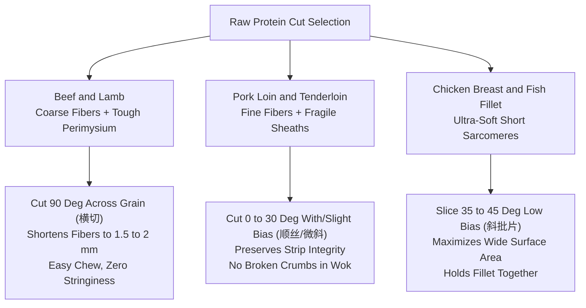

# Kitchen Science: Wok Setup, Heat Control, Knife Cuts & Silky Meat Velveting

If you ask why restaurant stir-fries taste smoky, glossy, and melt-in-your-mouth tender while home stir-fries stick to the pan, release puddles of grey water, and turn lean meat into cardboard, the answer lies entirely in **four pre-sauce fundamentals**: wok surface physics, oil temperature management, muscle-fiber cutting angle, and hydrated starch velveting (`上浆`).

Master the protocols in this module once, and they apply invariantly across every stir-fry in [03-SIGNATURE-HOMESTYLE-DISHES-PLAYBOOK.md](03-SIGNATURE-HOMESTYLE-DISHES-PLAYBOOK.md).

---

## 1. Wok Metallurgy: Choosing the Right Wok Once

Not all black pans are equal. Wok materials trade off **thermal conductivity** (how fast heat spreads), **volumetric heat capacity** (how much heat energy the metal stores), **weight**, and **surface reactivity**.

| Wok Material | Thickness & Weight (32 cm) | Thermal Behavior | Durability & Utensils | Verdict for Home Chinese Cooking |
| :--- | :--- | :--- | :--- | :--- |
| **Plain Carbon Steel (`无涂层熟铁锅`)** | `1.2–1.5 mm`, `1.1–1.4 kg` | Instant heat-up & instant cool-down when flame drops; responsive temperature zones | Lifetime durability; safe with steel spatulas, crab shells, pork ribs | **Gold Standard (#1 Choice)** — requires 15-min initial seasoning (`开锅`) and drying after wash |
| **Nitrided Carbon Steel (`氮化熟铁锅`)** | `1.2–1.6 mm`, `1.2–1.5 kg` | Identical to plain carbon steel | Nitrogen-diffused surface layer resists rusting 5x better than raw carbon steel; zero synthetic coating | **Best Upgrade for Busy Engineers** (e.g., Japanese River Light / domestic nitrided 99% pure iron woks) |
| **Traditional Cast Iron (`生铁锅`)** | `2.5–4.0 mm` (or thin brittle pig iron), `2.2–3.5 kg` | Slow to heat, high thermal inertia; stays hot long after turning off burner | Brittle if dropped; too heavy for one-handed tossing (`颠勺`) | Good for braising/deep-frying, suboptimal for agile stir-frying |
| **PTFE / Ceramic Non-Stick (`涂层不粘锅`)** | `2.5–3.5 mm` aluminum core, `1.2 kg` | Restricted to `< 230C`; PTFE begins off-gassing and degrading above `260C` | Coating scratches from bones/shells; loses non-stick in 12–18 months | Keep a small `24 cm` skillet strictly for low-heat eggs/dumplings; **never** use as primary high-heat wok |
| **Tri-Ply Stainless Steel (`复合不锈钢锅`)** | `2.2–2.6 mm`, `1.8–2.2 kg` | Even heating, slower response than carbon steel | Indestructible, dishwasher-safe, immune to vinegar/tomato acid | Great for acidic braises/soups, sticky for starch-velveted meats unless temperature is nailed |

---

## 2. Seasoning Chemistry (`开锅` & `养锅`) and Leidenfrost Physics (`热锅凉油`)

### 2.1 How Carbon Steel Becomes Naturally Non-Stick

Bare iron (`Fe`) has high surface energy and reactive oxide/hydroxyl sites that eagerly bond with sulfur- and nitrogen-containing amino acids in raw meat and egg whites. Seasoning transforms bare iron via two distinct chemical layers:

1. **Thermal Oxide Base Layer (`蓝化四氧化三铁`, $\text{Fe}_3\text{O}_4$)**: Heating clean bare steel past $300^\circ\text{C}$ converts rust-prone red iron oxide ($\text{Fe}_2\text{O}_3$) into dense blue-black **magnetite ($\text{Fe}_3\text{O}_4$)**, which passivates the metal against rust and anchors oil molecules.
2. **Cross-Linked Lipid Polymer Film (`油膜聚合层`)**: When thin films of unsaturated cooking oil are heated near their smoke point in the presence of iron (a Lewis-acid catalyst) and oxygen, carbon-carbon double bonds undergo free-radical autoxidation and cross-linking polymerization. This creates a hard, hydrophobic, microscopic plastic-like matrix chemically bonded into the micro-pores of the steel.

> **Crucial Mistake to Avoid**: Applying a *thick* puddle of oil during seasoning produces a sticky, gummy, brown residue (`腻子胶`) that flakes off into food. Each seasoning coat must be wiped **so thin that the pan looks matte dry** before heating.

### 2.2 Step-by-Step Initial Seasoning SOP (`新锅开锅标准流程` — 15 Minutes)

1. **Strip Factory Anti-Rust Wax**: Scrub the new wok inside and out under hot running water using dish soap and a stainless steel scrubber (`钢丝球`) for 2 full minutes until rinse water sheets evenly without beading. Wipe dry.
2. **Blue the Steel (`烧蓝`, Gas Stove Method)**: Turn on your range hood to maximum. Place the dry empty wok over high flame. Rotate and tilt the wok slowly so every section of the bottom and walls heats through silver -> straw yellow -> purple -> **gunmetal blue-grey** (takes 5–8 minutes total). *(On an induction stove: heat on medium-high Level 6–7—never Boost on an empty pan to avoid warping—for 3–4 minutes to evaporate factory moisture; skip full wall blueing and proceed directly to thin-film polymerization).*
3. **Cool Slightly**: Turn off heat and let the wok air-cool for 90 seconds until below $200^\circ\text{C}$ (so oil does not flash-combust on contact).
4. **First Micro-Film Polymerization**: Add `1 tsp` (`5 mL`) refined canola, sunflower, or peanut oil (avoid flaxseed oil, which flakes easily on woks, and avoid unrefined butter/olive oil). Fold 3 sheets of paper towel with tongs and wipe the oil across the entire interior—**then take a clean dry paper towel and wipe off all visible excess oil**. Return to medium heat for 60 seconds until faint wisps of smoke stop.
5. **Aromatic Conditioning (`葱姜猪油润锅`, Optional)**: Fry a handful of scrap scallion greens and ginger slices in `1 tbsp` oil or lard (`猪油`) over medium heat for 2 minutes, pressing them up the walls to sweep away any metallic odor. Discard scraps.
6. **Rinse & Seal**: Rinse with warm water only (no soap), wipe dry on the stove over low heat for 20 seconds, and wipe 3 drops of oil across the surface. Your wok is ready for life.

### 2.3 Leidenfrost Physics & Physical Non-Stick (`热锅凉油` Protocol)

Even a seasoned carbon steel wok will grab starch-coated pork or scrambled eggs if you add food into warm ($110^\circ\text{C}\text{–}150^\circ\text{C}$) oil that sat heating from a cold pan. Why? Because heating oil *inside* a cold pan degrades the oil prematurely while leaving micro-regions of metal unevenly expanded.

Follow the **6-Step `热锅凉油` Protocol** before every protein cook:

1. **Start Dry**: Ensure the wok has zero standing water droplets (water + hot oil = violent splattering).
2. **Preheat Empty Steel**: Heat the empty wok on high for 45–60 seconds until the air 10 cm above the center feels intensely radiant and the first faint wisp of smoke appears from the seasoned surface ($\approx 200^\circ\text{C}$).
3. **Optional Leidenfrost Verification (First 5 Times)**: Flick a single `0.2 mL` drop of water from your fingertips onto the pan.
   - If it sizzles flat and boils in place: pan is only $110^\circ\text{C}\text{–}160^\circ\text{C}$ (sticky danger zone—keep heating!).
   - If it instantly forms a frictionless, spherical "mercury ball" skating across the metal: pan has passed the **Leidenfrost point ($\ge 193^\circ\text{C}$)**. Let that bead evaporate completely.
4. **Swirl Room-Temperature Oil (`润锅`)**: Pour in your measured cooking oil along the upper rim, tilt the wok $360^\circ$ so cool oil coats the hot walls, and turn flame down to medium-high if cooking delicate velveted meat or eggs.
5. **Immediate Food Entry**: Add the protein **immediately** while the oil itself is still $120^\circ\text{C}\text{–}150^\circ\text{C}$ (cool enough not to burn starch or toughen meat), while the underlying steel holds $200^\circ\text{C}$ thermal momentum to flash-coagulate the bottom contact boundary.
6. **The 8-Second Non-Interference Rule**: When sliced pork, beef, fish, or tofu hits the pan, **do not scrape frantically in the first second**. Count 8 to 10 seconds so the starch/protein boundary coagulates and naturally releases from the metal, then slide the curved spatula cleanly underneath and toss.

### 2.4 Daily 30-Second Wok Care (`日常养锅`)

- **Wash Immediately While Warm (`趁热温水刷锅`)**: Right after plating, carry the warm wok to the sink, run hot tap water, and swish with a bamboo brush (`竹刷`) or soft sponge for 15 seconds. Thermal shock + residual heat lifts 99% of sauce glaze instantly with zero soap needed. *(Note: Using a tiny drop of mild dish soap occasionally when fishy or greasy is completely fine—true polymerized seasoning is chemically cross-linked and does NOT wash off with dish soap; only prolonged soaking in water or boiling vinegar strips it).*
- **Stove-Dry + 2-Drop Oil Seal**: Place the washed wok back on the burner over high heat for 20 seconds until every water drop evaporates. Turn off burner. If cooking every day in a dry climate, leave dry; if humid or storing $>2$ days, rub `2 drops` (`0.5 mL`) of oil across the inner bowl with a paper towel.
- **Acid Warning**: Avoid simmering tomato soup, sweet-and-sour ribs, or heavy vinegar braises for $>15$ minutes in a newly seasoned carbon steel wok—food acids ($\text{pH} < 4.5$) slowly chelate iron and strip young seasoning, imparting a faint metallic taste and turning the wok pale grey (`锅底发白`). Use your stainless steel pot for long acidic simmers, or simply re-wipe a thin layer of oil afterward if the wok dulls.

---

## 3. Cooking Oils, Smoke Points & Visual Temperature Cues

Using the wrong fat at high heat creates acrid acrolein smoke and destroys delicate flavors. Keep **two primary cooking fats + one finishing oil** in your kitchen:

| Cooking Fat | Smoke Point | Flavor Profile | Best Culinary Role |
| :--- | :--- | :--- | :--- |
| **Refined Peanut Oil (`压榨一级花生油`)** | **$225^\circ\text{C}\text{–}230^\circ\text{C}$** | Nutty, fragrant, classic Cantonese &鲁菜 aroma | Primary high-heat stir-fry & searing oil *(skip if peanut allergy in household)* |
| **Refined Canola / Sunflower / Corn Oil (`精炼菜籽油 / 葵花籽油 / 玉米油`)** | **$225^\circ\text{C}\text{–}235^\circ\text{C}$** | Clean, neutral, lets aromatics shine | Universal neutral oil for velveting seal (`封油`), `金银蒜`, chili oil, and everyday stir-fries |
| **Traditional Unrefined Rapeseed Oil (`浓香菜籽油`)** | **$190^\circ\text{C}\text{–}205^\circ\text{C}$** | Pungent brassica aroma; deep golden hue | Authentic Sichuan/Hunan dishes (`麻婆豆腐`, `小炒黄牛肉`, `水煮肉片`); heat briefly to `七成热` first to dispel raw grassy notes (`断生味`) |
| **Rendered Pork Lard (`自熬白猪油`)** | **$190^\circ\text{C}\text{–}195^\circ\text{C}$** | Rich savory mouthfeel & saturated fat gloss | **Secret weapon for leafy greens (`蒜蓉油麦菜/青菜`)** and egg fried rice—`1 tsp` transforms plain greens |
| **Toasted Sesame Oil (`小磨香油`)** | **$170^\circ\text{C}$ (Volatiles burn at $120^\circ\text{C}$)** | Intense roasted nutty pyrazines | **Strictly off-heat finishing (`淋明油`)** and cold dressings (`凉拌`). Never stir-fry with it! |
| **Extra-Virgin Olive Oil / Butter** | **$160^\circ\text{C}\text{–}190^\circ\text{C}$** | Grassy polyphenols / milk solids burn black | Keep out of high-heat Chinese stir-frying |

### Translating Traditional Oil Temperature Levels (`油温几成热`)

In Chinese culinary nomenclature, **1 level (`一成热`) $\approx 30^\circ\text{C}$**:

| Traditional Level | Temperature | Visual Surface & Chopstick Test | Exact Use Case |
| :--- | :--- | :--- | :--- |
| **`三至四成热` (Low-Warm)** | **$90^\circ\text{C}\text{–}120^\circ\text{C}$** | Oil is calm with subtle shimmer; zero smoke; dry wooden chopstick tip produces slow, tiny bubbles | Frying `郫县豆瓣酱` for red oil, slow-infusing scallion oil (`葱油`), toasting peanuts from cold oil, gentle meat velveting (`滑油`) |
| **`五至六成热` (Medium-High)** | **$150^\circ\text{C}\text{–}180^\circ\text{C}$** | Oil thins and ripples toward edges; zero or barely perceptible wisp of smoke; chopstick produces steady lively bubbles | Blooming `葱姜蒜`, frying golden garlic, crisp-searing tofu/fish, pouring over chili flakes for `辣椒油` ($170^\circ\text{C}$) |
| **`七至八成热` (High / Searing)** | **$210^\circ\text{C}\text{–}240^\circ\text{C}$** | Oil surface flattens calm after rippling; distinct steady white smoke rises from edges; instant loud crackle on contact | Flash-searing `小炒黄牛肉`, pouring sizzling finishing oil over `清蒸鲈鱼` scallions (`泼热油`), flash stir-frying leafy greens |

---

## 4. Engineering Wok Hei (`锅气`) on a Home Stove

`锅气` (breath of the wok) is that unmistakable smoky-savory complexity distinguishing restaurant stir-fry from flat boiled home food. Food physics research (Ko & Hu, Georgia Tech) proved `锅气` comes from four simultaneous mechanisms:
1. Rapid **surface dehydration + Maillard browning** ($>150^\circ\text{C}$).
2. **Flash caramelization of soy sauce and wine** hitting dry $210^\circ\text{C}+$ upper wok walls (`锅边烹酒/锅边酱油`).
3. **Thermal lipid oxidation** of microscopic oil droplets misting into the hot vapor plume above the food.
4. Zero pooling water at the bottom of the wok.

Because your home stove has $1/8\text{th}$ the thermal output of a commercial jet burner, follow these **6 Home Wok Hei Rules**:

1. **Hard Batch Cap (`单锅不超过350g`)**: Never crowd more than `300–350 g` of main ingredients into a `32 cm` wok at once. Cooking for 4 people? Stir-fry two sequential 90-second batches rather than steaming one giant 800 g pile.
2. **Two-Stage Separation (`荤素分开炒`)**: Sear or velvet the meat first (`25s`), scoop it out onto a warm plate, reheat the wok to $200^\circ\text{C}$, stir-fry the vegetables to 85% doneness, then combine for the final 15 seconds. This effectively doubles your stove's thermal reserve.
3. **Spin or Blot Greens Dry**: Wash leafy greens 15 minutes early and shake/spin in a salad spinner or blot with a clean kitchen towel. Dry leaves sear emerald green; wet leaves steam olive-drab.
4. **Pre-Blanch Dense Vegetables (`难熟食材先焯水30秒`)**: Broccoli florets, lotus root, green beans, or thick bamboo shoots take 4 minutes raw in oil (scorching aromatics), or just **45 seconds in salted boiling water** followed by a 30-second high-heat wok sear.
5. **Rim-Pour Liquids (`锅边烹料酒与生抽`)**: Never dump cold cooking wine or soy sauce straight onto the pile of meat in the center. Drizzle `10 mL` wine in a wide circle onto the scorching bare upper metal wall—watch it instantly flash into fragrant steam (`滋啦` sound), scraping fond into the food.
6. **Optional Kitchen Blowtorch Assist (`卡式喷枪增锅气`)**: If cooking on a weak electric/induction coil, sweeping a culinary butane torch across the tossing food for 8–10 seconds at the end replicates genuine aerosolized oil-droplet `锅气` identically to a restaurant range.

---

## 5. Knife Cuts & Muscle Fiber Geometry (`横切牛羊竖切猪，斜切鸡鱼`)

### 5.1 Safe Grip & Blade Control

- **Pinch Grip on the Cleaver (`捏刀法`)**: Wrap your thumb on the left face of the blade heel and your bent index finger on the right face of the blade, with only the remaining three fingers curled around the wooden handle. This locks lateral roll so thin slices never wedge crooked.
- **Claw Guide Hand (`猫爪护指法`)**: Curl all fingertips *inward* behind the first knuckle joint, resting the flat side of the Chinese cleaver lightly against your middle finger's middle phalanx. Even if distracted, the vertical blade edge physically cannot reach your fingertips because your knuckles project further forward than your nails.

### 5.2 Why Muscle Fiber Direction Dictates Tenderness

Skeletal muscle consists of bundles of contractile protein fibers wrapped in tough **collagenous perimysium sheaths**. Different animals have vastly different fiber thicknesses and connective-tissue toughness:

| Protein | Traditional Rule | Exact Cutting Geometry | What Happens If You Cut Wrong |
| :--- | :--- | :--- | :--- |
| **Beef & Lamb (`牛羊肉`: Sirloin, Flank, Shank `吊龙/牛里脊`)** | **`横切牛羊` ($90^\circ$ Perpendicular to Grain)** | Rotate the meat block so visible parallel muscle lines run left-to-right; slice straight down at $90^\circ$ into `1.5–2.0 mm` thin sheets (`肉片`). Looking at a finished slice, you should see tiny cross-hatch dots/short hatches, NOT long parallel strings. | Cutting parallel (`顺丝`) leaves `5 cm` unbroken collagen cables between your molars—chews like rubber bands regardless of marinade. |
| **Pork (`猪肉`: Loin `里脊` / Shoulder Butt `梅花肉`)** | **`竖切猪` ($0^\circ\text{–}30^\circ$ Parallel or Slight Bias)** | Slice pork loin into `2.5 mm` sheets along the grain, stack the sheets like fallen dominoes, and julienne parallel/slightly diagonal (`15^\circ\text{–}30^\circ`) into `2.5 mm x 2.5 mm x 6 cm` matchsticks (`肉丝`). *(Exception: For `回锅肉` or thick pork slices, cut across grain).* | Cutting thin `2 mm` pork slivers $90^\circ$ across the grain makes fibers so short (`2 mm`) that vigorous wok stirring shatters the slivers into minced pork crumbs (`炒碎成肉末`). |
| **Chicken Breast & Fish Fillets (`鸡胸肉 / 鱼片`)** | **`斜切鸡鱼` ($30^\circ\text{–}45^\circ$ Low-Angle Bias `抹刀片`)** | Hold the cleaver at a shallow $35^\circ$ angle to the board, press flat palm on top of the fillet, and draw-slice (`拉片`) against the grain into `3 mm` wide-area petals. | Vertical $90^\circ$ cuts on thin fillets produce tiny narrow strips that shred into mush when tossed. |

> **Pro Engineering Trick — The 25-Minute Freezer Firm-Up (`微冻切丝法`)**: Struggling to slice slippery fresh raw beef or pork loin to a uniform `2 mm`? Wrap the meat block flat and place it in the `-18C` freezer for **20 to 30 minutes** until the exterior feels firm like cheddar cheese while the core still yields slightly. It slices with laser-like geometric precision.

### 5.3 Core Vegetable Cut Geometries

- **Uniform Matchsticks (`切丝`, e.g., `酸辣土豆丝`, `胡萝卜丝`)**: Never try to balance a round rolling potato! Slice one thin flat cheek off the bottom first to anchor the potato flat on the board (`先切底座防滑`). Slice into uniform `2 mm` sheets, shingle-stack them flat like a fanned deck of cards, and push-cut vertically into `2 mm x 2 mm` slivers.
- **Roll-Cut (`滚刀块`, e.g., `红烧茄子/萝卜/胡萝卜`)**: Hold knife at $45^\circ$ to the vegetable cylinder, cut off the tip, roll the vegetable $90^\circ\text{–}120^\circ$ toward yourself, cut again at the same $45^\circ$ angle, and repeat. Produces irregular multi-faceted polyhedra with **maximum surface-area-to-volume ratio** so braising sauces penetrate rapidly.
- **Smash-Then-Chop (`先拍后斩`, e.g., Garlic, Ginger, Cucumber)**: Lay the flat of the cleaver over a peeled garlic clove and smack firmly with the heel of your palm (`啪`). Cell walls rupture instantly, mixing enzyme alliinase with alliin to generate **allicin** (pungent garlic aroma)—far more flavorful and 5x faster than neatly dicing intact cloves.

---

## 6. Restaurant-Secret Meat Velveting (`上浆` & `滑炒`)

Lean cuts like pork tenderloin (`猪里脊`), beef sirloin (`牛里脊`), and chicken breast (`鸡胸肉`) contain $<4\%$ intramuscular fat. Unprotected in a $180^\circ\text{C}$ wok, they lose up to $30\%$ of their water weight in 40 seconds and turn chalky.

Chinese chefs solve this with **`上浆` (Velveting Slurry)**—a **strictly ordered 4-layer chemical assembly** that forces extra water *into* muscle cells and wraps each piece in a thermal-insulating starch-and-oil jacket.

### 6.1 The Strict Order of Operations (Why Sequence Matters!)

**NEVER dump salt, water, soy sauce, cornstarch, and oil into a bowl all at once.** If oil or starch coats the meat *before* salt and water enter, the hydrophobic barrier blocks water absorption and the starch slides off in the pan (`脱浆`).

Execute in this exact 4-step sequence (takes 2 minutes total):

1. **Step 1 — Wash Excess Myoglobin (Optional, 20 sec)**: For beef slices or odorous supermarket pork, rinse briefly in cold water to wash away metallic-tasting surface blood (`血水`), then **squeeze firmly in your fist** until no water drips. (Cleaner flavor + higher liquid absorption capacity).
2. **Step 2 — Salt + Flavored Water Massage (`加盐与葱姜水打水起胶`)**: Add measured salt (and light soy sauce + white pepper + Shaoxing wine/ginger-scallion water). Massage vigorously in **one clockwise direction** with clean fingers for 45–60 seconds.
   - *Chemistry*: Sodium and chloride ions shield electrostatic charges on myosin filaments (**salting-in effect**), causing myofibrils to swell and trap `10%–15%` extra liquid inside the protein lattice. Stop when zero free liquid pools at the bottom of the bowl and the meat feels tacky and sticky (`发黏起胶`).
3. **Step 3 — Hydrated Starch Hydrogel (`抓匀淀粉锁水`)**: Sprinkle in cornstarch or potato starch (`玉米淀粉 / 土豆生粉`). *(Optional: add `1 tbsp / 15 g` beaten egg white per `200 g` chicken breast or shrimp for extra cushion; skip egg white for dark beef stir-fries if you want crisp Maillard sear).* Squeeze and fold for 20 seconds until a thin, milky, uniform satin coating hugs every sliver with zero dry white powder spots.
4. **Step 4 — Neutral Oil Seal (`封油防粘`)**: Drizzle `1 tbsp` (`10–15 mL`) neutral cooking oil on top and toss gently to coat.
   - *Chemistry*: Creates a hydrophobic boundary layer around every individual strand of meat. When dropped into hot oil, strands separate within 3 seconds (`下锅秒散`) instead of fusing into one giant meatball, and you can store this prepped meat in the fridge for up to 24 hours without drying out.

### 6.2 Exact Velveting Formulas (Per `200 g` Raw Trimmed Protein)

| Protein (`200 g`) | Step 2: Liquid & Salt Massage (`打水`) | Step 3: Starch Shell (`锁水`) | Step 4: Oil Seal (`封油`) | Special Notes |
| :--- | :--- | :--- | :--- | :--- |
| **Pork Slivers / Slices (`猪里脊肉丝/肉片`)** | `1.5 g` (`1/4 tsp`) salt + `5 mL` (`1 tsp`) light soy + `5 mL` (`1 tsp`) Shaoxing wine + `15 mL` (`1 tbsp`) water + pinch white pepper | `6 g` (`2 tsp` level) cornstarch | `10 mL` (`2 tsp`) neutral oil | Classic baseline for `青椒肉丝` & `鱼香肉丝`; skip dark soy if you want clean bright meat |
| **Beef Slices (`小炒牛肉片`)** | `10 mL` (`2 tsp`) light soy + `5 mL` (`1 tsp`) oyster sauce + `15 mL` (`1 tbsp`) scallion-ginger water + pinch black/white pepper *(zero extra salt!)* | `4 g` (`1.25 tsp`) cornstarch *(light coat so aromatics cling!)* | `12 mL` (`2.5 tsp`) neutral oil | **Never** add Shaoxing cooking wine directly into flash-fried beef marinade if your stove is weak—trapped alcohol tastes sour; use scallion-ginger water instead! |
| **Chicken Thigh / Breast Dices (`宫保鸡丁 / 鸡片`)** | `1.5 g` (`1/4 tsp`) salt + `5 mL` (`1 tsp`) light soy + `5 mL` (`1 tsp`) Shaoxing wine + `10 mL` water + pinch white pepper | `15 g` (`1 tbsp`) egg white (optional) + `7 g` (`2.5 tsp`) cornstarch | `10 mL` (`2 tsp`) neutral oil | Boneless chicken thigh (`去骨鸡腿肉`) stays 3x juicier than breast even if overcooked by 15s |
| **Peeled Shrimp (`脆口滑虾仁`)** | *(First scrub raw shrimp with `2 g` salt + `5 g` starch, rinse clean, blot bone-dry with paper towel!)* Then massage `1.5 g` salt + pinch white pepper + `5 mL` wine until tacky | `10 g` egg white + `5 g` (`1.5 tsp`) cornstarch | `8 mL` (`1.5 tsp`) neutral oil | Blotting shrimp 100% dry with paper towels before marinating is the #1 secret to crisp restaurant `玻璃虾仁` bounce |

> **The Baking Soda (`食用小苏打`, $\text{NaHCO}_3$) Warning**: Cantonese diners (`茶餐厅`) use alkaline baking soda to raise meat pH from `5.6` to `6.3`, preventing protein fibers from contracting tightly. If using on tough lean beef, **never exceed `0.5%` by weight (`1.0 g` / level `1/4 tsp` per `200 g` beef)** dissolved in the Step 2 water, and marinate for 15 minutes. Exceeding `2 g` destroys meat texture into mushy sponge and leaves a bitter, soapy metallic aftertaste (`碱水味`). With proper $90^\circ$ cross-grain slicing + `打水`, you rarely need baking soda at home.

### 6.3 Two Ways to Cook Velveted Meat at Home (`滑炒` vs `水滑`)

Restaurants deep-velvet meat in `1 liter` of `130C` oil (`宽油滑油`), which nobody wants to clean up at home on a weeknight. Use one of these two clean home methods instead:

1. **Home Shallow-Oil Slip-Fry (`家常少油滑炒` — Best Flavor & Gloss)**:
   - Execute `热锅凉油` with **`2 tbsp` (`30 mL`) oil** (slightly more than normal; you will leave the clean oil behind in the wok to fry vegetables right after!).
   - Spread velveted meat flat across the bottom in a single layer over medium-high heat.
   - **Wait 8–10 seconds untouched** until bottom edges turn opaque white, then rapidly stir/chop-separate with chopsticks or spatula for 12–15 seconds until **80% opaque** (a hint of pink remains).
   - Immediately scoop meat out onto a clean plate, leaving the remaining oil in the wok for your aromatics and vegetables.
2. **Healthy Water-Velveting (`沸水微滑法` — Fitness / Low-Calorie Variant)**:
   - Bring `1 liter` of water + `1 tsp` cooking oil in a saucepan to a rolling boil, then **turn heat down to low** so water sits at a gentle $90^\circ\text{C}\text{–}95^\circ\text{C}$ bare simmer (violent rolling boil strips off delicate starch coatings!).
   - Slide in your starch-and-oil velveted chicken breast slices or pork slivers. Wait 8 seconds before gently nudging apart with chopsticks.
   - As soon as pieces turn opaque white (25–35 seconds), lift out immediately with a mesh spider strainer (`漏勺`). Fold into stir-fried vegetables with `1 tsp` sauce at the very end—silky restaurant texture with 75% less oil.

---

## 7. Failure Mode Diagnostic Table

| Symptom in Your Dish | Root Physical Cause | Deterministic Fix Next Time |
| :--- | :--- | :--- |
| **Starch falls off meat and sticks as a gummy brown crust on the wok (`脱浆粘锅`)** | 1. Wok wasn't preheated past $195^\circ\text{C}$ (`锅不够热`); OR 2. You stirred violently at second 1 before starch gelatinized; OR 3. Too much dry starch without oil seal | Preheat dry wok until faint smoke, swirl cool oil, add meat, **count 8 full seconds** before sliding spatula under, and always finish marinade with `10 mL` oil seal |
| **Beef chews like tough leather despite marinating** | Sliced parallel to muscle grain (`顺丝切了`) OR left in pan $>45\text{ seconds}$ while vegetables cooked | Rotate beef $90^\circ$ perpendicular to grain (`横切`), pull beef out at 80% doneness (20s), cook peppers separately, combine for final 10s |
| **Pork slivers taste sour/metallic from cooking wine (`料酒味发酸`)** | Poured too much cheap salted `料酒` directly into marinade or center of cold pan where ethanol couldn't evaporate | Limit marinade wine to `5 mL` (`1 tsp`) brewed Shaoxing wine (`花雕`), or replace marinade wine with `葱姜水` (scallion-ginger infused water) |
| **Stir-fried greens turn olive-yellow and swim in grey soup** | Washed greens went in dripping wet + pan overcrowded + salted at the beginning | Spin/blot leaves dry, preheat wok smoking hot with `1 tsp` lard/oil, stir-fry $\le 300\text{ g}$ for 40s, add salt in the **final 5 seconds** before plating |
