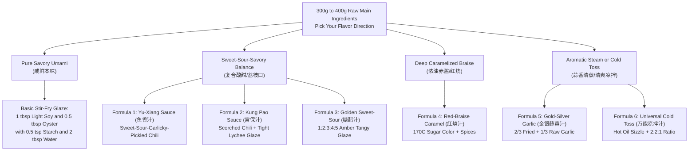
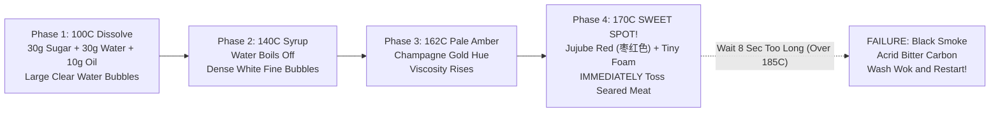

# Minimalist Pantry & Universal Chinese Sauce Ratios (精确到勺的万能碗汁公式)

Walk into a supermarket condiment aisle and you will see 80 overlapping bottles: "braised pork soy sauce," "seafood soy sauce," "stir-fry sauce," "spicy hotpot base," "sweet-and-sour packet." Buying specialized single-dish sauces clutters your fridge with half-expired jars full of corn syrup and preservatives while teaching you nothing about flavor balance.

Every regional flavor profile in Chinese home cooking—from Cantonese `白灼/蒜蓉蒸` to Sichuan `鱼香/宫保/麻辣` and Jiangnan `红烧/糖醋`—can be synthesized from **10 core bottles and 5 dry aromatics**. Even better: by pre-mixing exact **Bowl Sauces (`碗汁`)** in a small bowl *before* turning on the stove, you eliminate frantic mid-cook bottle grabbing and turn every 30-second high-heat stir-fry into a calm, deterministic pour.

---

## 1. Standardizing Kitchen Units (Spoons, Milliliters & Grams)

Chinese recipes fail when "1 spoon (`一勺`)" means a `5 mL` coffee spoon to one person, a `10 mL` porcelain soup spoon (`家用白瓷勺`) to another, and a `15 mL` measuring tablespoon to a third—a **$300\%$ variance**!

Throughout this vault, every formula is anchored to **international measuring spoons (`1 tbsp = 15 mL`, `1 tsp = 5 mL`)** AND **exact mass in grams (`g`)** so you can place a small bowl directly on a `0.1 g` digital kitchen scale and tare (`清零`) between pours without washing measuring spoons.

| Condiment / Ingredient | `1 tbsp` (`15 mL`) | `1 tsp` (`5 mL`) | `1 Chinese Soup Spoon` (`白瓷平勺 ≈ 10 mL`) | Density / Scaling Note |
| :--- | :--- | :--- | :--- | :--- |
| **Water / Cooking Wine / Vinegar** | `15.0 g` | `5.0 g` | `10.0 g` | Specific gravity $\approx 1.00\text{ g/mL}$ |
| **Light / Dark Soy Sauce (`生抽 / 老抽`)** | `17.5 g` | `5.8 g` | `11.5 g` | Dissolved salt & amino acids raise density to $\approx 1.17\text{ g/mL}$ |
| **Oyster Sauce (`蚝油`)** | `19.0 g` | `6.3 g` | `12.5 g` | Viscous; weighing on a scale (`19 g`) is 3x cleaner than scraping spoons |
| **Cooking Oil / Sesame Oil (`油 / 香油`)** | `13.5 g` | `4.5 g` | `9.0 g` | Lipid density $\approx 0.91\text{ g/mL}$ |
| **Pixian Doubanjiang (`郫县豆瓣酱`)** | `18.0 g` | `6.0 g` | `12.0 g` | Level spoon of finely minced paste |
| **White Granulated Sugar (`细砂糖`)** | `12.5 g` | `4.2 g` | `8.5 g` | Level spoon (not heaped) |
| **Table Salt (`精制食盐`)** | `15.0 g` *(rarely used)* | `5.0 g` | `10.0 g` | `1/4 tsp = 1.25 g`; `1/2 tsp = 2.5 g` |
| **Cornstarch / Potato Starch (`淀粉`)** | `9.0 g` | `3.0 g` | `6.0 g` | Level,鬆散 (unpacked) powder |

---

## 2. Minimalist Pantry Chemistry & Buying Specifications

Read the **back nutrition & GB standard label** rather than front marketing slogans. Stock only these workhorse bottles:

### 2.1 Liquid Umami & Salinity Core

| Bottle | Chemical Function | Exact Label Specs to Buy | Authentic Reference Brands | Storage & Usage Rules |
| :--- | :--- | :--- | :--- | :--- |
| **Light Soy Sauce (`特级生抽`)** | Primary salinity + free L-glutamate + roasted wheat/soy Maillard aroma | Standard **`GB/T 18186`**, Fermentation: **`高盐稀态`** (never `配制酱油`!), Grade: **`特级`**, **`氨基酸态氮 >= 1.0–1.2 g/100mL`** | Qianhe `千禾御藏/零添加180天`, Lee Kum Kee `李锦记精选/薄盐生抽`, Haday `海天金标特级` | Keep capped in cool cabinet (or fridge in hot summers). Add along hot wok rim for aroma, or in bowl sauces. |
| **Dark Soy Sauce (`草菇老抽 / 老抽`)** | Chromatic amber-red coloring (`上色`) + subtle molasses body; *low umami* | Brewed soy sauce + caramel color (`焦糖色`) or long sun-fermented (`千禾零添加老抽`) | Haday `海天草菇老抽`, Lee Kum Kee `李锦记老抽`, Qianhe `千禾头道原香老抽` | **Dose in `0.5–1 tsp` (`2.5–5 mL`) increments!** Too much turns stir-fries muddy black (`发乌发苦`). |
| **Oyster Sauce (`特级蚝油`)** | Concentrated glycogen sweetness + glutamate/inosinate umami + natural emulsion thickness | **Ingredient #1 or #2 MUST be `蚝汁` (Oyster Extract)**—avoid cheap bottles where #1 is water and `蚝汁` sits near the bottom! | Lee Kum Kee `李锦记旧庄特级蚝油` (gold standard) or `李锦记财神蚝油` | **MUST refrigerate ($4^\circ\text{C}$) immediately after opening** (high amino/sugar content molds at room temp!). Add late in cooking; prolonged boiling destroys oyster aroma. |
| **Shaoxing Huadiao Wine (`绍兴花雕酒 / 陈年黄酒`)** | Azeotropic co-evaporation of fishy/gamey amines (`三甲胺`) + organic acid esterification (`增香去腥`) | Standard **`GB/T 13662`** brewed glutinous rice wine, **`酒精度 >= 10%–14% vol`**, **zero added salt** | Pagoda `塔牌三年陈/五年陈花雕`, Guyuelongshan `古越龙山厨用花雕` | Ditch cheap `¥5` spiced salted `勾兑料酒`. Splash `10–15 mL` onto $>180^\circ\text{C}$ wok rim with **lid OFF** so腥味 evaporates out. |

### 2.2 The Vinegar Triumvirate (`醋的三剑客`)

Chinese vinegars are not interchangeable. Grain substrates and fermentation microbes yield completely different organic acid profiles (volatile acetic acid vs non-volatile lactic/succinic acids):

| Vinegar Type | Substrate & Profile | Label Spec | When to Use It |
| :--- | :--- | :--- | :--- |
| **Zhenjiang Aromatic Vinegar (`镇江香醋`)** | Glutinous rice (`糯米固态发酵`); rounded, malty, mildly sweet-tart (`酸而不涩，香而微甜`) | `GB/T 18623`, Total Acid **`总酸 >= 5.5–6.0 g/100mL`** (e.g., Hengshun `恒顺六年陈`) | **#1 All-Rounder**: `鱼香汁`, `宫保汁`, `糖醋排骨`, `万能凉拌汁`, dumpling dipping sauce |
| **Shanxi Mature Vinegar (`山西老陈醋`)** | Sorghum + smoked roasted grains (`熏醅工艺`); deep smoky aroma, assertive punchy acidity | `GB/T 19777`, **`总酸 >= 6.0 g/100mL`**, zero preservative required | Heavy northern noodles, `酸辣汤`, braised fish, smoked cold dishes |
| **White Rice Vinegar (`酿造白米醋`)** | Polished rice; crystal clear, sharp volatile acetic snap, zero dark pigment | Brewed `固态/液态发酵米醋` (**never** industrial glacial acetic acid `冰乙酸勾兑醋`), `总酸 >= 4.5 g/100mL` | **`酸辣土豆丝`**, `醋溜白菜` (keeps pale vegetables bright ivory-white instead of brown!), quick radish pickles |

> **Two-Stage Vinegar Chemistry (`暗醋增香 vs 明醋提酸`)**: Acetic acid boils at $118^\circ\text{C}$. Splashing vinegar early on hot wok walls (`锅边暗醋`) reacts with ethanol from cooking wine to form fruity **ethyl acetate esters** while softening harsh sourness. Splashing vinegar right before turning off the heat (`出锅明醋`) preserves sharp, mouth-watering acidity. Great `酸辣土豆丝` and `糖醋` dishes use both!

### 2.3 Fermented Pastes, Spices & Starches

- **Pixian Doubanjiang (`郫县豆瓣酱`)**: The soul of Sichuan cooking (`回锅肉`, `麻婆豆腐`, `鱼香肉丝`). Buy **`鹃城牌红油豆瓣`** (everyday stir-fry) or **`鹃城特级三年陈酿豆瓣`** (deeper umami, darker color—blend `2:1` red-oil to aged).
  - *Mandatory Rule 1*: Scoop onto your cutting board and **mince finely for 30 seconds (`剁细`)** before cooking so nobody bites into whole tough fava bean skins (`蚕豆瓣皮`).
  - *Mandatory Rule 2*: Fry in warm oil (`110C–130C`, low-medium flame) for 20–30 seconds until the oil turns brilliant ruby-red (`炒出红油`) and smells nutty-spicy. High heat scorches it dark brown and bitter in 5 seconds!
- **Fermented Black Soybeans (`阳江豆豉`)**: Rinse briefly, press/chop lightly with garlic, and bloom in oil for 10 seconds to unlock intense savory pyrazines (`麻婆豆腐`, `豉汁蒸排骨`, `小炒黄牛肉`).
- **Sichuan Peppercorns (`花椒`)**: Keep a small sealed glass jar of **Hanyuan Red Sichuan Peppercorns (`汉源大红袍红花椒`)** in the freezer (light and air oxidize volatile terpenes and numbing sanshools within 3 months at room temperature!). Fry gently in warm oil (`120C`) and **fish out the hulls** for clean numbing oil, or dry-toast for 45 seconds in a dry pan and crush with a rolling pin for electric **`刀口花椒面`** over `麻婆豆腐`.
- **The Minimalist Dry Spice Quartet (`炖肉核心四香料`)**:
  1. **Star Anise (`八角`)**: Sweet licorice anethole—use **1 to 2 whole pods max** per `500 g` pork/ribs.
  2. **Cassia Cinnamon (`桂皮`)**: Warm woody sweetness—use **1 thumb-sized bark shard (`3 g`)** per `500 g` meat.
  3. **Bay Leaves (`香叶`)**: Herbal lift that cuts pork grease—use **2 leaves** per `500 g` meat.
  4. **Dried Chilies (`干辣椒`)**: Stock **Erjingtiao (`四川二荆条`)** for mild, fruity, red-oil fragrance (`宫保鸡丁` needs low-heat fragrance, not nuclear capsaicin!) and **Facing-Heaven / Xiaomi (`子弹头 / 朝天椒`)** for medium-high heat. *Snip into 2 cm segments and shake out the seeds (`剪段去籽`)—seeds burn black first and add bitterness without aroma.*
- **The Starch Selection Rule (`淀粉怎么选`)**:
  - **Cornstarch (`玉米淀粉`)**: Keep 1 bag as your **95% universal default**—smooth velveting (`上浆`), reliable bowl-sauce thickening (`碗汁勾芡`), and crispy laceskirts (`冰花煎饺`).
  - **Potato Starch (`土豆淀粉 / 太白粉`)**: Gelatinizes at a lower temp ($62^\circ\text{C}$) into a crystal-clear, high-viscosity restaurant gloss (`麻婆豆腐`, Cantonese glazes). Add in small stages over medium simmer—boiling violently after gelatinization shears amylopectin chains and thins the sauce (`泄芡`).

---

## 3. Flavor Space Decision Tree: Picking Your Sauce Formula

---

## 4. The 6 Golden Universal Sauce Formulas (`六大精确万能碗汁`)

All six formulas below are calibrated for **one standard homestyle plate (`300 g–400 g` total main ingredients, serving 2–3 people)**. Always stir the bowl right before pouring into the wok because starch settles to the bottom within 60 seconds!

### Formula 1: Authentic Sichuan Yu-Xiang Bowl Sauce (`正宗鱼香汁`)
*Note: "Yu-Xiang" (`鱼香`, fish-fragrance) contains zero fish—it uses the classic Sichuan seasoning aromatics historically used to cook freshwater fish (pickled chili `泡辣椒`, ginger, abundant garlic, scallion whites, sugar, and vinegar).*

- **Aromatic Base (Fried in Oil Before Pouring Sauce)**: `1 tbsp` (`18 g`) finely minced pickled red chili (`四川泡二荆条`) OR `0.75 tbsp` (`14 g`) minced `郫县豆瓣酱` + `15 g` minced garlic + `8 g` minced ginger + `15 g` chopped scallion whites (`葱白粒`—added *last* right before sauce!).
- **Pre-Mixed Bowl Liquid**:

| Ingredient | Measuring Spoons | Exact Grams (`g`) | Functional Role |
| :--- | :--- | :--- | :--- |
| **Light Soy Sauce (`生抽`)** | `1.5 tbsp` (`22.5 mL`) | `26 g` | Umami & base saltiness (adjust down to `1 tbsp` if using salty `豆瓣酱`) |
| **Zhenjiang Aromatic Vinegar (`镇江香醋 / 保宁醋`)** | `1.5 tbsp` (`22.5 mL`) | `22.5 g` | Rounded fruit-acid tang |
| **White Sugar (`白砂糖`)** | `1.25 tbsp` (`15 mL` scant) | `15 g` | Creates signature mild sweet-sour `荔枝口` balance |
| **Shaoxing Wine (`花雕料酒`)** | `0.5 tbsp` (`7.5 mL`) | `7.5 g` | Esterification aroma lift |
| **Cornstarch (`玉米淀粉`)** | `1 tsp` (`5 mL`) | `3.0 g` | Binds red oil and water into a clinging emulsion (`红油包汁`) |
| **Cold Water (`清水`)** | `3 tbsp` (`45 mL`) | `45 g` | Dilutes starch so it doesn't clump into jelly balls on contact |

- **Works On**: `鱼香肉丝` (Pork Slivers), `鱼香茄子` (Braised Eggplant), `鱼香滑蛋` (Scrambled Eggs—an unbeatable 5-minute rice killer!), `鱼香杏鲍菇/豆腐` (King Oyster Mushroom / Pan-Fried Tofu).

---

### Formula 2: Authentic Kung Pao Rapid Glaze (`宫保糊辣小荔枝汁`)
*Unlike `鱼香汁`, authentic `宫保汁` uses **half the water (`小汁快炒`)** so the sauce thickens in **8 seconds flat**, wrapping crispy peanuts without making them soggy!*

- **Aromatic Base (Infused in Oil)**: `6–8` dried `二荆条` chili segments (deseeded) + `1 tsp` (`2 g`) whole red Sichuan peppercorns (`红花椒`) fried from warm oil until deep maroon (`棕红不黑`, `糊辣味`), plus `10 g` sliced garlic, `5 g` sliced ginger, and `30 g` `1.5 cm` scallion white batons (`大葱段`).
- **Pre-Mixed Bowl Liquid**:

| Ingredient | Measuring Spoons | Exact Grams (`g`) | Functional Role |
| :--- | :--- | :--- | :--- |
| **Light Soy Sauce (`生抽`)** | `1.5 tbsp` (`22.5 mL`) | `26 g` | Savory backbone |
| **Dark Soy Sauce (`老抽`)** | `0.5 tsp` (`2.5 mL`) | `3.0 g` | Warm mahogany tint |
| **Zhenjiang / Baoning Vinegar (`香醋 / 保宁醋`)** | `1.5 tbsp` (`22.5 mL`) | `22.5 g` | Tangy counterpoint |
| **White Sugar (`白砂糖`)** | `1.25 tbsp` | `15 g` | Classic `小荔枝口` (savory-first, subtle sweet-sour finish) |
| **Shaoxing Wine (`花雕酒`)** | `0.5 tbsp` (`7.5 mL`) | `7.5 g` | Fragrance |
| **Cornstarch (`玉米淀粉`)** | `1.25 tsp` | `3.8 g` | Tight glossy wrap (`紧汁亮油`)—zero loose liquid on plate |
| **Cold Water (`清水`)** | `1.5 tbsp` (`22.5 mL`) | `22.5 g` | Minimal carrier water for rapid 8-second gelatinization |

- **Works On**: `宫保鸡丁` (Chicken Thigh), `宫保虾球` (Crisp Shrimp), `宫保豆腐/杏鲍菇` (Crisp Tofu / Mushrooms).

---

### Formula 3: Golden `1:2:3:4:5` Sweet & Sour Sauce (`黄金糖醋汁`)
*Memorized by generations of home cooks via the ascending sequence `1-2-3-4-5` (measured in equal `15 mL tbsp` units for `500 g` pork ribs).*

| Ratio Slot | Ingredient | Volume (`500 g` Ribs) | Grams (`g`) | Engineering Detail |
| :--- | :--- | :--- | :--- | :--- |
| **`1` Part** | **Shaoxing Wine (`花雕料酒`)** | `1 tbsp` (`15 mL`) | `15 g` | Removes pork odor early during searing |
| **`2` Parts** | **Light Soy Sauce (`生抽`)** | `2 tbsp` (`30 mL`) | `35 g` | Savory anchor so sugar doesn't taste cloying *(optional: swap `0.5 tbsp` for `老抽` if not caramelizing sugar)* |
| **`3` Parts** | **Rock Sugar / White Sugar (`冰糖 / 白糖`)** | `3 tbsp` | `38 g` | Glossy syrup matrix upon reduction |
| **`4` Parts** | **Zhenjiang Vinegar (`镇江香醋`)** | `4 tbsp` (`60 mL`) | `60 g` | **Split `3 tbsp` during braise + `1 tbsp` (`明醋`) in the final 60 seconds** because 40 min of simmering boils away early acetic acid! |
| **`5` Parts** | **Water (`清水`, plus hot water to cover for ribs)** | `5 tbsp` (`75 mL`) | `75 g` | Base dilution *(for `糖醋排骨`, add boiling water to cover ribs and simmer 40 min before reducing down to a sticky glaze; for quick stir-fry `糖醋里脊/荷包蛋`, add `1 tsp` cornstarch to this `1:2:3:4:5` bowl and reduce in 30 seconds!)* |

---

### Formula 4: Foolproof Water-Oil Caramelization & Red-Braise Base (`零失败水油法炒糖色与红烧公式`)
*Beginners fear `炒糖色` (caramelizing sugar for `红烧肉 / 红烧排骨`) because pure oil-method sugar jumps from under-colored to burnt black charcoal in 4 seconds. The **Water-Oil Method (`水油法`)** buffers temperature at $100^\circ\text{C}$ first while dissolving sugar evenly, slowing the final $160^\circ\text{C}\text{–}172^\circ\text{C}$ transition into a leisurely, controllable visual ramp.*

- **Exact `红烧` Ratios per `500 g` Blanched & Seared Pork Belly or Ribs**:
  - **Caramel Base (`水油糖色`)**: `2.5 tbsp` (`30 g`) crushed rock sugar (`碎冰糖`—gives brighter mirror gloss than white sugar) + `2 tbsp` (`30 mL`) water + `2 tsp` (`10 mL`) oil. Simmer on medium-low until water evaporates and syrup shifts from pale yellow -> **amber jujube-red (`浅枣红色`)**; immediately lower flame to minimum and toss dry seared meat for 20 seconds to coat.
  - **Aromatic & Seasoning Additions**: `15 g` sliced ginger + `2` scallion knots + `1` star anise (`八角`) + `1` small piece cassia bark (`桂皮`) + `2` bay leaves (`香叶`) + `1.5 tbsp` (`22 mL`) Shaoxing wine (rimmed) + `2 tbsp` (`30 mL`) light soy sauce + `0.5 tsp` (`2.5 mL`) dark soy sauce + **boiling water (`100C 开水`)** just covering meat. Simmer gently covered 45–55 min -> taste -> add `1/4 tsp` (`1.2 g`) salt if needed -> uncover on high heat for 4 minutes until bubbles thicken into a mirror glaze (`大火收汁至油汁分离挂壁`).

---

### Formula 5: Restaurant Gold-Silver Garlic Steaming Sauce (`金银蒜蓉粉丝蒸汁`)
*Why does homemade garlic-steamed shrimp or baby cabbage taste raw-pungent or burnt-bitter compared to seafood restaurants? Because restaurants never use 100% raw garlic OR 100% brown fried garlic—they blend **`2/3` slow-poached golden sweet garlic (`金蒜`)** with **`1/3` fresh raw allicin garlic (`银蒜`)**!*

- **Yields enough for 2 dishes** (stores in a clean glass jar under oil in the fridge for 10 days):
  1. **Chop & Rinse `100 g` Peeled Garlic (`约2头大蒜`)**: Mince into `2 mm` fine granules (do NOT puree into wet paste in a blender, or it burns instantly). **Crucial restaurant secret**: Place **`2/3` (`65 g`)** of the minced garlic in a fine mesh strainer, **rinse under tap water for 10 seconds** to wash off sticky surface fructans/sugars (which cause premature burning and bitterness!), and press dry with paper towels. Keep the remaining **`1/3` (`35 g`)** unwashed raw in a heatproof bowl.
  2. **Poach the Golden Garlic (`炸金蒜`)**: Heat `4 tbsp` (`60 mL`) neutral oil in a small pan over medium-low (`120C–130C`). Add the `65 g` rinsed dry garlic, stirring gently for 2.5–3 minutes until **pale straw-gold** (pull *before* deep brown—residual heat darkens it one shade further!).
  3. **Combine & Season Off-Heat**: Immediately pour the hot `130C` golden garlic and oil straight onto the `35 g` raw silver garlic (`银蒜`) in the bowl (gentle sizzle tames harshness while preserving fresh garlic punch), plus `1 tbsp` (`10 g`) minced red mild chili (`红椒末`, optional for color). Stir in:
     - `2 tbsp` (`35 g`) Light Soy Sauce (`生抽` or `蒸鱼豉油`)
     - `1.5 tbsp` (`28 g`) Oyster Sauce (`蚝油`)
     - `1 tsp` (`4 g`) White Sugar (`白糖`—essential umami bridge!)
     - `0.25 tsp` (`1 g`) Salt (only if steaming unseasoned vegetables/vermicelli)
- **Works On**: `蒜蓉粉丝蒸虾/扇贝/生蚝` (Shrimp / Scallops / Oysters over soaked mung-bean vermicelli), `蒜蓉蒸娃娃菜/金针菇/丝瓜` (Baby Napa / Enoki / Loofah), air-fryer roasted eggplant (`蒜蓉烤茄子`).

---

### Formula 6: Universal Hot-Oil Cold-Toss Dressing (`万能凉拌汁`)
*Transforms blanched okra, broccoli, shredded chicken breast (`手撕鸡`), cucumber, soaked wood-ear mushrooms, or cold noodles into an addictive appetizer in 90 seconds.*

1. **Heatproof Bowl Dry Aromatics**: `1 tbsp` (`15 g`) minced garlic + `1 tbsp` (`10 g`) chopped scallion greens + `1 tsp` (`4 g`) toasted white sesame seeds (`熟白芝麻`) + `1–2` minced Thai bird's eye chilies (`小米辣`, optional) + `1 tsp` mild Sichuan chili flakes (`粗辣椒面`, optional).
2. **Sizzle (`泼热油`)**: Heat `1.5 tbsp` (`20 mL`) neutral oil until smoking (`190C`) and pour directly over the dry aromatics so they foam and release roasted aroma.
3. **Whisk in Liquid Ratio (`2 : 2 : 1 : 0.5 : 1`)**:
   - **`2 tbsp` (`35 g`)** Light Soy Sauce (`生抽`)
   - **`2 tbsp` (`30 g`)** Zhenjiang Aromatic Vinegar (`镇江香醋`)
   - **`1 tbsp` (`19 g`)** Oyster Sauce (`蚝油`)
   - **`0.5 tbsp` (`6 g`)** White Sugar (`白糖`)
   - **`1 tsp` (`4.5 g`)** Toasted Sesame Oil (`小磨香油`) + handful fresh cilantro stems (`香菜段`)

---

## 5. Common Pantry & Sauce Pitfalls to Avoid

| Mistake | Why It Ruins the Dish | Immediate Fix |
| :--- | :--- | :--- |
| **Pouring bowl sauce without re-stirring** | Cornstarch settles into a dense concrete disc at the bottom of the bowl in 45 seconds; liquid goes in watery while starch stays stuck in the bowl | Keep a dedicated teaspoon inside the sauce bowl; **swirl 3 seconds right before pouring** |
| **Dumping starch slurry into a cold/off-heat pan** | Cornstarch requires $\ge 68^\circ\text{C}\text{–}72^\circ\text{C}$ to gelatinize; below that, the sauce tastes chalky-raw and stays opaque white | Ensure liquid in the wok is actively bubbling when pouring starch bowl sauce; toss 10–15s until sauce turns **translucent and glossy (`清亮挂汁`)** |
| **Frying minced garlic together with ginger & dried chilies from second 1** | Garlic has high fructan sugar content and burns bitter dark brown in 15s at $170^\circ\text{C}$, whereas ginger has tough cellulose that loves high heat | Add ginger & scallion whites first (`5s`), then dried chilies/Sichuan pepper (`5s`), and **minced garlic last (`5s`)** right before liquids/vegetables hit the pan |
| **Storing opened Oyster Sauce (`蚝油`) or Doubanjiang (`豆瓣酱`) next to the hot stove** | Stove radiant heat ($35^\circ\text{C}+$) accelerates oxidation, mold growth (*Aspergillus*), and water separation in opened oyster sauce within weeks | Store opened **Oyster Sauce, Fermented Black Beans, Pickled Chilies, and Sesame Paste** on the refrigerator door ($4^\circ\text{C}$); keep only Cooking Oil, Soy Sauce, Vinegar, and Wine beside the stove |
