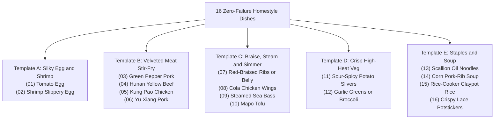

# 16 Signature Homestyle Chinese Dishes Playbook (零失败家常硬菜标准SOP)

Once you master heat control, velveting (`上浆`), and pre-mixed bowl sauces from [01-HEAT-WOK-HEI-KNIFE-AND-VELVETING.md](01-HEAT-WOK-HEI-KNIFE-AND-VELVETING.md) and [02-PANTRY-AND-GOLDEN-SAUCE-FORMULAS.md](02-PANTRY-AND-GOLDEN-SAUCE-FORMULAS.md), 90% of Chinese homestyle cooking collapses into **five repeatable thermal templates**.

Every recipe below is calibrated for **2–3 adult servings on a standard residential gas or induction stove**, using deterministic weights (`g`), spoon ratios (`1 tbsp = 15 mL`, `1 tsp = 5 mL`), and visual temperature cues.

---

## Table of Contents

1. [The Five Master Cooking Templates](#1-the-five-master-cooking-templates)
2. [Template A — Silky Eggs & Seafood (`滑炒类`: Dishes 1–2)](#2-template-a--silky-eggs--seafood-滑炒类-dishes-12)
3. [Template B — High-Heat Velveted Meat Stir-Fries (`小炒类`: Dishes 3–6)](#3-template-b--high-heat-velveted-meat-stir-fries-小炒类-dishes-36)
4. [Template C — Braises, Steams & Tofu (`红烧清蒸烩菜类`: Dishes 7–10)](#4-template-c--braises-steams--tofu-红烧清蒸烩菜类-dishes-710)
5. [Template D — Crisp Vegetables (`脆爽素菜类`: Dishes 11–12)](#5-template-d--crisp-vegetables-脆爽素菜类-dishes-1112)
6. [Template E — One-Pot Staples, Noodles & Soups (`主食靓汤类`: Dishes 13–16)](#6-template-e--one-pot-staples-noodles--soups-主食靓汤类-dishes-1316)

---

## 1. The Five Master Cooking Templates

---

## 2. Template A — Silky Eggs & Seafood (`滑炒类`: Dishes 1–2)

### Dish 01: Juicy Tomato Stir-Fried Eggs (`国民番茄炒蛋`)

- **Why Beginners Fail**: Watery, sour tomato soup with rubbery over-browned egg curds.
- **Root Fix**: Add `1 tbsp` water + `1.5 mL` Shaoxing wine into raw eggs for steam puffing; pull eggs at 80% set; fry half the tomatoes into a thick pectin-lycopene jam before returning eggs.
- **Ingredients**: `4` large eggs (`~200 g`), `2` ripe soft tomatoes (`350 g`, cut into irregular `2 cm` chunks; peel skins via 15s boiling water cross-blanch if desired), `2` scallions (whites & greens separated), `1 clove` minced garlic.
- **Execution (`6 min`)**:
  1. Beat eggs with `1.5 g` (`0.25 tsp`) salt, `1 tbsp` (`15 mL`) water, and `0.5 tsp` Shaoxing wine.
  2. Heat wok to smoking (`热锅凉油`), add `2 tbsp` (`30 mL`) oil, pour in eggs at `160°C`. Let puff 8 seconds, push large curds gently from edges to center for 15 seconds until **just 80% set and glossy**, and slide onto a plate immediately.
  3. Add `1 tsp` oil, sizzle scallion whites + garlic (`5s`), dump in tomatoes + **`2.5 g` (`0.5 tsp`) salt right onto the tomatoes** (osmotic pressure draws juice out fast so pectin breaks down into thick sauce in 90 seconds!).
  4. Stir in `1.5 tsp` (`6 g`) sugar + `1 tbsp` (`15 g`) ketchup (optional secret when winter greenhouse tomatoes lack ripeness) + `1 tbsp` light soy sauce.
  5. Return tender eggs + scallion greens, fold 10 seconds so curds soak up thick red sauce, and plate immediately.

### Dish 02: Cantonese Silky Shrimp & Eggs (`广式虾仁滑蛋`)

- **Ingredients**: `180 g` peeled shrimp (`青虾仁`, deveined, patted bone-dry), `5` eggs, `20 g` chopped scallion greens.
- **Prep**: Toss dry shrimp with `1.5 g` salt, pinch white pepper, `0.5 tsp` Shaoxing wine, and `1 tsp` cornstarch (`上浆`). Whisk eggs with `2 g` salt, `1.5 tbsp` (`22 mL`) warm water (or milk), and **`1.5 tsp` cornstarch dissolved in that water** (starch cross-links prevent weeping water `出水`!).
- **Execution (`4 min`)**:
  1. Sear shrimp in `1 tbsp` oil over medium-high (`45s` per side) until 85% pink and curled; transfer **directly into the bowl of raw beaten eggs** + scallion greens.
  2. Switch burner to **medium-low** (`120°C–130°C`), add `1.5 tbsp` oil to a clean non-stick or well-seasoned wok, pour in the egg-shrimp mixture.
  3. Wait `5s`, then slowly **push—never chop—from 6 o'clock to 12 o'clock** with the flat back of your spatula (`推炒`)4–5 times over 35 seconds. Kill the flame while the top 15% is still liquid custard; residual heat sets it into satin ribbons on the plate.

---

## 3. Template B — High-Heat Velveted Meat Stir-Fries (`小炒类`: Dishes 3–6)

> **Shared Step 0 for Dishes 03–06**: Velvet `250 g` sliced/slivered/diced meat using the exact protocol from Module 01 (`2 g` salt + `1 tsp` soy + `1 tsp` wine -> massage in `2 tbsp` water until tacky -> `1.5 tsp` cornstarch -> `1 tbsp` oil seal).

### Dish 03: Green Pepper Shredded Pork (`青椒肉丝`)

- **Ingredients**: `250 g` pork tenderloin (`猪里脊`, cut *with* the grain into `3 mm` matchsticks), `200 g` screw peppers or mild long green peppers (`螺丝椒/二荆条`, seeded and julienned), `10 g` ginger slivers, `2 cloves` sliced garlic.
- **Bowl Sauce**: `1.5 tbsp` light soy + `1 tbsp` oyster sauce + `0.5 tsp` dark soy + `0.5 tsp` sugar + `0.5 tsp` cornstarch + `2 tbsp` water.
- **Execution (`4 min`)**:
  1. Dry-sear or lightly oil-sear green pepper slivers with `1 g` salt over high heat (`45s`) until crisp-tender with light blister spots; remove.
  2. Heat `1.5 tbsp` oil to `150°C`, slide in velveted pork slivers, let sit `8s` so starch sets (stirring at `t=0s` knocks starch onto the wok!), then stir-fry `35s` until 90% white; push aside or remove.
  3. Sizzle ginger & garlic (`8s`), return pork + peppers, swirl and pour bowl sauce around hot wok rim, toss `15s` on max heat until glossy.

### Dish 04: Hunan Stir-Fried Yellow Beef (`湘味小炒黄牛肉`)

- **Ingredients**: `280 g` beef sirloin/flank/shank (`牛里脊/吊龙`, sliced `2 mm` thin **strictly perpendicular `90°` across muscle fibers**!), `4` fresh red Thai chilies (`小米辣`), `3` green chilies (`杭椒/螺丝椒`), `4 cloves` smashed garlic, `10 g` pickled wild chilies (`泡椒`, chopped), `1 handful` fresh cilantro stems (`香菜梗`, `4 cm` lengths — essential aroma!).
- **Beef Marinade (NO salt!)**: Salt toughens beef before quick-searing; use `1 tbsp` oyster sauce + `1 tsp` light soy + `0.5 tsp` dark soy + pinch white pepper + `2 tbsp` scallion-ginger water + `1 tsp` cornstarch + `1 tbsp` oil seal.
- **Execution (`3 min — ultra-fast!`)**:
  1. Heat wok over **maximum flame** until wisps of smoke rise (`200°C`), add `2 tbsp` oil, sear garlic + ginger + pickled chilies + fresh chilies + `1.5 g` salt (`20s`) until choking-fragrant.
  2. Spread marinated beef across the wok (`5s` undisturbed sear), then toss furiously for **exactly `20–25 seconds`** (`1 tbsp` Shaoxing wine splashed around the rim at `t=15s`).
  3. The instant 90% of pink disappears, toss in cilantro stems, turn off heat, fold **3 strokes**, and plate immediately. Overcooking by even 20 seconds turns tender beef tough!

### Dish 05: Classic Kung Pao Chicken (`川味宫保鸡丁 — 糊辣荔枝口`)

- **Ingredients**: `300 g` skinless boneless chicken thighs (`琵琶腿去骨`, scored crosswise on inner side and diced `1.5 cm`), `60 g` crispy roasted/fried peanuts (`脆花生米`), `40 g` scallion whites cut into `1.5 cm` batons (`大葱段` — match the chicken cube size!), `8` dried red chilies (snipped & deseeded), `15` Sichuan red peppercorns (`汉源红花椒`), sliced ginger & garlic.
- **Bowl Sauce**: Use **Formula 2 (`宫保碗汁`)** from Module 02 (`1.5 tbsp` light soy + `0.5 tsp` dark soy + `1.5 tbsp` Baoning/Zhenjiang vinegar + `1.25 tbsp` sugar + `0.25 tsp` salt + `1 tsp` cornstarch + `1.5 tbsp` water).
- **Execution (`4 min`)**:
  1. Heat `1.5 tbsp` oil over medium (`130°C`), toast dried chilies + Sichuan peppercorns (`10s`) until burgundy-brown (never black!) to create `糊辣` aroma.
  2. Crank heat to **high**, add velveted chicken thigh cubes, sear `60–75s` until opaque and golden-edged.
  3. Toss in ginger, garlic, and scallion batons (`15s`).
  4. Re-stir and pour in the Kung Pao bowl sauce (`15s` rapid toss until translucent amber glaze wraps every cube).
  5. Kill the heat, fold in crispy peanuts last (`3s` — keeps them crunchy!), and serve.

### Dish 06: Yu-Xiang Shredded Pork (`鱼香肉丝`)

- **Ingredients**: `220 g` velveted pork loin slivers, `60 g` blanched winter bamboo shoots or Celtuce slivers (`笋丝/莴笋丝`), `40 g` soaked & blanched wood-ear mushroom slivers (`黑木耳丝`), `30 g` carrot slivers, `1 tbsp` (`18 g`) finely chopped `郫县豆瓣酱` (or `泡椒末`), minced ginger-garlic-scallion.
- **Bowl Sauce**: **Formula 1 (`鱼香碗汁`)** from Module 02 (`2 tbsp` vinegar + `1.5 tbsp` sugar + `1 tbsp` light soy + `0.5 tsp` dark soy + `1 tsp` cornstarch + `3 tbsp` water).
- **Execution (`5 min`)**:
  1. Blanch bamboo, carrot, and wood-ear slivers in boiling water for `45s` and drain dry (prevents raw flavor and excess water in the wok!).
  2. Stir-fry velveted pork slivers in `1.5 tbsp` oil (`35s`) until 85% cooked; remove.
  3. In `1 tbsp` oil over **medium-low (`120°C`)**, fry `1 tbsp` chopped `郫县豆瓣酱` (`25s`) until bright red oil (`红油`) separates, then add ginger & garlic (`10s`).
  4. Crank to high heat, return pork + blanched veg slivers (`15s`), pour in re-stirred Yu-Xiang sauce (`15s`), finish with scallion greens.

---

## 4. Template C — Braises, Steams & Tofu (`红烧清蒸烩菜类`: Dishes 7–10)

### Dish 07: Glossy Red-Braised Pork Ribs or Pork Belly (`冰糖红烧排骨 / 红烧肉`)

- **Ingredients**: `500 g` pork spare ribs (`猪肋排`, chopped `4 cm`) OR skin-on 3-layer pork belly (`五花肉`, cubed `3 cm`), `25 g` rock sugar (`黄冰糖`), `2 tbsp` Shaoxing wine, `2 tbsp` light soy, `0.5 tbsp` dark soy, `1` star anise (`八角`), `1 small piece` cassia bark (`桂皮`), `2` bay leaves (`香叶`), `4 slices` ginger, `2` knotted scallions, **`700 mL` boiling kettle water**.
- **Execution (`50 min`, 40 min hands-off)**:
  1. **Cold-Water Blanch (`冷水焯水`)**: Place raw pork in a pot of **cold** tap water with ginger + `1 tbsp` wine. Bring to a boil (`3 min`), skim grey scum, rinse in **warm** (never icy!) water, and drain dry.
  2. **Foolproof Oil-Water Sugar Color (`炒糖色`)**: Put `1 tbsp` oil + `25 g` crushed rock sugar in pan over medium-low. Melt gently until amber-red with fine dense bubbles (`枣红色冒小泡` — pull off heat the second bubbles turn caramel-amber!).
  3. Immediately slide drained warm ribs/belly into the amber caramel and toss `45s` until evenly mahogany-coated. Add ginger, scallions, star anise, cassia, bay leaves, wine, light soy, and dark soy (`20s` sizzle).
  4. **Pour in `700 mL` BOILING water** (cold water shocks hot collagen fibers tight and tough!). Cover and simmer on **gentle low heat (`90°C`)** for `40 min` (ribs) or `55 min` (pork belly).
  5. Pick out spices/scallions, taste for salt (`~2 g` if needed), crank heat to **high uncovered (`大火收汁`)** for `4–5 min`, stirring constantly as gelatin + sugar emulsify into a mirror-like glaze!

### Dish 08: Zero-Fail Cola Chicken Wings (`懒人神菜可乐鸡翅`)

- **Ingredients**: `10–12` mid-joint chicken wings (`鸡中翅`, `~400 g`), `1 can` (`330 mL`) **regular** Coca-Cola (*never Coke Zero / aspartame!*), `4 slices` ginger, `2 tbsp` light soy sauce, `0.5 tsp` dark soy, `1 tbsp` Shaoxing wine, `2` lemon slices (optional secret to cut sweetness).
- **Execution (`18 min`)**:
  1. Score two diagonal slashes on the back side of each wing; pat dry (no blanching needed if fresh-chilled and patted dry!).
  2. Pan-sear wings skin-side down in `1 tsp` oil over medium heat (`3 min` per side) until golden-brown.
  3. Add ginger + wine (`10s`), pour in `2 tbsp` light soy + `0.5 tsp` dark soy + `330 mL` regular Cola, bring to a boil, cover and simmer medium-low `10 min`, then uncover on high heat (`3 min`) until thick, bubbly, and lacquered. Sprinkle toasted white sesame seeds.

### Dish 09: Cantonese Restaurant-Grade Steamed Sea Bass (`广式清蒸鲈鱼`)

- **Why Home Steamed Fish Smells Fishy (`腥`)**: Keeping the bloody kidney line along the spine, pouring soy sauce *before* steaming, and NOT dumping out the murky plate water (`腥水`) after steaming!
- **Ingredients**: `1` fresh sea bass (`加州鲈鱼`, `500–550 g`, butterfly-slit along back by fishmonger), ginger & scallion whites julienned into fine curls (`葱姜丝`, soaked in cold water so they curl!), `3 tbsp` **steamed-fish soy sauce (`蒸鱼豉油`)**.
- **Execution (`12 min`)**:
  1. Scrape clean the dark coagulated blood along the inner spine bone and black belly membrane (`黑膜` — #1 source of fishy odor!); pat dry. No salt!
  2. Lay `2` scallion stalks + ginger slices *under* the fish on a steaming plate like chopsticks so steam circulates `360°`.
  3. Wait until steamer water is at a **violent rolling boil (`水大开再上锅`)**, place fish in, cover tightly, steam on **max heat for exactly `8 minutes`** (`500 g` fish), then turn off heat and **rest covered `2 minutes` (`虚蒸`)**.
  4. **Crucial Step**: Pull out plate, discard cooked scallions/ginger underneath, and **tilt the plate to pour away 100% of the cloudy steamed liquid**!
  5. Pile fresh curled scallion-ginger slivers along the fish, sizzle `2 tbsp` (`30 mL`) smoking-hot `200°C` oil directly over the scallions (`滋啦` flash aroma!), and pour `3 tbsp` `蒸鱼豉油` **around the plate rim** (not over the white flesh).

### Dish 10: Silky Sichuan Mapo Tofu (`麻辣鲜香麻婆豆腐`)

- **Ingredients**: `400 g` soft/medium firm tofu (`嫩豆腐/石膏北豆腐`, cubed `2 cm`), `80 g` minced beef or pork, `1.5 tbsp` finely chopped `郫县豆瓣酱`, `1 tsp` chopped fermented black beans (`阳江豆豉`), `1 tsp` chili powder (`辣椒面`), minced garlic & garlic sprouts (`蒜苗/小葱`), `0.5 tsp` freshly ground toasted Sichuan peppercorn powder (`现焙花椒面`), **`3-part` cornstarch slurry** (`1.5 tbsp` cornstarch + `4 tbsp` water).
- **Execution (`10 min`)**:
  1. **Salt-Water Simmer (`盐水焯豆腐`)**: Simmer tofu cubes gently in lightly salted boiling water (`1 tsp` salt per `1 L`) for `2 min` — osmotic dehydration toughens the outer `1 mm` protein skin so cubes NEVER crumble in the wok and lose raw bean taste! Drain gently.
  2. Brown minced meat in `1.5 tbsp` oil over medium-high until crispy (`酥香`); lower heat to **low**, add chopped `豆瓣酱` + `豆豉` + garlic + chili powder (`30s`) until deep red oil emerges.
  3. Add `200 mL` hot water/broth + `1 tsp` light soy + `0.5 tsp` sugar, slide in tofu, simmer `3 min` (push gently with the **rounded back** of a ladle, never chop!).
  4. **Three-Stage Thickening (`三次勾芡`)**: Swirl in `1/3` of the starch slurry while bubbling (`15s`), repeat a second `1/3` (`15s`), and final `1/3` + drizzle `1 tsp` oil (`亮油`) so red oil wraps every trembling cube without separating into water! Top off-heat with `蒜苗` and `花椒面`.

---

## 5. Template D — Crisp Vegetables (`脆爽素菜类`: Dishes 11–12)

### Dish 11: Crisp Sour-and-Spicy Potato Slivers (`脆爽酸辣土豆丝`)

- **Why Yours Turns Mushy & Sticks**: Unwashed surface starch!
- **Execution (`7 min`)**:
  1. Cut `1` large yellow potato (`300 g`) into uniform `2 mm` matchsticks; **rinse 3 times in cold water** until water runs crystal-clear, then soak with `1 tsp` white vinegar (`5 min`), and **drain thoroughly**.
  2. Heat `1.5 tbsp` oil (`180°C`), flash `4` dried red chilies + `10` Sichuan peppercorns + sliced garlic (`8s`).
  3. Dump in drained potato slivers on **maximum heat**, splash **`1 tbsp` white/rice vinegar down the sizzling wok rim immediately** (acid cross-links pectin early to lock in crunch!).
  4. Stir-fry furiously for **`75–90 seconds`** until edges turn semi-translucent, add green pepper slivers + `3 g` (`0.5 tsp`) salt + `0.5 tsp` sugar + **`1 tbsp` aromatic dark vinegar (`陈醋`)** right before turning off flame (`二次烹醋`).

### Dish 12: Bright-Green Garlic Broccoli or Leafy Greens (`白灼/蒜蓉西兰花与油麦菜`)

- **Execution (`5 min`)**:
  - **Broccoli (`西兰花`)**: Cut into bite-size florets, soak `5 min` in lightly salted water, then blanch **`60–75 seconds`** in boiling water containing **`0.5 tsp` salt + `1 tsp` cooking oil** (oil coats chlorophyll against oxidation so florets stay emerald green for hours!). Drain and either toss in wok for `20s` with golden garlic + `1 tbsp` oyster sauce, OR drizzle **Formula 5/6** directly on top!
  - **Leafy Greens (`油麦菜/上海青/空心菜`)**: Shake leaves vigorously dry after washing (`0` standing water!), preheat wok with `1 tbsp` lard or vegetable oil + smashed garlic (`180°C`), dump greens in on max flame (`45s` toss), add **`2.5 g` salt + `0.5 tsp` sugar only in the final `10 seconds`** so zero grey puddle forms on the plate!

---

## 6. Template E — One-Pot Staples, Noodles & Soups (`主食靓汤类`: Dishes 13–16)

### Dish 13: Shanghai Scallion Oil Noodles (`老上海开洋葱油拌面`)

- **Scallion Oil Batch (makes 5 bowls, keeps 3 weeks refrigerated)**:
  - Gently poach `120 g` **bone-dry** scallion greens & whites (`小香葱`, cut `5 cm`) in `100 mL` neutral oil over **low heat (`115°C`)** for `12–15 minutes` until dark emerald-brown and crisp (not black-bitter!).
  - Pull off heat for `30s`, pour in **`4 tbsp` (`60 mL`) light soy + `2 tbsp` (`30 mL`) dark soy + `1.5 tbsp` (`18 g`) white sugar**, bubble gently `45s` until syrupy and intensely fragrant!
- **Per Bowl (`4 min`)**: Boil `120 g` thin alkaline wheat noodles (`阳春面/苏式细面`) al dente (`2.5 min`), drain well, toss with `2.5 tbsp` warm scallion-soy oil + crispy scallions + a sunny-side-up fried egg (`荷包蛋`).

### Dish 14: Sweet Corn, Carrot & Pork-Rib Clear Soup (`广东清甜玉米胡萝卜排骨汤`)

- **Ingredients**: `400 g` pork ribs (blanched from cold water), `1` sweet yellow corn (`甜玉米`, cut into `3 cm` rounds), `1` carrot (`滚刀块`), `3` red dates (`红枣`, **pitted** so soup isn't heaty/bitter), `3 slices` ginger, `1.5 L` boiling water.
- **Execution (`55 min` simmer or `22 min` electric pressure cooker)**:
  1. Combine blanched ribs, corn, carrot, pitted dates, ginger, and `1.5 L` hot water.
  2. Bring to a boil (`5 min`), cover, and simmer gently (`90°C`) for `50 min`.
  3. **Salt ONLY at the very end** (`4–5 g` salt + pinch white pepper + chopped scallion greens) — salting early toughens meat and reduces broth sweetness!

### Dish 15: Rice-Cooker Cantonese Lap Cheong Claypot Rice (`电饭煲零失败广式腊味煲仔饭`)

- **Why It's Magic on Busy Worknights**: Protein, rice, greens, and savory sauce finish in one rice cooker with `3 minutes` of active work!
- **Execution**:
  1. Rinse `2 cups` (`300 g`) long-grain jasmine rice (`丝苗米/泰国香米`), add **10% less water than normal** + `1 tsp` oil, stir.
  2. Lay `2` diagonally sliced Cantonese cured sausages (`广式皇上皇/秋之风腊肠`), `80 g` cured pork belly (`腊肉`, optional), and `4` sliced shiitake mushrooms directly on top of the rice; press **Standard Cook (`煮饭键`)**.
  3. Mix **Claypot Drizzle (`煲仔饭灵魂豉油`)**: `2 tbsp` light soy + `0.5 tsp` dark soy + `1 tbsp` oyster sauce + `1 tsp` sugar + `1 tsp` sesame oil + `2 tbsp` warm water.
  4. When `5 minutes` remain (or right when the cooker beeps), crack `1–2` eggs onto the sausages, arrange blanched `上海青` around the edge, pour the sweet soy drizzle evenly, close the lid to steam `5 minutes` (`焖5分钟`), mix thoroughly, and devour!

### Dish 16: Golden Lacy Skirt Potstickers (`冰花脆底煎饺`)

- **Works with ANY frozen dumplings (`速冻水饺`, NO thawing!)**:
  1. Arrange `12–15` frozen dumplings in a cold flat non-stick skillet with `1 tbsp` oil; fry on medium-high `90s` until bottoms turn pale gold.
  2. Whisk **Crispy Lace Slurry (`冰花水` = `1 : 1 : 10`)**: `1 tbsp` (`10 g`) cornstarch or flour + `1 tbsp` oil + `10 tbsp` (`150 mL`) water.
  3. Pour slurry into the hot pan (fills ~1/3 up the dumplings), cover immediately with lid, cook on **medium heat `7–8 minutes`** until crackling sounds replace bubbling water.
  4. Uncover for the final `60–90 seconds`, rotating the pan gently until the lace lattice turns crisp amber-gold. Invert onto a flat plate!
