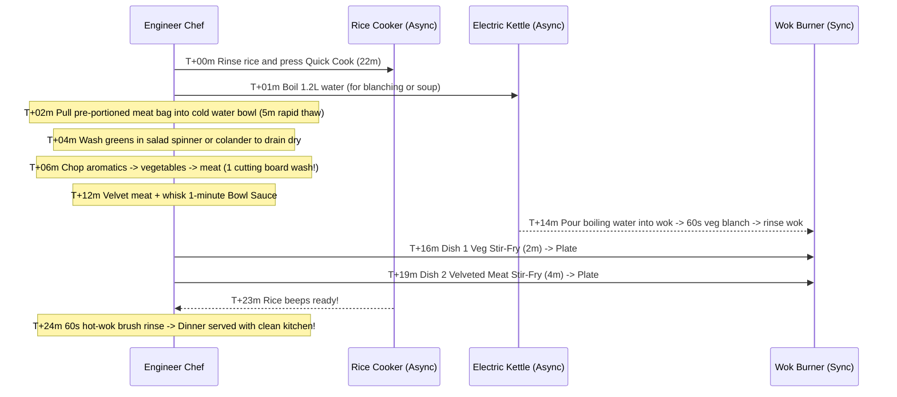
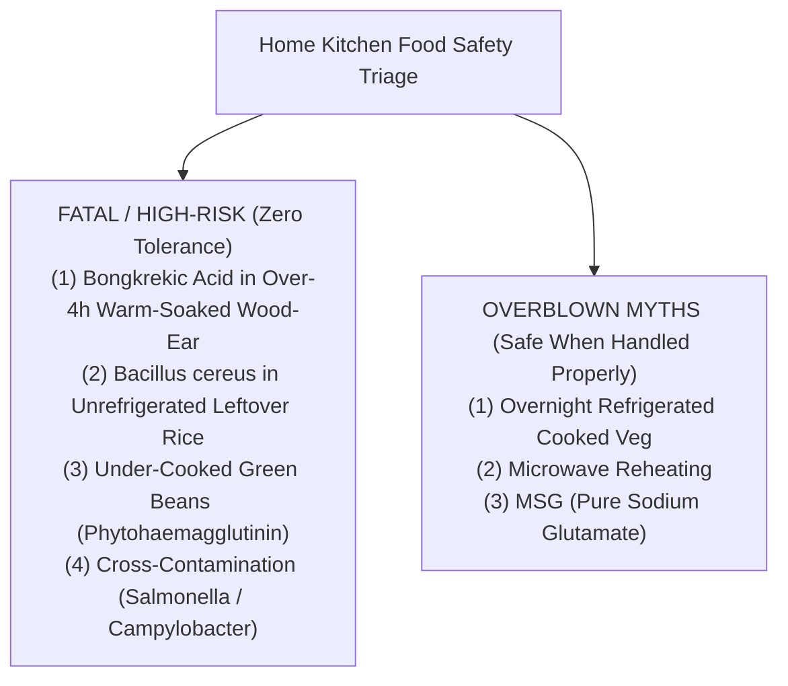

# 25-Minute Workday Cooking Pipeline, Mise en Place & Food Safety (工作日25分钟高效做饭与食品安全红线)

The #1 reason software engineers abandon home cooking and revert to oily takeout (`外卖`) is **workflow serialization**: washing one vegetable, chopping it, realizing garlic isn't peeled, searching for soy sauce while the pan smokes, eating at 8:45 PM, and facing a mountain of greasy dishes afterward.

Apply **CPU instruction pipelining, async I/O, and pre-computed caches** to your kitchen, and you will plate **two fresh dishes + steamed rice + a clean countertop in 25 minutes flat**.

---

## Table of Contents

1. [The 25-Minute Async Workday Dinner Pipeline](#1-the-25-minute-async-workday-dinner-pipeline)
2. [Single-Board Clean-to-Raw Chopping Order (Zero Extra Washing)](#2-single-board-clean-to-raw-chopping-order-zero-extra-washing)
3. [Weekend 30-Minute Freezer Cache Prep (`备菜缓存系统`)](#3-weekend-30-minute-freezer-cache-prep-备菜缓存系统)
4. [Clean-As-You-Go Kitchen Hygiene](#4-clean-as-you-go-kitchen-hygiene)
5. [Life-Saving Kitchen Toxicology & Food Safety Red Lines](#5-life-saving-kitchen-toxicology--food-safety-red-lines)

---

## 1. The 25-Minute Async Workday Dinner Pipeline

Treat your **rice cooker (`电饭煲`)**, **electric kettle (`烧水壶`)**, and **soaking bowls** as non-blocking async background threads—start the highest-latency I/O tasks at `T = 0:00` before touching a knife!

### The Golden Menu Formula for Busy Weeknights (`1荤 + 1素 + 主食`)

Never attempt two complex multi-stage braises (`红烧肉` + `糖醋排骨`) on a Tuesday night. Pair:
- **1 Fast Velveted Protein (`4 min` wok time)**: `青椒肉丝`, `小炒黄牛肉`, `宫保鸡丁`, `虾仁滑蛋`, or `番茄炒蛋`
- **1 Crisp Blanched/Flash Vegetable (`2 min` wok time)**: `蒜蓉西兰花`, `清炒油麦菜`, or `手撕包菜`
- **1 Async Grain**: Steamed jasmine/multigrain rice (`杂粮饭`) in the rice cooker.

---

## 2. Single-Board Clean-to-Raw Chopping Order (Zero Extra Washing)

Ideally, maintain **two thin dishwasher-safe cutting boards** (one wood/composite for produce & cooked food, one TPU/PP plastic dedicated strictly to raw meat/seafood). Even so, sequence your knife work strictly from **cleanest/driest -> wet/staining -> raw protein** so your chef's knife only needs **one soapy wash at the very end**:

1. **Dry Aromatics First**: Scallion greens (`葱花`), scallion whites, ginger slices/slivers, peeled garlic cloves, chilies. Sweep into tiny prep saucers (`备菜小碟`).
2. **Clean Vegetables Second**: Broccoli florets, green peppers, potatoes, leafy greens, tofu.
3. **Raw Meat / Poultry / Seafood Last**: Slice pork/beef/chicken on the raw-meat board, drop straight into the marinade bowl, then immediately wash knife + raw-meat board + hands with dish soap for 20 seconds.

---

## 3. Weekend 30-Minute Freezer Cache Prep (`备菜缓存系统`)

Spending **30 minutes on Sunday afternoon** eliminates 80% of weekday peeling, thawing, and portioning friction:

| Cache Item | How to Prep & Freeze | Shelf Life & Weekday Usage |
| :--- | :--- | :--- |
| **Flat-Pack Sliced Meats (`肉片扁平分装法`)** | Slice `750 g` fresh pork loin / beef / chicken thigh into `3 × 250 g` zipper bags (`密封袋`), press into a **thin `5 mm` flat sheet** before freezing! | Freezes solid without ice crystals (`3–4 weeks`); a `5 mm` flat sheet **thaws completely in 4 minutes** submerged in a bowl of room-temperature tap water (vs 3 hours for a frozen brick!) |
| **Aromatic Trio Box (`葱姜蒜冷冻法`)** | Wash & air-dry `100 g` chopped scallion greens, `100 g` ginger slices, and `150 g` peeled whole/minced garlic in separate airtight freezer boxes | Grab **frozen** straight into hot oil without thawing — zero moldy sprouted garlic or slimy scallions in the crisper drawer! |
| **Blanched Broth Ribs (`熟排骨分装`)** | Blanch `1 kg` pork ribs once on Sunday, cool, divide into `2 × 500 g` freezer bags | Drop straight into rice cooker / soup pot / braising pan on weeknights — skips messy scum-skimming completely! |
| **Washed Crisp Greens (`吸水纸保鲜法`)** | Wash lettuce/spinach/cilantro, spin dry, wrap loosely in **2 dry paper towels** inside a perforated produce bag in the `4°C` fridge drawer | Stays crisp and bright green for **7–10 days** instead of rotting in 48 hours |

---

## 4. Clean-As-You-Go Kitchen Hygiene

- **Keep a "Scrap Bowl" (`厨余碗`) Next to Your Cutting Board**: Toss garlic skins, pepper cores, and ginger peelings into one bowl on the counter instead of walking back and forth to the trash bin 12 times with wet hands.
- **Wash the Seasoned Carbon Steel Wok in 20 Seconds While Still Warm**:
  - Right after plating the final dish, run **hot** tap water into the warm wok and swish with a **bamboo wok brush (`竹刷`) or soft non-scratch sponge** (no harsh steel wool or heavy degreaser needed unless fishy!).
  - Place back on the burner for `30 seconds` on high until every drop of water evaporates, wipe `3 drops` of oil inside with a paper towel, and turn off the flame. Zero rust, better non-stick patina every week!
- **Load Everything Else into a Dishwasher (`洗碗机`)**: Stainless bowls, prep saucers, plates, spatulas, chopsticks, and TPU cutting boards go straight into a `70°C` dishwasher cycle after dinner — saving **150+ hours of manual dishwashing every year**.

---

## 5. Life-Saving Kitchen Toxicology & Food Safety Red Lines

Separate harmless Chinese internet food rumors from **genuinely dangerous biochemical foodborne hazards**:

### 5.1 Four Strict Red Lines (Never Violate These!)

| Hazard | Deadly / Severe Mechanism | Strict Kitchen Rule |
| :--- | :--- | :--- |
| **1. Over-Soaked Wood-Ear / Tremella Mushrooms (`久泡黑木耳/银耳`) & Fermented Wet Rice Noodles (`湿河粉/肠粉`)** | *Burkholderia gladioli* bacteria produce **Bongkrekic Acid (`米酵菌酸`)** in warm, humid conditions (`>26°C`). **Boiling at `100°C` or pressure-cooking DOES NOT destroy this toxin**, there is **no clinical antidote**, and case fatality exceeds `40%` (acute liver/organ failure)! | Soak dry wood-ear/tremella in cold water for **1–2 hours max** (or inside the `4°C` refrigerator, never >4 hours at summer room temp and **never overnight on the counter!**). Discard immediately if slimy or odorless-limp. |
| **2. Room-Temperature Leftover Rice / Pasta (`室温隔夜米饭综合征`)** | *Bacillus cereus* (`蜡样芽孢杆菌`) spores survive normal rice-cooking boiling, germinate rapidly between `15°C–50°C`, and secrete heat-stable emetic toxin | Scoop leftover cooked rice into a clean box and **refrigerate at `<= 4°C` within 60–90 minutes** of cooking (do *not* leave inside an unplugged warm rice cooker overnight in Shanghai summer!). |
| **3. Undercooked Green Beans (`四季豆/扁豆未炒熟`) & Sprouted Green Potatoes (`发芽变绿土豆`)** | Raw green beans contain **phytohaemagglutinin (`皂苷与植物血凝素`)**; green/sprouted potatoes contain heat-stable **solanine (`龙葵碱`)** -> violent vomiting/gastroenteritis | Always boil/braise `四季豆` thoroughly (`>= 8–10 min` at `100°C` until bright green fades to olive green and zero raw bean taste remains). **Throw away** green or sprouted potatoes completely! |
| **4. Washing Raw Chicken Under a Splashing Faucet (`水龙头下冲洗生鸡肉`)** | Aerosolizes *Campylobacter* and *Salmonella* droplets up to `80 cm` onto nearby clean dishes, fruit, and dishcloths | Do **not** blast raw poultry under high-pressure tap water! Blot gently with disposable paper towels (`厨房纸巾`), discard paper immediately, and cook poultry core to `>= 74°C` (`100%` opaque juices). |

### 5.2 Debunking Common Anxiety Myths (`科学祛魅`)

- **"Overnight Refrigerated Dishes Cause Cancer (`隔夜菜致癌`)?" — FALSE**:
  - Lab measurements show that cooked stir-fried vegetables sealed promptly in clean boxes and stored at `4°C` for 12–24 hours accumulate only `3–7 mg/kg` of nitrite (`亚硝酸盐`) — far below China's national cured-meat safety limit (`30 mg/kg`) and adult acute toxicity thresholds (`200+ mg`). Just seal while still clean (before saliva-covered chopsticks stir it repeatedly), chill within 1 hour, and reheat thoroughly to `>75°C` once!
- **"Thawing Meat in Hot Water (`热水解冻`)?" — BAD PRACTICE**:
  - Hot water puts the outer `5 mm` of meat straight into the bacterial danger zone (`30°C–45°C`) while partially cooking proteins grey, leaving the center frozen solid. Either **move meat from freezer to `4°C` fridge the night before**, OR submerge a sealed flat-pack zipper bag in **cold/room-temperature tap water** for 5 minutes!
