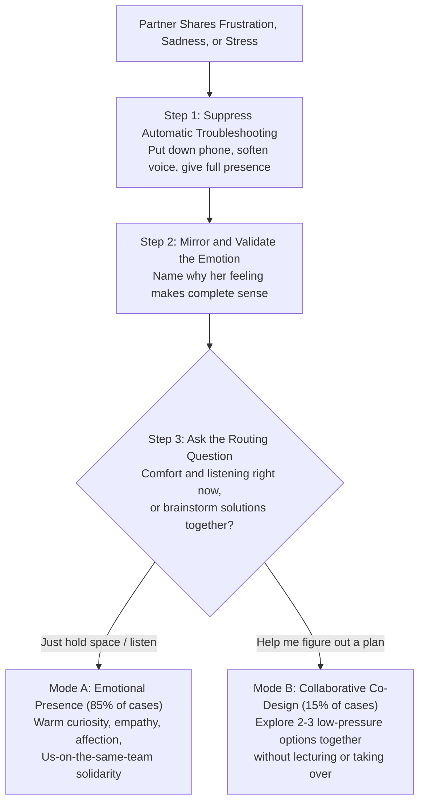
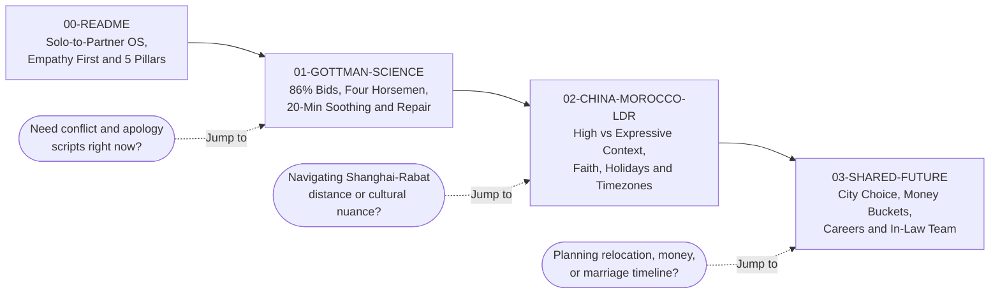

# Thriving in Your First Serious Relationship at 32: From Solo Engineer to Extraordinary Partner

## 1. The Hidden Superpower of Starting Serious Love at 32

Many software engineers who spent their twenties immersed in deep technical craft, career building, and independent solo living quietly carry a false insecurity when entering their first serious romantic relationship in their early thirties: *"Am I behind? Did everyone else learn some secret curriculum at 23 that I missed?"*

Relationship science tells a very different story. Decades of longitudinal couples research show that relationship longevity and satisfaction are not predicted by how many ex-partners you accumulated in your twenties. They are predicted by **emotional regulation, self-awareness, Secure Attachment behaviors, and willingness to learn without ego**.

Starting a serious partnership at 32 with genuine beginner's humility (*Shoshin*, 初心) gives you three massive structural advantages over jaded veterans:

- **Zero Accumulated Cynicism or Scorekeeping**: You are not punishing your current partner for an ex's betrayal from 2019, nor viewing intimacy through defensive game-playing rules.
- **Stable Nervous System & Adult Agency**: Unlike at 22, you know who you are, how to manage work pressure, how to support yourself financially, and how to pause before acting on fleeting impulses.
- **High Intentionality**: You are choosing partnership out of genuine affection and abundance rather than twenty-something peer panic or fear of being alone.

What *does* require deliberate upgrading at 32 is transitioning from a **Single-Tenant Solo OS**—where you never had to broadcast your internal mood, negotiate weekend trade-offs, or co-regulate another person's feelings—to a **Shared Partnership OS**.

### Relationship Starting Points Compared

| Dimension | Naive Twenties Impulse | Jaded Veteran Baggage | Grounded Beginner at 32 |
| :--- | :--- | :--- | :--- |
| **Core Assumption** | "Passionate chemistry alone will magically solve every life incompatibility." | "People always disappoint you eventually; keep one foot out the door and protect leverage." | "Love is both a deep feeling and a learnable craft; I will bring warmth, curiosity, and zero ego." |
| **Conflict Reflex** | Escalates dramatically over small misunderstandings; threatens breakups impulsively | Cynical eye-rolling, scorekeeping past grievances, preemptive emotional withdrawal | Pauses when flooded, listens for the underlying hurt beneath the words, repairs quickly |
| **Identity & Autonomy** | Enmeshment (losing all personal hobbies and friends inside the couple bubble) | Hyper-independence (treating normal closeness or vulnerability as a trap) | Differentiated intimacy: deeply devoted partner who still maintains health, craft, and friendships |
| **Growth Posture** | Blind trial-and-error | Rigid assumptions ("That's just how men/women are") | Studies evidence-based relationship mechanics and adapts directly to *this* specific partner |

---

## 2. Unlearning the Engineer Fix-It Reflex

The single most common stumble when an analytical engineer falls in love is the **Premature Fix-It Reflex**.

At work, your entire professional value comes from diagnosing broken systems and shipping patches with minimal latency. When your girlfriend calls after an exhausting day—frustrated by an unfair manager, drained by visa paperwork, or feeling homesick—your brain immediately pattern-matches root causes and outputs a three-step action plan within ten seconds. Inside your head, *offering solutions equals showing love*.

Inside her nervous system, however, premature troubleshooting before emotional attunement lands as a subtle rejection: *"Your emotions are irrational noise; stop feeling them and execute my checklist."* Neuroscience explains why: until a distressed person feels **seen, safe, and understood**, their limbic threat system remains elevated and their prefrontal cortex isn't even looking for tactical optimization. In attachment psychology, **connection must precede correction or problem-solving**.



### Upgrading Your Real-Time Responses

Memorize the **One-Sentence Routing Question** for moments when you aren't sure which mode she needs:
> *"Sweetheart, do you want me to just listen and hold space right now, or brainstorm options together?"*

| Everyday Scenario | Engineer Fix-It Reflex (Feels Dismissive) | Extraordinary Partner Response (Attuned & Warm) |
| :--- | :--- | :--- |
| **She vents about a rude colleague taking credit** | "You should immediately CC your skip-level manager with git blame timestamps tomorrow morning." | "Ugh, that is so frustrating after how hard you worked on that project. No wonder you're exhausted tonight. Tell me what happened." |
| **She feels homesick or misses family food** | "Well, Rabat is 7 hours behind, why don't you just order Mediterranean delivery or book a flight?" | "Come here. Missing home hits really hard on quiet evenings. Tell me what dish or memory you're missing most right now." |
| **She says she feels tired and behind on her week** | "If you slept at 23:00 instead of scrolling and time-blocked your mornings, you'd save 6 hours." | "You've been carrying so much this week. Forget the to-do list tonight—let me handle dinner so you can completely unplug." |
| **She worries anxiously about an upcoming exam or interview** | "Statistically you scored 90% on practice sets, so worrying has zero expected value." | "It makes total sense you feel nervous because you care deeply about doing well. I've seen how diligently you prepared, and I'm right in your corner whatever happens." |
| **A travel delay or restaurant mistake ruins evening plans** | Quietly frowning at your phone for 20 minutes aggressively re-optimizing transit routes in silence | Smiling, taking her hand, and saying: "Plot twist! Let's grab tea at this corner cafe for 15 minutes while we pick Plan B together." |

---

## 3. Attachment Security & The Five Pillars of Lasting Love

Psychologist Sue Johnson, founder of Emotionally Focused Therapy (EFT), distilled decades of adult attachment science into one core question every partner's nervous system silently asks: **A.R.E. you there for me?**

- **A — Accessible**: Can I reach you emotionally, even when you are busy or stressed, without hitting a cold wall?
- **R — Responsive**: When I share hurt, joy, or longing, do you tune in and respond with care rather than brushing it past?
- **E — Engaged**: Do I feel genuinely cherished, desired, and prioritized—not treated like low-maintenance background infrastructure?

Building on A.R.E. and John Gottman's laboratory findings, a thriving long-term partnership stands on five load-bearing pillars:

1. **Micro-Attunement & Joy Amplification**: Relationships are not built on two expensive vacations a year; they are built in tiny 10-second interactions—turning toward daily bids for attention and enthusiastically celebrating each other's good news (*Capitalization*).
2. **Constructive Conflict & Rapid Nervous-System Repair**: Happy couples still disagree—in fact, Gottman found **69% of relationship conflicts are perpetual** (rooted in personality or cultural temperament). Mastery means eliminating contempt, starting hard topics gently, soothing physiological flooding, and repairing hurt feelings fast rather than fighting to be "right."
3. **Cross-Cultural Curiosity & Mutual Reverence**: When two worlds meet (such as Chinese and Moroccan traditions), differences in emotional expressiveness, holidays, food, and family rhythm are never framed as "normal vs. weird." Both heritages are honored with genuine curiosity and pride.
4. **Differentiated Intimacy**: As therapist Esther Perel notes, love enjoys closeness while desire and respect require space. Two whole adults stay deeply connected *without* collapsing into dependent enmeshment—each nurturing personal vitality, friendships, health, and purpose.
5. **Intentional Shared Architecture**: Great couples do not drift vaguely on big life questions. They hold calm, loving alignment conversations around geography, finances, career seasons, family boundaries, and future marriage as **one united team facing the world**.

### Decoding Nervous-System Attachment Patterns Under Stress

Even two kind, emotionally mature adults have different automatic stress reflexes. Years of solo engineering often train a mild **Self-Reliant Withdrawal Reflex**—when overwhelmed, you go quiet to process internally so you don't burden anyone. To an expressive or connection-seeking partner, sudden quietness without explanation can trigger an **Attachment Alarm** (*"Did I do something wrong? Why is he pulling away?"*).

Understanding this dynamic removes 90% of accidental hurt:

| Attachment Pattern | Internal Stress Logic | Observable Behavior Under Load | Secure Bridging Move |
| :--- | :--- | :--- | :--- |
| **Secure Baseline** | "Closeness is safe, and autonomy is also safe; we can talk through anything." | Shares feelings directly; asks for support or quiet rest clearly; repairs fast | Model steady warmth; stay predictable between words and actions |
| **Anxious / Pursuing Reflex** | "Silence or ambiguity feels like disconnection; I need reassurance right now." | Double-texting when worried, reading micro-tone shifts closely, seeking verbal clarity | Offer proactive warm reassurance *before* asked: "I love you, we're solid, I'm just tired from work" |
| **Avoidant / Cave Reflex** | "Strong emotion feels overwhelming; I must retreat alone to regain control." | Going monosyllabic, hiding behind work tasks, changing heavy subjects to logistics | Never vanish silently; pair space with explicit return time: "Give me 25 minutes to decompress, then I'm all yours" |
| **Pursuer-Withdrawer Loop** | Partner A seeks closeness because Partner B went quiet; Partner B retreats further | Escalating frustration on one side and shutdown on the other over a tiny trigger | Name the loop gently together: "Wait—our stress loop is starting. Come hug me for 30 seconds; we're on the same side." |

---

## 4. Curriculum Map & Clickable Table of Contents

Use the learning path below to master the science, cross-cultural warmth, and long-term alignment skills of an extraordinary partner.



### Complete Folder Index

1. **[00-README.md](00-README.md) — Thriving in Your First Serious Relationship at 32: From Solo Engineer to Extraordinary Partner**
   - Turning beginner's humility at 32 into a relationship advantage; replacing the Engineer Fix-It Reflex with Empathy-First Triage; the A.R.E. attachment framework and Solo-to-Partner daily habits.
2. **[01-GOTTMAN-SCIENCE-BIDS-HORSEMEN-AND-REPAIR.md](01-GOTTMAN-SCIENCE-BIDS-HORSEMEN-AND-REPAIR.md) — John Gottman Relationship Lab Science: Bids for Connection, Defeating the Four Horsemen & 20-Minute Repair**
   - Turning toward 86%+ of daily micro-bids; maintaining the 5:1 positive-to-negative ratio; replacing Criticism, Contempt, Defensiveness, and Stonewalling with proven antidotes; 20-minute physiological soothing when heart rate exceeds 100 bpm; word-for-word repair and apology scripts.
3. **[02-CHINA-MOROCCO-CROSS-CULTURAL-AND-LDR-LOVE.md](02-CHINA-MOROCCO-CROSS-CULTURAL-AND-LDR-LOVE.md) — Building a Joyful China-Morocco Cross-Cultural & Long-Distance Partnership**
   - Bridging East Asian implicit care (含蓄内敛) with Moroccan/Mediterranean expressive warmth; honoring Ramadan, Eid, and Halal mindfulness alongside Spring Festival and Mid-Autumn without zero-sum pressure; high-trust Shanghai–Rabat (7-hour offset) daily rituals, async intimacy, and always keeping the next reunion flight on the calendar.
4. **[03-SHARED-FUTURE-CONVERSATIONS-AND-COMMITMENT.md](03-SHARED-FUTURE-CONVERSATIONS-AND-COMMITMENT.md) — Grown-Up Alignment: Navigating Money, Career Mobility, Family & Future Marriage Together**
   - Structured, low-stress alignment talks before big leaps: evaluating which country/city to live in without martyr resentment, "Yours / Mine / Ours" financial transparency, two-body career seasons, cultural wedding/family expectations, and handling in-law differences as a united *"Us vs. the Problem"* team.

---

## 5. Upgrading Four Solo-Living Habits Immediately

When you have lived independently for years, four innocent solo habits can accidentally read as coldness unless you upgrade them early:

1. **Upgrade Silent Disappearing to Warm State Broadcasting**: Solo engineers vanish into 5-hour debugging tunnels without telling anyone. In a relationship—especially across distance—unexplained silence triggers unnecessary worry. Send a 12-second warm heads-up *before* going heads-down:
   - *Before deep work*: `"Going into deep focus on a deployment for the next 3 hours, my love—can't wait to hear about your afternoon when I surface at 18:00!"`
   - *When mentally wiped out after work*: `"Just wrapped a brutal 9-hour incident call—my brain is at 5% battery, not quiet at you at all! Going to shower and eat for 30 mins, then calling to hear your voice."`
   - *When out with friends/colleagues*: `"At team dinner near Jing'an right now—thinking of you! Heading home around 21:30 and will ring you then."`
2. **Upgrade Muted Reactions to Active Constructive Responding**: Psychologist Shelly Gable discovered that how couples respond to **good news** predicts relationship joy even more strongly than how they handle bad days. When she shares a small win ("My presentation went really well!"), never give a flat solo-engineer nod ("Nice, cool"). Light up, pause what you're doing, make eye contact, and ask a warm follow-up ("That's amazing! Which part felt best when you were delivering it?").
3. **Upgrade Implicit Care to Spoken Appreciation**: Many Chinese men grow up learning that love is shown silently through practical acts—carrying heavy bags, paying bills, fixing Wi-Fi—while verbal affection feels redundant. Spoken warmth costs zero calories and multiplies emotional safety. Name one specific thing you admire or appreciate about her out loud every single day.
4. **Upgrade 50/50 Ledger Accounting to Mutual 60/60 Generosity**: When two partners track chores, texts, or favors like a strict split-wise ledger, both feel shortchanged because every human notices 100% of their own effort and only about 60% of their partner's invisible effort. Aim for both partners playfully trying to give 60% of the kindness.

### Shelly Gable's Four-Quadrant Matrix for Celebrating Good News

Most people think love is tested only during crises. Yet UCLA psychologist Shelly Gable proved that how you respond when your partner shares **everyday good news** (*Capitalization*) is one of the strongest predictors of long-term intimacy and trust. Analytical engineers frequently slip into two accidental traps—muted understatement (*Passive Constructive*) or premature risk-auditing (*Active Destructive*).

Suppose she calls beaming: *"Guess what! My director picked me to lead the regional client presentation next month!"*

| Response Mode | What You Say / Body Language | How It Lands Inside Her Heart | Relationship Impact |
| :--- | :--- | :--- | :--- |
| **Active Constructive (The Only Winner)** | Put phone down, smile wide: "Babe, that's incredible! They picked you because you nailed the last project. How did they announce it? Tell me everything!" | "My joy is safe and multiplied with him; he is my #1 fan." | Builds deep warmth, trust, and romantic vitality |
| **Passive Constructive (Solo Engineer Trap 1)** | Nodding briefly without looking up from monitor: "Nice, congrats. Oh, what do you want for dinner?" | "He barely cares about what excites me." | Quietly starves enthusiasm over time |
| **Active Destructive (Engineer Risk-Audit Trap 2)** | "Whoa, wait—aren't those regional clients super political? Won't you end up working every weekend?" | "Sharing good news with him pops my balloon; next time I'll call my sister first." | Trains partner to hide excitement from you |
| **Passive Destructive (Self-Centered Pivot)** | "Oh cool. Speaking of presentations, my sprint demo today was an absolute disaster..." | "My moment doesn't register at all." | Erodes emotional connection rapidly |

### Speaking Love Fluently Across All Five Channels

Rather than treating Gary Chapman's *Five Love Languages* as rigid personality labels, treat them as **five sensory channels of care**. Many engineers default heavily to silent *Acts of Service* while neglecting spoken and experiential channels. Aim for fluency across all five:

1. **Words of Affirmation**: Praise *character and specific presence*, not just output—*"I love how warm and gracious you are with everyone we meet"* lands deeper than *"Good job."*
2. **Undivided Quality Time**: Thirty minutes of eye-to-eye tea with phones face-down in another room beats four hours of sitting on the same couch scrolling separately.
3. **Thoughtful Acts of Service**: Take full end-to-end cognitive ownership of helpful tasks (planning the whole dinner reservation or travel logistics cleanly) rather than asking her to project-manage you.
4. **Meaningful Gifts ("I Remembered You" Tokens)**: Small, attentive tokens—buying her favorite Moroccan mint or pistachio pastry because she mentioned craving it on Tuesday—carry 10x the emotional weight of last-minute generic luxury items.
5. **Warm Non-Transactional Touch**: Everyday affectionate grounding—holding hands on walks, a warm forehead kiss, rubbing tired shoulders—keeps nervous systems co-regulated and close.

### Normal Beginner Friction vs. True Relationship Red Flags

When you have never been in a long-term relationship before, normal interpersonal friction can mistakenly feel alarming—or conversely, unhealthy patterns might go unnoticed. Use this calibration table to distinguish healthy growth curves from genuine red flags:

| Normal First-Relationship Learning Curve (Healthy) | True Relationship Red Flag (Requires Serious Boundary) |
| :--- | :--- |
| Misreading whether she wanted comfort or advice, then repairing warmly once told | Mocking, belittling, name-calling, or using private vulnerabilities as weapons during anger |
| Needing explicit conversations to coordinate solo recharge time vs. couple time | Punishing normal friendships, career focus, or family ties with guilt-tripping or silent treatment |
| Occasional awkwardness translating cultural customs, humor, or holiday expectations | Demanding one-sided cultural erasure ("My traditions matter; yours are backward or irrelevant") |
| Feeling nervous during big future talks (city, money, marriage) while staying honest | Chronic dishonesty, hiding major financial/life facts, or refusing all accountability when wrong |

---

## 6. Partner Readiness Baseline & Weekly Ritual SLA

Rate your current habits from `1` (rarely) to `5` (natural default) and revisit every 60 days:

| Pillar | Self-Audit Check | Score (`1–5`) | Deep-Dive Module |
| :--- | :--- | :--- | :--- |
| **1. Empathy Before Fixing** | When she is upset, I validate her emotion and ask what support she wants before offering advice. | `___ / 5` | [00-README.md](00-README.md) |
| **2. Daily Micro-Bids & Repair** | I turn toward small bids warmly, never use sarcasm/contempt, and apologize cleanly without "but." | `___ / 5` | [01-GOTTMAN-SCIENCE-BIDS-HORSEMEN-AND-REPAIR.md](01-GOTTMAN-SCIENCE-BIDS-HORSEMEN-AND-REPAIR.md) |
| **3. Cross-Cultural & LDR Warmth** | I express affection verbally, honor her cultural/faith rhythms with curiosity, and keep distance rituals steady. | `___ / 5` | [02-CHINA-MOROCCO-CROSS-CULTURAL-AND-LDR-LOVE.md](02-CHINA-MOROCCO-CROSS-CULTURAL-AND-LDR-LOVE.md) |
| **4. Shared Future Teamwork** | We discuss money, location, careers, and family expectations calmly as "Us vs. the Problem." | `___ / 5` | [03-SHARED-FUTURE-CONVERSATIONS-AND-COMMITMENT.md](03-SHARED-FUTURE-CONVERSATIONS-AND-COMMITMENT.md) |

### Keeping Your "Love Map" Fresh (Curiosity Never Expires)

In the first three months of dating, couples ask endless curious questions; after a year, many accidentally stop updating their mental model of their partner's evolving inner world—what Gottman calls a **Love Map**. People grow every season. Keep a rotating set of warm, unhurried dinner or walk questions alive:

- *"What is one childhood memory from family dinners or holidays that still makes you smile whenever you think of it?"*
- *"Right now in this season of your life, what feels most energizing—and what secretly drains you most?"*
- *"If we had a completely free, obligation-free month anywhere in the world next year, how would your ideal morning-to-evening day unfold?"*
- *"Which friend or family member do you feel closest to lately, and what have they been going through?"*
- *"What is one small thing I do that makes you feel most deeply loved and safe?"*
- *"Is there a personal dream or skill you've quietly wanted to explore in your thirties that I can cheerlead for you?"*

### The Weekly 20-Minute Tea Check-In Ritual

In engineering, small Preventive Maintenance checks eliminate catastrophic outages. Once a week over mint tea, coffee, or a relaxed Sunday video call, walk through four light, warm prompts (never during midnight exhaustion):

```markdown
## Weekly Us Check-In (15-20 Minutes Over Tea)
1. **Appreciation First**: Name 2-3 specific moments this week where you felt loved, proud of your partner, or grateful for something they did.
2. **Inner World Update (Love Maps)**: "What is one thing on your mind next week—at work, with family, or personally—that I can support or cheer for?"
3. **Micro-Tuning (1% Better)**: "Was there any small moment this week where you felt slightly disconnected or wished I had responded differently?" (Listen with zero defensiveness; say "Thank you for telling me.")
4. **Shared Joy Ahead**: Plan one specific date, video dinner, shared movie, or countdown milestone for the coming week.
```

### Private "Thoughtful Partner" Reference Card

Great memory in love does not come from superhuman recall—it comes from paying attention when she speaks casually. Keep a private, affectionate note on your phone so small details never slip through the cracks:

```markdown
## Cherishing Her — Quick Reference Note
- **Favorite Flowers, Scents & Tea/Coffee Order**:
- **Comfort Foods (and Strictly Avoided Ingredients)**:
- **Close Family & Best Friends (Names + Context)**:
- **Upcoming Big Dates (Exams, Presentations, Family Birthdays, Eid/Holidays)**:
- **Mentioned Wishes ("Ooh that looks pretty" Gift Radar)**:
- **How She Likes to Be Comforted When Exhausted**:
  - Step 1: Warm voice + reassurance before any advice
  - Step 2: Favorite warm drink / quiet company / gentle humor
```

### Core Evidence-Based Reading Shelf

1. **John M. Gottman & Nan Silver** — *The Seven Principles for Making Marriage Work* (empirical Love Lab mechanics, bids, Four Horsemen, and repair).
2. **Sue Johnson** — *Hold Me Tight* (adult attachment science and A.R.E. emotional responsiveness).
3. **Amir Levine & Rachel Heller** — *Attached* (decoding Secure, Anxious, and Avoidant nervous-system patterns).
4. **Erin Meyer** — *The Culture Map* (high-context vs. low-context communication, emotional expressiveness, and cross-cultural trust).
5. **Esther Perel** — *Mating in Captivity* (preserving curiosity, playfulness, and differentiated vitality inside committed love).
